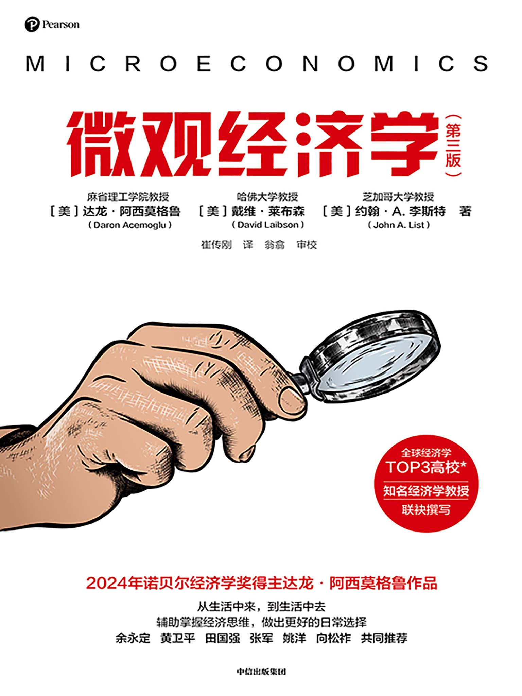

# agent skill

共 **5** 个 · 约 **130 万字** · **795** 张配图

最近更新 2026-10-26 22:03

每本书一个目录：**目录名/cover.xxx**（封面）、**目录名/目录名.md**（正文）、**目录名/images/**（配图）。

> GitHub 上直接点开 `.md` 就能读；想要原书就下 `.epub`。

---

## 书目

| 封面 | 名称 | 文件 | 规模 |
|:---:|---|---|---|
|  | <a href="查理-skill/"><b>穷查理宝典（珍藏版）（1+2册）</b></a> [美]查理·芒格 · 中信出版社 | [md](查理-skill/查理-skill.md) | 17.8 万字 42 图 2026-10-26 |
|  | <a href="都-skill/"><b>废都(海外未删节版)</b></a> 贾凹平 · epub掌上书苑 | [md](都-skill/都-skill.md) | 37.5 万字 1 图 2026-10-26 |
|  | <a href="牛可-skill/"><b>牛奶可乐经济学(完整版)</b></a> 罗伯特·弗兰克 · 中国人民大学出版社 | [md](牛可-skill/牛可-skill.md) | 12.5 万字 34 图 2026-10-23 |
|  | <a href="微观-skill/"><b>微观经济学（第三版）</b></a> 【美】达龙·阿西莫格鲁；戴维·莱布森；约翰·A.李斯特 | [md](微观-skill/微观-skill.md) | 53.5 万字 531 图 2026-10-26 |
|  | <a href="小岛-skill/"><b>小岛经济学</b></a> 彼得·希夫 · 中信出版社 | [md](小岛-skill/小岛-skill.md) | 8.7 万字 187 图 2026-10-23 |

---

> 本文件由 book2md v2026-10-23.6 自动维护，每次上传后自动重建
