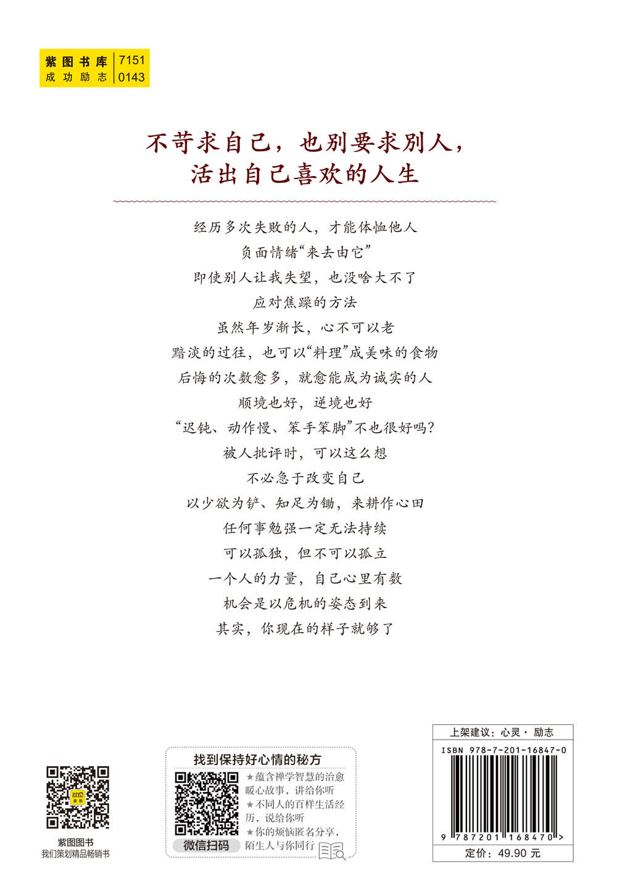

# 《别想太多啦》（日本畅销40万册的情绪疗愈指南！听日本超人气“傻和尚”讲讲生活禅，在复杂的世界里，做一个简单的人）

> 作者：[日]名取芳彦　·　语言：zh

---

目录

[第一章：练习钝感力](part0003.html#2RHM1-e772f94a921e44f3bfbc9114f4ddac1d)

[只要不作恶，你就是个好人](part0003.html#sigil_toc_id_1)

[人生是教给我“适度”的老师](part0003.html#sigil_toc_id_2)

[别人如何看自己是“对方的问题”](part0003.html#sigil_toc_id_3)

[不要在意“大家都这么说”](part0003.html#sigil_toc_id_4)

[不说坏话，不听恶语](part0003.html#sigil_toc_id_5)

[帮忙和善心，完成就好](part0003.html#sigil_toc_id_6)

[早发生摩擦是一件好事](part0003.html#sigil_toc_id_7)

[我常常被称为“傻瓜”](part0003.html#sigil_toc_id_8)

[即使失败了，又能怎样](part0003.html#sigil_toc_id_9)

[“自然体”的人，获得的结果最理想](part0003.html#sigil_toc_id_10)

[忍耐分为两种](part0003.html#sigil_toc_id_11)

[一句“原来如此”，就能让人轻松许多](part0003.html#sigil_toc_id_12)

[退一步，并不难](part0003.html#sigil_toc_id_13)

[对于别人的唠叨，说“谢谢你的好意”](part0003.html#sigil_toc_id_14)

[赋予何种意义在于自己](part0003.html#sigil_toc_id_15)

[不知道就坦言“不知道”](part0003.html#sigil_toc_id_16)

[世间之事未必按你的想法发展](part0003.html#sigil_toc_id_17)

[第二章：你想太多了](part0004.html#3Q281-e772f94a921e44f3bfbc9114f4ddac1d)

[人生没有胜负](part0004.html#sigil_toc_id_18)

[为什么想被赞美](part0004.html#sigil_toc_id_19)

[“请理解我”的愿望会缩小自己的气量](part0004.html#sigil_toc_id_20)

[幸福并非拥有什么，关键要认清幸福](part0004.html#sigil_toc_id_21)

[遭遇“背叛”并不稀奇](part0004.html#sigil_toc_id_22)

[与他人比较，若自己高兴会伤人，若悲伤会失去自我](part0004.html#sigil_toc_id_23)

[别人抢功劳，也不会影响你的价值](part0004.html#sigil_toc_id_24)

[想为别人做点什么是很伟大的](part0004.html#sigil_toc_id_25)

[世间大部分人既非敌人，亦非朋友](part0004.html#sigil_toc_id_26)

[“别人是别人，自己是自己”的思维陷阱](part0004.html#sigil_toc_id_27)

[试着从“不拥有”中获得乐趣](part0004.html#sigil_toc_id_28)

[有余力的时候，就去帮别人](part0004.html#sigil_toc_id_29)

[你忙的时候，大家也很忙](part0004.html#sigil_toc_id_30)

[做好事，不必让别人知道](part0004.html#sigil_toc_id_31)

[丢东西之前，先丢掉执念](part0004.html#sigil_toc_id_32)

[离别的时刻一定会到来](part0004.html#sigil_toc_id_33)

[你我都拥有无限的可能](part0004.html#sigil_toc_id_34)

[试着远离大道理](part0004.html#sigil_toc_id_35)

[不要戴着有色眼镜看人](part0004.html#sigil_toc_id_36)

[第三章：心情忧郁时这么想](part0005.html#4OIQ1-e772f94a921e44f3bfbc9114f4ddac1d)

[经历多次失败后，更能理解他人](part0005.html#sigil_toc_id_37)

[负面情绪任它来，任它去](part0005.html#sigil_toc_id_38)

[你可以让别人失望](part0005.html#sigil_toc_id_39)

[如何减少负能量](part0005.html#sigil_toc_id_40)

[身老，心不老](part0005.html#sigil_toc_id_41)

[成为料理人生的高手](part0005.html#sigil_toc_id_42)

[不要说心里没有的事](part0005.html#sigil_toc_id_43)

[顺境也好，逆境也好](part0005.html#sigil_toc_id_44)

[“迟钝、慢性子、笨拙”不行吗](part0005.html#sigil_toc_id_45)

[别人批评你时，可以这样想](part0005.html#sigil_toc_id_46)

[没有必要急于改变自己](part0005.html#sigil_toc_id_47)

[用小欲之锄和知足之锹耕种心田](part0005.html#sigil_toc_id_48)

[遇事绝不可为难自己](part0005.html#sigil_toc_id_49)

[孤独是好的，但不可以孤立](part0005.html#sigil_toc_id_50)

[要意识到一个人的力量有限](part0005.html#sigil_toc_id_51)

[机遇伴随危机而来](part0005.html#sigil_toc_id_52)

[现在的你就很好](part0005.html#sigil_toc_id_53)

[第四章：不比较、不苛责、不拖延](part0006.html#5N3C1-e772f94a921e44f3bfbc9114f4ddac1d)

[不是“你不如人”，而是还有改进的空间](part0006.html#sigil_toc_id_54)

[世间存在四种人](part0006.html#sigil_toc_id_55)

[麻烦是相互的](part0006.html#sigil_toc_id_56)

[执着于得失，反而损失更多](part0006.html#sigil_toc_id_57)

[被别人讨厌，你的感受如何](part0006.html#sigil_toc_id_58)

[在意别人的眼光前应该做的事](part0006.html#sigil_toc_id_59)

[每个人都习惯以自我为中心](part0006.html#sigil_toc_id_60)

[“无所事事”的日子才是最棒的](part0006.html#sigil_toc_id_61)

[你能为别人的成功喝彩吗](part0006.html#sigil_toc_id_62)

[找到生气的开关](part0006.html#sigil_toc_id_63)

[如果遇到令你羡慕的人](part0006.html#sigil_toc_id_64)

[不要想“这是我的东西”](part0006.html#sigil_toc_id_65)

[嫉妒是因为“现在的自己不幸福”](part0006.html#sigil_toc_id_66)

[争吵其实毫无意义](part0006.html#sigil_toc_id_67)

[不要自满和自夸](part0006.html#sigil_toc_id_68)

[人生顺利的秘诀不是金钱，而是人格](part0006.html#sigil_toc_id_69)

[第五章：让人生变简单的秘诀](part0007.html#6LJU1-e772f94a921e44f3bfbc9114f4ddac1d)

[与人交流依靠感觉，而非思考](part0007.html#sigil_toc_id_70)

[说话的基本是诚实](part0007.html#sigil_toc_id_71)

[表达意见时，注意表达的顺序](part0007.html#sigil_toc_id_72)

[夜晚，请安静地度过](part0007.html#sigil_toc_id_73)

[减少好恶感的秘诀](part0007.html#sigil_toc_id_74)

[用心生活，需要锻炼爱的能力](part0007.html#sigil_toc_id_75)

[了解“对金钱没有安全感”的本质](part0007.html#sigil_toc_id_76)

[面对信息，不要“暴饮暴食”](part0007.html#sigil_toc_id_77)

[帮不上大忙，小小的支援也很好](part0007.html#sigil_toc_id_78)

[遇到难相处的人，保持内心的距离](part0007.html#sigil_toc_id_79)

[电话、微信、社交网站只是沟通工具](part0007.html#sigil_toc_id_80)

[少说“可是、不过、然而”这些否定表达](part0007.html#sigil_toc_id_81)

[处理感情和表情的方式](part0007.html#sigil_toc_id_82)

[简朴的生活更轻松自在](part0007.html#sigil_toc_id_83)

[不要承诺自己做不到的事](part0007.html#sigil_toc_id_84)

[无须非要分出是非黑白](part0007.html#sigil_toc_id_85)

[换个说法，就能改变人际关系](part0007.html#sigil_toc_id_86)

[来自“失恋名人”的劝告](part0007.html#sigil_toc_id_87)

[第六章：好好活在此时、此地](part0008.html#7K4G1-e772f94a921e44f3bfbc9114f4ddac1d)

[现在的选择影响未来的生活](part0008.html#sigil_toc_id_88)

[没有一天是白白度过的](part0008.html#sigil_toc_id_89)

[闷闷不乐也不会改变结果](part0008.html#sigil_toc_id_90)

[轮到你上场的那天总会到来](part0008.html#sigil_toc_id_91)

[探寻乐趣与好东西](part0008.html#sigil_toc_id_92)

[成为一只“成熟”的变色龙](part0008.html#sigil_toc_id_93)

[赶流行不是坏事，只是……](part0008.html#sigil_toc_id_94)

[夫妻和睦的秘诀在于“共同经历”](part0008.html#sigil_toc_id_95)

[早点发现“上了年纪”的好处](part0008.html#sigil_toc_id_96)

[做自己认为对的事情](part0008.html#sigil_toc_id_97)

[人生的“预防医学”](part0008.html#sigil_toc_id_98)

[不管好事还是坏事，总有一天会结束](part0008.html#sigil_toc_id_99)

[每个人都是值得尊敬的“作品”](part0008.html#sigil_toc_id_100)

[如何面对与重要的人分别](part0008.html#sigil_toc_id_101)

[不要妄想将来](part0008.html#sigil_toc_id_102)

[中国古典中的“失败学”](part0008.html#sigil_toc_id_103)

[不在意并非“不关心”](part0008.html#sigil_toc_id_104)

---

当在意他人的看法，

就容易讨好别人，委屈自己，

请试着寻找自己想做的事，

并为之全力以赴，

因为这是属于你的人生。

---

## 序言：如何成为一个不在意的人

如果一个人心中装着烦恼，不可能说忘就忘。要劝慰一个在意某事的人放下，有点强人所难。

在意某事的感觉真实存在，即使心里想停止也无能为力。如果劝解他，得到的回答大多是：“也许每个人在意的程度不一样吧。”有的人还会认为，这是不知内情、事不关己的风凉话。

本书对我自己和身边人的亲身经历进行说明，希望大家不会再被“在意”束缚。

我们就像摄像师，对于人生发生的很多情况，只选取部分画面拍摄。

比如，运动会赛场上，我们选择拍摄的对象可能是赛跑前紧张的孩子，也可能是奋力奔跑的孩子，或是获得第一名脸上洋溢着快乐的孩子，或是屈居亚军心有不甘的孩子，或是那些热心喊加油的孩子。

无论哪种情况，不同的人会拍摄出不同的画面。

所以，有的人对于原本不必在意的画面按下了快门。有的人记录下可怜的自己，有的人拍下了自己的愤怒，有的人在委屈的时刻按下快门、愤恨不已，有的人怀念过去幸福的自己而感叹现在不幸的处境。

这样把不该在意的事情留在心底，就变成了烦恼。

人这一生，有些美好应该留在记忆深处，而有些事情应该忘掉。

也就是说，应该在意的事情就珍惜，不应该在意的事尽早放下。

哪些是应该放在心上的事呢？是那些提升自己也让他人安心的事，这样你才能向更好的方向发展。

如果有助于改善现状，就要用心对待。

最好放下的事，是即便在意也无法提升自己，甚至还会使自己陷入悲惨境地的事。

应该放下的事，是无论自己怎么做也无法改变的事。

我们往往没有好好对待应该关心或关注的事情，却常常对不应在意的事情倾注心力。

这都是因为选择了错误的拍摄镜头。

本书从不同的视角出发，重新看待那些让人伤心的镜头，告诉大家今后面对类似的状况，应该把焦点对准哪里。

希望本书让读者的心境变得开阔，心平气和地迎接每一天。

名取芳彦

---

## 第一章：练习钝感力

### 只要不作恶，你就是个好人

我们从小被教育要做个好人，我认为“无论何时，不管遇到何事，都要努力让自己的内心变得安宁”就可以。

努力让自己内心变得平静，不在意小事，在生活中具体该怎么做呢？

在生活中，存在一些人们普遍认可的道德约束法则，让人们尽量不去做糟糕的事，比如胡乱杀生、偷盗东西、不正当的男女关系、说谎、油腔滑调、粗言秽语、说人坏话、吝啬、动怒、观点错误。这些不是告诉我们为了内心安稳要去做什么，而是从反向出发，让人们知道不做什么比较好。

人生只要尽可能远离恶事就可以了。换句话说，“只要不作恶，你就是好人”。

从小被教育“做个好孩子”的人，有可能到了叛逆期反而变成坏孩子。

好孩子与坏孩子，这样的评价容易让人失去自我，无法平静地生活。

因此，我们要跳出好人、坏人这样二元对立的价值观，以追求内心平静为生活目标。这样一来，心情晴朗的日子会越来越多。

### 人生是教给我“适度”的老师

当你问“把这个东西放在哪里”，对方可能会说“只要放在合适的位置就可以”。

对此，千万不要解读为“放在哪里都没关系”，而是要明白对方是希望你“根据自己的判断，放在适当的地方”。因此，学会判断很重要。如果懂得这一点，别人就会认为你处事得当。

对于“您要出去吗，去哪里”，最合适的回答应该是“是啊，我出去一下”。有的人可能会生气，觉得“不是应该说明目的地吗”，其实完全没有必要动怒。因为对方并非想询问你去哪里，只是想看到你精神抖擞、心情愉悦，所以想要和你打招呼。我认为这是一种温暖的交流。不过，在公司里面这样回答可行不通。

日光东照宫的阳明门，所有的柱子都和树木生长的方向相同，只有一根柱子上下颠倒。对于这一特殊之处，导游解说道：“如果太整齐，妖怪就会进入，因此才这样做。”

从导游的解说中，我们感受到过于牢固的东西中，似乎隐含着某种危险性。

许多人或事物精准到丝毫不差，出一点差错可能就会引发全面“崩溃”。因此，某种程度的“适度”反而强大，也正因为这种强大，才能做到“适度”。

另外，我听说马戏团的小丑，在“适度”的把握方面堪称代表，能成为最富有开场经验的人。不掌握危险的技术，就不能成为真正的名角。

由此可见，适度有两种含义：一种是得过且过、马马虎虎，另一种是恰到好处。如果得过且过的人能够精进一步，就有可能获得周围人的赞许。相反，本身认真努力的人，也要学会适度松弛。

什么时候适度，什么时候适度不可取？

人生漫漫，它是教会我们如何“适度”的老师。

### 别人如何看自己是“对方的问题”

人与人交往时，总想知道对方的心情。如果有人问我“你对我怎么看”，我会微笑着告诉对方：“这样的事最好不要问，也是为了您自己。如果我说不喜欢你，您会做何感想？”

恋人之间或人气艺人姑且不谈，就算是普通朋友，有的人也会特别在意别人对自己的看法。我觉得原因就在想听别人说自己好，不想让人觉得自己不好。

没有人想被别人讨厌。然而，别人怎么看待你是别人的事，我们无法控制别人的心。

为了控制别人对自己的看法，就容易过度讨好，委屈自己，甚至以可爱幽默的姿态赢取别人的欢心。结果只会令自己身心俱疲。

在上中学之前，我就是这样。当时，除了学习外没有特别感兴趣的事，唯一认为有意义的，就是成为一个别人眼里的好人，一个有趣的人。

长大后，当我找到有意义的生活方式后，就不再努力避免被别人讨厌，也不再努力讨人喜欢。因为比起别人的评价，我更在意自己对所做的事情是否满意。

现在，我几乎不怎么在意别人对我的看法。当然，我也能察觉到别人对我的看法，但内心不会受到影响。因此，我不必猜测那个人喜欢还是讨厌我。

不讨厌就是喜欢，不喜欢就是讨厌，必须在喜欢和讨厌中择一的二元式思维方式，会使人生观变得僵化。

极度在意别人看法的人，请试着寻找自己想做的事情，并为之努力吧。

### 不要在意“大家都这么说”

我以前很在意别人的评价。得到夸奖时兴高采烈，受到批评时垂头丧气。我还告诉家人朋友：“哪怕说谎，也请表扬我。”有句格言说：“被夸奖的猪能上树，被夸奖的和尚会跳舞。”

我有个朋友自称“情报通”，四处打电话，发短信，谈论各种各样的话题，搜集各种信息。他对这些信息不进行分析，就大肆宣传“这些信息只有我知道”，并传达给别人。

他人本身不坏，只是有时令人感觉困扰。他有一句口头禅是“大家都这么说”。

当他夸奖我“大家都说您最近的演讲非常精彩”，我听后心情雀跃。但是，当他批评我“上个月的博客内容有点过激”时，我便坐立不安，慌忙修改或删除文字内容。

一想到“流言蜚语”，我渐渐慎重起来。有一天，我略带担心地问另一个朋友，对方回答说：“什么，有那种说法吗？据我所知，谁也没说过那种话。”后来，我意识到“情报通”所说的“大家”，并不代表全部的人。

于是有一天，我对这个朋友所说的“大家都称赞我”进行了反驳：“您说的‘大家’，具体是谁呢？”当他回答说“××和××说的”后，我继续问：“就这两个人吗？两个人这么说，并不代表大家都这样认为呀。”总之，我之前就是被这样的话“愚弄”了。顺便说一句，“大家都这么说”中的“大家”，往往只有两三个人。

无论是“大家都说”还是“一个人说”，应该听的事我会认真听；对于“大家都这么说”，我则不那么在意了。

因此，我平静度过的日子越来越多。

“大家都这么说”，实际上是想让大家在意自己。即使他不是“情报通”，也要装作“大家”的代言人，其实只有他说过。没有必要回避责任，也没有必要用全体来声援自己的主张。

### 不说坏话，不听恶语

在日剧中，有句台词很流行：“你是要在这里种松杉的人。”

想让松枝变得好看，想让杉树长成可用的木材，需要数十年。

松杉不像蒲公英随风飘动，落到哪里就在哪里发芽。“种松杉的人”常用来比喻一生都在同一地方、处于某种境遇的人。

剧中说这句话的人，是想告诉尚未在这片土地居住过的人：因为你要在这里种松杉，所以你不能说这片土地上的人的坏话。如果说了，别人可能会讨厌你。这是一种巧妙的劝言。

如果说生活在同一个环境中的人的坏话，自己的处境也会变得艰难。住在同一栋公寓、同一个小区，或是同一家公司的同事，社交网站的朋友，都相当于在同一个环境种植松杉的人。因此，只要身处同一个共同体中，就应该意识到自己是种松杉的人。

否则，我们的处境会变得糟糕。说别人的坏话短时间内可以泄一时之愤，但事后心情可能无法平静。

在A面前说B坏话，在B面前又说A不好。这样，我们可能会被孤立，让自己没有容身之地，就像蒙克的画作《呐喊》一样。别人说了你坏话，也不必在意，但我们要注意不要说别人的坏话，这样就能轻松地生活下去。

此外，要学会不听坏话。开头所说的“因为你是要在这里种松杉的人，所以你不能说这片土地上人的坏话”，其实也在提示别人不要听坏话。如果有人向你说别人的坏话，你不妨这么说：“请等一下，我是要在这里种松杉的人。等我离开后，您再说。”

说完这句话，他会说你坏话吗？对于那种说坏话的人，我们不必在意。

### 帮忙和善心，完成就好

一个人让自己幸福的美德，分别为不求回报地帮助他人、对人使用温暖的爱语、为大众的利益去行动做事、站在他人的立场上考虑问题。

其中，帮助他人是幸福的要素。

不管是帮助者还是被帮助者，最好不要刻意为之。也就是说，帮助者不要想着帮助是给予，被帮助者也不要觉得帮助是获取。甚至帮助什么、被帮助什么，都不要在意。这一点，其实很难做到。

无意识帮助就是帮助时无意识，帮助后想不起来。如果想太多，那就不是帮助。

帮助别人或者对别人好，也存在令人困扰的地方。比如，别人帮了你或者你得到别人的关心，过了一段时间你听到那人说“我帮了他，他却说……”，你听到后内心应该难以平静吧。

反过来你帮了别人也一样。过了一段时间，你说出“我帮了他，然后他却……”这样的话，其实是期待对方感谢你的帮助。

帮忙和好心，原本是一种不求回报的行为。

因此，“一直做下去”“一直做下去”就可以了。这样就心满意足了，是高尚的行为。能够帮助别人，善待别人，是生而为人非常了不起的事情。为了提升这种内心的美好，让我们帮助完就忘记吧。

### 早发生摩擦是一件好事

每个人都有自己做事的方式、方法和原则。

有的人衣橱最上面的抽屉放什么，第二层放什么都有规划。晚饭时先喝啤酒，也有人把它当作自己的原则。

我在写收信人姓名的时候，首先在中间写上“某某先生（女士）”，确定好平衡位置再写上住址。然而在年轻的时候，我很多次将住址、姓名全部写在右侧，就像被海浪拍打的羊栖菜一般难看。

自己所遵循的方式，是现在依然得心应手且可靠的。至少到现在为止，还没有出现过什么问题，因此比较放心。有时甚至觉得这种方式是最好的，认为它具有普遍性。其实，自己的方式并非放之四海而皆准，由于生长环境、经验不同，采取的方式、规则也不同。

普通企业的员工与公务员的做事方式当然不同；经验丰富的上司与新手，做同一件事也会采取不同的方式。有的人的座右铭是“今日之事不要放到明天做”；而有的人厌倦忙碌的生活，像我就信奉“今天不去做明天的事”。

婆媳争吵、夫妻吵架，都是因为生活方式不同引起的。自己的方式使用时非常顺利，一旦强加给做事方式不同的人，就容易产生摩擦。

因此，早发生摩擦是好事，没必要因担心引起矛盾而一直忍耐。从一开始就各自主张自己的方式，日后为了事情顺利地进行下去，慢慢磨合就好。

你是这么想的，我是那样想的，那我们一起思考一下在哪方面可以相互妥协。如果我觉得你的方式好，就按照你的方式去做。这就是舒心生活的关键。

在一个镇上，如果所有人都将自己的方式强加给别人，我肯定不想住在那里。为了不成为那样的人，我们试着用笑容寻找各自都能接受的处事方式吧。

### 我常常被称为“傻瓜”

一次酒过三巡后，我日常的丑态原形毕露，同样酩酊大醉的一位大叔说：“原来，你竟然是个傻瓜”。

周围的人都目瞪口呆，因为他们觉得他在公众面前对我说这样的话太为失礼。我反而告诉那位大叔“谢谢您夸奖我”。大叔接着说“您说什么啊，这可不是赞美”。我坦言“不，我就是一个傻瓜”。“是嘛……”，对方满脸不解，我继续说：“我这傻瓜‘傻’，是永不气馁、坚持到底”。说完，我哈哈大笑。“原来如此，这才是傻瓜的精髓呀”大叔笑着说，周围的人也不禁大笑起来。

不仅仅是“傻瓜”，我还被一些同行称为“笨蛋”，因为我经常无偿参与各种社会活动，甚至连留给自己的时间都没有。

有的人觉得“傻”并不好，但对我来说却是褒义词。在关西地区，“傻”甚至被认为是“白痴”。

当你被别人认为是傻瓜时，你大可微笑地说“傻瓜也很好，不是傻瓜还做不到呢”。认为自己是在做一般人做不到的事，这样就足够了。

我比较喜欢那些经历了很多次失败，依然笑着说自己是像傻瓜一样的人。

这里的“像”，实际上从心底不认为自己是傻瓜，也不认为自己失败。

但是，既然失败了，就大大方方承认自己的不足。那种失败的时候敢于说出“我努力做完了，只是结果有点糟糕”的人，倒是让人觉得很爽快。

如果你在意别人说“你是傻瓜吗”，你不妨回应对方：“是啊，我是傻瓜。很多事情，不是傻瓜还办不到呢”。

### 即使失败了，又能怎样

我写这节是为了再次确认人生美好的事情。

出生，无论怎样看待都是积极向前的画面。在诞生过程中，我们被向前的力量推动着，经产道呱呱坠地。出生之后的所见所闻所嗅所触所尝，一切都是人生第一次的体验。所以，对任何事情都感兴趣，充满好奇。

从嗜睡状态到牙牙学语，从蹒跚学步到独自走路。每个动作的重复，都包含着跌倒再爬起来的勇气。进入幼儿园和小学，第一次挑战集体生活。可以说，成长过程中我们一直不断面临新的挑战。

我们学习未知的领域，查阅、储备新知识。这些丰富的知识，总有一天会派上用场。

交了朋友后，我们不仅从朋友那里获得帮助，自己也会帮助他们。朋友能让快乐倍增，痛苦减半。

从孩提时代起，我们就怀着关于工作、家庭、财产等的梦想。梦想指引着我们前行，未来无人能预知，就像草原一样广阔无垠。

从出生起，每年都会增岁，今年看到的景色，也是这一岁第一次看到。昨天的自己和今天的自己，当然也不同。昨天的经历和得到的信息，是前天的自己尚未接触的。所以，我们的心也在不断变化。崭新的自己，每天都在更新。

有读者会问：“你能将积极的状态保持到什么时候？”我总是让心保持一种积极向上的状态，这样更容易处理将要面对的问题。即使这样，我也会在意一些小事，令心情变得糟糕。

但是，只要明白上述道理，就能重新享受人生的美好。即使失败，我们仍然可以从头再来。

只要保持好奇心与挑战精神，储备知识、朋友、梦想，永远保持第一次的心情，展现在眼前的人生就会像绿色的草原一样广阔而新鲜。

### “自然体”的人，获得的结果最理想

“自然体”是柔道用语，是最适合攻击和防御的姿势。这个词用于一般情况，表示不抱有任何设想，没有先入为主观念的境界。精神方面的自然体，也适用于应对生活中的攻击和防御。

工作、恋爱中人生最好的状态，就是不刻意、不用力、不抱先入为主观念的自然状态。该来的自然会来，不必过分在意，过于用力反而会让人筋疲力尽。

结果还没到来，就放松心情。如果想达成某个目标，出现意料之外的事情，就会惊慌失措。当自己的设想与现实有差距时，就难以应对。

以工作为例，你认为自己接下来会被安排某项任务，结果却是安排别人去做。当你像个泄了气的皮球，上司可能会安排给你新的工作。为约会精心准备，却被临时放了鸽子。经历几次后，也有可能被其他人表白。

遵循“自然体”的人往往能够随机应变，而结果往往是最好的。那么，怎样才能做到“自然体”呢？我觉得消除刻意和用力最佳的方法是，在明亮的房间中，让自己平心静气地度过一段时间。急躁的内心渐渐舒缓，就接近“自然体”的状态了。这样不仅能放松精神，也能治愈心灵。

另外，即便做好了准备，事情也不一定按照我们设想的发展，一切都在变化之中。如果出现一些意外变化，之前的预想也无法解决问题。所以，不妨从一开始就抱着准备好也无济于事的心理准备。

先入为主的观念也是一样。自己的想法只是看到现实的一个侧面，所以内心难以平静。面对问题，不同的人有不同的反应。“在池塘边的旅馆里拍手，鸟儿以为是狩猎者而惊逃，鲤鱼以为被投食而聚集，女佣以为客人要喝茶。”在日常生活中，不妨打开内心的天线，自然地迎接、应对各种变化。

无论发生任何事情，都能妥善应对的就是自然体的人。什么事情都应对不了，往往是我行我素的人。大家觉得呢？

### 忍耐分为两种

你的房间或者办公室是否有鲜花装饰？不管是盆栽还是插花，只要有花存在，人就心情愉悦。

在印度，为了招待客人，人们将花放在篮子里，把花篮挂在柱子或墙上。

花令人赏心悦目。人欣赏花的美丽，在目之可及的地方用花装饰，用于待客。

最初人们只是觉得花漂亮，将其用于装饰，后来花被赋予各种意义。比如，漂亮的花使人心情愉悦；看到花，人的怒气会消散，待人温和。有的花不畏寒暑竞相开放，我们也向花学会了忍耐。有时，我会向别人分享花在自我忍耐方面的特性。

忍耐分为两种：一种是想做的事但是忍耐不去做，另一种情况是不想做的事但不得不做。

在儿童时期就被要求忍耐的人，在成长的过程中会认为忍耐是扼杀自己自由的压力。

对这些人来说，他们觉得“不必忍耐”这类自我启发的话正合他们心意。然而，世间的事并非那么简单。

忍耐还有一个重要方面，就是没有目标就无法忍耐。反之，如果有目标，就能毫不在意地忍耐下来。

如果孩子们明白“为了实现目标，有些事不能忍耐，有些事必须忍耐”，他们就不会感到忍耐带来的压力，从而更好地提升自己。

因自我强迫而感到巨大压力的人，希望你们能学会从容地忍耐。

### 一句“原来如此”，就能让人轻松许多

经常有人向我倾诉烦恼，所以听别人说话对我来说至关重要。很多人说：“能与人说说心里话，心情就会轻松不少。”

这是因为把藏在心里的困扰与大家分享，会产生一种安心感。

其实，我并不擅长认真倾听（可能是因为我喜欢说教）。有位年长的阿姨说：“我儿媳的弟弟是个银行职员……”她的话让我感觉莫名其妙，因为她说这话的前提是认为我知道。我明明是第一次听说，她为什么觉得我就知道呢？如果对话这么突兀，听话一方想说或想听的意愿就会大打折扣。

我常常需要听别人倾诉。无论如何，我都愿意了解对方真正想表达什么。

如果是闲聊的话，可以开开玩笑，享受谈话的乐趣。

如果是商议，就要详细了解情况，不懂的地方及时询问，从谈话中知道对方想要表达什么。

如果是发牢骚，那我就做一个真诚的倾听者。一个人满腹牢骚地说别人的坏话，只听片面之词难以判断对错，所以听者最好不要发表过多的看法。

假如A、B、C三人是朋友，B与A争吵之后向C抱怨，而C与B无意中说了A的坏话，那就容易产生不必要的麻烦。当A和B和好后，B可能会告诉A“C说你这个人不好”，这是常有的事。这样的话，C将会陷入尴尬的处境。

发牢骚的人，往往也承认自己并非想寻找解决方案。因此，听完对方的抱怨，最后说一句“原来如此”就可以了，对方也会感觉豁然开朗。

当我想发牢骚的时候，我就会拜托对方：“我现在要发牢骚了，您听到最后只要说一句‘原来如此，我理解你的心情’就可以了。”

### 退一步，并不难

我们第一次得知有人和自己的想法并不一致，应该是在孩提时代。有句话可以充分体现这一点：“做父亲的，想说的话会说清楚；做母亲的，想说的话不会直接说出口。做长子的，不喜欢就说不喜欢；做次子的，不喜欢也会忍耐着不说。”

在家庭中，每个人有各自的价值观。放眼世界，价值观更是多种多样。有的价值观自己认同，有的价值观自己不认同；有的价值观根本没听过，有的价值观甚至令人不齿。虽然我们知道每个人都不同，但做不到每次都游刃有余地应对不同的价值观。

比较难应对的是，与自己的价值观相反的，这往往会扰乱我们内心的平静。自己坚信的价值观，说它等同于信仰也不为过。

我觉得保持一颗平常心最为重要。可能有的人觉得人生短暂，顺其自然地过日子这种想法并不可取，人生分出胜负才有意思。还有的人只追求快乐，得过且过。

拿炒股来说，有的人认为“炒股的人内心无法安稳”，有的人认为“股票就是低买高售，想想都有意思”，也有的人妄想着“通过股票赚钱的人，分点钱给我吧”。如果讨论起来，那将没有尽头。

明白这个道理后，我愿意在表明自己的价值观前，先试图理解别人。比如，我会说：“啊，原来还有这样的想法。”以表示理解对方。比起强调自己的价值观，我更注重内心的平静。

然而，人们容易将“理解”视为“同意”。有的人会说“如果你理解我的话，为什么你不按我说的去做”，因而生气。

实际上，“理解”与“同意”并不是一回事。我认为“理解”就是告诉对方“啊，原来有这样的想法”。以这样的态度，面对日常生活中出现的不同价值观，或许就能轻松应对。

### 对于别人的唠叨，说“谢谢你的好意”

在听相声专场或演讲时，观众云集，这时如果旁边的人与你搭话，不管说什么，你都会觉得“唠叨”。比如，相声演员登场时，旁边的人低声说：“那个演员在昨天的综艺节目中出现过。”或者说：“那个女演员和某个演员正在交往。”就这样，你错过了重要的台词。听到演讲的话题，忍不住告诉旁边的人：“这次的话题，我们家亲戚也说过。”或者：“这个话题，广播里也播放过。”导致别人无法认真听演讲的内容。

这样的人可能会在背包里放润喉糖，喜欢分给大家。到了饭店，他可能会说：“这个很好吃，你尝尝。”并将自己的食物硬分给你。有的人还会说：“我知道这道菜的食谱，以后我教你。”

与这样的人接触，比较麻烦的是他总是有一种吹嘘自己的倾向，希望博取他人的好感。问题的关键就在于如何把自己的热情适度地传达给别人。

曾经有人告诉我：“别人说你坏话，我都替你解释清楚了。”我听后大吃一惊。然后连忙摆手，笑着说：“哈哈哈，我可没拜托你这么做呀。”

对于喜欢开玩笑的我来说，这句话是我的口头禅。如果我是个较真的人，就会明确告知对方不要那么做，对方可能会告诉其他人：“我好不容易帮他处理了矛盾，谁知他还不领情。”庆幸的是，周围人都知道我和他的个性。

对于喜欢干涉别人事情的人，我觉得先要感谢对方的热情，这是成熟大人的应对方式。

通常我会这样告诉对方：“感谢您的热心，我真是不敢当。”

管闲事虽然多此一举，其实也是一种慈悲。然而，控制自己多管闲事是一种智慧。

### 赋予何种意义在于自己

我们所处的世界是一中有多，多中有一。人是世界的一部分，心脏有力地搏动，肝脏分解酒精，肺吸收空气中的氧气，血液将营养输送到全身不同的组织，大脑储蓄着数以亿计的人类几万年来积累的知识，这就是一中有多的例子。

大量的人汇集起来组成一个社会，无数的星星组成银河，无数银河组成宇宙，这就是多中有一的证明。

这种规律并非空穴来风，而是广泛存在的真理。如果以这样的思维方式看待问题，就不会对小事过于在意。

在日常生活中，我们可以借助很多事物开阔心境。比如，使用牙签清理牙齿时，想象就像清理内心一样，消除诸多烦恼；看见大河奔涌，仿佛烦恼就随着消逝；看到茂密的叶子，就想到树荫的伟大，为人们遮蔽阳光；看到笔直的大路，就想像这条路一样守住正直，不谄媚，不欺诈，遵从自己的内心。

我们总是试图从各种事情中找寻意义。比如，自己的这份工作有什么意义，困难对我们有什么意义，我们的人生有什么意义……其实，它们的意义来源于我们自身。想给什么东西赋予什么意义，全在你自己。

### 不知道就坦言“不知道”

“高人一等”是指身份较低的人，在说话语气上对同一身份，甚至身份比自己高的人，表现出高高在上的状态。这个词引起了我的注意，因为我交流的对象大多比我年长。

2013年，一个年轻人说：“上司说话时总是高人一等，真令人讨厌。”在这当时曾引发热议。为了避免引起不必要的纷争，甚至还发行了上司专用手册。如果说高高在上是由于说话者位置导致的，那么我经常是“高人一等”地说教。

位居高位、年长者说的话，来自更高的视角，他们拥有丰富的人生经验，所以他们的话值得一听。

在意“高高在上”的说话方式，根源是其有“自卑感”，担心自己被别人看不起。

我对“高人一等”并不在意。长者的话我自然静心聆听。如果年少者“高高在上”地问我：“这个你知道吗？”我不知道的话，也会如实回答。

如果对方说：“什么，你不知道？”我会回答：“没有人规定人什么都应该知道。”如果他不肯罢休，继续说：“那个很有名呀。”我会笑着回道：“我不知道，肯定不太有名吧。”

如果对“高人一等”内心反应过度，我觉得正是挖掘内心的机会。

### 世间之事未必按你的想法发展

昭和五十四年（1970年），日本进行人口普查，公布本国人口超过一亿。此后，不断诞生“一亿总××”等代表整个日本人的词语。

“一亿总评论家”就是其中一个。每个人都觉得自己的评论是正论。电子版词典《大辞林》对“评论”的解释是：“对事物的善恶、价值进行评判，也表示评判文章。”因此，关于“评论家”有两种解释；一是“以评论为职业的人”；二是“自己不动手，仅仅通过发表意见或批评来取笑别人的话”。

有趣的是，《恶魔词典》（西川正身编，岩波文库出版）对“批评家”的解释更为直接：“没有一个人能取悦自己，然后自负地认为自己是个难以取悦的人”。

我经常遇到大肆宣扬自己主张的人。因为《大辞林》和《恶魔词典》中的解释，已经让我们知道，他的主张并不一定正确。

世间之事并非只按某种规律发展。政治、经济和人心，都有一种不按规律发展的复杂性、模糊性和脆弱性。

费尽口舌地宣扬自己的观点，就像管弦乐的指挥在没有演奏者的舞台，拼命指挥的样子。

当然，不管这个人多么不可靠，他的话语和性格是两码事。如果是正确的主张，也值得认真倾听其中的内容。如果认为不靠谱，不妨以此为鉴，作为反面教材来学习。

面对复杂、模糊、脆弱的现实问题，在撰写本书时，我尽量不以评论家的姿态，不掺杂个人的主观因素。我深知从专家的立场来看，我写的东西并非专业的理论。但是，我不会对自己做不了或者不想做的事，信口开河乱下结论。

---

## 第二章：你想太多了

### 人生没有胜负

每天从早晨开始，我们一天的生活就像孩子们玩的猜拳游戏。

这个游戏分为两组，每组由两端出发，途中相遇后进行猜拳，失败者给对方让路。失败的一组，为了不让对方到达自己的起点，即对方的终点，就会派出第二名选手出发，再次与对方相遇并继续猜拳。双方相遇时喊出“石头、剪刀、布”，游戏因而得名。

无论和谁在一起生活，早餐吃什么都面临“猜拳”。有的人想吃米饭，有的人想吃面包，为了避免纷争，甚至有人会准备两种早餐。

选择电视频道也一样，有人为避免不必要的冲突，干脆多买几台电视。只要有两个以上的人，就会产生不同的想法，因此“猜拳”游戏无处不在。

在粘贴邮票的时候，每个人粘贴的方法也不同。这些都说明人与人之间有不同的想法和做法。有的人看到别人的贴法与自己不同，便不满地说：“为什么贴邮票也要花那么长时间呢？”

插队的人是想让自己处于优先位置。相反，对于准备插队的车子，有人会站在车前不让其通过，他们通常也是为了方便自己。总之，他们都是在“猜拳”游戏中不愿意认输的人。

然而，人生并非一场胜负游戏。当双方相撞前，不妨主动给对方让路。当自己的想法与别人的想法发生冲突时，如果将自己的意志强加给别人，结果往往并不能如你所愿。

胜者往往得意，败者心有不甘。但是，如果自己主动让路，多考虑对方的情况，自己的心情也会轻松。

最近你有没有说过或者听到别人对你说“您先请”之类的话？主动对别人说“您先请”，对方可能就会对下一个人说“您先请”，这样社会上懂得谦让的人会越来越多。那么，我们不妨先试着说“您先请”吧。

### 为什么想被赞美

人有四大愿望：想被爱，想被认同，想发挥作用，想被赞美。这四个愿望都是希望别人给予自己的评价。人无法离开社会独立生存，因此这样的想法也能理解。

“想被爱”，是希望自己被关注，孩子希望从父母那里得到的就是这个。如果有人对你说：“没有你也可以，可是偏偏……”这样的话谁听了都难以接受。

因此，我们都试图引起他人的关注。日常生活中打招呼、问候的原因就在于此。接受问候的人，在瞬间感受到被关注，“想被爱”的感觉油然而生。

“想被认同”，是希望别人承认自己的价值。对于身处痛苦的人说一句“你真不容易”，就能引起对方共鸣。抑郁的人有时觉得幸福抛弃了自己，当你告诉他“幸福一定会来到”，就能点燃他已沉入心底的“想变得幸福”的心情。

“想发挥作用”，是希望对社会或他人有所帮助。比起仅仅为了渺小的自己而活，对别人有所帮助可以提升自我的价值。原本宅在家里的人，通过参加志愿服务活动，重新回归社会，这就是助人所产生的力量。

“想被赞美”，其实不太容易实现。因此它在“想被爱、想被认同、想发挥作用”外，还期待获得他人的好评。换言之，“想被赞美”是“想被爱、想被认同、想发挥作用”之外的奢望。

要想被赞美，就要做值得被赞美的事情。这样一来，就有可能讨好、奉承他人，甚至撒谎。如果只是想引起别人的关注，那有很多方法。但是，要想别人赞美自己，不仅是勉强自己，也容易招人厌烦。

因此，适当放下“想被赞美”的心理欲望，这样才能活得更自在。

### “请理解我”的愿望会缩小自己的气量

对意识不到自己内心想做什么、为什么那样做的人，很难理解别人的想法，产生同理心。

关于这点，我大学的心理学老师曾说：“要想了解人心，应该大量阅读小说，而不是上心理学课。小说中对人物的心理描写细致入微，比心理学更有助于理解人心。”时至今日，我仍然非常认同这句话。

经常听到青春期的孩子抱怨：“为什么父母不理解我？”而面对青春期叛逆的孩子，父母也不知如何应对。

有多少孩子能体察父母的心情呢？很多人在成长过程中从未养成体察对方的习惯。因此，他们长大后也只考虑自己的想法，对其他人的所思所想毫不在意，只是将自己的想法强加给对方。

我非常喜欢下面这句话：“为什么有人喜欢说自己是神经质呢？”句中的“为什么”问得好，其意不是否定神经大条的人，而是与他们交流感到温暖、豁达的心情。如果是病态的神经质，周围的人要尽量给予理解。而说自己是神经质的人，是希望对方多一点耐心，言外之意是理直气壮地要求对方接受自己，所以这样的人有时会引起对方反感。

希望别人理解自己，是人之常情。即使整个世界与你为敌，只要有一个人理解自己，就像得到数万援军，心理也会变得强大。但是，拼命想寻求理解、认可，反而会让你的心量变小。

与其如此，不如尝试成为别人精神上的强大支柱，反而可以让自己心量增大，内心安宁。

想让别人喜欢自己的捷径，就是先去喜欢别人。

同样，想让别人理解自己，最好的办法就是好好地理解别人。想成为一个理解他人的人，要不先试着读一些小说？

### 幸福并非拥有什么，关键要认清幸福

人生原本就是复杂的。昨天还欢乐无比，今天就悲从中来；早上令你开心的事情，到了下午却变成令你后悔的事情；去年快乐的事今年却让自己哭了。诸如此类，不胜枚举。这边碰壁，那边摔倒……人生，就是这样循环往复。

人生就是由各种烦恼组成的。得意忘形时容易对周围情况视而不见，低落时就会想“反正……”而排斥身边的信息。看到别人顺风顺水、忙忙碌碌，心里发生某些转变，开始忌恨别人，讨厌自己，让自己越来越偏激，心生怨毒。嫉妒、攻击别人而忘记自己，成为吝啬的人，甚至诓骗、奉承别人，自大自满，最后成为自己讨厌的人。

这些状况都是因为不能认清自己的状况。但在别人看来，你做了什么，是什么状态，一目了然，这就是旁观者清。举例来说，比起下棋的双方，旁观者更能观察全局。如果棋手下错一步棋，就会听到旁观者发出轻微的叹息声。

这种情况同样发生在我们的人生中。在旁人看来是幸福的，自己未必能意识到；当你听到别人感叹：“不管怎么说，你真幸福。”可能会感到意外。

当听到别人这么说，你可能发现自己真的处于幸福之中，这得益于别人的不同视角。

还有一种情况，当别人告诉你时，你十分生气地说：“你什么都不懂，不要随意说。”然而，生气也不能让自己得到幸福，不如向对方说句：“谢谢！”

无论是别人眼中的幸福，还是亲身体验到的幸福，幸福与否都由你自己决定。

只要知道自己是为了什么，在做什么，有哪些问题，就能跳出烦恼的状态，这样就可以了。

### 遭遇“背叛”并不稀奇

有人坚定地认为，自己信赖的人绝不会背叛自己。

也许是期待一个完全值得信赖的人，即使自己做错了，仍然希望他不会背叛自己。永远值得信赖的人，只存在于不切实际的幻想中。

我们有负父母的期待和信赖，或是不能很好地完成工作，这些都是人生中诸多“背叛”的表现。另外，无法完成自己想做的事，也是对自己的背叛。有负他人的期待而感到万分抱歉，而被他人背叛更令人痛苦。

不管是出于本意或故意，还是在不知情的状况下背叛了他人，我觉得背叛都是理所当然的事情。这种“理所当然”，是心平气和生活下去、让内心安宁的关键。如果我们觉得理所当然，就不会因此受到伤害，也不会感到失落。

夫妻就像用红绳联结起来的关系，经常有人用线形容人与人之间的关系，我认为很贴切。

各种关系就像由细细的绳线连接起来，可能磨损，或者断开，所以需要用心对待。

要想这根线更粗壮结实不易断裂，需要经常不断加线。如果什么都不做，经年累日肯定会断掉。

要想夫妻之间的关系更牢固，孩子是一种新的缘分。即使没有孩子，同一时间、同一空间的共同体验，比如共同旅行等，也是夫妻关系的增强剂。但是，如果用剪刀剪，线当然会被剪断，这就是背叛。

这种情况不局限于夫妻之间。亲子、朋友之间，以及灵魂伴侣之间也是如此。

我们尽可能不要背叛别人，同时要做好由于某种原因，遭遇别人背叛的心理准备，这样我们的内心会更强大。

### 与他人比较，若自己高兴会伤人，若悲伤会失去自我

不要与他人比较，因为比较使内心产生的变化，对于内心的平静没有帮助。

话虽如此，我与他人交流前，也会事先了解对方。特别是了解对方有哪些优点，以便充分把握双方的交流情况，虽然不会用秤衡量对方，但也会评估。现在想来，这样的性格实在有些令人讨厌。

当对方比听闻中的更厉害时，便会心生佩服；但是如果相反，就容易不把对方放在眼里。这样的事一年曾发生过两三次，所以我是有待改进的“傻和尚”。

有很多与我相似的人，他们把自己和别人放在天平的两端，如果自己重就心安理得，藐视对方；如果对方重，便会讨好对方。现在，我会将对方视为教材或者镜子，告诫自己不要成为爱比较的人。

有句名言说：“比较之后自己高兴会伤人，悲伤会失去自我。”如果春风得意的人与你比较，你的内心当然不会平静，甚至觉得别人是嘲笑你而感到愤怒，这就是伤人。此外，和人比较感到悲伤，那悲伤不是真正的悲伤，而是因为失去了自我。

同别人相比，我不仅不会伤心，甚至还有些得意。比如，我会想“与某人那么做相比，自己的言行还算可以”。然而，这种想法既容易伤害对方，也会让自己骄傲自满，反过来是不利己的。

因此，我建议去掉比较的对象“某人”进行思考。不以“人”为比较对象，而是以“行为”为准则来警醒自己。因此，不要想着“和那个人相比”，而要想着“只要不做那些事，我还算可以”。这样一来，就会减少对别人的伤害，傲慢也会慢慢消失。

我们周围有很多反面教材，教我们让内心变得平静。我们不应该轻视别人，而是不去做别人有过的不恰当行为，并以此为鉴活出自己。这就是“以人为鉴，让自己变得焕然一新”。

### 别人抢功劳，也不会影响你的价值

自我评价高的人，一般不太在意别人的看法。当然，他们不会公然宣称我不在乎别人怎么看。这些人容易被说成以自我为中心或自恋，但本人依然心平气和，视这些言论为无稽之谈。

敢于说“我很好”，是人生获得平静的重要条件之一。

自我肯定感是最重要的，至于工作或人际关系中的评价都是次要的。

我们生活的这个世界，是不以自己的意志为转移的，生命的运转是不受自己小小心灵支配的。

除了构成我们身体的肉、骨骼、内脏，就连头发、指甲，都不是自己努力创造的结果，而是天地自然的馈赠。

所以，你的存在本身就非常了不起。如果缺乏对自身的肯定，再高的自我评价也会让人心虚。观察身边土里的虫子或小草，没有一个生命的存在是不合理的。我们也一样，因为人是被大自然认可的“生而有益的生命”。

以大自然对自己存在的肯定为基础，然后在世界中寻找第二、第三种肯定。

在生活中，经常有人因别人抢了自己的功劳而气愤。我没有抢别人功劳，也没有被别人抢过功劳（或许我从未注意到）。不过，即使别人抢了我的功劳，我也不会伤心懊恼。如果自己做出了成果，我就很满足了。此外，如果将这些作为人类的成果公之于众，对其他人有所帮助，或者对于创造其他成果有帮助，我觉得就可以了。

如果别人抢了你的功劳，其实并不会影响你的价值。你的价值不会因外在而改变，因为你生而就已经获得了巨大的肯定。

### 想为别人做点什么是很伟大的

有个70多岁的老太太，她告诉我：“儿媳妇每年去海外旅行好几次，这期间家里所有衣物都由我来洗。她非常感谢我让她安心地旅行。我边晒衣服边想，与其认为是她让我洗衣服，不如看成是在给自己洗衣服，这样一想心情也变得很轻松。”

老太太口中“给自己洗衣服”是谦虚的说法，但回想起来却有微妙的况味。认为“为别人做什么”或者“奉献了什么”的想法，其实是内心傲慢的表现。

“为别人做什么”是主动帮助别人，但在某种程度上也带有傲慢的心理。因此，最好尽可能说：“我为自己做什么。”

也就是说，我选择“我为自己做什么”的积极主动的心态，而不是“为别人做什么”的自怜心态。实际上，在很多志愿活动中，往往由于存在“为别人做什么”的想法，帮助者与被帮助者之间产生了摩擦。

有的人拒绝接受援助，因为他们认为“这是一种强加于人的方式，是强制的善意”，甚至会呵斥帮助他们的人赶紧回去。因此，每当我听到“为别人做什么”这类的话，往往就能预料到不会产生好的结果。

其实，“为别人做什么”同时需要考虑对方的感受，这点十分重要。

我觉得，如果有“为别人做什么”这样一种傲慢心理，就不会产生想要帮助别人的想法。

本来是为自己，却表现得为别人，这是一种伪善。而发自内心地想为别人做些什么，是一种善意。

因此，与其什么都不做，在考虑到对方的情况和感受下，为别人略尽绵薄之力，我认为是非常伟大的。如果因顾忌“伪善”和“傲慢”，仅仅思考大道理，最终大家都不会再去帮助别人。

所以，愿意为别人做什么，这是很伟大的！

### 世间大部分人既非敌人，亦非朋友

我曾经和一个50多岁的男人聊天，他说：“我之前混黑社会做坏事，四年前出狱后和女友结婚，改邪归正啦。”“我伤害过好人，所以理应受到惩罚。”他的笑脸上还带有一丝此前经历残留的冷酷。

“重新做回好人后感觉怎么样？”我问他。

“开心多了，我再也不会去干坏事了。”他说。

“其实，你已经变不成坏人了，因为你的心境已经改变了。”我鼓励他。

“哈哈哈，是吗？”他的脸上露出明朗的笑容，继续对我说，“以前白天为所欲为，晚上睡不着觉，那种日子真的不堪回首。要么和对手较劲，要么为了自己的利益永远神经紧绷。”

“是呀，神经紧绷的人，当然没人愿意接近啦。”

“真的是这样，这不现在就有人愿意到我身边了吗？”他拍了拍爱人的肩膀，说，“今天非常感谢，真是打扰了。”

“如果有缘，我们还会再见。”我朝他挥手送别。

有的人喜欢和别人唱反调，有的人对无视或妨碍自己的人保持戒心，心怀敌意。这样的人，通常认为除朋友外都是敌人，我想他大多是在痛苦中度过了少年期。

对他们来说，世界似乎永远是个让人神经紧绷的战场，所以不能从心底露出舒心的笑容。其实，世间大部分人，既不是敌人，也不是朋友。

如果遇到与自己为敌的人，不妨想办法让自己发自内心地哈哈大笑。比起战场，我推荐你多去“笑场”。比如可以去听一场相声小品，或者听单口相声CD，看看质量高的搞笑节目。

笑能使紧绷的心松弛下来。

### “别人是别人，自己是自己”的思维陷阱

有一则关于国别的笑话：让各国乘客从船上跳入大海，确定顺序时，美国人说“这是英雄的时刻”，德国人说“由法律来决定”，意大利人说“女士优先”，日本人则说“大家一起跳”。

日本人非常重视与其他人的和谐，这可能是因为共同居住在狭小的地方，需要和睦相处。

的确，与众不同会引人注目，被视为出头鸟，甚至被贴上颐指气使、特立独行、标新立异的标签。于是，很多人因无法做想做的事，无法展现自己的个性，而内心忧郁。

西方国家非常尊重个性。父母在教育子女时，经常会告诉他们：“别人是别人，自己是自己。”

我上小学时想做一件事，却被母亲制止了。当时，我用“大家都在做”来反驳母亲，母亲告诉我“别人是别人”。此后，我觉得人生“做自己想做的事情就好，与别人无关”。

对于我的“原则”，母亲后来又叮嘱我一句：“一定不要给别人添麻烦。”于是，我按照“只要不给人添麻烦，做什么都由我自己决定”的想法，成为了一个我行我素的少年，对其他人的事漠不关心。就这样，我度过了自己的青少年时期。

实际上，不给别人添麻烦是不可能的。判断是不是给别人添了麻烦，不在于我们，而在于对方。如果对方觉得是麻烦，就是给对方添了麻烦。这话虽然有点耸人听闻，但却是事实。

生而为人，拥有自己的想法，展现自己的个性，这是自立的关键。但是，并不意味着对他人漠不关心、不需要与人配合，这点不能忽视。

### 试着从“不拥有”中获得乐趣

想拥有某件物品，在精神方面有所追求，就会产生欲望。欲望并不是贬义词，想得到没有的东西是人的本性，这不是善恶的问题。

如果认为自己应该得到，却没有得到的时候，就容易出现问题。

我们以为得到了想要的东西才会感到安心、喜悦。其实，安心、喜悦不借助外物也可以实现。我想在寺院正殿放一套音响设备，由于已经有了便携的简易音响，觉得不买音响也可以。

此外，把获得某物作为目标的人，也可以从期待中得到乐趣。

一想到“总有一天白马王子会来接我”，少女们就心潮澎湃，是因为这个目标还没有实现。买彩票后直至开奖前，也会有这样的心情。未曾体验过的事情也是如此，光是想想就满满的兴奋感。在死亡来临之际，如果能想着“这是我出生后第一次体验死亡”，或许就能好好享受这段旅程。

我想说的是，欲望如果不加以控制，痛苦的日子终会来临。如果放纵欲望，内心就会变得焦躁不安，与外界的冲突也会增多。控制欲望的一个方法，就是缩小欲望、内心知足，具体可参见本书第三章第12节。

烦恼与欲望常常形影不离。如果欲望扰乱内心，就会产生相应的烦恼。比如，偷窃是想得到某个物品，使内心不安稳，这样产生的烦恼就超过了欲望。

当想要这个、想要那个时，反问自己：这种心情是扰乱内心的烦恼，还是一种简单的欲望？

如果判断为“现在似乎不是烦恼”，那么就快乐地获得；而对于尚未得到的事物，则享受得不到的快乐。

### 有余力的时候，就去帮别人

很久很久以前，在印度，年幼的兄弟失去了母亲，父亲再婚。但是，继母不是个称职的母亲。她因为自己不能独享丈夫的爱，将兄弟俩抛弃在一座四面环海的孤岛上。岛上什么也没有，兄弟俩面临死亡。

气息奄奄之际，他们想：“我们遭遇这种不幸，即将死亡。如果能获得重生，我们将劝人向善，让其他人都不再遭遇这样的事情。如果有人遭遇不幸，我们就去帮助他。”

后来他们重获新生，并按照此前的誓愿一生践行。

故事中的兄弟俩因为自己曾遭遇过不幸，就尽可能帮助别人，并付诸行动。

当我们遭遇不幸时，可能会想“再也不想见到那个人”或“再也不去那个地方”，让自己远离并切断让自己不幸的人或事，以此来保护自己。

与其停留于自我保护，不如将自己走出困境的方法教授给更多的人，让内心更丰盈。

如果大家有余力，不妨也去帮助别人。

### 你忙的时候，大家也很忙

当自己忙得不可开交想发牢骚时，不妨试试在4—8人的场合，说出：“最近简直忙死了。”从我自身经验来看，一个话题能引发讨论的最多人数是8人，这样的聊天可能颇为有趣。

“怎么样，最近很忙吧？”

“最近太忙了，太忙了。”

“最近都没看到你，到底忙什么呢？”

“干这个，干那个；这个事得做，那个事得做，一点时间都没有，都想把自己分身成两个人。”

剩下的几个人，继续七嘴八舌聊下去。

听完所有人的话，你就会发现大家都在为工作、家庭、育儿、志愿服务、兴趣等忙碌。此外，有人会说：“闲得没办法，真羡慕你这样忙忙碌碌的”。“咱们交换一下吧。”即便知道没有结果，人们也喜欢像这样调侃。

这个话题的结论往往是“大家都很忙”。如果有人不服，说“不管怎么说还是我忙”，有人不甘示弱说“刚才我没提，其实我和你一样”。如果这样你一言我一语，那就会一直讨论下去。

不知大家看后作何感想。依我看来，感觉自己“忙碌”容易产生傲慢之心，因为不只你一个人忙碌。

当我因忙碌而想要抱怨时，就会想起一首和歌：乍看水鸟不辛苦，实际脚忙碌，我也一样呀。和歌的意思是，从表面看，水鸟在水面悠然自在地移动，实际上它的脚在水中忙个不停。我也一样，看起来闲暇，实际上很忙碌。

将和歌中的“我也一样”换成“别人也一样”，你就能体会别人的忙碌。像这样，反复尝试几次上面的对话，你会发现大家的讨论也是一种治愈。

### 做好事，不必让别人知道

经历失败后，无意中制作出高野豆腐（冻干豆腐）的兴教大师（1095—1144），曾经给弟子们留下一句忏悔文，叫“若作善根住有相”。其中，“有相”是指眼睛可见的状态或姿态。意思是，如果做善事种下觉悟的种子，岂能得意忘形，甚至到处宣扬炫耀呢？

我开始写书后，总有人会问我：“您写书能获得很多版税吧。”告诉别人应舍弃金钱的欲望，自己却赚取版税，大家对这个话题应该都很感兴趣吧。

起初，我觉得别人的疑问中带有恶意，会进行说明：“我的版税都用于支持村庄发展、灾后重建。”后来我发现，他们主要羡慕我的版税。

于是，我在动笔写书前先声明：“我的所有版税主要用于……”

有一次，一个朋友对我说：“你的版税用途令人佩服，但最好不要说出来。不然，别人误以为你是在自卖自夸。”

这时，我想到了“若作善根住有相”这句话。“有相”的反义词是“无相”，即从表面看不到。

在日常生活中，我们无时无刻不在精进自己，自我完善，如果在不经意间展现自己的善心、才能或美德，便算不上真正的自我精进。带着自满的口吻说：“我正在做些什么。”其实，还差得远呢。

帮助别人是件很棒的事情。做善事、行善举，自己的内心也会明朗，即使不为人知也没关系。

所谓“天知、地知、你知、我知”，是指做坏事必然会被发现。但是，在做好事的时候，可以去掉“你知”，保留“天知、地知、我知”就好。当别人问：“听说你做好事啦？”“什么？有吗，肯定是别人搞错了。”希望我有一天成为这样的人。

### 丢东西之前，先丢掉执念

日本是消费大国，尽管食物自给率很低，但日本依然存在一日四餐，取消一餐目前仍难以做到。

在环境领域首获诺奖的肯尼亚人马塔伊（1941—2011）向世界宣称，日本是浪费之国。对此，她用了Reduce（减少垃圾）、Reuse（再利用）、Recycle（再资源化）、对资源的Respect（敬意），总结为4R理论。

听到理论后，最震惊的应该是日本人吧。是否浪费暂且不论，但日本有很多“整理无力症候群”和“舍不得扔东西症候群”。

扣子、丝带、包装纸就不用说了，不知什么时候用过的各种物品，常常堆放在房间各处。不要说打扫房子，就连地板都几乎没有下脚的地方。看一下冰箱，就能了解这个家庭的基本情况。同理，看一下壁橱、房间或抽屉，就可以大概了解这个人的状况。近年来的研究发现，这些人不是散漫邋遢，而是患有ADHD，即注意力缺乏、多动性障碍，这种情况需要接受治疗。

包括我在内，对于不会收拾东西或无法舍弃物品的人，书本、网络上有很多相关建议。比如，《房间清理妙招》一书中，简明扼要地介绍了三点：

1、抛弃“说不定什么时候还会用”的固有思维方式；

2、根据“用”与“不用”，而不是“有”还是“没有”来分类；

3、丢掉无用且轻易能得到的东西。

在此基础上，我还想加一条，那就是“与其舍不得丢掉东西，不如珍惜拥有的东西”。我非常认同第一条丢东西之前先抛弃固有的思维方式。

我认为对物的执着，是内心执着的一种表现。放下这种执着的心，内心就会变得轻盈。该舍弃的东西舍弃，该收拾的地方收拾好，不但房间整洁一新，心情也会焕然一新。意识到浪费固然重要，但内心的扫除同样重要。

### 离别的时刻一定会到来

从断奶到上幼儿园、上中小学，我们经历了很多的离别。不同阶段的终点，也是将我们引向新生活的起点。

然而，有很多人无法好好面对离别。近年来，我发现越来越多的人因为恋爱分手而苦恼。

跟踪狂就是其中一种。对方已经明确表示分手，你只要说“好的，希望我们彼此都能找到真爱”，然后各自安好。可是，这么简单的事，很多人做不到。

另外，有一种人让我比较担心，就是走不出丧母之痛的人。询问后发现，他们出生后与母亲关系密切，对母亲有很深的依赖。正因如此，本应该拥有独立个性的人，却始终无法自立。

当他们失去依靠，失落感无法排解和疗愈，也没有心思思考如何开展新的人生。

因此，我觉得父母要有放手让孩子自立的心理准备，孩子要有离开父母独立生活的勇气，双方都不要过于依赖对方，更不能干涉对方。

特别是父母要痛下决心，让孩子适应独立的生活。我这么说，并不是主张放任孩子不管。

父母对孩子干涉过多，孩子可能更不愿意听话。于是，父母干脆态度急转，说：“如果现在不听话，以后就不管你了。”这两种极端的养育方式，我们都应该避免。由于孩子害怕父母不管自己，便会更依赖父母，最终孩子就无法走向自立。

重要的是，要知道离别一定会到来。做好充分的准备，并期待人生下一阶段的到来。人生最大的离别莫过于生死。其实，死亡并不意味着结束，这种感觉很重要。

给先祖扫墓有助于处理死亡的哀伤。要想学会接受离别、分手，需要减少互相的干涉和依赖，我们不妨试一试。

### 你我都拥有无限的可能

任何事物不可能永远保持相同的状态。因为，任何事物都是缘的集合体，缘发生变化，状况也会随之变化。诸如时间、季节、信息、流行、精神的成长等因素，无时无刻不处于变化之中，因此无论物质还是心灵，都不可能一成不变。

任何东西都不存在固有的我。比如，现在阅读的这本书，它没有固有的实体。放在书架上，就是藏书；堆起来，就可能成为台阶或阶石；一张一张撕开点燃，可以成为燃烧的火苗；丢掉就是垃圾；扔出去可以当武器。

以此类推，“我”并不存在固有的实体，肉体和年龄都在不断地变化中。

心灵也一样，原本健康的心灵，可能因为某些原因而消沉或痛苦。一年前认为自己是这样的，现在的想法可能已经发生了改变。

如果没有认识到一切都处于变化中，有人就会说出“我的想法永远不会改变”这种绝对的话。这时，我就会告诉对方：“别那么坚决。”有时候，对方认为这种思维方式缺乏信念感，坚持认为自己不管遇到什么事情都不会改变。

其实，“我就是这样的人”与“这是书”的道理一样。如上所述，书在不同的场合有不同的用途，如果将自己限定在“我的想法永远不会改变”的框架里，只会限制自己的可能性。

你我都不是一成不变的，都拥有无限的可能。

### 试着远离大道理

我们每个人原本就拥有某些能力。比如肺从空气中吸入氧气输送到全身，肠胃吸收食物的营养，排毒系统化解并排出体内有毒物质，大脑处理大量信息并控制全身的活动。

印度流行的瑜伽，试图把身体的这种力量发挥到最大限度，从而消除身心压力，恢复身心健康。通过练习呼吸、打坐、冥想等，提升修行者的身心机能。

瑜伽与锻炼、修行有共同之处，都是跳出大脑的思维，训练身心的感知力。不必依靠大脑思考，当感知变得敏锐，有助于激发人的潜能。

以前在学习表达方式的时候，老师曾经出过一道测试题：孩子用蜡笔在纸上认真地画画，一不小心蜡笔纷纷滚落到地板上。这时候，你会说什么？

这是训练我们当下的反应和语言的表达能力。如果左思右想，给出的答案可能是长篇大论。因此，比起“可能是蜡笔握得太紧了”之类的分析，直接说“打扫起来可能有些辛苦”，听的人更容易接受。

如果你在人际关系中感觉疲惫，不妨试试通过融入自然开启内在的感性。满天星斗、山顶上的日出、山林的寂静、落日的庄严、雪山的崇高……都能帮你恢复内心的能量。

这个美妙的大千世界，只有画师的妙笔才能描绘，只有琴师的妙手才能弹奏。不停地用头脑去思考，心灵只会变得干瘪，感性的事物则可以滋养内心。抛开大道理，多花时间体味内心微妙的感受吧。

无论何时，大自然都可以刺激你的感性，给你意想不到的答案。

### 不要戴着有色眼镜看人

工作中或与人交流时，没有人希望被误解。因此，与人交流时，需要特别注意“5W1H”原则，即什么时候（When），谁（Who），为什么（Why），在哪里（Where），做什么（What），如何做（How）。

比如，我在撰写本书时，提前说明：“今年三笠书房告诉我说，因为最近在乎外界眼光的人越来越多，所以请我写一些建议。”这样可能就不会被误解（这里除了Where不重要之外，其他因素我都提到了）。

工作中为了不被误解，首先要梳理思路说明情况。如果使用了不当表达，就可能会出现麻烦。比如上面的话是对方“请我……”，但是如果说成“让我……”，可能就有人理解为我是被迫。

当写成“让我”，也许我写这些话时并没有意识到，但内心可能产生了“嫌麻烦”的想法。果真如此，那是我误解了对方，对方真正的意思是说“您帮我写，我表示感谢”。

如果对方觉得麻烦且微不足道，用了“让我……”的话，只是语言使用方式上的不当，所以有必要多阅读，学习正确的语言表达方式。

除工作外，与人交往也会产生误解。这种事情十分令人困扰，自己是如何被误解的，如果对方不明确表达出来，自己是不知道的。如果意识到被他人误解，我也会努力解释，消除误解。

即使不特意解释，只要坚持自己的信念，误解也会自然消除。有时候你不去解释，是因为别人尚未明辨是非，这样置之不理也是可以的。

我自己也曾误解过很多人。随着时间的流逝，不仅对方会发生改变，自己的接受方式也会变化。过段时间再相见，往往会发现对方并非想象中那种人。

因此，我不会用固化的观点判断一个人，也就是会摘下有色眼镜看待别人。

---

## 第三章：心情忧郁时这么想

### 经历多次失败后，更能理解他人

人生会历经无数失败，不吸取失败的教训依然犯同样的错误，然后感叹“为什么还不行”，进而陷入烦恼状态。

我十分尊敬的一位长者告诉我，这种烦恼状态其实是思维存在“盲点”，走出这个盲点，人就能豁然开朗。

所谓“事不过三”，即同样的失败不要超过三次。在失败中学习，避免重蹈覆辙才是成熟的人。

人生中会出现各种各样的失败，对于接连不断的失败，我已做好准备。

大家没必要担心失败，我认为有两个原因。

第一，世间之事，不去尝试永远不知道其中的奥秘，在尝试中有失败是必然的。如果担心失败，那什么都学不会。

第二，经历的失败越多，越会对失败者抱有宽容的态度，“原来如此，我也经历过类似的失败啦，那只是暂时的”。

经历越多失败的长者，越能包容别人，这也就是所谓的“越年长越宽容”。我发现在我50岁后，能包容的事也越多了。

成熟的人，就是在众多失败经历中不断学习，并接纳别人的失败。对于他人的小小过失不吹毛求疵，自己的心态会更加平和。

在不断失败中学习，让自己变得更丰富、包容，以这种方式面对生活吧。

### 负面情绪任它来，任它去

与人相处，有时也是件麻烦的事。独处时，就不会与其他人产生摩擦。从这点来说，僧人常常独自一人，自然也就远离了产生烦恼的环境。

即便和他人相处愉快，时间久了也会感觉疲惫。我不讨厌与人相处，也接受别人对自己的关心，但最多只能相处六个小时。之后，就想一个人独处，或是和家人在一起。

人与人之间相处，难免产生摩擦，如果长期处于因摩擦导致的负面情绪关系中，对内心反而是一种负担。

比如，对方失礼的言行令你感到愤怒，因别人不能理解自己而生气，被别人讨厌而心生怨恨，信任的人说了没心没肺的话让你无法释怀，和不好相处的人在一起感到不舒服。

对我来说，这些负面情绪大多在第二天就会烟消云散。即使偶尔想起，也能笑着说：“原来昨天有过不开心的事情呢。”

我还会将自己的负面情绪分类，知道什么程度的负面情绪可让它浮现，什么程度的负面情绪可任其消失。如果只是向不太亲近的人抱怨几句，那说明是可以置之不理的低度负面情绪。如果只能向亲近的人倾诉，那就是中度水平，只要有人倾听基本就可以释怀。

最大的负面情绪是不想向任何人倾诉。如果这样的状态持续三天，我就会分析为什么这种负面情绪一直挥之不去，然后面对并处理它。

自己讨厌什么，期望什么，心情如何，为什么对方那样做……这些问题我们都需要思考。这样的思考有助于发现未知的自己，进行自我调节。

如果能考虑到对方的处境和想法，就能理解如果自己是对方，那样做也是理所当然的。

你也可以试着将负面情绪分类，让今后的人生不被负面情绪所困扰。

### 你可以让别人失望

想要成为被大家都喜欢的人，这样每天都会过得很辛苦。因为他既想被人喜欢，也担心被人讨厌。比起被人喜欢的快乐，遭人讨厌的担心似乎更强烈。

为了掩饰这种恐惧，就会拼命迎合他人。如果是身心都需要保护的小学生，这样做也能理解。因为被人讨厌的话，就可能面临难以生存的处境。

可是，如果一直想要讨人喜欢，进入青春期后，就会像木偶一样看别人的眼色行事。

所以，要觉察这种不想被讨厌的恐惧。虽然我现在给大家讲大道理，但在高中前，我也有过类似的经历。当时的我认为，寺院主持的儿子是不能被人讨厌的。

有一段时间，我想做一个八面玲珑的孩子。在许多家暴的受害者中，很多人就是不愿意别人对自己失望。

可是，不让别人对自己失望，也不必非要活成别人期待的模样。你迎合了A的期待，就可能让B失望。

有的人为了不让朋友失望，偷父母的钱请朋友吃饭。当父母发现后，岂不是失望透顶吗？为了不让父母再失望，不停地让别人请自己吃饭，这样又让朋友感到失望。

如果在意被别人讨厌，在意让人失望的话，那么不妨调整自己的思维方式。

其实，只要你走在自己想走且正确的人生道路上，你走得坚实且自信，这样就可以了。

在你行走的路途中，有人支持你，也有人离你而去。

没有必要追逐离你而去的人，走自己的路便好。

请你务必心怀自信，潇洒地走在自己的人生路上。

### 如何减少负能量

如果周围有人生气，自己的心情也会受到影响，因为愤怒散发的能量也会影响我们。我通常会问他们：“为什么这么生气呢？”他们一般都会说：“由于××原因，这样生气理所当然吧？”对于这些理由，我能理解就说：“理所当然。”如果不能理解，我相信生气的人也有他的理由。因此，在理解之前我会反复想“为什么”，这样我就能走出负能量的磁场。

如果我们能想清楚其中的因由，就不会受对方愤怒的影响。比如，如果能想到“原来他是那样想的，当然会生气”，或者“如果那样想，心情不舒畅也能理解”，就会从客观的角度看待这件事。这种做法有助于减少自己的负能量。

试着想“我为什么而生气，我到底想做什么，我为什么希望如此”就可以。

这样一来，就会发现，①由于这个原因才会这么想；②想这么做才这么想；③由于这样的结果才想生气，于是豁然开朗。如果不想生气，就必须从①开始考虑。

不仅是生气，悲伤、苦闷等负面情绪都可以这样化解。在想清楚之前，反复问自己为什么。

如果认为这样做麻烦，那负能量带来的影响更糟。试着问自己“为什么觉得麻烦”，自己回答看看。

这样做既有助于自知，也可以理解对方的心思，帮你建立良好的人际关系。

我认为深思熟虑的人是善于思考的人，是善于了解他人和自己的人。因此，我们不妨多问句“为什么”。

### 身老，心不老

世人有无数个烦恼，根据不同的人，开解的方式不同。比如，鼓励怠惰者多努力，勤奋者多休息，吝啬者去布施，易怒者学会慈悲。

因此，如果针对不同的人写书，应该能写无数本书。可是，像我这样私事缠身的人，能写的书当然有限。我曾向出版社表示抱歉，告诉他们“我没什么可写的”。这时，有个编辑说了两句话，改变了我的看法。

第一句是“想开解一个心怀烦恼的人，只有不断写书”。新书一般只会在书店放几个月，好书需要上架几年，才有可能进入读者视野。因此，为了让书店总有新书，需要持续不断地书写。

第二句话让我很吃惊，他说：“新书出版后，您应该有新感受，那您就应该将其写下来。”

当朋友过生日时，我会发短信“恭喜你迎来××岁”。

我生日时，我也会想今年我××岁了，心里有一种崭新的感觉。有句话说：“今天是往后余生的第一天。”正如那位编辑所说，几个月间就应该有一本书问世，来传达自己的所思所想。我说自己没什么可写的，分明是懒惰。

人生日复一日，到了我这个年纪已经没有时间感叹了。只要有觉察新事物的敏锐性，就会在看似相同、重复的日常中，发现至今仍未注意的、让日常闪闪发光的事物。

让我们一起做个练习：闭上眼睛不依靠视觉，塞上耳朵不依靠听觉，去接近树木、草木和土地。这样的话，我们每天就能感受到新的生命力。即使上了年纪，心不可以跟着变老哟。

### 成为料理人生的高手

过去已经逝去无法重来，现在即将成为过去，未来尚未到来。

如何把握时间，唯有把握短暂的现在。所谓人生，就是活在当下这一段短暂的时光。

这段时光是以过去大量的经验为基础。就像做饭前，面前已经摆放好过去积累的各种食材、调料、锅碗瓢盆。用这些过去的食材做什么，就是现在、今天以及明天生活的轨迹。不管过去的经验，你今天或明天是否用得上，它们都已经出现在你面前。

即使不需要、不想要，我们一个也不能扔掉。过去就是过去，不增不减，是铸就现在的基础。

过去做了好事，现在和未来方可心安。现在的所作所为创造未来的心安，这就是善。相反，如果时间流逝，内心总是不安，就是存在恶念。因此，不能以做事的瞬间，来判断恶善。

阅读本书，你觉得“读了真好”，还是“不读就好了”，取决于今后的你。

即使是不想要的过往，也能为现在和将来的你做出很棒的料理，希望每个人都能成为料理人生的高手。

### 不要说心里没有的事

心里没有的事或想敷衍了事的事，最好不要说。“不要说心里没有的事”听起来是一种矛盾的说法，心里没有的事应该说不出来，肯定是心中某个地方在想才会说出口。

“不说心里没有的事”显然是委婉的表达，更直白的说法是言不由衷、心口不一。

会议结束后的恳谈会上不要说：“会上说的不是心里想的，实际上……”因为你想表达的是：“会上说的并非真意，实际上……”这样肯定会引发问题，即人们会传言“那个人的话不可信”，从而失去他人对你的信任。

越是关系亲密，或者说正因为关系亲密，越会在对方言不由衷后，试图告诉别人“那个人的发言并非本意”，以此向别人解释。但是，这样的话传开后，肯定会有人觉得那个人不可信。

有一句别人愿意听、对自己也没坏处的话，可以随时表达，那就是“抱歉”，这是结婚后我很快学会的夫妻相处之道。

但若仅仅停留在敷衍的层面说“抱歉”，反而会引发矛盾。如果对方觉得你只是想说一句“抱歉”就了事，只会火上浇油。谎言迟早会被发现，最终让自己陷入被动中。

有时为了不伤害对方，我也会言不由衷。为了让心里七上八下的朋友安心，我曾经告诉他：“你做的话，肯定没问题。”其实，我应该说：“做不到的话也不要放弃。”或：“我会帮助你。”但是一言既出，目睹对方的失败后，心中会懊悔不已。

此外，有人告诉我：“这段时间我那么说话，真是抱歉。”我撒谎说：“不不不，我根本不介意。”实际上，我在意到夜晚辗转难眠。

遇到这些事的时候，最好坦言相告。

诸如此类的事不胜枚举。渐渐地，我不再说心里没有的事，希望成为一个正直的人。

### 顺境也好，逆境也好

我是个谨慎的人，当一帆风顺的日子持续数月，大脑里就会浮现“福之祸所依”这句话。也就是说，人生顺利的日子不可能持续很久，我觉得近期可能会发生意想不到的坏事。

正因如此，我记住了不少格言，当不好的事发生时会自然想起。

比如“无论吸入了多少不幸，都要呼出感激的心情”。在逆境中不忘感恩之心，我们的内心就会保持温暖，不会封存，从而重燃希望。

“蹲下来是为了更好地跳跃。”这句话意思是，蹲下来是为了下一次跳跃，所以要耐心等待时机。

“当你用手指指向别人，说别人的不好时，其实有三根手指指向了你自己。”这句话告诉我们，在逆境中不要以“与我无关”的态度把责任推卸给他人，而是锤炼坚强的内心。

还有一句话：“认真倾听的心，可以在地狱锅上小憩。”意思是，如果认真倾听，让内心彻底安定，即使掉进地狱也不会慌张，甚至还可以坐在地狱的锅上休息一会儿。

即使身在地狱，只要正向思考和接受，也可以提升自己。即使身处逆境，也有“小憩”的闲暇之心。

我经常半开玩笑说：“我们都可能下地狱。”听者微笑着点头。我继续说：“那么我们会面的地方就约定在地狱一号停车场，先去世的人先在附近找个不错的居酒屋。”

尽管我是开玩笑，但希望大家也能笑着谈论生死。这样一想，便觉得顺境也好，逆境也好，慢慢培养出一个好的心态。

### “迟钝、慢性子、笨拙”不行吗

有很多人觉得自己迟钝、笨拙、不自信，我曾经就是这样。梅雨时节，盛开的牵牛花有篱笆可以依靠，当一个人脆弱无助、不自信时，也会有人给你力量。对我而言，宫泽贤治就是这样的人。

《银河铁道之夜》《要求太多的餐馆》都是大家耳熟能详的佳作。此外，他还有一篇全部用片假名写在手账上的名作《不畏风雨》，该书读起来甚为优美。

文章仅有200多个假名，我希望大家有机会去阅读。其中，后半部分这样写道：

东边孩童有疾病，医生来相助；西边母亲身体弱，我们帮她担稻束；南边有人将离世，安慰他不要害怕；北边吵架闹诉讼，告诉他们无须为此相争。

这种生活态度，既有对人生无常的接纳，也有对生活的热情。

此外，还有一句很触动我：被大家称为木头人，不要喜，也不要悲。

被认为是慢性子、迟钝和笨拙时，不需要因别人的看法而意志消沉。

贤治这么说是因为有自己的信念，所以不在意他人的评价。我们都是来自父母的馈赠，做力所能及的事就很好。

如果你还为别人说你迟钝而伤心，那么你不妨告诉对方：“一个慢条斯理的人反而能享受生活，悠闲地度过人生吧。”

如果有人责怪你笨拙，你可以说：“聪明的人不能专心一事，四处参与却一事无成，我可不想成为那样的人。”

把这个当作“不在意的练习”，迎接往后余生吧。

### 别人批评你时，可以这样想

35岁时，我第一次听说“批评是宝贵的建议”这句名言。我虽然知道“良药苦口”，意识到来自外界的批评就像良药，但“苦口”还是很讨厌。

对于别人的批评，我觉得就像完全否定了自己的人格，让人愤懑不已。不仅仅是批评的内容，对于批评我的人，有时我也会心怀怨恨。此外，这些还会使我产生自我否定的情绪，让自己变得缩手缩脚。

因此，我觉得不能再这样下去。于是开始思考自己的思维方式哪里出现了问题，总结出了以下几点：

1.别人的批评并不等于彻底否定自己，理解错了才会使一个人感觉愤懑。

2.比起批评的内容，我对批评者充满敌意，心想“你总说自以为是的话”。通过否定对方，来否定对方说的话。

3.随着时间的流逝，对别人的敌意逐渐淡化，而他所说的话却屡屡浮现在脑海中。

4.某一时刻，我冷静下来，发现别人说的话指出了我问题的关键。

换个角度思考，就像分裂出另一个自己，内心的格局会慢慢变大。

5.格局变大，无论批评你的人出于恶意，还是说话不好听，你都会觉得“多亏了那个人”，并对其心存感激。

刚开始别人批评你的时候，内心会感觉受伤，仿佛箭头扎向内心，然后你责怪对方，将箭头射向外面。但是，当你发现“也许他说的是实话”，就会再次转向内心反省自己。最终，内心释然，向外发射温暖、理性的箭。

6.不管别人说的话多有道理，如果对方的话否定自己的人格，实在不可取，我也要以此为戒，注意说话方式。

这样一来，自己的思维也会发生改变。得益于这样的分析，现在任何人批评我时，我都会分析一下自己处于哪一个阶段，应该进入哪一个阶段，大家也不妨作为参考。希望大家受到批评时，能尽快恢复内心的平静。

### 没有必要急于改变自己

我对自己的评价比较高。如果满分是100分，我会给自己打65分。剩下的35分，由于超过了自己的能力而暂时做不到。

比如，大家都想为身处困境的人提供帮助，但作为小小的寺院住持，不可能让自己的能力遍及世界各地。因此，只能心怀世界，行在当下。如果勉强为之，反而适得其反。这就是我上面提到的35分。

在65分中，有50分是我当下能做的事，但也有可能因别人的批评而瞬间贬值。65分中的15分就是自己还没做到的部分，正在努力的。

意识到自己有力所不能及的地方并非难事。比如，我早上打招呼用的“早安”中的“は”，如果气息不足，就不能清楚发音。

如果早上起来精力充沛，就能正确发音。遗憾的是，十次中只有五次发音清晰。

和别人共同度过一段时间，道别的时候往往会说“辛苦了，谢谢你”。我希望用一句简单的话，对共同度过一段时光的人说出感想。比如，“今天很高兴”“今天受益匪浅”“非常期待再次相会”之类的常用表达，但我常常说不出口。一边说着“就这样吧”，一边想着怎么回家，或者回去后要做什么，这对面前的人来说是失礼的行为。

如果只是意识到“我还差得远”而什么也不做，那自我评价会更低。

但是，知道自己想做什么，然后有意识地训练自己，思考在与他人分别时的语言表达，意识到自己的不足并加以改进，自我评价中的15分，就有可能成为加分。

如果你有自己想改进的地方，不要过于着急。上面提到的问候和告别语，我自己练习了15年，且尚有不足。自我改变并非那么简单，要成大器，需花时间。

### 用小欲之锄和知足之锹耕种心田

想要的东西很多，真正得到的却很少，内心自然有所不满。幸福度=现实÷愿望×100%，这是世人皆知的幸福方程式。比如，有十个愿望只实现了两个，那么幸福度只有五分之一。

幸福度的计算方式有两种：一种是十个愿望实现了多少，另一种是仅仅将愿望设定为两个。我常说“小欲知足”，就是缩小欲望而感到满足，内心就会平和。

也许有人觉得愿望太小，是消极的表现。年轻时，当我得不到想要的东西时，就会设想这些东西都是自己的，只是暂时借给别人。这听起来有点荒诞，假装自己拥有某物，虽然思维方式不恰当，但能抑制人频频产生的欲望。

慢慢地，我发现即使不能得到想要的东西，也可以正常生活，甚至认为“某些东西完全不需要”。

就像搬家后，好几个月没有打开纸箱中的家当，但生活照常。所以，这个箱子的家当都是不需要的东西。

我们不仅要意识到内心过多的欲望，还要留意内心的追求，特别是心有不满的状态。

人的欲望是没有止境的，不断追求就会对欲求不满的状态产生依赖。因而，得之则喜，失之则惧。这样内心永远不会感到满足，也无法平静。

古代歌谣中有一句话：“不惋惜，不思欲，现在世界就是我的。”正如我年轻时的想法，即使不认为世间之物是我的东西，但只要缩小欲望，心感满足就能保持内心平静。

我们的心可以为了追求而努力，可以是满足现状，也可以即使拥有很少仍然感到满足。

不要用对物质的欲望来填满内心，而是耕作心田，减少欲望和痛苦。用小欲之锄和知足之锹来耕种心田，就可以收获幸福。

### 遇事绝不可为难自己

我们的心，在自然状态下不断地收缩和膨胀，就像一个可以变化的细胞。

人心具有伸缩性，失落的时候会缩小，但它也可以发挥挑战精神，想变得更强大。

想变得强大，只要稍加努力，我们的心就会变大。只要不为难自己，稍微勉强自己努力是好的。

心如果收缩得太多，人就会面临崩溃。如果自己总感觉无能为力和自卑，就会陷入黑暗的深渊。

这时，需要拿出“天生我材必有用”的勇气，从黑暗中向上攀爬。另外，如果心膨胀过度，也会变得支离破碎。

所以，请多给自己一点时间，与自己的内心相处；如果过于为难自己、逞强，心可能会碎掉。

我认为，让真实的自己慢慢成长，不断强大自己，一切都会慢慢变好。

### 孤独是好的，但不可以孤立

世间有些事看似相似，实则不同。有位钢笔爱好者曾说，圆珠笔可以记录信息等事务性内容，钢笔却可以记录回忆和情感。受他的影响，我第二天就买了钢笔。

另外，一个象棋名家曾告诉我：“烦恼与思考是不同的东西。”仅仅原地踏步而得不出结论就是烦恼，反复动脑得出结论才是思考。知道两者的区别，就能给别人提出良好的建议。

烦恼的人无法客观地把握自己的内心状态。这时，如果有人问他：“你是在烦恼，还是在思考？”他就可能恢复冷静状态，重新思考问题。

孤独与孤立两个词语义相似，容易让人混淆。由于各种原因，人与人之间的关系纽带变得脆弱，甚至产生边缘村落、家里蹲、孤独死等孤立性社会问题。这样下去，通过协作精神而建立起来的强大日本，便会变为病态国家。一般而言，孤独是指一个人寂寞的状态。但是进入平成时代后，一个人的孤独状态，变成了褒义词。

从物理上说，孤独是指即使一个人生活，也拥有关系密切的朋友、家人；或者一个人独处，内心依然充实。僧侣坐禅，就是这种体验。

无论从物理还是精神上，孤立是切断了与外在的联系，处于无依无靠的状态。为了填补空虚的内心，要么沉迷游戏不能自拔，要么干脆自暴自弃。

有的人因为恋人、友人等亲密关系而感到烦恼，从而决定“不谈恋爱”或“不需要朋友”，放弃各种关系使自己变得轻松。

但是，想要孤立地生活，就要做好不需要援助、不求别人的心理准备。这与倔强、自暴自弃这样将错就错的做法看似相似，实则不同。

即使孤独，也不要孤立。不要因为求之不得，就说“我什么都不需要”之类的话，这就像孩子自暴自弃的做法。

### 要意识到一个人的力量有限

当事情在自己的努力与他人的助力、自然之力三者相结合时，才得以顺利发展，最终取得好的结果。

即便只是走在路上，也并非自己一个人在努力，少不了铺路的人付出的艰辛。此外，作为自然产物，用于铺路的碎石、土、柏油等材料，都发挥着一定的作用。

不能认为活着是自己的事，即使自己再努力，也不可能让心脏一直跳动。身体受了伤，也不是只要自己努力，就能马上让伤口愈合。

有的人靠自己赚钱享受生活，认为自己不需要周围人的帮助。工资确实是劳动报酬所得，但不管是制造业，还是服务行业，如果没有消费者，就不会产生收入。感知并感谢他人的帮助，内心会变得更丰富。

如果不明白这个道理，误以为自己一个人什么都能做，失去谦逊之心，就会变得孤独傲慢。

认为自己不需要任何人的帮助，这样的想法不值得自豪，还会被周围人取笑，觉得你只是自以为了不起。

与其这样，不如认识生活中他人给我们带来的各种各样的帮助，对人生的感知会更丰富。

### 机遇伴随危机而来

当处于无能为力的状态时，我们要历经怎样的过程，才能走出这样的状态？女医生库伯勒·罗斯通过对大量患者内心变化进行分析，提出了五阶段理论模型：

第一阶段是否认，觉得自己不可能患这样的病，可能是误诊，即否定现实的时期；

第二阶段是愤怒，想着为什么偏偏是自己而不是别人，觉得难以理解，没有理由，即迁怒他人的时期；

第三阶段是挣扎，为什么会患这样的病，为这个病寻找治疗机会，为治病付出努力的时期；

第四阶段是抑郁，没有办法只得放弃，内心无力、抑郁的时期；

第五阶段是接受，接受自己疾病或死亡的时期。

罗斯的理论模型常用于临床治疗，但如果仅限于此，那就太可惜了。患上不治之症时，如果了解上述心理变化的过程，就能判断自己处于哪种状态。

在我看来，尽可能直接进入第五阶段，就能知道当前应该做些什么。

与其思考为什么患这个病，不如早点承认患病的现实，思考如何治疗，以及如何在患病期间过得有意义。

生病的时候，不妨把它视为一次磨炼心灵的挑战。

### 现在的你就很好

有的人经常否定自己，理由各种各样。

比如，无法满足父母或社会的期待，做事偏离了一般常识或大众认知。我也常常在自我肯定和自我否定中徘徊。

内心不安地过日子，偶尔听到“接纳真实的自己”“活出自己”的说法，便不由自主地认同说：“对呀，只能这样啦。”如果仅从表面理解这两句话，反而会产生相反的效果。

如果浅薄地理解这两句话，索性豁出去，认为不符合他人的期望也没关系，甚至与之背道而驰或打破常识，结果反而会将错就错，以自己是受害者、自怜者的视角看待问题。

这样的话，眼前仍是彻底的黑暗，内心依然无法宁静。

“接纳真实的自己”与“活出自己”的第一步，就是了解自己的不足之处，承认对自己并不完全了解。

所谓“接纳真实的自己”，就是要觉察并接纳自己的脆弱，想办法改进自己，强大自己。

“活出自己”就是认识到自己力所不能之处，努力做到以前做不到的，这样就可以了。拥有一颗向上的心，现在这样的你就很好。

---

## 第四章：不比较、不苛责、不拖延

### 不是“你不如人”，而是还有改进的空间

通过与周围人比较，我们能更好地认识自己。如果轻视不如自己的人，可不是什么明智之举。

轻视不如自己的人，也会被比自己优秀的人嘲笑。如果总是向下比，得意扬扬，就不会再进步，渐渐走向失败。对于现在不如自己的人，我们应该伸出援手，帮助他们前进。这才是优秀且成熟的做法。

丰富的知识、卓越的能力以及高尚的人格等，如果向下比，不如你的人数不胜数；向上比，比你优秀的人多如繁星。有的人觉得自愧不如，干脆逃跑算了。这些逃跑者，大多数是经常轻视别人，或不求上进的人。

令人心悦诚服的伟人，大多心胸宽广，乐于助人。他们愿对人施以援手，甚至放下身段默默地在背后推动别人前进。

要成为那样的人，就要一步一个脚印，慢慢向上走。

我在三十多岁的时候，曾经遇到过两个有此志向的人。当然，此前也碰到过很优秀的人，只不过因年轻而没有意识到。

有个说法是“时间等人”，无论我们多么着急，时机未到，你就不会遇到那个人。

上面提到的两个人，其中一位是和尚。他总是精神饱满，拥有丰富的佛学知识，并且擅长书法。他虽然喜爱喝酒，但很有礼貌，与任何人交往不卑不怯，满怀自信。

另一位是幽默风趣、富有人情味的资深播音员。他曾说：“语言不会伤人，心才会伤害别人，修炼心性就可以给人温暖。”他的这句话，一直指引着我前行。

与他们相比，现在的我还差得远，但他们的思想与行为帮助我不断向上努力，让我觉得自己还有改进的空间。

### 世间存在四种人

我们经常会听到“对自己宽容，对别人严格“对自己宽容，对别人也宽容”之类的话。我总结了一下，世间存在四种人：

1.对自己宽容，对别人也宽容；

2.对自己宽容，却对别人严格；

3.对自己严格，却对别人宽容；

4.对自己严格，对别人也严格。

如果排序的话，我觉得3（对自己严格，却对别人宽容）是最理想的选择，应排第一。与之相反，2（对自己宽容，却对别人严格）最不可取，应排在最后。那第二位和第三位应该怎么排呢？也就是说，1（对自己宽容，对别人也宽容）与4（对自己严格，对别人也严格），哪个更好一些？

我问妻子，她的回答是对人对己皆严格应排第二，对人对己皆宽容应居第三（按照妻子的看法，我现在的行事习惯只能排第三）。

上述排序，因人而异。我也曾问朋友：“如果你是上司的话，如何排序”？有意思的是，且不说对别人，他们大多选择对自己严格，几乎都反对纵容己过。

如果将上司换成其他角色，比如朋友或恋人，应该会出现不同的结果。我将“对自己严格，却对别人宽容”视为理想状态，你会如何选择呢？

### 麻烦是相互的

我小时候，母亲经常嘱咐我“不要给别人添麻烦。”如果我给别人麻烦，母亲和父亲就会提醒我。

像教师、警察和律师等职业，如果身边有行事欠妥的人，就不应该保持沉默。如果不予理会，就会有人背后说你：“对别人趾高气扬，却对自己身边人放纵不管。”这样不仅对当事人有影响，还会让人们失去对你这个职业的信任。

因此，在孩子还不能判断是否给人添麻烦时，最好严格管教。除了职业，住得很近或关系亲密的亲戚之间，也要注意这个问题。这是日本“耻文化”的表现之一。

当我认为自己被“不给人添麻烦”这句话束缚，不能做自己想做的事，我便问母亲：“只要不给人添麻烦，是不是我做什么事都行？”母亲认为道理就是这样，但我之后还是无法依从内心行事。

后来我终于明白，添不添麻烦并非自己说了算，而是取决于对方。自己不觉得给人添麻烦，但对方认为是麻烦，那就是添麻烦。相反，自己觉得给人添了麻烦，但对方觉得一点不麻烦，这种情况也不少见。判断是否添麻烦，由对方掌握话语权。

生活中人与人之间相互依赖、相互依存和帮助，彼此处于一种互帮互助的关系。你的所作所为是否会给对方带来麻烦，由对方来判断。

相反，别人的举动是否给你带来麻烦，则由你判断。如果你觉得麻烦，那么想一想人生本来就处于彼此依存中，内心就会释然。在我看来，如果能为别人提供帮助，即使自己被麻烦也心甘情愿。

对于不怎么顾及别人感受的人，除了表示“没关系，有的事还要麻烦你”之外，还要加上一句：这个世界上，无论是添麻烦还是被麻烦，都是相互的。”

### 执着于得失，反而损失更多

损益（得失）是经济学专用词汇，若在其他方面使用往往会惹人讨厌。

我既不从事生产赚钱，也不以经营作为谋生手段。所以，我常说这样的漂亮话：“不能以得失衡量人生的价值。”如果仅靠金钱来衡量得失，那在不知不觉中得失就会成为贯穿生活乃至整个人生的价值标准。

很多人认为，为别人做事会让自己的利益受损。无论是在社团任职，还是担任朋友聚会的组织者，都会先考虑得失的问题。即使有人不得已接受了这项任务，也会满腹牢骚地感叹“真是麻烦”，这样就不可能积极地做好这件事。

没有人愿意和整日计较得失的人相处。如果凡事都计较得失，总有一天会被孤立。

当你上了年纪，孤独一人时再明白这个道理，已经为时已晚。

因此，年轻时就尽量调整自己的观点，不要把得失挂在嘴边。

我从30岁左右有意识地调整自己。当时，就连金钱我也有意识地避免使用“损益”。比如，要是A商店东西比B商店贵，我不说“买A商店的东西是损失”，而会说“在A商店买有点浪费。”

我的目标是让心量越来越大。不过，并不是做什么事情使心量增大，所做的事情本身已经让心变得更为宽广。正因为意识到这一点，当我用得失衡量事情价值的瞬间，心量的扩大也会受到阻碍。

不管我怎么说，喜欢以得失衡量一切的人可能很难下决心改掉这个习惯。然而，总想着得失，实际上内心会失去更多。

### 被别人讨厌，你的感受如何

在幼儿园玩过家家游戏时，大多数孩子喜欢扮演孩子，而非父母的角色。原因可能是，大家都觉得孩子无条件地被人爱着。

无论多么可爱的小动物，有的人担心被咬或不喜欢碰毛而不喜欢它。同样的道理，与不同的人相处，想被每个人喜欢是不可能的。

有人喜欢你，有人讨厌你，有人对你没有特别的感觉，这些都是正常的。和蔼可亲的人，可能会被认为八面玲珑；诚实稳重的人，或许会被怀疑有城府。

话说回来，人是想要被喜欢的动物。婴儿的微笑就是为了赢得大人对自己的好感，避免自己受到危害。也就是说，如果被大人喜欢，他们就能舒服地过日子。

有句话是“笑容可熔刀剑”，如果自己能得到他人的喜欢，那么就能减少许多危险。

但是，为了赢得他人的喜欢，扮演他人喜欢的人，自己也会疲惫不堪，甚至失去原本的自己。

特别是如果不想被人讨厌，而表现出想让别人喜欢的样子，自己内心也会烦恼不已。从希望被人喜欢，到即使不喜欢也不至于被讨厌，再到即使讨厌也没有关系，这个思维过程，其实就是逐渐摆脱别人的眼光，自我肯定的过程。

之所以说不要在意被人讨厌，是因为别人没有彻底否定你的理由，他并没有发现你真正的优点。

正在看本书的你，应该敢于正视自己的优点和缺点。我想说的是，世界上没有人比你更了解自己的缺点。如果你不想被讨厌，我推荐给你一个方法，那就是先去喜欢别人。换句话说，与其重视别人怎么看你，不如更好地看待别人。

### 在意别人的眼光前应该做的事

越是觉得朋友少而自卑的人，越喜欢在社交网站上晒与别人的合照。交朋友看似简单，实则很难。如果非要和别人做朋友，一味地取悦对方，这种反常的亲密，反而让对方渐渐疏远。

交朋友不应勉强，而应以真实的自己同别人交往。

如果这么做，依然没人愿意和你交朋友，那将是改造自己的好机会。真实的自己有哪些不好的地方，慢慢改正，成为一个让自己喜欢的人。

有的人在意别人的眼光，觉得自己没有朋友感觉孤独。实际上，缺少朋友而感觉孤独的人，可以尝试上一段的做法。我推荐你去能遇到意气相投者的地方，敞开心扉与人交往，没有必要讨好对方。

无论是谁，都有一个自我眼中的“第一自己”，一个别人眼中的“第二自己”。“第一自己”一我觉得自己就是这样的人，“第二自己”是别人眼中的你。

缩小“第一自己”和“第二自己”两者之间的差距，就会诞生“第三自己”。

认识到自己就是这样的人，反省自己哪方面不擅长，然后打造全新的自己。一个人体验过这三个阶段，就能逐渐认清自己。

有些人过于在意他人的眼光，总想着他人是不是关注自己有没有朋友，是不是取笑自己。如果总这样想，可能比较麻烦。因为缺少“第一自己”的基本判断，只能依靠别人眼中的“第二自己”。

这样就像把自己的事交给别人做。所以，在意别人的眼光前，应该先对自己用心。

### 每个人都习惯以自我为中心

我关注过两个人。一个人只谈论自己的事情。即便一群人聊的话题与他无关，他也会插话：“现在这个事，我是如何如何。”他工作十分认真努力，但喜欢把自己做的事以及与自己相关的事说给别人听。他对别人的谈话不感兴趣，把自己放在比别人优先的位置。

另一个人，十分关注别人对自己的看法。在聊天过程中，他说完后会环视四周，看看其他人是否关注自己。然而，无论他怎么渴求认同，话题还会持续下去。当他发现并没有人特别在意他时，脸上会流露出失落的表情。即使别人已经继续下面的话题，他还在反复咀嚼自己说的话，期待周围人的反应。这个人同样也是以自我为中心。

在我看来，任何人都应该以自我为中心观察、判断、行动，并且只能这样做。怎么想，怎么做，除了自己外没有人能决定。

无论多么具有奉献精神的人，当他想着“为别人做些什么”时，其主语仍然是“我”。此外，别人让你帮这个人做点什么，在你看来，这里的主语同样是“我”。

每个人的思考和行动，本质上都是以自我为中心。总而言之，每个人都是以自我为中心的，这是正常的。

问题不是以自我为中心，而是完全不考虑他人。如果一个人总是将自己放在优先的位置，那么在这个由人与人构成的世界，你将会遇到很多困难。

对别人的话题抱有兴趣（如果没有兴趣的话，自己的感性会变得迟钝），不必担心别人的看法，才能保持一颗平和之心。

### “无所事事”的日子才是最棒的

“啊，今天真是无聊的一天。世界上那么多有趣和快乐的事情，为何与我无关，我的日子总是很无聊。”产生这种想法的人，其实是感性钝的表现。

烹饪一桌佳肴是一件快乐的事，走路时随手触摸树干、抚摸树叶也是一种幸福。上学时，如果埋头苦读，就能领会无限的乐趣。在工作和学习中，不断创新，也会收获全新的体验。在傍晚或夜间散散步，能感受到与白天不一样的风景。

在夕阳下的街头散步，家家户户飘散出的美味，为你明天的美食菜单提供了灵感。漫步时，看到月光或街灯下的身影，好似回到孩提时代，心情非常愉悦。重读以前的书也是一种乐趣，或是在电影院看一场自己喜欢的电影。泡个澡放松一下疲惫的身体，也许你就会不由自主地感叹：“真是美妙极了。”

像这样，在平凡的一天中，我们的内心舒缓放松，既有不经意的惊喜，也有很多愉悦的体验。

只需稍微用心体验，就是快乐的一天。禅宗提倡的“日日是好日”，就是这个道理。我们不妨把这句话牢记在心里。

不必去和别人比较。自己幸福与否，是自己亲身经历的感受，而不是与别人比较而来。

一些人通过与他人比较来确认自己过得不错。对他们来说，即使一天没发生什么好事，与遇到坏事的人相比，这一天也是美好的。

也许被比较的人知道后会生气，但是同工作、生活过得糟糕的人相比，平凡的日子就是最棒的一天。因此，没有理由觉得“无所事事”的日子是无聊的。

当你感到无聊时，就要意识到需要调整内心的感知系统。这样想，说不定你就会和“无聊”说再见。

### 你能为别人的成功喝彩吗

有句格言说：“别人的失败是甜蜜的味道，别人的成功是嫉妒的种子。”一般来说，大多数人看到别人的失败内心窃喜，对别人的成功心生妒忌。

如果能察觉到自己内心的气量狭小是件好事，但如果被“甜蜜”驱使，让嫉妒占据内心，认为本应如此，那就太糟糕了。恶魔，从来不会认识到自己是恶魔。

不妨在别人成功时像自己获得成功一样，向对方说声“你真棒”，并真诚地表达祝贺之情。不过，这确实很难做到。究竟是什么影响了我们发自内心的喜悦？我觉得需要从内心的根源入手。

自己明明努力追求成功，却被别人捷足先登。就像是参加同一场比赛，得了一等奖的人会受到嫉妒。不管获得第几名，只要沿着自己的路不断前进就好。

自己成功能获得众人瞩目，而其他人成功就会分散你的光芒吗？这好比独生子享尽父母之爱，可一旦有了弟弟妹妹，自己就无法独享这份宠爱。父母之爱和别人的关注，就像分裂的细胞，作为三个孩子的父亲，我觉得虽然孩子增多，但我对他们的关爱和关注却不会减少。

还有的人嫉妒成功的人，过得比我们好。比如，学生时代的朋友取得了成功。这是因为他选择了和我们不同的人生道路，他的成功和我们没有关系，也不会对我们造成影响。如果能及早发现别人的可圈可点之处，反而有助于成长。

当然，一味地与他人比较，不可能对他人的成功感到欣喜。如果只有与别人比较才能确认自己的生活，这样所见所闻都容易令你产生嫉妒或傲慢。心就像不断摇动的钟摆，在嫉妒和傲慢之间来回摆动。

我们不妨在生活中尝试练习，做到不与他人比较。我自己曾经练习了三年。其间，我数百次感到自己“还在和人比”或“又想比赛”，最终令这种比较之心停止。此后，我开始由衷地为别人的成功感到高兴。

### 找到生气的开关

了解自己容易在哪些方面生气，这点非常重要。根据我的经验，分析生气的根源比不生气更重要。

生气的背后，往往是不能心想事成。放纵自己生气，不仅扰乱内心，增加内心的愤懑，还会攻击别人的弱点，伤害对方，引发各种烦恼。

但是，想要抑制怒气却不容易。在40多岁前，我经常生气。

一次是有人在公共场所乱扔垃圾。他边走边扔，甚至从车里向外抛，让人看了十分气恼。我的心瞬间就被怒火点燃，连忙呵斥他：“你扔了，谁来打扫？”而现在，我会走到他面前把垃圾装进袋子里。

另一种同样无法令人置若罔闻。就是各种不雅的吃饭方式，如盘腿吃饭，支着胳膊肘吃饭，吃饭时喜欢发出声音，有的人甚至三种行为都有。吃饭时，如果有这样的人在我身边，我会立即起身离开。这并不是说我吃饭的方式非常讲究，所以和我一起用餐也不要有什么期待。

除了社会上的不道德的现象，日常生活中我很少被激怒。当怒火将要燃起时，不妨换位思考，微笑地说一句“嗨，你还好吗？”

当你知道因何而动怒之前，请让自己保持心平气和。对于不知道你为什么生气的人，请先心平气和地与他沟通。也许你能轻而易举地控制怒气，这样扰乱内心的事情就少了一件。

### 如果遇到令你羡慕的人

世界上总有一些非常厉害的人，如果比不过这个人，就会不自觉地举起白旗，想要认输。通常，这种非凡的人都是1%的才华加上99%的努力。但是，很多人只看到别人1%的才华，而没有看到他背后99%的努力。所以，担心自己做不到像他这样。

如果发现自己与别人差距很大，就不必羡慕他人的天分。

有一个女性朋友喜欢唱歌，她说“自己没什么才能，如果不付出常人十倍的努力，就会一事无成。”因此在半年之内，她拼命练习。

功夫不负有心人，在赛场上她最终获得第一名。对此，她感慨地说：“一次胜利可能是偶然，两次胜利也许是幸运，三次胜利就是实力。因此，我的目标是连胜三次。”

她的毅力实在令人钦佩。同样的歌曲，别人只要五分钟就能唱得自然，她却需要花费半年反复训练。不得不说，有时人与人之间天生的差距就是这么明显。

人既有与生俱来的天赋，也有尚未被开发的天赋。唤醒天赋最好的方式就是努力。

接受你羡慕之人的建议并为之努力，你的才华就有可能被激发。

如果仅仅羡慕别人，而不去行动，你的才华只能孕育出花蕾，不会开花结果。所以，不妨大胆一些，请挑战一下自己吧。

### 不要想“这是我的东西”

中学第一次接触到英语“我”的变格形式，我被“mine（我的）”这个词惊到了。只要一个词就可以表示“我的东西”，我当时感觉有点不可思议。

在中学时，我想要的东西像山一样多。对于没有的东西，想着无论如何都要得到。当时有一种欲望，想将所见所闻之物皆视为己有。当然，也会面对爱而不得的痛苦。这就像为了掩饰无能的自己，想要把所有的东西变成自己的一部分。

那时候我最想要的东西是什么呢？我首先想到的是名字，长辈给我们起的名字是对我们人生的期望。在日本，有人为了不让别人知道自己的真名，存在一种“隐名”文化。拥有自己的真名，就是“我想要的东西”。

父母给我们起的名字与我们自己的意志无关。也许是他们把想要的东西寄托在我们身上。那是父母想要的，不是我们想要的。

在成长过程中，我们希望将很多东西贴上标签，变成“我的东西”，并且越贴越多。不仅仅是物品，就连知识、技术、财产、地位、名誉以及与人的关系等，都想通过变成自己的东西来强大自己。

此外，那些还没贴上的东西，看上去漂亮、坚韧、精彩的东西，也想通过不断贴标签来变成自己的。一旦别人贴的东西与自己贴的东西一样，自己就会不高兴。

我们何不放弃这些外在的东西呢？放弃外在的标签，通过强化内在让自己变得强大。在拥有名字之前，有一个完全属于我的东西，那就是生命。无须任何修饰的宝贵生命，是我们最早获得的东西。

不过，在我看来，连生命都不算是“我的东西”，而是上天赐予的。因此，舍弃“我的东西”这个意识，生活就会轻松许多。

### 嫉妒是因为“现在的自己不幸福”

人有一种麻烦的情绪，那就是嫉妒。嫉妒一旦产生，内心就难以平静。

为解决这种烦恼，我曾写过一本《烦恼力》的书。

所谓嫉妒，是对别人地位、成功、财产、技术、知识等产生的不悦心理，甚至产生想要阻碍别人成功的心理。

引起嫉妒的主要原因是比较。自己对拥有的原本已经知足，但与别人相比，内心就产生了痛苦。

嫉妒是一种源于比较的恶性循环，是不容易处理的烦恼，因为它意图阻碍别人成功，想让别人都不如自己。

同样，因爱而产生嫉妒，内心也会难以平静。自己本应收获的爱一旦转向他人，就容易产生嫉妒。幸运的是，这数十年来我没有产生过这样的嫉妒心。我觉得自己获得了足够的爱，因此与其关心自己，不如主动关怀他人。当我这样想，嫉妒便与我无缘。

不管是羡慕别人，还是自己本应收获的爱转向了他人，我们都应冷静地认识到：因为现在的我还不幸福，所以才和别人比较。之后，我们便能慢慢找到幸福的方向。

### 争吵其实毫无意义

宫泽贤治的《不怕风雨》中有这样一句话：“如果北家吵架闹诉讼，劝他不要因琐事而争吵。”当争吵或诉讼结束后，你会发现这些事情毫无意义。

但是，如果双方都碍于面子互不让步，无论结果如何，双方都不会开心。

只要发生纷争就有调解者出现。电视剧中会有这样的角色，台词一般是“请暂停一下，我知道你们各自都有道理，但我在这儿请先把刀放回鞘中。”然后，他听取双方的意见，在不伤害双方面子的情况下解决问题。后来，渐渐发展为现在的法院调停委员。

现在的结婚仪式已经取消了证婚人，实际上证婚人发挥着十分重要的作用。我曾经当证婚人时，告诉新郎、新娘：“如果你们今后发生争吵，请到我这里来。因为我有作为证婚人的义务。”在我看来，离婚率的攀升与缺少证婚人之间存在某种关系。

当我遇到关系好的恋人或夫妻，会询问他们：“你们不会吵架吗？”其中一方笑着告诉我：“虽然有时很想大吵一架，但一想到要是因此不能在一起了，今后没有吵架的机会，就不想吵架了。”

与我对话的一方，此时看着另一半，继续说：“想到这里，什么事都想开了，您说呢？”

吵架不是一个人的事，有人挑起争端也有人是被动的。引发冲突的人可能一时头脑发热，但随着你一言我一语，双方都会燃起怒火。因此，被挑衅的一方，应该冷静地意识到这场争吵其实毫无意义。如果不得已被卷入其中，最好找人仲裁或评理。

对于无意义的争吵，无论谁胜出都不是光彩的事情。

### 不要自满和自夸

如果对自己做的事感到满意，那完成后就可以放下。但是，自己所做的事，总想让人知道，想被人认可，就会变成一件麻烦的事。

也就是说，本来做完就可以画上圆满的句号，以崭新的心情尝试下一件事情。但是，如果骄傲自满，想在别人面前炫耀，就还有“多余的工作”要做。这个“多余的工作”，往往是在意对他人的评价，可以说平添麻烦。

我此前也有过类似的经历。前文提到过，我经常会无偿参加社会活动，贡献自己的一份力量，平时还需要照料寺院，倾听并开解有烦恼的访客，还需制作宣传活动相关的网页，撰写博客等，十分辛苦。

我有时想，把上面这些事写出来，是不是我对自己所做的事感到骄傲，想炫耀呢？

然而，如果将我所做的事情在博客中一一讲述，做出让人知道或认可的言行举动，就像是多余的工作。

这些多余的工作，不仅耗费自己的时间和精力，更会给自己平添烦恼。

其实，在自满、骄傲之前，好好想一想，自己所做的事，其实是得到许多人的帮助。拿今天来说，别人为我做的事，似乎比自己付出的更多。

### 人生顺利的秘诀不是金钱，而是人格

金钱是不断流动的，何时光顾你，有时也看运气。其实，即便金钱可以流转回来，也不会在自己手中停留太久。也许你会懊恼金钱都流向了别人腰包，但也不可能永远属于别人。

产生欲望的是我们的内心。心有时候像毒蛇或猛兽，比燎原之火还危险。人的本性是一种惯性行为，如果放纵不管，其危害无穷。

因此，绝不能放任自己的本性行事。面对金钱，尽早控制自己不加节制的欲望。

最好不要在人面前说：“我损失了多少，我得到了多少。”经常说这样的话，别人会觉得这个人“已经被金钱牵着鼻子走”，或者“为了钱可以不择手段”。

没有钱的话，想办法就好了。将手里的钱存起来积少成多，积分卡也可以有效地利用起来，购买的食品在变坏之前吃完也是理所当然的。

不浪费是一种美德，它往往使“贫穷神”束手无策。不浪费的生活，最终会赶走“贫穷神”。

所谓“贫则顿”，是指因贫穷而劳苦，才智变得迟钝，品性有所下降。诚然，世间固然存在因贫穷而使生活变得被动，品性下降的人。但是，更多的人其实是被金钱牵着鼻子，甚至丧失了基本的品德。

要想人生过得顺利，与其靠运气，不如靠才智；与其靠才智，不如靠人格。

要拥有高尚人格，就要学会合理地使用金钱。如果觉得自己在这方面有欠缺，就要下功夫提升自己。

---

## 第五章：让人生变简单的秘诀

### 与人交流依靠感觉，而非思考

曾经有位太太问我：“最近有事我不得不与人交流，但我不擅长在人前讲话，无法表达我内心想说的，我该怎么办呢？”

“什么？您不擅长与人交流，想要远离人群，可是您的爱人也是人，您和他说话会表达内心的感受吗？”我问她。

“您是开玩笑吧……”

也许没有人认为与家人朋友交流辛苦。因为这样的交流无须思考、准备和判断。

我每个月有数十次需要面向众人讲话，其实我向来不擅长说话。所以，我也常常感到棘手。

即使现在，有时我在众人面前讲话仍然不敢与人对视。我意识到不能一脸严肃，还是要有目光交流。当然，我不会把对面的人视为木头，这是失礼的想法，也不会做在马路上大声说话的不雅行为。

在会议或者宴会等重要场合和不怎么亲密的人交流时，我认为需要把握三个重要的时机：

1.不能说，必须沉默的时候；

2.说与不说都可以的时候；

3.必须说，不能沉默的时候。

把握这样的时机非常困难，我自己也经常失败。比如在不能说的时候开口，在氛围正好时横插一句，或者在不得不说时缄默不语，都会让周围的人（主要是家人）颦蹙不已。

在我看来，恰到好处地把握说话的时机，说出得体的语言，需要做的就是认真倾听别人说话。一边听别人说话，一边考虑自己必须说些什么，这样做是不妥的。

在不得不说的时候，不说经过思考的话，而是说内心的感受。如果你不擅长表达想说的话，就要认真倾听，让自己的感受优先于思考。根据我的经验，这样容易说出自己内心想说的话。

### 说话的基本是诚实

原播音员村上正行（1924—2005）先生，最早在日本的流动广播站工作。面对广播听众，他播音时显得旁若无人，声音听起来舒服自然。

我父亲曾经被邀请参加村上先生的节目，与村上先生相识。我邀请村上先生参加我举办的“说话学习会”，他颇受大家欢迎。村上先生教授给我们交流的秘诀，至今仍被我奉为瑰宝。

交流就像投球游戏，那么投球的基本是什么呢？就是投让对方容易接的球，最好不要投快球或变化的球。如果对方还未做好准备就投球（交流），就违背了日常对话的原则。

交流的基本是不做作，不装腔作势，不盛气凌人。在庆祝会上，主宾级人物的发言如果让人感到无聊，就是这方面做的有所欠妥。

而在众人面前发言与一般聊天不同，需要适当地装模作样，显出自信的样子。比如说，“咦？今天真心的……”的表达，就偏离了基本原则。所以，一般情况不说“咦？”而直接说“今天真的……”，对方就会认真听你讲。

日语中的交流、离开、放开这三个词语同源。放下自己的想法倾听对方说话，敞开心扉释放出的内容就是交流。为了不说出伤害他人的话，我们应随时磨炼内心。

要真诚地与人交流，除了不说谎话，还需做到不花言巧语、不口出恶言、不搬弄是非。

村上先生教给我们的“投球游戏式交流”“不做作，不装腔作势，不盛气凌人”“敞开心扉地交流”，都是告诉我们要如实地表达自己，与人真诚地交往。

这三年来，仅仅是平时说话时注意以上几点，我的说话方式就发生了很大改变。

即使口才不佳，也能向对方传递美好的感觉，让对方心情舒畅。总之，不管用词是否华丽、得当，心灵与语言的真诚才是最重要的。

### 表达意见时，注意表达的顺序

人说话时往往喜欢把需要强调的事放在最后说。

比如，恋人聊天时说：“你真傻，但我喜欢你”，是想强调喜欢对方。如果把这句话换下顺序：“我喜欢你，但你真傻”，就歪曲本意，甚至导致分手。

当你度过繁忙的一周，说：“这一周事真多呀，但这就是人生呀”，不管这一周经历了好事还是坏事，都表示自己接受了这一周的生活。如果反过来说：“这就是人生呀，但是这一周事真多呀”，听的人觉得你牢骚满腹。

放在最后说的话更重要，不仅仅说的一方这样认为，听者也一样。也就是说，最后那句话，往往会留在我们心里。

如果说“那个人刀子嘴，但是人很好”，是让人觉得在夸这个人好。相反，如果说“这个人是好人，但说话很刻薄”，是告诉别人要当心这个人。

父母、老师、上司，经常运用这种说话方式来培养、教育人。

比如“虽然没收拾玩具，但他是个不挑食的好孩子”，“学业虽然有待进步，但能为朋友着想”，“工作虽然表现不突出，但在公司最懂礼貌”等等。

这样的表达，听到的人也会心情愉悦，容易接受句子前半部分的内容，以后收拾玩具、好好学习、努力工作。

可能有人是勉强、刻意这样说，但真正内心温和、体贴的人会自然而然地以这种方式说话。鼓励的话不在后半部分说，可能会让对方失望、生气、颓废。只要一个人自然地说出激励人的话语，我就愿意向他学习。

### 夜晚，请安静地度过

自从人类学会了直立行走，就从猿的祖先中分化出来，摆脱了此前在树上的生活，走向广阔的草原。

当家人告诉我“你要稍微跑跑步，锻炼身体”时，我会说“动物奔跑要么是为了捕食，要么是害怕成为猎物”，以此为借口拒绝走出家门。

在人类的发展进程中，人类越来越习惯白天活动，夜间好好休息，形成非夜行性的本能。尽可能地遵守这个规律，才能更好地生活下去。

古时候，人们认为夜晚是人以外的妖怪在外徘徊的时间。俗语“夜间不能吹口哨”，是担心吸引妖魔鬼怪，所以古人通常夜间不外出。

此外，夜晚有助于恢复白天活动产生的疲劳状态。当然，少量饮酒也有这种作用。

另外，只有夜晚，才能再次展示灯的作用。不仅白昼的光亮令人赞叹，夜间的灯灯、烟花或微弱的光，使夜晚更具美感。

在这个商店 24 小时营业、宣传爆炸、网络遍布的社会，有人觉得在夜晚什么都不做的悠闲生活是浪费生命。

但是，白天工作晚上玩耍，身心会一直处于亢奋状态而无法放松。白天工作繁忙的人，夜间更需要安静的时间恢复身心的平衡状态。努力与休息，同样重要。

有的人在一年中安排了各种各样的活动，每次都精神饱满，一年过得很充实。其实，他们很懂得管理自己的精力，白天就是进行活动的时间，夜晚就是休息的时间。

所以，在夜晚，请安静地度过。

### 减少好恶感的秘诀

在担任小学 PTA（家长会）负责人时，我发现对人喜欢或讨厌分明的人，对食物的好恶感也很强。

有些小孩的母亲说：“这个人好恶分明。”和她们一起吃饭时，她们通常会明确表示“这个不吃，那个不吃。”

当时，我觉得人对食物的好恶并无不妥。但是，这些母亲却不让孩子挑食，想必这个孩子会很辛苦吧。

母亲让孩子“不要挑食”，孩子却发现妈妈也有不吃的东西。很多父母为了让孩子未来更顺利，以自己主观的想法管教孩子，孩子的人生之路反而崎岖不平。

同样，对人没有好恶感，人际关系会更加协调，有助于拓展人生的深度。如果理解这一点，就容易觉察到“对别人好恶感强，原因可能在于自己。”其实，有个简单的办法可以处理好恶感，那就是找到自己和讨厌的人身上的共同点。

比如你们年龄相仿，住在同一场所，在同一个公司上班，拥有同样的烦恼，在同一天出生，等等，应该会有很多共同点。当你发现这些，你对对方的厌恶感就会大大减少。

另外，我注意到吃饭方式也与内心有关。比如有人“塞饭”，会给人一种不礼貌的印象。吃饭是生存的基本，粗暴地对待吃饭，其实对人生、人际关系也会有影响。

孩子们在吃饭前会说：“每一粒米汇聚了千万人的辛苦，每一滴水都是天地的恩惠，我十分感激。”饭后，大家也会说“谢谢款待”。

大家吃饭时，也不妨试着对食物表示感谢。

### 用心生活，需要锻炼爱的能力

我曾经和一个编辑聊天，他 37 岁，有两个孩子，他说：“最近我想要用心生活。”

这好像是 15 年前的事。当时，我只是觉得“用心生活”很好，但并没有身体力行地实践，就这样匆匆忙忙、稀里糊涂地度过了。

带狗散步、沐浴或抄经的时候，一有时间我就思考“用心生活”是一种什么状态。

我查阅了词典，上面对“用心活”的解释有“认真且细致周密，能体察十分细微的地方”，还有“动作、语言礼貌周到，内心有诚意”。查完后，我有点似懂非懂。

我能理解“动作、语言礼貌周到，内心有诚意”，但词典里并没有告诉我应该怎么做才能达到这种状态。字典里当然不会写这些。对于如何做，每个人都有自己的想法。

比如，用心撰写文章，认真地读书、工作、说话、吃饭、沐浴……想要用心细致地生活，我们到底该做什么呢？

现在，我的结论是“对于某件事，如果没有感到爱和不可替代，就不算用心。”要想写出用心的文章，必须从读者的角度出发，感受自己与读者不可替代的缘分。

想到这里，我不禁有些懊悔。这 15 年间，我不认为自己是用心生活。也就是说，我只是努力工作，粗糙地生活，对自己所做的事没有感到爱和无可替代。

不知大家现在都过着什么样的生活，是拼尽全力，认真忘我，得过且过，或是没有办法？不管如何，请你不妨尝试一下用心生活。

当我们在用心生活中感受到爱，不可替代时，闷闷不乐或焦躁不安的心情就会在不知不觉中烟消云散。

### 了解“对金钱没有安全感”的本质

电视播放的街头采访中，记者问人们：“你现在最想要什么”，得到最多的回答是“钱”。我每次听到这个想法都非常吃惊。

如果采访我，我可能会说“内心的安宁”或“幸福”。

每个人的追求不同，这无可厚非，但金钱只是手段，有些人却把它当成最喜欢的东西。

这就像询问想要拿到位于高处物品的人：“现在想要什么”，他的回答是“梯子”一样。

如果将手段视为目标，就本末倒置了。拿和尚来说，开悟是最终追求的目标，剃发只是手段。如果每天沉迷于剃发，研究哪把剃刀好，剃完后，想着用什么乳霜缓解头皮的刺痛感，然后心满意足地想：“今天剃得很顺利，没了刺痛感真舒服。”这样，开悟这一目标就渐渐淡化了。

金钱是生存的必要手段。金钱（不使用当然没有意义）可以保证衣食住行，是维系衣食住行不可或缺的。

如果有人免费为我们提供住所、食物或衣服，那么基本不需要钱。

钱在保障衣食住行方面十分必要，一旦缺少，生活很难维持下去。换句话说，没有钱的话，衣食住行就无法保障，只能无奈地面对死亡。为了避免这样的情况，我们应各自纳税，互帮互助。

### 面对信息，不要“暴饮暴食”

在信息化社会，有些事令我十分困惑。其中，有代表性的一句话是“咦，你不知道吗，那个很有名呀。”

比我年幼的人，可能会使用敬语，但表达的意思一样——我知道，你不知道。在20多岁时，我也曾得意扬扬地说过类似的话，因此对这种表达更有感触。

幸运的是，对于我“你不知道吗”之类的问话，当时听者只是和善地回答：“是吗，我还真不知道。”在40 岁左右时，我逐渐意识到这一点。外表越高傲，越容易受挫，表面上鼻孔朝上，实际上内心全是漏洞。比起知道的事，我们不知道的事更多。即使自己知道某些事，就用“你不知道吗”这样藐视对方的口吻，免不了让人觉得高傲、自大、不逊、狂妄、卖弄聪明、高高在上。

不过，拥有知识是件快乐的事，对知识怀有好奇心的人来说，现代社会就像快乐的天堂。

即使不去图书馆，不用问别人，也可以通过网络检索获取大量信息（是否正确另当别论）。我遇到不懂的问题就会立马搜索。不过，我一般都了解得宽泛而浅显，我也乐于钻研深入的知识，获取更多的乐趣。

如果只停留在知道的层面，不去实践，就容易陷入了解知识的乐趣和对信息的“暴饮暴食”中。为了提升自己，在关键时刻帮助别人，应该增加必要的知识储备，并将其转化为智慧帮助别人。

知识是为了让我们更好地生活下去。

不管什么事情都是如此，我们要注意不能一味地关注手段，反而忽视了最终的目的。

### 帮不上大忙，小小的支援也很好

很多人无法对他人的痛苦置之不理，想要为他们做些什么。

日本自平成十年从法律上认可助人为乐的团体，并在税收方面给予优待。此后，这种活动活跃起来。这些团体以自己的信念为基础，在行政部门顾及不到的地方开展爱心援助。

如果你响应志愿者招募，参加小小的志愿活动，就会发现这种活动颇具吸引力，它能提升人的品性、提高行动力，增进同伴之间的关系。于是，我也成立了团体，希望为更多人提供更细致的关怀。当志愿者的时候自己是一个人，只能为别人提供小小的帮助，成为志愿团体的负责人后，就能进行更大的支援。

为有困难、痛苦的人提供帮助的社会，是理想的社会。但是，并不是要求每个人都必须帮助别人。原本自己就身心疲惫，却想要去帮助别人，可能自己才是被帮助的对象。因此，没有必要想着做大的援助，小小的支援也很好。

如果提供帮助的人说：“抱歉，只能为你提供小小的帮助，不值一提”，我们也应心存感激。

### 遇到难相处的人，保持内心的距离

除了日常工作和生活与人相处，我还要参加很多社会上的各种活动。与人相处的机会增加，遇到难以相处的人也多了起来。

当我觉得对方难以相处时，对方可能也有所觉察，结果使关系变得紧张。但是，我们不得不与这些难以相处的人交往。于是，烦恼、讨厌的日子增多，我开始思考怎样解决。

不仅仅是考虑对方的问题，更应该思考认为对方不好相处的自己应该做些什么。冥思苦想后，我发现并非是这个人本身难以相处，而是他身上的某种特质令人难以接受。

我想到“憎恨犯罪而不是憎恨人”这句话，这是我很久前就听过的说法。我想把这句话中的“犯罪”换成“我不认同的特质”，于是变成“讨厌我不认同的特质而不是人”。

难以相处的人（对我自己来说）具有的特质，其本质是什么呢？比如，不理解别人或不愿理解别人，心术不正，顽固呆板，对自己宽容而对别人严苛，该做的事不做，等等。

如果你说“我对那个人的某些特质难以接受”，这就是让你烦恼的地方。有可能你内心也潜藏着这种特质。当别人把这些特质展现在你面前，你能更敏感地察觉。

在现实生活中，我的应对办法是与难以相处的人保持一定的距离。我们只要把不好的特质放在远离自己内心的地方就好。

同时，我们要不断调整在他人看来我们自身存在的不好特质。如果自己意识不到的东西，也需要别人向我们展示出来。当你发现“啊，原来我也有令人难以接受的地方”，那么就把它视为改变自己的机会。

### 电话、微信、社交网站只是沟通工具

《上了一年级》（窗道夫作词，山本直纯作曲）是一首十分欢快的歌。歌词中“当了小学生，就能交到上百个朋友”的歌词，表达了孩子们想交朋友的愿望。一年级的孩子们一起吃饭，一起奔跑，一起欢笑歌唱。人与人之间不建立关系就会感到不安，这是因为人是社会性动物。俗话说：“痛苦两人分担就会减半，快乐与人分享就会倍增。”朋友是人生的财富。

上中学时，我被“朋友是财富，所以请允许我贪婪地获取”这句名言感动，想要广交朋友。那时，我是个容易感觉孤独的人，我给能想起来的朋友一共寄出了 500 多封贺年卡。

实际上，认识的人未必都能成为朋友。微信或社交网站上交流的人，只是认识的人，有的甚至是朋友的朋友。

朋友的朋友，对你而言就是陌生人，他们不是不会背叛你的朋友，你也不是他们可以信赖的朋友。如果不明白这一点，就无法理解朋友的真正含义，被算不上朋友的人摆布、背叛、中伤，甚至受到伤害。

网上交流的朋友，在特定的事情上产生共鸣，看法相同，并不代表对方是值得信赖的朋友。更何况，即使是好朋友，也可能随着周围条件的变化而日渐疏远。如果过度在意，反而让这段关系成为自己的羁绊。

如果为了排遣寂寞而与过多的人建立连接，就是制造更多的“羁绊”，使自己的心灵失去自由。

你是否拥有一颗柔软且强大的内心，即使不与社交网站上的人产生牵绊，也能很好地生活下去呢？

### 少说“可是、不过、然而”这些否定表达

我有寄明信片的习惯，会在明信片上写上意味深长的话，希望给人留下好印象。

诸如“不要把幼稚当成年轻”，“不要用得失之类的词来衡量人生”“余生，不是剩下的日子”“没有比今天更年轻的时刻”“没有自己会发光的宝石，每个人都是接收外部的光进行反射。但如果不打磨的话就不会发光”等等，这样类似的话我准备了 120 句。每年都有大约 500 张被寄到全国各地。

有个朋友看到这些句子后，说“名取先生所选的话，特别喜欢用否定句。”

听到这句话，我大吃一惊，发现果真如此。如上所述，我用的否定句确实很醒目。

否定句的表达很有冲击力，同时也有带刺的感觉。我知道肯定的表达更容易让人接受，所以对自己惯用否定句一时有些不知所措。类似的事情也发生在日常交流中。

肯定的表达固然好，但是常常脱口而出“可是、不过、然而”这些否定的连接词。所以，现实的情况与理想仍然有差距。

否定，一般用于表示做不了或者不能做的理由。还有一种情况，就是积极的人在接近理想状态的时候也会使用。现实就是这样，可是（不过、然而）应该这样才好。

那么，还是继续加油吧。这样的否定句也是很好的。

常用否定句的人，请将这些作为参考，积极地勇往直前吧。

### 处理感情和表情的方式

从记事起的三十多年来，经常有人问我：“你生气了吗？”对此我不能理解，家人回答说“主要是因为你总摆着一张臭脸”。

表情是心灵的窗户。快乐时欢笑，难过时表情痛苦，烦恼时表情阴沉，无聊时表情冷淡。

看看喜怒哀乐都写在脸上的小孩，就不难理解这一道理。大人也觉得坦率天真的孩子很好，因此常常笑而默许。

但是，在大人的世界里，如果不加修饰地表达感情，直白地表现出来，反而会让人敬而远之。或许，我们都非常羡慕小孩的天真。

大人表达感情的方式，能反映丰富的人性。

上车前电车门正好关闭。此时，一类人是自己满脸苦笑，让周围的人看到自己的窘况，另一类人却毫不在意。在与自己没有利害关系的地方，表现自己的喜怒哀乐，在他人看来是容易了解、结交的对象。

不过，如果对存在利害关系的人表现出明显的厌恶感，则不利于保持良好的人际关系。恋人或者夫妇如果想分手，只要连续三天说“我讨厌你”就可以，因为直白的表达在三天内足以破坏两人的关系。

如果在意人际关系，只要练习不让自己表现出明显的厌恶感就可以，不要简单地认为这是对自己的内心撒谎。

有句格言说：“最好不要说谎，但是不说真话也没关系。”换句话说，不必对讨厌的人摆出笑脸，但也不要露出厌恶的表情。

与其在意人际关系的好坏，不如关注自己的好恶之心。试着主动去喜欢别人，人生会变得更加美好。

### 简朴的生活更轻松自在

我曾经问一个文学教授：“如果让您去一个衣食无忧的无人岛，只能带一样东西，您会带什么？”

他的答案是三省堂发行的《新明解国语词典》。自那以后，我一直将这个词典放在自己触手可及的地方。

这本词典有独特的解说，比如【例行公事】（与研究、工作以及趣味、游玩等有意义的事情相反），社会上必须经过打交道才能产生效果的行为。

再如，【公仆】（不仅仅是行使权力），作为服务国民的人，是公务员的总称（不过，实际情况与理想大不相同）。

这个词典简直堪称神作。说到这里，去无人岛为什么要带它就不言自明了。

山下英子提倡断舍离，舍去不必要的物品，只留下自己喜欢和必需的物品。这在消费主义时代，看起来有些不可思议，但是生活中没有多余的物品，是不是更轻松自在。

相比拥有物质带来的满足感，极其简朴的生活更能让人体会精神的放松。所以，我觉得简朴的生活令人生更好。

其实，生活中我们需要的东西没有那么多。除必需品外，其他东西都是可有可无的。不妨经常整理你的物品，舍弃多余的物品吧。

只要明白一点，面对生活就不会出现大的问题，那就是如何安放内心。对待不同的人，佛教有八万四千种教义，可是对于一个人，完全不需要那么多。

在我看来，本书的核心有三个方面，分别是自我肯定、对事物的关心以及接受变化的心。你认为重要的东西，包括安放内心的方式，其实远比想象的少。

所以，我们不妨舍弃多余的东西，让人生变得更轻松美好。

### 不要承诺自己做不到的事

接到好友或者其父母去世的讣告，我赶去吊唁时一般都会说：“如果有能帮上忙的，您尽管说。”

对丧家来说，通宵守夜或赶赴葬礼，都是十分重要的活动。仅凭家里几个人，不足以全力应付，有时还要联系朋友，负责接待或致悼词。总之，有很多重要且琐碎的事情要处理。

做我能力范围内的事，如果能帮得上忙，回报对方之前的帮助，或者为别人分担些许忧愁，就可以。长期以来，我表示愿意帮忙时，都是怀着这样的想法。

除了葬礼外，接受别人的委托也是常有的事。如果没有办好，但仍然尽力了，可以说：“很抱歉没能给您帮上忙”以获得谅解。我们理解别人，反过来别人也会理解我们，这是人之常情。

问题在于过度自信的保证。自己本来没有做过，最好不要轻易说“放心交给我来做”这样的话。

我曾经做过类似的保证，结果导致很多个夜晚辗转反侧，难以入眠。最终还是给别人带来麻烦，即使事情办完，也丝毫没有成就感。心中只剩下过度自信应承后对自己无能的厌恶感，以及给别人添麻烦带来的负罪感。

还有一种危险，就是为了彰显自我，这包含自我吹嘘和炫耀的成分。这种情况往往不是为了帮助别人，主要是彰显自己。周围的人通常会敏锐地觉察到这一点，可能会与其保持距离，或者干脆断绝往来。

幸运的是，我没有做出过类似的应承，也没有被别人孤立。为了显示自我而做出承诺，往往会失去更多朋友。

因此，在应承某事之前，不管是真心想帮上忙，报答恩情或过度自信，都要敢于说：“让我好好想一想。”

### 无须非要分出是非黑白

我们习惯于以二元论思维简单地理解各种事情，结果陷入迷惘、烦恼中。

世界上没有胜利，也没有失败。在赛场上经常听到“赢了技术，输了比赛”这句话，同样战争中也没有真正的胜者。

认为有胜利就有失败的人，一心想着胜利而唯恐失败。这样赢了会骄傲，失败则憎恨对方。不管怎样，内心都无法平静。

损与得、正与错、善与恶是同样的道理。如何区分，因时因事而不同，因人而异。即使你觉得现在自己是吃亏的、正确的、善良的，但随着时代、价值观和地域发生变化，结论也可能会反转过来。

拿身边的例子来说，从学生变成社会人士，从单身步入婚姻，从结婚到离异，本来健康却生病，战胜疾病后恢复健康……这些变化总能让我们双手托腮陷入沉思：“什么是正确的，什么是错误的？”

从对与错的对立概念中走出来，其实对任何事情都不必过于在意。

二元论创造出“黑与白”的对立，理解起来十分容易。但是，请不要养成这样的思维方式，生活才能更轻松。

### 换个说法，就能改变人际关系

无论是同事还是或朋友，肯定有人习惯凶巴巴地说话。

他们可能想吵架，或是想通过贬低他人来抬高自己，或是为了凸显自己的存在？不管出于何种原因，我都觉得很奇怪。成为他们的攻击对象，心情肯定不会愉悦，如果针对别人，自己在场的话，心情无法平静。

喜欢攻击别人的人，就像“弱犬喜欢常吠”，因为担心遭受攻击而先恐吓别人，其实内心脆弱不堪。

遇到这种情况，我常会告诉大家：“没必要那么害怕，这些人并不想伤害你”，来安慰他们。

如果认为对方是在向自己寻衅，那么不妨表现出“我不奉陪”的态度。

具体方式，可以试着把话题转向无关的话题，这样对方也就失去斗争的意图。

对于待人刻薄以显示自己高明的人，要提醒他注意：要不照照镜子，你太傲慢了。

还有一种情况，虽然是为他人着想，但却给人留下了苛刻的印象。这就是表达方式的问题。

对此，我们不妨先接受对方的说法，告诉他：“非常感谢您的忠告。”由于对方收到了我们的感谢，下次见面时就会敞开温暖的心扉。这时，我们还可以笑着说：“这段时间真是谢谢您，您的话虽然有些严厉，但令人受益匪浅。”

比较麻烦的是，对方原本就不怀好意。如果是这样的话，尽可能对其敬而远之，让对方觉察到自己的疏离。

这些应对方法目的都在于使自己内心保持平静，不泛起涟漪，同时这也能使别人的情绪稳定下来。

### 来自“失恋名人”的劝告

因为爱常常伴随着恨，爱与恨其实都源于执着“我的东西”。

一旦执着就害怕失去，进而产生嫉妒这种不平衡的心理。

不管怎样，爱往往让内心无法保持平静，所以要特别留意。

我们都渴望无条件的爱，无条件的爱是世间最美好的爱。然而，很多人因爱生苦。比如，有的人长时间走不来失恋的阴霾，有的人在爱人去世后失去对生活的热忱。

我在上大学之前是位“失恋名人”。高中时，我曾因失恋剃了光头。与女生失恋后改变发型一样，我希望与之前的自己告别。这好比乘坐时光机，站在以前的自己面前，一边摸着剃好的光头一边笑着说：“好啦好啦，与喜欢的人分手，日子也会风平浪静。”

喜欢与爱都是伟大的。即使有恨有别离，即使不舍而撕心裂肺般痛苦，只要不因此放弃自己，这段经历就能丰富你的人生。

爱本身就蕴含着残酷。因为爱而不想恨、不想痛苦、不想受委屈，就像君子不近危，所以没有必要逃避。做好分手、背叛和占有欲等痛苦的心理准备，然后培养内心更多的爱。

---

## 第六章：好好活在此时、此地

### 现在的选择影响未来的生活

不管大事或小事，我们几乎每天都面临二选一的问题。

小到穿衣服，在两件之间纠结；阴天带伞还是不带伞；今天要不要向别人表达谢意或歉意；午餐是选A套餐还是做B套餐……

至于大事，和这个人结婚还是分手，离婚还是将就；辞职还是努力工作；重病时接受延长生命的措施，还是放弃；选择在脑死亡后是否捐献器官……

上面大多数问题没有正确答案。也许可以两者都不选择，但实际情况总要选择一个。我一旦选定这个，就会决心忘记另一个。已经舍弃的东西，即使留恋也无济于事。

有些人点完餐后，看到旁边桌上可口的饭菜时有些后悔：“也许别人点的好。”心想要是点那道菜就好啦，可现在想也没有用，并且对你点的饭菜也是一种失礼的想法。如果你确实喜欢邻桌的菜肴，不如留在下次一饱口福。不要后悔这次的选择，学会在下次好好享用。

对于二选一的问题，我通常会选择当前的必选项。简而言之，在时间、地点等因素不变的情况下，优先考虑选择哪一个才不会误事。

当然，如果是非必需品，不要被“限量生产”“限时购买”等宣传语所迷惑，而购买不需要的东西。

举棋不定时，还有一种办法，就是扪心自问哪个选择对自己更好。不是随意选择，而要相信选择的价值。购买物品时，产品相同优先选价格便宜的，不过价格便宜也不是唯一的购买条件。

不管面临的选择是什么，已经做出的选择就是正确的，让自己向前看就好。如果在意没有选择的东西，不但辜负了既有的选择，还会被过去牢牢束缚。带着你现在的选择，笃定地迈向未来吧。

### 没有一天是白白度过的

经常有人问我每天都做什么。在他们看来，我不从事生产工作赚钱，没什么必须操持的事务。这样的疑问，在旁人看来理所当然。

顺便一提，写这篇文章的今天，我也没有特别的事情要做。由于家里四人都外出，我不得不待在寺里。我接了10通电话，有3个人前来上香，有一组人来商量法事。此外，还要发邮件沟通发行杂志的事宜，抄写经文，洗衣物，撰写书稿，等等。这样看来，除了撰写原稿，我一天几乎没有实质性产出。

这样的生活日复一日，我会这样回答他们的疑惑：“我的生活每天都是星期天。”即便是这样的生活，我每天都有收获。每一天的生活体验，都被我记录在主页的博客上。或许有人觉得我过于自恋，而我想告诉大家的是，我们不能毫无觉知地度过每一天。也就是说，我想让大家意识到：“我今天感知到了这些，你有什么体验？”

当你调动自己的感知能力，即使一天没有任何产出，也会感到充实。认识到这一点，每天不仅不会空虚，还会过得非常有意义。这一天过得如何，不妨在大脑里回忆一下，从起床后到见第一个人之前的感受和体验开始。写成文字，可能是这样：

早上打开窗户，室内闷闷的空气随之飘出，外面的新鲜空气跑进室内，我的内心随之满怀感激。

今天，我的博客写下如下的感受：爱人出门，我负责把洗好的衣服收进屋子。夏日日光便于晾晒，但有六个晾衣钩缺了半边。阳光直射材质容易坏，残缺的挂钩不容易挂衣服，想必爱人挂衣服的时候很不容易吧。我悄悄更换了六个残缺的挂衣钩，爱人一定不会注意到。或许爱人平时默默做了很多事，我都没注意到。今天我这么做，算是对爱人的感谢。这是夏日傍晚发生的事。

你不妨也试着把你的感想写入每天的日记中。

### 闷闷不乐也不会改变结果

有句形容潇洒的江户男儿的话：“江户男儿，像五月的鲤鱼幡，嘴硬，但肠子空空。”意思是江户人虽然嘴巴不饶人，但心事永远不会藏在心里。我工作的地方，位于东京东部边上的江户川区，年纪大的人都会笑那些闷闷不乐或做事拖泥带水的人：“那样肠子会腐烂。”

另一句话，形容气度超群的江户男儿：“不带隔夜钱。”江户时代，木质房子十分密集，一旦发生火灾，就会迅速蔓延至大街小巷。当时没有保险箱，对于明天可能被火烧掉的钱财，他们宁愿当天花掉。

无论前者还是后者，他们有一个共同点就是豁达。豁达的人，面对自己意志无法改变的情况时，会尽自己所能做好。

这与中国胡寅在《读史管见》中所讲的“尽人事而待天命”是一个道理。

自己尽全力做好某件事，结果听天由命，然后立即投入到下一件事中。

首先做好自己应该做的事，该做的事不做，一味等待天命的到来，就像完全依赖于占卜。

我们不能等待天命的到来，而应先自我磨炼，能做的事尽量去做。

如果努力了仍不能突破，尽了自己的全力，心里也没有遗憾。

做好应该做的事，做完后就放下，这样的人生才充实。这种充实感，能带领你走向正确的道路。

闷闷不乐不能改变结果。明天有明天的微风，伴随着明日的清风，让我们一起潇洒地向前走吧。

### 轮到你上场的那天总会到来

成就一件事，伴随而来相应的名誉，就是“功成名就”。类似的说法还有“虎死留皮，人死留名。”

从战国到江户时代，为了不知因何发生的战争，武士们平日坚持练习武道。即使没有战争，自己一身技艺无处施展，他们也不放弃。

换句话说，他们都在追求高度的自我评价，想过有意义的人生。

然而，普通人更容易依赖他人的评价，而非自我肯定。

这种意识，也许从婴儿时期开始产生。还没长牙的婴儿露出笑脸，大人们的喜悦之情溢于言表。从爬到站，从站到走，孩子在成长过程中若能符合父母的期待，对孩子来说是件好事。

进入学校后，学习、运动、兴趣、朋友等作为评价的标准，受到大人们的关注。哪件事被表扬或对别人有帮助，孩子便觉得有意义。

电视或者报纸会选取部分“功成名就”的人做成特集。节目、特集由于策划的不同，被关注的人也不同。如果我是电视台总监，我会拍摄一个到处都是优秀的人的特辑，每天精心准备便当的人，每天面带笑容问候他人的人等等。

在敬老会上，擅长电脑的人颇受欢迎；懂插花的人，在私人聚会上易赢得好感。

现在这个时代，我们遇到各种各样的事情，无论出于兴趣还是其他原因，只要努力去做，就有很多能为别人帮上忙的机会。

如果懂得自我认同，觉得“不出人头地也没关系”而精进不已，这才是人生的真谛。

### 探寻乐趣与好东西

有个男员工，每天工作十分忙碌，神经紧绷到经常生病，对工作满腹牢骚。

这个员工退休时，健康管理部门负责他健康的护士为他感到高兴，认为他今后就能做自己喜欢的事啦。

第二天，护士却碰到他来上班，她惊讶地问：“咦，怎么回事，是忘记拿东西了吗？”原来这个人接受了减薪的条件，被返聘回来上班。

到了退休年龄却依然工作的人常会说：“为了生活，我还必须工作”，或者“待在家里也没什么可做的。”如果觉得工作有价值，这么做理所当然。可是，如果只是为工资而工作的人，我希望他们能发现工作之外的意义。

不仅仅是退休的人，很多人不知道自己想做什么，能做什么，甚至放弃选择，在工作上竭尽全力，甚至连休息日都在打拼，这样的人不在少数。

对于喜欢的事物、美好的事物，如果不亲自探索，很难发现。自己主动探索，就能打开好奇心的天线，接收天线传递出的不可思议的体验。

虽然我这样说，但我也没有什么特别的爱好。如果有人问“你的兴趣是什么”，我会说“画地藏菩萨画像”“读书”或者“写文章”。对方反问：“那应该不算兴趣爱好吧。”

如果这些不算兴趣，那我可以称得上是兴趣的，一个也没有。这样人生该多么无聊呀。可是，我偏偏过得很快乐。因为我意识到，仅仅活着本身就很有趣。

如果被为了赚钱的工作驱动人生，在死亡临近时往往会感叹：“人生多么无趣呀。”从现在开始，让我们主动寻找喜欢的事，不妨从吸引你的事物开始吧。

### 成为一只“成熟”的变色龙

有人因为担心被别人讨厌，故意做出迎合他人的言行。在幼年时期，这样做是没有办法，因为小孩被大人（父母）讨厌的话，将无法生存下去。

只要被别人喜欢，就能安心地活下去。可是，有些人即使长大了，仍然改变不了这样的习惯，总想要迎合对方。

我曾经听过这样一个故事。他是电视台和广播上的评论家，通常见导演时会问：“今天我是赞成，还是反对呢？”如果是艺人，这样问无可厚非。

当时，场上的主持人听到后非常气愤，便说：“我不需要你，你回去吧。”对这位既没有原则，又没有立场，像艺人一样的评论家，主持人感到气愤和惊讶是理所当然的吧。

这种人不仅存在于传媒行业，我们身边也有。根据周围的情况适应他人来明哲保身，就像变色龙一样。根据周围的环境改变颜色，不知不觉就忘记了自己真实的底色，迷失自我。

当然，有一些工作需要配合周围的人，那就做好自己该做的事。

像变色龙一样灵活切换自己的角色，关键在于他们知道自己真正要做什么，自己的原则是什么。

多个人向着同一目标努力时，只要自己想实现目标，就需要与别人协同配合。

抱有坚定的意志，知道自己应该做什么事情的变色龙也是很好的。

但是，为了不被别人讨厌，或者过于在意周围人的反应，那说明这个人从幼儿时期就没有成长。如果周围有这样的人，不妨告诉他说：“试着成为一只成熟的变色龙。”

### 赶流行不是坏事，只是……

我即使买东西也会选择既定的带回去。这样的生活日复一日，渐渐对社会上流行的事物感知迟钝。

儿女们穿着奇装异服，佩戴奇怪东西，我不禁感叹：“穿戴怎么这么差劲。”他们反而惊讶地说：“您不知道现在流行什么吗？”我不甘心地说：“再怎么流行，我也没有理由要知道。”我并不想赶流行，因为这样容易让人产生烦恼。

有一次，公立小学邀请我去做演讲。因为我对流行的事物非常迟钝，常常穿着10年前买的外套与裤子，家人都说：“现在穿这个，小心被别人取笑呀。”

虽然我并不在意别人是否取笑我，是否关注我的服装，但我不想给听众带来不必要的刺激。于是，我听取了代表广大群众的家人的建议。

在滑板车流行的时候，我打算蹬着滑板车出去，家人却说：“这不是胡闹吗”，结果不得不放弃这个挑战。

作家五木宽之曾说过：“对流行敏感，仿佛是感受时代最前沿的清风。”听到这句话，我倒是觉得感受这种流行，并不是什么坏事。

为了活出自己，接受最前沿的流行并非坏事，就像心灵需要吸收新鲜的空气。不过，盲目追求流行，可能会变得和别人一样。

为了不被流行牵着鼻子走，把重点放在自己身上，然后好好地感受时代的清风，怀着一颗欢乐的心不断前行。

### 夫妻和睦的秘诀在于“共同经历”

夫妻本是陌路人。他们的成长经历不同，两人在相处的一生中会历经诸多磨合与妥协。要想在去世前说出：“很高兴与你成为夫妻”，两个人在生活中就要不断磨合。

我认为，婚姻是慢慢培养为对方着想、尊敬对方、感谢对方的心。我经常对妻子说“抱歉呀”之类的话。

我25岁结婚，如今年过50，对我而言至关重要的就是我的回忆。回忆是想到和谁一起做什么，包括与父母兄弟的回忆、与朋友的回忆、与恋人的回忆……即便有的回忆令人难过，但在同一时间、同一地点的共同经历，让我们之间的感情更亲密、更牢固。

因此，拥有良好夫妻关系的秘诀就是共同经历，“两人一起”是关键。

去同一个地方，看同样的东西，听同样的故事，吃同样的食物，增加此前没有的经历。之后回忆起来，说起“那时候如何如何”，两人之间有很多可以交流的事情。

在众多的人际关系，夫妻是拥有共同经历最美好的关系。

### 早点发现“上了年纪”的好处

我与老年人接触的机会很多。交谈时他们常说：“我最近总是健忘，皱纹增多，浑身疼痛，上了年纪真是令人讨厌啊。”这样的话，我一年大概会听到30次。如果我回答说：“是呀，真麻烦”，我内心也并不舒服。不管怎样，我每天也在变老，等上了年纪，岂不是每天都要在烦恼的心态下度过？

于是，我便问他们：“您可千万别让我失去对年老后的期待，因为我总有老的那一天呀。您作为人生前辈，我想请教您，上了年纪后有什么好处呢？”

如今我56岁，倒没觉得上年纪是件糟糕的事情。我虽然不能拎重物，牙齿也拔了，但我告诉自己“不用拎重物，只拎可以拎得动的东西”，“我还可以品尝各种美味，此前交给牙齿的味感现在由舌头体验。”年纪增长后，我也变得更宽容了，由于经历了无数的失败，对挫折也能坦然面对。因此，上年纪本是极为平常的事。

当我问他们年老之后的好处时，他们往往陷入沉思不能立即回复。可见，他们平时并没有思考这一点。

有一个老人曾回答说：“自己可以支配的时间增加了”，然后笑着告诉我：“纵然时间充裕，身体却力不从心呀。”也就是说，他依然讨厌上年纪这件事。

因此，很多人为了保持年轻而增强运动，吃健康食品或使用化妆品。换个方式思考，为了保持年轻而做的努力，不也是上年纪的一件好事吗？为了改变自己而努力，我觉得是一件美好的事。

所以，大家在说讨厌变老之前，不妨先去发现变老的优点。

或许你的周围有很多人抱怨“不想变老”，他们是你的反面教材，可以帮你发现变老的好处。

### 做自己认为对的事情

从出生到毕业，我们都是在父母、大人夸奖（真有礼貌，真乖）或批评（那件事不能做）下长大的。

进入学校，老师也会对我们做出评价。走向社会后，根据每个人能力不同，评价、工资、工作也都会有所不同。

不同的人会被给予不同的评价，比如温柔、乐观、享乐、努力等。像这样，无论喜不喜欢，我们的人生大部分时间都会受到周围人的评价。

不知不觉，我们开始为了得到好评而努力。然而，为了得到好评而努力真的很辛苦，与其为了再次获得好评不断努力，不如学习在他人的评价下也能心情舒畅地生活下去。

换句话说，与其被表扬或者肯定“束缚”，不如活得安心自如。

每个人有各自不同的评价标准，想法各不相同，地域和时代也有所差异，评价当然千差万别，五花八门。温柔的人，在周围人看来可能过于柔和，严厉不足；乐观的人可能被评价为不知悲悯，过于浅薄；享乐者可能被认为是慢性子的笨蛋，无法把握紧急的事态；努力的人可能被批评是能力至上主义者。

追求简单的生活至为重要，但是如果周围人给予我们偏颇的评价，最好尽量避免受其影响。

不要被周围的评价左右，勇敢去做自己应该做的事。

### 人生的“预防医学”

江户中后期的著名文人、狂歌大师田南畝，又名蜀山人。他在75岁时走路不慎摔倒，之后卧床不起。有一天，他趁医生靠近时问：“我病情怎么样？”；医生露出为难的表情，告诉他：“这次可能好不了。”听到这话，他心里一惊，留下辞世之作。平时我们总认为死亡是别人的事，当自己面对死亡时该如何泰然处之呢？

我们对不同事物会以自己（第一人称）、身边的人（第二人称）以及他人（第三人称）加以区分。他人死亡与亲近的人死亡带给我们的感受不同，自己面对死亡与前两者更是大相径庭。

在年轻健康的时候，我几乎不会思考疾病、衰老等发生在自己身上。

预防医学就像在遇到困难之前先将问题解决好。所以，在年轻健康的时候，就要思考关于疾病、衰老的问题。

“衰老”是出生后经过岁月洗礼，在肉体、精神上的改变。我的岳母曾说：“我从30岁开始，就不再增岁啦。”这说明她更注重精神上的年龄。

肉体的衰老在某种程度上可以通过努力延缓，但没有乳霜和营养品可以让青春永驻。色斑、皱纹、老花眼和关节痛，都是这辈子努力生活的勋章和证明。精神上的衰老与成熟是同义词，意味着能体会年轻时体验不到的人生况味，也是岁月累积的美好。

如果我们用第三人称进行思考，可能会觉得上了年纪真麻烦；如果用第二人称，可能会觉得上了年纪真可怜。但是，往往难以接受自己日渐衰老。

我们不妨询问身边的老人，上了年纪后有什么好处。无论对方的回答是好是坏，对我们来说都值得参考。

### 不管好事还是坏事，总有一天会结束

好事与坏事都不会永远持续下去，甚至不存在绝对好或坏的事情。

任何事情都是由很多因素构成的，这些因素随着时间而变化，结果自然随之变化。比如，吃饭是由食材、调料、食器、厨师、食者、空腹感等因素集合而成。若缺少一个因素，吃饭这件事就无法完成。

此外，吃饭本身无好坏之分。对于营养不足或饥饿的人来说，吃饭是好事；而对于正在减肥的人来说，饭就是引诱自己的食品。

美食不会永远是美食。无论花费多少心思做的美食，对一个酒足饭饱的人来说，也没什么食欲。相反，我们觉得不好吃的东西，可能去了另一家店反而觉得美味。

工作与恋爱也是同样的道理，本身没有好坏之分。工作顺利进行对你而言是好事，但在其他公司员工看来，你为公司赚钱对他们而言不是好事。恋爱也一样，甜蜜的爱情荷尔蒙只能持续几年，失恋的痛苦也不会永远让人烦恼，人生还会开启新的恋情。

为什么好事坏事都不能持久？就像前面所说，因为好事坏事都是由很多因素构成，其中最关键的就是时间。

其次，是人内心感受的变化。昨天认为是这样，今天可能就会发生变化。经济或灾害等社会变化，可能会引起我们内心巨大的改变。

因此，我经常告诉自己，世间无论好事坏事不会永恒不变。特别是遇到糟糕的事情，我就会想一周后我可能笑脸盈盈、半年后可能会笑着讲给别人听、三年后怀念这样的事曾经发生。

总之，世间的一切事，都随着因素的变化而变化。

### 每个人都是值得尊敬的“作品”

任何东西都可以被视为一件作品。智能手机、书、绘画、建筑、地球以及你的一生，都是一件件作品。

在这个作品完成之前，需要做大量的准备工作。

以智能手机为例，从电话机的发明，到液晶屏、集成电路、通信技术等，众多震惊于世的科学技术奠定了智能手机的基础。包括外观设计，设计图纸可能几经修改。经过这些过程，智能手机才以“作品”的形式呈现在我们面前。

我们手中的书，最开始可能由笔记发展而来。从最初的原稿到三次校对，然后经过编辑整理最终定稿。印刷后，流转到我们手中。

绘画也一样。草稿几经修改、上色，调整色调才形成作品。作品成形，草稿也就看不到了。

建筑是同样的道理，从外观上看不到基础材料、地基、柱子等重要的组成部分。

地球是宇宙经过90亿年创造出来的作品，地球本身经过了45亿5000万年才形成今天的样子。

你现在的人生，是过去大量准备形成的作品。你至今所做的一切以及尚未做的一切，都在构成你今生的作品。

你今后要做的或不做的事情，直接体现在将来的你这一作品中。

这样看来，任何物品、任何事物都可以视为大量因素构成的集合体。就像书和绘画不会留下草稿一样，如果只看当前，你就不会发现支撑你的重要部分。如果想发现对自己起重要作用的事情，可以通过写日记的方式，这样被忽略的重要东西就会呈现出来。

在沟通时，思考他人言行举止的基础，也有助于培养同理心，让人生变得轻松且有深度。

### 如何面对与重要的人分别

这是关于重要的人离世后，我与别人的一段对话（别人用A，我用B表示）。

B：每个人都会经历重要的人离世的痛苦。自己总有一天也会面对死亡。

A：是呀，重要的人离世，光是想想就很悲伤。

B：是的。我想问一句，你是否去过墓地？

A：去过。

B：在墓前，你会想什么？会不会想着和去世的人对话？

A：嗯。我一般双手合十，说：“有您才有我的今天，请您安息，今后也请多保佑我。”

B：这么说来，你不认为人死之后就归于“无”？

A：不，这不是人死后变成“无”的问题，我认为人死了就结束了。

B：结束？就像那个人主演的电影结束了吗？

A：感觉就是这样。

B：如果结束了，是不是无法直接与那个人相见，也不能跟他说话了？

A：是啊。

B：那么在墓前，你向往生者汇报自己的近况并许愿，就是不认为人死后就结束了。那时，你认为逝者还存在。

A：你说的确实如此，但实际上还是不能与他见面、交谈。

B：真伤心呀。

A：是呀，很伤心。

B：不过，终有一天你也会面对死亡，前往逝者去的地方。如果这么想，何不抱着另一种心情呢？在日常生活中，我们常常说“再会”，带着一种满怀期待的心情与人告别。因此，面对逝者，我们不妨也这么想。

### 不要妄想将来

将来就是“即将来到”，未来则是“还没有来”。这两个词的共同之处在于，人们对将要到来的事情充满期待，并且难以预料。

将来是一种马上就来的预感。与此相对，未来更侧重还没有到来，即使想也毫无办法。

词典对“将来”的解释是“表示今后即将要来，相较未来更接近于现在。”确实如此，比如日语里常用“他将来会快乐”，但不说“他未来会快乐”。

在无意中，我们对将来和未来在时间上微妙的区别做出判断。

今后，等待我们的人生谁也无法预知。有的人因未知而深感不安，有的人因未知而觉得趣味盎然。

我属于后者。因为面对未知，我想知道自己到时会如何应对，即使无法应对，也能笑着对自己说：“还要加油呀”！

吉田兼好在《徒然草》中写道：“世间正因不确定而妙不可言”，倒颇能表现世间的无常。

有的人一想到眼前会发生什么便充满干劲儿，但也有人因此感到惧怕。我属于后者，所以难以适从，局促不安。于是，不断力求完善自己。

对将来或未来的想象，有时是梦想，有时则是妄想，从而过分苛求自己。梦想与妄想的界线十分模糊。

在现实基础上有梦想，只要精进努力就可以。不要无视现实的痴梦或妄想，而是抱有希望和愿望。

不听取别人的经验，自己固执己见，完全对别人的意见充耳不闻，这就是妄想。

对未来充满期待是好事，但切勿妄想。

### 中国古典中的“失败学”

有个故事叫“刻舟求剑”，讲的是一个楚国人在乘船期间发生的故事。船行至水中央时，他的剑突然掉进水里。慌忙之间，这个人在船舷上留下印记。此时，船夫感到十分惊讶，问他此举意欲何为。他回答说：“我的剑由此处落水，因此留印记以便寻找。”船靠岸后，这个人就按照所刻印记下水找剑。

剑落入水中，剑不移动但船却一直前行。停船靠岸之后再去找剑的踪影，可见这是个不知变通的人。

“不知变通”是我的译法，原文用了一个“惑”字。按照汉日字典中的解释：“所谓惑，就是困锁在狭小的空间而丧失清晰的判断，即思维狭隘。”

在很多人看来，这个故事最大的启发在于要关注事物的发展变化，避免因循守旧。

然而，依我所见，这样的理解似乎有点偏颇。

诚然，这个人在剑落水的地方刻上记号，并死守这一条。船靠岸时，刻着记号的地方当然无剑可找。

他要做的是，在剑落水的时候，看看周围的景色，通过这个树和那个桩之间的延长线，来判断此处距离岸边有多远。明白了这一点，找剑应该就不难。

就像楚人在船上刻记号那样，如果你将此前不当的想法刻在心里，那也毫无意义。舟行不止，时间流转，周围的状况无时无刻不在发生改变。

因此，记住此次失败，下一次它就可能引你走向成功的方向。如果有人觉得成功与幸福之剑已经落入人生之河，那么就请好好参考“刻舟求剑”这个故事，以应不测。

### 不在意并非“不关心”

昭和四十五年（1970）前后曾流行“三无主义”。这一词汇指的是昭和三十年（1955）左右出生的年轻人（我正好生于1958年）。其中，“三无”是指无气力、无关心、无责任。当时，我发现自己原来也是其中一员。不过，我并没有多想，也并不在意。这种情况一直持续到而立之年。

关于时代背景相似的话题，就交给社会学家去分析。处在经济持续高速增长无望的今天，无气力、无关心、无责任的“三无”人士又开始增多。

“把干劲儿都拿出来吧？”“好累啊……”

“对各种事物多一点关心”“关心又能怎样？”

“再多一点责任心可以吗？”“为什么只要我负责任？”

如果没有明确的目标就没有动力。躲在自己的躯壳中，置身事外的状态还会持续下去。如果把责任推卸给别人，也许会变成不负责任的人。

但是，这样的话你就不知道人为什么活着。其实，换一种看法，就会发现我们周围充满美好的事物。“三无”人士就像准备好了丰富的食材，却不关心食材的用途，最后做了一堆倒人胃口的饭菜，实在太可惜了。

幸运的是，我身边有许多对生活中的事物满怀关心且充满活力的人，他们的生活总是鲜活而有趣。因此，我也努力去关心周遭的事物。

如今，我也有有气无力的时候，也会被批评无责任感，但只要适当关心，自己的内心就会被激活，生活再次充满乐趣。

不关心寒暑与不在意寒暑是两码事，不关心不等于不在意。排斥外面的世界就是不关心，不排斥外面的世界变化，坦然接受就是不在意。不在意也没关系，只要不变成不关心就好。

更多好书分享关注公众号：sanqiujun

---

遇事绝不可为难自己，

过于逞强，心容易碎掉，

请多给自己一点时间，

与自己的内心相处，

让真实的自己慢慢成长，

一切都会都会慢慢变好。

---

**版权信息**

书名：别想太多啦

作者：（日）名取芳彦

出版社：天津人民出版社

出版时间：2021年1月

ISBN：978-7-201-16847-0

版权所有·侵权必究

---

