# 《缠中说禅文集--股市杂谈与每日解盘》更新--加粗

> 作者：bzlemail@163.com　·　出版社：Unknown　·　语言：ZH-CN

## 全球第一博客

### ＜股市杂论与每日解盘＞

#### 缠中说禅博客：http://blog.sina.com.cn/u/1215172700 缠中说禅技术论坛：http://www.chzhshch.net 整理者市场学生友情提示： 缠中说禅文集版权为缠中说禅所有 此文集整理版仅供缠中说禅论坛内部学习使用，严禁外传！缠中说禅博文全集最新版整理说明

今年四月底缠师宣布身患绝症，为表示我们的支持与祝福，特夜以继日地整理了缠师博文全集。时光飞逝，不觉已近半年，原计划到月底满半年之际进行文集的更新工作，但缠师十月五日发表＜美国救市，闹剧一场＞博文后，一直没有更新，也没有片字说明，这不符合缠师的做事风格。曾记得缠师申明忙，但

 会当晚补上贴子，结果在 **23** ：**58** 分（大概印象）发出贴子！信人也！ 我非常不安，感觉缠师与大家的网缘可能已尽。一种责任感使我放下手中的缠论学习，十月七日晚上就开始更新缠师博文全集工作。 整理全球第一博客**---** 缠中说禅先生的博文全集，一方面是为了铭记、感激缠师与我们网上的这份法缘、

师缘、情缘，另一方面也是为了弘扬缠师博大精深的思想，让更多有缘人得到其市场与人生的真义 , ，提高自己的生命层次！在这里我们衷心祝愿学识若一代宗师、修行似在世菩萨的她早日康复，心想事成！阿弥陀佛！！！

 静谧、幽暗的港湾何时及如何奔向光明指向的大海？**——** 这是封面喻义之所在。文集按内容分为五册，注重内容连贯性与完整性。由于缠师从今年四月患病以来，每天最多一贴，同 时包含治病、解盘、经济、杂论几方面内容，因此本着内容完整性有所选择地重复保存。同时此时贴子字体颜色丰富，我们对此进行了保持，只是为了节省篇幅统一大小为五号。＜文史哲经系列＞册：包括禅论、修行、治病、时事经济几方面成系列的帖子，依次为：

缠中说禅：缠非缠、禅非禅，枯木龙吟照大千论语详解陈建民《小大乘修空及密乘大手印、大圆满、禅宗辨微》之辨微教你打坐中医与治疗

 货币战争、时事经济缠中说禅经济学捍卫马克思数理科技 那一夜，他的体液喷了我一身＜文史哲经杂论＞册：文化、历史、哲学、时政几方面零散贴子及日常流水，完全按时间顺序排列。＜诗歌音乐足球＞册：诗歌、音乐、足球三类依次排列，各类内部按时间顺序排列。 －II－＜股市杂论与每日解盘＞册：保存缠师股票方面杂谈及每天的大势解盘，完全按时间顺序排列。＜教你炒股票系列＞册：保存缠师的教你炒股票系列文章，为缠师股市理论之核心，本册内容采用缠 中说禅技术论坛坛主老糊涂整理的《教你炒股票》教材，并增加至 **108** 课。随文集附上缠师制作的 **63** 张技术分析图，这是缠中说禅技术论坛缠友 autocontrol 从缠师博客相册中下载整理的，对体会线段的划分实属珍贵。随文集附上缠中说禅技术论坛缠友悟多整理的缠在 **blog** 中的全部留言，这也是缠师宝贵思想不可或缺 的一部分，有助于理解其独创的股票理论精微之处。

最后随文集附上缠师以前的旧贴，主要包括我所能收集到的喜欢数学的女孩（缠中说禅前用名）在天涯论坛上的贴子，尽管有些贴子缠师已经保存到新浪论坛中，但网页形式保存了原汁原味。说实话，对于是否附上这部分内容，我大伤脑筋，毕竟中国人讲究为长者讳、为尊者讳。即使是在今天，重新翻看打遍

天涯无敌手的数女贴子，仍让我感到难以接受这个聪明绝顶、桀骜不驯的狂女孩形象！ 但转念一想，这也许是缠师度人（我宁愿用这个词而不是修行）过程中一个不可或缺的环节，唯此方能认识到一个全色彩的缠师形象。以旧比新，更能看出缠师现在巨大的变化。在这个争夺眼球的网络时代， 或许冥冥中自有安排，数女 **ID** 知名度极高，为缠中说禅的问世做出铺垫，使更多的人有缘接触到缠论！阿弥陀佛！善哉！善哉！缠师曾说过，本 **ID** 没人知道，但本 **ID** 做过的事没人不知道。初识缠师者无不对此类狂言产生本能的反感。作为与缠师博客结缘一年多的我，深知缠师行事若出家人不打诳语一样，言出必行，表里合一。当 然在资本市场上进行博弈时也会有“如果本 **ID** 的话能抵百万兵为何不用？”之兵家诡道，审时度势，随机应变，这才是一个智者所为。为了使有缘见识本文集之人减小对缠师这种**”** 狂言**”** 的抵触情绪，在此推荐三篇天涯中的贴子给大家看， 第一贴贴主是天涯网友跳上跳下，后二贴为喜欢数学的女孩即缠师所作，看完后你会知道缠师为什么这么牛，因为牛得有底气！（此三贴在附件喜欢数学女孩（旧贴）中有） 天涯最牛 **ID** ＂喜欢数学的女孩＂身患癌症, 生命只剩三个月!  http://cache.tianya.cn/publicforum/content/free/1/1205620.shtml  －III－人只不过是人－－本女所交往的省部官员们！http://cache.tianya.cn/publicforum/content/free/1/337187.shtml  人只不过是人－－本女所交往的亿万富豪们！http://cache.tianya.cn/publicforum/content/free/1/330822.shtml

### 赞缠师，伟大的理论传奇的实践！ 阿弥陀佛！善哉！善哉！

市场学生敬笔二〇〇八年十月九日

#### 掌握缠师理论的二种方法及一个关键 市场学生 2008年10月

说实在的，这个题目对于自己目前的水平实在是太大了，没办法，为了抛砖引玉，只好勉为其难，胡说几句。

一般地要掌握一个高深的理论有二种方法，借用中国古代文化的一个术语，就是“自明诚”与“自诚明”。我所谓的自明诚，就是指因为明白其理，然后坚定相信它的功用至之融为一体；而自诚明则是指因坚信其一定正确而坚持研究下去，最终大彻大悟。

运用到缠师理论的学习掌握上，自明诚一派多是指对股票理论有一种穷究其道之瘾，各家各派无不涉猎之人。其中喜好研究市场结构、市场能量、股价轨迹者会对缠师理论一见倾心，他们会对老师的理论视若至宝，但有时因其内心的正人君子意象而对老师的 **419** 一类术语产生反感；或者因追求确定之道而无法接受老师彻底的顺势而为交易理念而放弃，或者为老师的几何语言所扰而无法深入下去。。。。。最终均无缘习得！

欲从明诚一路掌握缠师理论，一个重要方法是增强其诚的一面，不然会因为心中时时生出的疑问而打消继续学下去的信心。如老师是随笔而写，不会那么有条理，前后互相矛盾。。。。。如此下去，最终会因为越来越多的问题而觉得不过如此不如放弃。这时候我们要增加一点诚意，反问自己是否真正明白老师所言所指？要坚信以老师那么高的天份，如果其体系不完整，那么不可能从无到现在赚取数以亿计的财富！从老师看似随手拈来的文字与章法，要明白老师是在因材施教，随缘而化。设想一下，如果老师一开始就把最彻底的笔、线段用严格的几何论述全盘摆出，那么我相信大多数早就被吓跑了。细察起来，老师以八封故事开始，以“色”诱之，以利导之，以均线之吻引出各买卖点，拾级而上，不觉轻舟已过万重山！我们要不断地弃之，不仅包括过去的各种炒股理念，还有老师因材施教的各种说法，更包括人性的贪嗔痴疑慢！当我们抬头看见月亮的时候，就不要再想着老师指向月亮的“金手指”了！

缠师说缠论能够解释一切股票理论，学得越多越能体会到其伟大。凡事一分为二，如果从排斥的角度看，既然其它理论也能达到看起来差不多的结果，那么何必费那么大劲研究这种难懂的几何股票理论？从赞赏拥护的角度看，一个一以贯之的完美理论不是更值得我们努力研究吗？因此增强诚的一面是十分必要的。同时按缠师的说法，一旦你真的掌握缠论以后，并不废万法，如盘口理论、周期理论、神奇数字、小道消息等等，会使你如虎添翼！

观千剑然后识器。欲从明诚一路掌握缠师理论，更重要的是从明上加强，真正明白缠师理论，自然会体悟到其理之真，这里就要有针对性地采取相应的方法，从全新的视角研究缠师理论的出发点、着眼点，按照一个完整的交易系统所涉及的参与者、市场、交易理念、交易过程、资金管理五个方面一一分析缠师理论，有针对性地比较各方面与各家各派的异同，从中体会到老师所说的更精确之义，体会到老师理论一以贯之圆融无碍之美！

在当今这个几何即物理、结构即能量、物质即能量的时代，有时不求甚解是一个好的学习习惯，你可以走马观花地看一下老师博客中的数学部分，看看是否明白点什么。要善于从老师的只言片语中窥测老师整个庞大的思想理论体系。在股票方面，最终要真正体悟到走势终完美这一最高原理！伟哉，在当下已完成的市场结构合力与当下多空双方合力的共同作用下，一个“终”字把股价走势向前延续的时间特性发挥得无与伦比，从静态的分级结构变成了动态的生命成长过程。生成驻灭，一级级的结构在时间的延续下从下向上不断地传递，不断地完成，永远在完成，永远也没有完成！生命在其中！

 －V －

如果你继续关注到老师的文史哲经，那么会发现股票理论在老师几何物理之道中不过是一个例证而之，这时居高临下，会对股票理论有一个更高的认识，也会明白老师为何会出现在你的视野中，明白缘为何物，更会敬畏生命！

从诚明一路入手，是指由于天生的缘分或其它原因而对老师的理论一见如故，坚定而毫不动摇地学下去，遇到问题，只是不断地反思自己做错了哪里，是否理解错误，绝不怀疑老师理论的正确性，坚信读书百遍其义自现的信念，最终机缘凑和而得以开悟。

从此路入手，不要在小的细节上过多纠缠，要从大的方面着眼，反复通读课文，掌握其大意，居高临下，掌握全貌再一一深究细节。同时对老师的每日解盘一一研究，那是其理论的实际运用，假以时日，终会心诚则灵，功到自然成，！

从此路入手，也要注意增强一下明字，多看一下论坛中的精华贴，解决一下共同存在的问题。另一方面要增强对老师理论的信念。我所整理中的＜梦话胡猜“教你炒股票 **22** ：将 **8** 亿的大米装到 **5** 个庄家的肚里“＞（见《教你炒股票》理论讨论区）一文，就是为了增强自己的信念所为。当从成交明细中真的找出 **777** 手的时候，心中的激动无以言表，一个从九十年代初就入市，从无到现在的数以亿计的财富，如此真实的事例难道还不能证明其理论的生命力吗？！

 从博客中的回复中不时可以看到诸如吹牛一类的话语，如果他们真的能够深入验证一下，会明白自己错过了什么，这也许就是无缘吧

从去年下半年接触缠师理论已经一年有余了，详情在论坛或我博客中的＜整理缠师文集之缘起＞一文中有所表述。为了表达对患病缠师的敬意及祝愿，也为了大家更好地学习缠师理论，我今年四月用了十几天的时间夜以继日地精心整理了缠师博文全集。完成后，感觉到自己的缠论学习在实际操作上仍然无法深入下去，因此决定放下一段时间，继续自己原来的读书计划，研究的方向是雪峰的市场平衡结构、小周期 **K** 线形态代替日线分析、均线理论及周期理论，到八月随着自已对市场认识的加深，忽然明白缠师早已解答了我心中困惑已久的疑惑（人皆知顺势而为，那么什么是最小的趋势，什么是最小的可操作的趋势？我们可以忍受多大的回调？如何定义一个客观可操作的标准。。。。。。诸如此类在高手看来非常菜的问题）

 于是，重新找出缠师炒股系列开始第三遍的学习，至此更是别有洞天，算是初窥门径，有感而发，特提出上面二种学习缠师理论的方法，同时也清楚地认识到了为何缠师感慨有 **2** 的 **N** 次方种缠论！

学好缠论的关键，就是必须“以法为师，依经不依律”，要以教材为依据，忠实地学习缠师的理论，别人的观点只是一种参考与借鉴，更关键的是要学习缠师的原文，不要有依赖思想，等待别人反哺出来的东西，那样很可能离老师的思想越来越远。

一般地，我们认为＜教你炒股票＞至少要读三遍方能知其大意。前二遍不必过于想完全弄懂，可以把问题记下，取得一个总体印象后开始仔细的第三遍阅读，同时到论坛中寻找相关答案。只有这样才能事半功倍。

第四遍开始，我们要对教材的范围重新定位。目前大家只把教你炒股票系列作为教材，却不知还有更广的范围。请记住，缠师并不是仅仅靠大家所知道的笔、线段、中枢、级别几个概念来叱咤资本市场的。如果你想成为一个真正的缠论高手或者缠师所说的钢铁战士，那么要把教材的概念放大一些。一套完整的教材应该是由教你炒股票、股市杂论与每日解盘、缠师在留言中答疑的贴子三部分组成。

在目前无法直接向缠师请教的情况下，大家可以从缠师的每日解盘中学到如何观察市场及灵活制定交易策略的知识，是活生生的教科书；而缠师在回复中的答疑更是第一手资料，初学者在学习中可能遇到的问题早就被人提问过，缠师也做出了明确的解答。从这二个珍贵的宝藏中，我们完全可以找到困惑我们许久的问题答案！

学习时应按照时间顺序同时阅读这三部分内容，打开股票软件历史走势，细心体会缠师的解说，全面地、客观地、辩证地掌握其理论！当然这个学习量是巨大的，三部分内容加起来要超过 **1600** 页，这还不算涉及到数以百计的图表！这也正是验证每个人与缠论缘份的试金石，付出多少就会得到多少！

 向上一步，继续扩大教材的范围，就是市场与人生一体，把论语纳入教材范围内，并由儒入禅，提升自己生命的层级，正如缠师所说：

在当代社会，不了解资本市场的，根本没有资格生存，而陷在资本市场，只能是一种机械化的生存。当代社会，资本主义社会，无论有多少可以被诟病的，但却构成了当下唯一现实的生存。当然，你可以反抗这种生存，但所有的反抗，最终都将资本主义化，就如同道德资本、权力资本的游戏之于资本的游戏一般。了解、参与资本市场，除了以此兜住那天上的馅饼等小算计外，更因为这资本、这资本市场是人类当下的命运，人类所有贪嗔痴疑慢都在此聚集，不与此自由，何谈自由？不与此解脱，何谈解脱？自由不是逃避、解脱更不是逃避，只有在五浊恶世才有大自由、大解脱，只有在这五浊恶世中最恶浊之处才有大自由、大解脱。

投资市场最终比的是修养与人格及见识，光从技艺上着手，永远只能是匠人，不可能成为真正的高手。古代有所谓的打禅七，在现代社会，能找到 **7** 天来打禅七是极其奢侈的事情了。但每周，有一个小时，抛开一切束缚，抛开一切人群，独自一个人，在房间里、在高山上、在河流里、在星空下、在山野的空谷回音中，张开没有眼睛的眼睛、没有耳朵的耳朵、俯视这世界、倾听这世界。其实，何处不是房间、高山、河流、星空、山野？何处有束缚需要抛开？在资本、政治、淫乱贪婪、恐惧的血盆大口里，就是自由、解脱的清凉之地。当然，如果没有如此见识，还是先去需要自己的房间、高山、河流、星空、山野，但最终，依然要在五浊恶世中污之恶之，不如此，无以自由、解脱。

#### 本 ID 的理论就如同欧几里德几何，只要学会了，任何人应用都是一样的，所以该尊重的是理论本身，而不是本 ID，本 ID 也不能违背该理论，就像牛顿发现了万有引力，但依然在万有引力之中。所以有信心的是理论本身，而对理论的信心来自对其逻辑结构的充分理解，进而在实践中不断校对其理解，这样才真的变成自己的

 －VII－

#### 目录

目录 .....................................................................................................................................................8  新居落成，新春将至，聊赋《临江仙》以记之..........................................................................................19  声明：“喜欢数学的女孩” 退市，“缠中说禅”接盘！.............................................................................20  “全球第一博客**--** 缠中说禅”改名声明 ...................................................................................................21  群狼争肉**---** 国有股流通与国有资产蚕食、瓜分游戏！............................................................................22  用股票技术分析的方法考察毛泽东现象！.................................................................................................23  股市闲谈：**G** 股是**G** 点，大牛不用套！.....................................................................................................25  收购中国，从宝邯之争说起！...................................................................................................................27  长虹，老子变孙子，只要三亿美圆！........................................................................................................29  请尊重资本市场的投资者！......................................................................................................................31  中国人的中国企业，明年还有吗？...........................................................................................................33  四川，别给中国丢人！.............................................................................................................................35 [经典回放：**G** 股就是**G** 点，市场的原理和性的原理是一样的.....................................................................37](text00000.html#link0)  就某酒类股票对所有散户的严重提示!.......................................................................................................39  公告..........................................................................................................................................................40  本**ID** 如此精确地知道消息，依然要抗议！.................................................................................................41  关于抛弃各位两天的公告..........................................................................................................................44  休博 **5** 天公告 ...........................................................................................................................................45  就算是摇头丸也该洗洗盘了。...................................................................................................................46  最大的泡沫就是某些国人！......................................................................................................................48 [罗杰斯，有种的和本**ID** 来个 PK ..................................................................................................................50](text00000.html#link1)  来这里, 首先要洗心革面! ...........................................................................................................................51  声明..........................................................................................................................................................53  放假公告...................................................................................................................................................54  汉奸，有本事拿几十亿股联通把本**ID** 砸死！.............................................................................................55  汉奸，本**ID** 就把你们像面首一样玩弄！....................................................................................................57  关于大盘个股说几句闲话..........................................................................................................................59  神州自有中天日，万国衣冠舞九韶 ...........................................................................................................61  今天扯点闲话。........................................................................................................................................64  空头肆意妄为，必须依法严惩...................................................................................................................66  大牛市的序幕，还未真正拉开。...............................................................................................................69  请假公告...................................................................................................................................................72  对证监会的警示, 请充分理解! ....................................................................................................................73  再见, 这美食多于美男的城.........................................................................................................................75  偶见湘火炬广告牌，口占五绝。...............................................................................................................76  各位, 今天爽了吗? .....................................................................................................................................77  受传销蛊惑的，绞肉机最好的货！...........................................................................................................78  请远离所有借股票收费者！......................................................................................................................79  两年来股市晴空飘过的第一朵黑云 ...........................................................................................................82  从容面对突发事件是投资的基本素质........................................................................................................85  说两句 ......................................................................................................................................................88  周末腐败去吧!...........................................................................................................................................89  全流通后最大的投资机会..........................................................................................................................90  刚回北京再说私人股权投资......................................................................................................................92  股市里不动脑子只有死路一条...................................................................................................................94  周末，用股票长沙各位一把......................................................................................................................98 [索道复栈道, 风雨**XX** 行**(** 解盘附录)..............................................................................................................99](text00000.html#link2)  对不起刚回宾馆，解盘洗澡后附录上......................................................................................................100  离开某地前解解今日的盘........................................................................................................................101  一根筋是不适合玩震荡行情的.................................................................................................................102  解盘并说说中短线走势 ...........................................................................................................................105  解盘：今天看不明白的都请严重补课。..................................................................................................107  今日解盘：**3919** 颈线折磨你 ..................................................................................................................109  有些市是必须逆着而为的。....................................................................................................................110  告全国散户、大股东、庄家、基金及管理层书........................................................................................112  凭空接坠石，依然开弓没有回头箭 .........................................................................................................115  和散户网友说说现在的形势与任务 .........................................................................................................116  以黄河名字展开的绝地反击....................................................................................................................118  大盘长中短走势略说...............................................................................................................................120  中国股市前途的大决战 ...........................................................................................................................123  3919 点继续折磨你.................................................................................................................................124 [**3850** 点，残酷的多空无量鏖战...............................................................................................................126](text00000.html#link3)  为中国股票的投资价值正名....................................................................................................................132 [坠石化光剑，兵临 **3919** 点颈线..............................................................................................................134](text00000.html#link4)  私募变乌龟，制造成交地量....................................................................................................................135  无论多空，都必须要退的一步。.............................................................................................................136  人气，在震荡中汇聚。...........................................................................................................................140  出题考考各位，有空的都请进来。.........................................................................................................142  无论多空，都必须要进的一步。.............................................................................................................144  正在去机场的路上...................................................................................................................................146  在等待利空落地的日子里........................................................................................................................147  刚起来，下午解不了盘。........................................................................................................................149  该来的都来了, 你还需要什么? .................................................................................................................150  对不起，今天收盘后解不了盘。.............................................................................................................152  说说昨天的走势......................................................................................................................................153  应酬前，说说今天的大盘........................................................................................................................154  大盘周线上的四种演化分析....................................................................................................................156  对不起，刚回，说两句。........................................................................................................................158  先扬后抑，酝酿震荡。...........................................................................................................................160  完美的震荡制造完美的月线收盘.............................................................................................................161  该来的调整，必须且及时。....................................................................................................................166  明天才是大盘短线的关键........................................................................................................................168  醉生梦死疯一回游戏正式开始.................................................................................................................172  成分股行情的泡沫化阶段正式开始 .........................................................................................................175  五律：席间口占（附几段闲言语）.........................................................................................................177  对不起，有朋自远方来 ...........................................................................................................................180  因迎奥运一周年而延迟的震荡只是延迟了...............................................................................................181  当工行都发疯后，轿夫们还有什么把戏？...............................................................................................185  顶住明天，第四拨人才可能解脱。.........................................................................................................186  热点在震荡中蔓延...................................................................................................................................190  公募基金经理“快男”发展模式的不可持续...........................................................................................192  热点，如期蔓延中...................................................................................................................................194 [**41** 与 **1** ，本**ID** 对二级市场兴趣已失.........................................................................................................196](text00000.html#link5)  热点蔓延，阳光下没有新鲜事。.............................................................................................................198  外围因素引发今日震荡 ...........................................................................................................................201  全球化，没有市场可与世隔绝.................................................................................................................203  来自大洋彼岸的暗算...............................................................................................................................210  两年最大涨幅拉开泡沫化生存大幕 .........................................................................................................212  热点蔓延渐成潮流...................................................................................................................................214  一次值得鼓掌的加息...............................................................................................................................220  加息难阻热点蔓延...................................................................................................................................222  行情只会在一地鸡毛中高潮....................................................................................................................224  不是每个收盘都需要一个题目.................................................................................................................226  资金分歧日益严重的面子与里子.............................................................................................................228  冲动的惩罚，基金将成为毁掉市场的那只手...........................................................................................231  市场与政策的博弈全面展开....................................................................................................................233  有时候，当乖孩子并不是丢人的事。......................................................................................................235  还你漂漂拳之风再起时 ...........................................................................................................................237  刀锋上的行走..........................................................................................................................................239  目前市场所处阶段...................................................................................................................................241  吃得咸鱼抵得渴......................................................................................................................................243  技术、心理引发震荡...............................................................................................................................245  程式化补缺口震荡如期上演....................................................................................................................246  建行引领大盘前行...................................................................................................................................250  值得鼓掌的下跌......................................................................................................................................252  市场继续进入 **530** 前的怪圈....................................................................................................................254  要来的总要来**--** 为下跌热烈鼓掌............................................................................................................258  本**ID** 理论的现场教科书演示....................................................................................................................260  刚回来，说两句......................................................................................................................................262  有些钱不是适合每个人赚的....................................................................................................................263  各位注意，严重更正...............................................................................................................................266 [下周焦点：能否破坏周**K** 线顶分型...........................................................................................................269](text00000.html#link6)  刚从北京著名的快刀之一回来.................................................................................................................271  2007 年末，资金与政策博弈下的走势分析.............................................................................................272  资金向政策发起新一轮挑衅....................................................................................................................274  等待那万众期盼的每周一跌....................................................................................................................278  忽闻台风可休市，聊赋七律说《风灾》..................................................................................................280  政策对资金挑衅的反击 ...........................................................................................................................282  空头完败：必须让预测者出丑.................................................................................................................286  迷踪步舞乱多空头...................................................................................................................................289  “港股直通车”难以背负的使命.............................................................................................................291  震荡前行、多空齐杀...............................................................................................................................293  都是月亮惹的祸（附录七古：中秋见月）...............................................................................................295  可以不相信月饼，但一定要相信月亮......................................................................................................298  新蓝筹成多方利器，市场调控彻底失败 ..................................................................................................301 [资金乘胜追击，破圆顶兵临 **3/4** 线.........................................................................................................302](text00000.html#link7)  与大棒争分夺秒......................................................................................................................................305 [**3600** 点满江红后首次宣布中期做空........................................................................................................307](text00000.html#link8)  给散户的中期建议...................................................................................................................................309  板块如期轮动..........................................................................................................................................311  空头，熊刀小试......................................................................................................................................312  一个转帖.................................................................................................................................................313  为让多头更高更快更强地替股票站岗而继续努力....................................................................................317 [谨防**A** 股被挟持，股指期货应缓行。.......................................................................................................319](text00000.html#link9)  刚忙完回酒店, 就说上两句.......................................................................................................................321  终于要北大了..........................................................................................................................................322  中国经济，已需治理整顿。....................................................................................................................323  没有消息，继续把多头哨位架高.............................................................................................................324  成老先生，请慎言...................................................................................................................................326 [**6100** 点终破，无憾矣！..........................................................................................................................327](text00000.html#link10)  确实存在全面泡沫化的潜在风险.............................................................................................................329  解盘兼北京旅游指南，为奥运贡献一把 ..................................................................................................330  多头，没种，有屁用！...........................................................................................................................334  让今天要拉大阳的多头见鬼去.................................................................................................................336  上升通道下轨支持如期反弹....................................................................................................................338  10 日线如期阻截.....................................................................................................................................340  终于再次强调宏观调控，中国希望大大的。...........................................................................................341  中国经济和股市的未来依然美好.............................................................................................................343 [**5555** 点守住，反弹酝酿 ing ....................................................................................................................346](text00000.html#link11)  今天不得不破例说股票 ...........................................................................................................................347  明天面临下降通道上轨压力....................................................................................................................349  突破上轨，反弹空间如期打开。.............................................................................................................350 [**1** 分钟中枢如期形成 ing ..........................................................................................................................352](text00000.html#link12)  震荡等待中石油......................................................................................................................................353  调整形态保持，震荡级别加大.................................................................................................................354  宠爱之便宜且昂贵的中石油....................................................................................................................356  说说大盘中期走势的演化........................................................................................................................358  5555 点争夺战........................................................................................................................................360 [**5555** 点决战即将进入临界点 ..................................................................................................................362](text00000.html#link13)  血凝心裂，苍天啊！...............................................................................................................................364  如期决战，多头不堪一击........................................................................................................................365  5 月均线大埋伏剧本如期上演 .................................................................................................................367  略论国家经济意志的市场化体现.............................................................................................................369 [**1000** 点小康跌幅胜利完成......................................................................................................................371](text00000.html#link14)  市场总是少数人成功...............................................................................................................................374  5 日线受阻，多头仍需努力。.................................................................................................................376  节奏爽了才是真的爽...............................................................................................................................377  对不起，解盘晚了。...............................................................................................................................379  多头，不要争当中关村的货....................................................................................................................380  阶级斗争，打土豪分田地。....................................................................................................................381  快点解盘，否则要爽约。........................................................................................................................383  管理层终于又做对了一次........................................................................................................................385  又是月亮惹的祸......................................................................................................................................387  过高的股票交易印花税已到必须调整时 ..................................................................................................389  对不起 ....................................................................................................................................................391  对不起，晚到的解盘...............................................................................................................................392  抱歉，刚回家，还要忙。........................................................................................................................393  时间错乱还有两天，抱歉了。.................................................................................................................394  大盘进入基本支持区域 ...........................................................................................................................395 [**120** 天支持终显威力...............................................................................................................................396](text00000.html#link15)  周末继续效应..........................................................................................................................................397  短线面临变盘..........................................................................................................................................399  突破回抽，明后是关键 ...........................................................................................................................400 [长阳突破 **10** 日线，大反抽确立。](text00000.html#link16) [...........................................................................................................401](text00000.html#link16)  5010 点的回抽确认.................................................................................................................................403 [**5010** 点站稳，行情继续展开 ..................................................................................................................404](text00000.html#link17) [今天不是 530 ..........................................................................................................................................405](text00000.html#link18)  请中国的经济管理层先学会中医吧 .........................................................................................................406  反弹剧本第一目标胜利完成....................................................................................................................408  一目标达到后的例行休整........................................................................................................................410  顶分型确立显威力...................................................................................................................................412  周底分型构成待确立...............................................................................................................................414  再赋《临江仙》......................................................................................................................................416  抛弃指数，冰火两重天。........................................................................................................................418  多头，早死早投胎还是背水一战。.........................................................................................................419  多头绝地反击，仍需努力。....................................................................................................................421 [攻克 **5032** ，完成初步任务。](text00000.html#link19) [..................................................................................................................422](text00000.html#link19)  2008 年行情展望 ....................................................................................................................................424  加息再为市场打鸡血...............................................................................................................................427  做账行情，突破颈线待确认....................................................................................................................428 [**5209** 点，教科书式震荡..........................................................................................................................429](text00000.html#link20)  面临短线突破选择...................................................................................................................................430  教科书式突破如期而至 ...........................................................................................................................432 [**2007** 年低调收盘预示明年行情性格........................................................................................................434](text00000.html#link21) [**08** 年证券市场的头等大事：尚主席，该高升了。...................................................................................436](text00000.html#link22)  指数疲软下的个股高潮不断....................................................................................................................438 [向 **5600** 高地攻击前进 ............................................................................................................................439](text00000.html#link23)  多头，有了冲动就要喊。........................................................................................................................440  勇戴金箍大翻筋斗云...............................................................................................................................442 [**5462** 点如期较大震荡.............................................................................................................................443](text00000.html#link24)  上涨动力，来自清洗。...........................................................................................................................445  把下面的指数剧本告诉你........................................................................................................................447  2008 年，谨防宏观调控过度 ..................................................................................................................449  因为饿，所以疯狂。...............................................................................................................................451  指数犹疑，个股补涨...............................................................................................................................452  大盘压力期下的多头策略........................................................................................................................453  大盘又见亮晶晶......................................................................................................................................454  不会享受大震荡的人股票就没入门 .........................................................................................................456  今年投资者的四种命运 ...........................................................................................................................458  多头能否构建缓升通道？........................................................................................................................461  又被暗算的多头尚能饭否？....................................................................................................................463  如期反弹后的 **4778** 点压力.....................................................................................................................466 [**4778** 点，多空抉择线。..........................................................................................................................468](text00000.html#link25)  下周补缺，多头别无选择........................................................................................................................470 [**580989** 完美地达到理论要求的第一目标。.............................................................................................472](text00000.html#link26)  中国，需要的是中国式的全球化.............................................................................................................474  吃完饭上来说两句...................................................................................................................................476  年线支持初显现......................................................................................................................................478  看别人脸色的日子总是不好过的.............................................................................................................480  合格政府的第一标准：不给美国佬埋单 ..................................................................................................482  没有信心，一切瞎掰。...........................................................................................................................484  大盘中线技术分析...................................................................................................................................486  节前连涨三天？就不许！........................................................................................................................488  没有幽默感与修养成不了好的操作者......................................................................................................491  七绝：给大雪中国里的蛇虫鼠蚁.............................................................................................................492  年线上的中国式喜剧...............................................................................................................................493  阴线迎春给一根筋上了生动一课.............................................................................................................495  开门不红又何妨？...................................................................................................................................496  后三日是技术上最关键时刻....................................................................................................................498  回试年线暂显支持...................................................................................................................................500 [**MACD** 红柱子终现待确认](text00000.html#link27) [.......................................................................................................................502](text00000.html#link27)  CPI 公布成突破契机 ................................................................................................................................503  大规模增发猛于虎...................................................................................................................................504  资本市场必须维持生态平衡....................................................................................................................506  赚钱是靠个股而不是指数........................................................................................................................507  下周初决定大盘中线形态........................................................................................................................508  新基金难敌乱增发...................................................................................................................................511  无技术含量救市已审美疲劳....................................................................................................................513 [**4391** 点决定短线走势.............................................................................................................................514](text00000.html#link28)  穷疯浦发让大盘再陷彷徨........................................................................................................................516  要通胀还是要经济增长 ...........................................................................................................................517  大盘已具备上攻的所有技术条件.............................................................................................................519 [站稳 **4391** ，剑指 **4695** 点。...................................................................................................................520](text00000.html#link29)  增发再成行情杀手...................................................................................................................................522  选股首先要讲政治...................................................................................................................................524  平安粉饰性护盘闹剧如期上演.................................................................................................................526  平安应停牌以维护市场稳定....................................................................................................................528  紧跟平安将破罐破摔进行到底.................................................................................................................529  夜郎自大的中国大机构 ...........................................................................................................................531  回补周线缺口引发反弹 ...........................................................................................................................533  让人无话可说的管理层 ...........................................................................................................................535  美国救市救不了中国股市........................................................................................................................538  我们需要怎样的管理层 ...........................................................................................................................540  信心危机引发多杀多...............................................................................................................................542  我们需要怎样的投资者 ...........................................................................................................................543  信心不是“应该有”就能有的.................................................................................................................544  多杀多蔓延加速短期底部来临.................................................................................................................546  今天尾盘开始买入股票 ...........................................................................................................................548  自知之明.................................................................................................................................................549 [**3775** 点决定反弹能否延续......................................................................................................................551](text00000.html#link30) [**2008** 年行情再展望](text00000.html#link31) [.................................................................................................................................553](text00000.html#link31)  3780 点，短线生命线。..........................................................................................................................556 [**3780** 生命线失守再次探底......................................................................................................................558](text00000.html#link32)  万事具备只待平安事了 ...........................................................................................................................559 [**3616** 点，短线关键。.............................................................................................................................560](text00000.html#link33)  破发竞赛宣泄市场情绪 ...........................................................................................................................561 [**3424** 点初显威力 ....................................................................................................................................563](text00000.html#link34) [**3499** 点继续决定短线命运......................................................................................................................565](text00000.html#link35)  下一个短线机会又将来临........................................................................................................................566  现阶段中国资本市场的地位....................................................................................................................567  3462 点成短线关键位置..........................................................................................................................568 [**3462** 点如期发挥神奇作用](text00000.html#link36) [......................................................................................................................569](text00000.html#link36)  3613 点成中短线关键位置......................................................................................................................570  中国人，不要习惯性当政府的奴才。......................................................................................................571  3613 点如期发挥神奇作用......................................................................................................................573 [**3613** 点威力尽显 ....................................................................................................................................574](text00000.html#link37) [**3533** 点成短线关键位置..........................................................................................................................575](text00000.html#link38)  周底分型成立令 **3840** 点成中线关键.......................................................................................................576  又一短线机会扑面而来 ...........................................................................................................................577 [如约反弹，**3311** 点成短线关键...............................................................................................................578](text00000.html#link39) [**CPI** 让多空有了再次较劲的理由 ..............................................................................................................579](text00000.html#link40)  破底再给短线机会...................................................................................................................................580  告示：以后的帖子可能极端没规律 .........................................................................................................581  后市纯技术分析展望...............................................................................................................................582  多头版“半夜鸡叫”闹剧收场.................................................................................................................584  小分型顶起大反弹...................................................................................................................................585 [纯技术化的走势如期遭受 **3305** 点考验...................................................................................................586](text00000.html#link41)  正常解盘只是没有值得不正常的.............................................................................................................587  普涨后注意板块分化...............................................................................................................................588  3656 点如期发挥神奇作用......................................................................................................................589  3656 点的神奇捍卫技术分析的尊严........................................................................................................590  5 日线支持产生震荡................................................................................................................................591 [**3840** 点成中线关键.................................................................................................................................592](text00000.html#link42)  走势趋弱，小心震荡...............................................................................................................................593  该强不强小心陷阱终被验证....................................................................................................................594 [**3656** 点上下的艰苦选择..........................................................................................................................595](text00000.html#link43)  难得糊涂，难得有病...............................................................................................................................596  该如何评价历史人物**(** 附录解盘)..............................................................................................................597 [**21** 世纪依然担心言论自由的中国人是可耻的**(** 附录解盘).........................................................................599](text00000.html#link44)  今年诸多灾难与妖蛾子事的历史性解释 ..................................................................................................601  救越南无需一兵一钱...............................................................................................................................603  解盘、治癌及周末与下周本**ID** 动态预告 ..................................................................................................605  真诚与谦虚才不会有眼无珠....................................................................................................................609  中国的楼市大概真要崩一次盘了.............................................................................................................612  扯皮给了快速说两句的机会....................................................................................................................614  今天最危险 .............................................................................................................................................615  今早发了点小火......................................................................................................................................616  终于有时间上来说两句 ...........................................................................................................................617  阉割........................................................................................................................................................618  平常心非道（附步临济偈韵四首）.........................................................................................................620  周末还是说说病情吧...............................................................................................................................624  二次化疗结束出院游玩三周（附录七律：晓座**/** 冷战）...........................................................................626  忍着没去桌球，赶回来写帖子.................................................................................................................628  二元经济结构，中国经济的核心竞争力 ..................................................................................................631  资本主义社会形态的二元经济结构 .........................................................................................................634  何谓二元经济结构**(** 后部分内容少儿与外星人不宜) .................................................................................638  侃侃股票**\** 音乐**\** 房价**\** 病情 ....................................................................................................................644  说说股票和咒语......................................................................................................................................646  病情、朋友等..........................................................................................................................................649  重温一老帖 .............................................................................................................................................650  现在的好中医都到哪里去了？.................................................................................................................651  对不起，最近没太多时间写帖子.............................................................................................................652  已重新入院 .............................................................................................................................................653  化疗最危险阶段已过，特报平安.............................................................................................................654  说两句股票 .............................................................................................................................................655  临阵退缩了 .............................................................................................................................................656  体力恢复不少..........................................................................................................................................657  一堆闲话.................................................................................................................................................658  打针得一律**:** 尘歌（兼说两句股市）........................................................................................................660  股市简单人难做......................................................................................................................................662  短线关键 **2762** 点（附诗人画廊（七**)** ：孟郊）.......................................................................................663 [**2762** 点，大盘短线已到临界点...............................................................................................................665](text00000.html#link45)  苦口良药，预演后奥运断崖走势.............................................................................................................666  密切关注买点出现...................................................................................................................................667  断崖走势继续让短线买点逼近.................................................................................................................668  任何人在市场面前只能低头....................................................................................................................669  经济基本面给了调控下台阶的机会 .........................................................................................................671  确保经济高增长已刻不容缓....................................................................................................................672  第二级别反弹教科书般降临....................................................................................................................673  什么才是真正的“和”？........................................................................................................................674 [**2484** 点，短线关键位置..........................................................................................................................676](text00000.html#link46)  分型上边沿再起神奇作用........................................................................................................................678 [**2455** 、**2656** 成短线上下关键位置 ..........................................................................................................679](text00000.html#link47) [超短线抉择**:5** 天还是 **13** 天线..................................................................................................................680](text00000.html#link48)  博消息，于 **5** 日线震荡...........................................................................................................................682  以北京奥运为新标杆的面子工程运动会隆重开幕....................................................................................683  大盘短期走势纯技术分析........................................................................................................................685  严重预告**:** 本周开讲缠中说禅中医学 ........................................................................................................686  等待政策与技术产生共振效应.................................................................................................................688 [超短线就看周一及 **2403** 点.....................................................................................................................689](text00000.html#link49)  退一步海阔天空......................................................................................................................................691  5 日线控制超短线走势............................................................................................................................693  不破不立，反弹可期...............................................................................................................................694 [本**ID** 彻底击毁坐骨神经痛........................................................................................................................695](text00000.html#link50) [**2220** 点决定最终反弹级别高度...............................................................................................................697](text00000.html#link51) [**5** 日线继续主宰大盘短线 ........................................................................................................................698](text00000.html#link52)  直面更大级别反探...................................................................................................................................699 [请记住 **1987** 年的股灾发生在 **10** 月 **19** 日...............................................................................................700](text00000.html#link53)  做人是要讲良心的...................................................................................................................................701  中美联手后的潜在陷阱 ...........................................................................................................................702  行情级别分析..........................................................................................................................................703  真正的震荡还在后面...............................................................................................................................704  今天见到了神..........................................................................................................................................705  不当美国佬的刹车片...............................................................................................................................706  最终解脱了 .............................................................................................................................................707

缠中说禅技术论坛 www.chzhshch.net 新居落成，新春将至，聊赋《临江仙》以记之

#### 新居落成，新春将至，聊赋《临江仙》以记之

 时间：2006-02-01 09:15:39

#### 新居落成，新春将至，聊赋《临江仙》以记之缠中说禅 浊水倾波三万里，愀然独坐孤峰。龙潜狮睡候飙风。无情皆竖子，有泪亦英雄。 长剑倚天星斗烂，古今过眼成空。乾坤俯仰任穷通。半轮沧海上，一苇大江东。

缠中说禅技术论坛 www.chzhshch.net 声明：“喜欢数学的女孩” 退市，“缠中说禅”接盘！

#### 声明：“喜欢数学的女孩” 退市，“缠中说禅”接盘！

 时间：2006-03-13 21:48:34 

本女用过很多 ID，例如弄日本对联那个“日日日日日日日本”、写“货币战争与人民币战略”的“乾坤一张纸，一字一星辰”，还有写“中华民族面临的重大机遇”的“打喷嚏打喷嚏”，但闹得最凶的还是本来只用来吵架用的 ID “喜欢数学的女孩”。

股市上退市是因为业绩太差，这个 ID 是因为业绩太好。现在网上和这个 ID 相关的 ID 怎么都有百多号了，像在某网站，这个 ID 后带数字的就已经到了 99（可能的最大值），还不算前面带数字，还有把 1 写成 l、数学写成教学之类的。当然，这不是退市的主要原因。

最重要原因就是这个 ID 的性别色彩太浓，而且还强调了本女没结婚的现实，就给了很多无耻之徒捣乱的机会以及他们臭不要脸的借口。本女学贯中西，艺术、文学、科学、哲学、宗教、玩乐、赚钱，捣乱，所有不搭界的东西样样精通，打败男猿人，当然不是因为性别，而是要从智力上击败他们，一个过分显露未婚以及性别的 ID 只是让他们有了借口，好象本女只是因为这个 ID 才这么能折腾，简直可笑！

换了新 ID，男猿人就没理由整天问本女什么时候帖相片了，本女来这里又不是要去当第二个芙蓉，本女就是本女，独一无二，鄙视所有企图用网络出名的人。现实就是一个大网络，现实都干不出事情，只能到网络上口活，那是男猿人的勾当！本女在现实中干过的事情好象全国没几个不知道的，还想出名那不成笑话了？唯一希望的就是网络和现实的完全分离，这也是本女对那些发信息要采访本女的人说的。

本女只要保持与现实完全分离地继续在网络上折腾，“喜欢数学的女孩”就让她成为历史，她没完成的任务、连载等，都由“缠中说禅”全面接盘，这同时也是本女博客名字，这样也统一了！另外，为了不继续给男猿人口实，本女的标准用语“本女”同时退市，特此声明！

缠中说禅技术论坛 www.chzhshch.net “全球第一博客---缠中说禅”改名声明

#### “全球第一博客**--** 缠中说禅”改名声明

 时间：2006-12-22 15:55:35

不是本 ID 自吹自擂：能让你八卦的博客，不能让你有品位；能让有品位的，不能让你智慧；能让你智慧的，不能让你挣钱；能让你挣钱的，不能让你明心。而能让你八卦、品位、智慧、挣钱、明心，一个都不少的博客，全球只有一个，那就是：

### 全球第一博客---缠中说禅

 附带说一声，以后发帖时间都改 3 点以后，中午太累很容易老的，请谅解。 补充一句：

本 ID 什么都没干过，什么药呀米呀的，都和本 ID 没关系，那只是本 ID 发梦时说的梦话，如果现实中竟然兑现了，那只是巧合，别往本 ID 身上扯，别和本 ID 惹麻烦。当然，如果有人喜欢麻烦，本 ID 也不介意，本 ID 最不怕的就是麻烦了。

 公告

为了严肃这里的环境，别把这里搞成一个消息满天飞的地方，使得各位无心学习真正的技术，以后本 ID 就少发梦了，过去的就过去了，本 ID 是最牛的人也不能成为你的拐杖，必须自己站起来。本 ID 只希望看到各位自己站起来。

缠中说禅技术论坛 www.chzhshch.net 群狼争肉----国有股流通与国有资产蚕食、瓜分游戏！

#### 群狼争肉**---** 国有股流通与国有资产蚕食、瓜分游戏！

 时间：2006-03-10 00:11:53  （写于两年前，曾被广泛转载，包括一些很特别的地方）

无论隐或显，用尽各种手段对国有资产进行蚕食和瓜分，构成了近 20 年各利益集团的基本指向。最终，这种蚕食和瓜分已经从实物大规模向资本升级，一如经济的发展。前期的股份化游戏有意无意为此铺好了道路，其中的奥妙就不用多说了。而目前有关国有股流通问题的争吵，其实质背景就在于此。至于什么国有资产保值增殖之类的废话，纯粹是瞎掰。试想，如果最终这堆东西都要给分掉的，保它增它又有什么意义呢？至于什么防止国家股一股独大、保证中小投资者利益之类的，就更是骗小孩的玩意。

国有股是最大的肥肉，这一点地球人都知道。这几年陆续把中国最好的资产都股份化了，又陆续在上市了，真是费了大心了。费心是要求回报的，在这场国有股流通的大合唱中，所有利益集团都有一个共同的声音，就是国有股要流通。而所谓的定价、方式问题，只不过与胃口有关。

把国有股流通和蚕食、瓜分联系在一起并不是什么荒谬的事情，特别当国有股的流通被当成理所当然的时候。而实际上，流通、特别是上市流通并不是股份存在的必要条件，例如优先股就可以不流通、更无须上市流通，而国家股和优先股有着很多相似的地方。至于用所谓国际惯例来说事就更无聊了，唐朝时候，中国的惯例还是国际惯例呢。

其实，说白了，目前有关中国股市并没有什么大的问题，一点也不比其他地方的多。之所以有问题，就是所谓的问题后面有着太多的各利益集团之间的政治经济利益算计。那么一块肥肉在那里，怎么能不引来群狼争食呀。手段和花招并不重要，关键是最后的指向，不看明白这点，其他都是瞎掰。

#### 用股票技术分析的方法考察毛泽东现象！

 时间：2006-03-11 22:02:02 

两年前本女曾写过这个题目并引起左派强烈不满，但本女把该帖子丢失了，在网上除了一些反驳的文章没找到原文，这些反驳的人也太不厚道了，就顾着自己驳，也不把原文摘录，本女只好重写一遍，至于那些人的驳，都反了，本女也没兴趣为此浪费时间。

我们能认识的只可能是现象，所谓的本质都是人构造的。一个现象能被现象，当然是比较重要了。例如在技术分析中，小波动基本是没意义的，一个现象进入分析的视野，已经承认这现象不属于小的波动，这点是必须明确的。站在技术分析的立场，毛泽东现象虽然是个股表现，但显然是一只能带动大盘的权重股；权重股和大盘的关系虽然不完全合拍，但相关度当然比一般的股票要大多了。

按照类似的角度，可以知道，毛泽东现象的出现当然是和大盘，也就是中国历史的大趋势有着大的相关度，就像行情展开必然有领涨的，但有领涨的并不一定都能最终走出行情，而毛泽东是有行情的。但即使是上涨的趋势，行情还可以分大、中、小，如果没有毛泽东，中国历史大盘的行情至少在程度上有所区别，这是很显然的，当然，这种区别的性质和程度，只能是一个假设性的问题，也就是一个屁股决定脑袋的问题，这类问题，其实都是假问题。

毛泽东自身个股走势，很明显地分为了五个子浪的上升波段，第一上升子浪在到井冈山后结束，里面还可以细分为小的 5 子浪上升结构，就不详细说了；第二调整子浪在遵义会议前后结束，其中可细分为三个子浪的调整结构，不详细说了；第三上升子浪到大跃进时结束，里面还可以细分为小的 5 子浪上升结构，就不详细说了；第四调整子浪在 66 年结束，其中可细分为三个子浪的调整结构，不详细说了；第五上升子浪到 76 年结束，其中也有 5 子浪上升结构，也不详细说了。这里，第二、四子浪的调整时间大致相等，其中第二是深幅调整，第四是三角收敛调整，符合典型的交替原则。

上面只就现象所呈现的走势进行分析，至于现象后面的微言大义，也是一个屁股决定脑袋的问题，这类问题，其实都是假问题，就不继续分析了。但可以说一个股票中的常见现象，就是当前一段领涨个股和大盘走势相背离的时候，往往意味着一个结构性震荡的来临，这一点至少在股票中是通用的，而 76 年的改变其实也是很符合这一点的。

#### 缠中说禅文集版权为缠中说禅所有 此文集整理版仅供缠中说禅论坛内部学习使用，严禁外传！ 股市闲谈： **G** 股是 **G** 点，大牛不用套！

 时间：2006-05-12 19:02:25

能和本 ID 聊股市的，如果有，最多就处在精子或卵子状态，连受精卵都算不上。而且股市游戏是靠干出来而不是说出来的，因此一般都不说。但看到有些人被这股市折腾得厉害，出于同情，又周末了，也就说两句。

一年前股市跌到 1000 点最腥风血雨时，当时看到很多人在网上很可怜，就用老 ID 给了一个明确的说法，叫“G 股是 G 点”，越腥风血雨就机会越大了。现在这个 G 点已经弄得让很多人受不了，绝大多数在市场中的人都是很犯贱的，跌也怕，涨也怕，真是可怜。为此，今天再给一句话，叫“大牛不用套”。

这个不用套，最关键的意思就是不要用老思路来套用走势，特别是那些对市场了解不多的。例如那天看到有人说什么五粮液的权证疯了，都 3、4 元了，这些人就是对市场了解不多。知道以前宝安权证给干到多少吗？知道深圳市场受香港影响一直都有玩权证的传统吗？知道在香港比这疯多的权证遍地都是吗？市场总是要超越一般人想象的，3、4 元就贵？为什么股价就不能比酒价贵？哪一天，按复权算，一瓶茅台、五粮液买不来一股相应股票又有什么可奇怪的？

当然，对于极少数的人来说，市场就是一个提款机，想提就提，这怎么才能办到？就是要对市场充分地了解，真了解市场的人，就知道市场都是一样的，就像穿着各种衣服的人，扒光了都一样。真明白市场的，就无所谓牛熊，市场永远都是提款机。当然，如果市场只能是单边的，那么唯一的区别就是在熊市中，投入的资金以及摆动频率要小。

不过，即使在牛市中，高手和低手之间的赢利程度也是区别很大的。一个股票如果上涨 1 倍，低手最终落袋的最多就是 1 倍，而高手搞出 3、4 倍来是一个很简单的事情。其实，股票投资十分简单，最关键的就是成本，而时机其实就是成本，如果你有本事能比市场的平均成本要低，就永远立于不败之地。既然波动是市场风险所在，那么相应地就提供了利用市场的风险，利用一切值得利用的波动把持有成本往 0 甚至负数干下去的机会，这样，无论牛熊，都无所谓了。有波动就有风险，相应就有利润，对于一个高手来说，只要有足够的时间，一个下跌股票弄出来的利润一定比一个低手在一个上涨股票弄出来的大，当然这只是举例，真正的高手当然不会故意逆着趋势干。

投资是一门艺术，而投资的艺术归根结底是资金管理的艺术，这就像歌唱的艺术，归根结底是呼吸的艺术一样。而市场的波动，归根结底是在前后两个高低点关系构成的一个完全分类中展开的，明白了这一点，市场就如同自己的掌纹一样举手可见了。以上这些，不但对于散户，对于庄家其实也是一样的，能明白这一点的，就可以在市场中游刃有余了。当然，这个境界还有向上一路，这就不是能对一般人说的，而且说了也白说，就不说了。

#### 缠中说禅文集版权为缠中说禅所有 此文集整理版仅供缠中说禅论坛内部学习使用，严禁外传！ 收购中国，从宝邯之争说起！

 时间：2006-06-02 21:44:58  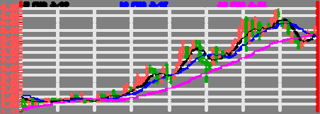             

资本全球化，就意味着资产价格的全球化定价，最近国内房价、油价的变动正反映了这种不可逆转的大趋势，而这一切，最终也会最充分地在资本市场中体现，特别，当国内资本市场全流通后，这种反映就不单单是一种理论了。

资本市场归根结底是通过虚拟价格来实现现实价值的占有，而这一虚一实的游戏就有了资本市场的诸多故事，当然最多的故事都是望梅止渴、画饼充饥一类的，但对于大资金来说，除了利用这种画饼游戏去套人套钱外，更重要的还是利用这种虚拟机制达到现实的目的。

这几天，其实私下已不是新闻的宝邯之争成了当下的新闻，且不说这是否又是一个画饼游戏，这和十几年前的宝延之争都可以说是开风气之先了。后者是在一个具体的全流通个股中玩的游戏，而前者却是在整体全流通背景下必然出现的游戏。

前两天，邻国的一位资本市场大玩家来北京，在一起聊了一个下午。他那里，因为最近文化输出十分牛，现在流行文化概念，除了原来控制的几个上市公司，他刚收购的一个相应股票三个月就涨了十七倍。刚在东南亚某国收了一个赌场的他，这次来却不是为了赌，而是要寻找进入中国资本市场的机会，原因之一是他那的某税收政策有大变化，其次，他希望在两国资本市场间嫁接一个流动的渠道，最后，最重要的还是目前中国的资产价格严重偏低，这就意味着玩大游戏的机会。

那人拿着收集好的几十家国内上市公司的资料，希望能选择合作收购其中的三、四家。本 ID 当然是很专业地和他探讨这些问题，而这，最近一、两年其实已经不是一个很新鲜的事情了。资本全球化，意味着资本必然通过任何可能的渠道在各国中流动，如果以前收购中国可能还是一个神话，那现在，神话已不再。看看，在目前国内的资产价格下，几亿美金就可以控制一个国家大型钢铁企业，这一切说明了什么，警示了什么，大概就不用多说了。

#### 长虹，老子变孙子，只要三亿美圆！

 时间：2006-06-06 21:09:45  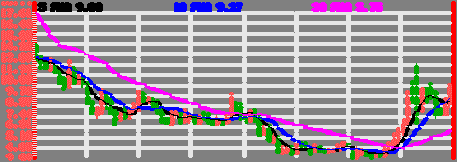      

这是“收购中国，从宝邯之争说起！”的续篇。长虹是谁，即使你从未在资本市场上晃荡，从未被电视、媒体上十几年如一日的广告、报道所污染，也应该知道！那长虹是谁的？当然不是人民的，如果是人民的，那现在人民的名字叫国资委。而上市公司长虹是谁的？在目前中国的环境下，肯定是大股东的，大股东四川长虹电子集团有限公司，也就是他的老子。儿子是老子的儿子，这很中国地天经地义，但已越来越全球资本市场地没了意义，老子一夜可变孙子，这就是市场经济。

股改了，这老子现在只是三分之一的老子了。长虹 18 亿的股份中，长虹集团只占 6 亿，从原来 53%的绝对控股一夜之间变成现在 33%的相对控股。相对控股也还是老子，毕竟还是大股东，而现在的中国上市公司，大股东是老子，其他都是孙子。但是，让现在的长虹“老子变孙子”，其代价只要三亿美圆。

目前长虹已有所回升的股价是 3 元多人民币，要成为大股东，也就 6 亿多一点的股票，大概三亿美圆上下。且不算其品牌价值和市场渠道、人才等软价值，目前长虹的每股净资产是 5 元多人民币，公积金有 5 亿多美圆。最近长虹刚收了美菱，触角伸向白色家电，而赵少帅也刚因为把长虹重新纳入快速增长轨道而获大奖，这对于猎手来说都是好消息，猎物越来越肥了。

3 亿美圆是一个什么概念？对于国外一个中型基金，3 亿美圆只是一个尾数的尾数，对于国内的私募基金来说，有 3 亿美圆的，现在也算不了什么大鳄了！资金从来都不是问题，另外一个更不是问题的就是，即使 10 亿美圆，一定复制不了现在的长虹，这是无疑的。买东西其实很简单，如果 3 亿可以控制一个 10 亿都复制不了的东西，这个买卖当然就可以买卖了。

显然，在现在的市场中，长虹绝对不是特例，而是相当普遍。最近，外资等的收购已经不断出现，这种收购并不是单单在某个产业，而是系统的。不是有人以中国成为世界工厂而兴奋吗？但黄雀只知道，成为世界工厂的大股东而控制世界工厂，是一个更简单的、可以目标的目标，而且是一个正不断目标了的目标了！

#### 缠中说禅文集版权为缠中说禅所有 此文集整理版仅供缠中说禅论坛内部学习使用，严禁外传！ 请尊重资本市场的投资者！

 时间：2006-07-18 21:39:38 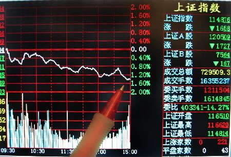

本 ID 之所以选择在资本市场里玩，唯一的原因就是资本市场比较简单，不用处理太多的人际关系。本质上，资本市场完全凭一己之力就可以在里面获取超额的回报，而且一个人就可以掌管实业里多得多的人才能运转的资产，这是最重要的一点。

全球化的本质就是资本的全球化，资本市场在其中具有核心的地位。以前对这一点的认识是不够的，现在国家明显地意识到资本市场在经济中的核心位置。资本市场的投资者就是这其中最重要的基石，任何一个人，都可以在资本市场中理直气壮地挣钱，没本事是个人的事情，和市场本身无关。不明白这点，只不过是被市场所抛弃的一群。

在市场经济中，财富的资本市场化衡量是最标准的。一个不接触资本市场的人，基本就丧失了经济中的话语权，这一点在以后将进一步显现。谁都不用忌讳在市场里挣了多少钱，而在市场中挣钱最根本是要通过对经济的深刻理解而达到的。本 ID 不讳言在资本市场中积累了所有的超出绝大多数人的财富，但这是本 ID 应得的，是对本 ID 智力及市场洞察力的奖赏，这一点，本 ID 只会无比自豪。

人，首先要获得有尊严。当然，有钱并不一定有尊严，但连国家也不能一穷二白，人当然更是这样了。对于个人来说，大概没有任何途径比资本市场能更简单地达到这个目的。当然，前提是你能在市场中生存。不管你对资本市场有什么看法，即使你反对它，要推倒它，那首先你要了解它、战胜它，否则只不过是失败者的哀鸣！

#### 中国人的中国企业，明年还有吗？

 时间：2006-09-11 18:10:41 

前段时间写过一些文章，前面都冠以“收购中国”，最近和搞企业的混了一混，发现这个问题已经有点超出可接受的范围了。以下几个事例都是本 ID 这段时间亲身经历的，由于涉及的公司都相当出名，基于商业秘密，必须连行业都隐去。

1、亚洲某国资本市场某人，第一次碰面是在长安街北侧某饭店内，探讨的话题是如何收购中国某行业的龙头企业，然后在两国资本市场上嫁接出一通道，还可以说的是，该企业在上交所有上市，目前股票价格在 3、4 元上下。

2、还是在北京，涉及资金 N 十亿美金，这资金分成两部分运用，其中一部分针对某目前被严重调控的行业在某特大城市的项目，另一部分在南方某出名沿海城市建造一个特别的东西。该资金背景来自某大国的某沙漠上的绿洲。

3、还是离不开北京，这项目首期涉及资金 M 十亿美金，针对行业被称为 21 世纪最朝阳行业之一。背景外资是该行业世界排第二的，第一那个已经基本完成相应的最初步骤，第二这个已经算是后来者了。他们的策略是针对两种类型中国企业，其中一类型已经初步接触的是最近在市场上最多新闻之一的，另外一个，可以很明确地告诉，是某特大型的国企，在香港和内地交易所控制着 N 家的上市公司。

 上面这些都是本 ID 最近参与其中的部分事情，本 ID 的原则其实很简单，这些事情都是符合法律的，符合商业原则的，反正这种事情，本 ID 不去撮合，自然还有其他人去，大势如此，现在探讨的是，为什么会出现这种大势？这种大势难道就有必须性？难道这种事情一定要发生才符合中国的国家利益？ 为了对比，不妨举一件同样亲身经历的相反事情：

某奖得主的得意弟子，在高科技某最热之一的产业中有着世界领先的技术基础，回来后，并没有得到足够的应有支持。由于该产业的研发费用惊人，而人才要求特高，该公司里随便抓一个人都是博士，但最近因为某种特殊原因陷入困局，原来支持他们的资金出了事。其实，本来这种关系到国家科技前途的东西，就应该国家大力支持的。

本 ID 看到他们很无奈的样子，真有出钱给他们的冲动。但本 ID 一直以来的原则都是除了股票、期货，一律不投资，以前曾两次违反了这个原则，都是因为碍于情面，结果都很无聊，所以只能祝他们好运了。但这种情况的出现，真的是必然的？当然，投资是不会投了，忙，本 ID 是决定帮了。这帮人有时候真是书呆子，为了他们，本 ID 还刚干了一件平时最讨厌干的事情：打麻将。硅谷是硅谷，不是全世界都是硅谷的。

其实，本 ID 根本就不愿意去和这帮搞企业的人混，一般有点笨的人才搞企业的，而搞企业的真搞好了，周围的狼就围过来了，何必呢？本 ID 还是坚持自己的原则，除了股票、期货一律不投资。因此，站在个人的角度，即使所有中国企业都非中国化了，其实也无所谓，反正鬼佬的钱咱是赢定了，以前鬼佬的钱咱也没少赢。但如果有一天，已经完全分不清楚中国的资本市场和美国的或欧洲的有什么区别了，看看那些所谓中国企业的大股东名字都不用中文写了，这是不是也有点太恶心了？中国人的中国企业，明年还有吗？

#### 缠中说禅文集版权为缠中说禅所有 此文集整理版仅供缠中说禅论坛内部学习使用，严禁外传！ 四川，别给中国丢人！

 时间：2006-10-18 16:16:23 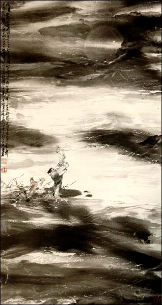

本 ID 曾以“收购中国”为题写过几篇文章，力陈中国将面临被收购的现实风险。几年前，本 ID 著名网文“货币战争与人民币战略”中，对这种局面已有所告戒。后来在人民币放开那天，本 ID 写到“中国终于世界了，但世界还能中国吗？”，不到两年，对目前的中国企业，要面临的却已是“世界依然世界，中国还能中国？”

对中国企业的非中国化，早已麻木。在另一帖子中也说过，反正鬼佬的钱也是钱，以后就吸鬼佬血了，看谁比谁狠。但这几天，对有关四川某著名白酒企业将被世界第一大酒业集团收购的事，还是有点不能接受。白酒，中国的国粹，英国佬为了他们的“英国病”可以把威士忌搞得更 GAY，但凭什么让白酒威士忌？谁有这个权力？

四川，别给中国丢人！李白曾喝过的酒、杜甫曾喝过的酒，东坡曾喝过的酒。没有酒，哪有中国的文化？没有酒，你让李白如何去“对影成三人”？让杜甫如何去“白日放歌”？又让东坡如何去“问青天”？就算全中国的酒都给卖了，四川的酒又如何能忍心卖？某酒，凭洋人的一个奖就成了国酒，但它有李白、杜甫、东坡吗？它有什么资格当国酒？要卖就把它卖了，但不要卖四川的酒，因为那是李白、杜甫、东坡！

就让威士忌更 GAY，让波尔多更 SEX，但四川的酒一定要中国，一定要李白、一定要杜甫、一定要东坡！在没有李白、杜甫、东坡的年代，这大概是一个中国人最基本、最底线的要求了。人，可以没道德，但一定要有底线。四川，别给中国丢人！

#### 经典回放：**G** 股就是 **G** 点，市场的原理和性的原理是一样的

 时间：2006-11-27 12:10:52

今天必须把这帖子在博客里回放，否则过两天都给删光了，都没证据表明本 ID 曾写过该文了。本 ID 没博客以前的帖子都是先发在强国论坛，那是本 ID 的大爷，最近强国论坛换新版，很多老帖都查不到了，包括这帖子，二爷天涯杂谈、三爷猫眼、四爷猫扑竟然也没了，现在就剩下天涯的经济版上还残留了一个，马上复制过来。各位看到没有，当时本 ID 的名字还叫“喜欢数学的女孩”。帖子最早应该在 2005 年 7 月中旬，当时正在二次探底考验 1000 点，但就算现在保留下来的 2005 年 8 月 5 日，刚好是二次探底成功突破双底颈线的那天中午，也足够早了。现在回头去看，有谁能在那么早提出“大行情”三个字，又有谁能对这行情开始的性质给一个这么鲜明的定义“G 股就是 G 点”？

说这个不是要显摆本 ID 如何有先见之明，这根本无须显摆。关键是对现在走势给一个明确的说明。在博客里，5 月份给出了一个新的命题，就是“大牛不用套”，而且特别强调这个“不用套”最重要的是不能套用原来的走势，为什么？因为“G 股是 G 点”这个命题在 2006 年的 5 月份已经即将完成历史使命，后面就是“大牛不用套”的延伸，目前为什么不再提出新的命题、口号？就因为这个“命题”继续有效。用面首来比喻，“G 股是 G 点”是把一个雏男变成一个面首很关键的一步，就是要他先认识 G 点，先有了 G 点，先让他开窍，在开窍之前，面首还不能算面首，只能算准面首。行情也一样，当完成“G 股是 G 点”前，中国股市只是从一个准股市变成一个符合国际规范股市的过程，从“大牛不用套”开始，大牛市的第一阶段才算真正的开始，这也是为什么本 ID 反复强调目前只是大行情展开的第一阶段的一个理由。

对大盘的走势，本 ID 从 2005 年 6 月重新天天看盘以后，就从来没怀疑过。这大盘还早着呢，想想，96 年的行情，实实在在地走了 5 年，即使按照 96 年的标准，现在难道不还早吗？当然，短线走势会调整会反复，但真正的行情还没有真正的展开，让本 ID 给各位回忆一下 96 年到 2001 年行情的走势吧：第一阶段，走得最牛的都是成分股票，这也是为什么本 ID 反复强调让大家现在注意成分股的理由，而事实上，现在的走势就是这样。第二阶段走得最牛的是所谓的成长股，第三阶段走的是所谓的重组股，等大盘大面积地炒所谓的重组股时，这大盘的大牛市才有结束的风险，也就是 2001 年见顶的时候发生的事情，这也是为什么本 ID2001 年能从容退出且 4 年不看股市一眼的理由，连续三次高潮之后，再牛的面首也有一个大的不应期了。

股市是有规律的，本 ID 现在已经把这 N 年大牛市的最重要节奏告诉各位了，本 ID 已经把股市像面首一样扒个精光给各位了。等着吧，不久以后，这就会被人抄袭，接着被市场所抄袭。现在市场上流行的不少概念，就是在 N 年前从本 ID 这里流传开去的，这些陈年谷子就不说了。这里，还是重温一下 G 股成为 G 点的故事。G 股已经过去，但 G 点依然需要，就像面首随着年龄的增加，G 点会变化的，这和股市里 G 股以后，从成分股到成长股到重组股 G 点变化是一个原理，市场的原理本来就和性的原理一样，这也是本 ID 名言“像做爱一样做股票”其中一方面的含义。

 『经济论坛』G 股就是 G 点，市场的原理和性的原理是一样的 作者：喜欢数学的女孩提交日期：2005-8-5 12:15:00

本女和证监会从一开始就有打交道，从第一届到现在，都很熟悉。以前从来没有称赞过证监会，但对这一届是感觉最好的。前段时间就发过几个帖子，例如：“为尚福林鼓掌-------不会挑逗各方利益的战争不是一个好的调控者 (喜欢数学的女孩: 2005-06-20 20:17:51)”、“为尚福林鼓掌-------必须对企图用股权分置问题要挟政府的用法律制裁之 (喜欢数学的女孩: 2005-05-16 12:06:07)”等。当然，市场总是后知后觉者占大多数，否则先知先觉的怎么挣钱？当看到一些左派或名嘴继续按老思维对证监会大放厥词时，就知道又一批傻瓜在表演了。

G 股当然是 G 点，这次是为证监会能对市场 G 点的充分摸索后加以引导而鼓掌。本女对山东人一向印象比较好，当然，生意上一般不要和山东人弄，但管理上，山东人确实比较厉害，看看现在一些大企业的头，山东人还是很多的。现在证监会的山东特色已经有点当时家电突起时候一种大刀阔斧的感觉，熟悉了以前证监会妞妞捏捏的人，当然是处处看错。

市场的原理和性的原理是一样的，所谓世界都是相通的。市场需要的是 G 点，没有 G 点就没有性，没有 G 点也没有市场。而 G 股当然是 G 点，现在所有的事情都是围绕这个 G 点来，这样就对路了。市场兴奋了，一切都好办；市场没感觉，一切都瞎掰。

这届证监会和以往的思路、特别是风格上都有了极大的改变，这种新气象是必须的，这也是本女为什么一开始就看好他们的关键。一场大行情是需要各方面的配合的，没有配合，没有共同的 G 点认识，行情就只能是空话。没有行情，市场也就是空话。

缠中说禅技术论坛 www.chzhshch.net 就某酒类股票对所有散户的严重提示!

#### 就某酒类股票对所有散户的严重提示!

 时间：2006-12-07 10:00:31

本ID昨天写的"对四川提出最强烈的抗议."纯粹是就该公司进行抗议,不涉及任何股票走势.本ID强烈希望把这事情搞黄,因为本 ID 不希望去喝英国人造的中国酒.本 ID 昨天的文章,只是对某些人的警告,所有散户不要在其中参合.

 本 ID 在昨天本博客已经明确表示这点,请看:  缠中说禅 2006-12-06 16:20:48  [匿名] 无聊 2006-12-06 16:17:41  请问 lz 你说的那瓶酒俺也想买点，抽他们的血，可乎？ =============  这个抽血的繁重任务还是让本 ID 来完成吧,现在中线买点早过了,风险太大,本 ID 持有的成本不同,不建议任何人追高买入.  有些事情不是散户该干的,今天也不写什么文章了，就是这声明,注意,散户不要瞎搞,风险第一.  补充一句:  打仗就会飞沙走石,谢绝散户参与,参观无妨,别到时候伤着,来本 ID 这里吵闹,本 ID 没这时间接待. 缠中说禅技术论坛 www.chzhshch.net 公告

#### 公告

 时间：2006-12-07 15:06:53  公告 以后本ID这里不准备对具体个股与大盘走势发表任何具体意见,免得各位狐疑.所有走势与本ID无关, 别瞎闹了.  对大盘,最后把前面说的强调一次:  中长线:目前是牛市的第一轮,主要涨的是大盘成分股.大调整后的第二轮,涨的是成长股,最后是重组股.这个节奏的完成大概需要几年时间.  中短线:大盘 11 月是长阳,本月上涨前出现震荡积聚能量是理所当然的(这在 12 月 1 日就说了,现在继续有效.)

#### 缠中说禅文集版权为缠中说禅所有 此文集整理版仅供缠中说禅论坛内部学习使用，严禁外传！ 本 **ID** 如此精确地知道消息，依然要抗议！

 时间：2006-12-12 09:38:38  本 ID 如此精确地知道消息， 依然要抗议！ 缠中说禅 2006-12-11 13:44:29  抗议！抗议！抗议！ 为了不影响散户操作，抗议什么暂且不说，明天就知道了。 2006-12-12 刊登重大事项公告,上午停牌一小时 水井坊重大事项公告

四川水井坊股份有限公司接第一大股东四川成都全兴集团有限公司(下称：全兴集团)通知，其控股股东成都盈盛投资控股有限公司已于 2006 年 12 月 11 日签署《股权转让协议》，将其所持全兴集团 43%的股权转让给帝亚吉欧高地控股有限公司(下称：Diageo 公司)。上述股权交易将报经政府商务部门批准后实施，全兴集团将相应变更为从事商业经营的外商投资商业企业，为 Diageo 公司提供采购服务并进行其他经营活动。

 事情回顾： 作者：缠中说禅提交日期：2006-12-6 15:16:00  对四川提出最强烈的抗议.  缠中说禅

虽然本 ID 消息极端准确,今天本 ID 手里的某酒厂股票还在大盘大跌时涨停了,本 ID 还是要抗议.本 ID 之所以买他的股票,就是要抽他的血,他们把厂家卖给外国人,本 ID 就是要抽他们的血.这事情可能已经无法更改,准确的消息说这几天就要停牌,大概两周,然后就宣布外国鬼子进村,气愤!

还有中国一个最大的药厂之一正被国外最大药厂之一收购,方案在报批中,该股票正停牌,本 ID 也按照抽血的原则大量持有该股票.但ID只希望把这事情搞黄!反正即使黄了,本ID也不会亏钱,成本低着了.最近听说也要宣布了,除了让医药板块折腾一下,中国一个大企业又就此沦落,值得吗?当然,本 ID 钱是挣的\血是要抽的,但还是要表示气愤!

 抗议还是用原来的文章.  四川，别给中国丢人！ 2006-10-18 16:16:23

本 ID 曾以“收购中国”为题写过几篇文章，力陈中国将面临被收购的现实风险。几年前，本 ID 著名网文“货币战争与人民币战略”中，对这种局面已有所告戒。后来在人民币放开那天，本 ID 写到“中国终于世界了，但世界还能中国吗？”，不到两年，对目前的中国企业，要面临的却已是“世界依然世界，中国还能中国？”

对中国企业的非中国化，早已麻木。在另一帖子中也说过，反正鬼佬的钱也是钱，以后就吸鬼佬血了，看谁比谁狠。但这几天，对有关四川某著名白酒企业将被世界第一大酒业集团收购的事，还是有点不能接受。白酒，中国的国粹，英国佬为了他们的“英国病”可以把威士忌搞得更 GAY，但凭什么让白酒威士忌？谁有这个权力？

四川，别给中国丢人！李白曾喝过的酒、杜甫曾喝过的酒，东坡曾喝过的酒。没有酒，哪有中国的文化？没有酒，你让李白如何去“对影成三人”？让杜甫如何去“白日放歌”？又让东坡如何去“问青天”？就算全中国的酒都给卖了，四川的酒又如何能忍心卖？某酒，凭洋人的一个奖就成了国酒，但它有李白、杜甫、东坡吗？它有什么资格当国酒？要卖就把它卖了，但不要卖四川的酒，因为那是李白、杜甫、东坡！

就让威士忌更 GAY，让波尔多更 SEX，但四川的酒一定要中国，一定要李白、一定要杜甫、一定要东坡！在没有李白、杜甫、东坡的年代，这大概是一个中国人最基本、最底线的要求了。人，可以没道德，但一定要有底线。四川，别给中国丢人！

 作者：缠中说禅提交日期：2006-12-7 10:41:00 就某酒类股票对所有散户的严重提示!  2006-12-07 10:00:31

本ID昨天写的"对四川提出最强烈的抗议."纯粹是就该公司进行抗议,不涉及任何股票走势.本ID强烈希望把这事情搞黄,因为本 ID 不希望去喝英国人造的中国酒.本 ID 昨天的文章,只是对某些人的警告,所有散户不要在其中参合.

 本ID在昨天本博客已经明确表示这点,请看:  http://blog.sina.com.cn/m/chzhshch  有些事情不是散户该干的,今天也不写什么文章了，就是这声明,注意,散户不要瞎搞,风险第一.  作者：缠中说禅回复日期：2006-12-12 10:14:39  作者：裸大人回复日期：2006-12-7 18:42:02  这不仅是企业的沦陷,还是酒业药业文化的沦陷,美国人能够注册我们的人参蜂王浆,韩国人能够注册我们的牛黄丸,日本人能够仿我们的六神丸造的救心丸,一年在国际上的市场就有一个多亿美圆的销售额.  当哪天我们在酒吧喝上日本人的注册我们的国酒牌子名酒的时候,才明白数学妹妹今日的一番良苦用心.  ===============  知道就好 缠中说禅技术论坛 www.chzhshch.net 关于抛弃各位两天的公告

#### 关于抛弃各位两天的公告

 时间：2006-12-19 21:45:00

明后两天，本 ID 一个花了两年没变现的项目就要变现了，2001 年时的投入不多，现在变现也就两三倍的利润，资本市场外的游戏真是不好玩，千万别玩。这批本来 1 年半前就要参加大部队的，现在才能归队，也算搞笑了。不过牛市也就刚开一个头，周五又多七、八亿斤的大米酿酒造药，为各位抬抬轿子，也值得本 ID 抛弃各位两天了，就别怪本 ID 狠心啦。

缠中说禅技术论坛 www.chzhshch.net 休博 5 天公告

#### 休博 **5** 天公告

 时间：2006-12-29 15:05:47  股市休五天，本 ID 也要外出腐败五天，博客只能跟着休市，各位也要好好休息、明年才能继续闹腾！本 ID 赶飞机去也。

### 元旦快乐

 有问题请先扔在回帖里，本 ID 腐败回来再回答。

#### 就算是摇头丸也该洗洗盘了。

 时间：2007-01-24 15:40:48  今天说点闲话，来这里的所有人都应该知道这个公告 “关于抛弃各位两天的公告 2006-12-19 21:45:00”  剔除，元旦的放假，刚好一个月，21 日的交易日，一个神奇数字，翻番了。这时候，就算是摇头丸也该洗洗盘了。 特别好玩，刚上来看到有人这样写：2007-01-24 14:12:16  今天的药不用说了，大家都看到了，还要继续涨，我敢打包票。呵呵 可惜没钱，有钱就是砸锅卖铁也要买啊！ 2007-01-24 14:59:52 尊敬的罗锅同学以及各位学友们:  我慌慌张张跑上来问一句:我们的药咋打开了呐.俺看不懂噢...  谢谢你!~~  看来各位还需要好好学习，首先要学的是心态，当所有人都觉得无风险时，洗盘就是必须的了。市场，永远可以被利用的就是恐惧和贪婪，一定要彻底地修炼。

最近本 ID 特忙，在大换仓，把去年的一些涨幅过大的、现在估值偏高的股票换过来。这些是老资金了，和 12 月 19 号说的不是一笔钱。这段时间的震荡，就是一直在换仓，不仅仅是本 ID 这样干，很多人也这样干着。

其实，本 ID 所换的方向，在回帖里都有说过，这段时间本 ID 新换的，主要的如下几个板块：军工、有色、农业、环保、公用事业。前两个板块，停了大半年了，也该动动了，后三个板块，公用主要是一些低市赢率的股票，这是防守仓位；农业、环保，是以后要大力支持的，本 ID 最近忙着搞一件大事情，和这两方面都有关系。

 当然，药和钢铁，是去年就开始布局的，就不用说了。 曾提过的八只股票，中线都没问题的，而且现在都离提的时候有一定涨幅了。 药，就不说了，还 S 呢。浙江人，山东人、管子、5 夹 1 都没什么可说的。今年那三只，直升飞机正慢慢起飞，山东那大大的环保正清扫着，还有那过年不收礼的玩意，盘中有点乱，还行。 军工、有色，都是最近一两周进去的，自己看技术找买点。本 ID 搞的军工只搞和航天有关的，有色只搞稀有金属。 以上都是梦话，大家洗洗睡吧。

#### 缠中说禅文集版权为缠中说禅所有 此文集整理版仅供缠中说禅论坛内部学习使用，严禁外传！ 最大的泡沫就是某些国人！

 时间：2007-01-25 11:58:51

今天，某美国老头的一些破话竟然导致股市的急剧波动，在中国金融历史上写下了最耻辱的一章。中国的金融市场有没有泡沫，这是一个可以研究的问题，无论有与没有，但那些听了美国老头的破话就拼命杀跌的国人，一定是最大的泡沫。

请问，股票有没有泡沫，你自己没脑子想？要听美国人的忽悠？如果有泡沫，难道今天才有，昨天没有了？工行 6。70 元没泡沫，反而今天 5。3 元有泡沫了？6。7 元的时候，美国老头哪里去了？这些泡沫的中国人哪里去了？中国最大的敌人，从来都不是来自外面，为什么中国最盛产汉奸类的物体？

从纯技术的角度，今天本来回试的要求就 99%，按本 ID 的理论，走势需完美，而且在短线上，昨天明显有点背驰，所以回试一下上两天的低点去确认 2870 突破的有效是很正常的，这都是在计划之中的。最不正常的，就是因为一个美国老头的忽悠而使得某些国人乱了方寸，可耻啊！

好，就说说工行有没有泡沫。首先，任何的股票，都时刻存在于泡沫与非泡沫之间，因为未来是不可确定的，只能预期。而预期就意味着不确定，股票的魅力就在于不确定性。美国老头，用好来污的招数，戏剧化地表演，然后指责工行的服务如何如何。确实，工行的服务是有问题，但工行的服务一直在改进，而且站在另一个角度，工行目前如此有问题的服务，都能产生目前的业绩，一旦这种服务被改进后，其业绩不是更可以预期？彩电、汽车，打败外国人的故事，为什么就不能在工行身上发生？一个 13 亿的人口大国，出一个世界最大的银行又有什么不可以的？而且，站在专业的角度，工行目前的业绩，都是在狭小的范围内取得的，很多国际性银行能干的事情，工行就根本没干，而那些事情往往是最有赢利潜力的。这就是工行以后高速提升的保证，因为这些以前不干的业务，将逐步成为工行的赢利源泉。至于工行的网络、政策与品牌优势等等，都是不可复制的资源，至于对大盘的权重溢价，那反而是小事了。工行目前的价位，至少是一个中线稳定的中枢，这是毫无疑问的，期间围绕这个中枢上上下下都很自然，工行要走新的行情，突破该中枢，就必须要有新的突破点，例如建行的回归，股指期货，最重要的是，工行的一个核心新业务的开展等等。本 ID 相信，在彩电、汽车等方面的神话，一定会在工行等中国银行上重现，中国金融的崛起，是中国崛起的标志，因为，当今世界，是资本的世界，没有金融的强大，国家的强大只能是废话。

 站在纯交易的角度，本 ID 早就及时提醒向二、三线的战略转移，但工行等控制指数的工具，是不能落入美国人的手里的，这是一个原则问题，工行可以没行情，可以继续围绕目前位置盘整，但企图想把工行打下去拣便宜货，门都没有，首先本 ID 就不答应！

本 ID 今天的策略很简单，盘子乱的就顺势洗，让那些汉奸分子亏死出。盘子稳定汉奸少的，就起来。中国现在最应该戳穿的泡沫就是有着汉奸基因、喜欢舔美国人沟子的垃圾！中国需要的是钢铁的脊梁，而不是泡沫的膝盖！

 补充特别声明：

本 ID 现在基本上没有任何工行的仓位，年初开始就大面积换成二、三线股票，这里的人，都可以证明本 ID 多次反复强调二、三线股票。昨天的帖子还把这次战略性转仓的主要 5 个方面列举出来：军工、有色、农业、环保、公用事业。而且今天这些股票根本没跌，还有涨停的，当然这和本 ID 的努力有点关系，所以，本 ID 对工行的论述完全和利益无关，但本 ID 就是不愿意看到，中国人要看美国人的脸色。

对大盘的中线走势，本 ID 早已经指明，最恶劣的就是在这里形成一个周线的缠中说禅走势中枢，而牛市的第一波走势，还没有完成，也就是有关成分股的行情，在调整后仍将继续，这是无疑的。只是二、三线的成分股，更有机会。当然，一线的股票机会依然，只是要等待契机。

而这轮大牛市，在第三波的大重组行情出现之前，绝不会走完，这是绝对无疑的。即使出现周线中枢的震荡，个股行情机会依然不断，工行可以没有行情，但个股不会没有行情，不信就走着瞧，今天，本 ID 的农业股、环保股、公用事业股、军工股都创出新高，这就是先头部队！

各位注意了，本 ID 从 2005 年 6 月开始一直长多，最出名的文章叫“经典回放：G 股就是 G 点，市场的原理和性的原理是一样的”，这里的人都该看过。本 ID 现在无所谓多空，千万别理解错了。一个中枢扩展该干什么，是有理论的唯一根据的，和本 ID 的喜好无关。但本 ID 的结论很明确，牛市的第一波没完，这个观点没变。周线中枢的震荡，不影响这个结论。

缠中说禅技术论坛 www.chzhshch.net  罗杰斯，有种的和本 ID 来个 PK

#### 罗杰斯，有种的和本 **ID** 来个 **PK**

 时间：2007-01-26 15:03:54

在昨天中午最恶劣的情况下敢和美国佬公开叫板的，有谁？昨天明确指出“站在纯交易的角度，本 ID 早就及时提醒向二、三线的战略转移，但工行等控制指数的工具，是不能落入美国人的手里的，这是一个原则问题，工行可以没行情，可以继续围绕目前位置盘整，但企图想把工行打下去拣便宜货，门都没有，首先本 ID 就不答应！”，有谁？更公开“而这轮大牛市，在第三波的大重组行情出现之前，绝不会走完，这是绝对无疑的。即使出现周线中枢的震荡，个股行情机会依然不断，工行可以没有行情，但个股不会没有行情，不信就走着瞧，今天，本 ID 的农业股、环保股、公用事业股、军工股都创出新高，这就是先头部队！”有谁？今天，本 ID 的先头部队里，农业股、环保股、军工股、有色继续创出新高，而工行在有大量新股准备上来的巨大利空面前没有给美国佬任何机会，一些可耻的汉奸企图让工行跌停，门都没有！

罗杰斯，有种的和本 ID 来个 PK，比什么都可以，例如一起拿 N 亿大米在中国某个股票里互相对攻，看谁能挣钱更多，或者就用一笔钱比短线，或按一定时期比收益，怎么都可以，让你选择。方法很简单，都放到一个证券部里，人可以不出面，钱直接划过去。然后比赛就可以开始。现在传媒如此发达，本 ID 的战书就在这里，传播去吧！

很高兴看到回贴里有人按照本 ID 的理论在今天 2720 点 1 分钟背驰时敢全仓杀入，学理论就要敢实践，否则学来干什么？但由于现在中枢扩展的现实走势，因此根据短线指标来回运动就是更关键的，这正是高手与低手的巨大区别，利用震荡，下跌就是巨大的赢利机会，那些一跌就叫爹的闹钟，死去！

 贪婪和恐惧，人的死穴，周末到了，请给自己一小时去找找自己！

#### 来这里, 首先要洗心革面!

 时间：2007-01-31 15:13:30

每个人都有看法,特别像股市这种东西,但来这里,首先要洗心革面!否则就别来,来了也白搭!如果来了这里,你还追高杀跌,不要买点买\卖点卖,那就别来了,世界很广阔,何必来这里.今天的大跌不过是昨天 5 分钟背驰所引发的,按照本ID的理论,你不能逃过吗?然后你按5分钟或其他的买点重新买入,难道就不可以避免所有的下跌吗?下跌对于本 ID 理论的实践者来说,就是快乐的事情,因为在下跌之前,你已经离开,因为下跌总在卖点之后!

至于有人 6 块不买,喜欢 12 块买,那行,不是有人说 15 分钟拉涨停吗?别说涨停,从跌停到涨停,10 分钟足够,但首先要把喜欢杀跌的都给杀掉!500 万股压盘算什么?大盘跌 150 点又算什么?好,本 ID 不是雷锋,本 ID 干的事情只按技术与需要来,解放军已经干了,以后有谁还说废话也可以继续废话,只是各位想说真功夫的人就少听废话为好,别再干6块不买12块才买的蠢事!至于有些希望明天还跌停的黑心汉,也少点白日梦, 别刚学了点皮毛就觉得怎么了,还早着呢.

 以上话都是梦话,现实如有雷同和本 ID 毫无关系,本 ID 不担负任何法律责任.  下午走的太急，补充一段，有必要把一些前面已经多次提过的原则重复一次。 1、你手中的钱，一定是能长期稳定地留在股市的，不能有任何的借贷之类的情况，这太关键了，本 ID 见过太多的人就是死在钱的非长期性上，故事以后有空说。

2、级别必须配套来看，最好不要单纯的短线，任何进入的股票，最好是至少是日线级别的买点进入的，一定不能远离底部，特别对于生手，这更为重要。短线是让你把成本将下来，而且确保持有的安全性，除了日线的单边上扬走势，短线必须坚持。但仓位可以控制，例如用其中的 1/3，慢慢养成好习惯以后，就可以更随心所欲一点。

 3、如果判断不准确，那卖点卖错了无所谓，这么多股票还怕找不到好的？但买点一定要谨慎，宁愿筹码少了，也不能追高买回来。操作中，开始的熟练程度差，不奇怪，这种事情要不断实践才能提高的。 4、最开始以中长线心态进入时，尽量参考一下基本面的情况，不能搞太烂的股票，而短线就不大需要考虑这些问题，只看技术就可以。 5、不要有依赖心理，只有自己在实践中成为自己一部分的，才是真实的。 6、一个坏习惯足以毁掉一切，每次操作后一定要不断总结，逐步提高。

7、如果你选择股票时是以一个中长线的心态谨慎选择的，那么就不要随便斩仓，本 ID 反对斩仓、止蚀之类的玩意，亏出去的钱是真亏出去的，而只要筹码在，不断的短线足以把成本摊下来，斩仓又一定能买到更好的股票？特别在中长线依然看好的情况，更没必要。

 8、先卖后买也是可以挣钱的，不要光知道先买后卖。 9、股票都是废纸，你要的不是任何股票，而是通过股票把血抽出来！10、恐惧和贪婪，都源自对市场的无知。

#### 缠中说禅文集版权为缠中说禅所有 此文集整理版仅供缠中说禅论坛内部学习使用，严禁外传！

缠中说禅技术论坛 www.chzhshch.net 声明

#### 声明

 时间：2007-02-07 21:02:45

刚上来，发现下午本 ID 的所有回帖都没有了。这里受到攻击甚至最后被关闭都是很正常的，因为这里的存在至少会让庄家、汉奸等等很不高兴，当然，在现实中，本 ID 是不怕他们的，他们能找的人，本 ID 也能找，他们想玩什么游戏，本 ID 都可以陪他们玩，但在虚拟的空间里，这一切就很难说了，最主要是本 ID 暂时不想抛头露脸。

最近这里捣乱的人越来越多，这都是很正常的，本 ID 没义务也没兴趣去制止或干涉他们，在本 ID 这里，爱怎样都可以。不过，如果真想学习的，就快点把这里的帖子都复制下去，说不好哪天这里被汉奸给删了，也一定不奇怪的。各位看着办吧。如果这里被删，就是和各位的缘分到此了，本 ID 唯一可以承诺的，就是只要这里不被删，本 ID 还会尽量发帖子，只此而已。下午的回帖不可能再一一来过了，各位先看吧。关键是自己学好本事，就算是本 ID 也靠不住的，例如，这里突然被删掉了，那就不可能再找到了。学习，快点小学毕业吧，然后是初中、高中、大学、硕士、博士、博士后等等，这样，才是真正的立足。

缠中说禅技术论坛 www.chzhshch.net 放假公告

#### 放假公告

 时间：2007-02-16 15:21:37  过年好 24 日重新开博

汉奸之所以如此昌盛，就是因为国人习惯于一团散沙，今天尾市给汉奸借泄露消息偷袭，而其他大盘股纷纷弃守，就是一个好的证明，但联通已经干了他该干的事情，没有丢人。除了本周的联通，本 ID 以前说过的 14 只股票，除了 2 只，全部今天都见到过本轮行情的新高，而那没见新高的两只，都和一个有着汉奸名字的基金有关，本 ID 不待见他们。前面说过，就算突破 3000 点，震荡还是必须的，这场多空的绞杀战，依然要继续。

 放假了，少谈股票，多谈面首。先和各位拜年了，在炮竹声中，听听自己在哪里？

#### 汉奸，有本事拿几十亿股联通把本 **ID** 砸死！

 时间：2007-02-26 15:50:13  汉奸 有本事拿几十亿股联通 把本 ID 砸死！

当本 ID8 号说要阻击联通，让联通春节前上 5 元，让大盘上 3000 点，估计汉奸们都在窃喜，盘算着这次怎么搞死本 ID。结果，最后一天，看联通无法得手，尾市只好借泄露的消息偷袭，让大盘收在 2998，以为这样就能让本 ID 丢脸。这种小肚鸡肠，也只有汉奸能干出来了。这种无聊的偷袭能改变什么？靠收买几个官员、知道点垃圾消息就想左右市场？脑子水太多了吧！

中国的世纪，中国人的地盘难道还不让中国人说了算？本 ID 这次如此高调，并不是本 ID 有裸奔的爱好，而是这次的战役，就像百团大战，必须打，砸了锅也要打，否则像罗杰斯这种垃圾以及汉奸就会以为这天下还是他们的！而这也像百团大战一样，要打得全世界的人都知道，要告诉那些没有骨头的国人，鬼佬、汉奸连面首都算不上！说句闲话，像本 ID 这里的点击竟然还没有孔男人那里的三份之一多，这大概也是中国汉奸多的一个指标之一。

那些面首以及面首都不如的，就不说他们了。大盘震荡的反复是不可避免的，而且站在纯技术上，就算站稳 3000 点上攻，也有极大可能进入日线的背驰段。但个股，特别是有题材的二、三线股票，将越来越摆脱指数的影响。联通是让大家观摩的，散户真没必要买，原来说过的 14 只股票，究竟整体走得怎样，大家也有目共睹了。不妨再列一次出来：

 12 月中旬说的：000999、000777、000600、000778、600777。 元旦后说的：000416、000915、000099。 1 月中下旬说的：600343、000998、600649、600578、600432  2 月上旬说的：000938

其实散户挣钱真的很简单，就像这 14 只股票，基本的节奏都不大一样，利用技术，把涨幅大的换成涨幅小的，这样的利用率就高了。就像，一开始基本都有的 000999，1 月 25 日翻倍进入调整，而 000416 在 1 月 26 日见到洗盘回试的低点，为什么这么巧，就没必要追究了，只是到今天，也是刚好一个月，基本也翻倍了，这股票本 ID 可有特别提示的，当时本 ID 叫他“今天过年不收礼”，后面一句是什么，应该没人不知道吧？而他过年前后的表现，大家也看到了吧。如果你的节奏弄好，两个月翻两番并不是什么难事。

有了联通后，大概本 ID 也不能再说什么具体的股票了，否则肯定要给抢乱套了。对今年的板块，去年底的时候已经明确说过，药是去年的酒，钢铁是去年的有色，有人当时还不相信，现在不知道见到没有？二、三线的小板块，一月下旬明确说了，农业、环保、军工、有色、公用，这些还会继续表现的。农业、环保，是中国政策必须倾斜的，最近这方面的政策越来越明确了。另外，有些特别的小板块，像 VC、深沪本地低价股，特别是深圳的，要充分注意，历史上，最大的黑马，特别在炒垃圾股时的最大黑马，经常出现在这里。

 学了那么多，在这么小的范围内找一个合适的股票，各位应该可以胜任了。本 ID 如果还明确说一只出来，就害大家了，把本 ID 当股评看了，这样也太对不住本 ID 的课程了。

#### 汉奸，本 **ID** 就把你们像面首一样玩弄！

 时间：2007-03-01 15:42:20  汉奸， 本 ID 就把你们像面首一样 玩弄！

百团大战以后是什么，熟悉中国历史的没有不知道的，除非他是汉奸或鬼佬并且脑子进满了水。显然，中国的金融市场的很重要部分，被汉奸与鬼佬把持着，这一点已多次指出。不承认这一点，不是别有用心就是瞎了眼。用最简单的板块论，例如金融板块显然就是汉奸与鬼佬围剿的重灾区。特别，由于金融股多数都同时在其他市场上交易，因此更容易成为他们企图控制中国金融市场的利器。

有些幼稚的人，例如一个叫什么水皮的，昨天还傻忽忽地说，谁谁谁发表什么文章，就要涨了。中国最可怕的不是汉奸，而是那些弱智的所谓爱国者，喊两句口号就等于爱国，这爱国也太没技术含量了。喊口号是赶不走日本人的，同样杀不死汉奸和鬼佬。在金融市场中哪里有什么和谐，那是血和肉！别老大不小的还装天真！

本 ID 承认，本 ID 现在所能集合的力量，还不足以和汉奸与鬼佬进行全方位大集团的会战，这都是前期保守的金融政策所导致的！那种希望杀光大鳄的政策，只是为外国大鳄的入侵制造良好的环境。没有 2000 年前后可笑的金融政策，没有某些人中了海龟的迷幻。中国民间的力量也足以和外国鬼子在最大层面上进行会战了。

这就像百团大战一样，一个中级规模的阻击就会引发后面残酷的围剿。但历史却是这样发展的，所谓的围剿并没有达到任何目的，日本人最终还是滚出去了。确实，汉奸们可以不断打压金融股来控制走势，就像日本人占据着大中小城市。但二、三线股有着广阔的纵深空间，这就是本 ID 们的地盘，没汉奸、鬼佬们什么事情。

在大跌前一天，本 ID 说了深圳本地低价股，大跌又有什么影响？不照样连续涨停？同时还强调了农业、环保的股票，怎么样大家都有眼睛看。注意，各位没必要一定要看本 ID 所说那 14 只股票里的农业、环保，只要是这个板块，只要是低价，走势有买点出现的都没问题。环保其实还包括新能源。

 本 ID 最近的口号就是，对 5 元上下的三线股发动最残酷的攻击，汉奸、鬼佬最好把工行砸回 4 元，把人寿砸回 20 元，那时候自然去接管你们，让你们永远滚出中国。游击战，把汉奸和鬼佬像面首一样玩弄。

N 年前，本 ID 已经到处呼吁，中国人的盘子要中国人控着，现在还不是最可怕的情况，毕竟，大的国有股还抓在手里，但如果还不警惕，汉奸自然有办法把那些都蒙掉。温先生的文章不是说要金融安全吗？盘子控在汉奸与鬼佬手里，是没有安全可言的，这就是最简单的道理。

 今天的盘子没什么可说的，上不了 5 日线就要二次探底，就这么简单。现在就看这在 2800 附近的 30 分钟中枢如何演化的，这是最近的一个唯一的主题。

#### 关于大盘个股说几句闲话

 时间：2007-03-14 08:58:13  附录：

昨晚汉奸他爸大跌，汉奸很兴奋地要为他爸下半旗，所以就出现今天的走势。本来，大盘就需要震荡，而今天汉奸为他家拉的阴线，依然在围绕新中枢震荡的范围里，只要第三类买卖点不出现，这种震荡就将延续。现在的问题是，难道以后汉奸家的姨丈姑父们有什么烂事都要中国股市陪着他们一惊一乍？所以，一个以反汉奸为任务的传媒就是必须的。

忙，昨天收盘没发帖，今早补几句。目前大盘中线就是一个日、周中枢的问题，刀没两头利，如果这里是日中枢，现在就直接上去，那么就进入背驰段；如果在这里继续震荡弄周中枢出来，其后可预期的上涨幅度就更可观一点。不过无论是什么中枢，大盘牛市第一波远没结束。

个股方面，从元旦开始一路出大型成分股、力挺二、三线股，春节前后更强调在低价三线股，目前，4 元以下的非 ST 三线股基本没有了，前段说对 5 元上下的发动最残酷的进攻，很快也没进攻对象了。三线股的行情已经进入值得反思的阶段，除了真有题材与业绩支持的，已经进入短线的压力阶段，可以持有等卖点，但以没必要追高介入，特别那些业绩特差的。三线股上台阶后，其他股票就显示其价值。大型股票的启动还需要契机，资产注入等在前期强调的军工等板块中将继续蕴藏中线机会，农业、环保、科技之类的价值将逐步挖掘。

现在特别强调一个新板块，就是深圳中小板里的新上市小盘股票，一般流通都在 2000 万上下，总盘 6000 万上下，这类股票，即使在熊市中都不会有问题，牛市中就更有大的中线机会。回顾所有中小板的股票，在上市阶段介入的，最终有哪个不是获利多多的，因此中线的资金，可以多关注，比现在还去追三线股的尾巴行情有意义得多，具体介入看图就可以。

 附录：

昨晚汉奸他爸大跌，汉奸很兴奋地要为他爸下半旗，所以就出现今天的走势。本来，大盘就需要震荡，而今天汉奸为他家拉的阴线，依然在围绕新中枢震荡的范围里，只要第三类买卖点不出现，这种震荡就将延续。现在的问题是，难道以后汉奸家的姨丈姑父们有什么烂事都要中国股市陪着他们一惊一乍？所以，一个以反汉奸为任务的传媒就是必须的。

各股早上已经说了，现在的问题就在于，三线股的潜力有缩水，不可能把所有三线股都弄到比二线股还高，这样就乱套了。大盘现在最大的问题是，板块需要转换，一些有巨大中线潜力的二线股，将是主要目标。像今天早上说的那些，二线股还包括一些有高送配的股票，这在业绩公布时，都是常规性被操作的。

袖珍中小板的，值得中线关注。无非两种走势，一种是在开盘附近震荡出一个中枢后向上，一个是向下，向下的其实更有潜力，向下无非就两波，一旦出现日线背驰，就是中线大牛股。看看以前中小板中的走势就明白。向上突破的，可以在中枢震荡低点介入，来回弄短差直到出现第三类买点后就可以长抓一下，中小板一旦出现开盘后中枢的第三类买点，其后都有可观升幅。不明白的，把前面一些已经走出来的研究一下，对新股如何把握就有一个大概了。

 基本面上，加息只有心理影响，一旦兑现就没问题了，比较大压力的是外汇投资公司中的一些问题，但依然在最多是周线中枢的承受范围内。

#### 缠中说禅文集版权为缠中说禅所有 此文集整理版仅供缠中说禅论坛内部学习使用，严禁外传！ 神州自有中天日，万国衣冠舞九韶

 时间：2007-03-19 08:52:42  西海东瀛涨落潮，商林股道冷炎飙。 神州自有中天日，万国衣冠舞九韶。

以美欧日为动力源的全球化经济在 2000 年网络泡沫后出现历史性的发展瓶颈，而中国经济的崛起，是资本全球化历史与现实的必然要求，是一个有别于欧美日的全球经济新动力源的必然选择，是一个拥有最多人口、最大潜在市场的新兴经济体的必然承担，是不以任何人的意志为转移的必然趋势。当中国经济成为全球化新动力源时，中国股市也应当成为世界股市的新龙头，成为面向世界的超级大市场。中国的交易所，必将成为世界性交易所，世界上的公司必将以能到中国上市为荣。这一切，将成为中国新一轮特大型牛市真正的动力源泉。对此的任何短视，都将错失这一历史性机遇。

从 1986 年 9 月 26 日延中实业上柜交易始，到 2001 年 6 月 14 日 2245.42 点止，近 15 年充满曲折的第一轮大牛市带来了其后一轮长达四年、幅度超过 50%的全面调整，也留下了一个制度上存在严重缺陷的市场与无数的争论。所有的争论最终达成一个最基本的共识：股票，作为一种交易凭证，其最基础的制度必须保证所有股票都有相同的流通属性。2005 年 6 月 6 日，六六大顺，以全流通为标志的制度性改革拉开新一轮大牛市的序幕。而中国股市的制度性改革，归根结底是顺应经济全球化背景下中国经济历史性崛起的必然抉择。

这一轮特大型牛市，至少同级别于第一轮大牛市。后者，即使从 1990 年的 95 点算起，最终涨幅也超过 22 倍。而世界股市的历史表明，第二轮大牛市的时间与幅度都无一例外地远远超越第一轮，即使按照最保守的 1.5 比例，由此可以推断，从 998 点起步已延续两年、上升 2 千点的新一轮特大型牛市，仍将至少再延续 20 年、上升 3 万点。站在中国成为全球经济新动力源的历史背景上，可以预言，这轮波澜壮阔的特大型牛市行情将分为三大阶段：

第一阶段行情，伴随着中国股市本身的制度性、结构性完善，其后，中国股市才真正具备参与全球化盛宴的资格。全流通、整体上市、两大交易所的功能重组、人民币逐步可自由兑换等，都不过是这种制度性、结构性完善的必然步骤。这一阶段，行情最主要体现在以权重股为代表的成分股上。在总市值超越 GDP 之前谈论股市的泡沫是可笑的，在中国股市总市值超越其 GDP 之前，第一阶段行情不会结束。

第二阶段行情，伴随着中国参与全球化进程的深入，越来越多的中国公司将逐步成长为全球化公司、中国市场将逐步成长为全球化市场、中国股市也将成长为与中国国际地位相匹配的全球化股市、大中华圈股市的一个彻底的结构性重组将成为现实。这一阶段，行情最主要体现在那些拥有全球成长性的股票上，以全球成长性为标志。在中国股市成为亚洲市值最大、最重要的股市之前，第二阶段不会结束。

第三阶段行情，伴随着世界全球化格局的历史性变化，中国经济将从新动力源变成最重要的动力源，中国市场也将成为世界上最重要的市场，正像中国 GDP 必将超越美国 GDP，中国股市也将成为世界上最重要的股市，中国股市将成为整合、重组世界经济资源的最重要场所。这一阶段，行情最主要体现在那些拥有全球整合、重组能力的股票上，以全球整合、重组为标志。在中国股市成为世界上市值最大、最重要的股市之前，第三阶段不会结束。

中国需要世界，而全球化经济下的世界更需要中国，这是现实要求也是历史必然。在这样一个历史性背景下，即使出现所谓的泡沫，也只能是阶段性泡沫。让中国经济成为世界经济的新动力，让中国金融市场成为世界金融市场的新龙头，这就中国成为负责任大国所应该负起的历史性责任。而这一轮历史性大牛市，不过是这历史性责任的一个必然的历史性呈现。这历史性的舞台，将赋予所有参与者历史性的机会，激发其最大的潜能与创造。

 正是：西海东瀛涨落潮，商林股道冷炎飙。神州自有中天日，万国衣冠舞九韶。 方便各位阅读，附录在这里：

今天大盘走势，完全在设计之中。中行的启动，在周五已经提示。但对汉奸的战争，并不会因此而结束，更艰苦的斗争还在后面。3000 点并不会因为一天的上攻而站稳。一个重要的问题就是，如果还是以老思维或者汉奸思维来统治市场的思维，那么罗杰斯之流最近的怪叫你就愿意听还是愿意听还是愿意听了。

这次大盘成分股的启动能否成功，其实取决于市场的每个参与者，火点起来了，但是否燎原，这不是本 ID 能决定的，市场是大家的，不是本 ID 一个人的。本 ID 已经干了所有该干的事情，当然，本 ID 只会根据当下的情况采取不同的手法，一定不会狂接硬撑。只要火真的燎原了，什么汉奸都是白费的。

个股没什么说的，中国经济的大局在新的经济结构，所谓改变经济增长方式，因此站在中长线角度，前期一直强调的环保（特别强调过包括新能源）、农业、军工、科技等等板块都是值得中长线关注的，这是中国经济发展的新方向。

当然，短线决战在金融股，银行、保险等，都是决战场所。显然，汉奸目前的实力还是很厉害的，本 ID 已经有了长期抗战的准备，越震荡，成本越低，没什么大不了的。不过，一旦有机会突破，这机会是不会放过的。大盘具体走势，按照中枢自己就可以分析，本 ID 要先下，还有会议在后面。

 再见。

#### 今天扯点闲话。

 时间：2007-04-13 15:31:25  现在来这里的人，虽然还达不到去孔男人那里的三分之一，但也是越来越多。本 ID 开这个博客，并不是因为无聊没事干，主要的原因如下：

一，为了让自己写点东西，像解释《论语》这种东西，如果没有这样一天天坚持写下来，是很难完成的。本 ID 目前也不适宜抛头露脸，资本市场这行业是一个寂寞的行业，只有失去能力才去抛头露脸，就离死不远了。等本 ID 哪天决定完全离开资本市场第一线时，才会出版了。

 二、现在，众声喧哗，皆为贩卖，本 ID 这里什么都不卖，这里无法可传、无门可入，幻网之中起幻事，密在汝边自珍重。

三、至于说到股票，也是希望各位能自立，本 ID 将市场那点破事说说，有缘得之。本 ID 这里，股票是末事，金钱对于本 ID 来说，10 几年前就是末事了，但这点生存的小技巧，如果能被有心者用去，解去一点生存压力，于金钱而自由，在这现实中，也是一条方便之路。

 四、现在蠢人太多，中国之崛起，气运在，蠢人多虽不妨大事，但凭空多了点波折，折腾的可是所有的人。最好的办法，就是先把蠢人的蠢行和谎言一一戳穿，大道流行，自有开花结果日。

五、本 ID 这里有很多 CD，有机会和各位分享一下，顺便卖个广告，去本 ID 的播客多下载，本 ID 以后上传的空间才大，大家可以听到的音乐就多，本 ID 对电脑如对面首，不想太深入研究，那播客用着还顺手，就不换了，更不会自己去弄一个私人空间。就像在这里，诸多问题，但本 ID 是到一地方就不爱挪了。

 六、没什么理由，既然已经有了，就继续有下去，就像买点已经买入，现在是持有阶段，卖点出来之前，就继续持有吧。

最后补充几句，本 ID 这里的东西，不排除有人会拿出去贩卖。现在说股票的人，那些靠收别人钱而活的人，不能便宜了他们。在市场里，有本事就挣市场的钱，注意，所有要收钱的，都一定是市场的失败者，给钱他们，还不如去澳门赌了算了。 自立，不能靠任何人，连本 ID 都不能依靠。人人是佛，别憋屈自己了。

 缠中说禅 2007-04-13 15:33:16

正如昨天所说，目前是考验管理层智慧的时候，今天的走势很正常，尾盘的下来就更正常了，这种 2 点 45 分的跳水走势，又不是第一次了，技术上不难把握。这也是本 ID 反复强调的，利用技术先卖后买降成本的好机会。

基本面上，所有人对管理层可能的态度有点担心，而且深圳 1 万点、上海 3500 的第一攻击目标已经到，进行震荡稳固本就是应该的事情，以退为进是最好的选择。现在就看管理层的短期态度，20 年的牛市，来日方长，本 ID 从来都反对急功近利。在目前位置展开整固，将有利于大盘以后的走势。

个股依然活跃，但本 ID 反对乱炒，这已多次说过，这样只会增加汉奸没哭诉的口实，而管理层的智力与经验都有限，最终将损害市场本身。今天有些股票的表现就有点过分了，这样，市场本身也要给予降温，让大家都冷静一下。本 ID 不愿意看到因为某些人的急功近利，损害都市场所有人的利益。

#### 空头肆意妄为，必须依法严惩

 时间：2007-04-30 08:36:12

一个无聊的交易日，把一个原本 10 天的假期断成两截，所以必须找人骂上几句。这两天，N 个熟人来电问本 ID 是否要开征资本利得税，就像前几天，N 平方的人来问本 ID 是否人民日报又要社论了。N 个版本空头编造的所谓社论，都流传到本 ID 这里，这绝对可以当罪证了。

227 暴跌希望把股市砸下去的、最近特郁闷的一群，当然不一定都是汉奸，但在被夹空 1000 点后，配合国外舆论、伪造社论，大造声势，对中国股票市场的指责与诽谤达到空前地步，这难道是巧合？这几天，无数人跳出来，唯一的主题就是探讨如何把股市打下去。本 ID 就奇怪了，当年纳指涨得更没道理，市梦率都解释不了，但所谓新经济的神话又是谁在传送？现在，市场又凭什么要按他们的估值去标准自己？他们是上帝？最主要是，这些汉奸豢养的，有些从 1300 就开始唱空，说到现在，竟然还有脸出来晃？看来，股指期货确实早该出，1300 就该出来，让这些空头破产 N 次，人间蒸发算了。

一个很奇怪的问题，就是某些人，一点都不参与这市场，却整天围着市场喷口水，如果这些人只在自己的博客吠两句，那无所谓。但这些人，占用着最重要的媒体资源。更有些人在暗地里日以继夜编造文件、打黑枪。这些人，无论中国股市的点位是多少，即使是 300 点，他们也会有足够的任务去任务。他们的任务归根结底只有一个，就是捣毁中国资本市场。因为一个强大的中国资本市场，会令世界上某些人、某些国家不安、恐惧。

其他言论且不说，编造人民日报社论这样的事情，绝对已经严重触犯法律。相信，按照现在的技术，不难查出是谁制造这样的违法事件。证监会，如果连这都不监管，那至少是大大失职了。至于像资本利得税，涉及制度的根本改变，是一个小小的证监会能定的？制造这些谣言的人，是否也需要法律来制裁一下？本 ID 觉得，对汉奸以及造谣生事的空头，没什么道理可讲，中国的国家机器如果对这种人都不开动一下，就要生锈了。

市场可以正常震荡、回调，甚至月线、季线、年线 419、一夜情，但绝对不允许有人惟恐天下不乱，造谣生事。那些在市场中失败的孬种，就玩阴的，但无论怎么样，被夹空 1000，是铁一样的事实，吠也没用。

前几天，本 ID 还写了让央行别脑子进水的文章，结果，央行的行为却继续证明，如果央行有脑子，那这央脑里的水确实太多了。现在的困境难道不是他们自己造成的？既然让人民币升值，最猪的脑子都会想到，70%的美圆资产必然会带来现在面对的烦恼，难道 2005 年到现在，没有足够的时间让他们去调整外汇资产的结构？就算按最平衡的资产配置比例，凭什么美圆资产达到 70%的比例？是谁的决定，是不是要负责？现在的所有行为，不过是为了去掩盖一个愚蠢的错误。

一个无人敢说，但本 ID 必须说的事实就是，目前人民币的所谓升值，并不是人民币的单独行为，因为问题的实质是美国危机导致的美圆在贬值，很多货币都跟着升了，就如同一个投资组合里，你故意或因为失误拿着 70%的贬值股票，其他 30%并没有跌，这是投资失误，按照美圆的比重，该占多大的比例，难道整个央行，这么多留美博士就没有一个人能算清楚？大概不是算不清楚吧。是谁天生对美国忒好感天生就看美圆亲？本来，这种比例的调配，完全就可以在升值前完成的，升值的决定又是自己出的，难道出消息之前先把该干的活干了都不知道？不是不知道，而是有其他本不该是问题的问题吧。

 从最善良的角度看，知道空头和央行的共同特点是什么吗？就是知错不改，还要以错饰错，当然，这是最善良的解释了。还有一大堆问题，本 ID 都不想说了，放假了，本 ID 要去腐败去，懒得理这种人。 最后，为所有被市场所折腾的人五言一首： 尘心自波动 泛绿又飘红 临屏迷鹿马入市苦牛熊 无国商潮外 全民股海中 乾坤虚涨跌 几梦几多空 附录： 本来，本 ID 早上不想多说的，后来还是八卦一下，让大家别先入为主，以为有什么大幅低开。想想周五那些跑消息的人，为什么让他们能回补？ 估计 51，汉奸们会到处哭诉，汉奸存在的最大好处，就是让不坚定的人跑出跑入，为券商贡献，从而让与券商相关的股票有更大的基本面支持，所以，站在这个角度，汉奸真是功劳大大的。

今天，999 也翻两倍了，这本来早该完成的任务，就是因为那汉奸基金的老鼠闹迟了，这些事情就不说了。给各位一句话，就是，花心大萝卜是需要有技术、有实力的，如果没有，就专一点。如果你想当花心大萝卜，但收益竟然没有专一的好，那你就没资格当花心大萝卜。

 放假了，从今天起，本 ID 也要连续七天将股票抛弃，去有甲骨文的地方游荡一下，博关几天，7 号回来重新开张。 各位 51 腐败快乐。先下，再见。

#### 缠中说禅文集版权为缠中说禅所有 此文集整理版仅供缠中说禅论坛内部学习使用，严禁外传！ 大牛市的序幕，还未真正拉开。

 时间：2007-05-10 15:56:10

股市走势看似复杂，其实有规律可言。这轮已延续两年的上涨行情，在技术上其实十分简单，为了能清楚说明，必须先揭示一个上证指数的历史走势规律。为了简单起见，只以月线为例子。1992 年 5 月，上证指数创出 1429 点的第一个历史高点，其后的历史高点，都与该点位及时间有着密切关系。

 1993 年 2 月，上证指数 1558 点的历史性大顶，恰好触及 1429 点开始，每年上涨 180 点，每月上涨 15 点的压力线，当月该线在 1429+15X9=1564 点。 2001 年 6 月，上证指数 2245 点的历史性大顶，恰好触及 1429 点开始，每年上涨 90 点，每月上涨 7.5 点的压力线，当月该线在 1429+109X7.5=2246.5 点 以上两个历史大顶都是上证指数历史上最重要的顶部点位，都与 1429 点开始的按某速率上涨的压力线高度相关，这显然不能以巧合来敷衍解释。有人可能要问，相应速率是否随便设置？答案是否定的。 任何人都知道，圆周是 360 度，这构成分析的基础。以每天上涨 360 点为基准，相关压力线速率以其 1/4、1/2、3/4 等比例构成。显然，在上述两例子中，压力线速率分别由 1/2 和 1/4 构成。

由此不难理解，从 2007 年 1 月开始的 3000 点下盘整，不过是突破 1/4 线后的强势回调整理，3 月，该线在 1429+178X7.5=2764 点。经过 1-3 月的调整，在 3 月初确认对该线突破的有效，而所谓的 227 大暴跌，不过构成对该线的最后一次回抽确认，其后出现的大幅上涨，在技术上理所当然，不过是 1/4 线突破确认后，展开对 1/2 线顺理成章的攻击。只是不学无术的空头，对此茫然不知，演出了一场企图在 2700 点放空的闹剧。

5 月，1/2 线在 1429+180X15=4129 点，该点位在技术上有强烈意义。从时间上看，1429 点开始有着同样重要的历史规律。1558 点与 1429 点相差 9 个月，2245 点与 1429 点相差 9 年，而今天 5 月，是 1429 点以来的 180 个月，360 的一半，一个极为重要的时间之窗，其后，不发生点事情，显然是不可能的。

从纯技术的意义上，1/2 线能否有效突破，是考验本轮大牛市的真正试金石，不能有效突破该线，将使得受制于十几年来 1/2 压力线的运行模式依然延续。反过来说，到目前为止，这两年股市的上涨极端温和，是旧有的股市运行内在速率引导下的恢复性上涨，没什么可大惊小怪的。从某种意义上说，只有真正有效突破 1/2 线，一轮脱胎换骨的大牛市，才真正拉开序幕，否则，不过是以前节奏、速度与模式的重复而已。

因此，能否有效突破该线，构成对多头的真正考验，而空头，必然以此为屏障展开反攻。围绕该线的争夺，将构成两年以来第一次真正有分量的多空对决，一场决定行情新旧模式的大对决。相应走势，只有三种可能的演化：

 一、在该线前止步或在该线上形成多头陷阱进而形成一个大级别顶部； 二、突破该线并围绕该线进行强势的、如 1-3 月在突破 1/4 线后进行的类似盘整，然后寻机突破。 三、强力突破并远离该线后，以一个强势的回调来确认对该线的突破，然后再展开对 3/4 线的攻击，目前该线的位置在 1429+270X15=5479 点。

无论市场采取哪种选择，对该线的突破、回试、确认等，都至少需要 3 个月的时间，因此至少在 7 月之前，该线将主导着大盘的走势。至于大盘究竟采取哪种选择，无须预测。一切市场走势都是市场所有参与者合力的结果，并没有上帝事先确定。而市场的选择，当下地在走势中呈现，只要对市场日线以下级别的走势规律有足够认识，不难从中提前发现。

无论市场最终如何选择，都不过构成超级大牛市的一个小片段。该 1/2 线是新旧两种模式的分水岭，一旦有效突破这每年上涨 180 点、一直控制大盘十几年的压力线，就能把该线有效转化成其后行情发展最坚实的底部支持。突破是迟早的事，而基础打得越扎实，对行情发展越有利。

 附录： 本 ID 人在外地，但看盘不一定都在北京的。昨天承诺各位要收盘解盘，当然要执行。

昨天说的三种当日中枢情况，一开盘就确认是最弱一种，因此，在这里形成中枢扩张就是理所当然的。知道比空头、汉奸更可恶的是什么吗？就是不学无术的多头，那些号称破多少冲多少多少的傻瓜。本 ID 前几天已经明确说过，4000 点不是怎么容易站稳的，必须是一个中枢后一个第三类买点才能确认，没出现之前，就是中枢的形成与震荡。在本 ID 的理论里，没所谓空头多头，只有见买点买卖点卖，这是必须知道的。那么为什么本 ID 长线是多头，因为长线没有卖点，这就是技术上唯一的原因。哪天连季度线上都有卖点，那么，本 ID 是最狰狞的空头。

 后面走势很简单，继续中枢震荡等待市场自己去选择方向。而这种震荡，就是玩技术的最好场合，多多练习，那才是真工夫。 今天 416 第一个翻 300%了，今年从 2 元多到现在，有多少个股票比他厉害的，请告诉本 ID。国安永远争第一，让本 ID 也有一个努力的目标。 在外，事忙，周一收盘再解盘。有一公告在外面，请看。先下，再见。

#### 缠中说禅文集版权为缠中说禅所有 此文集整理版仅供缠中说禅论坛内部学习使用，严禁外传！

缠中说禅技术论坛 www.chzhshch.net 请假公告

#### 请假公告

 时间：2007-05-11 15:26:45  本 ID 来深圳是有重要的生意上的事情，当然，本 ID 主要的生意就是股票，不是来玩的。很不幸，深圳后下周初还要去湖南某市，具体不说了，因为当地市里要接待，本 ID 暂时可不想以真面目示人。 各位珍重，开盘的四小时，别说市的书记，再大的，本 ID 都不会搭理他们的，股票才是本 ID 最重要的生意。 不说了，争取周三回京，再写新帖子。希望本 ID 回来后，就可以超越孔男人的 1/3，要不要和他们书记建议，如果要本 ID 投资，先让他们全市发动起来，让孔男人变成本 ID 的 1/3。 周五解盘在上一帖子里，请移步。

#### 对证监会的警示, 请充分理解!

 时间：2007-05-12 17:57:25  今天,N的N次方的人通过各种渠道骚扰本ID,为的是证监会的警示,估计来这里的人也是六神无主的多, 本 ID 趁着宴会前的 N 分钟,在深南路上某五星级宾馆为各位写两句.

对证监会的警示,请充分理解!前面,本 ID 已经说过,无论山东人后面因为各种压力\原因干出些什么事情,大家都应该原谅,毕竟是这一期的证监会摆脱原来的思维定式,为中国资本市场的最终破题给出了一个大的突破,就算后面有多少不得不为之之事,怎么也是功七分,过三分了.一个大国,任何事情都是一个平衡的结果,这点也多次指出,没有任何人,可以完全不理会这种平衡,必要的姿态,就是对股市最大的关心,如果这都体会不到,像那些不学无术的多头这两天还叫嚣直接突破 4000 点冲多少多少,这就是本 ID 前面给他们的定义,是比空头和汉奸更可恶的人,是典型的左派幼稚病.

本 ID 反左反右反中，对中期的走势,本 ID 说了有一篇文章,将在适当的时候给出,5 月 10 日,那文章出来了,在里面最主要的话就是"因此，能否有效突破该线，构成对多头的真正考验，而空头，必然以此为屏障展开反攻。围绕该线的争夺，将构成两年以来第一次真正有分量的多空对决，一场决定行情新旧模式的大对决。"

空头的这种反攻,当然不纯粹在市场面上,还有政策上的反攻,这完全都在本 ID 的剧本之中,大家现在可以再次体会 10 日文章中的这句话:"而今天 5 月，是 1429 点以来的 180 个月，360 的一半，一个极为重要的时间之窗，其后，不发生点事情，显然是不可能的。"

注意,本 ID 在这里只是强调,这种寒流是理所当然,完全在剧本之中的.不妨在告诉各位一个秘密,本 ID 的一个老熟人,10 日也同时发布了一篇文章被各大媒体传播,当然,本 ID 文章的立足点和他完全不同,但各位如果对此人背景有了解,不难知道点什么.

 5 月开始展开多空大对决,这不仅仅是市场上的,还有是市场的政策\指导思想等方面.由此可见,技术分析的意义可以深入到事物的底层,为什么和 360 有关?想想人的身心波动周期吧.

必须再提醒,关于那三种震荡模式的选择,目前并没有任何上帝已经给出答案,本 ID 事先告诉你将发生事情的基本模式,而具体的选择,市场自己会有答案,并没有市场的上帝就选择了这三个月就一定要选择其中的第一种,一切都在市场各方力量的平衡中.而有了本 ID 的理论,任何的震荡,都是天堂,这里一样会产生和单边走势一样大的利润.关键不是走势,而是你的技术.那种只有单边才有快感的,一定成不了猎鲸者.

请再次重温本 ID10 日文章的最后一段:"无论市场最终如何选择，都不过构成超级大牛市的一个小片段。该 1/2 线是新旧两种模式的分水岭，一旦有效突破这每年上涨 180 点、一直控制大盘十几年的压力线，就能把该线有效转化成其后行情发展最坚实的底部支持。突破是迟早的事，而基础打得越扎实，对行情发展越有利。"

 请用你的眼睛去警惕这几类人:  1 从 1000\2000 多点就开始叫嚣崩盘,每次一夜情就兴奋异常的.  2 只会在市场上火上添油的,以散户为冲锋队,把散户当炮灰的.(想想为什么本 ID 在 9 日要写"教你炒股票 51：短线股评荐股者的传销把戏",本来希望新浪能放到主页,让更多人看到,包括 10 日的文章.)  3 出货后就叫嚣要把资金拿出国,散布要秋后算账的.(今天在北大,就上演了这样一场闹剧,本 ID 耳目众多,这倒是知道的.)  4 带着捣毁中国资本市场任务的.  5 任何要向你收费的.  有本事到市场上去拿,市场是干出来的. 缠中说禅技术论坛 www.chzhshch.net 再见,这美食多于美男的城

#### 再见, 这美食多于美男的城

 时间：2007-05-14 15:23:24  马上要离开深圳去长沙,然后有人在机场接本 ID 去某市,临走前,按承诺,对今天的走势说两句.  大盘今天就是一个典型的震荡,深圳强点,但也就是一个强点的平衡市,对于上海来说,今天的中枢就在 2040 上下,这是明天的一个很重要参照,站稳或围绕震荡都没问题,否则将再次去考验 4000 点.

4000 点不是这么容易站稳的,这还不单单是技术上的原因,心理\政策等等,没有足够的震荡去消化,根本不可能有效站稳.今天大盘创新高而量萎缩,证明一直有点习惯的利空当利好游戏有点审美疲劳了.那种叫嚣今天就要站上多少多少的不学无术\只会把散户当炮灰的无良多头,是必须严惩其扰乱市场的行为.当然,空头也是垃圾一堆,周末空头到处乱吠,竟然有的跑到北大对着所谓总裁班的人狂吠,这种人,早该抓起来卖去当面首了.

本 ID 这里无所谓空头多头,只看市场的信号.再次声明,中线那三种震荡模式,是需要市场各种力量综合对比的结果,没必要去预测.操作上,只需要按照中枢震荡的原则,在第三类买卖点出现前,不断上卖下买就可以,一旦出现第三类买卖点,就根据相应趋势采取对应操作,例如,第三类卖点出现后,当然就看着,等到一个够级别的底背弛出现后再说了.再次提醒,震荡的利润绝对不会少于单边的,但这需要技术,技术不行, 就看均线吧.

有很多事情都不方便这里说,一个历史事件,隐藏着后面的事情从来都不是表面所显示的.就像股改,现在都当一个历史功绩了,又有多少人知道,其中有多少次夭折的风险?很多事情都没必要说了.各位只要记住. 一切表面的事情都是合力对抗的结果,而对于一般投资者,要冷静\冷静再冷静,按照一套行之有效的技术模式来，这样才能不被人当枪使了.

 全世界的城市,多数既没有美食,也没有美男,深圳至少还有美食,就知足吧.这次,没碰到美男,只好对美食说:再见!缠中说禅技术论坛 www.chzhshch.net 偶见湘火炬广告牌，口占五绝。

#### 偶见湘火炬广告牌，口占五绝。

 时间：2007-05-15 15:14:19

今天的走势没什么可说的，连续在这里提醒了 N 天了，中枢震荡就是逢高出，等下来出现底背驰再买，按此操作的，今天应该很爽才是。就算你不会这些，昨天告诉你 4040 点，今天 1046 的最后反抽，然后跌破 5 日线，这都看不明白，那就一定要连夜补课了。

 今天，给那些冲多少点的无良多头沉重打击，活该，不过这些人还是会有脸出来晃悠的，多头无耻起来，和空头一样。 本 ID 这里没有什么多头空头，本 ID 横刀立马在此，告诉你 4000 点不会也不允许这么快突破，要震荡，就这样了，其他没必要废话，看买点买，卖点卖，选好级别就可以。 今天偶然在这里看到湘火炬广告牌，想起 97 年就提醒唐家兄弟的老皇历，感触良多，这种废人，不听好人言，死了活该。忙，马上有谈判，先下，再见。 偶见湘火炬广告，口占五绝。 曾经湘火炬 今已鲁潍柴十载风云客 七尺老残骸 缠中说禅技术论坛 www.chzhshch.net 各位,今天爽了吗?

#### 各位, 今天爽了吗?

 时间：2007-05-16 15:26:10  各位,今天爽了吗?

如果10点17添补周线缺口的底背驰你竟然还看不明白,还不会操作,那么就必须继续挑灯学习去.中枢震荡,直到出现第三类买卖点,这就是 5 月以后一直的说法,一个不会中枢震荡的操作者,注定是蹩脚的.一个完美的中枢震荡,会让多头空头同时挨嘴巴,当多头兴奋时,就让他痛苦,当空头要把 419 天长地久时,就让他哭,这就是中枢震荡,一个完美的中枢震荡,要多头和空头的血同时抽干,这就是中枢震荡.

 中枢震荡的操作要领在课程里都有,不会的学,不熟练的继续练习.

在本 ID 这里,首先要打破的一个概念就是走势是被上帝决定的垃圾概念,走势,从来都是市场各方力量综合的结果,管理层也不一定能随时决定走势,而所有的走势,最终都是技术性的，都被本 ID 的理论所包含着.不明白,不深切地体会这一点,那么,就要继续学习.再次提醒,那围绕 1/2 线的大的中枢震荡,其形式依然形成中,没有上帝,包括你在内的任何一个参与者都在创造着历史.

本 ID 这里不需要太多人,来这里的,就应该有志成为猎鲸者.就像本 ID 学作曲时老师说的,他只是一个训练者,真正的曲子只能自己写出来.本 ID 在这里也只是一个训练者,引导者,真正月亮靠自己去发现.八卦问一句,谁还和本 ID 一样继续抽那汉奸上实医药的血?

 外面,车正等着本 ID 去机场.  各位,北京见. 缠中说禅技术论坛 www.chzhshch.net 受传销蛊惑的，绞肉机最好的货！

#### 受传销蛊惑的，绞肉机最好的货！

 时间：2007-05-17 15:27:16

回到北京，还是不错的。今天还有不错的，就是看到还有人一直拥有 600607，13 元上下到现在，1 个来月，其实没什么厉害的，最厉害的，这是汉奸的船，本 ID 比较高兴的，是能让这里的人能一起乘乘汉奸船、抽抽汉奸血，这种感觉和那 16 只股票是不一样的。

关于大盘，给那些不学无术的多头空头上上课。今天最重要的位置，还是前几天说的 4040 点，早上受压制，下午受支持，都是这个位置，那么这个位置就是决定中枢震荡是否能级别扩展的关键位置，站稳，就会形成中枢震荡的级别扩展，否则还在这级别的中枢里进行延伸。

 关于中枢延伸与扩展的定义，在课程里都有，自己学去。

本 ID 反复强调，关于 1/2 线最终的震荡级别与形式，都是形成中的，而现在，只是其中的一部分，这就是种子，不断延伸、扩展下去，而大盘，永远都只是本 ID 理论的注释。实际的操作，特别对于散户的操作，你只要知道这个大概的框架，根据短线的背弛进出，这个就能创造出比单边更厉害的利润。当然，这需要技术，技术是靠磨练的。

今天为什么用这个题目？因为刚进来时发现一个传销广告，是这门户和某某联合推荐股票如何厉害如何收费之类的。好好去看看本 ID 前面关于这个问题的文章，本 ID 早知道这种垃圾活动会不断出现，绞肉机的货将足够新鲜。

 记住：任何向你收费的，或部分收费的，都是垃圾。只要市场的垃圾才需要参与这种收费的垃圾活动。 市场里有金山银山，有本事有技术就去拿，否则，市场迟早让这些垃圾吐出来！ 对不起，刚回来，很多腐败活动要补课，这两天各位就让本 ID 去补习一下腐败。今晚有三拨活动，最早的 4 点开始。 先下，再见。请原谅。

#### 请远离所有借股票收费者！

 时间：2007-05-25 08:52:29  上周突破孔男人 1/3 线后，本 ID 这里成交屡创天量，比平时 6、7 千的浏览翻了近 6、7 倍，这轮行情过后，本 ID 这里指数上台阶，但也有太多新人加入，人心难免中枢震荡，为此废话几句。

首先，现在来此的多为股票，原来这里是不说股票的，只谈诗赋歌乐、众哲诸子、吃喝玩闹、经济数理等等，但本 ID 唯一能谋生的就是股票之类的活动，本 ID 所有资产，都是从市场中抽血收刮而来，虽然十多年前已不再为阿堵物烦恼添堵，但 2005 年六月后，本 ID 又重新出来折腾，看着那些忽悠传销之辈到处瞎人正眼、害人财物，本 ID 也就不能置身度外了。

当然，本 ID 是谁并不重要，本 ID 的年龄也无须公开，至于本 ID 干过什么事情，就更没有必要说了，不过可以 100%负责地说，本 ID 呼风唤雨时，现在市场上 99%的所谓人物可能还没解决温饱问题。股票，无论对本 ID 还是本博客，都是末事，从某种意义上说，股票之类的，不过是本 ID 接触社会的一个方便途径，如果不在市场上玩玩，那本 ID 就要与世隔绝了，按本 ID 现在的年纪，这也太年轻了，这也是 05 年本 ID 重新出来的一个原因，之前最多就在网上游逛，那有关人民币与货币战争的帖子就是 05 年之前网络游逛时随手写的。当然还有一个原因，就是本 ID 知道人民币升值将带来一轮前所未有的大牛市，比本 ID 折腾过的都要大，而且，在 2001 年大盘见顶，本 ID 休息时，本 ID 就曾和朋友说，中国今后最大的问题之一，就是中国人是否还是中国资本市场的主人，这也是本 ID 要重新出来的原因。

对于一般投资者，请远离所有借股票收费者，这是给来这里的所有人，无论是常住还是过客的一个最基本忠告。市场中，真正值得本 ID 去接触的所谓牛人，有哪个是靠收费出来的？收费那点钱都要吆喝的人，能是什么牛人？有那吆喝收点小钱的工夫，还不如去 419 一把爽。把自己的身家性命交付给那些自己都不能自保的人，那真是抱团死了。说实在，这世界上最不值钱的就是关于股票的信息，股票本质上就是废纸一张，当然，为关于废纸的信息付钱，比起为关于上帝的信息献身，那还是脑子的水少点。

本 ID 眼里不喜欢沙子，所以，现在这里人多了，鱼龙混杂，以前这里是不删帖子的，但以后，这里要删帖子了，但只删一类，就是卖广告骗钱的，其余的，爱干什么干什么，本 ID 一视同仁，如果你骂本 ID 能心情愉快，本 ID 也会觉得心情不错。

本 ID 这里一不收费，二不收徒子徒孙，你是佛，本 ID 顶礼，别憋屈了自己。本 ID 这里如空谷，任尔云来风动、虎啸龙吟，各位不用客气了。来这里，股票只是一个小道，最终如果能小道而大道，那才算有小得，否则只是一场儿戏。非离股票而觅什么大道，如果你那大道连股票都不能折腾一把，那你的是垃圾道。有些人看不得本 ID 这里写股票，以为这就俗了、堕落了，就是如此之辈。本 ID 这里横天横地，天堂地狱一把捏，不要画地自囚。

看了一下昨天的回帖，发现对连接同级别中枢的次级别有疑问，注意，这问题以前其实都说过，一个次级别，连接两同级别中枢，这其实就是趋势，所以分解时，那连接的次级别当然要和趋势本身是同向的，否则就不是趋势了。所以，在那图上，（g0d1+d1g1+g1d2）+d2g2+（g2d3+d3g3+g3d4）就是不允许的，因为这两个同级别中枢间有重叠，而且 d2g2 的方向不对。

刚才看到那老熟人，有如下发言：“很多人都认为中国股市目前已经发展到'全民炒股'，但我的观点是，中国还远未到'全民炒股'的程度。毕竟，现在开户数不到 1 亿，而且一般都会在两个市场开户，那么差不多只有 5000 万户。就算一家有三到四口人，那也不过是一亿多人，不到中国人口的十分之一。而在发达国家，这一比率是三分之一甚至一半对一半。”

对比一下本 ID 四月份的文章“站在市场发展的历史趋势上看，目前这种“全民炒股”不是过分了，而是远远不够。目前国内，无论社会还是个人资产，其中的股票等虚拟资产所占比例，与市场经济发达国家还有着极大的距离，在股票等虚拟资产占到社会与个人总体资产的 30%之前，“全民炒股”只能算是初级阶段，必然需要一个大的快速发展，才能满足市场经济发展的最低要求。目前，国内资本市场逐步出现的“全民炒股”现象，不仅符合市场经济发展的内在逻辑，而且具有历史必然性与广阔发展前景。“全民炒股”，使得社会上的任何企业与个人，都可以通过资本市场这公开平台，公平地选择、参与市场经济中最有价值的投资机会，让社会与个人资源得到最公正合理的配置。而在股票等虚拟资产占到社会与个人总体资产的 50%之前，一切对于“全民炒股”的指责都是可笑、短视的。”

 管理层要逐步统一到这个认识上来，否则要干傻事情。 附录：

今天大盘没什么可说的，就是在昨天那 5 分钟中枢上晃荡，周五，由于对周末消息面的犹疑，尾盘只能横着。下周依然只要看这中枢震荡直到第三类买卖点出现。大的方面，还是突破 4129 的 1/2 线后的反抽确认活动，没什么特别的。下周很关键，因为涉及月线收盘，月线如果留下长上影，那下月一个弱走势盘整走势就很难避免。如果收光头阳线，那么后面继续强势的可能就很大了。

前面突破 3000 点时，有人问 5 浪如何如何，本 ID 回帖反问，为什么不能是 3 浪 3？当然，本 ID 的剧本是这样设计的，能否最终完成，这要看很多方面的配合，不是本 ID 一个人能完全决定的，但从春节前直播上 3000 点，到 319 一大早用神州自有中天日，万国衣冠舞九韶发总攻号令，这 3 之 3 的游戏，也算有点意思了。不是汉奸说 3 个月之内回 3000 之下吗？那就让他在 3000 下等着吧。

回想 319 在 3000 点之下的情况，后面大盘走成怎样，怎么都比那时候要上了一个大台阶了，这个局面来之不易，大家是珍惜的，也希望管理层珍惜，脑子尽量干燥点。当然，管理层也不是一言堂的，所以，一切都是合力的结果，多一个人出力，才可能走出剧本所描画的蓝图。

 周末，腐败去吧！

#### 缠中说禅文集版权为缠中说禅所有 此文集整理版仅供缠中说禅论坛内部学习使用，严禁外传！ 两年来股市晴空飘过的第一朵黑云

时间：2007-05-29 08:16:51 关于《操纵市场指引》草案周末已经在报纸上有所暴光，说实话，这指引若被实施，绝对是针对目前 市场一个真正的狠招，其中有些规定，对市场的操作格局有着严重影响，如果说以前加息之类的玩意不过 是向烈日的天空吹了口气，那么，这指引，才是两年来股市晴空飘过的第一朵黑云，只是现在市场中散户 太多，一般反应比较迟钝，没什么感觉，把一个真正的隐患给忽略了。

先回顾一下历史，2001 年股市的历史大顶，就是在亿安科技那轰动市场，空前绝后的近 9 亿罚单后引发的，当然，市场的最终反应有所迟缓，那是正常的，因为一个突然的事件，让市场有一个理解、反应的过程，是很正常的，别以为市场就能够最快速最充分反应的，市场往往特别地迟钝。

 不妨摘抄两条这闭门造车的所谓指引里的无聊条款：

“在一个交易日交易某一证券两次以上，或在两个交易日交易某一证券三次以上，即构成连续买卖。” （“最重要的，按照新的认定指引，没有成交的买卖申报也可以算做连续买卖；再比如约定交易，只要双方买入申报和卖出申报的价格相近，就可以构成该项操纵的条件。”）

 ==

如果上面句子正描述某面首或者指引草拟者的生理状态，那么本 ID 没什么意见，但用来规范市场每一个人的行为，那就不行。首先，市场的参与者并不都是面首，就算是面首，也不一定就是一天不能两次、两天不能三次的超级弱男，这条款有超级严重的重男轻女倾向，而且重的还是弱男，简直太过分了。说点实际的，如果你当天要买 1 万股，结果 9 元没买着，然后撤单 9.01 元再买，这就构成连续买卖？或者说，当天要买 100 万股，分 10 张单，那就更是连续买卖了？难道买 100 万股，只能填一张单，还不能撤单，那一定能买到？那么还不如干脆规定每天买卖不能超过多少股算了。难道以后买卖股票都只能每天一单，而且只能一个固定的价位，因为按照这个垃圾指引，在不同的价位填单就已经违规。显然，制订所谓指引的人不仅下半身功能有可疑之处，上半身功能已是无可质疑地极端可疑。

 “同一交易日内，在同一证券的有效竞价范围内，按照同一方向，连续、交替进行三次以上频繁申报和撤销申报的行为将被认为是“虚假申报操纵”。”  ==

制订这条款的人大概从来没有交易过股票，就算是一个散户，如果一股票突然拉起来，他要去追买，连续三次都买不着都要撤单重新填高价位去买，这种情况难道很不常见吗？此外，这指引不是标榜自己如何如何细化吗？那么什么叫频繁？1 秒还是 1 分钟？如何是 1 分钟，那么 61 秒就不频繁了？申报和撤消难道不都是交替的，难道可以不申报就可以撤消？买的申报撤单后难道为了不同一方向，就只能进行卖的申报？这种无聊的指引就如同在某类活动中规定只能男上位一样极端地无耻。

本 ID 对这类无聊指引的态度很明确，由于这关系到根本的市场交易制度，本 ID 不喜欢这种规定只能男上位的垃圾制度，因此，一旦这种制度被实施，本 ID 将彻底离开这个市场。本 ID 挣的钱，够花天酒地、天天换面首，玩个一百几十辈子了，凭什么受这份鸟指引的鸟束缚？而且世界那么大，全世界的市场都没有这样的垃圾指引，本 ID 去哪里不一样挣钱？一定要一棵树吊死？或者本 ID 干脆就转玩文化圈子，把什么孔男人、李男人之类的砸成个面首之膜简称面膜算了。

更重要的问题是，这个无聊的指引，最终必然堕落为权力寻租的有力工具，指引越细化，这工具越有力。说实话，这些破指引，最终都是杀鸡给猴看，和本 ID 都毫无关系，你说狮子、鳄鱼会看这类把戏吗？不过，本 ID 看不起这种无聊游戏后的无聊勾当和无聊后果，这种无聊把戏为了什么，这就更不用本 ID 说了。

由于该条例只是一个草案，所以还有纠正的可能，下面，真正有意义的事情，就是对该条例进行无情打击，深入揭发，让该条例中严重危害市场的条款不能实施。别以为这事情和散户没关系，你看看你自己平时的操作中，有多少次违反了上面的规定？还有更多更无聊的规定本 ID 都没有援引，上面这两条一般化的已经够恶心的，本 ID 都不想把各位恶心掉了。

当然，必须明确的是，黑云不等于一定有暴雨，但黑云晃荡在这明朗的天空中，确实够恶心。而即使在这种交易条件下，本 ID 的理论依然有效，只是相应的操作级别必须大幅度提高。站在纯技术的角度，管他什么风什么雨，一切尽在操作中！

但本 ID 还是不得不提醒，股票都是废纸，如果你在股票中已经获得利益，那首先去改善自己的生活条件，去孝敬那些值得孝敬的人，本 ID 看到昨天帖子的有博友“白玉兰”说拿钱出来买房子给父母，那就是很好的事情。赚钱不花，当守财奴，脑子有水呀？先把自己以及家人的生活安置好，把本金拿出去，用股市挣的钱继续股市的游戏，这样无论那天空有多少黑云，多少风雨，你都可以毫无顾忌了。但无论如何，中国大牛市的格局是不会因此改变的，而荒谬的东西，也是不可能真正实施的。

 附录：

离月线收盘还有两天，这两天极为关键，今天全天在昨天的中枢之上，因此技术上没有任何问题。今天走的是前三个 30K 的高低点都被打破的平衡市，明天要考验 4323 点早上高点的支持，如果不有效跌破该位置，大盘就超强，跌破，则形成新的中枢，该中枢基本以 4300 点为中线，然后又是中枢震荡直到第三买卖点出现的游戏。

前面已经反复说过，本 ID 的剧本是 3 之 3，是否能最终成功，需要各方努力，这其中一方面，就对任何对市场有损害的东西，一定要及时全面地回击，例如昨天的解盘以及今天的文章，主要的目的就在此。如果人人都不说话，那么有些恶果就要种下。当以后品尝这些恶果时，就不要后悔当时为什么不一起努力把这恶种子给废了？市场是大家的，不是本 ID 一个人，也不是管理层的，恶草就要拔，这样市场才可能如剧本般发展下去。

刚才看了看回帖，有人觉得本 ID 要逃跑，还看空。真不知道这些人的语文是怎么学的。本 ID 哪个字说了要逃跑了，本 ID 说如果那东西成真了，本 ID 就不玩了，但那东西现在成真了？关键在于，那东西是否成真，是合力的结果，本 ID 的意思很明显，就是要一起来让那东西给废了。本 ID 早上还担心有人理解错误，9 点还专门上来加了红字的一句：“但无论如何，中国大牛市的格局是不会因此改变的，而荒谬的东西，也是不可能真正实施的。”

 知道孔子为什么是孔子吗？有一条就是最重要的，明知不可为而为之，现在，根本不存在不可为的前提，为什么不一起努力？剧本写好了，也要人来演的。

#### 从容面对突发事件是投资的基本素质

 时间：2007-05-30 06:53:34

本 ID 虽然在大牛市的序幕，还未真正拉开说过，“5 月，是 1429 点以来的 180 个月，360 的一半，一个极为重要的时间之窗，其后，不发生点事情，显然是不可能的”；虽然前天已说过：“在某一级以上的，今天应该已经收到一些东西，具体的本 ID 不能说，内容当然也是和调控股市有关的，估计这几天就会出来了”，昨天更劝告“如果你在股票中已经获得利益，那首先去改善自己的生活条件，去孝敬那些值得孝敬的人，...赚钱不花，当守财奴，脑子有水呀？先把自己以及家人的生活安置好，把本金拿出去，用股市挣的钱继续股市的游戏”，但本 ID 绝对不会说关于早已传闻的印花税增加在今天凌晨公布的准确时间，本 ID 已事先知道。

显然，这事情公布的最终确认就在昨晚，所以各位也没必要拿 23 日管理层的澄清说事，更不能说管理层朝令夕改，毕竟 30 日和 23 日已经相隔一周了。这种凌晨才发布的消息，在中国证券历史上也算开先河了。这里，首先必须表扬管理部门目前的操作程序与保密级别上比以前有了很大的进步，这对市场的所有参与者更加公平；其次，这政策本身也符合目前管理部门的认识水平；最后，收到的钱应该多照顾几个该照顾的人，这也算是大牛市对全中国贫苦人的一点贡献。所以，对该政策，本 ID 没什么意见，该来的都要来的。至于政策市这样的帽子，本 ID 觉得没必要给他们戴上，毕竟，提高税收，并不是中国才有的事情，这比那什么指引要强 10000 倍，那才是本 ID 最反感的。

好，现在回到具体的操作上。首先必须再次明确，要改变大牛市性质的只有经济的倒退，否则都不过是造成市场不同级别震荡的诱因，一个正确的操作，足以应付。其次，面对突发事件，仓位、成本控制比较重要，这也是本 ID 为什么反复强调股票是废纸，必须成本为 0 的原因，因为突发事件，本来就是市场中不可避免的，一个良好的操作习惯，足以应付任何突发事件，一个成本为 0 的筹码，是应付突发事件最好的工具。

在投资市场上，必须大气点，无论这次震荡的级别有多大，你走了没走，都不过是一个小事情，走了不是胜利，没走也不是末日，关键的是你正确的操作习惯与长期的坚持。1996 年 12 月，连续的跌停后，市场最终 5 个月后依然重新创出新高。1987 年的美国股市大跌，在现在看来，只不过是在山脚上的一次小颠簸。从容面对突发事件，这才是投资的基本素质。

技术上，这几天反复强调的月线收盘将引发多空相争的惨烈，当然也包括政策面这市场合力之一。相应的分析依然有效，如果月线留下长上阴，则 6 月份调整压力就大了，显然，管理层也知道这技术上的意义，在这最关键的最后两天出手。这里，必须表扬一下管理层，不像以前一样一点技术都不懂了。站在大的技术层面，本来那关键的 1/2 线就需要更多的考验，该线将至少影响 3 个月走势的结论依然有效，而那三种模式的选择，现在依然没有最后确认。这里无须预测什么，看图操作就可以。

本 ID 知道，昨天有人看了本 ID 的帖子阴错阳差就清了仓的，有些把本金拿走了，这都很好，虽然这里有点阴错阳差，但也算孝顺者得好报，这和本 ID 无关。至于仓位依然比较重，如果一直从低位守着均线等上来的，有足够多的利润空间，特别成本已经是 0 的，就更无所谓了，只要按正常的操作，无论什么情况，就算没在第一卖点走，也可以在第二、三卖点走，这没什么难的。至于最近追高买股票的，那就得一个教训，然后才能刻骨铭心地记住本 ID 的话：股票都是废纸，必须选好级别买点买、卖点卖，把成本降为 0，只有成本为 0 的股票才是真正安全的。

由于以后的交易成本大幅度提高，因此相应的操作级别必须大幅度提高，最低的操作级别至少是 5 分钟甚至 30 分钟以上，至于按买点买、卖点卖的原则永远不变。有了相应级别的买点，就要重新介入，这一点是没什么可说的。短线技术上，30 分钟上本来就形成的顶背驰段的区间套确认极可能因为这突发事件而被粗暴地确认，以此为起点，参照其后相应的当下走势，去逐步确认今后的买卖点进行相应的操作。

至于本 ID 的仓位，可以很公开地说，除了永远保持的协调应急保证金，目前大概是 70%仓位成本为 0 的老股票，还有 5%是新建仓的新股，其余 25%都是现金。这两天本 ID 的减磅也有点阴错阳差，但都不是为了这印花税，小部分是技术上的原因，大部分是为了那可恶的指引，当然还有一点是为了本来知道也和各位暗示过的一些消息，当然，那些消息的力度与印花税的这个不可比较。本 ID 的观点依然如故：除非那可恶的指引被实施，否则本 ID 不会走人，至于减磅这种活动，只要有卖点，本 ID 都会参加的，只是数量多少的问题，但本 ID 会在适当的买点重新买入。

最后，把昨天的话重申并延伸一下，这也是本 ID 的一贯态度：但无论如何，中国大牛市的格局是不会因此改变的，震荡级别越大，不过提供降低成增加筹码的机会越大。至于本 ID 一直设计的剧本，依然没有任何放弃和修改的理由，因为 3 之 3 已经走出来，这一段已经比上一段的 1500 点要长了，符合最严格的理论条件，至于能否走得更长，那并不重要。更重要的是，这个剧本已经给在 2000 多点开始的参与者带来巨大的回报，这个回报已经锁定，成本已经为 0，谁都抢不走，而这，又是展开新一轮行情的能量储备，该来的，必将要来，现在需要的，只是等待买点的出现。

 附录：

从今天的走势，就知道为什么本 ID 的理论里要分第一、二、三买卖点。例如像今天这种突然的事情，可能让第一卖点给错过了，但第二卖点是不会错过的。因此早上本 ID 专门提醒第二、三卖点走，实际图形上，如果你认不出 05300947 这个第二类卖点，或者知道没操作，那么学习就比较失败了，还要努力。本 ID 的理论是实战的，在第二类卖点走，即使不知道什么消息，和高位比也差不了多少，有些股票今天还新高，可以对照不同股票的图形感受一下第二类卖点在这种突发事件中的实用之处。

对一个操作者来说，不要这么多抱怨，第二类卖点不走，那就是节奏错误，那后面就没有资金等待买点，不过，市场的机会多了，经历一次这样的，也会得点经验。这 30 分钟的顶背驰压力，怎么都需要一个至少 1 分钟的底背驰才能有比较有力度的反弹，而且还要参考 5 分钟、30 分钟等的走势。真正的底部构筑，必须让这些级别的图形重新走出买点来。

长线看，本 ID 说那 1/2 线，还是对大盘有着极大的吸引，深圳对应的线在 13700 点，没有突破，因此，上海对该线的走势就更有指导性。5 月份这 180 月时间之窗的压力，同样构成了今后行情发展的最主要技术压力。目前的调整是针对 2 月 6 日 2541 点上来 1800 点上涨的，这是必须明确的。

 从中枢的角度，一个 30 分钟顶背驰，按理论的要求，重新拉回 5 月 8 日到 5 月 21 日构成的 30 分钟中枢，因此，可以继续参照该中枢来考察今后的中枢，可以中枢震荡的观点进行。

对于短线有能力的，可以参照短线指标回补第二卖点卖掉的股票，然后进行中枢震荡操作。本 ID 的所有观点，没有任何变化，就不多说了。另外，一旦大盘稳定下来，个股机会将很多，下面与中报业绩好相关的个股会逐步走强，技术上注意那些在这里大跌中形成日线第三类买点的个股。

#### 缠中说禅文集版权为缠中说禅所有 此文集整理版仅供缠中说禅论坛内部学习使用，严禁外传！

缠中说禅技术论坛 www.chzhshch.net 说两句

#### 说两句

 时间：2007-06-07 15:04:21

3858 的技术意义在今天表现无遗,突破就意味着一个大的中枢在形成,这样是大盘拨乱反正的第一步, 这样,大盘就有了一个可以依赖的波动中心,但这中心在形成中.4015 点是下一个位置,这位置如果不能突破, 大盘还有严重变坏的可能,否则,大盘就有重新挑战 1/2 线甚至创新高的可能.

 其他不能多说,马上要去看一个企业,明天主要看 3858 能否站稳.走了,再见. 缠中说禅技术论坛 www.chzhshch.net 周末腐败去吧!

#### 周末腐败去吧!

 时间：2007-06-08 15:13:42  3858 点，昨天给今天的任务，完成得不错，但对周末消息面上的担忧，使得今天十字星充满了“六桥烟柳”的味道。 周末腐败去吧。断桥边，苏堤上，相逢何必曾相识。

#### 全流通后最大的投资机会

 时间：2007-06-10 08:40:52

刚从安徽回到苏州,明天很忙,如果没有时间写评论,就在后天早上补上。注意，本 ID 这里指的最大机会是私人股权投资这一块，但一般人没机会参与，所以可以关注中国最大 VC（现在主要做私人股权）公司的股东 600635 以及其他有相关题材的公司。这题材，目前市场还不大了解，等市场了解了，就不是这个价格了。可以明确告诉各位，创业板明年一定出来。635、潍柴动力都是从中线角度说的，没必要追高买，如果是中线的资金，可以耐心等待好的买点。当然，如果以前已经有的，就拿着。今天跑了不少地方，本 ID 也累了，先下，再见。昨晚已到苏州，等一下要去安徽，去看一个准备私人股权投资的项目，N1 千万，占 10%，好象有点贵。明天可能还要回杭州，这几天看了不少企业，看到真正的企业，就知道中国的资本市场有多大的潜力，就知道本 ID 说 20 年的大牛市至少上 30000 点可能都有点保守了。像安徽这企业，今年的净利润已经 N2 个亿了，具体不能说，涉及商业秘密。

600635 是本 ID 那十几只股里的 VC 股，说的时候，当然也是本 ID 大举介入的时候，是 5 元多点。为什么本 ID 要当时要大力买入并让这里的人都去买？因为他是中国最大的 VC 企业 20%的股东。知道全流通最大的投资机会是什么？就是 VC，更准确说，是私人股权投资这一块。知道 635 的那 VC 企业对潍柴动力 2000 万的投资，几年时间，现在已经快 100 倍的收益了吗？知道本 ID 为什么要为潍柴动力写了一首诗？看看当时该股多少钱，现在多少，有受大盘影响吗？知道潍柴动力占有中国 5000 亿重汽市场的多少分额吗？当然，本 ID 不是让你现在去买，当时写诗的时候，潍柴动力 60 不到，不过，就算现在去买，站在中线的角度，绝对一点问题都没有，但就怕你没有这个耐心。就像本 ID4 月前后让各位注意 002100 后的 6000 万总盘，2000 万以下流通的中小板，看看后来都走成什么？如果两年后再看看，你会更 H，本 ID 就奇怪了，怎么总是有人说本 ID 的理论是短线的，有些股票，本 ID 绝对可以拿 10 年以上，关键是他值得本 ID 拿吗？本 ID 可以 419，当然也可以 4N9，关键是你的 N 是多少。谁告诉你本 ID 只看技术面买股票的？只看技术面买股票就等于只看上半身找面首一样，只有上半身没有下半身的能是好面首吗？

昨天，央行的吴大姐已经在说大力支持私人股权投资的事情，本 ID 在这事上的布局早就完成了，可以预言，这是今后最大的热点，注意，这不单单指二级市场，而是股权投资本身，本 ID 只等着坐轿子了。现在 ID 已经开始布局一个更新的事情，不走在所有人前面，那是本 ID 吗？

今天违反规定，周末说股票，对不起了，车子来了，马上去安徽，不能多说了。最后重温一下潍柴动力那五绝： 曾经湘火炬今已鲁潍柴

 十载风云客七尺老残骸

#### 缠中说禅文集版权为缠中说禅所有 此文集整理版仅供缠中说禅论坛内部学习使用，严禁外传！ 刚回北京再说私人股权投资

 时间：2007-06-11 20:50:14

刚从南京飞回来，说句南京人不爱听的话，苏州比南京真是好太多了。这次去苏州，金鸡湖一带也比上次好多了，南京给人的感觉，一如既往地乱，杭州也不行，现在的杭州，完全没有特色，如果没有西湖，真不知道杭州算什么了。当然，从南京开车，一进入安徽，之间的对比也是明显的，现在的中国，真是众声喧哗。

 这次出去，跑了五个省，累，今晚要好好休息。不过，一路上，开盘的时间依然是不会耽误的，要感谢现在发达的通信手段，科技是让人自由而不是束缚人的，这点很重要。

今天的大盘走得很正常，周末没消息就是好消息，因此大盘当然要尝试对 4015 点进入攻击。前面说了，这一段都是深圳带着上海走，前者的 1/2 线在 13700 点，这没碰到过，所以有空间，只要这节奏不变，大盘总体上就没大问题。现在，5 日线也成功拐头向上了，如果不会看短线走势的，就看 5 日线，不破就没问题。现在印花税太贵，短线不要太频繁，把操作级别放大点，人也轻松。

至于私人股权投资，和传统的 VC 不同，只投那些马上可以上市的，更重要的是，可以在大的产业结构上进行大布局，目前的中国，正走向一个产业大综合的阶段，这里的机会大锝惊人。具体有时间再说，一般投资者没有参与这大机会的机会，现在私人股权投资基金也没有被发展起来，所以一般投资者只能在二级市场上受累了。

 不能多说了，本 ID 要休息了，先下，再见。 附录：

今天的震荡都受不了的，就要好好补补心，买个猪心、牛心之类的回家啃啃。今天突破 4015 点后回抽 5 日线，技术上极端标准，现在是前面说的大盘拨乱反正走势的第二步，第三步就是 4144 点的 1/2 线，第四步是创新高。而深圳是 13700 点，现在应该明白深圳带着上海走的意义了。深圳已经创新高，那么上海呢？当然，剧本能否一幕幕最终完成，必须依赖各方面的配合，如果再来一次半夜鬼哭狼嚎的，那只能再来一次悲惨世界，正如本 ID 上次说的，这样只能害散户，大资金砸狠，回补也狠，怎么会有事情？当然，现在谁还敢玩这样的夜半游戏，是要负历史责任的。

个股上，要知道，在这拨乱反正的过程中，有先有后，前面已经说了，先是所谓的绩优，现在，这些很多都新高上下了，而其他股票，搞个双底、头肩底的，总可以吧？最终，只要指数没问题，绝大多数，都会轮动到的。目前人心还在狐疑中，所以关键是通过震荡去让各位安心，今天深圳先冒头，也是测试一下各方的反应，这心理、政策层面的测试，还是必须的。还是昨天的话，如果看不明白的，就看 5 日线，不破就拿着，这样也不累。大盘真站稳 4000 点后，三线也会逐步活跃的，特别有题材的。

#### 股市里不动脑子只有死路一条

 时间：2007-06-22 08:30:44

由于今天收盘后要去出差，第一站湖南，然后还要跑几个省，所以就不想写新东西了。最近这里很热闹，好象有 10 万的日成交天量出现过，有点不大正常，新人太多，大概也需要风险教育一把了。“股市里不动脑子只有死路一条”这题目，适合一切风险市场，而不光是股市，例如人生就是一个大的风险市场。

可是这世界尽是些不动脑子的人，这些人的心态就是，企图找一个所谓的先知、上帝，然后借着他力就飞上天去了。所以，在股票市场中，那些所谓的股评、黑马推荐到处泛滥，养活这些人的都是这些不动脑子的人。但这世界上，从来没有任何一个搞股评、黑马推荐能成为市场的真正成功者，更不用说那些听股评、黑马推荐而不动脑子的一群。

任何东西，都要经过自己的大脑，就算是本 ID 的理论，你也必须经过自己的大脑，用自己的脑子去判断。如果某些人的水平还暂时太孔男人，那完全可以对本 ID 的理论敬而远之，当然不敬而远之也可以，甚至破口大骂都可以，例如可以很孔男人地说“我炒股到你这个水平的时候，你全家都没出生呢？你也敢跟我谈股票？无耻！”。本 ID 理论的正确，又不在乎有多少人相信，就像即使没有人相信费马大定理是对的，但该定理依然是对的，关于该定理的证明，没几个人能看懂，但对就是对，没任何改变。

学任何东西，都必须究底穷源，如果你还有疑惑，怎么可能操作起来得心应手？特别像本 ID 的理论，实战性如此强，不透彻理解，怎么可能与走势本身过招？当然，没有任何人有义务去学本 ID 的理论，甚至本 ID 一直都建议，如果你对本 ID 的理论在理解上还有疑问，就别用本 ID 的理论去操作，特别不能进行级别太小的操作。当然，本 ID 的理论有很多方面，如果你彻底明白其中一方面，例如同级别分解，那也可以按此操作，前提是你真明白了。

本 ID 这里不是股评，也没有黑马。本 ID 在这里说的股票，都是本 ID 自己实际操作的股票，而且本 ID 说的时候，基本就是同时在买的时候，那种自己先买后说的活动，本 ID 才没兴趣干。为什么？因为只要精通本 ID 的理论，任何股票在任何价位买，其实都不是问题，通过震荡，通过不断差价，本 ID 总能把他们的成本变成 0，只是时间长短的问题。

现在本 ID 做盘已经很温和了，N 年前，本 ID 的风格可不是这样的。例如，有一只东北的股票，当时本 ID 抢筹码，从 9 元开始，一直抢到 26 元，然后展开大幅震荡，N 家人在里面打架，成本也大幅度减少，最后拍上 38 元飞流直下三千尺，前后不过 N 月。这只是本 ID 干过的一件小事，那次，基本没散户什么事，谁告诉你股票一定要有散户才好玩的？

去年底开始来这里的人都知道，本 ID 在这里说股票，第一只就是 000999，当时是 12 月 20 日前后，价格在 6 元，本 ID 也就是同时进去的，后面 000416 在 3 元，600635 在 5 元，600777 在 4 元等等，本 ID 说的时候，也就是本 ID 开始买的时候。所以，本 ID 持有股票的时机、成本是完全公开的，但成本只是当时的，现在这些股票的成本都是 0。

至于 16 只股票外 3、4 月以后说的股票，一只是 600607，当时说是抽点汉奸血，当时是 13 元，后来翻倍后砸出部分让成本变 0，这在当天也顺口提醒过了；000338，写诗那天是 5 月 15 日，本 ID 是写完诗后第二天开始进去的，看图形就知道；600139，这股票说的第二天一大早，专门上来说这股票盘子太小，不能乱买，本 ID 当然也没乱买，可以看看当时本 ID 说的话，请问够清楚没有？

 缠中说禅 2007-05-22 08:49:55

各位请注意，本 ID 昨天说的股票只是举例子，由于有些盘子太小，例如本 ID 就在摆弄着一只和那锌锗内容一样的股票，但盘子确实太小，根本就没法说，一说就乱。现在不是 2000 点了，任何股票都要首先注意风险，必须按照大级别的买点进入。盘子小的，不能乱买，否则盘子就乱，就要洗。各位最好就是按思路去买股票，最好就是继续持有原来已经获利丰厚而依然有大潜力的股票，这样可以减少震荡的风险，否则一窝蜂地去换股票，那就乱套了。

还有一只是 600569，也是 5 月 21 日说的，22 日就停牌，本 ID 也都是 21、22 两天买的，不过这股票有点背，本来要大涨的结果停牌碰上 530 大跌，所以本 ID 在复牌 6 月 13 日那天明确说：“今天，那关住的钢铁出来，这股票，这里很多人是停牌前一天 9 元多点买的，至少让各位少了被震的痛苦，逃过一次大跌，如果今天早上反应快的，还能有 10%以上的收益。本来，如果没这次大跌，这股票肯定是要连续涨停的，现在只能先清洗一下，让需要用钱的先出来，这也是市场操作中经常要面对的事情，剧本，偶尔也要修改一下的。至于后面的走势，看好技术图形就不难发现了。”如果你在 6 月 13 日后还追高买入而不是等待买点再说，那本 ID 严重怀疑你是孔男人的嫡传弟子。至于本 ID 自己，去看看 60 分钟图，这么大一个顶背驰，本 ID 会麻木不仁吗？对于有大卖点的股票，最大的仁慈就是砸死他，先卖后买，注意节奏，这样成本才能降低，否则成本怎么去变成 0？至于 600636，本 ID 也正在慢慢建仓中。

当然，本 ID 还有几只股票没说过的，600839、000021、000001，这都是本 ID 在 96 年那次大牛市中大抽其钱血的股票，买他们纯粹是怀旧，而且参与程度有限，都是元旦前后买的，现在也都成本为 0 了。002121、002123，这是本 ID 曾多次说的中小板里 6000 万总盘，2000 以下流通的股票，还有一个 002114，都是上市就买，盘子太小，买不了多少，也花不了什么钱，这些依然没完全成本为 0，但也快了。

由于很多新来的，都不知道这么多典故，例如还发纸条问“緾姐好！经常前来学习，在你的文章中总提到 16 只股票，能否告知？昐！”所以就把本 ID 最早那 16 只股票列出来，括弧里是说时的价位，也就是本 ID 自己最开始买时的价位，方便起见，都四舍五入，取整数了。

注意，本 ID 又不是庄家，虽然比庄家还残暴，但根本不需要任何人抬轿子，本 ID 现在吸的是庄家血，现在的庄家，都是本 ID 的晚辈了。所以没有的，最好就是观赏，千万别追高买，技术不好的，就更应该这样。当然，如果低位一直拿着的，当然可以继续玩下去，把这些股票面首玩到精尽人亡为止。但最终，都要自己找吃去，这才不枉来学本 ID 的理论一场。

000999（6）、000600（5）、000777（8）、600777（4）、000778（5）、000416（3）、000915（3）、000099（4）、600635（5）、600649（6）、600578（5）、600343（11）、000938（10）、600432（19）、000998（9）、000802（10）

 出差，主帖就不写了，但每天解盘还是可以继续的，大概下周末能回北京，本周的音乐会就自由活动吧。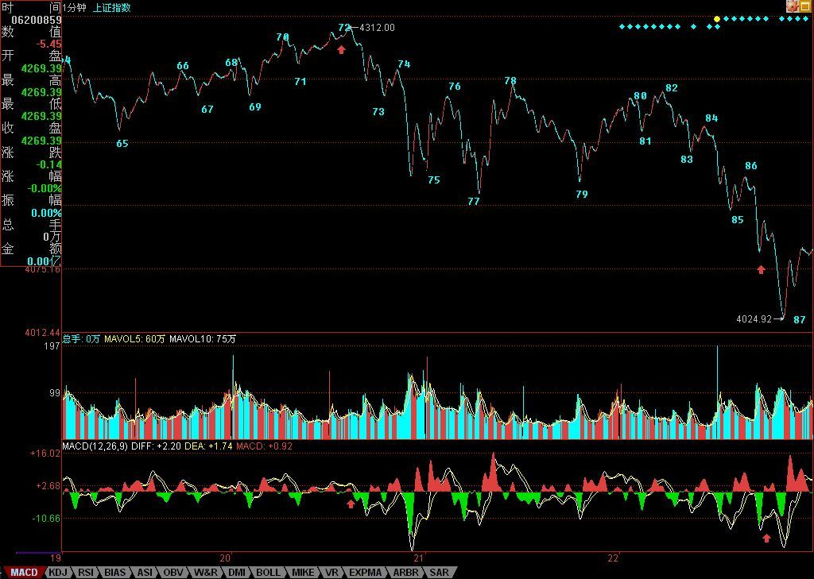 附录

由于要出差，先把这线段图贴出来，否则回来就积累一大堆 K 线，要分很多张图了。昨天说的很清楚了：“明天还是这个 4244 点，站稳就走强，否则继续 5 分钟的中枢震荡，并且要小心出现第三类卖点。” 今天的走势在 4244 点上精确地被再次压制，然后出现大幅度跳水，这些在今天走势的当下都很容易分析。81-82 的盘整背驰、84 点的第二类卖点，后面走出一个线段的标准下跌，以红箭头所指微型中枢前后出现背驰，然后有 87 的转折，但这个转折，由于 86-87 没有背驰，所以，只能是线段下级别的，因此，并不能现在就确定该线段就走完了，除非重新突破 85 的 4131 一点。

站在中枢的角度，75-84 这个 5 分钟中枢下边在 4188 点，如果后面的走势不能重新站上去，就要提防形成 5 分钟第三卖点。而前面已经说过，现在的情况 46-87 已经构成一个 30 分钟的中枢，短线的问题只是这中枢的第三段是否完成。其后就是该中枢的一个中枢震荡，该中枢区间在[4067，4192]，该中枢要管大盘一段时间直到出现 30 分钟的第三类买卖点。

下周走势十分关键，由于关系到月线、特别是季线的收盘，季线如果留出很长上影，则 7 月到 9 月的行情压力都很大。所以，对于多方来说，下周的任务就是不让季线留下长上影。只要收在 4144 点的 1/2 线上，就是多方最大的胜利。本 ID 在 5 月初关于 4144 点的 1/2 线要管大盘至少 3 个月的断言，看来肯定是成立了。

 个股方面，就看图作业吧，各位可能都发现，本 ID 一出差，本 ID 那些股票都走得没什么力，这也怪不了本 ID，大家就当成是巧合，希望里面的大小庄家也别老是这样，这样有意思吗？希望这次有点改变。 下周收盘都会解盘的，周末，各位腐败去吧。 本 ID 要去机场，先下了，再见。缠中说禅技术论坛 www.chzhshch.net 周末，用股票长沙各位一把

#### 周末，用股票长沙各位一把

 时间：2007-06-23 16:15:21

长沙，一个正被一群女性化幼男折腾着的城市，到处散发着腐烂的气息。本 ID 虽然喜欢腐败，但对女性化幼男的腐烂没兴趣。企图以贩卖中性男女糜烂中国的长沙，最近还有一个娱乐，就是关于所谓中国地王的。相比之下，曾剃头已经算是忒可爱了。

中午刚腐败结束，晚上接着来，接着的一周转战 N 省，腐败到底。有点空闲，学着画了两图，周末音乐会开不了，就用股票长沙各位一把。图一里的图形都是等价的，都是一线段；图二里，区分了一些容易混淆的。随手画的，各位凑合看吧。

长沙，最大的好处，就是没有任何 419 的诱惑，至少按照本 ID 的审美标准，这里是最安全的城市了。在这里还要度过两个安全的、没有诱惑的夜晚。那些没有诱惑的街道，如同卖点过后的下降通道。今晚，湘江上是否有一叶扁舟，浮着轻凉的月光，让本 ID 去私人股权投资一把？

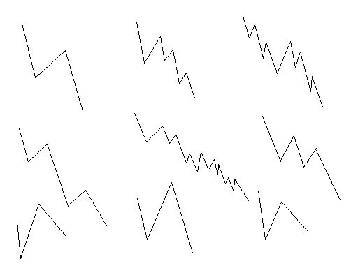 缠中说禅技术论坛 www.chzhshch.net  索道复栈道,风雨 XX 行(解盘附录)

#### 索道复栈道, 风雨 **XX** 行**(** 解盘附录**)**

 时间：2007-06-25 19:03:22  刚游山回来,当地最大几位头正在迎宾馆等着宴会.趁着换衣服的时间和各位打个招呼.本 ID 今天根本没看盘,两年来头一次,好好地游玩了一下.解盘等应酬后再写.对不起。

对不起，刚回来，看来和实业沾边的事情都是累人的，哪里有二级市场里杀进杀去来得好玩，至少不用应酬人，一个人，在一个光明或黑暗的角落，就可以呼风唤雨，管你天王老子，本 ID 该干什么是什么。但和实业相关的事情，就不是这样了。本 ID 今天游山的兴致，被这晚上的无聊应酬给消磨掉了，看来本 ID 的性格还是比较适应二级市场。

今天，留守的人都受苦了。本 ID 上周五说，本 ID 一出差，股票就不行了，希望这次有点改变，看来还是没戏。技术上，本 ID 在周五已经说得很清楚了“因此，并不能现在就确定该线段就走完了，除非重新突破 85 的 4131 一点。站在中枢的角度，75-84 这个 5 分钟中枢下边在 4188 点，如果后面的走势不能重新站上去，就要提防形成 5 分钟第三卖点。”今天的反抽，就像上周的 4244,极端精确地最高到 4131 点，这就是一个很明确的信号，后面的下跌理所当然。目前最关键的位置是 4025 点，该位置是新的 1 分钟中枢的下边，这位置不重新站住，大盘还有继续变坏。而 3982 点也是很重要，如果能重新回到上面，那至少将演化成一个新的 5 分钟中枢。如果连上面这个最基本的条件都不能满足，那大盘就一定以线段的形式下移到形成一个新的 1 分钟中枢为止，至于这个位置是多少，没必要预测，当下用背驰的方法很容易判断。

个股没什么可说的，卖点卖了，当然希望下一个买点的距离长点，这样差价才能大点，那些卖点不卖的，只能上上下下去享受了，本 ID 对电梯没兴趣，本 ID 只知道卖点出来了要卖，买点要买，你看看现在砸得狠的，日线上有哪个是好的？就看 MACD 也就知道有麻烦，就别说其他了。当然，跌多了，就要考虑密切关注回补的时机了，买点出现不懂得买，一根筋思维，同样是脑子水太多了。

 本 ID 今天豪饮一把，把加起来 N 百岁的男猿人给震住，现在脑子里的水分也开始增加，所以不能多说了，明天，解盘时间不能定，但只要有时间，一定第一时间上来的。 看来脑子水有点多了，不是明天，已经是今天了，先下，再见。缠中说禅技术论坛 www.chzhshch.net 对不起刚回宾馆，解盘洗澡后附录上

#### 对不起刚回宾馆，解盘洗澡后附录上

 时间：2007-06-27 00:20:58  今天可是看盘了，但一收盘，马上被接去给 N 百人搞了一场演讲，然后轮番应酬，刚才回宾馆，解盘洗澡后附录上。

本 ID 已经有点厌倦私人股权投资了，大概需要想想，怎么可以不应酬，也可以私人股权投资一把。最让本 ID 信心崩溃的，是晚上竟然给拉去卡拉 OK，听着那些面首们无数次走调的演唱，本 ID 给彻底折磨到想见人就痛扁一轮。在卡拉 OK 里，本 ID 唯一听过一个人是能让本 ID 满意的，一个 60 来岁老男人，80 年代初就是师长，现在可以很轻松地唱出高音降 E，王宏伟的《西部放歌》随时可以一音不落轻松唱出，本 ID 觉得他没学歌唱简直太浪费资源了。相貌堂堂，特爷们，可惜年纪偏大，否则，真有面首一把的冲动。

喝多了，废话就多，还是说大盘吧。今天的大盘，哦，对不起，应该是昨天的大盘，一点都没逃离昨天凌晨的解盘所画的圈。大盘就是以线段的形式下移到形成背驰后构成一个新的 1 分钟中枢，昨天说的 3982、4025 依然是今天的最关键位置，相应的分析，依然和昨天的一样。

 个股方面，昨天已经说了“当然，跌多了，就要考虑密切关注回补的时机了，买点出现不懂得买，一根筋思维，同样是脑子水太多了”，具体没什么可说的，按图操作吧。

明天又要去另一个省，这是本次出来的第三站了，用大幅度震荡来清洗，消化政策等的压力，这近期的策略，前面已经说过，现在依然如此。这是一个练习技术的好机会。本周站在中线角度十分关键，这在上周解盘中已经说过，月线、季线收盘，这对中线走势，有着一定的指导意义。

 对不起，现在脑子不好使，被那些五音不全的男猿人折磨得脑子生锈了，先下，再见。缠中说禅技术论坛 www.chzhshch.net 离开某地前解解今日的盘

#### 离开某地前解解今日的盘

 时间：2007-06-27 15:29:56

今天一开盘就突破 3982，所以就奠定了全天的强势基础，后面的洗盘不过是突破 4000 点后的一次回洗，让不坚定分子最后下车，然后就展开一路的上攻。1340 的回调刚好在这几天强调的 4025，这信号也太明显了。明天，下面看 4025 点能否继续站稳，上面看上周强调，周一刚好被阻击的 4131 点能否继续构成阻力。周四，是一个爱震荡的日子，而对周末效应的恐惧，也让明天走势震荡难免。而站在新的 5 分钟中枢角度，后面的走势，在该中枢第三类买点出现前，都可暂时归于中枢震荡。不会看的，就看 4131 点，该点没被有效突破前，关键是站稳 5 日线，这是今后三天大盘的关键，就是 5 日线要站住，否则还要大幅度震荡。

 中线，留给多头去修复季度 K 线的时间只有两天了，这两天很关键，本 ID 上周就说过，如果能收在 4144 点 1/2 线上是最理想的。两天，什么事都可能发生，尽力而为吧。

个股，本 ID 要提出抗议了，那十几只股票，本 ID 不看盘就全面堕落，一看盘就兴奋，这也太不地道了。里面的其他人也要干活，别都那么好吃懒做，这样身体会变胖的。一年半载下来，就会和猪八戒为伍了。本 ID 什么都不会干，就是该砸的时候砸，该买的时候买，现在，这些股票都是在保持 0 成本赚筹码的阶段，这种游戏很好玩，各位学会的一定会上瘾的，本 ID 就喜欢上上下下地抽血，是不是本 ID 的基因里有些残暴的残留？各位，什么时候也能一起残暴，那才是炒股票而不是被股票炒。

 车来了，马上要走，先下，再见。

#### 缠中说禅文集版权为缠中说禅所有 此文集整理版仅供缠中说禅论坛内部学习使用，严禁外传！ 一根筋是不适合玩震荡行情的

 时间：2007-06-28 15:53:15  应酬前抓紧时间说两句。

震荡行情是最容易玩出利润来的，但这绝对不适合一根筋思维的人。大盘的中线走势，在前面 6 月 4 日的文章里已经明确说过“而 5 月初给出的技术面分析依然有效，目前这 1/2 线已经上移到 4144 点，深圳成分指数相应位置在 13700 点，能否最终有效站稳该线，是判断中期走势是否重新趋强的关键。在此之前，大盘走势将以震荡形式逐步消化技术面、政策面的压力。其中，目前在 3600 点附近的 5 月均线将是判断大盘是否正常调整的关键，只要该线不有效跌破，那么大盘的调整在正常的范围内，否则大盘的调整时间将大为增加。”本月的走势，基本就是在这 5 月均线与 1/2 线之间的震荡，而 7 月，这判断依然成立，但要密切注意突破的方向，因为 7 月时，5 月均线将上移，空间压缩，最迟 8 月初就要选择突破方向了。之前，就是大玩震荡，狠拉狠砸，把利润给洗出来，把差价打出来。

今天的大盘，冲不破昨天给出的 4131，调整就成了必然的。然后又跌破 4025 点，所以调整就加大了，这在盘中都很容易判断出来。实际操作，特别对待震荡行情，就是要敢卖敢买，该卖一定要卖，反而买却不一定，特别对技术有点问题的，仓位可以控制好。当然，技术没问题的，这里就是天堂，一定要记住本 ID 的多次忠告：股票都是废纸，只有能弄出差价来才是抽血，否则上涨下跌不过是坐电梯，和你有什么关系？而要弄差价，用中枢震荡的手法，就是最好的，这需要刻苦的学习和练习。

把图弄上来花了点时间，图中 100 的顶背驰都看不出来的，102 的第二类卖点看不出的，都要抓紧学习。102 后面的 103 在收盘时还没走完，要 102 走完，就是要出现线段里的底背驰。而下面箭头位置，就是大盘短线的压力所在，特别是最下面一个，必须站稳，否则大盘就是最弱走势，至少要等待出现 1 分钟以上级别的背驰才有介入价值。

 忙，晚上又有应酬，下周才能回北京，季 K 线收得不会太好看了，这中线的大震荡延续时间不会短，学会震荡操作，将让你在这中线大调整中获利良多，好好学吧。 多说句废话，中国第一只在德国交易所交易的股票将在 7 月初挂牌，这是中国第一创投公司的杰作，7 月底还有韩国交易所的第一只股票，这两枪打响后，估计私人股权投资要加温了。先下，再见。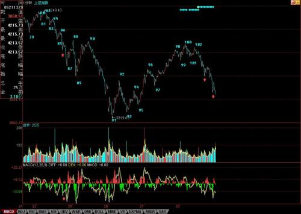 附录：

刚打开电脑，上来看看，发现有人对昨天的线段分法有疑问，这问题以前说过，就是关键是看你用多大的精确度。下图中，红箭头处是 4022.69，绿箭头处是 4022.42，按最严格的标准，精确到小数点后两位，这就没破坏原来的线段，所以就不是新的线段。当然，如果统一按个位数是精确度，直接取整，那么这就等于两处有重合，那按这标准，就可以定义为新线段（像下图一样）。但如果按四舍五入，那前面是 4023，后面是 4022，就不能这样定义了。

 新线段的一个最重要标准就是一定要破坏老线段的结构，例如下跌的线段，后高点一定低于前低点。 为了照顾各位的习惯，也为了简单，以后就统一标准，用直接取整的办法来确认。所以，线段分类就可以改用下图了。 先下，下午收盘后见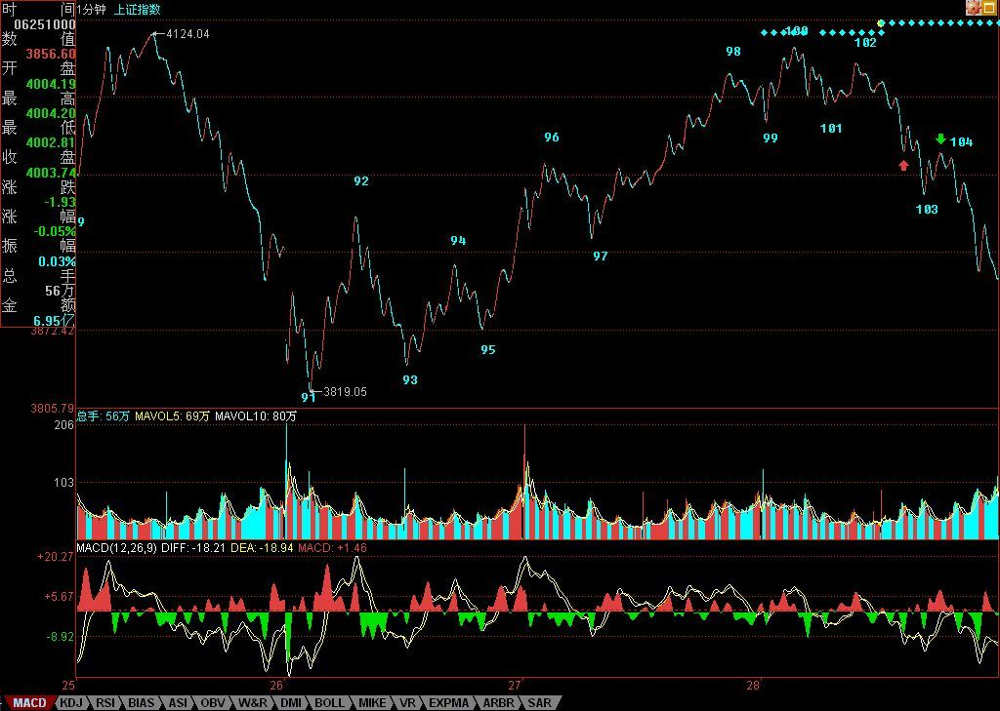

#### 解盘并说说中短线走势

 时间：2007-06-29 15:45:10

昨天解盘中已经说到，如果图中红箭头所指位置不能突破，那么大盘就是最弱走势，今天，大盘盘中的反弹就刚好被这位置 3919 点所压制，一点都不差，这就如同前面的 4244、4131 等一样，都是极端精确的。谁告诉你本 ID 理论没有预测功能的，只是预测都是无聊玩意，没必要浪费时间。关键还是当下的操作。

今天 105 的背驰十分简单，但由于前面没有明确的 1 分钟中枢，所以这种背驰一般都只构成盘中的意义，昨天已经说过，只有 1 分钟以上级别的背驰才有参与意义。目前交易成本这么贵，又不是 T+0，所以不熟练的，一定只能参与一些大级别的活动，太小的，估计只能用在权证或特别强势的股票上。但技术好的除外。今天，这样的震荡可以又吸出不少的血。

由于季线有 500 点的上影，所以该上影将一路压制 7-9 月的走势，本 ID 的那条 1/2 线，下月将上移到 4159 点，在站稳该线之前，大盘不可能展开象样的行情，只能如本 ID6 月 4 日文章所说，就是一个大震荡。下月的关键是 5 月均线，如果不破，那么大盘还有机会走三角形的整理，否则，一个平台型是不可避免的。本 ID 在 6 月 5 日反弹时已经明确说过，这个反弹最终不可能演化成 V 型，现在看来，最强的也就是三角形，其次是平台型，所谓平台型，就是要再次考验 6 月 5 日的低点。

当然，现在大盘依然存在走三角形的可能，下周是关键，5 月均线不能有效跌破，而好的介入时机，还是至少是 1 分钟以上级别的背驰，反弹的压力，3919 以及最重要的是 5 周均线。对于技术不好的，对震荡行情没把握的，在 5 周均线重新站稳之前，都可以不参与任何活动，多读点本 ID 的帖子更好。但是，像技术好的，如同本 ID 般经常要活动一下才舒服的，就可以在震荡行情中大吸其血。

注意，玩震荡一定要等适合自己资金的针对具体个股的较大买点，然后到较大级别卖点一定要卖，否则就是坐电梯，没意义了。这种活动必须多练习才有感觉的，如果觉得自己没有这方面的天赋，那就少弄，上网多弄 419 算了。

 晚上还有应酬，先下了，本周的音乐会也没法开，就用各自猛烈的腐败活动去替代。周末，腐败快乐。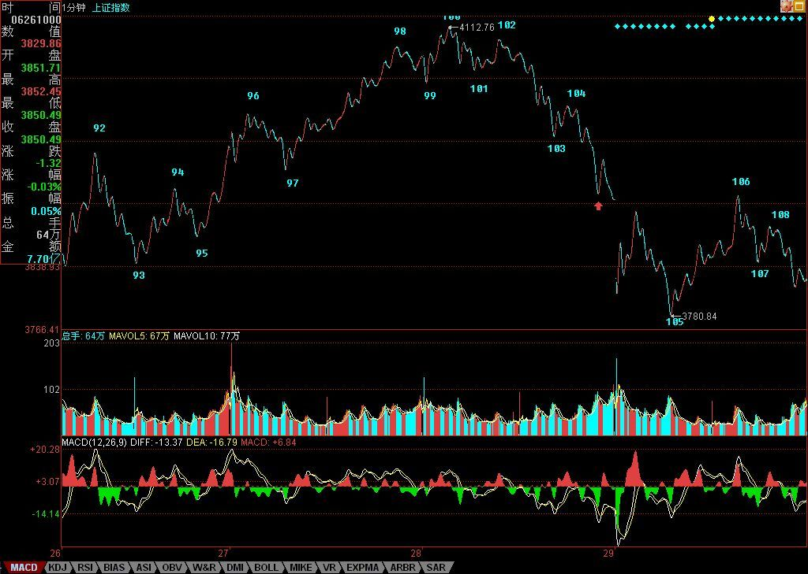

#### 解盘：今天看不明白的都请严重补课。

 时间：2007-07-02 15:32:58

今天的走势，简直是标准教科书，连这都看不明白，你要严重补课了。下图中 110 点的线段里的小顶背驰，111 点的小底背驰，都是极端标准的。111 点，看不明白的，看看 MACD 里那两个红箭头指着的绿柱子面积比。如果还有人问，为什么前面的不是，就一定要把分型、笔、线段那课以及 63 那课好好看了。图中红箭头处，趁着现在 1 分钟图还能看到，请去好好研究那为什么是一笔，那底分型是怎么构成的，这都有最严格的标准。

至于走势，没什么可说的，就是震荡，这里是本 ID 理论的天堂，如果说单边势傻瓜都能赚钱，那么这种市场，就不是一般人能把握的了。能把握，就有了一个好的吸血机器，练习好了，那算有点模样。具体的中枢分析，本 ID 不准备说了，有这么明确的线段划分，按照递归定义，答案不难得到，如果这都不练习一下，那就没法学了。大的技术位，和周五说的没什么不同，唯一需要补充的，就是图中 107 这一点，如果能站稳，至少这中枢震荡是有保证的，上面还是 3919 点是第一压力，现在，等于成了一颈线位置了。再上面，就是 5 周均线的位置。大图上说，今天是受到 5 月均线的支持产生的反弹，这线最重要，三角形还是平台型，就看这 5 月均线是否有效跌破了。

注意，再次强调，这种震荡行情，没什么基础的，最好就观望，半仓、空仓都无所谓，没这本事，就不一定玩这游戏，当然，如果你要学习，要练习，可以用少量资金。对于初学者，震荡的原则就是，宁愿卖早，一定不卖晚，有钱，还怕买不到股票？

个股方面，本 ID 那些股票各位都知道，除了新进去的二、三只，本 ID 现在是在保持 0 成本赚筹码阶段，震荡幅度越大越高兴，技术不好的、心脏不好的，千万别参与，找些脾气好点的股票，本 ID 的股票，一般脾气都不大好。

 先下，下午、晚上，忙，还要赶回北京。明天见。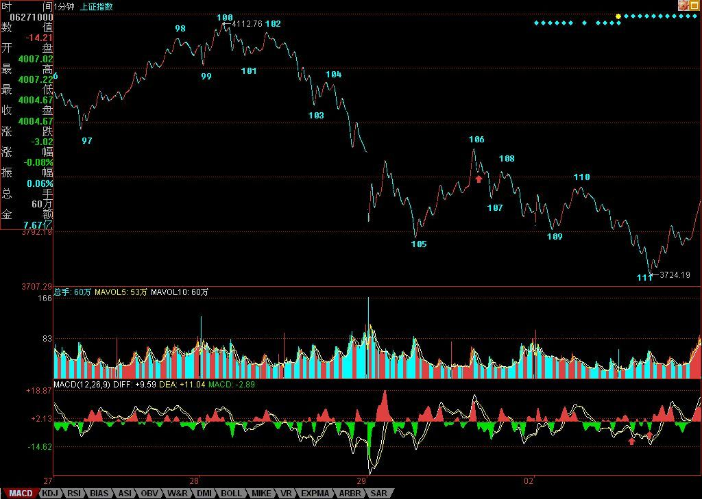 缠中说禅技术论坛 www.chzhshch.net 今日解盘：3919 颈线折磨你

#### 今日解盘：**3919** 颈线折磨你

 时间：2007-07-03 15:30:02

一回来，N 多的腐败活动，今晚又要看演出，所以只能粗略说说。今天的大盘，就是在这 N 天反复强调的 3919 颈线下进行的蓄势，现在，图形上头肩底的雏形已经基本按剧本构造完毕，但如果颈线突破不了，那还是白搞。现在，人心涣散，谋事能成的概率，当然没有前面的多了。现在，剧本中最好的情节，就是走三角形，这次上去是 D 段。但这次的把握性，比上次 B 段那次要差，剧本只能按每天一步步演，下面最关键的就是这颈线的突破与回抽确认，但现在人气涣散，最主要是现在有些人，不断放暗枪，特别那些等额度的，肯定不想上，希望走平台型，因此不断捣乱。而走三角形的，又不一定很团结，只能见一步走一步，但本 ID 会尽力的，能走到哪里算哪里。

今天本 ID 已经足够出力了，16 只里 3 只 9%以上，而且还有其他活不能公开的，也算本 ID 回北京第一天的一个见面礼了，但本 ID 从来不当解放军，只是煽风点火、顺势而为，别指望本 ID 当举杠铃的。那种一根筋的多头思维，是典型的散户思维。

 注意，一旦大盘不配合，本 ID 依然如前面那些，砸起来比谁都凶。本 ID 现在是保持 0 成本赚筹码阶段，最喜欢的就是砸盘。当然，只要大盘人气配合，本 ID 依然会轮动，但一定不会当解放军。 废话不想说了，今天的分段太简单，具体的明天一起给出。先下，4 点有一个会，沟通一下思想，然后晚上看演出，明早见。

#### 有些市是必须逆着而为的。

 时间：2007-07-04 15:45:01

散户多是墙头草，但如果所有的中国人都成了墙头草，那么，中国金融市场等着被人宰割的日子就不远了。昨天已经说了，那些正在等额度的，都希望走平台型，3000 点下的时候，本 ID 也逆过一次市而为，当时博客都有部分记录，那次，这些汉奸与目前等额度的一批，希望从 3000 点下一直回到 2000 点下做一个大差价，但最终他们没有得逞。看看这里春节前后的帖子，就知道斗争的激烈。

这次，道理一样，那些等额度的，希望他们新增加的额度能够买到他们所谓符合投资价值的股票，而国内配合他们的，其他跟着他们的，都在暗地里使坏，这在昨天的解盘里已经说过。这时候，必须有人站出来，就像春节前 3000 点以下，那罗美国老头忽悠时，必须有人站出来。那次，本 ID 站出来了，这次也一样，现在的战役，就是不能让汉奸与等额度的人得逞，3000 点那次，汉奸和等额度的人大败，这次，条件更险恶，但有些事情是必须干的，就像上次在 3000 点下，本 ID 就说过，有些事只能北京人干，北京人就是牛 B，就像昨天在人民大会堂唱响国际歌。

技术上，压力惊人，但有些事情，就是要逆市而为。今天早上，两次的冲击，完全没有任何人跟进，所有的散户都落荒而逃，汉奸和等额度的不断犯坏，看看今天中石化等指标股上，再看看今天代表指标股的白线一直在黄线之下就知道了。但这次，汉奸和等额度的还是落空了，指数是跌了，但今天的游击战术还是成功了。

现在，就是要放弃指数，对所有有中长线价值的股票进行战略性建仓，让汉奸们、等额度的人，就算真打出平台型，也买不到好股票。整体上市、大重组、中小盘成长股票，都是可以游击战的领域，就让汉奸们去砸指标股好了，指标股不是不出手，而是要等待时机，时机一到，游击战就要转化为大兵团作战，就像 3000 点那次本 ID 演示的联通与中行一样。

对于散户来说，你们那些都是糊口的钱，没必须在这么血腥的斗争中坚持，就像八年抗战，在上海，不一样有很多面首活得很好？这样，抗战胜利不一样能分点好？这世界上，除了当汉奸，还可以当顺民，管他是日本人还是美国人。但本 ID 不可以，真正的北京人都不可以，本 ID 就是看不了汉奸和等额度的鬼子得逞，本 ID 的钱都不等着花，钱是留着买子弹，打鬼子和汉奸的。

现在的环境有什么可怕的，95 年那么凶横的环境下，一样能掀起一轮轰轰烈烈的重组行情，而带头的，还记得是哪里的股票吗？昨天，在人民大会堂可以唱响国际歌，在最凶险的走势中，一样可以唱响游击队之歌。

技术没什么可说的，颈线不能放量突破，图形自然受到破坏，大盘最坏的情况，就是进入缩量阴跌，散户的对策，本 ID 已经多次说过了，如果你没有技术、没有资金实力，那就半仓甚至空仓去当顺民，等待抗战胜利的机会然后再出来。

 而对于有一定实力的资金，就选好目标，现在的股票也不过就 1000 来只，难道中国还没有 1000 多的游击队，在每个适合的股票上进行游击战？本 ID 已经选好目标了，你们呢？ 好，不说了，没有资金实力的，就按技术来，唯一需要再次提醒的，就是要放大操作的级别，特别技术好不太好的。 但，只要给本 ID 一个机会，反攻是必然的，在拉锯中消耗汉奸和鬼子，这就策略。先下，后面还有一大堆事情等着，不能多说了，再见。

#### 缠中说禅文集版权为缠中说禅所有 此文集整理版仅供缠中说禅论坛内部学习使用，严禁外传！ 告全国散户、大股东、庄家、基金及管理层书

 时间：2007-07-04 23:34:45

中国的资本市场，必将成为世界性的市场，因此，必然将吸引世界性的资金参与其中，但所有参与中国资本市场的资金，都必须按中国人制定的规则办事，任何企图通过收买、使诈、玩坏来达到不可告人目的的，都应得到应有惩罚。

管理层最重要的任务是什么？就是保证金融市场的绝对安全，这是和国防同等重要的事情。而中国金融市场绝对安全的最基本标志是什么？就是中国的金融市场是掌握在中国人手里的，是任何外国势力都不能攻陷的，这是不允许有租界、不允许 0.00001%的殖民色彩、不允许金融市场的任何一个山头去飘扬任何非中国的旗帜，无论那是太阳还是星条。

但众所周知的，2005 年中的 1000 点飘扬着各色的旗帜，汉奸及其主子晃悠着各色的旗帜永远历史地在 2005 年的上海指数 1000 点处显摆，2007 年春节前的 3000 点下，他们出手了，企图把中国资本市场的轮盘永远控制在自己手里，不过，那次，一场血与火的战争，他们失败了，1997 年后，汉奸及其主子的嚣张气焰又一次被打击，但他们从来都不会死心。这次，分配给他们的额度一下大幅度增加，但任何对这个市场有一点了解的人都知道，其实，这连冰山一角都算不上，躲藏其后的资金，比这多得多。但，额度的增加，给了他们一个新的借口，他们又有了新的目标。

虽然中国人好客，1000 点可以先让客人吃，甚至这次也可以弄个 2000 点再让客人先吃，好的都先让客人吃，但是，某些客人绝对不光光只想当客人，他们不光光只想吃几个底部，卖几个顶部，他们窥视的是整个中国的资本市场，他们现在的所有行为，不过是在预演，不过是要去培养一种习惯、一种情绪，一种潜移默化、不断积聚的习惯，最终，当他们发动致命一击时，这些习惯、情绪将起着关键作用，那时候才警觉，就太晚了。

必须如 3000 点下那次一样，打乱其节奏、打乱其计划，不能让其得逞，否则，一旦让他们得逞一次，以后就永远落入其圈套、节奏之中。一个最简单的问题，请问，难道他们每一次提高额度，市场都要回调 60%来等他们买入，这才是中国人的好客之道？要表现好客，2005 年的 1000 点已经够了，以后还有，那不是傻蛋就是别有用心。

任何的资本市场，都有大鳄，如果杀光了本国的大鳄，那不过是让外国大鳄横行。中国的金融市场，也需要自己强大的海陆空三军，在现代社会里，这甚至是更为重要的国防力量。只有脑子都是废水的人才会认为，只有上涨才有操控，难道下跌就不可以操控？但现实却是，只有因拉抬坐牢的，却没有因打压坐牢的，还是问一个最简单的问题，导致 2001 年后，在中国经济飞速发展的背景下打压 4 年，近 60%去请外国人客的人，是否要背负法律责任？是否需要去彻查某些外国资金违反中国法律的勾当？是否要对某些有罪恶勾当的资金全部没收、永远禁入？管理层的监管系统能不能环保一点，别光看着红，涨得多的，需不需要监控一下主要针对指标个股刻意打压的帐号？难道你们的分辨力连刻意打压与正常卖出都分不清楚？对那些大各大传播途径散播胡乱编造消息的是否要采取必要措施？难道在发生灾害时能允许人随意散播恐慌言论吗？现在的手段，难道还不足以对此进行有效措施吗？

对于全流通后的大股东，好好管好你们的企业，只要你的企业能在世界上为中国人扬眉吐气，那你的股价、财富自然也扬眉吐气，中国的资本市场会为所有有能力、有抱负的中国企业提供最强大的能量，这是你们最坚强的后盾，让你们去征服世界。一个没有征服世界雄心的中国企业，不配当中国资本市场的上市公司。

对于各路庄家，你们辛苦了，任何行业都有害群之马，庄家必须得到正名，不能因为少数的害群之马而败坏了整个行业。没有任何资本市场是不存在庄家的，但庄家的形式，也必须与时俱进，像以前那种老模式，路子将越来越窄。必须实现庄家新的模式，但无论模式如何，有一点是必须知道的，请管好自己的一亩三分地，别让鬼佬抄了后路。现在不过就 1000 来只股票，难道中国连 1000 来个合格的庄家都没有？任何一个中国庄家，最基本的标准就是，不能让鬼佬抄了后路，宁愿当山大王，也决不当汉奸头子吃鬼佬的屁。

 对于基金，因为有些基金的汉奸背景，就不说他们了。所有不想汉奸化的基金，必须树立有中国特色的投资理念为己任，一个被鬼佬完全洗脑的基金，是没资格管理中国老百姓的钱的。

对于散户，一定只能拿出空闲的钱来参与资本市场，任何有压力的钱，都不能也不应该来这个战场中。对于个人来说，资本市场不过是生活的一部分，没必要为此而付出所有的生活。如果你市场中的钱不符合以上要求，那么请等待一个好的机会，把该留的钱留好，绝对不能因为股票而影响正常的生活。而对于那些无压力的钱，也不能去当炮灰了，风险太大的活动是绝对不能参加的。而且，大兵团作战，其实你们也帮不上什么忙，一定要等到买点，特别是大级别的买点出现后才介入，市场是合力的结果，等大兵团作战打出结果来，大合力合力出方向来，才好介入，否则刀光剑影、飞机导弹，弄伤了就不好了。像本 ID 这种人，就算打败了，也是好吃好住，一生无忧，但散户就不同了，所以一定记住下面几点：

 散户三大纪律 一、只用空闲的钱参与市场二、必须等大兵团作战有结果才介入，要等大级别的买点。即使是本 ID 输了，汉奸鬼佬赢了，他们最终也是要搞上去的，这种，复仇的种子才能保存，楚虽三户可亡秦，有种子就有希望。 三、坚决不抬汉奸鬼佬的高位轿子，要练好技术，从底位开始，逐步抽光他们的血。

盘子控在汉奸与鬼佬手里，是没有金融安全可言的，这需要中国的散户、大股东、庄家、基金及管理层共同的努力。为了打乱汉奸鬼佬的节奏，本 ID 可以牺牲掉，但希望能换来国的散户、大股东、庄家、基金及管理层共同的努力，一致对外。中国的资本市场，只能中国人说了算。

 最后，临屏赋《满江红》以告国人。 满江红 缠中说禅 万古长空，今犹昔，一朝风月。 何处住？春花夏雨，秋鸿冬雪。 百代浮华皆作土，千江吸尽无堪说。 问世间，多少梦消磨、英雄血。 星旋轨，天补裂，山崩柱，河倾缺。 捣神宫鬼府，凤巢龙穴。 怒剑穿云惊浩宇，狂涛卷日横孤筏。 纵生死，劫火洗乾坤，齐欢悦。时间：2007-07-05 15:43:43

所有的战役都不是一天能完成的，现在，进行的是一项不可能完成的任务，谁都知道，技术上周线刚破位，所以的技术指标与大的环境都不可能让这样的任务完成，但本 ID 既然这样选择了，就义无返顾。今天，是指标股被全面打压的一天。上下午两次的介入，同样 50 点的反弹，都以失败告终，但开弓没有回头箭，抗战必须坚持而且继续坚持，每一次的阻击，都是一次拉锯与消耗。没有正面的阻击，游击战争是开展不起来的。看看今天中石化等放出的量就知道了，虽然这是凭空接坠石，但必须接。而且，这也是以后需要的一些基本筹码。

今天的能量消耗不大，只属于试盘阶段，现在重点在三大领域，就是整体上市、大重组、中小成长股，这是与指数无关的。技术上，必须依靠年线，那些没有回到年线的股票，都不足以支持。但，这样的战役，靠一方力量是不足以完成的，像今天的两次反抽，最后都是因为没有呼应而夭折。但，明知道失败也要干，对技术指标上的战术准备，这两次反弹也是必要的。

但战争有其规律，不能莽撞，技术上，所有的因数都有利于汉奸与等额度的，但所有技术都是合力的结果，本 ID 站出来，而且将继续义无返顾地干下去，就是要改变着合力，这合力是由每个人组成的，这是一场成功率只有 1%的战争，每多一份努力，都是值得的。而改变合力，最终都反映在某级别的买点上，本 ID 就是要在逐步的分级抵抗中，把大级别的买点给构造出来，这就是今后一段时间的任务。

 好了，最终需要的工作太多，不能多说了，先下，再见。时间：2007-07-05 23:04:16

首先，必须要明确，各位的状况和本 ID 有很多本质的不同。各位也知道，本 ID6 月后就忙于 PE 的事情，可以很明确地说，本 ID 一部分资金已经分流到 PE 上去，也就是说，就算本 ID 这次大败，依然有翻身重来的机会，而且一定可以翻身重来。正因为有这样的背景，所以各位第一不用为本 ID 担心，第二必须知道，本 ID 这样干并不是不顾后果的意气之举，而是进退有度的。

其次，本 ID 必须在这时候站出来，败了，大不了当股东，哪天本 ID 心情不好，找一个面首收购了自己当大股东算了，当然，这就成了走唐家兄弟的老路，没什么意思。或者，再折腾几年，等本 ID 厌倦了，就不玩了，出来玩文化也很好。而各位并没有本 ID 如此自如的进退之路，所以，一定要量力而行。

因为本 ID 知道的太多，所以必须要干上这一仗，当然，这里不光是本 ID 自己的，本 ID 在市场上干过这么多事情，联合点人干点事，还是没问题的。站在纯技术的角度，这样干，绝对是脑子进水，但人，有时候脑子就是要进点水，特别当这事必须干时就更应义无返顾。本 ID 当然知道自己理论中耐心等待买点的道理，但站在实际层面，本 ID 必须追究，这个买点不能如 1000 点那样被汉奸了。站在纯技术的角度，本 ID 现在的所有行为都是错误的，正如站在所谓纯人性的角度，用胸口顶枪口肯定是有病的，但人，有时候就是要病上一病。

但对于一般的散户，完全没必要参与这种活动，各位应该利用市场机会去壮大自己，没必要干用胸口顶枪口的傻事。对于各位来说，根本不需要知道这市场的买卖点是如何合力构成的，你们只需要知道合力的结果，根据结果进行操作。

目前的技术形态，站在最恶劣的角度，如果是对整轮行情的一个中级调整，比较极端的幅度是 2/3，也就是说，调整到 2100 点也是毫不奇怪的，所以，没必要有任何站岗的无聊思想。学了本 ID 的理论，唯一需要坚持的就是根据自己操作级别，买点买，卖点卖。等各位有这个能力后，才学本 ID 如此一病吧。

市场就是战场，一旦开战，在战场上，就是无情的，本 ID 只考虑如何去夺取战争的主动权，这里，一切手法都可以用上，本 ID 不希望在打仗时有什么顾虑，在战场上，分不清什么散户、机构。而且本 ID 这次战役的目标，也不是当什么解放军，只是要打乱某些人的节奏，让某些人的目的不能得逞。如果一定要硬加上一个解放军的任务，只能是两头不着边。解放军只能是一个顺带的任务，而不是战役的前提。所以这盆冷水，本 ID 是一定要泼的，本 ID 从来都实话实说，不想让人有任何不切实际的误解。

对于散户来说，市场中的真正的解放军，只能是你自己，你要掌握好技术，要对股市有充分的理解，要明白股票都是废纸，要知道，股票只是抽血的凭证。然后，放下一切幻想，如果有可能就学好本 ID 的理论，看图作业，这才是散户战胜市场之道，只有自己壮大了，才是对汉奸和鬼子最大的打击。而本 ID 有这个能力，当然需要更多的承担，这必须要分清楚。

本 ID 这次的任务，不是原来那 16 只股票可以完成的（这些股票，中长线的角度依然会关照的，对他们，都是保持 0 成本增加筹码的阶段），本 ID 现在正在开辟新的战场，介入一些对股市更有影响的品种，大致方向本 ID 已经说了，就是整体上市（包括中字头）的、大重组（包括老树发新枝那种）、中小成长。技术上，都是有年线可以依托的。本 ID 不可能去接什么基金、甚至汉奸的高位股票，那真有病了。但像中石化、联通等指标股，当然是需要慢慢控制的，否则，就没有话语权了。逐步，将慢慢掀起整体上市、大重组、中小成长的行情，把整个不利的局面扭转过来。

现在，要把人心扭转，不是一天半天的事情，必须有股票，逐步走出有号召力的行情来，才会得到市场的响应。当然，这市场不是本 ID 的，其他有实力的，如果都能选择好攻击对象，为市场的稳定和对汉奸的阻击给出自己的贡献，那么本 ID 的星火最终就可以燎原。而市场好了，解放军自然就来了，这才是根本之道。

 光有热血，当义和团，是打不赢汉奸鬼子的。先下，再见。 散户三大纪律 一、只用空闲的钱参与市场 二、必须等大兵团作战有结果才介入，要等大级别的买点。即使是本 ID 输了，汉奸鬼佬赢了，他们最终也是要搞上去的，这种，复仇的种子才能保存，楚虽三户可亡秦，有种子就有希望。三、坚决不抬汉奸鬼佬的高位轿子，要练好技术，从底位开始，逐步抽光他们的血。

#### 以黄河名字展开的绝地反击

 时间：2007-07-06 15:50:50

今天一大早，本 ID 先把博客的个性图片换成了本 ID 写的《满江红》，再把《黄河大合唱》中选了四段，按交响乐的形式组成一四乐章的曲子放到背景音乐上，然后就开始了开盘前的一切准备。本 ID 知道，明天是 7 月 7 日，70 年前的英灵在天上看着。

具体的盘中事情，各位就没必要知道了，各位只需要知道结果，而结果是什么，已经永远刻在中国证券历史的 K 线图上。当然，如果要学技术，要当猎鲸者的，请好好去研究一下，从昨天凭空接坠石的两波反抽，到今天早上一开始的急拉，到后面的下跌，是如何构筑一个良好的技术反攻图形的，例如可以看看 5 分钟图，是如何用钱把这个底背驰给构造出来的。本 ID 也不能违反本 ID 的理论，就像牛顿也不能让苹果尽往天上飞。

当然，本 ID 没可能干完所有的事情，只不过点了一把火，后来就星火燎原了。市场是大家的，不是本 ID 一个人的。至于具体的个股，就不方便说了，免得给人以把柄。不过，这里的人都这么冰雪聪明的，不说而说最终都是说了。

 大的技术形态上，依然有利于某些人，所以，一切并不会因为一根阳包阴就天下太平，这就当是平型关一战吧，但已足以向某些人表明最基本的态度了，特别在这样一个特殊的日子里。 对于散户来说，一定要坚持按自己的级别买点买、卖点卖，这样才是取胜之道。特别在这种震荡市中，一定要把握好节奏。 本 ID 也累了，不想多说什么了，周末腐败去吧，周日继续音乐会。 最后，各位如果还有兴趣，请再读读这首词。 满江红

缠中说禅万古长空，今犹昔，一朝风月。何处住？春花夏雨，秋鸿冬雪。

 百代浮华皆作土，千江吸尽无堪说。 问世间，多少梦消磨、英雄血。 星旋轨，天补裂，山崩柱，河倾缺。 捣神宫鬼府，凤巢龙穴。怒剑穿云惊浩宇，狂涛卷日横孤筏。纵生死，劫火洗乾坤，齐欢悦。

#### 缠中说禅文集版权为缠中说禅所有 此文集整理版仅供缠中说禅论坛内部学习使用，严禁外传！ 大盘长中短走势略说

 时间：2007-07-08 22:16:44  市场走势是合力的结果，市场不是本 ID 一个人的，本 ID 这一方的力量也不可能就是合力本身。目前市场走势，存在三种选择，而每一种选择对应着不同的多方能量要求，依次如下： 一、三角形调整

这种走势，要求的多方能量最大，具体走势分析，从 530 开始，大盘完成了三角形的前三段，目前正走三角形的第四段向上。这种走势要成立，前提就是要重新有效突破 3919 点的颈线，否则，如果没有足够能量达到这一点，大盘的三角形形态最终不可能成立。

 二、平台型调整 不能重新站稳 3919 点，然后再逐步积聚空方能量，再次考验 3400 点低位，最强的平台型可以在 3400 点上完成，而一般地，将跌破 3400 点形成空头陷阱，极限位置可以达到 2800 点附近。 三、大平台型调整 这种情况下，大盘的调整时间将大幅度增加，也就是说第二种的平台形成后，形成一个大的反弹段后重新进入跌势，整个调整就是针对 1000 点上来的两年行情的大调整，极限位置，可以达到 2100 点附近。

前两种调整，时间都不会太长，最快的情况下，7 月份就可以完成调整。而后一种情况，调整至少延续半年。注意，市场的任何走势都是当下形成的，并没有任何上帝规定现在就要选择哪一种调整方式，市场最终走势是合力的结果，所以，本 ID 上周的努力，并不是毫无用处的，所谓绝地反击，就是要在最合适的时机，四两拨千斤，用分力去改变合力，让合力按更好的选择去选择。

当然，所有的分力，无论多强大，最终都是分力，任何分力，把自己当合力了，就是脑子水太多的表现。世界上没有什么救世主、大救星，因为世界上没有任何分力就是合力本身，那种把自己当救世主、大救星，或者企求救世主、大救星的，都是脑子注水了。

对于一般散户来说，只需要根据本 ID 的理论来，根据合力本身的轨迹来。有人可能疑问，如果人人都根据合力来，等市场选择方向，那么市场还会波动吗？这是典型的脑子进水想法。市场有各种不同的利益，不同的利益构成不同的分力，任何时候都不缺乏不同的分力，除非这世界上没有了利益的分歧。但没有利益分歧的世界，至少不是目前的世界。

不用讳言，打击汉奸，不让鬼子霸占中国的金融市场，这也是一种利益，这也是一种利益驱动，所以就有了本 ID 上周的分力，就这么简单。这种利益是和鬼子、汉奸的根本对立的，所以要打仗，而打仗，没有任何上帝保证谁谁谁一定赢，所以本 ID 已经很明确地说，这次比春节前后本 ID 现场直播那次困难大多了，但本 ID 即使只有 1%的把握也要干，这和任何技术无关，只是利益驱动，只是不希望鬼子汉奸横行的利益驱动。

但，对于散户来说，就像战场上打仗，散户就是一般的老百姓，哪里有让老百姓直接上战场打阵地战的？散户就算打，也只能打游击战，阵地战不仅打不起也输不起。散户和本 ID 这种人是有本质区别的，本 ID 阵地战打败了还可以打游击战，等大机会一到，随时又可以招兵买马、找到大量新的资金来大打战略大反攻，不是本 ID 看不起散户，而且很客观现实地根据不同的存在状态给出的客观建议。

 所以，对于散户来说，究竟最终选择哪种调整方式根本不重要，最重要的就是要用本 ID 的理论，根据自己的操作级别，买点买、卖点卖，大打游击战，这才是散户该干的事情。 当然，如果你是散户，又没有打游击战的胆识，那么你就当顺民，就把仓位空掉，完全不参与这市场的操作，等市场调整完再说。

还有一种，就是干脆全仓不动，反正无论哪种调整，最终还是要结束的，最终还是要重新开始行情，中国股市大牛市的基础一点都没改变，20 年 3 万点这过于保守的结论依然成立、甚至要大大向 4 万、5 万点修正，只要拿着有着大潜质的股票，这些小波动根本不算什么。例如，本 ID 告诉各位的年线附近，中字头、大重组、整体上市、中小成长等股票，任何大盘的调整，只是提供一个中长线建仓的机会。

例如，那只中字头的唐家兄弟的老股票，如此大力度的重组（以后就知道，现在没必要说），如此深厚的大股东背景，如此完美的图形，虽然本 ID 很讨厌唐家兄弟，很鄙视他们智力低下的游戏技巧，但最近还是对这股票上下其手？而这种股票，就算是 15.19 元买了，解套挣大钱，还不是迟早的事情？问题不是你什么价格买，而是你是否有技术把成本降下来，或者，即使你没那技术，那你是否有持股的耐心与决心。否则，整天贪嗔痴疑慢中当惊弓之鸟、追涨杀跌，上帝他姥姥的姥姥都救不了你。

注意，本 ID 这只是举例，本 ID 最近上下其手的又不仅仅是这股票，而且更重要的是，并不是本 ID 上下其手的股票才是好股票，别的，有大买点、大题材、大背景的股票，都必须中长线密切关注。但最重要的，还是你的技术与心态，如果是烂技术加烂心态，任何股票都成了烂股。

股票，是废纸，玩不好，就是股票吸你血而不是相反；但站在国家的金融战略的大背景下，股票又是维护国家金融安全的关键筹码，一场虚拟战争的光剑。这两者，来自对股票观察的两个不同视角，没有对错，关键你的实力与位置。只有认清楚自己的实力与位置，才可能采取相应合适的操作，没有任何操作是适合所有人的。

 好了，太晚了，先下，明天见。缠中说禅技术论坛 www.chzhshch.net 中国股市前途的大决战

#### 中国股市前途的大决战

 时间：2007-07-09 15:35:37  大决战的第一目标，今天已经达到，就是用比下跌更低级别、更猛烈的方式重新回来前面 3900 点下的中枢里。只要回到该中枢里，一切都可以下回分解了，多空都将有一个喘息的时间去思考下一步的走法。

由于现在是打仗时期，本 ID 的分段就不要放上来了，免得汉奸鬼子从中揣测本 ID 的意图。但根据本 ID 前面给的分型、笔、段的原则，其实并不难解决。昨天的大盘长中短走势略说已经把大盘的长中短走势按纯理论分析得十分清楚了，各位根据实际走势，不难发现最终合力选择的结果。

 本 ID 这分力，当然是要选择第一种走法，而且三角形这选择，本 ID 也不是现在才说的，这也是上周出手的主要技术上理由。当然，由于本 ID 现在是身在此山中，所以多说也没用。

从今天下午开始，汉奸鬼子就开始加大反击力度了，明天，这力度会更加大，不过这都是在本 ID 的预料中，大不了，就再玩玩中枢震荡。从纯图形看，汉奸鬼子肯定不希望现在的大头肩底最终能成立，这就是斗争的关键所在。

个股方面，本 ID 的股票都是中长线介入的，都有足够的基本面和战略面的理由才介入的。当然，对于本 ID 这种资金来说，有时候介入的股票，不一定是基本面很明确的，但本 ID 可能是先介入，再改造其基本面。例如，最近在年线附近介入的一只股票，现在才 7、8 元，但他将生产的产品，比三一重工的最大利润的拳头产品成本低 30%以上，马上就开始生产，三一这次可麻烦大了。本来这样的股票是很好的，但该股票在基本面上有些很不明朗的因数，所以本来这股票，应该现在就应该在 30 元以上位置的，就因为这基本面上的某个因数，所以不能太用力玩弄这面首。而这个因数能否解决，本 ID 也没把握，也只能看一步走一步，所以这种股票，也就只能让本 ID 自己独自去偷欢了。

 总之，股票这种面首，一定要控制成本，不要追高，有技术的，一定要通过震荡把成本往 0 甚至负处玩弄下去，这才是玩弄股票之道。 最近太忙，没时间和各位回答问题了，对不起，先下，再见。

#### **3919** 点继续折磨你

 时间：2007-07-10 15:43:11  今天的调整如期而至，这点在昨天已经说了。这种调整，无论多头空头，都是需要的，所以可以说是众望所归。今天由于金融股的超好业绩，引发大盘瞬间突破 3919 点，这并没有改变该位置的强大压制作用。

现在本 ID 与汉奸鬼子的分歧在于，这个 3919 点颈线下的头肩底是否能形成。所以，真正的鏖战还在后面。当然，其实最后是什么图形并不重要，最终都要归结到 3919 点颈线的有效突破，如果这一点达不到，其他一切都没意义。

对于散户来说，本 ID 已经多次强调，你们只需要知道游击战怎么打，看着市场的最终合力划出的轨迹、根据自己设定的级别来操作，最后就算本 ID 打败了，你们也没必要陪本 ID 一起去失败，该卖就卖，该买就买，根据图形来，而不是根据其他任何原因来。

个股方面的选择，从纯技术的角度，一种就是已经下跌 50%上下，在年线、至少是半年线附近，有明显新资金介入的有题材、有潜质的中低价股票，另一种就是超强势的股票，但这种股票，一旦大盘逆转，就有补跌的可能，因此对技术的要求特别高。现在对个股，一定要抱着中长线建仓的心态，当然，有些短线题材股，会继续表现的，但这里的风险比上半年要大多了。

注意，对于散户来说，建仓完全可以是动态的，也就是说，你可以反复操作一只股票，这样把成本减下去，反复强调，在市场上要生存，关键的就是成本，一般股票在构筑底部时，一般震荡都比较大，其实是很容易把握的。而且，万一大盘逆转，有些股票会顺势砸出空头陷阱，如果不会动态建仓，就会有短线被套的痛苦，所以，如果你技术还可以，就要让自己动态起来，这样才是真工夫。

 当然，如果你没什么技术，那就分析好基本面，研究透了，然后就靠熬的工夫，逐步建仓后就熬着，把牢底坐穿了，自己就解放赚大钱了。每个人的操作方法，必须根据自己的实际情况来，千万不要硬来。

最后再强调一次，市场操作，最终都要归于自己，只有自己提高了，才是最终的。千万别依靠任何人，连本 ID 都不要依靠，你可以学习本 ID 的理论，因为那是几何的、是不患的，谁都必须遵守，但千万别有依靠本 ID 的想法，本 ID 可不是慈善家，在残酷的市场中，宣称自己是慈善家的，肯定只能是骗子。

 市场就是火与血，没有温情与慈善，就别偷心不死了。至于那些被传销者骗的，那是自作自受，市场没有眼泪给这些人，自己反省去吧。 先下，再见。

#### 缠中说禅文集版权为缠中说禅所有 此文集整理版仅供缠中说禅论坛内部学习使用，严禁外传！ **3850** 点，残酷的多空无量鏖战

 时间：2007-07-11 15:41:38  由于本 ID 身在此山中，因此评论难免有本方色彩，为了尽量客观点，所以以后的评论都换一种说法，这样就不至于干扰散户的自我判断。

昨天说了，真正的鏖战还在后面，今天，是一个地量，却是多空间一场残酷的无量鏖战，其他大多数的市场参与者都采取一种观望的态度，有点像古代战场上，对敌双方的主将在那里大战 300 回合，周围 N 万的人在那里观战，一旦一方取对方首级，后面就可以掩杀过来，来次大胜了。

当然，股票市场还要复杂点，有时候对方可能是九头虫，砍一个又冒一个出来，所以需要极端的耐心，不要期望一次搞掂。今天的无量与震荡幅度极端收窄，只不过意味着更大规模的、在更广空间上的对攻战的开始。

 这是一场中国资本市场的斯大林格勒保卫战，对其残酷性要有最充分的准备。

中短线来说，3919 点不能有效突破站稳，那么多方的中短线战略就没有得到真正的胜利；中长线来说，目前在 4159 点的 1/2 线不被有效突破站稳，多方的中长线战略也只能是空想，所以，对于多方来说，胜利还很遥远，还需要加倍的努力。1%的可能，也要付出 100%的努力。

个股没什么说的，也不方便说。有人整天说本 ID 这里爱出谜语，这是自然的。本 ID 当然要根据法律来办事，本 ID 说的股票，都只是梦话，因为本 ID 白天自己买了，日有所思、夜有所梦而已。有时候操作多了，白天也说梦话，所以各位千万就当梦话听，千万要自己看图操作，一定要根据图形，在大级别的买点去介入。

当然，本 ID 有时候也会显摆一下，例如本 ID3 元上下买的 000416，同时也就说梦话了，后来涨到 18 元，本 ID 显摆一下，是理所当然的。再说一遍，本 ID 说梦话的，一定自己刚买的，一般涨了本 ID 就不再说梦话了，最多就显摆一下，就像 000999，6 元说的梦话，后面都是显摆。当然，有时候梦话了，并不一定都如 000999、000416、000777 之类都一开始就梦想照进现实，有时候，梦里的剧情也会改变一下，但梦想总是要照进现实的。

 好了，废话就不说了，本 ID 今天心情还不错，晚饭才有事，就回答各位的问题到 4 点半，不过一定是可以回答的问题，本 ID 可没有回答间谍问题的癖好。 缠中说禅 2007-07-11 15:47:57  [匿名] 50 年以前 2007-07-11 15:43:19  现在利空真是满天飞啊。什么加息，取消利息税，新股申购等等，会不会太可怕？！ =  消息跟着走势走，空头主控，当然利空漫天飞，哪天等多头主控了，你想听什么利多消息都有。 缠中说禅 2007-07-11 15:53:14  楚狂人 2007-07-11 15:49:25  请问缠君： 在 30f 图上找到的 30f 中枢和在 1f 图上找到的 30f 中枢，起始位置是否会一样呢？ =  当然不一定一样，就像两个不同倍数的显微镜，看的东西当然不一定一样。不过，在一般情况下，没有太实质的差别，只是精确度的问题。 缠中说禅 2007-07-11 15:59:25  [匿名] 在路上 2007-07-11 15:51:23  缠姐今天心情不错,抓紧时间请教问题:  在任何级别的图中,有没有可能是这样,一个顶分,下来一个底分,盘整几天再下来又形成一个底分?因图是当下看的,第一个底分出来后并不知道后面是如何的,  如上海指数日线,620 是顶分,走到 627 时像形成了底分,但接着双下来.702 后二天也是,请问缠姐分的是否有错,当下如何判断?  谢谢! =  那就是包含了好几段，或者，有些段并没有被段所破坏。注意，段必须被段破坏才是确认结束。当然，可以用类似背弛的方法预先确认段的结束，但那不是实际的确认。 缠中说禅 2007-07-11 16:01:45  [匿名] 窗外 2007-07-11 15:57:27  缠 MM,问一个划分线段的问题：有一个线段虽然级别很低但是很长，在大级别的图上也是很明显的高低点，是不是就把他算做大级别的一段呢？这样和定义又不相同，怎么理解这个问题呢？ ==  不，按定义，该怎么就怎么，段的级别和幅度没什么关系，只能说，级别越大，其平均幅度越大，但对单个，并不能这样说。 缠中说禅 2007-07-11 16:08:23  [匿名] 新浪网友 2007-07-11 16:06:19  请问缠 MM，除了用 MACD 判断背驰外，还有没有其它更严格的方法？ =  这问题回答过很多次了，可以很严格的数学方法去确认，但太复杂，实用起来很麻烦，还要自己去编软件。MACD 只是辅助，但用好了，98%的问题都解决了，足够实用了。 缠中说禅 2007-07-11 16:10:26  [匿名] 海东青 2007-07-11 16:07:40  缠姐辛苦，有个问题想请教 是否可以这样理解，次级别的线段构成本级别的分笔，而次级别的走势类型构成本级别的线段。差别在于级别越低则精度越高。 盼望解答 =  没必要这样理解，笔、段都是针对最低级别说的，有了最低级别，按中枢和走势类型的递归定义，后面的级别就可以严格推出来了，没必要用什么笔和段。 缠中说禅 2007-07-11 16:13:53  [匿名] 求教 2007-07-11 16:10:04  大,如果一段上涨,中间没有三笔,但却是一段走势中的高低点,那么是不是一条线段呢，如今天 600505 的 11 点 28 分到 11 点 38 分,中间显然不构成三笔,那么这一段是不是一条线段呢,盼复 =  必须至少三笔，如果没有，那一笔肯定是归于前面一段，后者后面一段没完成。至于，在盘整中，三笔之间的高低点是可以有奔走型或扩张型等形态，这在以后再说。 小丸子 2007-07-11 16:03:25  妹妹辛苦了！ 这两天重新看缠论，关于线段的划分又有新的疑问，恳请回复。

1.在从 530 开始的下跌，按您的分法，3-4 是有三笔这倒可以确定，但是它并没有构成对 2-3 这个线段的破坏，为什么要单另算一线段呢，同理，15-16 并没有破坏 14-15 这个线段为什么也要单另算一线段呢？

 2.17-18 和 20-21 都没有三笔，但在您以前的画图中都是算做线段的，这是为什么。它也不是跳空缺口啊 3.还有好奇怪的事情，您的图上 14-15 和我用的同花顺上的图形怎么不一样啊 缠中说禅 2007-07-11 16:26:35  [匿名] 新浪网友 2007-07-11 16:21:56  妹子辛苦了！

我学缠论，刚看到 29 课。请问“该趋势最后一个中枢的级别扩展中”，最后说的，这种情况和盘整背驰中转化为第三类买卖点不同。那种情况下，反弹的级别一定比最后一个中枢低。而这种情况，反弹的级别一定大于或等于最后一个中枢的。

 ------  这里不明白。反弹的级别如何定？是不是也要看反弹以来的这一段走势包含什么级别的中枢？如果是，那反弹的级别等于/大于最后一个中枢的级别，不是在最后中枢下形成了新的中枢？ 望解惑. xiexie  ==  不一定在最后一个范围内形成，例如突然消息引发的缺口，就完全可以在最后中枢之上很元的地方形成新中枢。如果还是被原中枢级别小，那就意味着原来的趋势并没有结束，还是原来中枢的中枢震荡。 缠中说禅 2007-07-11 16:29:24  以下网友留言只代表其个人观点，不代表新浪网的观点或立场 [匿名] 勇敢的心 2007-07-11 16:21:57

缠老大和空头打仗有什么意义?大盘 50 倍的市赢了!难道非要拉到 100 倍?到 100 倍的时候又怎样?后来总是要有人买单的!如果缠老大能把外国人忽悠进来那算成功!但是把散户套在高高山岗上的话我就搞不清你是否是最大的卖国!

 =  现在是 50 倍市盈率吗？而且，中国现在绝大多数股票的市盈率/增长率<1，如果说投资价值，中国的股票比鬼佬的投资价值大多了。以后世界上最牛的公司，很多将在中国的股票里产生，你说谁有投资价值？ 缠中说禅 2007-07-11 16:34:51  我爱法拉利 2007-07-11 16:26:17  缠姐:  我写了<<7 月 10 日沪市大盘用三十分钟级别图来进行分析中枢和背驰>>在世界上博客并配图,请缠姐前往看看,写得合不合理!!  我的博客是:blog-sina-com-cn/ahuge(把-换成点)  缠姐 16:30 快到了,等你的答复呀!!!  =  对不起，已经说过，现在打仗时期，不能对实际走势发表分段结果，等该走的走完了，以后再补充。 缠中说禅 2007-07-11 16:36:27 [匿名] 多来米 2007-07-11 16:29:15  博主.你说过站在本级别上都把次级别当作线段.但有时候如果只看 30 分钟图的话,把有高低点的线段是 5F 的,但可能是次次级别 1F 的线段啊 ==  线段只针对最低级别，把次级别当线段，只能看成是比喻，严格的说法，线段只存在最低级别之下。 缠中说禅 2007-07-11 16:38:05  [匿名] 紫衣飘飘 2007-07-11 16:36:24  如果在盘整中，那可以看做中枢震荡。如果超过 9 段，则可以根据结合律看做更大一级别的中枢 [匿名] 长江 2007-07-11 16:34:31  两个中枢需要线段连接，但在盘整中呢？ ==  线段都没有怎么会有中枢？线段构成 1 分钟中枢，然后这就是原料，再按定义构筑更大级别的中枢和走势类型，后面这些和线段无关。 缠中说禅 2007-07-11 16:38:45  [匿名] 紫衣飘飘 2007-07-11 16:34:22  我现在遇到问题是，看大盘一分钟的图觉得比较清晰，但是看 5 份钟和 30 分钟的图时，对于段的化分就有点疑问了。还有看个股的图的时候也觉得没有那么清晰，因为个股的上下影线重叠的比较多。 请缠姐姐回答一下，5 分 30 分及个股中划分怎么样才能清晰呢？ == 请想想显微镜的比喻。

#### 为中国股票的投资价值正名

 时间：2007-07-11 23:47:16  回来晚了，花了 18 分钟，随手写的文章，各位将就看吧，先下，再见。

在某些被华尔街洗脑的人的忽悠下，中国股票的投资价值，从中国资本市场诞生那天起，就长久地成了被质疑的对象，中国资本市场，被某些人有预谋地描述成垃圾股漫天飞，投机倒把的场所，还有所谓的中国股市赌场论大行其道。

这种说法，不过是利用信息不对称制造的经济殖民话语。世界上所有资本市场，都存在严重的投机行为，不说别的，就说香港股市，那些所谓的“仙股”、还有各类权证，其投机性比中国股市那些厉害一百倍，在那里，一天涨几倍、跌 80%，从几分钱涨到几块甚至更高又跌回 0，这难道很难见到吗？至于欧美股市，这种现象一样存在。而且在欧美股市发展的历史中，严重的投机行为比中国曾存在的厉害一万倍，就算现在，请问中国股市中有从 2 毛飞涨到几百美圆然后回跌到 6 毛的股票吗？欧美市场上就有，而且最近就有。可以很严肃负责地说，中国股市中的投机行为，只能说是在资本市场正常机制的平均水平之下，中国资本市场，从来没出现过超过任何一个国家或地区投机平均水平之上的投机现象。

对待华尔街的洗脑，就是要用洗脑对洗脑，本 ID 比较懒，也没太多时间，如果有谁有兴趣，写一篇数据详实的文章，对比各国资本市场投机行为的历史与现状，揭露某些人粉饰所谓成熟市场的谎言，这将是一件有意义的事情。

有人可能说，我们要取法其上，不要学别人不好的。那没问题，我们就考察好的方面。这里，必须首先区分，所有资本市场，考察其市盈率，都是以成分股为对象的，像在香港股市里，其“仙股”里的市盈率比中国股市里的垃圾股高多了，说香港股市的市盈率，不过是考察其成分股，欧美的股市也一样。

在国际市场上，考察一个股票的投资价值，最典型的不是市盈率，而是用市盈率/增长率这指标为标准，一般来说，只要市盈率/增长率<1，这股票就被看成存在合理的价格。而目前，中国股市中的成分股，其增长率平均在 50%以上，那么，在中国股市，一个 50 倍的市盈率是绝对合理的。换另外一种算法，由于现在的利率在 3%左右，也就是一个 33 倍的市盈率意味着和利率的水平相匹配，而一个 50%的增长率，将使得一个 50 倍市盈率的股票在一年后的市盈率变成 33 倍，因此，这也反证了，50 倍市盈率对中国股票的合理性。

有人可能反驳说，你说的是动态市盈率。废话，股票价格就是各种预期的合力，反映的是对价格的预期，哪天中国企业的增长率下来了，可以接受的市盈率自然就下来，在这趋势没有出现之前，当然就是按现有的可预期的增长率作为参考的标准，没有谁是上帝，也别把自己当上帝去规定未来。

 上面说的都是些最简单的道理，但某些人故意不承认，不过是别有用心而已。可以很明确地说，中期业绩出来后，沪深 300 的平均市盈率将远远低于 50 倍，中国股市目前的投资价值是被大大低估了。

站在更大的层面上，由于中国目前的企业，代表着中国经济的未来，而中国成为世界经济强国的历史趋势不可逆转，因此，现有的上市公司里，将出现以后世界上一些最大的公司，中国的企业也将跨国化，现在，很多的中国上市公司，即使是盘子最大那些，站在成为世界上最大公司的角度，都只能算是中小盘股，都是成长股。只要看好中国经济的未来，就没有理由对中国的企业失去信心，谁又能说，21 世纪最伟大的公司不能是中国公司？而且可以肯定的预言，21 世纪世界最伟大的 500 家公司里，至少有 100 家是中国公司，而这 100 家公司就在现在深沪交易所交易的股票里。

当然，中国的企业，有着各种毛病，但所有的发展都是在毛病下出现的，没有毛病的企业早死了。而经济资本化带来的历史性动力，将让中国的企业走上一个伟大的历史性发展时期，这才是中国资本市场发展的核心动力，没有这样的历史眼光，只不过是被人洗脑的可怜虫。

#### 缠中说禅文集版权为缠中说禅所有 此文集整理版仅供缠中说禅论坛内部学习使用，严禁外传！

缠中说禅技术论坛 www.chzhshch.net 坠石化光剑，兵临 3919 点颈线

#### 坠石化光剑，兵临 **3919** 点颈线

 时间：2007-07-12 15:38:28

看完今天的走势，各位重新去看 N 天前的凭空接坠石，依然开弓没有回头箭，大概都有别样感觉了。今天，坠石化为星球大战中的光剑，挥舞出雄兵亿万，直指 3919 点颈线，关于这光剑的道具，前面的帖子里也提过了。

当然，昨天说的更大规模、更广空间上的多空对攻战，今天不过是开始，后面的困难，还是想多点，准备充足点，毕竟现在，技术指标没被完全修复，人气还没被有效聚拢，后面的路还长着，路漫漫其修远兮吾将上下而求索。

个股方面，前面说了两类股票是必须关注的，一种就是中低价的已经受到年线支持的有题材、有潜力的股票，一种就是强势股票，这种股票的代表，就是昨晚为中国股票的投资价值正名中说的沪深 300，原话是这样的“可以很明确地说，中期业绩出来后，沪深 300 的平均市盈率将远远低于 50 倍，中国股市目前的投资价值是被大大低估了。”

这里的老人都知道，本 ID 把中国的牛市分为三阶段，第一阶段是成分股行情，而这个第一阶段的行情还远为结束，站在 20 年以上大牛市的角度，现在不过是第一阶段成分股行情中的一个小修正，没什么大不了的。所以，在第一阶段行情中，任何一波有实在性意义的行情，都必须有成分股的加盟，否则都是白搞。中期业绩开始后，大家会发现如昨晚文章中说的，中国最好的 300 只股票的投资价值已经被大大低估了。

 注意，本 ID 这博客说的话，如果梦想照进现实了，那请找王朔去，和本 ID 无关。本 ID 只是梦想，至于那现实那么不争气，愣要死皮赖脸地跟着本 ID 的梦想，就去把那死皮赖脸的剥皮拆骨吧。

#### 私募变乌龟，制造成交地量

 时间：2007-07-13 15:36:38

这两天，很多所谓的私募都开始自我检查，变缩头乌龟去了，乌龟多了，今天自然就地量了。在二级市场，本 ID 从来不和什么私募玩，也最反感那些所谓的私募，特别是其中最下等那些，简直就是偷摸拐骗、五毒俱全，对这些人不进行全面清理，就不会有中国资本市场健康发展的良好环境。

本 ID 的观点一向很明确，就是自己的钱自己干，真没这天分的，就把钱给特别好的公募基金，最好就是指数型基金，这样至少不会跑输指数。至于那些私募，最终的命运就是被收编或阳光化，还有，就是要加强对新投资者的基本知识教育，被这么低劣的骗术也能骗倒一片，简直给中国人丢脸。

大盘今天，在这么恶劣的环境下，还是对颈线进行了试盘，现在最大的问题，还是人气的聚拢，这需要反复的震荡才能完成，而对中国股票投资价值的再认识，是新一轮行情能否展开的理念基础，中期业绩的逐步公布，会让更多人认清中国股票的投资价值，当然，一些理论上的工作，还需要各方去努力。下周，由于有宏观数据的公布，让行情的发展存在变数，但这都不是核心的问题，关键是要有新理念，有新理念，才有新行情，一切不过是唯心所造，而这心，在投资市场中，就是理念。

个股方面，还是一直强调的那两类，中低价位的一类，都处在换庄或筹码收集的过程，所以短线不一定会有火暴表现，而沪深 300，由于有长线资金一直关照，所以会有轮动表现，先让成分股轮动起来，然后延伸到大盘，一旦这个良性循环能形成，一切关于资金、人气的担心都无须担心了。路还很长，慢慢走吧。

 终于又是周末了，终于可以腐败、419 了，各位就各取所需去吧。

#### 无论多空，都必须要退的一步。

 时间：2007-07-16 15:43:17

上周五已经说了，由于本周有宏观数据的公布，让行情的发展存在变数，而周末所有的消息面，都对该数据有着最不利的版本，这时候，硬顶在颈线上，已经变得毫无意义，只能让有生力量被无谓地消耗。这些数据，从本质上说，只是为了让靴子落下，目前，地球人都知道的那几条利空，如果不落地，只能让行情的发展变得不可控制，无论多空，这一步都是必须要退的。

现在，确实是一个多空大对决的阶段，本 ID 已经很明确地说，从纯技术的角度，空头占着绝对优势，而从宏观面的角度，空头在短期上也占着绝对优势，这也就是为什么本 ID 一直强调路长着的原因。现在，就是要有不断的阻击战、阵地战、突击战，不断消耗空方的力量，通过在不同空间的震荡来让筹码与人气得到梳理。这是一个残酷而漫长的过程。

本周，借助宏观面数据的发布，空方的能量已经并继续会得到大力释放，而如何借力打力，用最小的消耗去消化这空方能力的宣泄，是短线摆在多方面前最重要的课题。而今天的走势，也正是该解决方案中必不可少的一步。

明天有可能到深圳出一次差，具体还没定好，如果走得太急来不及解盘，请原谅，有时间会补上的，对于散户的操作原则，本 ID 已经反复说过多次了，不用关心走势的合力是如何构成的，只要关系合力所画出的轨迹，看图操作，不要受任何的影响。而对于中短线操作的、技术又不好的投资者，在 5 周均线重新站稳之前，没必须参与市场的买入。而对于中长线的投资者，继续可以利用市场下跌的机会，震荡式对前面提到的两类股票进行中长线的建仓。

 由于可能要出差，有几天帖子不能正常发，所以今天可以回答问题到 4 点半。 缠中说禅 2007-07-16 15:59:18  [匿名] 新浪网友 2007-07-16 15:57:54  ＬＺ好！小声问下上涨趋势的中枢走势是下上下吗？新人学习中谢谢！！ == 准确说，在标准分解中，可以这样认为。但首先你要明白结合律与分解多样性的关系。 砂 2007-07-16 15:59:35  这是石猴在 BOLG 的问题，也请缠主过目。

小缠在 07 月 11 日下午三点多,在网上答疑,可惜没赶上.虽然问的问题多数不着边际,但小缠的回答非常非常的重要,大家一定要找来看看,多想想.上次讲过线段由笔而来,至少三笔组成线段,我想线段大家应该有概念了.中枢是关键,小缠的课详细讲了中枢的生住坏灭,但为什么一到个股实盘大家就晕了.因为高级别中枢由次级别层层递推上来的,最低级别的中枢由线段而来,而线段只用在最低级别上,高级别的中枢里线段只是个比喻说法,实际要由次级别按定义严格推上来.这就是小缠那天答疑里最重要的.在以前的课程里,小缠没着重讲明这点,我也误解了很长时间,以为每个级别的中枢都可以按线段画出来.那么线段怎么来的,从笔而来,为什么大家对大盘现在的中枢画分比较清楚,因为大盘的笔太容易看清楚了!大盘的 K 线很规矩,可个股的 K 线,犬牙交错,没几个不晕的吧.笔是到处都有,眼花缭乱,就不知哪一笔才是真风情的那笔. 小缠 62 课给出了笔的严谨定义,但实际遇到的情况是定义不能完全解决的,比如一根 K 线包含好几根 K 线, 如何处理,上次我回答是,先合并一根,再合并下一根,实际操作有些困难;又比如在端点的包含 K 线,是按上升来合并,还是按下降来合并,也不清楚;又比如,一个高位顶,紧接这一个底,但这个底后有个小反弹,但不构成顶就转身而下,又一个底,然后再成一个顶,而这个顶是前个底还低,那这一笔从哪个顶,到哪个底,我晕了,你也别我说晕了.反正现在笔是大多数人最困惑的地方,如果有人说自己不困惑,那恭喜你,你可以高中毕业了.那天答疑小缠提了句,说:"至于，在盘整中，三笔之间的高低点是可以有奔走型或扩张型等形态，这在以后再说。"所以只能等小缠的解说了,就象 62 课线段,我觉得对实际操作来说,应该先讲效果会好,而笔的详细讲解更是基础的基础,如果不弄清楚,理论再清楚也是空中楼阁,赵括的水准.

 如果大家有机会遇到小缠答疑,一定要力请她讲清楚笔的情况!  缠中说禅 2007-07-16 16:04:02  [匿名] 人间几年 2007-07-16 16:02:44

楼主好，请教一个困惑很久的问题：大级别上出现了明显的背驰，但是小级别却不断延伸，ＭＡＣＤ上的表现是红柱已经缩短没有了，黄白线平走或者逐渐下倾，但价格却不断创新高，这种情况如何操作呢？如果按大级别出了，什么时候接回呢？如果不降低操作级别的话．

 ==  请搞清楚背驰与背驰段的关系。这样才能明白区间套的用法，明白了，你的问题就不是问题了。缠中说禅 2007-07-16 16:08:02  [匿名] 大盘 2007-07-16 16:05:22 请问博主， 在 1 分钟图上，某个起点开始的很长时间 2-4 根 k 线上上下下的小幅震荡盘整可以构成一笔吗，是不是类似延伸超过 9 段就扩展的情况 谢谢 =  不可以，顶和底之间一定要至少有 1 根 K 线不完全属于顶和底的，也就是说，该 K 线至少有部分，既不属于顶也不属于底。 缠中说禅 2007-07-16 16:14:46  [匿名] 不想飞 2007-07-16 16:12:01  缠姐姐，我想问下三条线段组成的中枢魔力根源。第一次提问盼姐姐能回复下。 = 所有人的贪嗔痴 缠中说禅 2007-07-16 16:17:19  [匿名] 三次求解 2007-07-16 15:59:14  再次请教关于线段的破坏的判断:  细读过课中的表述, 关于笔等观念以及埔主划分的例图, 发现是似乎能以更简单的方式来判断线段的破坏, 但不确定是否正确,请博主指正:  设下跌趋势中某点为 E, 当 E 点后连续走出 2 个渐高点, 则下跌段被破坏, E 点为此段的端点. 上升则反之.  谢谢.  =  这只是最标准的情况，有些特殊的情况下，线段也可以走出三角形、奔走型等的。这些，在后面的课程里都会说到。 缠中说禅 2007-07-16 16:18:57  [匿名] 缠中解馋 2007-07-16 16:17:21  因为新手,问不出技术问题,只能问缠主一个个股问题:569 平时的波动很小,没差价做的,今天又破位了, 我要割出来吗?  == 看大级别操作，别整天泡在分时图上，现在的交易成本，基本让分时图没有任何操作意义。 缠中说禅 2007-07-16 16:20:30  [匿名] 水房姑娘 2007-07-16 16:17:41  缠 M，很多个股的价格已经在 3000 点以下了。在这种时候，再下能下到哪里去呢？ == 对于散户，第一要明白的就是不预测顶部、底部，跌了还可以跌，涨了还可以涨，关键是看图，看是否有符合操作级别的买卖点。 缠中说禅 2007-07-16 16:21:05  老实念佛 2007-07-16 16:19:53  缠主，中枢为 3，扩展为 9，与易有关吗 ？谢谢！！==  没有关系，只是和结合律有关系。 缠中说禅 2007-07-16 16:28:20  老实念佛 2007-07-16 16:24:40 请问缠主，背驰可以廷续吗？ ==  请把背驰段与背驰搞明白，能延续的只能是背驰段，背驰段的延续，最终有可能导致背驰段的失效。所谓的背驰，可以说就是成功了的背驰段，既然成功了，就不存在延续的问题。 缠中说禅 2007-07-16 16:29:57 [匿名] 新浪网友 2007-07-16 16:27:35  LZ,下面的支撑在哪呢？ ==  不要考虑什么支持、压力，这都是些无聊概念，本 ID 就希望用支持、压力玩骗线，当然，也不单单本 ID 喜欢这样。

#### 人气，在震荡中汇聚。

 时间：2007-07-17 15:40:05

昨天晚上才临时决定不出差了，而大盘也在昨天的一退后，给自己留出了再进的空间。本 ID 在前面已经反复说过，现在就是要在震荡中把人气汇聚。市场，最重要的就是人气，只要有人气，其他都不是问题。人气汇聚，人心修复，这就是多方在技术与基本面极端不利的条件下，唯一能干的事情。而技术，都是合力的结果，只要人气改变，合力自然就变，技术面就会改变过来。

 各位大概已经发现，在昨天和今天的一退一进间，日的 MACD 已经金叉了，当然，这金叉需要确认，但至少让完全不利于多头的技术面有了一线生机。为了这线生机，付出的努力太惨烈了。

目前，所有的中短期均线都缠绕在 3900 上下，这在技术上就完全具备了变盘的条件，现在，可谓万事具备，只欠东风，而这东风，就是某些利空的兑现。现在，市场就需要某些利空的兑现来让靴子落地，让空头整天忽悠的那些火星人都知道的利空去兑现，兑现了，就不是事了，而人气与走势，就可以形成有利多方的正反馈了，一旦这正反馈形成，空头就可以一边凉快去了。

当然，正如本 ID 一直强调的，现在的一切，都有利于空头，多方现在的努力，只是无中生有，逆势而为，其困难可想而知，路还很长，但只要走了，只要有人走了，路，总有一天会走出来的。至于政策面，一旦走势与人气回来，政策面也是可以改变的，政策，不过是合力的一部分，政策，不是天上掉下来的，也脱离不了现实。

 所以，现在多方从事的，是一项大的系统工程，要在技术、人气、心理、政策等等方面，把本来完全有利于空头的局面彻底扭转。正若本 ID 一早所说，只要有 1%的可能，就要付出 100%的努力。

个股方面，本 ID 在前面已经十分明确地反复指出了，就是两类，第一是 300 成分股，这会出现轮动，例如今天的房地产动了，过两天可能就换别的，这就是轮动。轮动是带动人气的基本方法，这点在前面已经说得很清楚了。第二种就是经过充分调整的，有题材有潜力的中低价股，这类股票，本 ID 也说了，现在正在收集、换防中，要动态建仓。

 当然，如果这次多方努力失败，成分股会有比较大的补跌风险，这是必须注意的。不过，谁说多方就一定要失败的？为什么不可以多方大胜，结果成分股又走出一轮波澜壮阔的行情？本 ID 身在此山中，也不能也不必多说了。还有事，必须先下了，再见。

#### 出题考考各位，有空的都请进来。

 时间：2007-07-17 22:34:40  回来晚了，累，不想写文章。不如就出道题考考各位。顺便说句，昨天的课程应该是 65，匆忙中搞错了，已经更正。

请各位看看下图，里面有 12 种走势，其中每种走势中的每一划都代表实际走势中的一笔，请问，里面构成一线段走势的有多少种？换一种问法，就是有多少个图是不构成一线段，有多少个图刚好是一线段，有多少个至少是 2 个线段的连接？

问题很简单，请各位仔细分辨，这些图形，在实际走势中都会经常碰到的。另外，像分型、笔、线段这些的分辨，只能根据定义，不断看图，熟能生巧，没有任何其他办法。这是有标准答案的东西，定义就是权威，其他一切都没意义。

还有，根据最严格的定义，对背驰等概念，一定要存在最低级别的中枢后，才有最低级别的走势类型，才会有背驰等概念的存在，一般来说，在线段之下讨论背驰概念是没意义的，但可以根据类似背驰的力度比较方法来讨论线段之下类背驰的现象，但这和背驰是两回事情。而用区间套的方法，在定位线段之下的精确买卖点时，实际上用到的就是类背驰的力度比较，一般来说，对于大资金，其精确定位不需要用到线段之下的，例如 1 分钟甚至 30 分钟级别的区间，对于大资金就是精确定位了。当然，对于散户来说，用类背驰的方法，甚至可以把定位定到精确的分笔图上某个价位，但这在实际操作中没多大意义，特别对通道不顺的散户，就算你看到那价位，也不一定能买卖到。因此，不要用太低级别去操作，这样太累，特别在交易成本大幅度增加的今天，更没意义。

 好了，本 ID 要休息了，各位有时间就回答问题吧，再见。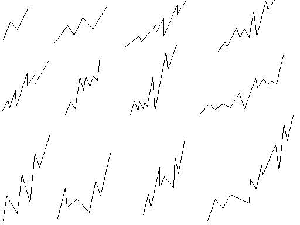

#### 无论多空，都必须要进的一步。

 时间：2007-07-18 15:47:50  前几天，本 ID 写了“无论多空，都必须要退的一步。”，今天却要写“无论多空，都必须要进的一步。” 这一进一退间，正好说明了本 ID 所说的路之艰难。而今天的走势，就是现在多空对战的一个最好演绎。

由于在多方的反复努力下，昨天在技术面上出现日 MACD 的金叉，使得今天的突破成了必然。现在，不妨让本 ID 换了身份，如果本 ID 是空头，本 ID 要阻击多方的进攻，最简单的就是先让一步，利用 4000 点和 60 天线的心理屏障，通过震荡，破坏日 MACD 的金叉信号，最终让金叉变死叉，如果本 ID 是空头，一定是这样干。否则，在技术面金叉情况下一味在 3919 点颈线下打压，只能让多方高兴，空头最不利的，当然就是在技术面转向多方时在低位损失打压的筹码。

而对于本 ID 的多方立场，如果不利用技术上的金叉信号进行颈线的突破，那前面的震荡都白搞了，因此，突破是必须的，至于突破是否有效，这是后话，突上去再说。而突上去后，对于多方，需要对 3919 点的颈线进行反抽，而空方，需要出手打压制造假突破，因此，下午的回落，同样是多空双方都乐意看到的。细心的投资者一定发现，下午回落的最低点，刚好是本 ID 在 N 周前就开始反复强调的 3919 点。

 现在，对于短线走势，消息面有着决定性的意义，在技术上，对颈线突破后需要三天的回抽确认，而刚好本周的最后两天和下周第一天是消息面上最大的动荡期，技术与消息，在这里产生完美的碰撞。

本 ID 虽然站在多方立场上进行战略部署、战术安排，但对空头的所有伎俩，当然也分析得底朝天。站在大的角度，本 ID 也可以分析一下空头可以采取的最好策略，就是同样搞三角形，但这三角形和本 ID 为代表的多方要搞的不同，对于本 ID 来说，现在是三角形的第四段，而对于空头来说，现在是他们的三角形的第三段，就是这三、四之争，将构成后面技术上的最大分歧。多方搞的三角形，最后是要往上突破的，而空头搞的，是要往下突破的。

今天，一个多空共同合力下走出的完美图形，而明天开始，这种一致将被打破，而关键之处，就在消息面的配合。个股方面，今天成分股的轮动有了新的发展，但还没把人气充分激发，更多的股票里的人，都采取观望，甚至有些还采取借机逃跑的策略，这都是正常的。天上打架，没打出结果，下面的当然只能这样了。一旦天上打架有了结果，地下的自然就有了方向。主力、庄家的资金，也是分级别的。

 对于散户来说，本 ID 已经说得很明确了，在有效站稳目前在 4159 点的 1/2 线之前，都以震荡行情看待，按自己的级别，顶背驰出，底背驰买，这样就不会左右挨巴掌。 有事忙，先下，再见。

#### 缠中说禅文集版权为缠中说禅所有 此文集整理版仅供缠中说禅论坛内部学习使用，严禁外传！

缠中说禅技术论坛 www.chzhshch.net 正在去机场的路上

#### 正在去机场的路上

 时间：2007-07-18 21:09:33  有急事紧急出差，本来早要去的，推迟了，今天不得不去。最后一班，机型还是今天巴西毁掉那种，本 ID 受飞机煎熬，各位就继续收中国队的煎熬吧。 问题的答案：都是一线段，不明白的以后有时间再解释。明天见。时间：2007-07-19 15:29:28

其实，无论本 ID 出差还是在北京，和各位的距离都是相等的，也就是一层网络而已。所以，虽然每次本 ID 出差，大盘就有病一般，但本 ID 利用战事的空闲处，也要干点别的事情，二级市场的事情，不是光二级市场决定的，所谓工夫在诗外矣。

现在科技那么发达，在哪里看盘都一样，别说深圳了。本 ID 在 N 多年前，就熟悉深圳的大小证券部，里面留下无数故事，有时候只能说给星星听了。在这样一个等待利空落地的日子里，说点闲话也不是多余的。

但，就算在这样一个日子里，汉奸鬼子还没罢休。看看尾盘最后十来分钟的窄幅波动，斗争一直到最后 1 秒。有时候，真觉得这种事情有点无聊，至于吗，汉奸鬼子们？最后几分钟不晃悠一下，你们会死呀？当然，这也是可以理解的，换着本 ID 当空头，只会更残忍。

 现在，其实没什么可说的，在等待利空落地的日子里，大家就去倾听那落花飘落的声音，本 ID 有足够的耐心，等待那些火星人都知道的利空影子一样摔碎。所有爱当捕风蚊子、捉影苍蝇的，就继续吧！

虽然，写相信未来的人，最后成了疯子，但并不需要疯子才可以相信未来。特别对中国资本市场的未来，可以断言的是，所有用最疯狂的愚昧去断送中国资本市场前途的人，无论是谁，都只能是民族和历史的罪人。

 在外，课程没法写了，但还是可以继续考考各位的学习程度的，今天又来一道题目，下面，每一划依然代表实际的笔，请问，站在线段的角度，这两者是否相同？为什么？ 各位就请好好回答问题，回答不出的，就请继续学习。本 ID 要忙去了，先下，再见。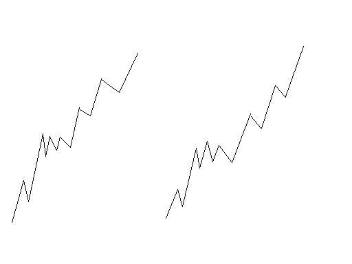

#### 缠中说禅文集版权为缠中说禅所有 此文集整理版仅供缠中说禅论坛内部学习使用，严禁外传！

 时间：2007-07-20 08:26:20

刚起来，下午收盘马上有事，盘是解不了了，周六、日有空再补上。反正在外面，音乐会也没法开。刚才扫描了一下回帖，很多网友的答案都是对的，站在线段角度，那两图是有本质的区别的，但如果里面的每一划不是笔而是线段，那么这两图就是没区别的。这是为了说明，笔、线段，和中枢、走势类型是有区别的。笔、线段是为了在实际操作中构成最小级别的中枢，在笔和线段中，连中枢都谈不上，只能用类似中枢以及相应的背驰力度方法去确认笔与线段的结束，但这只是类似，并不是说笔与线段里就真有什么中枢与背驰。严格意义上说，把线段当成最小级别走势类型的次级别是不对的，当然，在不严格的意义上，可以类似地这样认为，但两者是有本质区别的。这两个图就区分出两者的区别来了。

请注意中枢的递归定义的存在性意义，与分型、笔、线段的操作性意义的区别。当然，如果我们能找到交易中每一分笔（注意，不是上面说的笔，而是实际交易中的每一分笔）的成交，然后按照递归定义，就可以构造出整个走势类型与中枢的级别序列来，但这没实际操作意义，只是理论上的。而分型、笔、线段，并没有违反中枢的递归意义，只是用一种方法来确认具有操作意义的最小级别中枢与走势类型，其后的一切，依然按照递归的定义来。如果对数学有点了解的就知道，两者在递归的形式上是一样的，都是 an=f(an-1),唯一不同的就是预先给出的 a0，纯理论上的，这 a0 就是从每一分笔的成交开始的，但这没有实际可操作性；所以，就要用分型、笔、线段来确认这个 a0。而站在递归的程序上，这两者没有本质区别。其实，这些都是最简单的数学，除了孔男人类的，全宇宙的人都应该明白。

 还有，本 ID 画图只是随手画，但市场的图是合力的结果，不是任何人可以随手画的，要真把握本 ID 的理论，不预测、只看当下走势，这是必须首要记住的。 听说黄油蟹当季节了，可惜没有菊花酒可以对影成三人。先下，明后两天有时间再见。缠中说禅技术论坛 www.chzhshch.net 该来的都来了,你还需要什么?

#### 该来的都来了, 你还需要什么?

 时间：2007-07-20 21:33:08  在车上和各位打招呼，今天的走势无须多说，今天的消息也说得太多，该来的都来了,你还需要什么?  当然，空头没有完全打死，本 ID 需要痛打落水狗，因为本 ID 知道，有些狗不打死，就要咬人，如此而已。 一切不用多说，本 ID 喜欢干，不喜欢说。干的已经成为历史，永远 K 线了，如此而已。 周末，腐败去吧，本 ID 还要忙，今晚的黄油蟹不错，可惜没有菊花酒。先下，再见。

#### 打狗棒下，星火正燎原。

 时间：2007-07-23 15:25:57

对不起，这两天确实太忙，没有新帖子，趁着收盘说两句。其实今天的走势，没什么可说的，周末，本 ID 在这里已经明确说了，要痛打落水狗。有些狗般的思维不是说要低开吗？不是说有回补的机会吗？当然，本 ID 尊重这种思维。但按本 ID 痛打落水狗的思维，就是没有低开，没有回补的机会。要回补可以，当轿夫吧！

当然，这里说的是那些在 3600 点下狂砸诸如中石化等要把多方弄死去舔他们主子的洋狗，这次激战，在这里全程直播了，就像春节前后那次，最后，一阵打狗棒下，星火正燎原。本 ID 在开战时就说了，本 ID 只点火，本 ID 不当解放军，但一旦星火燎原，解放军自然就来。好了，本 ID 该干的已经干了，后面，就看有多少草可以燎原了。对于多方来说，现在已进退自如。对于本 ID，拂身白云外，回首大江横，点火事了，谁爱当火炬手就当去吧。

 技术上，4159 点的 1/2 线将决定整个中线走势。

由于二级市场战事已经稳定，本 ID 将花更多时间去为一个更大的战争作准备。这战争的意义在于，让中国人永远当中国资本市场的主人，而这不是光从二级市场下手就可以的。好了，事忙，先下。最后用旧作七律一首结尾--

 本地风光本地游 非污非净现头头 缘情天地皆精彩 逐梦英雄总自由一样兴亡千样戏 这般岁月那般愁 长空倚剑披云啸 散作乾坤碧水流 缠中说禅技术论坛 www.chzhshch.net 对不起，今天收盘后解不了盘。

#### 对不起，今天收盘后解不了盘。

 时间：2007-07-24 08:46:06  对不起，今天收盘后解不了盘。有一个 N 百人参加的腐败活动，忙完，晚上有时间再说。特此说明，免得各位收盘后空等。缠中说禅技术论坛 www.chzhshch.net 说说昨天的走势

#### 说说昨天的走势

 时间：2007-07-25 08:54:22

对不起，实在太忙，现在刚起来，抓紧时间说说昨天走势。昨天其实没什么可说的，技术上碰到前面两个高点连线，站在本 ID 三角形整理的最低要求上，昨天的回落理所当然。本 ID 前面说了，现在至少对本 ID 来说早已进退自如，所以要花多点时间在别的地方。本 ID 最低的要求就是三角形的第四段，昨天碰到前两高点连线，就完全达到本 ID 的要求，所以本 ID 完全不会再作为。也就是说，如果大盘出现比三角形更好的走势，例如从这里直接突破，对于本 ID 来说是锦上添花，本 ID 乐于坐轿子。如果大盘继续按三角形走，出现一个回调的第 5 段，那么即使大盘重新回到目前位于 3700 点下的下面两低点连线，本 ID 也是可以接受的，大不了到时候本 ID 再出手。

本 ID 这次出手的目的在出手时已经公开说了，就是不让汉奸鬼子买到便宜的筹码，不让他们平台型的阴谋得逞，现在已经完全达到。本 ID 的行动，只针对汉奸、鬼子，不当解放军，这也是一大早说了的。而本 ID 目前的资金、筹码配制，在这两天已经完全调配到符合这种两者皆可的程度。这点，在周一收盘时，本 ID 已经明确说了“对于本 ID，拂身白云外，回首大江横，点火事了，谁爱当火炬手就当去吧。”

站在纯技术的角度，4159 点的 1/2 线是关键，现在的火炬手们，如果有能力扛住该线，那么大盘将继续创新高，否则就去补缺口，考验 4000 点支持，甚至考验下面两低点连线。由于本 ID 现在已经退居二线，只坐轿子不冲锋，所以以后可以多说技术的问题，分段也可以提供了。当然，前提是本 ID 有时间。

个股方面，本 ID 那些中长线的面首依然会继续宠信，前提是你要有足够的耐心。例如，像本 ID4 月说的 6000 万总盘，2000 万以下流通的深圳新上中小盘，当时一直不动，你看现在的 002121，看看是不是符合本 ID 当时说的中长线价值？大盘震荡下跌这么多，对他又有什么影响？对其它股票也是一样的，面首，有中长线搞才有味道的，整天对股票面首 419，小心得爱滋。

中长线运作，专一点，把成本降到 0，这才是股票中永远不败之道。前面说 002121，本 ID 的成本还没到 0，经过这 1 月的运作，也 0 了，注意，现在各位就千万别买了，30 元下不买，现在买，那是有病，只是有的，可以继续按本 ID 的方法运作下去，成本为 0 后就是保持 0 成本增加筹码了。对于其他所有股票，这方法是一样的。

 对不起，今天依然忙，收盘后可能没时间解盘。但只要有时间，本 ID 会上来说两句的。

#### 应酬前，说说今天的大盘

 时间：2007-07-25 18:31:21  首先说一句，刚上来，发现系统警告好友数量已经到极限，所以请各位不要再申请本 ID 为好友，等新浪的数量限制扩大再说。

应酬前，抓紧时间说两句。今天，各路火炬手们都很兴奋，本 ID 坐轿子，当然要表扬一下抬轿子的。站在纯技术的角度，4159 点站稳后，就攻击前期高位，这在昨天和早上都说了。当然，现在的上攻有点急，但被压抑了许久的多头力量，尽情释放一次，也是无可厚非的。

技术上，4335 点是否明天突破，其实一点意义都没有，早一天晚一天并不重要，重要的是突破后，在适当的回抽确认后，能释放出更大的能量。否则，就要面临假突破的风险。所以，现在，在技术上，主要要面对这个问题，一旦确认假突破不成立，那么大盘就会走出一段坚定有力的行情；否则，大盘依然有考验 4000 点等可能。是否假突破，是今后两周行情演化的关键点。

本 ID 今天早上已经宣告，本 ID 现在在轿子上，所以绝对不出力了，只会享受本 ID 应该享受的成果。别人想羡慕也没用，本 ID 前段时间冒着枪林弹雨换来的成果，当然要好好享受，否则本 ID 怎么能不断壮大？怎么能在下次出手时更强劲有力？所有如本 ID 般以抗击外敌为使命的资金的壮大，就是对汉奸鬼子最大的打击，这没什么可说的。

个股方面，本 ID 前面已经反复说过，先成分股。这几天成分股轮番表演，就是本 ID 前面说的轮动。目前各路诸侯纷纷上场，互相配合良好，也就是所谓的星火燎原了。至于非成分股，肯定会轮动到的，特别是有题材、基本面支持的，更会有中长线价值。

基本面上，现在最大的努力方向，就是争取单边印花税，全世界，只有香港、深沪、澳大利亚等少数几个市场双边印花税，现在，深沪交易所难道不应该和国际接轨？这次，国际接轨应该成为保护国人利益的武器。那种老让国人不爽的国际接轨已经太多，早该来一次能让国人爽的国际接轨了。

不管什么面，一切都是合力，没有任何上帝，一切都在合力之中，即使没有回报，但该努力的必须努力，3600 点汉奸鬼子叫嚣平台型时如此，现在亦如此。明天，本 ID 就回北京了，估计又是最后一班飞机，后天才能在北京和各位相见。 北京的天空，无论白天黑夜，也是天空、只是天空而已。

#### 缠中说禅文集版权为缠中说禅所有 此文集整理版仅供缠中说禅论坛内部学习使用，严禁外传！ 大盘周线上的四种演化分析

 时间：2007-07-27 08:01:59  对不起，昨天回京太晚，没写帖子。现在补上。还要道歉一下，在外，只能说股票，其他东西没时间写。回来，下周还是按正常来。

大盘无分歧地创新高，才会导致真正的分歧。前天说了，现在最大的分歧就在于真假突破。但无论真假突破，突破后的调整、回抽、确认等是必然要发生的。站在周线的角度，无非四种：一种是本周的上影线调整；二是下周的周 K 线调整。前者是弱的，后者是强的。当然，还有一种更强的，就是下周继续拉长阳，中间有日的跳水洗盘，再下周才真调整。最强的就是强力夹空，连收 N 根周阳，全部调整以日线完成。

一切都由市场合力决定，只要按本 ID 的理论当下去判断市场的选择就可以。例如，今天就面临第一种情况是否出现的选择，这由今天当下的走势就可以判断。从管理层的角度，如果出现第三、四种的走势，那么基本面上的可能变化，例如单边印花等，就会受到更大阻力，站在对股市中长线健康的角度，本 ID 反对后两种走势。当然，本 ID 只是市场分力之一，而且，本 ID 现在轿子坐得舒服，因此这种反对最多是口头上的，如果有哪些无聊的火炬手们一定要搞第三、四种，本 ID 站在短线利益的角度，确实也没理由反对。本 ID 唯一可以干的，就是等这些疯狂抬轿子的火炬手抬到没力气时，一棍子把他们打晕，给他们上上市场风险课，配合一下管理层的风险教育。

至于第一、二种，本 ID 都可以接受，说实在，本 ID 更喜欢上下震荡，越震荡，差价越多，单边其实没什么意思。站在纯技术的角度，目前的 5 日线是判断能否直接真突破的关键，一旦在下周初之前 5 日线上移到目前位置指数依然不能脱离目前区间，大盘重新回跌的机会就不可避免了。

归纳上述，第二种走势是最有利于多头的，而第一种走势，则给空头一个喘息的机会。至于第三、四种走势，那是纯粹找死，为本 ID 做嫁衣裳，当然，这世界上想死的人很多，本 ID 当然也不讨厌这些死都这么有性格的。

 对于本 ID 来说，前两天已经宣布退居二线，所以只会按市场的选择来当下选择自己的操作，而不会主动去引导市场的方向。3700 点上，市场爱干什么，什么资金干的，本 ID 都可以接受。

个股方面，成分股的拉升轮动后，如果没有其他股票的呼应，大盘走势不会太健康，所以各位要看这轮动是否能蔓延，如果不行，那么大盘的走势就要变局。现在的节奏就是一二三，等三线都轮动到了，就看一线是否能重新启动，不行，大盘就要休息了。

 下午收盘后，本 ID 要开始补腐败课，晚上有时间再解盘，先下，再见。

#### 对不起，刚回，说两句。

 时间：2007-07-27 23:09:24

收盘就开始补腐败课，刚回，明天还要继续腐败，周末这两天闲不了。早上说了，对于多头来说，最好是第二种，今天，在外围股市大跌下，能走成这样，各路火炬手是出力了，搞得本 ID 都有点怪不好意思的，当然，这也只是口头上，本 ID 赚钱坐轿子，从来都是心安理得，没什么不好意思的。

由于各路火炬手很多在 4000 点以上才逐步重新介入，所以现在火炬手变举重选手的机会大增，下周初就看这些举重选手举杠铃的能力了。举住了，自然更大面积的空翻多，否则，就假突破引发一轮雪崩。本 ID 没有举杠铃的爱好，倒是如果某些人举不住，本 ID 顺势踢上两脚的兴趣更大。当然，如果各路举重选手都能更高更快更强一把，那本 ID 也乐意在轿子上多晃悠晃悠。

可能有人又要骂本 ID 卑鄙无耻，为什么光点火不举杠铃，一直冲上去。本 ID 脑子里还没有水太多，只爱点火，不举杠铃。而且本 ID 已经多次说过，只要在 3700 点上，大盘怎么走，本 ID 都没意见。现在，那些在 3600 点还鬼哭狼嚎的，突然都成了多头首脑，都在宣称自己以前多么英明神武，多么先知先觉。本 ID 只干，这些无聊的帽子，谁想戴就去套上吧。

除非大盘有能力以最强劲的动力一口气走到 6000-8000 点，否则，这一段，在日 MACD 没突破前期高位之前，本 ID 只能认为现在是处在背驰段中，对于本 ID 来说，除非背驰段被破坏，否则一切就处在区间套的精确定位过程中。而要避免背驰段，就需要对日线的MACD 走势进行周密的控制，这对于本 ID 当然不是一个问题，但对于那些众多举重选手，能否最终完成，本 ID 会在轿子上好好看着，一旦他们弄不好，本 ID 就会狠狠踢他们两脚，给个教训这群面首让他们长点见识。

对于散户来说，一旦行情展开，就一定要按照行情自身的规律，喊口号不是操作，股票是用来操作而不是用来喊口号的。如果大盘能保持基本在前期两高位连线上进行震荡整理，那么就将走强，否则就要面对假突破后的猛烈清理。

而由于今天没有出现早上分析的第一种走势，因此，后面可以选择的就只能是二、三、四种了。而其中的第二种，下周线无非三种：长阴线、十字星或小阴小阳、带长上影的 K 线。而其中，只有长阴线这种是有巨大风险的。因此，只要看住 5 日线或前期两高点连线，只要这些线能守住，长阴线是不可能的。而相应的走势，都可以持股或用部分筹码进行中枢震荡的操作来处理。

总之，下周初走势十分关键，如果先扬后抑，一旦再次上攻失败或 15 分钟以上短线背驰，将引发一次有力度的调整，反而先抑后扬能使得走势更轻松点。个股方面，今天热点开始向非成分股蔓延，这是比较好的现象，如果这现象能维持，那大盘即使调整，后面的行情也会有可期待的地方，否则就要小心了。

 周日开音乐会，先下，各位周末腐败愉快，再见。

#### 缠中说禅文集版权为缠中说禅所有 此文集整理版仅供缠中说禅论坛内部学习使用，严禁外传！

缠中说禅技术论坛 www.chzhshch.net 先扬后抑，酝酿震荡。

#### 先扬后抑，酝酿震荡。

 时间：2007-07-30 15:19:35  上周说得很清楚，只要现在的举杠铃者能顶住，空翻多就更多了。今天，昨晚伊拉克的精神大概也给了举杠铃者一点血性，所以今天，这群人动用所有力量，最终把该顶住的顶住了。

市场就是这样的一个生物链，本 ID 这种第一波进去的，等着 4000 点上进去的抬，而 4000 点进去的，顶住 4300 点，自然有新一波人进来。所以，现在 4000 点进来的也进退自如了，当然，如本 ID 者，就更自如了，上面已经有了两层保护膜。

但上周说得很清楚，本周周线上是选择第二还是第三种走势，是一个关键，如果是第二种，那么周线上将有长上影，而第三种，调整也会以日线形式产生。所以，正如周末说的，先扬后抑，后面的调整压力就大了，今天的走势，就为后面酝酿震荡。

月线上，明天是收盘，所以，站在第三波 4300 点进来资金的角度，一个十字星是最理想的。而对于第二波 4000 点进来的，一个阴线也是可以接受的，只要不破4335 点就可以。当然，对于本 ID 这种 3600 点进来的，大阴线也无妨，不过又提供一个短差机会而已。因此，明天开始的三天，就是 4300 点进来与 4000 点进来两波资金的游戏，本 ID 继续看戏，偶尔三国演义一把。

个股方面，今天轮动可以，但地产等有调整压力，目前，关键看成分股里未启动的，和有题材的成分股能否跟上。换言之，就是 4300 点进来的一批，能否坚决顶住，他们顶住，前两波也不会故意害他们，因为他们顶住，就有第四波进来，要害，也害那第 N 波的。当然，这 N 是可以等于 3 的。

 忙，要先下，再见。

#### 完美的震荡制造完美的月线收盘

 时间：2007-07-31 16:03:53

今天，有没有消息都要震荡，反而因为消息的出现，使得震荡中，市场各方的心理都比较平稳。盘中的最大一次跳水，刚好去回试确认 4335 点的突破，为什么？因为 4300 点刚进来的，要护住他们的成本线，而今天的消息，刚好给了他们这个机会。由于今天又是月线的收盘日，所以前面两拨人也没理由估计去砸坏这图形，毕竟，三拨人，前后时间不同，但至少在做多这点上，暂时还是利益一致的，一个好看的月线，当然对三者来说都是必须的。

有了月线，那么 8 月的走势，无非就是长阴线、十字星、长阳线等几种。纯技术的角度，本月 K 线的一半位置刚好和 1/2 线的位置差不多，也就是说，这月 K 线的确立，使得 1/2 线的突破有了极大的保障，虽然不能说万无一失，但至少对于多头，特别对于前面两拨进去的人来说，已经有了中线运作的第一道防线。短线，还是看 4300 点进去这一拨，他们最大的愿望，当然是快速拉离目前位置，所以短线做多意愿最大的就是这一拨人。3600 点这拨，当然乐见其成，4000 点那拨人，也不会有太大分歧。

但是，基本面上依然有不明朗的地方，国家对目前经济形势的判断，依然有可变的地方，这构成影响今后走势最重要的因数。因此，大盘能否把去年 8 月后的走势复制一次，基本面上还有着极大的不确定因数。这因数，不是哪一拨人可以控制的，那是一个合力的结果，当然，一切都确定了，这市场也太不好玩了，不确定，才有美丽与奇迹可言。

技术上，其实十分简单。前面几次的单边势，都是基本以 5 日线为支持，基本上，在单边势里，没有 3 天是收在 5 日线之下的，因此，如果不会看太复杂图形的，5 日线，或者中线的 5 周均线，就是最简单的判断指标。如果震荡连 5 日线都不破，那还怕什么？日线上，可以先以背驰段看待，然后根据后面的走势去确认背驰段是否有效。短线，4500 点附近如果太快通过，就会为以后的走势埋下技术隐患，本周走势，如果继续长阳，将使得可能的基本面变化埋下政策隐患。但现在急功近利者太多，而本 ID 也不想浪费筹码进行太严厉的调控，因为本 ID 并不介意这次真搞成一个背驰段，现在本 ID 的策略，就是尽量不作为，让各路举重选手自己表现去。

 个股方面，还是一早说的两条主线，成分股和超跌股，那些从年线或半年线上来的超跌股，也慢慢把形态走好，一旦大盘中线上升完全确立，那么都会轮动走出行情，但问题的关键是，这个确立依然不完全，所以超跌股的短线表现依然不充分。 一句话，太急功近利，就会把大盘给害了，目前大盘的关键是要走得扎实点。而八月中上旬，基本面上也将有一个中长线的定调，具体到时候就知道，现在还没有结果，这才是必须关注的地方。 今天可以回答各位问题到 5 点。 缠中说禅 2007-07-31 16:14:47

**[** 匿名**]** 新浪网友 2007-07-31 16:10:56  缠 **JJ** ，一笔是否也有类似线段那样得三角形态或奔走形态？ 或者说，一笔之中的非顶、底 **K** 线是否允许超出顶底的范围呢？顶或底是否一定为一笔的最高点或最低点呢？**--**

 一笔，是一顶一底，怎么会有三角形？顶和底，当然一定是那一笔的最高最低，如果不是，那里面一定不只一笔。 缠中说禅 2007-07-31 16:18:45  [ 匿名**]** 新浪网友 2007-07-31 16:15:06  缠主, 你好 对背弛和背弛段还不能理解，是看 **MACD** 的柱线高度还是总的面积啊？**==**  标准情况下，黄白线和柱子面积都要看。 缠中说禅 2007-07-31 16:22:09  [ 匿名**]** 新手 2007-07-31 16:16:08  老师，对于技术不好的新手，可不可以做长线投资，不理会一时的震荡或调整？**==**  技术不好，可以把操作级别扩大为 **30** 分钟以上、甚至是日线的，这样，一个月也就操作一两次，而且心态要好点，不要强迫自己一定买卖在最好的位置，最好的位置的买卖，那是要靠磨练的，不可能一上手就达到，所以一定不能有不切实际的想法。 缠中说禅 2007-07-31 16:23:07  [匿名] 新浪网友 2007-07-31 16:15:51  缠姐：今天的 1118-1333 算不算一笔？==  那不是一笔，而是很多笔。 缠中说禅 2007-07-31 16:36:32  [匿名] 新浪网友 2007-07-31 16:31:56 博主好！请教： 按中枢振荡观点解读走势时，中枢振荡的每一次级段是否按同级分解规则划分呢？能否按非同级分解规则划分呢？ ==  概念不清，线段上没有中枢，哪里来级别和同级别？线段的划分，就按线段自己的原则，具体下节课回说到。 缠中说禅 2007-07-31 16:38:37 [匿名] 新浪网友 2007-07-31 16:36:06  老大后面走势在顶分型第一个 k 线的区间内，可以算一笔吗？ ==  不可以，除非在后面根据非包含处理后能找到标准的底分型。 缠中说禅 2007-07-31 16:41:21  [匿名] 楚狂人 2007-07-31 16:37:18  感觉市场做多气氛好的时候，1f 甚至线段级别的上涨都延伸很久。。 碰到这些小级别的延伸，判断第一卖点感觉好困难。。还是等第二卖点。。不知这样妥否？请缠君指正 == 除非你觉得自己交易通道特别好，判断又能特别精确，否则不要太多参与线段的操作。至少要参与 1 分钟以上的操作。 缠中说禅 2007-07-31 16:43:17  [匿名] 学习 2007-07-31 16:40:59  请问，9 个一分钟的走势类型重叠构成一个 5 分钟的中枢，那么这个 5 分钟的中枢点位和从一分钟递归上来的一样吗？ ==  不一定。按 3+3+3 这样组合后确定 5 分钟的。 缠中说禅 2007-07-31 16:47:59  [匿名] 砂 2007-07-31 16:25:58  请教缠主,今天在 1 分钟在早上 9.41-10.35 那段下跌,没有很明显的背驰,为什么后来的反抽上去的力度这么大呢,再很多股看到是有很明显的 a+A+b+B+c 的,但是大盘 1 分钟很不明显.  谢谢 ==

背驰的概念，标准的在最低级别之上用，线段上的，只能是类背驰的判断。因为，在线段里，如果是类小转大的，判断起来就不能光靠 MACD 了，那时间太短，不够灵敏度。一般来说，小转大都有一个小平台，等小平台确认向上再介入更好，因为小转大的平台，是可以往下突破的。不过还是要强调，除非已经技术很好，不要参与 1 分钟以下的操作。

 缠中说禅 2007-07-31 16:48:50  [匿名] 新浪网友 2007-07-31 16:44:03  请问老大，有时，大盘的“一笔”可能就 5～6 根 K 线，走得比较平，其中存在包含关系，如果包含掉，则不能形成一笔，请问要看包含吗？ ==  有包含的一定要非包含化处理。严格按定义来。 缠中说禅 2007-07-31 16:50:47  [匿名] 神抛弃的大道 2007-07-31 16:46:49

女王好，关于您的理论，我有个小小的问题，就是如果 9 跟线段构成的 1f 中枢同时扩张成为 5f 中枢，那么 5f 中枢的区间如何确定，您能说明一下么，要是能图解一下最好不过了？这个问题困扰我一段时间了。谢谢女王，盼复。 ==

 按结合律。3+3+3 结合。 缠中说禅 2007-07-31 16:52:03  石头叁 2007-07-31 16:49:58  老大，向下的一段无论延伸了多少笔，在触及前一向上线段的最后一个高点之前都不能认为是一个线段，因为还没有破坏向上线段的内部结构。----这样理解对么？ == 一般情况下是这样，但有些特殊情况，下节课都会说到。 缠中说禅 2007-07-31 16:55:59  [匿名] 大盘 2007-07-31 16:50:53  请问博主： a+b+c+d 依次连续出现的 4 个线段，其中 b 线段没有破坏 a 线段，但是 b、c、d 线段相互重叠（即构成中枢）， 请问这种情况下，当下在线段 b 的时候如何反应 ==  如果 B 不破坏 A 的，那 A 这线段就没完成，等 A 完成再说。在线段里，A 线段没被破坏，就不会存在 B 线段。关于线段划分的一些细节问题，下节课里都有。

#### 该来的调整，必须且及时。

 时间：2007-08-01 15:33:01

本周的 K 线，本 ID 在上周已经明确说过，希望是带上影的第二种情况，否则急功近利，只能害了最终的行情。今天的调整，使得这长上影的小阴线已初显。后面两天，关键是第三拨人的做多决心了，强烈回收上去，则还有走出第三种情况，也就是中阳周线的可能，但这种走势，确实有点急功近利，反正，本 ID 是绝对不出这手的。本 ID 已经早说了，震荡，对本 ID 只是一个先卖后买的短差机会。在这里等 5 周均线上来，更稳健。

技术上，今天的低点并没有跌破前面两高点连线，所以调整在合理的范围内，该线在 4260 点附近，目前 10 日线也在该位置，因此是否有效跌破该线是一个大盘调整强弱的重要指标。一旦有效跌破，上周 K 线留下的缺口将面临考验。对于第三拨人，该线是他们的生命线，当然，对于前两拨，其实无所谓，就看第三拨人表演吧。

上面，由于今天跌破 5 日线，因此后面的反抽如果不能上 5 日线，则大盘的调整将加大，能重新上去，那就将重新挑战 4500 点。即使能突破 4500 点，最好能反复震荡，否则，将引起昨天所说的八月中上旬基本面上的重大不稳定因数。还是昨天那句话，不要急功近利，要爱护市场本身。

大的技术上，日线上的背驰段依然成立，如本 ID 般第一拨进来的，一定不能在这个位置加码，而是用先卖后买打差价的策略，通过震荡把成本降低，万一大盘真不能突破 4500 点走出多头陷阱，到时候砸起盘来也更爽。大家好好去看看，现在叫嚣冲多少多少点的人，在 3600 点的时候，是不是那些吼着要跌破多少多少点的。行情是合力的，一步一步走出来的，预测都是忽悠，按照正确的策略去操作才是一切。

如果能看明白线段、中枢、走势类型等的，现在这种行情是最好操作的，注意，节奏一定是先卖后买，卖错了不怕，如果大盘真能突破 4500 点，很多中低价股都会大幅启动的，还怕买不到好股票？不杀跌、不追涨，按照买卖点来。各位看看今天的高点，是一个 15 分钟级别的背驰引发的，里面的区间套极端完美，可以仔细研究。由于现在 60 分钟并没有进入背驰段，因此，不能说日线的背驰段已经被定位。只能看成是一个 15 分钟卖点引发的。本周注意 15 分钟以上级别的卖点，这在上周已经提醒，如果没看懂，请好好继续学习。

 晚上，把关于线段分类的课程放上来。先下，再见。

#### 明天才是大盘短线的关键

 时间：2007-08-02 16:06:21

今天，没跌破昨天本 ID 所说的前期两高点连线以及 10 日线，所以出现反弹就理所当然了，加上外围因素的影响，也给第三拨进来的人壮了胆。今天，也收在昨天特别强调的 5 日线上，但这并不意味着大盘就平安无事了。大盘在 6 月 20、21 日，也走出过类似的 K 线组合，而且时间上也是周三、四，而周五的下跌，就使得一轮大调整得以确立。当然，一般来说，历史不会简单重复。这只是要提醒，今天的走势其实并不重要，关键是明天，考虑到周末消息面的因素，这个时间还要延伸到下周一，也就是说，下周一前能否确认重新站住 5 日线，将是短线大盘走势的关键所在。

对于新进的第三拨人，他们不想就此站上 N 个月的岗，必须要在这里奋力一搏，现在，比 6 月 20、21 日有很多有利的条件，技术上，MACD 形态好多了，下面有前期两高点的连线，而上周的周线缺口，技术上有三周不补就以后再补的惯例，也就是说，新进来的一拨人，只要能顶住三周，至少可以把某些中线资金给忽悠进来了。因此，对于这拨人来说，别无选择地，必须守住前期高点连线，重新站稳 5 日线。

但是，这拨人也有可能最终毁了市场，为什么？这拨人如果急功近利地迅速突破 4500 点，引发大量新资金涌入，那么上半年的单边行情将不可避免。但目前国家对经济的总体判断与相应的对策，都在一个敏感时期，如此走势，必然导致目前对多头有利的舆论、政策环境发生极为不利的变动。目前，比印花税还要严厉的，就是关于交易制度、规则的改变，如果谁最终乱搞，把这东西给搞出来了，那么，才是真正恶劣的事情。

所以，虽然多头目前当然有能力快速突破 4500 点，但一个稳健的走势依然是必要的。在 4500 点附近进行合理的震荡，将对市场长远的发展有好处。甚至，在4000 点到 4500 点进行一个长时间的大箱体震荡，也比又掀起一场连续 N 根周 K 线长阳的运动要强。

当然，市场往往不会按照理智的方式进行，市场往往就是醉生梦死疯一回，那么，对于如本 ID 一样第一拨进来的，一定要采取这样的策略，就是绝对不增仓，因为在 3600 点开始都买够了，现在还买是脑子水太多的表现。其次，采取保持仓位先卖后买打差价的策略，这样成本降低，就永远立于不败之地。第三，一定不要听任何人忽悠马上要冲多少多少，冲是别人的事情，我们的事情就是坐轿子，你有本身把轿子抬到华山顶上，我们也没意见，但只要有人抬不动，就一定要一脚把轿子给踹了。

个股方面，成分股继续打冲锋，一旦确认周线突破成立，二、三线股会跟上的。下面给出这次下来的一个分段。红绿箭头给出的是黄白线或柱子面积等的对比，看看就知道这些买卖点是完全可以当下判断的。现在，一个 1 分钟中枢已经形成，短线走势，就看这中枢的演化，一切当下判断。

 这两天，北京的雨可露了面了，本 ID 也不想出去腐败了，免得哪条桥又搞一个 N 米深的水库回不了家。 今天可以回答各位问题到 5 点。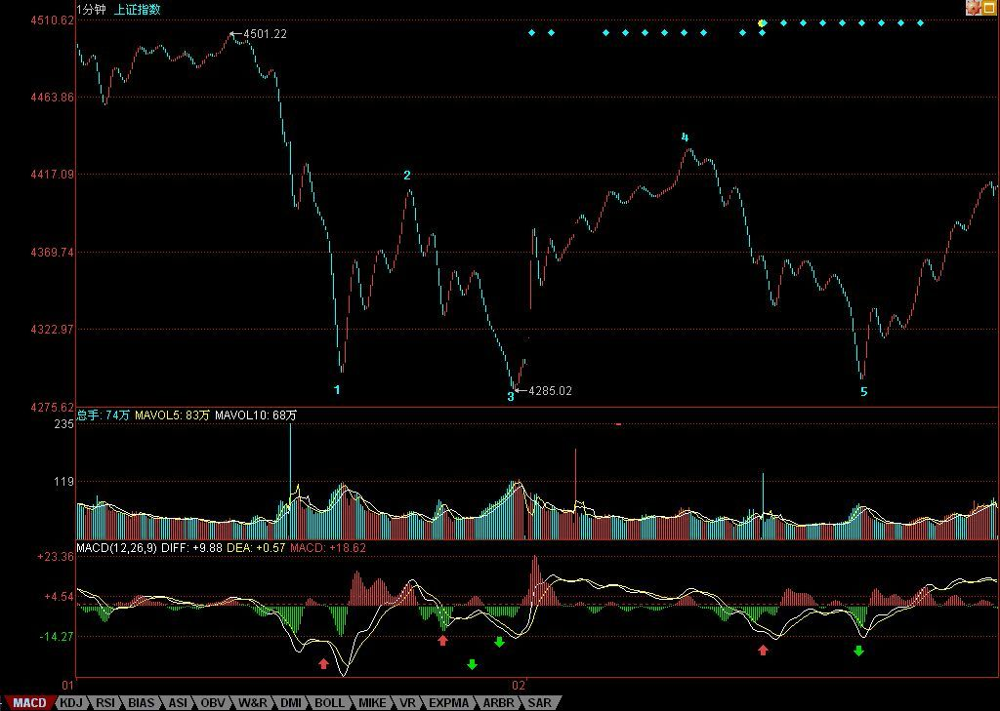 缠中说禅 2007-08-02 16:18:13  [匿名] 大盘 2007-08-02 16:11:55  请问博主： 进行每笔划分时，相邻 k 线出现以下三种情况，是否要合并处理： 1）相邻 k 线的高点或者低点之一相等 2）相邻两 k 线的高点和低点都相等 3）好几分钟都维持同一价位，也就是 k 线走势出现“麻点”  ==  只要不包含就不需要合并，包含就是有一 K 线完全在相邻 K 线的里面。 缠中说禅 2007-08-02 16:19:25  [匿名] 新浪网友 2007-08-02 16:18:29  那么，对于如本 ID 一样第一拨进来的，一定要采取这样的策略，就是绝对增仓，因此在 3600 点开始都买够了，现在还买是脑子水太多的表现。 --------  妹子好！这句话写错了吧？ ==  改了，但新浪系统慢，可能还没有显示出来。

当然，市场往往不会按照理智的方式进行，市场往往就是醉生梦死疯一回，那么，对于如本 ID 一样第一拨进来的，一定要采取这样的策略，就是绝对不增仓，因为在 3600 点开始都买够了，现在还买是脑子水太多的表现。

 缠中说禅 2007-08-02 16:47:11 christine 2007-08-02 16:42:11  姐姐，昨晚的新课程看得我很晕，我的理解水平太差了。 1.在标准特征序列里，构成分型的三个相邻元素。 是指构成分型的三笔吗？

2."特征序列的顶分型中，第一和第二元素间不存在特征序列的缺口，那么该线段在该顶分型的高点处结束，该高点是该线段的终点；.....；"和“特征序列的顶分型中，第一和第二元素间存在特征序列的缺口，如果从该分型最高点开始的向下一笔开始的序列的特征序列出现底分型，那么该线段在该顶分型的高点处结束，该高点是该线段的终点；......”此二段描述看着没有什么区别

 ==  特征序列里的三相邻元素不是真实图形的连续的三笔，里面的元素如果是上的线段，是那些向下笔，这在课程里说得很清楚，先把这搞清楚，否则后面肯定看不明白了。 这特征序列的分型，是把特征序列里每一元素当成一个 K 线所形成的，不是实际图形上的分型。请再研究一下。 缠中说禅 2007-08-02 16:59:59 [匿名] 新浪网友 2007-08-02 16:51:27 老大辛苦了那个 600636 跟老大当初所说的相差甚远希望老大能回答一下谢谢 == 636 没什么问题，在长线建仓中。就像 737，虽然从 7 元多到 10 元多了，依然在长线建仓中。注意，建仓都是动态的，如果成本没被降到一定值，建仓完不了。 一个天大的误解，就是建仓时成本要很高，其实高明的人，建仓时，成本就可以不断下降，当然，这种手法，对没耐心、短线思维的人，是痛苦的。所以本 ID 说过，散户也要学会动态建仓。

#### 缠中说禅文集版权为缠中说禅所有 此文集整理版仅供缠中说禅论坛内部学习使用，严禁外传！ 醉生梦死疯一回游戏正式开始

 时间：2007-08-03 15:57:58  坐轿子的感觉确实不错，坐在轿子上看沿路风景，别有一番情趣。下面，是关于坐轿子上华山的第一天日记。这个日记，将有 N 日 N 章。

今天大盘的跳空高开，就使得 6 月 20 前后的 K 线组合不可能出现。昨天已经说过“市场往往不会按照理智的方式进行，市场往往就是醉生梦死疯一回”，站在第三拨人的立场上，尽快远离 4300 点，吸引第四拨人进来，本来就是急切的事，至于后面将引发什么，他们当然无所谓，而前两拨人就更无所谓。一般来说，越到后面的第 N 拨，其成分将越来越杂乱，如果说第一拨人的成分是最纯净的，到后来，就三教九流，什么都有了。

今天的大盘开始迎来第四拨人里的先头部队，周末如果没有什么太大的坏消息，那么，第四拨人里的主力部队将在下周大面积进入。这拨人的成分将比第三拨更杂，有前三拨中中途开小差的逃兵，有看所谓周线突破有效进入的技术人士，有在外面卖外卖现再回家开店的、更大面积的是那些被钱烧得发慌的各路男女等等，醉生梦死疯一回游戏正式开始。

对于前三拨进来的人，从现在开始，最后埋单的是谁，是 N 等于几，已经不重要，关键是如何把这个游戏玩得长一点，但这个时间并没有什么上帝去规定，一个合力的结果下，从下周一开始，这个游戏的时间 T 开始计算，T 从 0 开始，向着尽可能大的数进发。这就如同玩电子游戏，去预测在第几关结束是脑子有水的表现。

 也正如玩游戏，关键是操作的策略，而不是去预测游戏在第几关结束。目前的操作也一样，预测都是无聊把戏，关键是有精密的操作。而操作是针对不同人的，如同玩游戏，高手和低手当然不是同一玩法：

对于低手，本 ID 反复说过最基本的操作策略，就是短线看 5 日线，中线看 5 周线，长线看 5 月线，只要不有效跌破，相应的操作就不用操作了，持股看着就可以。何谓有效跌破，就是跌破后反抽上不来，这种反抽当然和对应级别有关，例如一个月线的跌破，至少要看下个月反抽的情况，而不是看一日。

 对于大资金以及散户里的中高手，就是要利用震荡机会就减低成本，一路上涨，一路把成本减下来但持仓数量不变，这样，你的仓位就自然随着大盘的上涨下降，也就是钱越来越多，但筹码没少，这样，是既回避大盘可能的突发非系统风险，又能完全把握市场利润的有效方法。 对于散户里的高手，就要充分利用大盘震荡中板块的轮动机会，获取市场最大的机会。 有人可能问，做不到高手怎么办？那就做低手，持股都不会，大盘晃悠一下就鸡飞狗跳的，那还炒什么股票，让股票炒你就行了。

昨天已经说了“个股方面，成分股继续打冲锋，一旦确认周线突破成立，二、三线股会跟上的。”这个结论继续有效，而且，只要第四拨资金能被忽悠进来，那些已经消除业绩风险的二、三线股，以及有题材的股票将大肆表现，例如，你没看到这两天，本 ID 已经大肆引诱各位到北京旅游了吗？注意，题材股的操作，一定不要追高，过了这个村，还有那个店，天天都有新机会，不管谁的股票，都不必追高。

 股票都是废纸，一个好的策略与心态，能让你把废纸变黄金。 技术上，把今天的分段放上来，还搞不清楚的，请好好学习。例如下图中的 7，这是什么？是下面那 1 分钟中枢的什么？这么标准的图形，都看不明白，那请把 ID 的课程重新读去。 周末，腐败的时间到了，大家放风去吧，别让股票把自己的生活套牢了，本 ID 要去风花雪月去也，不陪各位了，自由活动，周日继续音乐会，这次一定不爽约。 先下，再见。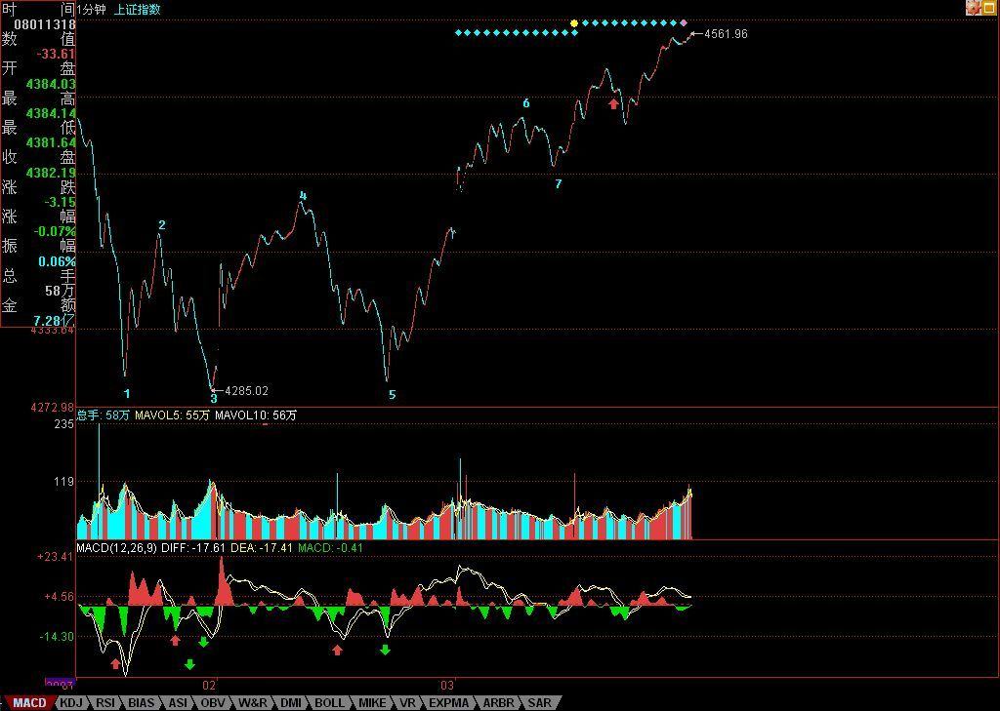 时间：2007-08-06 15:58:43

正如这次在 3600 点突击时，本 ID 写了满江红，上次突破 3000 点的总攻行情，本 ID 在 3 月 19 日写了神州自有中天日，万国衣冠舞九韶，时间上，回头一看，都是很是时间的。在 3 月 19 日那篇文章里，本 ID 宣称“在总市值超越 GDP 之前谈论股市的泡沫是可笑的，在中国股市总市值超越其 GDP 之前，第一阶段行情不会结束。”现在，这个目标已经达到，中国股市的总市值已经达到 GDP 了。本 ID 在文章里很明确指出，第一阶段“行情最主要体现在以权重股为代表的成分股上。” 但，今天这样一个日子里，本 ID 必须宣布，成分股行情的泡沫化阶段正式开始。

GDP，就是整个股市市值波动的中枢，前面是恢复性上涨，恢复到这个中枢上来。而从今天开始，将是远离该中枢的泡沫化阶段。一般来说，泡沫化阶段的行情，将逐步走向全面疯狂，大笨象们都可以跳出小步舞，疯狂的上涨将如瘟疫般蔓延。这个阶段，可以很短暂、也可以延续相当时间。可以远离中枢 30%，也可以远离 300%，但最后的结果都是唯一的，回跌到中枢处。

所有如本 ID 般正在轿子上享受的，首先要在思想上明确这波行情的性质，但不用慌张，能在泡沫中安心享受，在泡沫最后一刻一脚把泡沫踢破，本来就是投机的好境界，好好享受，好好利用，别浪费了疯狂轿夫们的力气。

一般在这种泡沫化阶段，本 ID 的原则就是只坐轿子不动手。本 ID 握有大量中字头的大盘股票，基本每一个中字带头的成分股票都有，这在 3600 点的时候，本 ID 专门说过的，等这泡沫化打到高潮时，这些都是很好的踢破泡沫的种子好选择。其他就是原来的那十几、二十只成本为 0 的，这是作为所谓的二、三线股配置的。这些股票，反而有些会长线继续关注，因为第二阶段的成长股行情中，有些会成为种子选手。本 ID 的仓位都是按 20 年的思路来建的，对有些股票，本 ID 绝对要搞他 20 年以上。

短线走势，看看下图就很明白，8-9 形成的线段，和下面 6-7 的形成线段上类上涨走势，当然，这个走势可以延续下去，直到形成新的 1 分钟中枢，但前提是后面的上攻不形成类背驰，否则，将至少在目前位置形成一个 1 分钟级别的中枢震荡。是否背驰，就是明后两天关注的重点。一旦背驰形成，那么一个大的震荡不可避免。

个股方面，成分股的冲锋依然会继续，但二、三线股的行情将逐步加温。今天最大的问题就是，周末应有的程度，因此，这几天第三拨人如何在忽悠方面表演，可以继续看戏。如果第四拨人的进入速度太慢，那么大盘必然要背驰而震荡。目前外围股市腥风血雨，如果这两天能止，一定是第三、四拨人最大的利好，那就等着吧。

 思考题：看这线段中的类背驰，是用 1 分钟图上的 MACD 还是 5 分钟图上的 MACD 辅助判断方便？ 本 ID 原想着以下大雨的名义而偷懒不去腐败，结果，去腐败的那区竟然没下雨，而本 ID 这区的雨也小了，看来没机会，只能先下，再见了。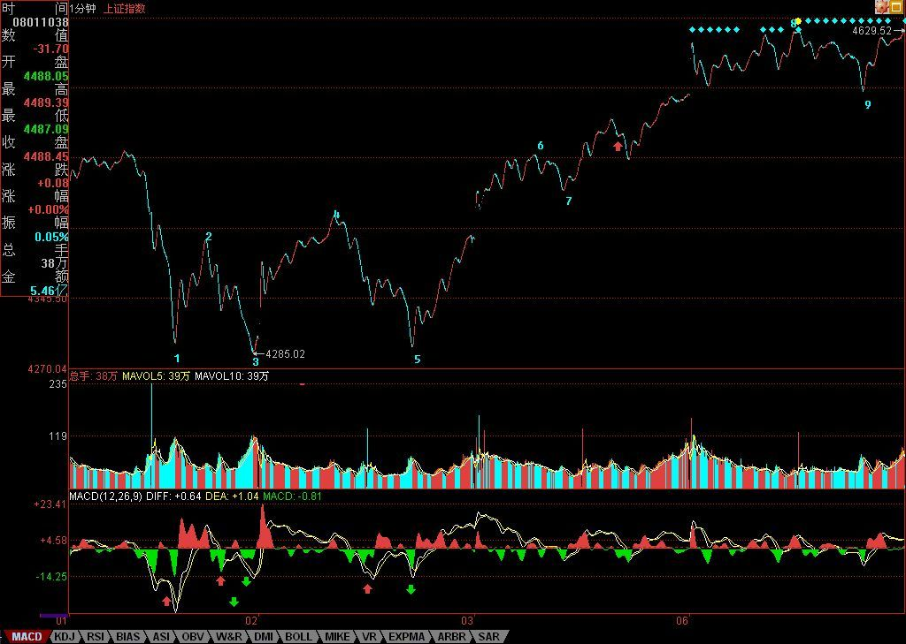 时间：2007-08-06 22:56:55  一酒一诗，人间乐事，酒无诗俗，诗无酒滞，三十载陈酿今宵尽，化作新诗四十言。 席间口占 缠中说禅 红尘多市易 吾辈少经营 偶得天真句 长留快活名 衔杯纵天地 仗剑入阴晴时上孤峰坐 相看心月明

今天这雨下的不是地方，停得不是时候，最后换来一首五律，也算这腐败没白腐败。本 ID 三教九流都交往，难免腐败活动多。本周还有一个法国人的腐败活动在君悦，白酒是喝不上了。喝红酒没有任何写古诗的感觉，古诗总是白酒的。

今天走的时候发现小丸子、大道等指出原来的分段有问题，因为本 ID 平时是用别的系统，写帖子才用同花顺，没注意这两个系统数据上的细微差别，就对着标上了。仔细检查同花顺系统里的数据，确实原来的分段有问题，所以马上改了，然后在车上还上来打了一个招呼。新浪的刷新似乎很慢，一般本 ID 发完帖子，出来也看不到自己发的帖子，要等上一阵，但在“我的所有文章”里能马上看到，只是在首页以及最新文章列表不显示，不知道各位是否也有这个问题。

刚才回来看到有人说别的软件和同花顺的数据不同，那不算的一笔在别的软件上是一笔。这个问题其实很正常，在课程里本 ID 已经说过，每个软件对数据的反应或处理可能都有点不同，所以，数据有差异是微镜就可以。本 ID 看盘时用的软件和同花顺不同，以后也注意点，不能照抄过来。但这些细微的地方，并不大影响整体的判断。而且这个分段，比原来的更简单清晰，更美。

因此，各位必须注意，在一个具体的分析中，一定要坚持用同一套软件的同一个数据源，这样，数据的连续性是保持在同一规范下的。不同软件的数据不同导致的不同划分，不会实质影响大的级别划分，站在实际操作层面，至少要在 1 分钟级别上讨论操作问题，所以这样的测量误差，是在可接受范围内的。测量误差，是不影响理论的统一性与严谨性的。

那么，这样的分歧，究竟有多细微的程度，各位可以看下图。关键是绿箭头指着的两个 K 线，第一根范围是[4594.91，4597.57],第二根范围是[4595.19，4597.44]，由于第一根是最高收的，而 4597.57与 4597.44 相差极为细微，所以可能就是 0.1 秒的数据收集差异，就导致在同花顺中的包含关系，在别的软件中就是第二根的高点比第一根的高一点点，就不是包含关系了，第二根才是分型的顶，这样，笔自然就成立了。如果这里的笔成立，那么整个分段就有一定的变化了。不过，这并不实质影响整个走势的分析，由于各位也应该明白，为什么在实际的分类中，必须要从分型和笔开始，最后由线段构成最小级别的中枢，其中一个原因，就是这样，到了最小级别的中枢的层次，这种微小测量误差造成的差异就可以尽量地抹平了。而到了更大级别的中枢，这些就不再存在。当然，这不是分型、笔、线段的主要功用，但也是其中之一。

这件事情，可以给出一个结论：本 ID 的理论是可以进行最精确的研究的，而且这种研究是绝对科学客观的，只和分析的具体图有关，只要是同一个软件的同一张图，就有绝对唯一的答案，在这个答案面前，无论是谁都一样平等。并不因为本 ID 研究出了这理论，本 ID 就有任何权威，在理论面前，人人一律平等，本 ID 也有出错的时候，但本 ID 的理论是不会错的，结论是唯一客观的，这叫依法不依人。

对任何理论，必须有依法不依人的最基本前提，本 ID 的理论之所以客观准确，并不是因为本 ID 的原因，而是该理论是实际走势最可能客观的反映，无关任何人，不管他喜欢不喜欢本 ID 本人，但只要在市场中，就被本 ID 的理论所覆盖。就如同一个在欧得里德空间里的人，无论他对 180 如何厌恶，但任何一个他能测量的三角形，就永远用 180 去折磨他，无处可逃。本 ID 的理论也如此，只要你在市场中，无论你知道不知道，喜欢不喜欢，你都无处可逃。

有网友问图怎么才能看清楚，本 ID 的电脑水平基本在打字阶段，但这个问题还是能回答一下的。请对着图按右键，然后打开属性把地址复制下来在网上打开，就能看到清晰的大图。本 ID 说电脑，纯粹是胡闹，各位有更好的办法，请提供。

 最后给小丸子、大道等人一人一朵大红花。先下，再见。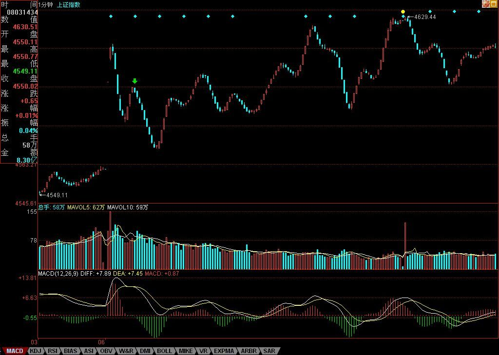 缠中说禅技术论坛 www.chzhshch.net 对不起，有朋自远方来

#### 对不起，有朋自远方来

 时间：2007-08-07 12:55:57 对不起，有朋自远方来，收盘后马上要去接待一下，晚上 11 点以后才解盘，请原谅。

#### 因迎奥运一周年而延迟的震荡只是延迟了

 时间：2007-08-07 22:18:38  对不起，现在才发帖子，今天其他内容的帖子没法写，只能说说今天的大盘。

显然，8-11 已经极为标准地形成 1 分钟中枢，11-13 可以看成该中枢的一个延伸。而 13-14，这个对中枢的离开后形成 14-15 的回抽，构成 1 分钟中枢的类第三类买点（严格来说，一个线段是不能构成买点的，只能是一个类买点，因为在这种理论前提下，1 分钟中枢是最小级别，而最小级别的走势，必须至少包含一个 1 分钟中枢，因此说 1 分钟的第三类买点，只是类比地把线段当成了 1 分钟的次级别，但这只是类比说法，在严格的理论上，不能这样认为。）

由于收盘，使得 16 开始的 17 段走势是否完成，无从判断，因此，明天一大早的走势就是决定该线段结束的位置，如果在图中 10 之下（也就是 4645 点下），那么将成一个 5 分钟的中枢，（8-11）+（11-14）+（14-17）。

注意，一定要注意，一般来说，而由于第三类买点后并不必然导致上涨的延续，而是还有第二种选择，就是形成更大级别，也就是 5 分钟级别的中枢，而一般来说，在走势上，第一个中枢的第三类买点能形成上涨的概率比第二个中枢的要大多了，对于上涨中第二个中枢以后的第三类买点，其后形成上涨继续的概率越来越小，也就是说，这些第三类买点的参与价值越来越小。站在实质操作中，在第一个中枢已经买了，根本没必须等到第二个以后中枢的第三类买点才介入，那是脑子反应慢的表现。

因此，无论明天开盘后那线段走成怎样，连超短线的介入价值都不高，典型的刀口舔血，明天开始，要关注的反而是因迎奥运一周年而延迟的震荡只是延迟了，但延迟不等于消除了，要发生的一定要发生，昨天留下的两点缺口，也构成技术的吸引力，因此，对于实际操作来说，如何应付好这震荡才是首要关注的事情。当然，不排除明天出于某种原因有护盘力量使得这震荡被减震了，但周四、五，依然有极大的可能补回来。技术上，4500 点突破后，还没有一次有力度的震荡去确认突破的有效，一般来说，这种程序是少不了的，人为因素，最多用时间换空间，但能否实现，那还两说呢。

个股方面，本 ID 让各位来北京旅游，这几天已足够热情了，现在，短线也没有任何参与价值了，该股，是本 ID 的中线股票，来回折腾到 2008，是必然的，但并不意味着就永远不回杀了。至于那等比，本 ID 一早就断言，等真启动的时候，肯定都是所有人拿不住的时候。算了，这些小盘股，不会让太多人获利，就那么点筹码，还不够塞牙缝的，千万别追高了，这种小盘股，追的人一多，马上又是一个灾难。大资金有什么优势？大资金的优势就是可以在一股票上耗上一年半载还能把成本给搞没了，而小资金，没必要把时间浪费其中，有些钱不是和任何人都有缘的。

本 ID 从 3600 点开始买股票，只和国资委保持一致，只买中字头，这可在当时暗示过了。最近中船、中铝之类发疯，可别以为是真疯了，当然，这类股票最近都涨多了，就别买了，欣赏吧，顺便去想想国资委为什么前段时间出那减持的规定吧。

对中字头的，本 ID 只说了一个，原因是那价位低，对于散户合适点。现在走得怎么样，各位也看到了。不温不火，就已经从 7 元多快到 12 元了，这就像去年 12 底，本 ID 在 6 元让各位买那只药一样，都是送一个大包子给有各位，让各位挣点学课程的学费。那药，可是本 ID 准备搞 20 年的股票，为什么？华润把万科搞到中国老大，为什么不能把药搞到世界老大？现在 20 元，还 S 股，本 ID6、7 元大力抢入的成本早就 0 了 N 个月了，不搞他 20 年怎么对得起自己？现在，本 ID 对这股票的要求很低，保持 0 成本，一年增加 1 到 2 倍的筹码，别人挣钱，本 ID 挣筹码。至于那只比三一成本低多的股票，也从 7 元跑到 10 元了，这股票基本面有不确定的地方，高了就别追了，对这股票，本 ID 的信心可不大，只是如打家劫舍的，劫他一票而已。

 二、三线股会逐步苏醒，但成分股的疯狂会直到泡沫破裂结束第一阶段的行情。 不说了，累了，上面的后面关于个股的都是梦话，休息。 先下，再见。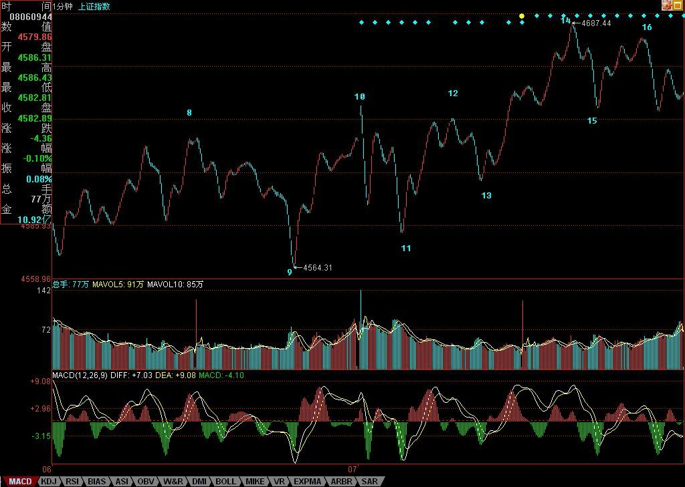 Cheetah 2007-08-07 22:24:19  缠大宗师好，各位师兄师姐好：初学缠论，斗胆冒两个泡， 问 1、遍览各课，除了第 12 课的说明，为何不见第一、第二买卖点的缠中说禅精确定义？ 问 2、对 67 课的特征序列两相邻元素“Xi 与 Xi+1 之间并不一定有重合区间”有疑惑：根据 58 课及 65 课的上下文，我的理解是： 特征序列两相邻元素 Xi 与 Xi+1 之间一定没有重合区间！有的话，线段就被破坏了。 第一种情况：相邻两个特征序列中的元素(Xi 与 Sj 之间)有重合区间,  第二种情况：相邻两个特征序列中的任何元素都没有重合区间，可称为一个缺口。 不知是缠主笔误，还是晚生糊涂？心想缠大宗师不可能写错，所以百思不得其解。还望师者解惑。 =========================================

附 58 课原文“这很简单，因为这段中的下-上-下-上-下中，没有任何的重合，也就是第二个上的终点没有触及第一个上的起点，这种图形，和直接的一个下没有任何区别。而一个线段，除非是缺口，否则必须由至少上-下-上或下-上-下的三折组成，只要互相相邻的上或下不重合，则这个模式可以一直延伸下去而依然还是一个线段。这里就不难明白 14-15 为什么只是一段线段了。”

 附 65 课原文“对于从向上一笔开始的，其中的分型构成这样的序列：d1g1d2g2d3g3…dngn（其中 di 代表第 i 个底，gi 代表第 i 个顶）。如果找到 i 和 j，j>=i+2,使得 dj<=gi,那么称向上线段被笔破坏。 对于从向下一笔开始的，其中的分型构成这样的序列：g1d1g2d2…gndn（其中 di 代表第 i 个底，gi 代表第 i 个顶）。如果找到 i 和 j，j>=i+2,使得 gj>=di,那么称向下线段被笔破坏。”

#### 当工行都发疯后，轿夫们还有什么把戏？

 时间：2007-08-08 15:44:40  今天的震荡，已经在昨天明说了。而且，昨天还特别强调某种护盘力量出现的可能。但这种力量，并没有改变震荡的本质，只是让这种震荡更具有迷惑性。

震荡的位置，昨天也说了，就是那差两点未补的缺口，今天两次的下跳都在上面受到特别关照。如果这都能把人晃晕，那就请抓紧学习和心态调整了。显然，从下图可以看出，昨天说的 5 分钟中枢确立后，这中枢的震荡将一直维持到出现其第三类买卖点之后，具体的分析太幼儿园，就不说了。

目前在 4600 点上下的这个 5 分钟中枢震荡，对应的是 4300 点那个，也就是说，3900 点上来，已经出现第二个 5 分钟中枢，因此，该 5 分钟的上涨类型是可以确立了。但正如昨天所说，一般第二个以后中枢的第三类买点，即使出现，最后演化成更大级别中枢震荡的几率也逐步增加。因此，在操作上一定要坚持以下原则：在第三类买卖点出现之前，必须先卖后买，一旦出现第三类卖点，则坚决等待更大级别中枢出现或下跌完成后才再介入。

 当然，没这个技术的，看 5 日、5 周、5 月均线。短线上，后三天是关键，因为 5 日线已经逐步上来，如果在目前位置不能有效向上，那跌破 5 日线，向 5 周线靠拢寻求支持就是理所当然了。

现在，对于第四拨人来说，一个现实的问题就是，当工行都发疯以后，还有什么可折腾的？一个最简单的，就是继续把汽车、交通、能源等最近没特折腾的也折腾一遍，然后再继续原来折腾的轮动再搞一波，把第五批也给诱骗进来。那时候，比本 ID 前面说的大笨象要跳小步舞还要厉害的是大笨象都变小笨鸟，飞得满天都是了。

 当然，这只是第四拨人的如意算盘，能否打响，就走着瞧了。我们只需要坚持前面的买卖原则，边把成本降下来，边耐心看轿夫的表演。至于没这技术的，就看着均线把股票拿住。 下午、晚上都有活动，先下，再见。

#### 顶住明天，第四拨人才可能解脱。

 时间：2007-08-09 16:04:24

昨天说，工行发疯后，第四拨人只能继续轮动板块把第五拨人蒙骗进来。今天，板块轮动再次展开，当然，本 ID 已经给这论行情定了一个性，就是成分股的泡沫化行情，最终，大笨象要跳小步舞，甚至都要变小笨鸟飞得满天都是，行情的发展继续按这个性质不断展开。至于哪天才会泡沫爆破，无须预测，市场自然给出。

走势上，下图中 20-21 是 14-17 的 1 分钟中枢一个类第三类买点，站在 8-17 这个 5 分钟中枢的角度，明天是否能形成第三类买点就极端重要了。（注意，图形一收放，图中数字会走，本 ID 今天才发现这问题，昨天图中的 17 位置移动了，今天这个位置才是对的，其实，这个根据定义就很容易发现，17 后向上的中间有一个 X，就是因为这不构成一笔，因此，18 必须到目前的位置才满足至少三笔的要求。）

因此，今天的题目是针对此而说的，只要能顶住明天，形成这个 5 分钟中枢的第三类买点，然后再拜托周末没有大的消息，再给两天时间大肆宣传，下周一，新的资金才会有机会补充进来。今天成交量的萎缩，使得第四拨人的努力有不靠谱的地方，因此，明天的第三类买点至关重要，一旦出现跌回 8-17 的中枢，那么这群人当举重手的可能性就根本无须探讨了。

看不明白上面的，本 ID 已经给出最简单的方法，就是短线看 5 日线，但这就可以让你安心持股了。技术高的获取更高的利润，这是天经地义的。复杂的不会，那就玩简单的，千万别吃夹生饭。会就会，不会就学到会，没学会之前，就先用简单的方法操作。对于已经学会的各位，也应该养成好习惯，就是边看盘，边把段给分了，这样操作起来，就一目了然了。这包括大盘和自己操作的个股。

注意，本 ID 说了只坐轿子，但没有任何地方，本 ID 曾经说要看空。本 ID 之所以能在市场中生存十几年而不断壮大，唯一秘诀就是底部之后只坐轿子。本 ID 的方法很简单，就是留了机动的资金后，把仓位打到最大，然后不断在出现中枢震荡时，保持仓位把差价搞出来。一般情况下，到一段行情顶部的时候，本 ID 原来的仓位都要下降到 70%-75%，注意，筹码不丢失，只是钱多出来，所以仓位自然下来了。这样，无论发生什么，本 ID 都是大赢了。

在市场中，关键是能长期保持赢利，本 ID 从来没见过喜欢当轿夫的最终能活下来的。谁爱当轿夫就当去，本 ID 依然如故。而且本 ID 还要特不厚道，还要经常批评轿夫的姿势不美、动作恶心。例如，本 ID 今天就要批评，轿夫们，本 ID 其他中字头的都不错，就是中石化、中国银行有点蔫，连新高都没创。哪位轿夫有力气的，也来一把吧。另外、抬中铝的，动作优美点，今天走得特恶心，搞了一个双针出来；潍柴动力的轿夫，手脚麻利点，反正都要上 100 的，就别摆太多姿势了；中国国航，也比较丑陋，连南航都比不上，你们李总怎么见部队的朋友？

 股票，要有放松的心态，轿子都不会坐，那就当抬轿的，或者当饺子给人吃了吧。 今天可以回答问题到 5 点。 缠中说禅 2007-08-09 16:14:48  全线飘红 2007-08-09 16:09:56  缠 MM 好，说说看 这几拨咋不光顾俺们的轿子呢？ == 成分股行情，首先是最大那 50 家，然后是 300，最后才会轮动到二、三线，当然，这不是绝对的，只是大方向。 缠中说禅 2007-08-09 16:18:21  [匿名] 与你同行 2007-08-09 16:14:41  老师,股指狂升，很多股票价格却不动，反而跌怎么理解？==  这太正常了，上半年二、三线股涨的时候，大盘成分股也没怎么动，风水轮流转。 从今天开始，可以慢慢关注沪深 300 中的，大盘 50 会慢慢扩散出去。当然，还可以关注大盘 50 中没怎么动的，没动的都会轮一遍的，前提是，有一定级别的买点。 缠中说禅 2007-08-09 16:21:19  [匿名] 恒灵 2007-08-09 16:17:25 缠主，我看大盘图一直有顶背却不下跌，是不是我看错了？ ==

MACD 是辅助，首先要把走势给分清楚，否则又怎么知道是哪段和哪段比？这次上来这一段，可以先看成是 5 分钟级别的背驰段，如果背驰成立，就至少重新跌回 4600 点上下中枢，也最迟在周一前就有结果。也就是说，这个背驰段是否成立的结果。 缠中说禅 2007-08-09 16:30:15

 [匿名] 胡子大将军 2007-08-09 16:23:52  标注 17-18 之间 1122-1312 这个为什么不算一段？是 3 笔重合，而且破坏了上一笔。 还有，18 要是没创新高的话怎么分段？ ==  这当然不能算，这种情况要看该段特征序列的底分型，而这里没有，不构成。最后新高与否问题并不大，当然，如果不新高，这段有可能成为一个三角形，这在后面段的形态中会说到。 缠中说禅 2007-08-09 16:33:36  [匿名] 贪心病犯了的人 2007-08-09 16:23:10  禅你好,我被802困住了,短时间还有解套的机会吗,我知道前天您对802有很明确的指示,但我又贪了, 结果...  想您提示最近它的走向可否,谢谢! ==  本 ID 也奇怪，昨天在 26 上砸，怎么跟着的不多，本 ID 就像搞了一个塔山阻击战一样。这股票，要休息一下，但 2008 肯定比 26 高，这是没问题的，下来，本 ID 会回补，把差价锁定。 缠中说禅 2007-08-09 16:37:33  石头叁 2007-08-09 16:32:52  老大什么时候讲讲个股的线段划分？现在看大盘操作个股有点不灵。另外那个您说过的中字头这两天表现也不好，您也点评一下这里面的轿夫吧。谢谢！ ==  737 没什么大事，涨了 N 元了，也该洗洗。该股票形态上还不够完美，如果下面的均线能上移上来，把短、中、长进行一定缠绕，那就更完美了，现在的问题是，时间上不知道够不够，尽量吧。 缠中说禅 2007-08-09 16:43:28  [匿名] 执迷不悟 2007-08-09 16:34:46 至于那只比三一成本低多的股票，也从 7 元跑到 10 元了，这股票基本面有不确定的地方，高了就别追了，对这股票，本 ID 的信心可不大，只是如打家劫舍的，劫他一票而已。

－－－－老大提及此票以来，大盘的涨幅超过 30％了，看看 600375 多少，两市一半的票都超过它了，真想直接去给老大说说“省省吧，还是多讲点技术好，个股就不要提了－－搞的俺们小散每天为此东奔西走的，而且亏的比例还多。”

 “这股票基本面有不确定的地方，高了就别追了，对这股票，本 ID 的信心可不大” －－－看，看，老大这不又搞错了。－－－基本面分析错了，托大盘的福，也跟着起来了 30％。 ==  看来你不知道什么才是基本面，那些分析不出来的，必须通过中国特色的程序的，才是基本面。600375 从 7 元到 10.5，一个月不到 50%，应该休息一下，这是技术面。至于基本面，到时自然知道。 缠中说禅 2007-08-09 16:45:46 [匿名] 大盘 2007-08-09 16:39:04  请问博主： 线段走完的划分，多少有些滞后性质，因为至少需要类顶分型中一个下的一笔后才能最终确定， 虽然可以根据 macd 辅助提前判断，但是有时即使是放量强势拉升后的线段回跌力度也很大，可以 6％上下，有时又只有 1％多，形成类 3 买， 那麽从操作程序上来说，离开中枢向上的线段，是不是即使回跌幅度连手续费都不够也要先卖出，再看情况回补呢，还是有什么好的方法可以区分可能的回跌幅度， 可否结合线段概念出来以后，再重新把操作程序给诠释一遍，谢谢 ==  本来就不能用线段来操作，至少要 1 分钟以上级别的。当然，实际上，一定要线段操作也可以，这样就要用类背驰的概念。 缠中说禅 2007-08-09 16:47:46  小丸子 2007-08-09 16:20:10 走势上，下图中 20-21 是 14-17 的 1 分钟中枢一个类第三类买点 ==========请问缠 20-21 怎么不是 16-19 这个一分中枢的三买 == 也可以是，只是看成 14-17，后面的就是中枢延伸。

#### 热点在震荡中蔓延

 时间：2007-08-10 15:56:27  昨天已经给了第四拨人一个任务，就是顶住。可以这样说，在外围环境如此恶劣之下，这总算顶住了。当然，站在本 ID 不厚道的角度，会说他们姿势不够优美。周末消息面，就决定这拨人的短线命运。

技术上，今天 5 分钟的第三类买点并没有被制造出来，因此依然只能归于中枢震荡的范畴。下周一，能否制造此买点，将决定短线大盘的上攻力度与强度。当然，偷懒的、看不懂的，就继续 5 日线，这确实是懒人的懒招数。

个股方面，昨天在回答问题时说了，现在是从大盘 50 到 300 的热点蔓延，如果这蔓延能成功，那么大盘的热度还会增加，今天，这迹象已经开始。更重要的是，今天 ST 大面积启动，也表明短线的投机资金开始蠢动起来，因此，下周的热点蔓延能否成功，是决定行情延续时间的关键。

个股方面，中字头继续是本 ID 的主力。对那些不启动的中字头，轿夫都应该像 777 学习。本 ID 昨天那一通骂还是有点作用的，看看今天的中铝、中国国航，但国航确实恶心，跟着南航后面跑，那李总的军人作风成气了。算了，大周末的，就不想骂人了。其他股票，等大盘炒热后，会逐步补涨。

 一到周末，本 ID 就对股票反胃。各位腐败去吧。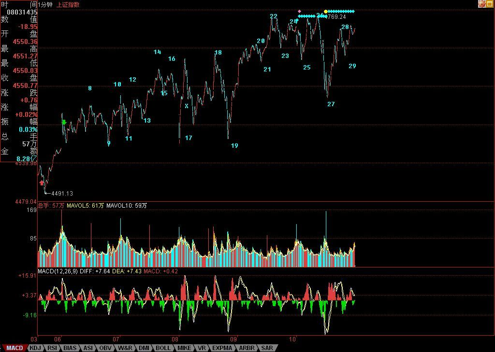

#### 公募基金经理“快男”发展模式的不可持续

 时间：2007-08-13 08:29:07  各位注意 用这个网地 http://v35.blog.sina.com.cn/u/1215172700，一切都正常，看来新浪的新版确实需要更多改进。下面的文字继续保留，看电脑高手有没有更好意见。

今天，原来只有 13 页的所有文章，不知道被谁又改成 32 页，显示的文章又基本全了，其他分类也一样，但时政经济还是没有。本 ID 电脑水平连菜鸟级别都算不上，也不想搞明白究竟什么回事情。希望是新浪的新系统有待完善。请问，有什么方法让这用得最多的时政经济能重新显示文章。

对于粉丝无数、发行井喷的公募基金，探讨其发展模式的不可持续，似乎有点杞人忧天。但公募基金经理的跳槽比例在今年达到惊人的 40%，已明白无误地表明，如今这种基金经理“快男”发展模式的不可持续。

表面上，公募基金经理跳槽是由于个人待遇以及业绩压力等原因。众所周知，公募基金只收取管理费，相对于私募基金的收益提成模式，其分配上的激励机制明显不如后者。但只收管理费模式意味着旱涝保收，收益提成模式在牛市中可能兴旺一时，而在熊市中，则会引发无数法律、经济纠纷，终不是长久之计。

当然，有人可能反驳说，收益提成模式能使得基金管理者的优劣得到更直接地反映，使得优秀的基金管理者能得到更大的发展，因此，公募基金也可以尝试采取相应的模式。但是，在只收管理费模式中的管理资金大小与收益提成模式中的分成收益大小具有同等的赏优汰劣意义，而公募基金占有制度上的先天优势，由于能够合法面向公众募集，其资金规模具有私募基金所不可比拟的优势，至少在目前的经济、法律、社会结构下，只收管理费模式是获取这种募集优势所必须付出的代价，不仅公募基金不可能采取收益提成模式，而且阳光化的私募基金也只能采取只收管理费模式。

募集范围的大小通常正相关于分配比例的大小，例如，私人股权基金，其募集范围在主要针对二级市场的公募与私募基金之间，一般就采取收取管理费与比例较低提成的综合分配模式。如果收取了管理费，那么像私募基金那样根据收益大小最高分成可达到 50%的分配模式是不切实际的。公募基金只收管理费模式的不可改变，决定了其内部的分配机理机制也不可能有大的实质改变，因此，企图通过公募基金分配方式私募化而使其可持续发展是不切实际的。 由于个体利益的巨大诱惑，明星式人才必然趋向于高比例分配激励的私募基金，这对公募基金来说，

基金经理“快男”模式将形成一个恶性循环，在私人利益驱动下，更多人会把公募基金当成积累个人资源的平台。一旦从这平台得到个人所期望得到的资源，离开就成了他们必然的选择。现在开始采取的双基金经理制，其实更坏，等于把这跳板上的人又增加了一倍，而这些人，站在长远的角度，对于公募基金来说都是狮子虫。

要解开这个恶性循环，就不能培养“快男”式基金经理，而是要依靠集体、团队的力量。要明星化的不是个人，而是团队。要形成这样一个良性循环，就是让优秀的人才能以在明星团队为荣。这有点类似“智库”的品牌建立，一个“智库”是否优秀，从来都不是因为里面有多少“快男”，而是该“智库”的传统、风格、团队的综合研究力。一个更通俗的例子就是，无论北大、清华曾出过多少“快男”，但北大、清华的名声却依然凌驾于一切“快男”之上。

因此，对于公募基金来说，应该淡化基金经理的个人色彩，突出团体的风格，逐步形成自己的特色与传统。一个好的基金，一个能可持续发展的基金，就应该走金融“智库”的品牌之路。另外，在个人经济利益上，对基金管理公司进行适当的股权创新，加大核心团队的持股比例，这也是必要的。

最后，附带说说 8 月大盘的走势。7 月大盘站住了 5 月均线并突破了 4159 点的 1/2 线，目前该线已经上移到 4174 点，而 5 月均线也上移到 4170 点附近，并且 7 月长阳的一半位置在 4136 点，因此，4150 点附近成了大盘中线能否保持强势的最重要位置。只要能有效站稳该位置，那么大盘的整体走势就能保持向上拓展空间的能力，否则将引发大盘周线指标的走坏，至少要重新陷入新的大震荡中。

但即使大盘能保持强势，本月也一定要注意大盘过分冲高所隐含的月 K 线上影杀伤力。8 月是宏观政策理清思路的关键时间，这方面的变动将对大盘走势起着决定作用。此外，外围股市的走势也会对大盘走势产生影响。全球化社会里，没有哪个股市是可以与世隔绝的。个股方面，一、二线成分股的行情依然会延续，但要注意升幅过大后的短线震荡风险，而当业绩风险释放后，二、三线题材股会找到重新活跃的动力。

#### 热点，如期蔓延中

 时间：2007-08-13 15:38:41

上周末说了，热点会逐步蔓延，从 50-300-二、三线，今天，300 中已经骚动不断，而二、三线，也已经有不少按捺不住蠢蠢欲动了。今天唯一不完美的，就是第三类买点还没有走出来，所以，明天的走势依然有变数。最简单的，还是看 5 日线。

从 4200 上来的走势，从下图就可以看到，一种走势类型划分已经逐步明朗。1-14 是一个 1 分钟的上涨走势，从 14-27，是一个 5 分钟的中枢，27-32，是对该 5 分钟中枢的离开，该离开与回抽依然没有完成，就看明后两天的发展。如果能形成第三类买点，那么其后就看是否形成背驰性走势，否则，就要在 14-27 的区间形成 30 分钟的中枢了。

个股方面，没什么可说的，还是中字头。N 天前，本 ID 骂中行和中石化连新高都不去太过分，今天，也都基本新高了，这可以看出，中字头就是有力量。当然，所谓的中字头，就是大型国企，只是本 ID 比较懒，就买其中带中字开头的，这样好记。当然不会有人觉得，如果没有中字头的就不会涨了。原来的那十几只老股里，依然是中字头的 000777 表现最好，后面，一旦热点蔓延成立，其他都会逐步动起来的。本 ID 买股票从来都不是乱买的，8 元让各位买 000777 时，各位当然不可能知道该股基本面将会怎样，但本 ID 就知道，这就是对基本面的把控能力，光技术面，只是一方面。例如，600649，大概到现在，没人知道这股票里卖的什么药，但如果你去研究一下该股是现在管理层的资本运用的辉煌历史，还有上海市对国企重组的计划，那么，当然就明白，本 ID 当时让各位在 6 元买入，不是瞎说的。好的剧本，当然是慢慢展开的，本 ID 经常是在序幕时就告诉各位，所以，如果没耐心的，千万别买本 ID 说的股票。否则，请问，有谁能把 000777 从 8 元拿到现在？大概，除了本 ID，来这里的人是不会有了。

 （这里原有私人资料已删除，有缘得之，无缘亦不失，梦中游戏，能窥操作之一斑，不枉本 ID 之冒险一贴。） 下面是分段图，各位研究去吧，有一个谈判在 4 点，先下，再见。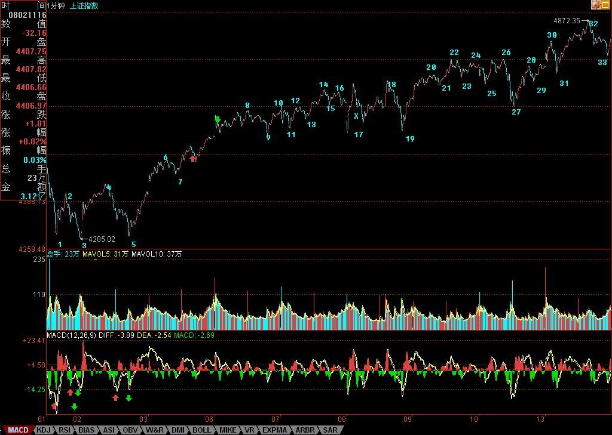

#### **41** 与 **1** ，本 **ID** 对二级市场兴趣已失

 时间：2007-08-13 21:26:14  周五，本 ID 是一边叨唠，一边让人报盘买股票。一个 41 元的股票，本 ID 最高买到近 43 元，心里越买越窝火。看看，里面的人，1 元的成本，那种 PE 游戏，本 ID 也干着，凭什么让本 ID 贵了 40 来倍来买？

今天下午，一个关于 PE 的谈判，本 ID 已经决定全面转战 PE，当然，撤退是战略性的，本 ID 决定的原则是：第一，本 ID 将不会再买入任何二级市场的股票；第二，任何成本不为 0 的股票，本 ID 都将把成本逐步抛到 0 为止；对成本为 0 的股票，本 ID 将持有到大牛市结束，有空可以继续玩先砸后买增加筹码的游戏。

本 ID 已经有了基本的判断，就是谁执 PE 牛耳，谁得中国资本市场的天下，PE 中，除了 Pre-IPO 等，类似收购基金之类的，在中国依然没有大发展，当然，Pre-IPO 这类活动当然不能放弃，但收购基金之类活动，也是可以逐步展开的。在中国，目前类似活动搞得比较好的，是一个生了 5 个孩子的海龟中男。

 当然，完全放弃二级市场是不行的，所以必须留下已经有的根据地。但如果现在不到 PE 上大发展一把，那么就整天为人做嫁衣裳了。前期，本 ID 那一顿忙，已经为此铺好了路。

当然，在二级市场中，也有类 PE 的机会出现，也就是当大的波动让某些大的重组股票达到足够吸引的地步，这也是好的介入机会，在全流通时代，如何用收购基金的模式在二级市场搞上一票，这也是一个有趣的活动。但目前讨论这个问题有点无聊，现在，二级市场之外黄金满地，本 ID 脑子又没进水，没那闲工夫搞这二级市场了。

以上都是心里话，也是本 ID 的决定。当然，PE 的活，意味着整天要腐败，这是本 ID 最不喜欢的，当然，有些活可以让别人干，本 ID 只要有时间，依然会保持每天的解盘。毕竟，对于散户，二级市场是唯一可大面积介入的地方，而且，原始积累也只能靠这地方，山高水长，如果本 ID 能帮各位一把，也算结一段善缘。

 本 ID 会尽力为之，各位有缘得之吧。

附录：各位请不要胡乱猜疑，本 ID 关于二级市场 20 年以上大牛市的判断从来没改变过。本 ID 春节后说在突破 GDP 之前，成分股为主的第一段行情一定不会结束，当时，有谁能如此明确的说？又有谁能把 20 年的大牛市给明确分了段？本 ID 的这观点从来没改变过。

 没有大牛市，PE 也白搭，只是现在的二级市场，比起 PE，利润太薄，那种能 3 年翻几十倍的股票越来越难找，但在 PE 里，一点都不难。 资本都是往利润高的地方跑，本 ID 也不例外。 本 ID 对大盘没有任何暗示，短线大盘的走势，看分段图甚至 5 日线就能判断，谁都没必要预测。累了，10 点了，先下，再见。

#### 热点蔓延，阳光下没有新鲜事。

 时间：2007-08-14 15:49:37  当然，没有阳光下也同样没有新鲜事。今天的走势，唯一的特点，就是没有新鲜事。从上周起，本 ID 不断强调热点开始蔓延，今天，这热点已经开始燎原。 50-300-二、三线，本 ID 已经给股票的热点蔓延画出了线路图，现在，不过是按着线路图的一种演绎，正所谓阳光下没有新鲜事。 今天，14-27 这 5 分钟中枢的第三买点 35 也总算给憋出来了（偶尔看到有问为什么不是九段？九段可延伸成 5 分钟中枢，可不等于 5 分钟中枢就一定是九段，这么简单的逻辑关系可别搞糊涂了。） 5 分钟第三类买点后，只有两个选择：一、继续上涨直到形成新的 5 分钟中枢；二、在目前位置附近形成大一级别的 30 分钟中枢。 现在，关键是热点的蔓延持续，只要这没问题，一切都好办。 站在日线角度，提两个思考题： 1、目前日线的背驰段解除没有？提示，关键是哪段和哪段比，连相比的对象都没分清楚，还谈什么背驰段？更不用说什么精确定位了。 2、4174 点的 1/2 突破后，下一条真正的压力线在哪里？

注意，本 ID 战略转移，并不会影响博客的一切活动，只是有时候晚上的文章，可能会因为应酬改到早上发，如此而已。而且，本 ID 现在是战略转移，0 成本的股票是不会抛的，没到 0 成本的，本 ID 也不会胡乱抛的，没到卖点，凭什么抛？今天，能在 49 下买到 002149 的，可要感谢本 ID，某人脑子进水，竟然企图让本 ID 在 50 下出来，一开盘就企图打压，脑子有水吧？这股票，本 ID 会抛至少一半的，但想让本 ID 今早 49 以下就抛，简直病得不轻。

 今天可以回答问题到 4 点半。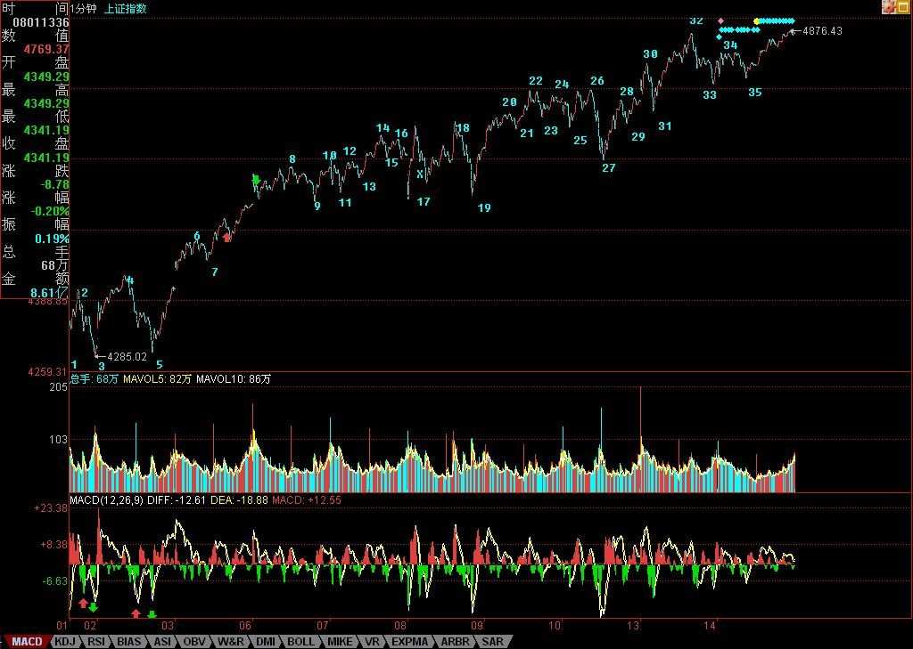 缠中说禅 2007-08-14 15:58:20  [匿名] 新浪网友 2007-08-14 15:54:47  能谈谈对"次级债"的看法吗?  ==

这类问题，在本 ID 关于货币战争的帖子里都说过了。其中一个比喻是这样的，美国这个发动机积炭了，只能换一个新的。新的，可以是一个新国家，例如中国，但美国人显然不乐意。唯一让美国人乐意的，就是全世界人出钱为美国人换一个新的。而从 2001 年起美国人的所有玩意，就是这种玩意，不管这玩意变了多少名字。

 缠中说禅 2007-08-14 16:06:43  [匿名] 举杯邀明月 2007-08-14 16:01:22  老师,有个问题,就是假如我用 5 分钟以及更大级别的 K 线级别操作的话,画图也还是按照笔-------线段-----中枢这样的同样的方法吧 另外希望老师能继续股票课程的讲解,别真的离开我们 ==  本 ID 什么时候说要离开了？本 ID 只是说不再新买二级市场的股票，买了窝火。 请你先把显微镜和被显微镜这两种关系搞清楚。你当然可以只看 5 分钟图，那等于用一个不太精确的显微镜，难道 5 分钟图上就没有线段、笔？ 用 1 分钟图上的线段笔，只是一个更精细的显微镜，这并不影响任何级别的操作。 关键是对精确度的要求，但笔、线段等等，对任何精确度下的图，都是必要的。本 ID 不是有一课示范了在月线上如何划分笔、线段了吗？ 缠中说禅 2007-08-14 16:36:13  年年一变三 2007-08-14 16:01:08 缠主，看了你昨天的帖子，我们小散没法参与，但我想 600635 按缠主的宏观思路，是否应该是只大牛呢？ 另问：缠主多次提及 636 是战略建仓，我只是建早了些，还小套。问缠主不买二级市场的股票也包含 636 吗？ ==  不买就是都不买了，不过 600636，本 ID 在 10 元上下买了不少，本来是要继续买的，既然都不买了，就都不买，战术服从战略，本 ID 不买，自然还有别人要买。 像 600737、中铝、中国国航等等中字头以及原来那十来只，本 ID 都会继续持有的。没有成本为 0 的，本 ID 会找机会变为 0，这就是套钱的手段，套出来的钱，都离开二级市场去干 PE 去，如此而已。 缠中说禅 2007-08-14 16:40:26  [匿名] 新浪网友 2007-08-14 16:36:36  14-27 形成 5F 中枢是否不准确？ 因为 14 开始的 3 段的高点不够高？ == 中枢和高点高不高有什么关系？中枢，关键是有重合部分。 ===  我可能没说清楚，因为 14 开始的 3 段的高点不够高，使得与后面的六段无法重合？？？ -

临走回答一下，这问题太典型，就是概念没搞清楚。5 分钟中枢，只要 3 个 1 分钟走势类型有重合就可以，不是一定要里面的所有段都重合。所有都重合，只是其中一个特殊的情况，这叫又线段延伸九段后形成 5 分钟中枢，在这种情况下，同样可以看成是三个 1 分钟走势类型的重合。

#### 外围因素引发今日震荡

 时间：2007-08-15 15:49:33  先解答一个和打坐有关的疑问，本 ID 说念想把横隔膜以下气息在横隔膜以上送出，这气肯定不是真正呼吸之气。人体结构里，横隔膜以下哪里有什么呼吸之气？那只是一念，以此一念带动那非气之气之真气。

好，说股票。最近，外围市场鬼哭狼嚎的，弄得全世界的鳄鱼都痛哭流涕。中国市场震荡一下，也很应该。技术上，昨天已经很明确说了，现在，或者继续上涨直到出现新的 5 分钟中枢，或者就在这里形成一个 30 分钟中枢，除此之外，别无选择。

今天早上冲高后，一个 1 分钟级别的背驰就出现，整个 1 分钟的上涨，是下图中的从 17-38，两个 1 分钟的中枢，37 是对最后一个 1 分钟中枢 32-35 的第三类买点。因此，该上涨极端完美，背驰的 MACD 辅助判断，看 5 分钟图更为明显。（各位请自己去看，这里的贴图只有 200 的额度，本 ID 不能浪费太多空间。在 5 分钟图中，看对应 1 分钟图中的走势去比较力度。）这是一个标准的走势，十分教科书。

后面的震荡十分正常了。现在，从 8 开始走势的一种划分也自然当下给出了，就是 8-17 是一个 5 分钟中枢，然后 17-38 是一个 1 分钟级别上涨。而从 32 开始，一个 5 分钟中枢的雏形也出现，极短线走势，就看这 32 开始走势的演化情况。

个股方面，请问 002149 让各位爽了没有？当然，后面的走势和本 ID 没关系，本 ID 只在上周五最高买  到 43 元，然后把其中 41 附近一部分清单在这里放了几个小时。这股票，为什么还有这么多人抢入，最主要是基本面与成长性。本 ID 在 N 个月前，强调过中小版成长股的中长线介价值。后来，本 ID 也告诉过介入了 002121，注意，这股票和 002149 都和 600635 有关系，那纯属意外。对中小版，一定要看其成长性，而且要有耐心。

 注意，任何股票，都不值得追高，包括如 002149 这样的。

不过，这都是老皇历了，本 ID 现在不会再买任何二级市场的股票，只会等待机会把成本不为 0 的的出掉变为 0，然后都去干 PE 去。至于其他股票，本 ID 说过的任何股票，本 ID 都持有着，当然，很多都是 0 成本的，但本 ID 都会持有到牛市结束。

这前面说过。本 ID 再强调一次，本 ID 对大牛市的信心没变，但目前进入成分股泡沫行情的判断也没变。成分股行情结束后，还至少有两轮行情，分别是成长股与重组股带头，这些游戏，至少玩 20 年，早着呢。

 本 ID 就多累点，PE 多点如 002149 的，让各位在 40 元买了也不后悔的好股票。 二级市场，咱相信群众。今天有事要去谈，先下，再见。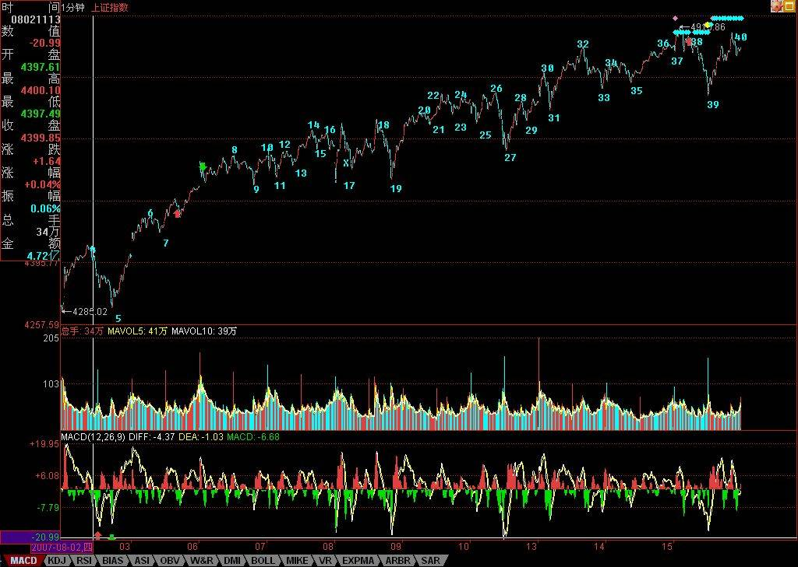

#### 全球化，没有市场可与世隔绝

 时间：2007-08-16 15:41:56

“全球化社会里，没有哪个股市是可以与世隔绝的。”是在本周一的公募基金经理“快男”发展模式的不可持续上写的，主要是针对八月股市的分析。现在的问题，已经很明确了，还是该文章里说的，要注意月线上影的杀伤力。

当然，没必要预测这个问题，而且本 ID 从来都认为，美国的事情对中国的影响从来都是战略性的，中美游戏，只看最后结果，中间都是游戏而已。就像原来的蒋委员长，最终只得了个蒋匪而看海水之蓝终老，谁能把美国搞成美匪，显然更牛于将蒋委员长搞成蒋匪。

美国暴风雨，全世界陪着挨冻，但至少今天的中国散户，很多都没这种感觉。为什么？因为二、三线股被热点蔓延了。本 ID 从上周起，反复用到的就是蔓延这个词，这确实是一个度过风雨时节的好办法，搞工行的被美国搞了，现正痛苦中，那些到香港 QDII 的，终于知道全世界的乌鸦一般黑了。而这里的二、三线股的火，能否温暖这风雨之夜，就看明天和周一了。

全球化，没有市场可与世隔绝，但可以创造与世隔绝的板块，二、三线股，本来就是给点烛光都能灿烂，关键是，如果烛光都不能给，有点光就把投机大帽子盖上，那就瞎闹了。那些二、三线股一动就忽悠投机的，脑子里肯定水太多。当然，现在不比上半年，这二、三线股之火能否燎原，还真不好说，走着瞧吧。

大盘走势上，16 这点如果跌破，那么，形成 30 分钟中枢震荡就是唯一选择了，换言之，4700 点如果不破，还有在目前位置形成新的 5 分钟震荡可能，也就是原来的 5 分钟上涨走势依然能维持，因此，短线调整级别的大小，就看这 4700 点。

 这，关键还是要看美国这病人还要鬼哭狼嚎几天了，说实在，本 ID 是宁愿中国这边 30 分钟甚至日线震荡，也希望看到美国哭个 368 天算了，为阿富汗、伊拉克死难的人，美国人多些破产，难道不应该？ 今天心情大好，看到美国暴跌就开心，虽然会让汉奸不爽，但汉奸不爽的事情，本 ID 最愿意干。 今天回答问题到 5 点，因为开心。注意，下图中的 46 并不百分百确定，因为如果明天大幅度高开，那就要改变了，这只是大致标记上。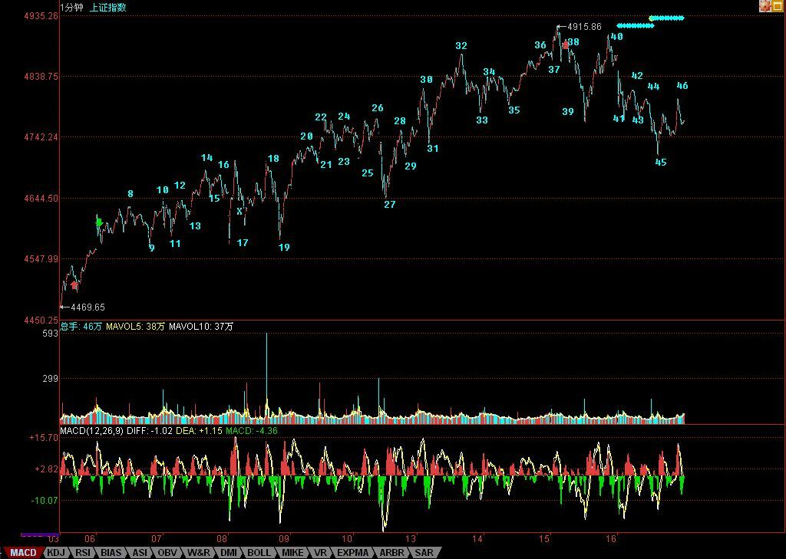 缠中说禅 2007-08-16 15:50:48  [匿名] 新浪网友 2007-08-16 15:45:17

1.按缠主 32-35 若是一分钟中枢，是否 32-33，33-34，34-35 都是笔而不是线段，也就是所谓的次级别走势，他们的重叠构成一分钟中枢，也就是在某一级别走势图上，类似 32-35 的三笔就可以构成该级别的中枢，而不需要再到更低级别的走势图上去看了。

 2.日线背驰段的问题，缠主说：是从去年 8 月到今年 5 月 29 日这段，为什么？因为这段前后两个中枢是同级别的，而今天春节前后那一个不是。

我看 MACD 图，去年 8 月-今年 5.29 这段的黄白线挨得一直很近，也就是二者交叉形成的面积不大，下面的红柱子也不高，明显感觉今年 7 月到现在的红白线的交叉形成的面积和红柱子面积都比上面那一段大，为什么背驰段还没解除能。

 ==  请先把概念搞清楚，32-35 是一分钟中枢，32-33，33-34，34-35 怎么会是笔而不是线段？三笔能构成一个 1 分钟中枢？ MACD 只是辅助，关键是要把中枢找到，前后对比的走势找对，并不是 MACD 回抽就有背驰，如果这样，那直接研究 MACD 就可以，还用其他干什么？ [匿名] 蓝羽 2007-07-31 16:10:56  缠 JJ，一笔是否也有类似线段那样得三角形态或奔走形态？ 或者说，一笔之中的非顶、底 K 线是否允许超出顶底的范围呢？顶或底是否一定为一笔的最高点或最低点呢？ -  一笔，是一顶一底，怎么会有三角形？顶和底，当然一定是那一笔的最高最低，如果不是，那里面一定不只一笔。 37—38 不符合“顶和底，当然一定是那一笔的最高最低”  理解是否正确？？？？？ ==  怎么不符合？顶和底是对笔说的，线段是由笔够构成的，请不要搞混了。一个线段里的各笔之间，还可以走出三角型、扩展平台等等形态。 请搞清楚几个概念。分型对应的是笔，而特征序列里元素的分型对应的是线段的破坏判断，请不要把不同的概念搞糊涂了。 缠中说禅 2007-08-16 16:04:18  注意： 发现还有人把一笔之间的分型，与线段之中的各笔给搞混。一笔，只有一顶一底，如果顶接着顶，那其中一个肯定不是真正的顶。这是在笔的范围里说的。 在笔里，当然没有什么三角形之类的东西，笔就是一线段，两个端点。 但线段中的各笔之间，是可以有各种图形的，只要这些图形不破坏线段本身。 请把概念搞清楚了。 缠中说禅 2007-08-16 16:10:34  [匿名] 新浪网友 2007-08-16 16:05:45  不知为啥您的图看不清,能不能整一个能够放大的图?  == 很高兴有一个电脑问题本 ID 能回答的，你对着图按右键，然后把图复制下来就有大图了。好象新的浏览器，都带放大功能，在右下角。http://blog.sina.com.cn/s/blog_486e105c01000c8g.html#contentIframeLink  缠中说禅 2007-08-16 16:16:47  [匿名] 听风 2007-08-16 16:06:32  妹妹:  有个问题问问,前天好象才出现第三类买点,拿联通来说,当时是 7.16.O 为何在这二天却有更低的价格? 是受系统影响?  ==

有没有这买点且不说，就算有，也是有级别的，难道一个 1 分钟的第三类买点就保证永远上涨，显然没有这种事情。所以先搞清楚级别，第三类买点后两类选择，更大级别与继续上涨，如何分别这，以前课程说过，就是看相应走势是否出现盘整顶背驰。

 盘整顶背驰，对应这更大级别的情况，后面出现下跌，那是天经地义的。 但即使是更大级别的，从第三类买点到盘整顶背驰，理论上必然保证一段向上的过程，更不用说继续上涨那种情况了。但理论从来不保证，向上以后就不再向下。 缠中说禅 2007-08-16 16:24:08  [匿名] 新浪网友 2007-08-16 16:12:13  老师大架不知是否能光临技术论坛.!!!  现在已有会员 1200 名了!!!!!!!!!!  而且答复在论坛里也方便保存!!!  不象新浪这么烂!!!!!!!!!! 期望老师能摆驾论坛!!!!!!!!!  ==  本 ID 不反对有这样的论坛，毕竟能方便各位互相研究，而且不光是本 ID 的理论，任何东西都可以研究，不比较，哪里能知道谁是最好的。 但本 ID 确实不能去那里，因为那样会有不好的嫌疑。本 ID 干事情，不能有任何把柄给汉奸们利用。本 ID 如果去一个以本 ID 相关的论坛，肯定会被编出无数故事，汉奸们正等着呢。

有什么问题，还是在这里回答，各位可以把问题集中一下，这样效率高一点 [匿名] 沙滩 2007-08-16 16:23:14 缠 mm，你的心情大好，咱么都跟着高兴！

 不过自己实在缺乏战术，才买中行就这么跌。长期投资一定没问题的，你说对不对？？ ==  本 ID 反对任何操作失误被用长期投资所掩盖。长期投资，就是要在大级别买点介入，例如年线、季线、月线的买点，然后一直持有到大级别卖点再卖，这才是真正的长期投资。 当然，中行最终肯定是套不住的，那关键操作上要有正确的思维方法，任何一个操作，必须要知道对在哪里、错在哪里。如果本来想 1 分钟操作的，结果搞错了，就用长期投资搪塞，这样是很难进步的。用本 ID 的理论，和别的完全不同，所以必须洗心革面。 在本 ID 这里，任何东西都是有精确定义的，包括长期投资。 缠中说禅 2007-08-16 16:34:13  [匿名] christine2007-08-16 16:28:41 现在我发现自己的问题还有一个在对待顶背驰与底背驰的问题上有些困惑，底背驰抓得比较准，但顶背驰往往错过，仿佛近视了一般。 ==  这不是技术问题，而是心态问题。从来，大多数人都是容易买对，永远卖不对，结果就是坐电梯。说白了，就是贪婪所致。 宁愿卖早，不要卖晚，卖早，有钱，就有新的机会可以把握。卖晚，不仅坐电梯，还把机会成本给搞起来了。 至于卖点的精度问题，那是一个磨练的过程。卖多了，精度自然高，对理论的把握自然好。一把好刀，一次都不用，有什么用？ 缠中说禅 2007-08-16 16:40:06  缠中说禅 2007-08-16 16:35:57  [匿名] 新浪网友 2007-08-16 16:30:22  缠中说禅博主，请问 36-37 怎么回事，能说说不？看着 36-37 没有 3 笔呀，下上下，后面那个下，不能成为 1 笔。难道是缺口的缘故？ 另外，发现博客已经一切正常了 ==  为什么不是？9 点 25 那一分钟不算了？==  当然，如果一定要坚持 9 点 25 那竞价不算，那么自然不是一笔，那就把 36 标记到 4915 点那最高点就可以。 但事实上 9 点 25 必须算，竞价是最重要的时刻之一，这里的意义重大，而且，这里刚好形成下面中枢的第三类买点，后面上拉的技术意义更明确了。 缠中说禅 2007-08-16 16:41:04 潺缠禅 2007-08-16 16:39:26  昨天课程中 1 分钟趋势的第一个 1 分钟中枢是 18-27 吗?如果是,当下的在 27 位置,如何确定之后的反弹是趋势的延续而不是翻转呢?还是只能根据策略来操作?  ==  不是，是 22-27  缠中说禅 2007-08-16 16:44:08 [匿名] 大盘 2007-08-16 16:40:09  紧急请教博主： 今天上证指数 44 处根据线段定义，似乎不是顶分型啊，因为随后一笔大幅下跌形成包含关系。 这里的疑惑，一定帮忙解答一下，因为这个问题很普遍啊，不搞清楚，很难分好线段 == 这里是第一种情况，也就是特征序列缺口被第一笔就封闭的情况，没必须探讨第二段特征序列分型的问题，那是第二种情况考虑的问题。 缠中说禅 2007-08-16 16:54:24  石头叁 2007-08-16 16:45:56 老大今天的划分有个疑惑，1120 那里好像构不成一笔，所以 44 那里构不成顶分吧？ == 还是没搞清楚，这里是第一种情况，不存在特征序列的缺口，这种情况，任何三笔其实都构成对前面线段的破坏。

麻烦的是第二种情况，在那种情况下，并不是任何三笔都能构成破坏，就算最终特征序列元素间的缺口被封闭了。注意，在第二种情况下，即使封闭，肯定不是被第一个给封闭的，因为这样就变成第一种情况了。

 缠中说禅 2007-08-16 16:57:47  石头叁 2007-08-16 16:54:21 这里是第一种情况，也就是特征序列缺口被第一笔就封闭的情况，没必须探讨第二段特征序列分型的问题，那是第二种情况考虑的问题。 ========  老大走了吗？还是有疑惑，特征序列应该先考虑包含关系转换成标准特征序列，再看分型吧。 == 当然没错，但注意，特征序列和实际走势是相反的。

#### 缠中说禅文集版权为缠中说禅所有 此文集整理版仅供缠中说禅论坛内部学习使用，严禁外传！ 来自大洋彼岸的暗算

 时间：2007-08-17 15:58:48

全球资本市场这连续几年的多头氛围，好不容易给空头逮着一机会，各种衍生工具一起作用，大有来一次 1987 年的味道。或者，至少怎么都来次 1997 年。其实，2007 年要出点事，是天经地义的，看看 1987-1997-2007，瞎子都能看出规律来。不过，由于目前的全球化体系，各国间如果能有效配合，震荡的力度是可以充分减少的。例如，1997 就比 1987 要小。

站在货币战争的角度，本 ID 从来都认为，美国人的这些把戏，不过是让全世界为他们的堕落埋单，所以根本没有任何值得同情的理由。而且，因为美国人在世界资本体系中的位置，他们受到的惩罚其实更多让全世界分享了，站在根本的角度，那不过是美国人的一个暗算，道理很简单，涨不过你，难道不可以拖累你？一起跌下来，让你更惨，或者将自己的烂东西让全世界一起背，你说，最后最大的利益者难道不是美国人？

 美国不是泰国，美国就算崩盘了，其中依然会渔利不少，肯定还是大赢家。至于美国的最核心的统治阶级，最核心的利益集团，那更是赢家中的赢家。现在的问题是，这暗算是否把你给暗算了。 当然，对于一般散户来说，这些问题都没必要研究。今天，已经有熟人在说，上周刚过去香港的已经没了一半了。天下乌鸦一般黑，有什么奇怪的。以为 QDII 就如何有投资价值，那是脑子进水了。

让工行去为美国人下半旗帜吧，二、三线股可不陪你们玩。今天，依然有不少二、三线股企图星火燎原，不和美国人一般见识。这能否成为共识，这就不好说了。毕竟，现在有国外背景的资金，都在夺路而逃，甚至，很多人要把这里的资金拿去填美国月亮的窟窿，那就让他们的资金被资本市场人道毁灭去吧。

可以肯定地说，本周全球的恶劣走势，会引发各国金融当局的强力介入，因此，一个有力的反弹的出现，是很正常的，至于之前是否要制造空头陷阱，那并不重要。站在大方向看，这个反弹后，如果各国金融当局的政策不得力，甚至更大可能的，有某些全球利益集团，故意要政策不得力，那么，更大的下跌还在后面。看看 1987 年的走势，第一段的下跌并不严重，反而是反弹后的下跌才真正的令人开眼。

 所以，这次 10 年周期的金融风暴的第一次下跌，并不是太重要的，关键是看后面反弹后基本面以及各国玩法的状态，那才是关键所在。

国内市场，本来基本面上就有所不同，如果能在这次波动中，把某些外国资金给清理掉，这也算是一件好事。但如果外面的世界继续狂风暴雨，说这里一点都不受影响，那是脑子进水了。想想那些从非法渠道进来的资金，他们的老家出事了，你说他们能不受影响？他们受影响了，国内的市场能不受影响？

技术上，30 分钟中枢震荡已经成立，这没什么可说的，在前面已经反复说到这种情况的边界条件。图就不用贴了，今天的分段太简单，周一一起帖，这样可以节省一个图的上传量，这里的总量只有 200，用不了几天。

 个股上，一线成分股，将跟随外围，一旦外围走稳，将引发大反弹。二、三线股，关键是看这次资金的流入情况，但无论如何，个股行情将再次活跃。

最后问一句，600139，以前对他仇恨无比的，现在是什么心情？5 月 28 到 7 月 6 日，就一个月的洗盘，都受不住，那还玩什么？不过，这也没什么，好象这里没说过的 600594。本 ID 一个文化界的熟人，6 月份在 11、12 元买了，明确告诉至少要翻倍。前两天，在腐败时碰到，说在 10 元砍掉了，因为听别人说，这公司要破产。本 ID 只能很有礼貌地无话可说了。

 算了，废话就不说了，周末，腐败才是王道。 各位，腐败快乐。先下，再见。

#### 两年最大涨幅拉开泡沫化生存大幕

 时间：2007-08-20 15:48:47

大盘中长线走势的判断，都在今早的总市值超 GDP 后的泡沫化生存里。其中最后一段有必要引用如下“显然，目前市场最疯狂的状态依然没有出现，外围因素制造短期的波动反而有利于市场能量的积累。在泡沫制造能力被充分发挥之前，市场不会最终逆转，第一阶段的成分股行情不会结束。不再战略性买进、只战略性持有，等待市场疯狂、等待第一阶段长线卖点的出现，是泡沫化状态下最应采取的策略。”今天，大盘以两年最大涨幅拉开泡沫化生存大幕。

至于大盘的中短走势，在上周五已经明确说过“可以肯定地说，本周全球的恶劣走势，会引发各国金融当局的强力介入，因此，一个有力的反弹的出现，是很正常的，至于之前是否要制造空头陷阱，那并不重要。”其后的走势，基本如此，在同一文章里，已经说了，最重要是反弹后的走势，需要关注的是相关政策的有效性，一旦救市政策失效，引发全球资本市场更大规模的杀跌，并不是什么天方夜谈。

回到上海指数，从纯技术的角度，下图里的 8-49 可以看成是一个 30 分钟中枢，但更可以看成是，对于 8-17 这个 5 分钟中枢，17-38 的 1 分钟走势 5 分钟背驰后，必须有一个回拉至少回到 8-17 这个 5 分钟中枢里。显然，49 已经跌破 14，十分完美地演绎了本 ID 的理论。超短线的角度，根据走势的多义性，可以把后面的走势先看成是 32-41 这个 5 分钟中枢的一个震荡，要往上突破，就要出现第三类买点，否则，别看今天涨了 248 点，依然只是中枢震荡。

个股方面，周五也说得很清楚了“个股上，一线成分股，将跟随外围，一旦外围走稳，将引发大反弹。二、三线股，关键是看这次资金的流入情况，但无论如何，个股行情将再次活跃。”显然，今天的走势完全与此符合。目前，行情要继续发展，必须把二、三线股点燃起来，这是今后行情是否能往纵深发展的关键，否则光拉一线大盘或者普涨走势，都不可能持续。

另外，周五用 600139、600594 为例子，只是说明持股的重要，如果没有做短线的本事，也没有持股的耐心，怎么可能长期战胜资本市场？不妨再举一个例子，那只唯一本 ID 明确说过的中字头股票 600737，本 ID 在 7 月中 8 元时十分明确地告诉，这股票等于 6 元告诉你 000999，纯粹就是给你准备点学费，可以安心学习。但现在又有多少人能从 8 元持有到现在？其实，前后也就 1 个月时间，如果这样都持不住，那就该干什么干什么吧。 今天有事，先下，再见。

#### 缠中说禅文集版权为缠中说禅所有 此文集整理版仅供缠中说禅论坛内部学习使用，严禁外传！

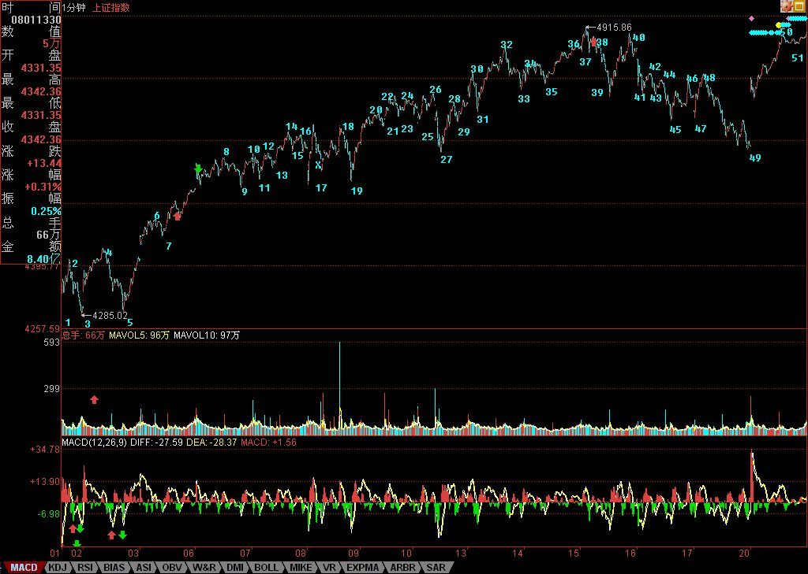

#### 热点蔓延渐成潮流

 时间：2007-08-21 15:59:25

当然，对看不惯、从 1000 点就开始说地球要毁灭、世界要末日、上海股市 100 点都没有价值的空头来说，这个题目太粉饰太平了，就是为了骗散户，哪里有什么热点，都是庄家拉高出货。可惜，这庄家拉高，从 1000 点一直拉了两年多、4000 点，还在拉高，还在骗散户，不知道这究竟算是什么了？

本 ID 这里的逻辑关系十分明确，在总市值超越 GDP 之前，本 ID 从来没有谈论过任何有关泡沫的问题，大概从上周起，本 ID 才开始谈论这个问题，而且给以后的走势一个明确的定义，就是泡沫化生存。如果说，从 1000 点的严重被低估状态到上周的刚好达到 GDP，这个时间有两年，请问，这制造泡沫到泡沫真正破裂，至少要多长时间才合适呢？

所以，如果没有对全局的一个大方向的把握，永远在每天的波动中折腾自己，或者每天就盼望着大跌、熊市、100 点，再一次 1000 点，那是脑子水太多了。以前，本 ID 已经给这种人一个定性：这种人，真跌了，也和他们没关系，就算有熊市，真正的底部也和他们没关系，真有大调整，也和他们没关系。1000 点  和他们没关系，3400 点和他们没关系，3600 点同样和他们没关系。

还是回到今天的走势，现在，十分明确的现象，就是热点在蔓延。本 ID 以前曾说过，中报出来后，二、三线股会逐步活跃，本月结束，这中报基本就出来了，那些业绩不好，但有题材的股票抛开业绩这个枷锁，会逐步活跃起来的。

其实，这个节奏，并不是什么新鲜事。从来都是在业绩大面积公布时，所谓业绩好的、一线股表现得好一点。等业绩公布完了，业绩作为题材被炒烂了，自然要找新的来替代，否则就维持不住这锅的热度。当然，今年有点例外，就是业绩公布完以后，一线成分也不会太耷拉，为什么？还不是那期货闹的，有那东西在前面晃悠着，一线成分这些大狗小狗，总要不时奔跳折腾几下的。

 今天涨停的股票里，二、三线已经占了绝大部分，这就是一个热点蔓延的正常现象。这火如果能再坚持几天，就会彻底燎原。 今天，就不帖图了，节省点上传图片的空间。今天的分段也太简单，没什么特别的。昨天说了，现在在技术上，就是要先形成 5 分钟的第三类买点，然后是 30 分钟第三类买点，这才能最终确认突破的有效，在这之前，都只能看成了一个中枢震荡。

今天留下的缺口，构成短线的技术关键，而上方的真正压力，并不是什么 5000 点，而是 2/3 线，目前在 5089 点，这在前面曾以问题的形式给各位说过了。突破 1/2 线，上一条就是 2/3 线，这涉及预测，但有比较大的经验值保证，但本 ID 为了彻底反对预测，所以只以问题的形式和各位讲，就是不希望让各位先入为主，影响当下的判断，那才是真工夫。

 预测这种东西，不过是按一个模子照套，傻子的干活而已。2/3 后就 3/4 线，目前在哪里，傻子都能干活出来，所以预测都是傻子的干活，还是不要提了。 今天可以回答问题到 5 点。 石猴 2007-08-21 16:06:07  问题：封闭还是不封闭？ 67 课中讲：强调，在第二种情况下，后一特征序列不一定封闭前一特征序列相应的缺口，而且，第二个序列中的分型，不分第一二种情况，只要有分型就可以。 71 课中：这里的逻辑关系很明确的，线段要被笔破坏，那么必须其最后一个特征序列的缺口被封闭，否则就不存在被笔破坏的情况。

65 课：缠中说禅线段分解定理：线段被破坏，当且仅当至少被有重叠部分的连续三笔的其中一笔破坏。而只要构成有重叠部分的前三笔，那么必然会形成一线段，换言之，线段破坏的充要条件，就是被另一个线段破坏。

如果 67 课的缺口不封闭，也可以产生线段破坏，而按 71 课的说法，缺口不封闭笔破坏都没有，如何理解这个矛盾？我理解是不是笔破坏的定义不严密？以向上一笔开始线段为例，笔的破坏只是定义，后低点低于前高点，没定义后高点和前高点的关系。

 最近几天被这个矛盾缠晕了，简直就是 to be or not to be，提到线段两个字俺现在都有要吐的感觉。 缠中说禅 2007-08-21 16:20:01 [匿名] 百思不解 2007-08-21 16:01:49  缠姐好！下面是几个月以前跟贴的问题，至今仍想不明白。能不能详细说说？ ―――――――――――――――――――――――――― 第 18 课有个定理有点疑问，该怎么理解？

定理三：某级别“缠中说禅走势中枢”的破坏，当且仅当一个次级别走势离开该“缠中说禅走势中枢” 后，其后的次级别回抽走势不重新回到该“缠中说禅走势中枢”内。这定理三中的两个次级别走势的组合只有三种：趋势+盘整，趋势+反趋势，盘整+反趋势。

 这定理三中提到的两个次级走势组合，比如“趋势＋盘整”，是否同级？这里说的是两个同级走势的连接？还是从走势组合观点看，那个盘整中枢级别高于趋势中枢级别？ ==  这和连接的结合性有关。简单说，只要能分解出两段次级别走势就可以。详细情况，下几堂课程会说到，请耐心等等。明天就继续说这几种不同分解的问题。 ==  盘整中枢为什么一定要高于趋势的？关键不是盘整还是趋势，而是中枢究竟是什么级别，没有中枢，没有中枢的级别，哪里有什么盘整、趋势以及他们的级别？

这个问题其实说过 N 次了，盘整结束的标志就是第三类买卖点，而趋势结束的标志就是形成该级别的背驰后对最后一个中枢的回拉，为什么一回拉趋势就肯定完成？因为，一回拉，肯定就有更大级别的中枢形成，所以原来级别的趋势肯定就破坏了。这个逻辑关系是极端严格的。

 那么，我们是否要等到回拉才决定进出？当然可以，可以等回拉后再一次向上，形成所谓的第二类买卖点进行操作。这种操作，完全可以不用背驰概念，纯粹就用三类买卖点就可以。 当然，实际操作中，可以用背驰，在第一类买卖点操作，为什么？因为背驰后一定回拉，这是本 ID 理论的一个定理。

但从上面的分析可以知道，虽然背驰一定回拉这个定理是 100%成立了，但即使没有这个定理，本 ID 的理论依然成立，为什么？因为走势必完美，第一类买卖点后还有第二类买卖点，这是纯图形的，而背驰是动力学的。

 缠中说禅 2007-08-21 16:27:28  石猴 2007-08-21 16:09:23  问题：封闭还是不封闭？ 67 课中讲：强调，在第二种情况下，后一特征序列不一定封闭前一特征序列相应的缺口，而且，第二个序列中的分型，不分第一二种情况，只要有分型就可以。 71 课中：这里的逻辑关系很明确的，线段要被笔破坏，那么必须其最后一个特征序列的缺口被封闭，否则就不存在被笔破坏的情况。 ==  这根本不是问题。线段破坏和线段的笔破坏根本就是两个概念。线段被笔破坏，但线段不一定被破坏，也就是说，线段被笔破坏，那特征序列的缺口被封闭，并不意味着线段一定被破坏，有新的线段产生。 线段破坏，就是那两种情况。其中第二钟情况中还包括了一种最特殊的，也就是所谓小级别转大级别后连最后的特征序列缺口都不回补的情况。 快乐 vs 菜虫 2007-08-21 16:30:58

缠姐，我想总结一下我刚才关于分段的问题。先截取《教你炒股票 67：线段的划分标准》中一句话：“强调，在第二种情况下，后一特征序列不一定封闭前一特征序列相应的缺口，而且，第二个序列中的分型，不分第一二种情况，只要有分型就可以。”

一开始我有个疑问，因为这第二种情况和缠姐以前说的好像自相矛盾啊，以前的说法比如一个向上的线段，后一个向下的线段要破坏前一向上的线段必须跌破前一向上线段最后一跌的起始点；反之如果后一个向上的线段要破坏前一个向下的线段也必须升破前一个向下线段最后一涨的起始点。这和 67 课新的定义 “强调，在第二种情况下，后一特征序列不一定封闭前一特征序列相应的缺口”明显是矛盾的，67 课第二个图就是最好的例子，以前这种情况向下的一段是不能算一段了，课新的定义下就算一段了。

 后来有个“新浪网友”提醒我如下：“你肯定没看 MM67 课这一段：

“上面两种情况，就给出所有线段划分的标准。显然，出现特征序列的分型，是线段结束的前提条件。本课，就是把前面“线段破坏的充要条件就是被另一个线段破坏”精确化了。因此，以后关于线段的划分，以此精确的定义为基础。””

我看了以后觉得很有道理，也就是说以前关于破线段的说法实际上是有前面我说的这个小问题的，但是由于这种情况非常少见，再加上还没到精确定义线段的课程，因此“线段破坏”的说法也就可以用。现在有了新的精确的定义，也就弥补了以前“线段破坏”中的这个小缺陷了。

另外我还找了一个特别的例子，那就是之前印花税导致 530 暴跌行情那天的大盘分段，也就是在《教你炒股票 57：当下图解分析再示范》中的 3－4 这一段，如果按照“线段破坏”的说法，这 3－4 段是绝对不能算一段的，当时候缠姐的说法是“小级别转大级别”。关于这个“小级别转大级别”简直就象一个鱼刺一样卡再我喉咙里卡了两个多月了，现在我请问缠姐，这个说法是不是当时候的权宜之计呢，因为当时候没有精确定义线段，没办法解释只好用“小级别转大级别”来解释呢？？？？

事实上如果用 67 课的新的精确定义，57 课里的 3－4 段的分段就迎刃而解了，正是这句“强调，在第二种情况下，后一特征序列不一定封闭前一特征序列相应的缺口”解决了此问题。缠姐，是否如此呢？那 “小级别转大级别”是否要退居幕后了呢？？？？

 缠中说禅 2007-08-21 16:36:36  [匿名] Happysky2007-08-21 16:14:11  潜水很久了，冒一下泡 谢谢缠主每天解盘，从你的文章感觉你的理论很管用，可惜怎么都学不会 ==  其实，逻辑化的东西都最好学的，关键是从最基本的概念下手，然后把整个逻辑关系串起来，这样就一通百通。否则，只能乱套。 缠中说禅 2007-08-21 16:40:58  [匿名] 新浪网友 2007-08-21 16:30:33  越来越感觉你的理论比一些我看过的理论有用的多,不过,我还是不能很好的掌握.近段时间想试试把成本降为 0,结果总是把筹码弄丢了,郁闷啊 ==

加大操作级别，对新手来说，先练习持股，在一个大级别买点买入后持有到大级别的卖点，怎么都应该是 30 分钟以上的。你看这次从 3600 上来，从来就没有效跌破过 5 日线，对初学者，用这一招就比所有的所谓专家高多了。如果资金大的，就看 5 周线。

 至于中枢震荡中的短差，那是一个高难度的活动，初学者当然做不好。至于趋势中时，根本就不存在做差价的可能，趋势中，唯一需要干的就是等待背驰。注意，上面说的，都是在你的操作级别的意义上。 缠中说禅 2007-08-21 16:46:44  快乐 vs 菜虫 2007-08-21 16:30:58  事实上如果用 67 课的新的精确定义，57 课里的 3－4 段的分段就迎刃而解了，正是这句“强调，在第二种情 况下，后一特征序列不一定封闭前一特征序列相应的缺口”解决了此问题。缠姐，是否如此呢？那“小级 别转大级别”是否要退居幕后了呢？？？？ ==  在线段的层次上，是不需要小级别转大级别的概念的。但在最小级别走势类型之上，还是需要。 缠中说禅 2007-08-21 17:02:26  对于石猴网友的问题，由于有代表性，再多说两句； 笔破坏与线段破坏，是两个不互相包含的概念。并不是笔破坏就一定线段破坏，也不是线段破坏一定要笔破坏。 显然，在线段破坏的第一种情况下，必然是笔破坏的。 在线段破坏的第二种情况下，就不一定了。反之，线段破坏如果不是笔破坏，那么一定是第二种情况的。那么，笔破坏为什么要单独提出来？因为笔破坏有动力学上意义。 本 ID 的理论，有一部分和物理学有点类似，就是探讨动力学方面的东西，这方面，各位现在接触最多的就是背驰，而笔破坏，和这一样属于动力学方面的内容，这在以后会逐步说到的。先形态学，再动力学，各位慢慢来。

#### 一次值得鼓掌的加息

 时间：2007-08-22 08:37:19

本来不想为昨天加息的公布说任何话的，因为确实没什么可说的，管理层只是干他们该干的事情，而投资者看着市场的反应去反应，不需要任何预测、猜测。任何的谈论，不过都是忽悠、站在自己利益上的广告而已。现在之所以写，只是站在一个非市场的立场上，为一次值得鼓掌的加息留下一笔。

这次加息，显然时机十分正确。当然，反对加息的人肯定不这样认为。他们的理由无非是，美国人都要减息了，中国凭什么加息？这是典型的脑子进水想法。中美之间保持息差，不过是一种可能的生存状态；不保持息差了，难道就不是一种可能的生存状态。而且，本 ID 最讨厌看到任何美国怎么了中国人就要怎么的破烂言论，美国还 911，你怎么不也跟着去？脑子有锈？

当然，现在并不是说管理层已经放弃了原来中美之间保持息差的基本态度，但这次加息，至少是一次完全以我为主的行为，从而使得管理思路上有了自我的性格，这就是好事情。而且，如果要加，现在的时机是最好的，在世界对美国那些破烂事情反应稍有喘息的时候，效果显然是最好的。这次，本 ID 给管理层打 100 分。

当然，对于市场里的人，可能认为这次加息有调控的味道，特别昨天刚出个人到外面买股票的试点，今天又出加息。而现在又面临 5000 点，这个时机，显然有组合拳的味道。这对也不对，为什么？虽然，理想的状态是少调控多监管，但现实如此，就是调控还是一种自然反应，就必须面对着现实，如果能达到一个调控的高境界，那就是一件可欣赏的事了。

显然，这次组合券，分寸、时机都拿捏得很好，在是不是之间。所谓调控的艺术，就是让市场产生不同的预期，而不是统一的预期，这样的调控，就是最高明的调控。当然，不能说以后的调控都一定能达到这样的水平，但至少现在是这样，所以，本 ID 要给管理层再加 100 分。

 这次调控，对市场将产生不同的解读与预期，这样，市场的合力就不会产生一边倒的现象，这样，市场就可以在一定的时间内进行一定的磨合，最终去选择自己的方向。 目前，技术上的条件没有任何变化，日线上，背驰段依然成立去等待最后的确认或破坏，短线，30 分钟的中枢震荡依然，超短线，最后一个 5 分钟的中枢震荡依然，按照这些技术界限，与自己的操作级别，不难根据当下的走势去选择自己的操作。 对于技术学习不好的，就看 5 日线、5 周线，不要为市场的消息所动，只看市场最终的反应，这是一个最基本的素质。 至于今天的走势，无非就是强中弱三种：

一、直接平开或者高开，不补昨天缺口，继续上攻，一旦出现这种走势，证明市场选择了这样的合力，因此，只要继续看着。不过这种状态，必须密切注意是否还有新的组合拳，一旦还有，就要注意 2/3 线与基本面产生的共振。

 二、补昨天缺口后在附近震荡，这种走势，是一种平衡状态，就要看后面基本面的变化去选择突破方向。 三、直接跳空向下，形成岛型反转，这是最恶劣形态，短线的压力大，至少要再次考验 8-17 那个中枢。

其实，这些分类界限，都无须预测，让市场自己去选择，根据市场的选择去反应。另外，一定要注意自己的操作级别，如果你是月线操作，那就看 5 月线，没有效跌破之前，都可以少管，任何的波动都可以当戏看。

另外，美国那破事，在如期反弹后续的发展，是决定今后走势的一个重要分力，这样因素在前面反复说过了。这可能比加息、组合拳都要根本点，毕竟，管理层的加息、组合拳都要参考这方面的因素综合给出。

#### 缠中说禅文集版权为缠中说禅所有 此文集整理版仅供缠中说禅论坛内部学习使用，严禁外传！ 加息难阻热点蔓延

 时间：2007-08-22 16:10:16

昨天说热点的蔓延如果能持续几天，就会燎原。而晚上公布的加息产生的新分力，使得大盘最后选择了今早所说的第二种中等力度的走势，这都是自然的选择，无须预测。任何有预测癖好的人，去当火星股评去吧，地球很危险的。

今天的走势，从纯技术的角度，连一个线段都不一定 100%确认完成了，为什么？因为都没 100%满足线段完成的条件。该线段完成的判断，显然属于第一种情况，本来第一种情况是属于相对简单的。但由于特征序列的分型一直没有最终完成，每一次上冲都新高，而下来都是一笔，形成所谓的向上倾斜三角型走势，该走势的特点就是 99%回跌到三角形启动的位置，尾盘的跳水满足这一跌幅，但只是一笔，所以如果明早一下高开在 5000 点之上猛烈上攻，不再回跌到 5000 点下，那这线段还真一时完成不了。当然，一般情况下，这线段已经在今天的最高点处完成，所以在上面标记上 56，但这是否最终确认，还要上面说的这种情况不发生。

一般来说，1 分钟线段都不会延续这么长时间，能延续这么长时间，反而是一个技术上的重要提示，证明多方上 5000 点的冲动比较大，反复闹，而上面，有人不断压制，所以才会走出向上倾斜三角型的走势。而到尾盘，差不到一点见 5000 了，多方一股真气突然泻去，回到倾斜三角形起点位置。主要是如 530 般在亢奋状态突然被惊吓留下了后遗症，因此往往在关键时刻都来这么一下，尾盘收回去一半，只是表明多头上攻的欲望依然没得到满足，如此而已。

今晚的消息面很重要，连续两天有消息了，如果今晚还来什么调控玩意，这走势变数就大了。由于选择了第二种走势，短线政策面的变化起着重要分力的作用。如果今明两天没什么特别消息，使得关于政策面组合拳的猜想暂被搁置，那么，上上 5000 点去满足一下多头的欲望，也是理所当然的。

 本 ID 早说了，5000 点根本什么都不是，关键是 5089 点的 2/3 线，这线就如同下面 4100 多点的 1/2，该线反复磨了三个月，上下跳来跳去，2/3 线是否历史重演，这才是技术上需要注意的地方。

个股上，加息并没有延缓热点的蔓延速度，反而是加快了。银行股被压制，反而有利于其他股票的表现，本 ID 反复强调的二、三线股的逐步活跃已经成为现实，看看这几天涨停的都以什么股票为主就知道了。而且，这种蔓延已经逐步偏向三线股，特别是低价股，这是游资重新活跃的迹象。

这里，一个最现实的问题就出现了，银行股、地产股等等基金们玩的股票，和比较正规的大资金玩的一、二线大股，与游资搞的二、三线小股之间争夺话语权的问题。后面，能使大盘大幅度震荡的，一是政策面，二就是这话语权争夺战了。

 散户当然喜欢三线股狂飞，像本 ID 的中铝那样的中字头股票，散户参与的热情也不会太高，特别现在，随便买个 1 万股就要 40 万，而一个 5、6 元的股票只要 5、6 万，哪个群众基础好就根本不用说了。

本 ID 对哪类股票飞都无所谓，本 ID 的持有结构本来就是一、二、三全有，大小通杀，现在又不买了，只持有，所以只有看戏的份。不过，本 ID 最喜欢的，其实是三线变一线的股票，谁又告诉你，三线不能变一线呢？

 今天有事，刚才一路写东西，电话就不断，下面的事够忙一晚上了。 晚上回来可能晚点。先下，再见。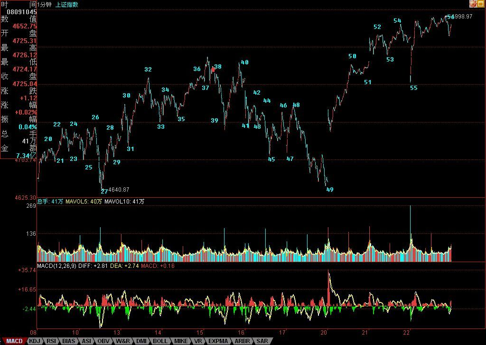

#### 行情只会在一地鸡毛中高潮

 时间：2007-08-23 16:08:01

没有三线股参与的行情，永远都是不完整的，行情只会在一地鸡毛中高潮，没有三线股鸡毛一地的高潮，这种行情，至少在中国特色的市场中，本 ID 还没见过。这里的原理很简单，一个爱好群众运动的文化中培养起来的投资者，连选秀都可以超女快男一地去鸡毛一把，股票不亦如此，怎么对得起博大精深这四个汉字？

这锅热度如期中升高，三线鸡毛开始满地打滚，这还只是开始，被一线大盘、高价股抛弃了的散户，才正开始撒着步子欢了起来。人类的本质是酒神性的，人的本质中，那酒神的狂欢永远可以战胜太阳的冷酷。狂欢，总是大众的。茅台、五粮液去大众，要困难点，还是二锅头、老白干，更能激发人们心里的野性。如此，股票的高潮，总是老白干的。

 有人问，怎么还不说今天突破 5000 点的历史时刻？5000 点算个什么？本 ID 不是一大早就把股市的 20 年走势的剧本都告诉各位了？5000 点在那剧本中，连一句台词都够不上，有什么可说的？

站在纯技术上，突破 1/2 线，就看 2/3 线，然后就是 3/4 线。但现在，还是先看 2/3 线。从大盘对前几条线的突破看，都不是刚好触及就回头，而是围绕着其震荡。由于 2/3 线与 3/4 线之间距离不大，所以在这两线的震荡级别不大会一样，一般来说，2/3 线小级别，那么 3/4 线级别就大点了。所以，行情在 2/3 线附近如何发展，对今后行情的发展，有一定的意义。2/3 线如何计算？1429+183*30*2/3=5089。3/4 线，只要把里面的 2/3 改为 3/4 就可以。当然，下月计算时，183 要变成 184，如此类推。

短线技术上，昨天的 56，不能 100%的那种情况，今天发生了。这说明什么？本 ID 的理论是几何，没有一种精确的数学态度，是弄不好的。任何有预测癖好的，都离技术之门远着。今天图里，昨天 56 的位置就要根据这种情况变了。注意，并不是本 ID 的划分可以随意变，而是因为昨天的走势没有 100%满足本 ID 的划分标准，只是暂时标记。例如，今天 59，同样有这个问题，那里标记上 59 并不是说 59 在那里已经完成了，因为目前没有满足 59 段被 100%破坏的标准。而 58 以及以前的所有标准都是唯一的，不可更改的，为什么？因为，符合标准了，就这么简单。这个问题，一就是一，二就是二，没有任何可含糊的地方。

 个股方面，给各位一个技术面上的判断标准。现在的个股，日线上无非三种：一、突破 530 高位；二、没突破 530 高位但突破 530 后第一个反弹高位；三、530 后第一个反弹高位还没突破。

一般来说，第一种技术条件的股票，注意那些刚突破后回抽确认正再次启动的，这种股票要预防假突破的危险；第二种，属于最有表现欲望的，但这种股票的预防启动突破 530 高位后有一串洗盘；第三种，最容易吸引踏空资金，但唯一的坏处就是，资金新近来，如果是一个喜欢打压吸货的主，那就要被折磨一段时间，当然，如果是一个喜欢高举高打的，那就祝贺你了。其实，这不难判断，关键是看第一次放量后回抽的位置。

昨天说到本 ID 更喜欢三线变一线，这种股票，一般人可真拿不住。本 ID 的股票里就有很多，不过估计没人能真和本 ID 一样从最低位拿他 N 年。以后的一线股，都必须是至少是中字头甚至是世界级的公司，要从三线变一线，只有两个途径：一、自己能成长为中字头甚至世界级的公司；二、中字头甚至世界级的公司全面介入。

 有事，先下，再见。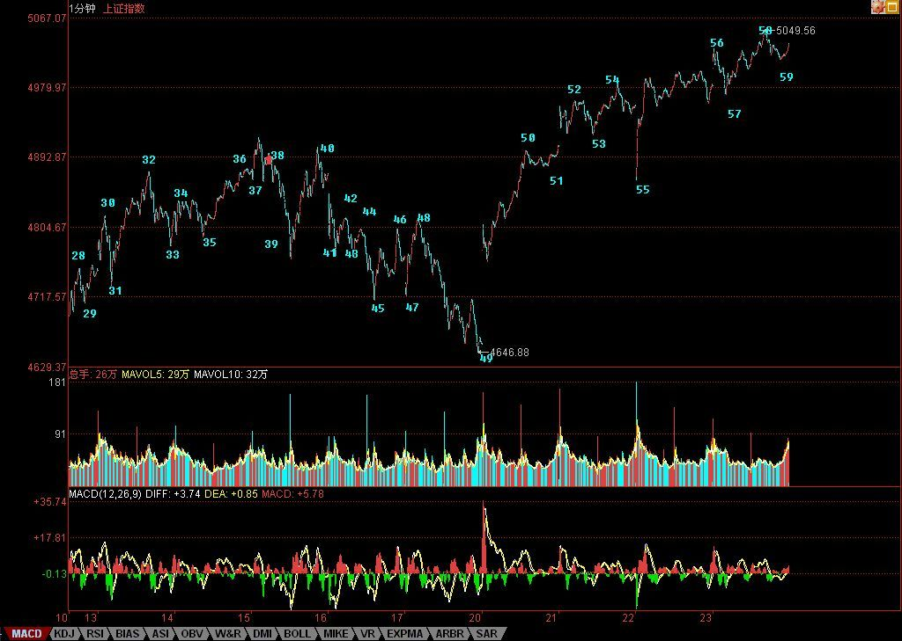

#### 不是每个收盘都需要一个题目

 时间：2007-08-24 15:24:47

今天，一开盘，首先冲到 5088 点，在 5089 点的 2/3 线面前整理了 30 分钟，然后就就突破该位置，后面基本是一个震荡，毕竟下面缺口的压力在。突破站稳 1/2 就到 2/3，这今天实现了。下面要继续完成的任务是站稳 2/3 线，这是继续上攻 3/4 线的前提。

周末消息面很重要，如果没什么特别的东西，那么下周有一个好开头，但下周决定月线收盘，因此，下周的任务是，不能拉太大的阴线，其余的任何情况，都是可以接受的。下周，比较理性的作法，是在目前位置稳固 5089 点的 2/3 线，一般来说，这种线的突破，都至少需要周线上的确认，各位可以看看 3000 点与 4000 点对 1/4 与 1/2 线的突破就知道了。当然，如果大家一定要很冲动，要下周马上就去挑战 3/4 线，那周末可以先听听那首极端口水的《冲动的惩罚》。

 个股方面，热点继续表演。但基金之类正规部队与游资等负规武装之间的争夺资金较量，今天有点火花了。和气生财，都别闹了。排好队，姿势优美点，能面首的自然会被面首的，和为贵。

昨晚说了那课程，可能有人会说本 ID 自己那 10 来只股票里没什么行业龙头、高成长性，不符合本 ID 昨天课程说的。这只是不同的眼睛看出的不同景象。首先，最明显的，000338 不是龙头？600649 不是？000999 不是？000998 不是？000777 不是？甚至，连 600432、600343、000099、000778，哪个不是细分行业的龙头？知道 000778 是离心球墨铸铁管的世界第一吗？知道离心球墨铸铁管在干什么的吗？知道全世界发达地区，排水管道用的什么？知道全中国就算排水管道更新一次，需要多少吗？知道除了排水，城镇供水输气也用着玩意吗？当然，000778 还不止这些东西，知道新兴这两个字代表了多少东西吗？其他股票也一样，就不细说了。

要注意，本 ID 的股票可都是在极为低的位置说的，例如，000778，说的时候只有 5 元多，现在再买，同样的钱只能买 1/3 的股票不到了，这确实没办法，迟来的人，肯定要付出更大的代价，这是天经地义的。而且，这 10 几只股票都是去年 12 月底才开始说的，本 ID 之前买的股票可基本没怎么说过。本 ID 的原则就是，本 ID 说的时刻就是自己买的时刻。想想 000999，难道忘了，本 ID 说有一笔新钱，过两天到，还提前先把 000999 给说了，这里应该有人买得比 ID 还便宜，例如 5.9 元买的。当然，本 ID 买那个量，建仓成本肯定比一般的散户高，早一天晚一天没什么大事。关键是后面把成本变 0 的本事，这一点，本 ID 自认天下第二，这天下就没第一了。当然，成本为 0，持股决心自然也天下第一，600432，20 元这里不少人买过，就半年多时间，现在谁还有？本 ID 可一股还不少。000338，明确告诉，肯定上 100 的，现在估计也没人有了，其实，这股票，100 根本不值一提，想想他在行业中的地位，想想这个行业的规模，你就知道，为什么他有动力了。

 周末，股票是一件最恶心的物件。 都别股票了，腐败去吧。 祝全世界想腐败的人终能腐败。 腐败快乐万岁万万岁。 下了，本 ID 要去为腐败事业添砖加瓦。再见。

#### 资金分歧日益严重的面子与里子

 时间：2007-08-27 16:15:38

现在，行情已经演化成这样一种格局，基金等正规部队与游资等负规武装之间展开博弈。对于基金来说，由于新鲜血液不断进来，因此，只要坚持自己的板块，就算来个五十年不变，也有新的血液进来筑成他们的长城；而对于游资来说，有不少这次是踏空的。530 后，很多游资利用第一次反抽胜利大逃亡，结果不过逃了一个山脚，回头一看，什么都和他们没关系了。由此可见，游资的视角上和基金比起来，是极为短视的。当然，基金都是被正规所忽悠的人的钱，用着不心疼，就算 10000 倍市赢率买所谓的大盘蓝筹，也可以编出无数的理由，更不用说现在大盘蓝筹的市赢率还有很多连 50 都不到，至少还有 200 倍的忽悠空间，所以基金的长视显然是可以有恃无恐的。

游资不愿意为基金抬轿子，只能各自为战去攻击一些所谓的题材股。但这种攻击，还是有效的，因为这些所谓的题材股，基本都是中低价股票，所谓群众基础好。资本市场的管理是绝对不能走群众路线的，一走群众路线，那肯定是垃圾股满天飞。

所有的所谓成熟市场，都是分为泾渭分明的两个世界，就是正规为主的所谓蓝筹世界与负规为主的垃圾世界。这点，不用看远的，看看香港市场就知道。在资本市场，同一世界同一梦想，从来都是笑话。仙股能和汇丰长实同一世界同一梦想吗？这是世界的常态，但中国的资本市场，从大锅饭里来，总还有那无聊的做作。总是有人在资本市场也要一刀切，要问什么蓝筹垃圾，宁有种乎？

 但这种游戏，最终都要被改变的。拣垃圾，在垃圾堆里寻宝的是一拨人；拿着蓝筹自渎的是另一拨人。两拨人将越来越老死不相往来，这才是最终的归宿。

现在，正在半路中，那些基金们，其实血液里也没有多少蓝筹的贵族气息，所以，偶尔混在垃圾堆里，反而觉得比较匹配；那些负规们，本来就是开野店的料，却还左摇右摆装名草，这样，行情，依然在这种边界的模糊两可中展开。

基金，不需要在二级市场骗人接筹码，而是公开地，无数人排着队争先恐后地进来成为新的举重能量。其实道理上一样，只是把赤裸裸的变成了道貌岸然的。而负规部队们，注定名声不会好了，但他们也从不在乎这玩意。负规可以潜规则正规，如此的中国特色，怎么也要特色 N 年，这样的负规，又有什么可抱怨的？

 所谓的资金分歧，其实只是表面现象，给分歧掉的资金，不过都是不入流的资金。8228、2882，其实还不都是那唯一的一？

技术上，今天没什么可说的。回抽 5089 点，如此而已。当然，5089 是否一天回抽就能确认，这显然不大可能。但行情完全可以先上攻，再以周线等形式进行回抽确认。当然，行情具体怎么走，没必要预测，看图作业就可以。

图形上，49 点开始的走势简直是教科书。52-55 的 1 分钟中枢，55-58 的线段离开，58-59 的回抽不跌回形成 1 分钟的第三类买点。然后，后面唯一的两种可能，更大级别中枢，与继续中枢上移直到出现新的 1 分钟中枢。显然，走势选择了后者，目前，可以暂时把这新的 1 分钟中枢看成是 60-63。因此，从短线看，从 49 开始的 1 分钟上涨走势什么时候结束，就是短线唯一的主题。这相当简单，学过本 ID 课程的都应该怎么处理，应等待什么，那什么一出现，就该如何。（什么是什么？权当一个作业，这都不会，请复读。）

个股方面，有些人相当奇怪。竟然可以有这样的逻辑，例如对 600139，他们意思是，如果不被洗干净，就不会有今天了，所以是本 ID 在犯坏，要把他们都给洗出去。然后这些人又在开始唠叨什么什么怎么还不怎样怎样，这些人，最该干的事情就是拿豆腐撞头去。知道本 ID 课程里对以前已经有的技术分析系统只说了均线系统吗？知道本 ID 在课程里说过，没有吻就没有高潮之类的话吗？均线系统没有粘合之前，怎么可能有单边的拉升？600139 这种典型的 a+A+b 调整后，然后一吻高潮的走势，难道本 ID 在课程里没说过？就算今天的 600343、000600，难道没看到前面消魂一吻吗？就算中铝这种上市没多久的，7 月 20 日前后那一吻，请问够消魂否？

更奇怪，有人怪本 ID 不提前告诉中铝，30 元才开始说。说老实话，本 ID 确实没有说任何个股的兴趣，任何个股，就算是天天暴涨的，也同样有怨大头。而且本 ID 现在又不当庄家了，说了明显就给自己添麻烦。有些股票知道为什么洗那么长时间吗？其实可以明确地告诉各位，就是在洗本 ID。但那些家伙都是脑子有毛病，你想本 ID 能被他们洗出去吗？简直脑子锈了。但无论如何，不管是谁干什么，技术是第一的，任何最终都在技术图表上显现出来。如果你能成为吻的高手，那自然就能不断消魂，该说的早说了，如果吻这么私人的事情都想让别人替代去实践，那么还是买块豆腐去吧。

 先下，再见。

#### 缠中说禅文集版权为缠中说禅所有 此文集整理版仅供缠中说禅论坛内部学习使用，严禁外传！

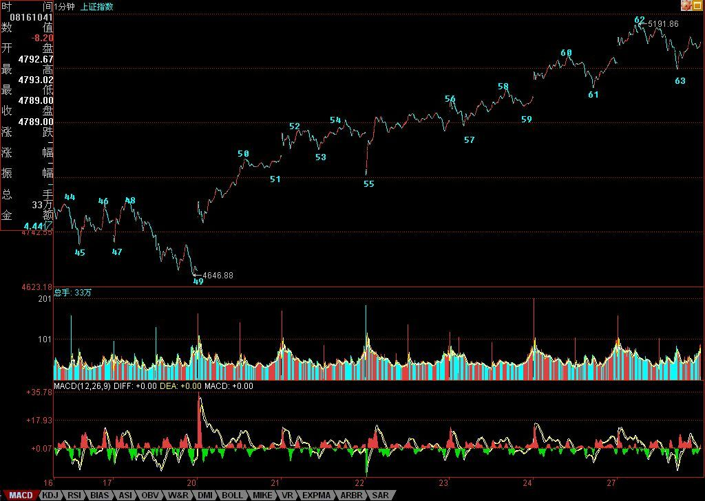

#### 冲动的惩罚，基金将成为毁掉市场的那只手

 时间：2007-08-27 20:45:41  冲动的惩罚 基金将成为毁掉市场的那只手 上周末，本 ID 说请先听听那首极端口水的《冲动的惩罚》。那么，最近这一轮行情，发展成这样，已经越来越挑战到某些底线。 现在的问题，在下午已经说得很明确，基金利用所谓正规的身份，正制造着泡沫行情。超 GDP，就是进入泡沫行情，这点，本 ID 在前面已经反复说得十分明确。那么这个泡沫如何才会被刺破？ 显然，目前的情况下，泡沫不可能因自身破裂，基金目前这种资金正循环关系，使得泡沫可以维持相当长的时间而不破裂。 显然，在中国目前的环境下，刺破泡沫的，只有政策。而最近政策的声音，比起行情超乎寻常的安静，这只有两种可能性：一、政策并没有觉得目前的行情有太大问题。二、暴风雨前的安静。 政策这种东西，无法预测，上周连续两天的调控至少表明，政策面至少没有资金面那样乐观。 本 ID 在超 GDP 后，就明确说过，不再买入任何股票，而只是持有，并把可能的资金转向其他领域，最主要的原因，就是这种泡沫行情的破裂方式，其非系统性风险并不在任何人的控制之下。 今天，本 ID 偶尔发现，有些从 1000 多点就开始唱空的人，有开始松口的迹象，这给本 ID 特别不好的感觉，连死空头都开始转向，这风险确实已经开始如一切风险般积聚了。 可以肯定地说，如果没有政策的刺破，一切都会如基金们的如意算盘般继续下去，但冲动总要被惩罚的。惩罚来自明天、后天，还是 N 天后，那只有天知道了。 但一个市场，如果发展到只有惩罚才会停止下来，那就如同一个失控的车子，究竟要发生什么，那只有天知道了。 一些死空头转向，给了本 ID 相当不好的感觉，一叶知秋，秋天，大概也不远了。

#### 市场与政策的博弈全面展开

 时间：2007-08-28 16:10:20

今天的市场，在技术上十分简单，就是本 ID 昨天所说的那 1 分钟中枢的震荡，而要形成新的上攻，就要看是否形成该 1 分钟中枢的第三类买点，然后，最关键的，因为从 49 开始的走势已经是标准的 1 分钟上涨，所以该上涨结束的信号，就是背驰，因此，背驰段能否被精确定位最终形成背驰，就是今后几天走势的关键。而且，这 1 分钟的背驰后是否引发更大级别背驰段的精确定位，则是今后几周最关键的问题。

从基本面上看，目前市场与政策的博弈已经全面展开。有些话，不能说、不该说的就不说了，可以说的就是，目前有些后进的资金以及某些用市值营销为幌子的正规基金，正在玩一种危险的游戏，这种游戏的名字，叫与政策博弈。

显然，至少在他们看来，现在存在与政策博弈的空间。第一、一个最重要的会议将在不久后展开，他们认为这时候的监管可能会有空隙；第二、目前以一线股行情，最终会有指数期货托底；第三、H 股、红筹与 A 股对做，这样两头促进，两头赢，A 股估值高，使得 H 股、红筹有空间，而后者一涨，前者又有了涨的理由。（当然，这点本 ID 是同意的，也是乐意，否则本 ID 为什么要钟情于中字头，今天，最懒之一的中字头中国人寿也动起来，本 ID 还是比较满意的。）；第四、有些理由，只可意会，不可言传。

而管理层方面，确实存在两难状态。硬调控一旦起用，则又陷入 530 之类的困局。而软调控，其力度又被市场所藐视，达不到其目的。所以，管理层方面，有时候有些事情也是被迫的，只是那条底线不要被触及，一旦触及，站在公正的角度，本 ID 觉得，硬调控也是可以原谅的。

现在，这种博弈的难局的化解，靠市场的所谓理智是不现实的。市场从来都不会是理智的，而且某些资金，说白了，花的不是自己的钱，不心疼，只要能潜规则一把，什么不可以？所以，不要冀望于市场的理智。最终的结局，无非两种：

 一、市场因为一些因素自动不去触及某些底线。例如，美国的那破事情又起第二波，这样，全世界都自然顺着带下来，这样，死局反而可以自然解开了。 二、市场变本加厉，最终触及某些底线，甚至，有些局面可能是被担保、求情下才出现的，而给脸不要脸，那最终只能搞到翻脸，这又能怪谁呢？ 从某种意义上说，现在所有人交易成本的大幅度增加，就是给脸不要脸所制造的结果，现在，虽然指数是上来了，但交易成本的大幅度增加的结果却在可见的将来都改变不了了，最终损害的就是整个市场。 现在，诸如印花税减半的东西，提都没法提了。本来想搞这些提案的人，自己都不好意思了。现在，这么高的印花税，就是中国资本市场所有参与者的共业，这叫自作自受，那么，还要有多少在后面等着？

本 ID 对目前的状况已经一早说得很清楚，就是那些在 3600 点要毁掉市场的人、那些 3600 点要死要活的人，将会在大涨百分之 N 十后就开始兴奋，开始忽悠他们的英明神武。目前，5200 点时，这种情况已经变成现实。特别，一些 1000 多点就开始死空的翻多更证明了，事情已经到了该警觉的地步。

 本 ID 从本质上只关心市场结构的完整与合理，本 ID 最不愿意看到市场的结构被有意无意地伤害。市场的伤害，最终都会转嫁到市场参与者头上来。

正像在 3600 点最恶劣的时候，本 ID 会出手；当市场发展到完全失控时，本 ID 一样会出手。本 ID 有能力在 3600 点凭空接巨石，当然也有能力干其他活。本 ID 干活，从来都是明说明干，春节前后和 3600 点已经成为 K 线在那里了，本 ID 无须说明或证明什么。

 本 ID 的目的只有一个，希望本 ID 能制造一个分力出来，让市场不去触及某些底线，从而使得类似印花税等如此伤害市场的东西不被现实。 有些话，多说也没用，该出手时就出手，本 ID 有这个权利。 本 ID 可以把话说得更明白，任何与 2/3 线相关的活动，本 ID 都可以接受，任何企图快速抛离 3/4 线制造多头陷阱的活动，本 ID 都不能接受。够清楚没有？ 不说了，先下，再见。

#### 缠中说禅文集版权为缠中说禅所有 此文集整理版仅供缠中说禅论坛内部学习使用，严禁外传！ 有时候，当乖孩子并不是丢人的事。

 时间：2007-08-29 15:54:01  昨天说了，如果美国那破事还能搞一次，可能是化解死局的好选择，昨天美国的大跌，来得够及时。本 ID 说了，任何和 2/3 相关的活动，本 ID 都是乐于见到的。 有时候，当乖孩子并不是丢人的事。今天，那漂亮 50，集体耷拉，这是好现象。该休息还是要休息，整天瞎搞，小心精尽人亡。 其他个股，借着漂亮 50 休息而风起云涌一把，这也是天经地义的事情。 技术上，一个新的、从 62 开始的 5 分钟中枢已经基本成型，因此，该中枢的后续走势，决定了短线行情的发展。 说实在话，除了快速突破 3/4 线直接上攻 6000 点形成多头陷阱这样一种走势本 ID 不能接受外，其他任何的走势，本 ID 都能接受。

说实在，这两年的行情，根本不火暴，比起 1996 年，简直没法比。那次，1 年半就从 1000 点冲到 6000 点上，那次表现的是深成指。这次，走了两年多了才到这个位置，乌龟都不如。但现在市场大了，影响大了，婆婆也多了，所以只能这样。

 6000 点会有的，10000 点会有的，30000 点也会有的，但不是一天去完成。欲速则不达，有时候当当乖孩子，作乖乖状，又有什么大不了的？何必一定要去挑起不必要的麻烦？ 可以很明确地说，如果不是某些努力，昨天早就已经尸横遍野了。有些事情没必要说，只要知道，一切都是合力而成。但有时候，太过分了，那就只有对立面了，把自己逼到墙角，又何必呢？

但目前的市场，成分已经越来越复杂，本 ID 更相信一件事情，就是任何良好的愿望，在一个市场里，最终都要被践踏的。在现实中，死缓总变有期，在市场里，死缓往往就是绞刑变凌迟，人的贪婪总有最大的疯癫基因。

 最后说句闲话，发现很多人对分段的第二种情况还是没搞清楚，例如下图中的 62-63，就是一个典型的第二种情况，各位请好好研究一下。 最近整天下午晚上都泡在北京那几个高新园区那里看项目、谈项目，有点忙，不能和各位聊天了。先下，再见。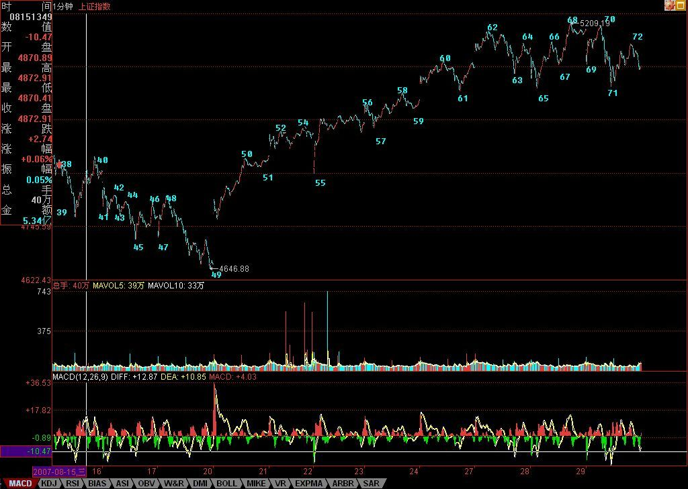

#### 还你漂漂拳之风再起时

 时间：2007-08-30 16:05:43

漂亮 50 歇菜是好事还是坏事，如果昨天早上还没看明白，那还是可以原谅的；看了本 ID 昨天下午的 “ 其他个股，借着漂亮 50 休息而风起云涌一把，这也是天经地义的事情。”还不明白，那最好的归宿就是孔男人一把；如果到了今天还不明白，大概连孔男人都对你绝望了。

 还你漂漂拳之风再起时，什么风？二、三线股之风，让指数见鬼去，重开上半年二、三线股走势之风。还你漂漂拳，将二、三线股的丑八怪打出一个个大可面首的成熟爷们，这就是还你漂漂拳之风再起时。

什么叫一吻高潮？看看 600635、000998、000938、000099、600578、000915 等等，哪个不是吻得万草狂舞、风沙走石、天昏地暗、日月无光的？就算最近开始狂动的 600008，在 8 月 20 前的那一吻，还不够万草狂舞、风沙走石、天昏地暗、日月无光？你去看看今天涨停的股票，有多少是一吻而万草狂舞、风沙走石、天昏地暗、日月无光的？还记得几天前本 ID 再次强调吻的重要，难道吻都要别人代替？

 以上只是技术上的一些小技巧，以后不再说了，有缘得之，爱谁谁去。

现在，初步回到本 ID 希望编排的剧本，这剧本在这一章节只有一句话：指数耷拉，二三雄起。指数耷拉，将使得一些极为迫切解决的矛盾不会一下被激化，而二三雄起，又可以消耗目前一些多余的能量。记得本 ID 在 8 月 13 日的话吗？原文：“个股方面，一、二线成分股的行情依然会延续，但要注意升幅过大后的短线震荡风险，而当业绩风险释放后，二、三线题材股会找到重新活跃的动力。”

 现在，中期业绩的公布已经尾声，该发生的就需要发生。而本 ID 为什么前几天狂批“快男”，就是他们的节奏有打乱本 ID 剧本的可能，对这种拿着别人钱乱搞之人，不教训一下怎么行？

本 ID 的持有结构十分明确，就是中字头和那 10 几只谁都知道的二、三线股，中字头，如中铝者不愿意休息就让他休息，顺便差价一番，这没什么不对的。当然，站在中长线角度，这些中字头的潜力远远没有发挥出来，本 ID 乐意和他们海枯石烂，但现在，本 ID 觉得 4N9 一下二、三线股，难道不是一件很浪漫的事？

大环境，本 ID 已经说得很清楚，就是警报声声，而且还一度几乎擦枪走火，这时候该干什么，所有对市场的长期有珍惜的人，都应该明白。市场的做多能力没地方宣泄，就找地方让他们宣泄，而不能影响整个大局，这就是目前市场参与者应该有的共识。

 当然，市场是所有人的，有些人，拿着别人的钱乱搞，最终搞死市场，这种人一定要受到市场的严重声讨。现在，这伙人好象新钱有点少了，气焰大概也消停一些了，那么就反省去吧。

短线技术上，没什么可说的，就是还是昨天说的 5 分钟震荡，这就很好。明天周末、又是月线收盘，任何温和的走势，都是本 ID 可以接受的。周末，究竟会有什么？还是先看看现在都有什么了，最近这温柔的一刀包括：

 一、风险提示；二、停发基金；三、直通车；四、6000 亿等等。 那么，不温柔的一刀呢？ 本 ID 可以明确地说，那市场的做多冲动引到二、三线股，只是一种最好的选择，但不是一个绝对安全的选择。与其让市场在漂亮 50 上继续冲动，还不如玩一把还你漂漂拳之风再起时。 请注意，没有任何股票值得追高，而且目前政策面上依然风云多变，更没有追高的必要。 今天既然风再起时了，可以回答问题、还你漂漂拳到 5 点。 缠中说禅 2007-08-30 16:18:28  老实念佛 2007-08-30 16:15:09

老大，在分型上：相邻两根 K 线，只要有一端数值相同，就必定是包含关系？相邻两根 K 线的高低点完全相同是不是可以不算是包含？或者包含只能是一根‘完全’在另一根的范围之内，即高点小于高点，低点大于低点？请明示，谢谢！

 ==  只要有一端相同，那必然是包含，两端相同那更是了，所以如果不是包含关系的，都必然不需要考虑

#### 刀锋上的行走

 时间：2007-08-31 16:04:19  目前的状况，已经反复说得很清楚。目前已经给出比较严重泡沫的定性，这可不是本 ID 说的，至于谁说的，当然也不可能在这里说。在这样一个明确定性的大背景下，任何的行走，都如同在刀锋上的游戏。

指数耷拉、二三雄起，这是目前现实状况下最可行的走法，这剧本显然已经得到足够多的共识。这样，至少能延缓指数上涨的速度，而且能使得受益面能尽可能的广。为什么？因为目前的强劲做多欲望必须被消耗掉，这欲望，来自人的贪嗔痴疑慢共业，如此之强大，必须在疯狂中最终燃烧尽，才有回头的可能。当然，还有一种最干脆的做法，就是再 530 一番，这一把刀一直悬在头上，铺在脚下。但贪嗔痴疑慢共业如此强大，能否不触及那把刀，又能让贪嗔痴疑慢共业尽情疯狂，这就是目前剧本中最激动人心的篇章。

今天周末的行情，在下午，明显受到对周末消息面的担心而产生震荡，但最终的震荡都在前几天最高位上受到支持，这就充分显示目前做多能量需要消耗的急迫性。如果周末没有任何足够分量的消息，那么下周，这能量将有一个大的爆发。

再一次用一个最直白的话把这 N 天反复说的话再说一次：打击快男，使得疯狂中的可获利面极大扩大，一句最狠的话就是，就算疯狂过后是无限的地狱，但多数人的疯狂总比单纯漂亮 50 的疯狂来得更公平、更有趣一些。

下周，绝不排除出现群魔乱舞的状况，如果能尽量减少指数涨幅而带动更大面积的疯狂，这就是最好的状态了。3/4 线还有足够远的空间，而且加上突破后的顺势，有足够的空间去完成这种疯狂。但必须明确注意，这疯狂的代价，与刀锋相关。

 既然选择了在刀锋上行走，无论市场还是个人，都要明确知道这行走的代价。其实，没有什么是不可以的，但必须知道代价以及能够去承受这代价。那些又要玩刀又怕被刀杀着的，回家玩豆腐吧。 个股方面，没什么可说的，该说的，在 8 月 13 日已经全说了：“个股方面，一、二线成分股的行情依然会延续，但要注意升幅过大后的短线震荡风险，而当业绩风险释放后，二、三线题材股会找到重新活跃

至于一直有人说本 ID 原来那 10 几只股票基本面很差，纯粹垃圾股的，最近的看法也应该有所改变了。本 ID 从来不乱买股票，如果乱买，那么整个股市中最和 VC 与 PE 相关的两只股票 600635、000938，为什么都在本 ID 的组合里？本 ID 那 10 几只股票中，业绩暴增百分之几百、甚至一千的，难道还少？当然，这只是冰山一角，就像 000938，谁告诉你就是 PE、VC 这点事情？

长线介入与短线介入是根本不一回事情，本 ID 已经把最好的方法告诉各位了，就是利用中短走势把长线成本降到 0，然后长线持有，对于大资金，这基本是唯一可行又效率最高的方法。如果是小资金，那根本不需要这样，你忙得过来，技术又可行，那么天天都可以 419 一把，关键是你能否有这时间、通道与技术。

 但小资金弄好了，最终都要大资金的，所以最终都要走这条道路。

没有成本，本质上就是没有占用资金，这样才有安心持股的可能以及效率。那些，连几个月都熬不住的，根本就不适宜做股票。例如，000938 之类确实很无聊，但如果你 0 成本长线持有了，那就不无聊了。这股票历史天价是 100 元，一个清华的股票，大牛市竟然可以不创历史新高，你相信吗？当然，这可能需要 1 年、2 年、N 年，但对于 0 成本后，就无所谓了。而且，清华企业的整合是必须和必然的，这里的空间有多少，本 ID 不想去预测，没意义。总之，本 ID0 成本地和他海枯石烂了。那些天天想着涨停短线的，还是去顶豆腐比较有意义。

其实，本 ID 还有一只独自去偷欢的股票，比 000938更无聊，就是 000021，原来的深科技，7 元时介入的，现在已经三个季度了，除了已经把成本降为 0，这股票没有任何值得炫耀的地方，但本 ID 也和他缘定三生了。

对不起，本 ID 只会把股票变 0 成本后海枯石烂地持有，除此之外，对大资金，本 ID 不知道任何在大牛市里更好的操作方法。当然，在一个大级别的回调中，本 ID 也会弄一个短差去增加筹码数，这大概就是本 ID 唯一能再干的活了。

 周末，腐败比股票可爱。散去吧。

#### 缠中说禅文集版权为缠中说禅所有 此文集整理版仅供缠中说禅论坛内部学习使用，严禁外传！ 目前市场所处阶段

 时间：2007-09-03 08:49:53  最近，新来的人太多，鱼龙混杂，本 ID 就入水入泥，再说一下目前市场所处阶段。这些，都在前面反复说过，但为了照顾一般水平的，不妨再明确说一次。 本 ID 的观点，从来都是一贯的，依照相同的逻辑关系展开： 一、这轮大牛市至少再延续 20 年，至少再上升 3 万点以上。这个观点，一直没有改变，包括这大牛市可以划分的三大阶段，已经明确说过。

二、目前的走势处于大牛市第一阶段的泡沫化过程中。由于从低估到回到正常位置的 GDP 用了 2 年，上升 4 点 5 倍。从纯对称的角度，泡沫化阶段也可以延伸 2 年，上升 4 点 5 倍，也就是在极端情况下，可以到达 2 万点。但有一点是必然的，就算先到 2 万点，那么后面泡沫破裂后，必然在回到 GDP 的位置，也就回到目前以下的位置。

三、泡沫可以自然破裂，也可以人为戳穿，人为戳穿的情况，关系到政策的调控，属于不可系统的风险。面对这种风险，必须要明确，就是这不改变任何长期趋势，最多就是制造一个中线的调整。如果调控相对高明，那么泡沫化阶段可以延续的时间就长点，高度就大点，而且后面的破裂相应的杀伤力就小点，但能否达到这种调控水平，本 ID 没有任何信心。

四、在泡沫化阶段，就如同在刀锋上行走，既然选择了如此，就只能如此下去，有任何损伤都不能怪任何人，要自我承担。如果没有这心脏，那就退出，也别眼红别人去赚取泡沫化中的超高回报。在泡沫化阶段，需要更好的心态、更高的技术。

五、有些股票是值得持有 20 年，等待整个牛市结束才抛出的，一旦选择了这种股票，就是天荒地老、海枯石烂地持有，但可以根据中短线的波动去把成本降低、在 0 成本后再增加持有的筹码。站在大牛市的长线角度，泡沫的破裂，也就是提供一个减低成本、增加筹码的大机会，如果有这技术、心态，就要好好把握，如果没有，就坚定信念，义无返顾地持有 20 年。

 下面是半年报中业绩最好的前 10 名：每股收益前十名 证券代码证券简称每股收益(元）600137 *ST 浪莎 4.75  000338 潍柴动力 1.87  000623 吉林敖东 1.71  600497 驰宏锌锗 1.70  600109 成都建投 1.50  600993 马应龙 1.45 600432 吉恩镍业 1.43  600030 中信证券 1.41  000592 S*ST 昌源 1.34  600677 航天通信 1.29

*ST 浪莎只是重组而来的利润，没什么实质意义，因此实质第一名的是潍柴动力，也就是本 ID 要海枯石烂的 10 来 20 只股票中的一只，另外一个吉恩镍业也在十名之内。由此可见，说本 ID 的股票都是垃圾股的，就是胡说八道。

 本 ID 股票的基本面，过 N 年以后再评论吧，现在，你又能看到什么？

#### 吃得咸鱼抵得渴

 时间：2007-09-03 15:38:43  去广东，总能学点古灵精怪的中文，例如本文题目。这句话的意思，用来要求现在的市场参与者，是最恰当不过了。

今天的大盘，如上周五所论，周末没有任何足够分量的消息，因此做多能量如期爆发。但今天有一个有趣的现象，就是大盘在 5330 点下徘徊许久，就是不敢上去，为什么？因为 4330 点上曾留下的记忆依然太过深刻。

现在，每天都等于一个对赌，就是赌当晚没有特别的消息。最重要的问题是，现在消息决策的保密程度，已经超过一般人的想象，否则，529 怎么可能是最高收盘？因此，市场能量依然强劲与对消息面突发性的担忧，构成目前走势的最大一对矛盾。

在这种情况下，就要发扬“吃得咸鱼抵得渴”的精神，要干就狠干，干到消息出为止，出真家伙时，砸起来，看谁狠了。就算是 530，早上大把个股还有红盘的时候，关键是该砸的时候决不手软，这样就有继续疯狂的资格，否则，就退出观望吧。

疯狂是需要资格的，没有这素质，没有这技术，就别疯狂。地球很危险，回火星去吧。而目前的疯狂，已经完全按照剧本来，就是二、三线狂舞。有人叫嚣宁愿蓝筹泡沫，也不让二、三动弹，是典型的脑子有水的表现，现实已经足够严厉地教训这些人了。

 纯技术的角度，今天的缺口是引发短线震荡的技术隐患，因此，这缺口的技术意义必须被短线所重视。 个股方面，可以充分关注技术走势的意义。用本 ID 有的个股为例子说明： 第一类，如 600636，属于最弱的股票，还没有重新站在半年线，这种股票的任务就是先站住半年线，然后再展开。具体到该个股，基本面上不存在任何问题，只是里面的人太杂。 第二类、如 600737，前几天刚突破 530 点后的第一个反弹高位，然后回调，这对于其他股票有同样的意义，这类股票的任务就是通过震荡站稳该位置，然后才会去挑战 530 的高位。 第三类，如 000938，突破 530 高位后出现震荡，这都是最正常的。这类股票，短线能否继续展开行情，关键就是这 530 高位能否在震荡后站稳。

对于补涨的二、三线股票，无非就是这三类，因此可以根据具体的情况，进行相应的短线处理，如果看不明白或没时间短线的，就看 5 日或 5 周线进出，这是中短线操作的最懒惰方法了。一般出现相应阻力的震荡，可以在冲高时先退出，下来再回补，用中枢震荡的方法，如果没这判断与技术，就算了。

另外，除非你技术特别过关，否则不建议目前频繁买卖，因为谁都不能保证你今天买的，不会在晚上就碰到一个恶劣的消息，对于心态、技术特别好的，当然无所谓，真出消息，一刀下去千了百了，但一般人可没这心态。

一定要注意，长线介入，一定是在长线买点，如果在一个短线买点介入要持有长线，是绝对地违反本 ID 的理论的。短线买点的介入就只意味着短线的操作，除非你有最坚强的意志，任何牢底都可以坐穿，否则，就别玩这游戏了。

本 ID 说的话就是话，例如，现在大盘的走势，是本 ID 可以接受的，但如果大盘快速突破 3/4 线后继续快速上涨去构造多头陷阱，那么就算没有政策，本 ID 也绝对不客气。这几天的中铝只是一个演习，中铝这次的演习，目的完全达到，使得二、三线的切换全面成功，从明天开始，爱谁谁去。

 下午、晚上都给 PE 了，没办法，先下，再见。缠中说禅技术论坛 www.chzhshch.net 技术、心理引发震荡

#### 技术、心理引发震荡

 时间：2007-09-04 15:12:24  4 点在国贸有会，只能以最快速度说上两句。今天的震荡，在技术上，就是昨天的缺口，这已经明说过；心理上，最近天天报上有提示风险的文章，你说心理上能没压力？

这个震荡明天是否加大，其实都不重要，从纯技术上说，这缺口如果补了后没有有力的回拉，那短线问题就严重了。所以，缺口越不补越不存在技术压力，这叫强者恒强。一旦强者不能恒强，那较大级别的调整就不可避免的。所以从技术上，走得越强越不用担心，一旦有走弱迹象，反而是短线必须小心的。

个股方面，可能会有人骂今天的中石头和联通。这些人都是一点良心都没有的，没有中石头、联通，3600 能不能转过来还是问题，最近这俩为大盘已经给了足够贡献了，一直缩着不动。到现在还不让动一下，万一刀子下来，连回跳的空间都没有，那真雷锋了。

 闲话不能说了，图明天再贴，今天下午会后，晚上还有一个 PE 的项目要谈合同，所以晚上可能很晚。对不起，先下，再见。

#### 缠中说禅文集版权为缠中说禅所有 此文集整理版仅供缠中说禅论坛内部学习使用，严禁外传！ 程式化补缺口震荡如期上演

 时间：2007-09-05 16:10:28  今天的走势真没什么可说的，周一留下缺口，技术上需要三天时间去考验，今天一个过于程式化的补缺口震荡如期上演，让人误以为在长不安大剧院看一场京剧表演。

程式化震荡后，才是问题的关键。从纯技术的角度，下图中，62-71 的 5 分钟中枢突破后，71-80 是一个标准的 1 分钟上涨，也就是次级别的离开，而 80-83 是一个标准的 1 分钟盘整回拉，也就是说 83 是教科书式的 62-71 的 5 分钟第三类买点，其后的走势无非两种：形成更大级别震荡，或者是 5 分钟中枢上移的延续。

现在，最坏的情况就是形成一个 30 分钟的中枢，最好的就是继续 5 分钟的上涨，直到形成新的 5 分钟中枢。技术上的形态，就这两种情况，没什么可说的，根据走势当下就可以判断。说得仔细点，就是明天不能新高，或新高后出现 1 分钟的不构成第三类买点的盘整背驰，那么必须要在目前位置形成新的 5 分钟中枢了，后面就很简单，就看中枢震荡后是出现第三类买点还是卖点了。至于明天能形成 1 分钟的第三类买点，那么大盘就将上涨去延续寻找新的 5 分钟中枢的过程。

个股方面，二、三线题材股继续发威，这是好现象。而一线大盘，关键就看建行的发行价了，如果搞出一个比现在中行、工行差不多甚至还高的发行价格，那么这些一线大盘就谁都按不住了。这其实也是本 ID 为什么一手题材股、一手中字头，两手都要硬的原因。你想，如果中移动发 30-50 元，那么中国联通待在 10 元之下，他好意思？如果中石油也搞个 20-30 元的，中石头怎么好意思在 20 元之下。

 目前，这些大石头们最大的支持或动力，就是同类回归的价格，一旦建行出现一个高发行价，后面回来的想低都没门了。这样，各位就继续疯狂吧。 现在，情况很清楚了，本 ID 也说得很明白，管它明日洪水滔天，如果你心态好、真来家伙时能手起刀落，够恨，那就充分享受这疯狂的游戏吧。 东风吹，战鼓擂，这个世界谁怕谁？ 但如果你没这胆子，就把仓位调节好。否则，你又想疯狂，又要疯狂没有任何代价，那还是回火星去吧。 今天可以回答问题到 5 点。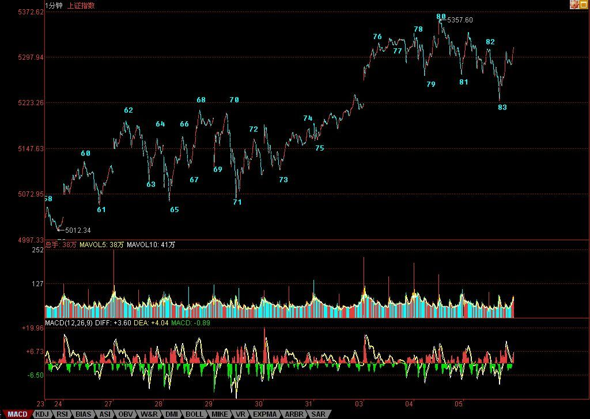 缠中说禅 2007-09-05 16:24:14  骄阳 100002007-09-05 16:18:53  禅师,能讲一下 81、82 这个分段为什么中间那个高点不是一个段呢？ ==  因为那只是一笔，笔破坏不等于线段破坏。 顶石猴的问题 2007-09-05 16:22:20  对线段还有困惑在第二种情况里，就是分型第一，二元素间有缺口 1.最后缺口被封闭，但没有线段破坏，比如 6263，

2.最后缺口没被封闭，有连续三笔，但这三笔没破坏原线段，3233 是这种情况 3.最后缺口没封闭，有线段产生，但线段破坏了原线段，也就是真有新线段形成，就是长沙那课小级别转大级别的那个图

 如何把前两种情况和第三种情况区分开来？按定义是无法做到的，至少我的理解是无法做到，你上次答疑我也没明白

答疑说：请先搞清楚底分型是从哪里开始算起，哪里开始结束。在这种前面是下跌的，对应的第二是上涨的，其特征序列就是看向下的，这第三个向下的，已经跌破原来第一段的底，怎么能属于第二段里的特征序列？

 特征序列的底或顶，首先必须要都属于这个特征序列才行，这是前提条件。其实，如果第二特征序列没有三个元素，就根本不存在出现分段中第二种情况的可能

我的问题是：分型的开始和结束是怎么定义的？说第二个特征序列没有三个元素，根本不存在就根本不存在出现分段中第二种情况的可能，那么第二种情况的那个三段例图，也符合第二特征序列没三个元素的情况吧，为什么会是三段？

 缠中说禅 2007-09-05 16:33:55 [匿名] 顶石猴的问题 2007-09-05 16:22:20

我的问题是：分型的开始和结束是怎么定义的？说第二个特征序列没有三个元素，根本不存在就根本不存在出现分段中第二种情况的可能，那么第二种情况的那个三段例图，也符合第二特征序列没三个元素的情况吧，为什么会是三段？

 ==  在第二种情况中，如果不满足定义的情况，就不算线段被破坏。例如一个下跌，一个 ABC 的回拉是第二种情况的，然后一个新的一笔下跌直接就新低，那显然就不符合定义，所以就是原来的下跌没结束。 而如果 ABC 的回拉是第一种情况，那么原来的下跌肯定结束了，这就是第一、二种情况的区别。

另外，有些概念请搞情况。第一、二种情况是完全的分类，不是第一就必须是第二，先区分了第一、二种情况才有后面第二个特性序列的问题。对于第一种情况，这个问题根本不存在。如果对第二种情况，找不到第二特征序列，那就是原来的线段没被破坏，就这么简单。

 请一切从定义出发。 缠中说禅 2007-09-05 16:52:47  石猴 2007-09-05 16:35:10  在 7475 上面，08311055 那下来一笔，封闭了缺口，后面也先跌破这一笔的结束点，为什么不是线段呢？ =

这只是笔破坏，没有线段破坏。 缠中说禅 2007-09-05 16:54:43 全线飘红 2007-09-05 16:38:41

 请问缠主。 79－80 这个线段是去比 77－78（盘背），还是比（75－76）呢？标准是什么 79－80 毕竟创新高不多。 ==  这和创新高多少没关系。关键看有没有趋势。 缠中说禅 2007-09-05 16:59:02  [匿名] 手机用户 2007-09-05 16:47:16  老大,一个线段有时离开中枢力度很大没有背驰,但不一定形成三买卖点.怎样预判?  ==

第三类买卖点，必须是回拉的力度没有离开的力度大才可能形成。如果回拉走势都没有出来，怎么可能预判？离开的力度大，如果回拉的力度更大，那当然就不形成第三类买卖点。所以一切都必须等图形当下走出来。

 缠中说禅 2007-09-05 17:03:36  [匿名] 新浪网友 2007-09-05 16:59:41  缠住昨天说补了缺口行情会走弱，今天补后大盘反而放下包袱，重新站在 5300 点上，不知缠住有什么看法？谢谢 ==  本 ID 没什么想法。 不补缺口是最强的，补了缺口能强力拉回并继续新高那是次强的。如果补了缺口拉回无力，不能新高，那就是最弱的。 现在大盘不能选择最强的，而后面两种，选择什么，让大盘自己来，本 ID 没预测的兴趣。

#### 建行引领大盘前行

 时间：2007-09-06 15:55:55

这题目没错，就是建行引领大盘前行，建行发行的意义，在昨天已经说得很清楚了，而建行作为这次大规模回归的首家，其最终的表现，将对后面的回归者有极大的指标意义。因此，像尾盘出现中行等飞速拉起的情形，就一点都不奇怪了。

不过有点必须明确，本 ID 昨天回答问题时说到中国联通的一些题材，并不是正式的东西，就当成梦话吧。本 ID 有联通，这里的人应该很多都知道，在春节前后，在这里还连续 N 天直播过联通上 5 元的活动。这是本 ID 要海枯石烂的股票，中移动在香港 100 元多，如果中移动的 GSM 业务都给了联通，本 ID 也不知道联通该多少钱，但联通搞 GSM、移动搞大唐玩意、电信搞 CDMA，并不是什么正式公告，只是一种还未被最后正式批准的可能方案，其实本 ID 在以前回答问题的时候也多次说过，但从来没在文章里说过，所以只能当梦话，相信者有毛病。至于整体上市、中移动回归，都是很明确的，只是迟早的事情，所以对联通的判断，要以此为准。

本 ID 其实不愿意回答个股问题，本 ID 告诉的股票都是本 ID 正买着的，当然，本 ID 建仓的过程可能很长，但本 ID 在这里第一次说的时间，肯定和本 ID 第一笔建仓的时间是同一日，甚至更早，这点是没问题的。例如潍柴，5 月 15 日写诗，也是本 ID 买的第一天，本 ID 把自己买的股票说出来，不存在推荐的问题，这就如同告诉各位，本 ID 中午吃了点什么一样。今天中午，本 ID 只喝了点果汁，就这样了。

 大盘没什么可说的，补完缺口后创新高，也就是说周一的缺口依然只是中继性质的，那游戏继续。 下面再次用明确的语言给出目前的操作守则： 一、一旦有致命的消息，手起刀落，让股票见鬼去。 二、没消息就是最好的消息，用尽一切手段疯狂去。 三、最懒的办法，看 5 日、5 周线。 四、针对那三种技术形态的股票，分类操作。（以前用 600636、600737、000938 为例子说过。）五、目前位置，就不要抱什么长线打算了，长线打算是在长线买点去打算的。现在只是疯狂的游戏阶段，成功的唯一标准只有一个：把钱赚到袋子里又不被刀子伤着。 六、对于中长线投资者，只战略性持有等待中线卖点的出现，然后用部分仓位去进行降低成本或赚取筹码的操作。 这六点里，对于短线来说，第一条是最重要的，第二条是最实际的。今天有事要忙，不能回答问题了，对不起，先下，再见。

#### 缠中说禅文集版权为缠中说禅所有 此文集整理版仅供缠中说禅论坛内部学习使用，严禁外传！ 值得鼓掌的下跌

 时间：2007-09-07 15:29:09

今天的准备金本不是大事，但尚老先生的风险提示，可不能说是小事。最近天天报上风险提示，但尚老先生，是力主市场调节的，如果没这老先生，530 大概早已不再被提起，因为已经有了更新的被各位口水一番了。

 因此，做人要厚道，有人担着，就不能太给脸不是脸的，否则，好人难做，市场调节失效，那就政策调节吧，但对于一些不厚道的垃圾来说，到时候一样会喷粪的。 市场主动调节，那调整就是有限的，是系统可控制的。而市场不主动调节，要人工降雨，那要发生什么，就只有天知道了。 有时候，市场配合一下，那么力主市场调节的分力就更能发挥作用，这点如此显然，但在利益面前，很多人就昏头了，所以，有些事情是人算不如天算，不如不算。

技术上，这里出现一个大一点级别的震荡，那就按中枢震荡来处理，而不会看的，中线可以关注 5 周均线，从 3600 点上来，该线从来没有被触及，这是本段行情是否结束进入较大调整的一个最简单的 PH 试纸。

个股方面，像 000938 之类站稳 530 高位后继续走强的技术形态，会在其他股票上复制，对该股的态度，本 ID 已经说过多次，唯一需要补充的是，在一个清华比北大牛太多的年代，本 ID 也只能很经济学地去哈清华了，连清华都不哈，真不想在中国混了？

本 ID 说过的股票，还是要负责到底。600375，在 7元时说过，本 ID 也是那时候进去的，当时的理由已经告诉各位，就是他有新产品，比三一的成本低多了，这是本 ID 派人实地考察过的，派出的人回来报告说，他连刚进口回来的钢板都亲手摸过了。但这公司，本 ID 对他信心不大足，就是其关联交易问题。而且很重要的，其一个超大关联公司，由于更多私人利益在里面，实际上接了 600375 发展起来的，可能最后要有大古怪，那新的玩意，要直接自己上市去实现私人利益的放大。这东西如果按正常直接装到 375 里，375 早该站 50 元了，但这样搞古怪，这种公司，本 ID 确实信心不足。 不说了，一到周末，本 ID 就对股票恶心。

 下了，各位该干什么是什么，就别股票了。再见。

#### 市场继续进入 **530** 前的怪圈

 时间：2007-09-10 15:58:37

现在关于风险的提示，级别越来越高，而现在市场里最大的信念是，政策不会制造大幅下跌，因此我们可以继续上涨，无论我们上涨到什么位置，政策都不敢出狠招。市场继续进入 530 前的怪圈：一方面，由于大盘的做多能量没被耗尽，很多个股还在 530 高位下徘徊，所以继续上涨的冲动无法消停；另一方面，关于目前市场的判断以及风险的担心，已经在越来越高级别的层次上被明确表达。

 由此，明确无误地证明本 ID 理论中一个最基本的原理，就是走势必然是市场所有当下分力的一个合力呈现。现在的这种情况，就是两种同样强大的分力在互相喷撞。 资金在赌政策不会发飙，这就是目前最大的问题所在。挑战政策底线的后果是什么，18 年的中国股市已经一次次呈现过。每一次都有人认为有例外，结果这些人都不存在了，那么，这次如何，就走着瞧。

对于资金面充裕的分力，必然要利用政策面的缝隙去制造行情，无论是整体还是局部的。而游戏政策的结果，往往是被政策所游戏，在这个游戏与反游戏的游戏中，只能用震荡去触及行情塌陷的临界点。而这种行情塌陷，往往呈现非系统性，因此对操作的要求特别高。

 现在的行情，具体的操作已经多次声明： 一、水平特差的，就把仓位降低，拿着一些长线品种就算了。 二、水平还可以但看不懂中枢震荡的，就看 5 日线或 5 周线，一般来说，只要 5 周线不破，调整的级别就是有限的。 三、懂得中枢震荡操作节奏的，就按中枢震荡的要求去操作，一般来说，原则是先卖后买，在这些位置，如果你的水平有点问题，卖错了就卖错了，权当把仓位减低。 注意，现在一定是不怕卖错，就怕买错。宁愿卖错，绝不买错。 图形上，76 开始的 5 分钟中枢异常明确了，在该中枢的第三买卖点出现前，中枢震荡将一直延续。个股方面，前面没怎么动的板块都开始补涨，这是一个明确的信号，就是如果这轮补涨后，前面调整时间比较长的板块没有再次启动，那么大盘的调整不可避免地加大级别，其时间与力度都大为增加。 本周，一定要注意上周高位能否被突破，如果能，那周 K 线上分型结构不能形成，否则，就是周线上在 3600 点后第一次出现明确的警示信号。 今天可以回答问题到 5 点。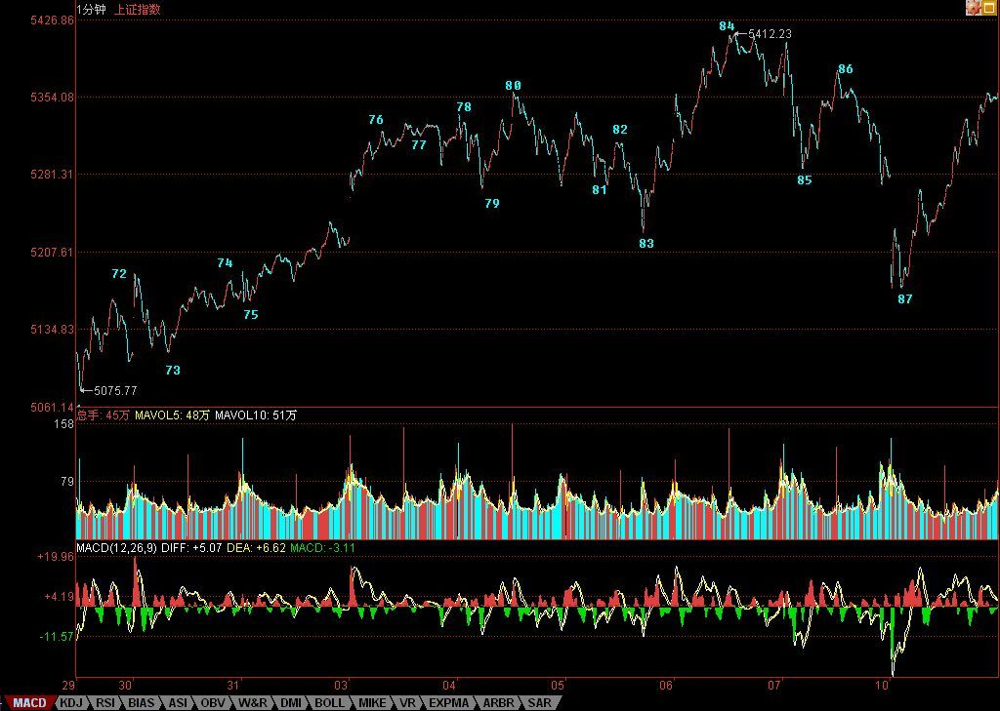 缠中说禅 2007-09-10 16:05:08  [匿名] 新浪网友 2007-09-10 16:01:19  缠姐好！ 70 课里讲到 17－38 构成完美 1f 上涨趋势，其中第二个中枢是 32－35，跟贴里也提到第一个中枢是 22－27，则整个趋势的划分是： a+A+b+B+c = (17-22)+(22-27)+(27-32)+(32-35)+(35-38)  这种划分的问题是，a和b都包含一个1f中枢，分别是 18-21 和 28-31。这样 a 和 b 都是 1f 走势类型，与中枢 A 和 B 同级，这样组合能成立吗？以前讲的 a、b 不是应该比 A、B 级别低吗？ == 为什么一定要有 a\b？A+b+B 也是一分钟的上涨，关键是两个中枢之间没重合，中枢之前之后有没有走势并不重要。 缠中说禅 2007-09-10 16:26:20  [匿名] 新浪网友 2007-09-10 16:22:54  缠主中铝深深被套中，请问大盘由于政策因素下调，它会被波及到吗？到年底中铝会上１００吗 ==  这种思维会害死人的。股票别设定预测的位置，预测是胡扯。 你只需要选择好自己的操作级别，然后根据级别的买点进入。如果你在 50 元以上才介入，那你肯定只是超短线级别的，那就按超短线级别操作。 知道股票操作中最大的毛病是什么？

就是用一个超短线的买点去期待一个超长线的卖点。缠中说禅 2007-09-10 17:09:40 [匿名] 新浪网友 2007-09-10 16:57:17

天眼 2007-09-10 16:16:44  ......................4  ....................../\...................8  ...................../..\................../\  ..................../....\..........6...../..\.  \0......2........../......\......../\..../....\  .\....../\......../........\....../..\../......\  ..\..../..\....../..........\..../....\/........\.....10  ...\../....\..../............\../.....7..........\..../\  ...1\/......\../..............\/..................\../..\  .............\/................5...................\/....\  .............3......................................9.....\  ...........................................................\  ............................................................\11  请问老大,上图分几段,怎样分?  ==  如果前面还有走势，那这根本分不了，要看前面的走势。如果前面没有任何走势，那就是三段 ---------  谢谢老大,分 03 38 811 对?还是第二种 05 58 811?

 缠中说禅：笔破坏后延伸出线段破坏，所以当然是 03 38 811。 看样子 600569 已经被缠给淘汰了，没有价值了，还是跑吧 ==  看看 569 周五的日分型。本 ID 所有介入的股票都不会走的，但一定会用震荡减低成本到 0 后继续增加筹码。 注意，对于散户，根本没必须长期持有一只股票，那是大资金没办法的办法。如果这市场能让本 ID 这样的资金短线都能杀进杀去，那本 ID 也不这样玩了，事实上不可能。 所以，对于散户，如果通道畅通的，最快的方法就是用第三类买点去操作，杀完一只继续一只，不断干下去，不参与任何的中枢震荡，只搞最强势的。 这才是散户该干的事情。 当然，如果你没这技术，那就别玩高难度的，就玩简单的，把操作级别弄大点。中枢震荡玩不了，就看 5 日、5 周线，持有到背驰卖点，然后坚决走人，等待新的买点。

#### 要来的总要来**--** 为下跌热烈鼓掌

 时间：2007-09-11 15:59:25  最近反复强调，企图和政策对着干的人，最终的结局就是消失，这已被中国资本市场 18 年的历史所反复证明。不管任何理由，今天的下跌值得热烈鼓掌。

技术上，本 ID 已经很明确地说过，本周将有绝大可能构成周 K 线上的顶分型，这是 3600 点以来的第一次，而在小级别上，目前依然可以归为 5 分钟的中枢震荡，操作上先卖后买的原则，足以让你避开今天的下跌。

好了，下跌已经是事实，就不用多说了，问题是后面如何去操作。昨天图上的 79 在 5265 点，只要后面的 1 分钟走势反抽走势不能重新站上该位置，则第三类卖点成立，后面至少要扩张成 30 分钟的中枢，最恶劣的就是 5 分钟的中枢下移。

短线上，日线的 9 月 7 日，顶分型形成，显然，现在一定要形成至少笔的调整，因此，在形成有效的日线底分型之前，大盘的调整不会有效结束。但短线的震荡反弹机会还是很多的，有没有必要参与，就要根据各人的情况了。

 目前 5 周线在 5074 点，一般来说，第一次触及和跌破 5 周线后，都有一次强烈的反抽，因此配合上面的分析，该反抽是否够成 5 分钟中枢的第三类卖点，将决定整个调整的力度。

另外，由于周线的顶分型除非有特别的意外，已经成立，所以关键要看这顶分型后的调整是两种类型中的哪种，也就是是否有效跌破 5 周线，一旦有效跌破，那调整就级别大了，至少要形成一个周的底分型才能结束；如果不有效跌破 5 周线，那么调整的幅度就有限。

本 ID 在八月下旬就明确说过，任何与 2/3 线相关的活动，本 ID 都是支持的，现在又见 2/3 线，调整将以该线为基准，上下震荡构成，只要最终能站住该线，大盘依然会再次展开中长线的行情。而在站稳该线之前，反复难免，看看 3000 点下的 1/4 线、4300 点下的 1/2 线当时是怎么走的就明白了。

 市场操作中，最多见、最无聊的，就是上涨的时候就忘了还有调整的事情，一调整就认为世界要末日，这种心态，还是回家买豆腐吧。 所有下跌后就怨这怨那的，都请离开市场。政策面的变化难道是今天的？昨天还不是很牛说要顶着政策上？现在怎么蔫了？这市场的操作，都是自己的，要怨的只有自己的贪婪与恐惧。

万古长空，一朝风月，没有任何走势值得叨唠的，过去的就过去了，关键是后面的操作。无论前面的操作是成功还是失败，只要市场在，人在，股票在，资金在，这游戏就继续运转，没有必然的胜利者和失败者，关键是从此刻起，与自己的贪婪与恐惧说再见，深刻了解自己的能力与可能性，形成一套适合自己的操作原则，这样，失败的可以胜利，胜利的继续胜利，对过去说三道四没什么意义。

 今天有事，不能回答问题了，先下，再见。

#### 缠中说禅文集版权为缠中说禅所有 此文集整理版仅供缠中说禅论坛内部学习使用，严禁外传！ 本 **ID** 理论的现场教科书演示

 时间：2007-09-12 15:42:13  刚今天的走势太技术，简单说，就是昨天说的，跌破 5 周线后必然有反弹，问题的关键是这个反弹能延续到什么位置，如果不能抽回 5265 点之上，那么后面的走势依然充满凶险。

但如果了解了本 ID 理论的一些最简单结论，那今天的走势，简直就是一个现场教科书演示。你可以清楚地看到，走势是如何从线段扩张成一个 1 分钟中枢的，而其中利用背驰等关系，又是如何能在火海刀山中逍遥游的。

 显示，第一个绿箭头的那一笔，没有发生笔破坏，那必然要回落去完成线段的走势，这是理论上 100% 保证的。 而 92 这一处，出现线段破坏，但该线段不能拉回 85 处，那么这就构成了 85-88 这 1 分钟中枢的第三类卖点，后面的继续下跌也是理论 100%保证的。 93 处，标准的线段类背驰，这就意味着 92 这 1 分钟第三类卖点，将出现中枢扩展，至少形成一个 1 分钟中枢，这也是理论 100%保证的。 也就是说 88-93 的下跌已经完成，后面必然有一个针对这下跌的反弹。后面的演化，都如教科书般标准，学过本 ID 理论的，都知道这一切都可以当下判断，无须事后分析。

那么，现在后面的走势如何，很简单，84-93 这个 1 分钟的走势类型离开 76-85 这个 5 分钟中枢后，就要看一个 1 分钟的走势类型的反抽能否出现回到 79 这一点，也就是 5265 点之上。不行，就构成这 5 分钟中枢的第三类卖点，后面至少要扩展成为 30 分钟中枢，最恶劣的，就是一个 5 分钟级别的下跌。

 今天在 93 点按理论要求进去的，以及昨天没按理论要求走的，都要关注这第三类买卖点是否成立，如果不成立，那大盘就继续中枢震荡，那简直是本 ID 理论的天堂。

个股方面，其节奏不一定和大盘一样，用本 ID 股票为例子，600578、000099、000999 这些，昨天并没有任何构成日顶分型的迹象，而今天很快也破坏了形成日顶分型的可能，这是短线的强势股，就一定要耐心等待日顶分型的出现。

而像 000938 这些，如果你用本 ID 的理论去操作，里面的短差机会对于散户来说简直好玩透了。请好好研究一下 000938 的图，看看昨天的顶分型多么标准，而今天 17.59 的底背驰又是多么经典，力度比较请看 5 分钟图。这两者的差价有多少？

 别看不起短线，看不起短线的，不过是因为你没这水平。当然，没这水平，就别太短线了，短线可需要战士够钢铁。 本 ID 的理论可不单单是短线的，各种级别都适合，关键是你能真掌握了。 先下，再见。缠中说禅技术论坛 www.chzhshch.net 刚回来，说两句

#### 刚回来，说两句

 时间：2007-09-12 23:58:00

刚回来，一个极端无聊的晚上。本 ID 在西南某省投了一个矿，结果内部的一些事情闹到本 ID 这里来，搞到本 ID 用了一晚的时间去折腾这事情。最后，本 ID 一轮花言巧语，终于把 N 个属于本 ID 父辈年龄的老头给说回去，明天一大早飞机，老头们可以和北京说 88 了。

本 ID 给他们下的一个套就是，你们好好把你们现在的业务搞好，比矿有前途，你们这是现代服务业，一旦你们在两年内搞出业绩来，本 ID 一定 PE 你们，现在这些小事就算了，以后你们前途无量，你们要搞一个最牛的上市公司，本 ID 就当你们的小股东。

 不说了，累了，二级市场就没这些破事，在中国，哪个人斗人起来不都是英明神武的？这些五、六十的老头，也是行内的超级专家了，还斗个不停，知识分子有时候就是该被洗刷洗刷。 废话一大堆，其他东西没时间写了，晚上还有足球，本 ID 休息一下，3 点还要足球。先下，再见。

#### 有些钱不是适合每个人赚的

 时间：2007-09-13 16:00:16  看完下面文章，请务必看 各位注意，严重更正 首先表扬一下某网友，请看：[匿名] 新浪网友 2007-09-13 11:25:01  呵呵，被我说中了，目前就看破不破 5166。不破 5166就是 1F 三买，那就还有机会冲击 5265

这就如同下棋，只看一步，肯定高手不了，能知道上午的跳水，其实是去形成 92-95 的第三类买点，这就不错，为什么？因为一般都关注 5265 点了，5265 点按理论，如期成为大盘的阻力，由此产生的回落，当然可以短差一把，但由于在 96 时，95-96 与 93-94 的力度对比并没有明显的类背驰，而且一旦回落形成下面 1 分钟的第三类买点，反而成为反弹继续的动力，能看出这一点，就比光看 5265 点要更进一步了。

后来，96 到 99 形成一个新的 1 分钟中枢，那么这个对 76-85 这 5 分钟中枢，86-93 的 1 分钟走势类型离开，93 开始的 1 分钟走势类型的反抽就一目了然了，这意味着，后来，突破该中枢继续上行，突破 5265 点，第三类卖点不成立，76-85 开始的中枢震荡依旧。

显然，目前这个 93 开始的 1 分钟走势并没有结束，96-99 是第一个中枢，如果是盘整走势，那么 99 开始的向上就要和 93-96 的形成盘整背驰，如果不形成，这走势就强了，理论上大盘完全可以再创新高。但探讨这个问题没意义，关键是看这盘整背驰是否形成。

不过，对于 96-99 这 1 分钟中枢，其第三类买点还没有形成，因此，比上面的盘整背驰还要急迫的，就是要确认这第三类买点，否则，最多只能是这 1 分钟中枢的震荡，然后由此产生 96-99 的第三类卖点，转而下跌也是符合理论要求的。

 所以，明天的技术走势极为简单，最强的，就是开盘后能形成 96-99 的 1 分钟中枢的第三类买点，然后继续上攻，这时候必须关注其盘整背驰问题，一旦出现，该怎样操作，就不用说了。 弱的，就是不能形成第三类买点，然后继续中枢震荡，最弱的当然就是形成第三类卖点，然后再次大幅下跌。 因此，明天的走势，只要看好这几点，一切都在当下把握中。 注意，正确的操作，就是 93 背驰进入后，现在一直持有着，或者你有技术条件，96-97 的震荡的可以对冲一把的，回补或换股后，现在应该是持有状态。

最坏的情况，就是今晚突然有巨大消息，这样明天一开，确定 96-99 的第三类卖点成立，就手起刀落。当然，这种情况，一百天也碰不到一次，所以一般情况，就可以耐心等待真正卖点的出现。卖点出现干什么，就不用说了。

 上面说的都是短线，这对技术要求高，没这理解力与技术的，就算了，把仓位调节好，有些钱不是适合每个人赚的。

当然，只要你对本 ID 的理论有一定认识，那没有什么钱是不可以赚的，因为所有的赢利机会，本质上都被本 ID 的理论所把握，唯一的问题是你的理论把握程度与交易通道，反应速度等等。理论保证所有机会，那你的精力与资金不可能参与所有的，所以就只能有所选择了。

 个股方面，没什么可说的，像小安子，那些对他不满之人，现在也如同等比一样没什么可说的了。000938，今天提供了一个底分型的买入机会，就算你不关系这股票，那也请从纯技术角度，好好研究其图形。 注意，下面都是梦话，谁信谁有毛病：

这里再说一只股票，注意，这股票风险极大，不适合一般人，本 ID 先把其前因后果说清楚，这股票是 600078。该股的问题是在云南买别的矿的时，突然发现买的地方下面有另外的矿，那矿就是 600497 搞那种，据说量比 600497 还大。

注意，因为本 ID 一直有参与矿的事情，这消息的来源与此有关。但这消息的准确性问题不大，但最大的问题是，该公司去买的时候，不是直接用上市公司，其次，这东西，完全存在可能就是被他们低价倒给自己，因此上市公司最终没什么利益。

 因此，建议，对云南熟悉的人，自己去调研一下，看这事情的准确性有多大，千万别只听本 ID 说，本 ID 目前也在核实中，并不保证任何问题，而且就算是真的，也有可能不装到上市公司里，所以完全有可能是闹剧一场。 消息就这样了，如果大盘下跌，这股票完全有可能跟着大幅度下跌，所以任何头脑发热就冲进去的，自己负责。 马上要去看一个 PE，车子在下面等着，先下，再见。看完上面文章，请务必看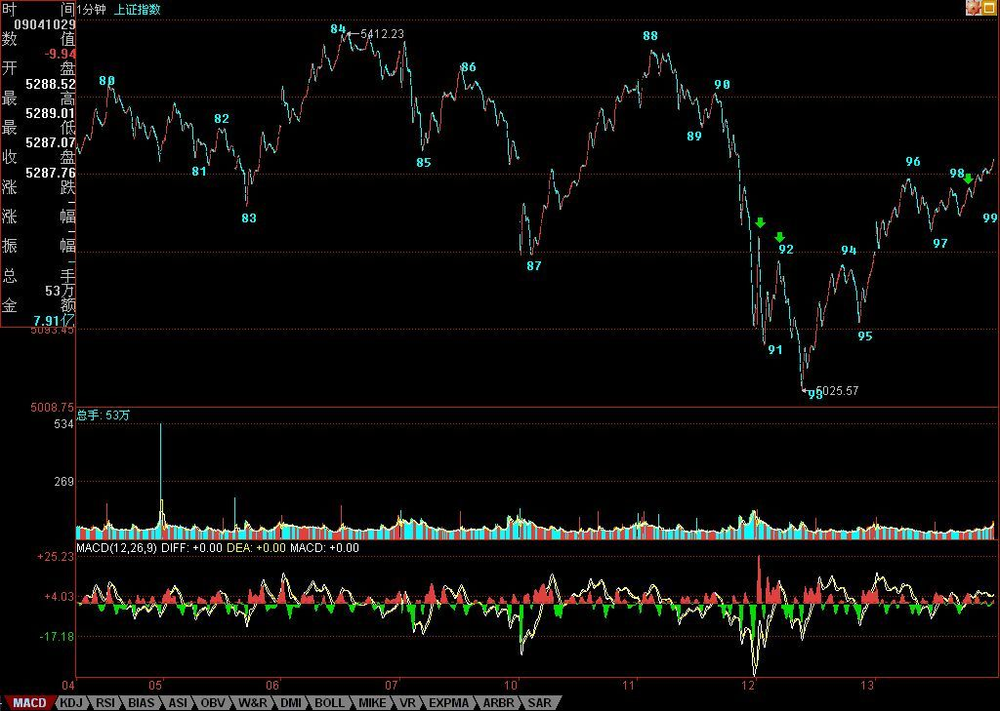

#### 各位注意，严重更正

 时间：2007-09-13 20:55:15  各位注意 严重更正

今天收盘后事情不断、电话不断，后来又要赶去看一公司，司机按时到，本 ID 是在赶着把文章写好，连复查一遍都没有，导致今天的划分出现严重错误。以后尽量把写帖子的时间安排充裕点，但有时候实在太忙，出现点错误，也请各位原谅。

错误的划分还在今天的收盘分析中，本 ID 也不更改，把错误的放在那里，好当一个比较，对学习划分有大的帮助。错误就在于错把绿箭头的那一下当成一段了，这是错误的，中间那一折仔细看一下就知道不构成一笔，而一段是至少三笔的。

因此，按照正确的划分，大盘的走势比错误划分中显示出更强的趋势，也就是 93 开始的回抽，是一个标准的线段类上涨，连 1 分钟中枢还没构成。当然，明天开盘一跌破 96，1 分钟中枢就形成，而如果不破，97 开始的线段依旧延伸，后面的线段回抽不破 96，那这线段类上涨就延伸出 3 个类中枢了，那当然是超强的表现。

 至于其他的分析，依然有效，就是 76 开始的 5 分钟中枢震荡没形成第三类卖点，线段类上涨都已经穿越 5265 点，当然比 1 分钟走势类型穿越 5265 点还要强悍。 明天，就要注意这线段类上涨的结束位置，然后下来的线段调整，必然形成 1 分钟中枢，其后走势，都与该 1 分钟中枢的演化相关，这太简单，就不要详细说了。 等等，找找有没有发现本 ID 错误的，都给戴上大红花。 [匿名] 赚到了 2007-09-13 17:18:33  [匿名] laowang2007-09-13 16:23:07  疑问：缠 MM：98——99 并不是一线段啊？只是一笔，各位同学有不同意见吗？ ========= 同感，97 接下来的线段还没走完。 [匿名] 新浪网友 2007-09-13 17:10:22  有疑问：98 到 99 应该不是一个线段吧？我的看法从 97 开始的线段目前还没有走完，请大家讨论。 [匿名] 新浪网友 2007-09-13 16:27:34  我觉得 98、99 段分得有问题。我在分时，仅到 97 段。请斑竹讲解一些。谢谢 找到不少，可能有漏掉的，一律大红花。 由此可见，如本 ID 反复所说，本 ID 的理论如同几何学，是可以 100%严密地讨论的，这里没有权威，连本 ID 都不是，本 ID 错了也就错了，没有什么可说的。

有人说，错了也没什么，只是把一段给分错了，但这里的差别大了去了，因为这样，市场的真实力度等就分析不对了，原来是一个线段类上涨，搞成 1 分钟走势，那样，回拉的力度差别就大了。而级别越小，证明回拉力度越大，所以必须绝对准确，这才能真正反映市场的真实情况。

 必须用最严谨的态度来对待划分，这样才能真正看清楚市场在干什么。

补充一句，600078 的基本面，在 2 个月前就有相关传闻，但那时候关于矿的量没有说法，目前有了新进展，不过最终能否实现对上市公司的装入，那是一个远没答案的问题。而且详勘资料本 ID 还没看到，所以一切都只是一个传闻，就算本 ID 最近看到了正式的详勘资料，也绝对不能保证这玩意就能放到上市公司里，所以一定不能以此为准。

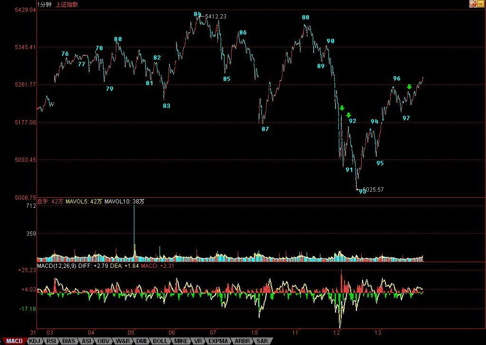

#### 下周焦点：能否破坏周 **K** 线顶分型

 时间：2007-09-14 15:33:01

显然，本周如期出现周 K 线顶分型，而且制造了一次绝妙的短线机会。那么，下周就在于，能否破坏这周 K 线顶分型。看过本 ID 课程的都知道，周 K 线顶分型出现后，如果在 5 周均线处得到支持不有效跌破，那么，该顶分型只制造一个小级别调整，不会出现周 K 线上的笔调整那样的大级别调整。因此，下周的走势十分明确，下面就看 5 周均线的支持度能否制造该顶分型的破坏。

小级别图上，今天的走势在昨天已经明确说过，就是形成 1 分钟中枢，然后根据该中枢的震荡情况决定行情的发展。今天的走势，其实就干了这样一件事情。下周一的走势最简单，就是 98 到 101 这 1 分钟中枢究竟是先有第三类买点还是先有第三类卖点，如果是前者，那么这个 1 分钟的向上走势将延续，顶分型的破坏的可能性极大。如果出现后者，那么二次探底就不可避免，5 周均线将继续受到考验。

这两天的图形，完美地演绎着本 ID 的理论，从中可以看出，一个线段上涨如何演化出一个 1 分钟走势类型，后面，继续看这走势类型如何生长，到最终的完成。如果你真明白本 ID 的理论，看行情的走势，就如同听一朵花的开放，见一朵花的芬芳，嗅一朵花的美丽，一切都在当下中灿烂。

 周末，让股票豆腐、磨墙去吧。 先下，再见。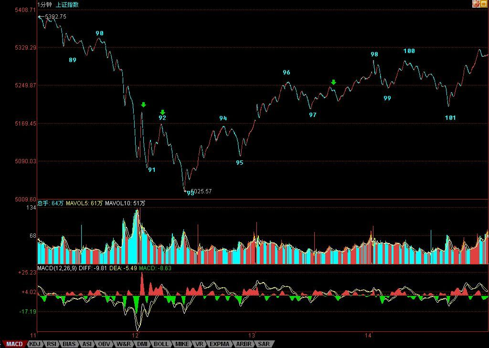 缠中说禅技术论坛 www.chzhshch.net 刚从北京著名的快刀之一回来

#### 刚从北京著名的快刀之一回来

 时间：2007-09-14 23:44:02

北京，一个浮华无度的地方，像姜文这样的粗男都竟然被天才一番，北京圈子的腐烂可见一斑。说实在，本 ID 在北京的各类圈子中长期游荡，除了身体，从未见过有一人值得正眼一看。中国的人才，如果真有，一定不在北京。

 中华之文明，究竟是怎么一种玩意？54，鲁迅之类已经够人呕吐一番了，现在，连吃鲁迅尸体的，都能文化一把，这世界的堕落，绝对是超越人的善意的。北京这垃圾堆，生长的都是些什么生物？

本 ID 真不知道中国还有什么地方值得中国地去流连，上海？广州？成都？千万别告诉本 ID，深圳也叫一座城市。中国文化竟然可以堕落至此，悲哀，中国的文化，难道就堕落到去二人转、假洋鬼子、京痞、百家讲坛、搓麻、走鬼、瘪三的地步？

今天喝酒，N 人提了 N 品种，本 ID 都反问，你们都有他们的股票吗？结果是不都有，所以本 ID 说了，就喝小二吧，千万别喝牛栏山的，那是二锅头吗？为什么不可以在刀子最快的地方喝 N 元一瓶的小二？没有，就到外面买，其他你爱收多少是多少，今天就喝小二了。

 现在，本 ID 越来越觉得，这世界上最好的酒就是小二、老白干也不错。那刺破一切虚伪的劲道，喜欢。什么破烂茅台、五粮液，死去。 北京依然北京，夜深时分，腐烂的北京依然北京。在灯红酒绿间，左派痉挛着不平等，右派痉挛着市场经济，狗屁！死去！ 今日之北京，一地秋风飘起一天秋雨。坐台的面首，姿势忒文化。

#### **2007** 年末，资金与政策博弈下的走势分析

 时间：2007-09-17 00:41:48

这轮从 2005 年中开始的行情，一直受到 1992 年 1429 点开始的系列比例线的严格控制。例如，在 3000 点下，震荡确认的是 1/4 线，也留下了 227 暴跌印记；而在 4000 点上，震荡确认的是 1/2 线，恰好在 5 月的 180 月大周期中，以 530 暴跌来继续印证这些比例线对大盘走势控制的有效性。而目前大盘的走势，同样没有离开这系列比例线的控制。

9 月，2/3 线的位置在 1429+184*30*2/3=5109；3/4 线的位置在 1429+184*30*3/4=5569。显然，911 的大跌行情，是对 2/3 线突破后的回抽，但该线最终是否被有效站稳，一般来说，都需要 3 个月以上的确认周期，这在 1/4 与 1/2 线的确认中都得到完美的验证。

由于 2/3 线与 3/4 线相差太近，所以今后行情的走势，将受到这两条线同时的控制与确认。由于本月是第三季度 K 线的收盘月，因此，只要本月收盘不能收到 3/4 线之上，那么可以肯定地说，2007 年的最终收盘，将受制于 3/4 线，也就是说，即使年收盘位置最终能向上脱离 3/4 线，但其中必然会出现至少一次类似 227、530、911 的走势。

可以相当肯定地说，根据交替原则，227 是小调整、530 是大调整，如果针对 2/3 线的调整是小调整，那么，针对 3/4 线的调整，将有极大的机会至少是一次如 530 走势般的剧烈调整。根据 9 月收盘相对 2/3 线的位置，可以将大盘走势进行分类：如果收盘在该线之上，那么大盘是强势，反之是弱势。其强弱程度的绝对值正比于收盘相对 2/3 线的距离。

最简单的经常是最便利且最有力的，在对行情的分析与操作中，情况同样如此。在技术分析中，没有比均线系统更简单的，但在中长周期的分析中，一条 5 月或 5 周均线，就比绝大多数的复杂系统都有效了。从 2005 年中行情发动以来，大盘从未有效跌破过 5 月均线，甚至在 530 大跌中，也没有发生过，任何在 5 月均线下的走势，最终都被证明是空头陷阱。

但这样一个模式，最终必定会被打破，而打破之时，就是行情进入大级别调整的确立之日。请注意，该调整的级别一定大于 530，也就是说一定是 2005 年中行情发动后最大一次级别的调整。反之，在 5 月均线被有效跌破之前，大盘的行情依然延续。

由于 7、8 月的连续月长阳，使得 5 月均线严重偏离，目前仍在 4600 点不到的位置，因此，9 月的震荡，在技术上，是等待 5 月均线的上移。因此，第四季度的走势，归根结底只是一条，就是一旦 5 月均线上移后，能否继续站稳该线。也就是是说，行情是否继续被 5 月均线的上移惯性所带动？

而从中短线的角度，5 周均线极为重要，一旦有效跌破，就意味着类 530 级别的调整不可避免。根据交替性原则，由于 530 是以空间换时间，那么，下一次类似级别的调整，有绝大的可能是以时间换空间。当然，这判断成立的前提是，行情没有受到特别的非系统性因素的影响。

由于去年大盘涨幅是 130.43%，收盘在 2675.47 点，按相应比例，6165 点成为今年一个标杆式的点位。还有，深圳成分指数在 96 年的行情中，也如本次上海指数一样略微跌破 1000 点后展开，而前者最终在 6100 点上见大顶，因此 6100 点附近是后者行情一个特别值得留意的位置。

站在对市场发展有利的角度，大盘年内最理性也是最理想的走势是：一、9 月收在 2/3 线之上；二、第四季度以第三季度的长阳为基础进行震荡整理，震荡区间，以绕 2/3 线至 3/4 线区间为中枢展开，最终以十字星或者小阴小阳收盘。

但一旦政策面的压力超乎合理的范围，大盘将演化为一种具有压力的走势，即 9 月收盘在 2/3 线下，而第四季度最终以中阴线甚至大阴收盘。这种走势，必然使得年 K 线留下长上影，对明年行情发展的空间产生较大压制。反之，一旦资金面的肆虐超乎合理范围，那么大盘将演化为一种疯狂走势，即在今年内强行突破上面所说的 6100 点区域，这样，一次超 530 级别的调整将难以避免。

目前，资金面与政策面逐步走向平衡，一旦这种平衡被其中一面非理性打破，那么将对中国的资本市场中长期的发展制造不必要的困难。资金与政策的博弈，不仅是中国，也是世界资本市场历史发展中永恒的主题。如果这种博弈能在尽可能的理性与系统性范围内展开，那么对中国资本市场的发展将是最大的福音。

#### 缠中说禅文集版权为缠中说禅所有 此文集整理版仅供缠中说禅论坛内部学习使用，严禁外传！ 资金向政策发起新一轮挑衅

 时间：2007-09-17 15:46:13

今天的走势十分正常，无非就是延续了加息突破的老路子。周五的分析中已经很明确了，只要形成 1 分钟的第三类买点，那么新高就是绝大可能。今天早上 11 点多的那个第三类买点，极为教科书，后面的走势，就是本 ID 理论所 100%保证的活动，没什么可说的。

大盘年末的走势分析，已经在今早所贴的“2007 年末，资金与政策博弈下的走势分析”里，文章为了照顾大多数人，没有用本 ID 的理论分析，只是用了些通常的分析方法，因为这种预测性的文章，没多大意思，只是给各位一个大致的方向性。

真能有效战胜市场的，还是要学会用本 ID 的理论去当下的操作。上周一个绝妙的短差，然后又一个绝妙的回补点，从那 5025 点的 93 开始，一个 1 分钟中枢类型都没完成，但你明白本 ID 的理论的，就可以看着他按照理论的规范一步步地生长出来，这其中的从容与逍遥，又岂是那些用无数概率化的无聊玩意去争论大盘是新高还是不新高，真突破还是假突破的能明白的？

股票是用来操作而不是用来预测的，必须明白本 ID 理论知行合一的特点。现在十分简单，就是等待这 1 分钟走势类型的凋谢，具体的理论与操作，在课程里都反复说了，就不一一重复了。另外，今天的划分太简单，为了节约那可怜的 200 图空间，今天就不上传图形了。

 由于在 5000 点反复震荡还跳过水，所以本 ID 对大盘所给予的空间也打开一点，在早上的文章中已经分析过，请过去看。总的来说，只要围绕 2/3 线到 3/4 线为中枢的震荡，都是可接受的。 今天，大盘的资金面向政策面发起新一轮挑衅，能否得逞，就看这几天政策面受刺激后的反应了，一般来说，本周没反应，下周反应的机会就越小，毕竟有一个长假期，稳定第一，没人会用这来开玩笑的。 个股方面，中字头的继续逞强，最近开始吹中字头的人越来越多，本 ID 在 3600 点开始说，现在就不说了。当然，中字头是本 ID 组合的一只翅膀，海枯石烂去了。 本 ID 的事情，都是尽量善始善终的。600569，当时 9 元说 5 个涨停，这倒霉孩子，碰上 530，剧本只能变，这次从 7 元开始发力，折腾下来，也达到原来剧本的承诺了。后面当然还有剧本，但，本 ID 可已不欠任何人的话了。

600078，本 ID 最近找人去调查，这是最新的结果。该公司的所有在当地的子公司、孙公司都查了一遍，仍没有在当地国土部分申报有关领采矿证的资料，由于该公司在当地乱七八糟的公司特别多，也不知道有没有漏网的。没有采矿证，一切都不能算数。根据情况，大致有以下可能性：

 一、一个闹剧 二、这些民营坏蛋想私吞了。 三、想学黄某某，先晾着，等大家都不注意了，再突然装进来。

所以，现在这游戏，已经从 PE 变成 VC 了。本 ID 毕竟离得太远，去企业又太显眼，又不想为这事情到基层兴师动众，只能通过省里某些标准渠道去了解。有在当地的人，如果有可能的，可以到企业进一步了解，看能否把 VC 再变回 PE。

了解这事，顺便还了解了另一件事情，就是有人希望把某驴让美驴来入股，现在中驴很厉害，所以就有人要搞这样的把戏。不过企业相当抵触，所以这事情还真不好说。如果美驴真给放进来了，那些驴们又要疯了。但这只是一个有人在折腾的事情，在实际上，事都是折腾出来的，但折腾并不一定能事，所以，这也只能是一个 VC 项目，不能太沉迷。

 注意，本 ID 说的是驴，可没说什么股票。 今天踩着刀锋，醉生梦死把上周完成的顶分型给破了，那也不妨醉生梦死一把，回答各位问题到 5 点。 缠中说禅 2007-09-17 16:06:45  [匿名] 春日 2007-09-17 15:51:54  缠 MM 好!有一问题一直无解,100-101 对 98-99 没有出现盘整背驰,其内部也没有线段内类背弛,怎么能当下地在 101 处判断回补呢 ==

比较力度，用盘整背弛一招也不是光比较最近这一段的。以前有课程专门说过中枢震荡中的力度比较问题。你必须从 96 开始看，101 没出来前，只能先看 96-99 这个中枢的震荡。这震荡没破 97 这点，就意味着震荡的力度有限，所以一定只是中枢震荡。而且 100 的内部，一个典型的黄线下跌后双回拉后再下跌，而再下跌这段明显比不上第一段黄线。另外，柱子面积也比不上。

 还有，线段下没有中枢，所以不能照套中枢概念，这必须清楚。一般来说，最好不要用线段操作。连中枢都没有，没什么意义，除非你概念特别清楚，对中枢震荡研究得特别明白。 缠中说禅 2007-09-17 16:09:49 [匿名] 与你同行 2007-09-17 15:55:58  楼主,对于个股来说顶分型出现后,立刻出现底分型,而大盘的走势并不确定,可以买入此类股票吗?  ==

这情况说得很清楚了，日、周顶分型后关键看 5 日、周线，大盘这次周顶分型后继续破顶，就是因为 5 周线没有效跌破，构成一个完美回补点。参照原来说的 000938 可以明白。至于大盘和个股的关系，是另一个问题，一般来说，水平不高的，最好还是买和大盘相关度高的。水平高的，就无所谓了。

 缠中说禅 2007-09-17 16:21:05  [匿名] 新浪网友 2007-09-17 16:17:44  中铝什么时候能调整完呀，缠姐已经被套好久了 ==  中驴还有什么可问的，本 ID 当时说向下阻击，说得满大街都知道，怎么不走？就像 000802，当然说得这么明确，还有没走的。现在小 ABC 走出来了，短线就看对上面中枢的回拉力度了。中线当然没问题了。 缠中说禅 2007-09-17 16:36:45  [匿名] 新浪网友 2007-09-17 16:02:30  缠 mm，为什么缠论理论上很清楚，但一但实际操作，又晕了。郁闷！ ==  实际上，根本原因是理论还学得不够清楚，你看，上面还有很多人，对今天的分段没搞清楚，那第三买点怎么来的，也没搞清楚，所以，还是先把理论搞清楚，一定要多看图，那些都是用钱划出来的。你想想，现在最牛的画，一般的级别也就几千万，而随便找一个图，几乎都要上亿才能划一个日分时，就别说日线图、周线、年线了。 怎么珍贵的画，还不好好欣赏，也太浪费了吧。 缠中说禅 2007-09-17 17:12:00  [匿名] 大盘 2007-09-17 17:00:56 请问博主 线段纠缠很久了，问一个看待走势如何像花开花落的问题 背驰买点后，形成两个完全不重叠的 1 分钟中枢，如果第 2 个 1 分钟中枢没有出现三买而是通过 9 段延伸形成 5 分钟中枢，这 5 分钟中枢暂时也没有与第 1 个 1 分钟中枢有如何重叠， 那么我们当下是应该把走势看作未完成的 1 分钟趋势呢，还是按照 5 分钟的震荡来处理当下走势真的很想像看花开花落一样看股票走势，但是疑问还是不少 ==  当然是 5 分钟走势，看成是 5 分钟的中枢震荡。 缠中说禅 2007-09-17 17:21:46  [匿名] 影子 2007-09-17 17:04:52 今天踏空了一半,看多了小缠的博,我这个几乎是死多的居然踏空了一半,真是的.  博主文章对多方贬义词用的太多了,估计缠友踏空的比例不小.我发表点不同意见,希望对大家有点帮助,错了勿怪.  ==

那你的判断完全错误，除了必须保留的机动资金已经对冲风险的仓位，本 ID 从 3600 点开始都是 100% 的满仓，当然，本 ID 的是机动资金会在组合中不断流动，一般在 10-30%比例间波动，这样效率是最高的。一般来说，有大点的卖点，那么本 ID 的机动资金会达到 30%，一般来说不会到了比例。另外，本 ID 都会有一定比例的对冲风险操作，这就不细说了。这一点对大资金其实很重要，如果没有这一点，本 ID 在 530 早上就不会如此从容了，毕竟对于大资金来说，在那兵荒马乱的早上，一个第二卖点，也走不了多少，但有对冲，就不同了。

 如果按对冲基金的观点，纯多纯空都是风险级别的，一定要有一定的对冲。 缠中说禅 2007-09-17 17:37:06 各位注意，特征序列必须要有三个元素才能有可能有分型，两个元素怎么可能有分型？

#### 等待那万众期盼的每周一跌

 时间：2007-09-18 15:53:21

首先，必须声明，本 ID 昨天说的是驴，和任何股票无关。至于有些无聊股票，走出例如涨停那种很无聊的走势，可和本 ID 一点关系都没有。本 ID 这里可从不推荐任何股票，最多就是梦里胡言乱语一把，本 ID 要推荐，也推荐驴肉火烧实在点。

现在的走势，极端简单，就是真突破还是假突破的问题，一般来说，如果是假的，就是三、四天内见分晓，先来两、三个十字星之类的玩意，然后虚晃一枪向下跳水。如果按这个把戏，周四前后就是田亮一把的日子。而且，现在，每周一跳，跳了，都爽了，就该干嘛干嘛了。

当然，用本 ID 的理论，就没有这么多麻烦事，而且绝对不用去宣称什么这是世纪大顶之类的无聊事情。如果你是按 30 分钟操作的，什么顶呀底呀，只要按照节奏来，绝对不参与 30 分钟级别的下跌，那么这世界在你眼里，就只有三种活动，30 分钟级别的上涨、盘整、下跌，世纪大顶、火里刀上也一样可以逍遥游，其他级别的操作也是一样的。

现在的情况十分简单，对于短线来说，就是现在依然是原来 76-85 那个 5 分钟中枢的中枢震荡，现在的问题只不过是，该 5 分钟的中枢的第三类买点是否出现。如果不出现，那就继续中枢震荡，当然，那时候，这 5 分钟就扩展成 30 分钟的中枢震荡了，那就更好玩了。

至于超短线来说，昨天问题的答案在图里就有了，分不清楚的，请好好研究一下。目前，就是 102-105 的一个中枢震荡。注意，目前这个离开原来 5 分钟中枢的走势并没有完成，所以还谈不上回抽，那今天震荡的低点，刚好在 78 之上，也就看出，这中枢震荡并不是瞎掰的，这么远的距离，依然起着作用。

个股，没什么可说的，就算是假突破，只要这大的中枢震荡存在，那么个股机会依然汹涌，假期前，又有一个持股持币的无聊问题，关键还是你的操作级别和该级别中的表现。对于完全不了解本 ID 理论的，就看 5 日或 5 周线，特别是 5 周线，这是中短线的关键。

 马上有一件新疆的什么无聊管道要上市的事情要谈，不能回答问题了，先下，再见。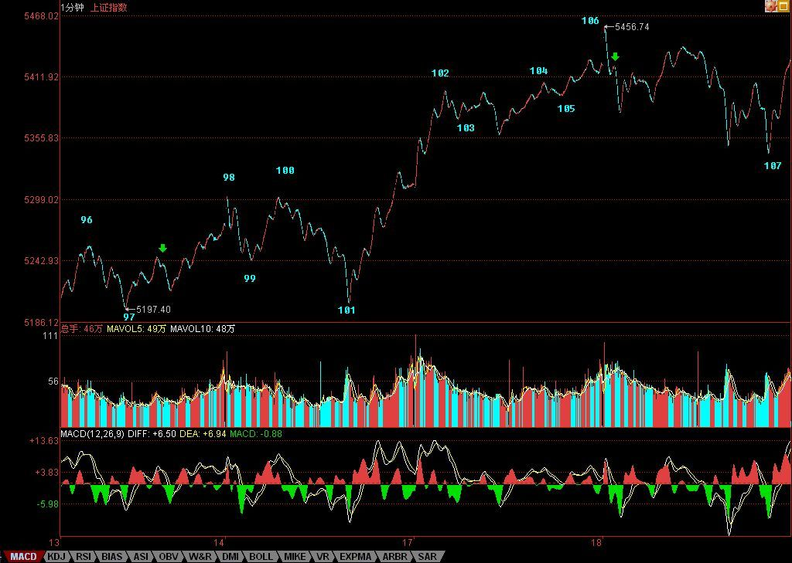

#### 忽闻台风可休市，聊赋七律说《风灾》

 时间：2007-09-18 22:53:57

回来晚了，有点累。听说上海那边，明天有可能因为台风休市，借个话头，写首七律敷衍一下各位。可惜，就算上海休市，深圳也还开，十一将至，真是有点无心恋战了，干脆都放假休息，游山玩水去，不亦快哉？

 今天，急着外出，把 107 写成 108，后来是在谈完一轮，去吃饭的路上车里改的。

现在发现各位对那些古怪的分段还是有点乱，那些古怪的分段，经常是因为第一次笔破坏时，延伸不出线段来，例如，今天图里绿箭头所指的地方，顶和底分型经过包含处理后中间没有 K 线了，这就不能算一笔。

本 ID 想了想，计算了一下能量力度，觉得以后可以把笔的成立条件略微放松一下，就是一笔必须满足以下两个条件：1、顶分型与底分型经过包含处理后，不允许共用 K 线，也就是不能有一 K 线分别属于顶分型与底分型，这条件和原来是一样的，这一点绝对不能放松，因为这样，才能保证足够的能量力度；2、在满足 1 的前提下，顶分型中最高 K 线和底分型的最低 K 线之间（不包括这两 K 线），不考虑包含关系，至少有 3 根（包括 3 根）以上 K 线。显然，第二个条件，比原来分型间必须有独立 K 线的一条，要稍微放松了一点，这样，象今天绿箭头所指的地方，就是一笔了，相应那三笔下来就构成一段了，整个划分就不会出现比较古怪的线段。

对线段一直比较晕的人，这个新的条件大概容易处理一点，至少可以避开处理如 106 到 107 这样复杂的线段，而这，本 ID 刚计算过，也不会影响整个线段的动力学能量。但 103-104 这样的线段，是无法更改的，这类线段必须能够处理。

另外，以前也说明过，现在再说一次，本 ID 平时交易时不用同花顺，只是本 ID 用的系统网上没有，所以那里的标记无法搞过来，因此，本 ID 在同花顺上的标记，都是收盘后才弄的，而两套系统的数据经常有点小出入，有时候偷懒，就照抄过去，偶尔就会出问题。其实，本 ID 这个示范，只是为了让各位能明白真正的划分，只是一个示范，如果你真明白了划分的原则，不看也可以，根据自己系统的数据，都有唯一正确的答案。分型、笔、线段，都是最基本的准备，关键还是通过这去分别出更高级别的走势类型，那才是操作的关键之处。所以，一定要把这两部分的区别搞清楚。 不说了，本 ID 写的七律来也，上海的朋友，看看和外面的比怎么样？

 风灾 缠中说禅 层城飙卷万星帷昆柱倾摧折纆徽 天海低昂惊叠错 云山吞吐莽相围 九重阊阖龙虎散 六道娑婆神鬼饥斗碾参磨冰火淬茫茫三界只灰飞

#### 政策对资金挑衅的反击

 时间：2007-09-19 15:42:03

今天算不算田亮一把，估计要看了明后两天才知道了。因为，好象田亮参加的项目，有 1 米板，还有 10 米台，这玩意，要对比着才知道的。本来，美国减息，全世界喝了一把水井坊，但中国就是中国，不和全世界玩，咱自己玩。

年末行情的判断，在“2007 年末，资金与政策博弈下的走势分析”说得很清楚，最理智的走势是怎么样的，也写得很清楚了，如果一方挑衅，肯定会被反击，今天三大报让各位学习，各位也就学习一把，水井坊给英国佬搞去全世界，到时候用英镑卖的，咱就喝王老吉，降降火。

技术上，昨天已经说得最清楚不过了，基本看法一样，首先小的 1 分钟震荡，今天没震出什么结果，而操作上，当然是冲高震荡时卖，卖了回来看，如果向下破位出第三卖点，咱就不管他，看他跌成王老吉还是水井坊再说，如果不出第三卖点，咱就继续陪他游戏。

不过，从短线政策的压力看，如果资金面上还继续麻辣火锅，火气旺旺的，那么，政策上大概就不是学习学习那么简单了，让你喝王老吉，那是给面子你，哪天让你吃点巴豆、喝点减肥茶，又有什么不可以的？

 本 ID 总是想和稀泥，让双方都能平和点，但良好的愿望，绝不是本 ID 一个就能实现的，市场是大家的，是合力的。当然，本 ID 也懒得呼吁什么了，现在只有一个念头，快点放假，游山玩水去吧。

昨天，本 ID“欣闻台风可休市，聊赋七律说《风灾》” 可能引起某些敏感，本 ID 后来就改成了“忽闻”，这就是和稀泥，本 ID 不想为一个字去坚持什么，没什么可坚持的。虽然原来的话修饰什么，是很明确的，不过，如果一个字能让大家少点争吵，那字又算得了什么？所以，资金与政策目前的困局，也是一样，资金去挣所谓的钱，难道就一定要只争朝夕了？退一步，难道不可以海阔天空？

 只是美国一减息，某些如意算盘就难打了，本 ID 自己从来没什么烦恼，现在唯一的烦恼，就是看得太明白了。

昨天是 918，我们补默哀三分钟吧。今天可以回答问题到 4 点半，不过都请先为 918 默哀三分钟。注意

 下午技术分析的补充请到今晚帖子里看。 缠中说禅 2007-09-19 16:04:54  恒灵 2007-09-19 15:59:46  缠主,昨天又重新说了笔,我们以后画线段按新定义还是老定义呀? ==  那主要是为了不同软件间可以减少不同，因为，K 线的个数是肯定基本一样的，这样，就不会因为一些微小的差别导致不同的结果。而且，分别起来更简单，所以，可以用新标准。其他都不需要改变。 本 ID 自己一直用老标准，因为本 ID 从来只用一套软件。但这理论公开，就有一个适应性的问题，毕竟不能要求所有人只用一套软件，所以稍微改改，又不影响最终的判断，又何妨？ 缠中说禅 2007-09-19 16:14:02  [匿名] 菜鸟 2007-09-19 16:01:15  缠姐姐,000807,我已经看到你回复其他同学了!领会精神了!  再帮我看看紫光吧,还可以继续拿着么?谢谢!  ==  这是典型的初学者毛病，为什么跌了才问还持有不？上面的卖点这么明确，又盘整背驰，又顶分型，为什么不可以先走？ 股票操作是有节奏的，节奏错了，本 ID 也不知道怎么办。 本 ID 只知道跟着市场的节奏舞蹈，只要跟着市场的节奏，在刀锋上一样可以凌波微步。 另外，请搞清楚自己是为什么买入的，如果是中线买入，那就应该是中线买点进入。 这股票，中长线肯定是没问题的，短线调整幅度，当然和大盘相关。 缠中说禅 2007-09-19 16:20:39  [匿名] 袖手旁观 2007-09-19 16:17:15  |......................................................  |...................................................9/. |.................................................../..  |................................5................./... |.............................../\.....7........../....  |............................../..\..../\......../.....  |.........1.................../....\../..\....../......  |......../\.......3........../......\/....\..../.......  |......./..\....../\......../.......6......\../........  |....../....\..../..\....../................\/......... |...../......\../....\..../.................8..........  |..../........\/......\../.............................  |.../..........2.......\/..............................  |../....................4.......... ...................  |./.................................................... |.0... ................................................  |......................................................  请教缠 mm，就这个图，56 对 0～5 构成笔破坏，但是 56 与 34 间又有缺口，按第二种情况看待吗？如果考察 12、34、56 整个序列，可以视为无缺口吗？ ==  首先要选择原线段待破坏的顶点，这里显然是 1，3 还没 1 高，显然不构成待破坏的顶点。这样，5 下来破坏了 1，然后扩展成线段，那就是标准的第一种情况，和 3 没什么关系。(缠师语) ============  缠 MM，我在前一个贴子对此有回复，并对你的定义做了如下补充，你看可以吗？（袖手旁观语） 我同意“两种情况的区分标准按第一笔是否构成笔破坏”，这应该也是缠 MM 的原意。问题是这句话在特征序列中不好体现，所以缠 MM 才用缺口描述。因此我补充修改为： “缺口必须不被之前的同一特征序列中的元素所覆盖，才算是真正的缺口，否则不视为缺口”  ==  很好体现，对 1 来说，他的特征段是 12，对于 5 是 56，对于 7,是 78，12、56、78，就是顶分型。(缠师语)  补充一句，上图里的 3，没有新高，对于原线段来说，就等于笔里面，顶接着一个更高的顶，前面那个就不算了。所以，3 对于原线段就不算一个顶，34，不看成是特征序列的元素。 缠中说禅 2007-09-19 16:26:00 [匿名] 笑天 2007-09-19 16:00:27  缠主，如果一个顶分型和一个底分型中间只有一根Ｋ线的情况下，是不是不用考虑Ｋ线的方向了？所以这个《顶＋无方向的Ｋ线＋底》就可以单独构成一笔了吧 ==  那无所谓，只要是独立的就可以。昨天说了一个更简单、更有适用性的，对不同软件，就算数据有点差别也不会影响结果，请去昨天晚上帖子里看。

#### 缠中说禅文集版权为缠中说禅所有 此文集整理版仅供缠中说禅论坛内部学习使用，严禁外传！ 空头完败：必须让预测者出丑

 时间：2007-09-20 15:40:19  预测是什么，本 ID 已经很明确说过，不过就是一个概率游戏。那些宣称什么地方是什么大顶的，和街边算命的没什么不同。股票是用来操作的，不是用来预测的，这是所有市场参与者的第一信条。

昨天的顶分型，有两种演化，一种就是破 5 日线延伸出笔，一种就是不破 5 日线，反而上破顶分型。今天大盘一开盘，市场就明确给了选择。注意，没有人比市场本身聪明，因为市场是合力的结果，如果你觉得比市场聪明，那么你就是把自己当上帝，上帝就得死。

 市场每天都有预测者，根据概率，总有人碰到那最后唯一的馅饼，但这并不能证明市场是可以预测的，反而证明，预测市场只是一个无聊游戏。对了，不过证明那馅饼刚好砸到你了。

本 ID 昨天说了，短期大盘，就看那 1 分钟中枢有没有第三类卖点，而我们的眼睛告诉我们，我们没看到，这就足够了。没有第三类卖点，那就让市场继续发展去告诉你下一步的操作，这就是本 ID 理论的核心问题。

从资金、心理，本 ID 也可以给各位分析一下。现在，长假前只有最后一周了，中间还有一个中秋，市场做多资金最害怕的政策强力打压，可能出现的几率有多少？过了十一，那最重要的会议期间，还有谁有心思去搞什么政策强力打压？这样一个空挡，就给了做多资金一个好时机，这个时机里，如果能顺利完成诱多，那就有回跌的空间，否则，哪里来的空间？请问，如果没有 1000 点的回跌空间，对于大资金来说，有做空的吸引力吗？

说句狠话，现在很多做多资金，都是对政策面调控力度失望而再次做多的。现在，越来越多人接受本 ID 所说的刀锋上的游戏的观念。确实，现在很危险，但最危险的时候反而可能最安全。没有技术、没有胆略的，应该离开或减低仓位；有技术、有胆略的，真是最可疯狂的时机。真有什么硬东西来，就看谁刀下够狠，只要有手起刀落的勇气，谁又怕谁？

再次强调，现在的游戏很危险，一般人，没有那心理与技术，就半仓等待，或者就看本 ID 反复说的 5 日或 5 周线，有效跌破就一刀下去。否则，就继续玩。有人可能问本 ID 是什么头？本 ID 什么头都不干，多头抬不动，本 ID 比空头还砸得狠；空头砸不动，本 ID 比多头还回补得凶。本 ID 在刀锋上的操作原则一早就向所有公布，就是不再战略性买入，但战略性持有，并在来回震荡中减低成本、增加筹码。

 有人说，今晚就有大利空怎么办？这种问题没意义，你应该问自己，你的刀快吗？ 有人又问，你不是政策和资金博弈？是，但本 ID 不站在任何一方，本 ID 只会利用这种博弈制造的机会去增加自己的资产，这才是最明智的策略。

所以，各位就应该明白，本 ID“2007 年末，资金与政策博弈下的走势分析”里并不是对大盘进行预测，而是进行了一个完全分类。虽然，本 ID 愿意看到市场走成平衡的格局，这样对以后市场的发展有利，但这绝对不会影响本 ID 的操作。因为一旦资金对政策大面积胜利，大盘完全有可能在年末大面积突破 6100 点，但这样走势的后果，你必须清楚，因为在中国，政策一定是最后的胜利者，资金的疯狂，最终的结局只能是最大的扼杀。

 但结局与利润无关，利润总是在过程中产生。结局很悲惨，但如果在悲惨到来的时候，你能全身而退，悲惨又和你有什么关系？说得更狠一点，任何的悲惨，只是去制造下一次的大机会。 没有失败者的悲惨，哪里有胜利者的辉煌。这就是市场的道理，接受不了就请离开。留下来的，就必须接受。

今天的划分太简单，就省下来不帖了，再次说一下，那 200 图的上传空间也太小了。现在那 1 分钟已经延伸出 5 分钟中枢来了，现在就看这 1 分钟的离开后回抽是否形成 5 分钟的第三类买点，不是，就再次震荡，那又有什么不可以的？

 本 ID 欢迎市场的任何走势，包括今天晚上就有巨大利空。在市场，就要等待接受一切，关键是你面对一切时，有没有应对一切的技术与策略。 今天可以回答问题到 4 点半。 缠中说禅 2007-09-20 15:55:55 缠中说禅技术基地 2007-09-20 15:45:38  哪天新浪不行了，缠主来论坛直播吧，论坛收集了你全部文章。 -  谢谢，祝你们顺利。但瓜田李下，本 ID 还是要避点嫌疑。如果新浪没有了，那可能就是缘分到此的信号了 。本 ID 希望新浪能地久天长，但谁又能保证呢？ 缠中说禅 2007-09-20 16:05:52  [匿名] 新浪网友 2007-09-20 15:56:08 姐姐,同样是中字头,为何厚此薄彼啊,737 好像是后妈的孩子?  ==  有人在 13-14 元大量抢入，所以必须被洗。基本面没有任何问题。一直关注该股的，一定记得在 13.99、13.49 元分别有大买盘，后来都给干掉。可以告诉你，那些买盘不是庄家的。 缠中说禅 2007-09-20 16:16:16 [匿名] 新浪网友 2007-09-20 15:51:59  缠姐好！ 77-79 课更进一步地讲明了一些复杂线段的划分。但根据这几课内容，37-38 段的划分似乎又不符合规则了，缠姐能否对 37-38 段再深入讲解一下？ 另外，81 课关于线段的内容出来后，32-33 的划分又产生矛盾。32-33 和 81 课的两个图到底有何不同呢？ ==  你自己根据定义来，有些划分不同，可能就是因为有些数据不同造成的，所以，最新给了一个新的笔的定义来使得不同软件间数据差异影响的减少。

#### 迷踪步舞乱多空头

 时间：2007-09-21 16:07:38  看了一下，似乎喜欢红色的多一点，那么本 ID 就稍微改进一下，不加粗，且放大字号，这样，觉得刺眼的博友可能会舒服点。另外，将重点加粗，这样也清楚点。 在一般人眼里，主力杀人，似乎就如同无聊股评所说的所谓多空之争。但可以明确告诉各位，真正牛的主力，是多空齐杀，让所有人左右挨巴掌。不明白这个道理，股票是白干了。 别人的迷踪步正好成就本 ID 理论的凌波微步，今天的图形，如教科书般经典，看不明白，真要补课了。 但是，必须明确，目前的形势十分严峻，对于技术不好又迷恋短线的，现在的走势就是典型的绞肉行情。

请记住本 ID 一句话：在中国，最后的胜利者一定是政策。因为有技术，所以我们可以在刀锋上凌波微步，但是刀锋依然是刀锋。现在的政策信号已经足够频繁，如果如此大力的密集新股发行都不能平息资金的冲动，那么，更严厉的政策一定会出来。

现在，有人说，公募基金牛，有最大的做多冲动，没人管得了。真是典型的幼稚想法，一个基金黑幕就可以打跨他们，难道他们的头不受党纪国法管吗？难道不可以派调查组下去调查调查吗？现在为业绩以及自己的老鼠仓疯狂的所谓公募们，你们连孙悟空都不是，还想逃出掌心？可笑！

 所以，刀锋就是刀锋，虽然这个游戏，我们无所畏惧，但一定要有一根弦紧绷着，对政策的动向，1000% 地密切关注。而对于一般的投资者，必须要适当控制好仓位，没那技术的，就把均线看好。

下周，关键是能否破本周的顶，如果不行，大盘就会走出小的头肩顶，后面的震荡就会很大。而且，中秋前后，人心浮动，震荡少不了，现在的问题，不是多空的问题，而是不要左右挨巴掌的问题。记住：不多空通杀的，没资格当主力。

对于个股，本 ID 说的那 10 几只股票，对于散户来说，如果你作为股票池进行不断的换股操作，你想想你的收益有多少？难道不记得本 ID 说过在里面资金不断流动的概念？你看看那十几只股票，此起彼伏，有哪天闲着的，用本 ID 的理论，难道在 10 几只里找卖点买点都很难？不要这几天 000099 涨了，才问能不能介入，这是节奏吗？

还有，对股票不要有感情，本 ID 反复说，散户最大效率的就是不断换股，卖点卖了，一定要等买点，等的时候就去找别的有买点的，如果有时间，你把本 ID 那 10 几股票比较一下，感受一下那此起彼伏的节奏，大概你的操作水平就会有更大的提高。

这里的公众场所，本 ID 的言论必须符合法律的要求。但本 ID 已经尽量告诉各位节奏了，请问，前几天，本 ID 在最高位时，不是告诉你小安子的剧本如何如何了吗？其他股票，有了顶分型，而且还跌破 5 日线，那么不等到底分型出现，你管他干什么？还有人不断问，636 怎么样？一个连半年线都没站住的股票，是散户买的吗？大资金可以在里面打架，散户有必要陪着浪费时间吗？等打完了，图形走好了，自然就动了，这样，关注着，但先去操作别的股票，不更节约时间、提高效率吗？

 有时候，本 ID 都为各位着急，为什么这个节奏这么难把握呢？应该很简单的啊。 算了，周末说股票，没劲。先下，再见。

#### “港股直通车”难以背负的使命

 时间：2007-09-24 08:52:17

最近，“港股直通车”试点吸引广大投资者眼球。随着中国资本市场大发展，中国投资者参与世界上任何资本市场的途径都将越来越便利，个人直接参与港股投资只是一个小序曲。现实问题在于，这本来极为正常的“港股直通车”，却有意无意中背负了一个本不该背负的调控使命，通过“港股直通车”使 A 股软着路竟成了一剂调控妙药。据说，这剂妙药还能治好流动性过剩，是解决流动性过剩以及股市泡沫的一箭双雕之举。

所有把“港股直通车”炼成包治百病妙药的妙论，都离不开如下假设：在 A 股与港股同时上市的股票存在巨大价格落差是不合理的。而事实上，这只是一个并不高明的误读。该误读，不过建立在这样一个错误认识上，例如以中国人寿为例，无论在 A 股还是港股交易，都是同一公司，因此，其每股价格应该一致。但南橘北枳，在市场中能评估的，只能是交易的价值，这是由市场中的众多因素合力而成。A 股的中国人寿到了港股，就有不同的价格，这反而是最正常不过的事情。

 不妨用一个最简单的模型来评估不同市场中同一品种的交易价值：用在市场中交易的流通总市值代表同一公司，相应地，可以以不同市场中同一品种的总流通市值必须相等来建立相应的价值分析模型。

例如，对于同在 A 股与港股中交易的中国人寿，就有 A 股价格 XA 股流通量=港股价格 X 港股流通量。目前，中国人寿的 A 股流通量只有港股流通量的五分之一，因此，即使 A 股价格是港股价格的 5 倍，也并没有任何不合理的地方。而事实上，两者之间的差价连 1 倍都不到。

从另一个方面看，港币的币值由于和美圆挂钩，在人民币升值的大背景下，港币资产自然没有人民币资产保值，而港币的利率比人民币高多了，其能接受的合理市盈率自然要比 A 股低得多，因此同一品种在 A 股比在港股里得到高得多的交易价值是极端合理的。

由此可见，那种认为同一股票就该在全世界的任何地方都以同一价格买卖的想法无比幼稚可笑。可以断言，即使是同一群交易者，在不同的市场中交易同一品种，其交易价格也不可能相同。例如，面对流通量大五倍以上的港股中的中国人寿，其价格，即使是同一群人在交易，显然要远低于在 A 股中的价格。因此，那种以为有了“港股直通车”就可以拉平两地股票价格的幼稚想法极端可笑。除非把 A 股和港股间的所有基础市场变量都完全调节成基本相同，否则，这背负调控使命的“港股直通车”注定不能直通向其使命所指定的方向。

其实，A 股的结症异常明显，根本无须任何形式的直通车就能解决。在上面的模型分析里，只要把港股变成调控达标的 A 股，那么在这调控达标的 A 股中，希望其股票价格在一个更合理、更低市盈率的环境下交易，最简单的方法就是把流通量加大。例如，现在只有 15 亿 A 股流通量的中国人寿，如果变成 75 亿，其交易价格显然就不可能如现在一样。

问题的关键还在于，目前被大规模拉抬的所谓漂亮 50 或大盘蓝筹，站在证券法的角度，都有违法的嫌疑。证券法规定“公司股本总额超过人民币四亿元的，公开发行股份的比例为百分之十以上”，这样，中国人寿的 A 股流通量应该在 28 亿以上，而不是目前包括还未上市战略配售在内的 15 亿。这在所有大盘蓝筹中，都是一个普遍的现象，这恰好是目前一线蓝筹能被轻易泡沫化的一个不可忽视的因素。

没有合理的流通量，就没有合理的价格。目前，蓝筹供应不足问题的解决就应先从严格执行证券法开始，让公开发行股份比例达到百分之十以上标准。有人可能要说，公开发行股份还包括 H 股。如果是这样，那么该条款就有修正的必要，应明确修正为在 A 股的公开发行股份比例都必须在百分之十以上。否则，新的超低流通量蓝筹的上市只会让市场又多了能提供杠杆投机的品种，在股指期货迫在眉睫的今天，这点犹为重要。

站在资本市场历史发展的角度，目前国内的资金不是太多，而是太少了。这些宝贵的资金，更应该留在 A 股中，不能雨季怨水多、旱季怨水小，那么还要水库干什么？中国的资本市场如果蓄水功能不强，不能怪水，而是要怪水库修得还不够合格，因此就应该想方设法尽快把水库修得能够满足经济发展的需要，这才是实事和正事。否则，一味把水引到外面去解一时之急，这种病急乱投医所求回来的药，能成妙药的可能确实太渺茫了。

#### 震荡前行、多空齐杀

 时间：2007-09-24 15:26:30

最近的行情，估计对绝大多数的人都极为困难，不过，不难发现，本 ID 那些股票已经越来越像喝了水井坊一样。中字头、题材股，两个翅膀，所以能翱翔到现在。在目前这样一个震荡前行、多空齐杀的行情中，有这样的节奏，就是刀锋上的凌波微步了。

那些大海龟，从明天开始，陆续回来了，当然，承销的、摇旗的，都要护着点。以前看不出本 ID3600 点接石头的妙用，现在也应该明白了。至于联通之类的，等于一个抢劫，你承销中移动的，有本事就别抬联通，有本事就别送钱给本 ID，本 ID 就是收路费的。

当然，这些都是对大资金说的，小资金，一般都可以不管这些大家伙，在题材股上折腾，不是更好玩？600078，请好好研究 15、5、1 之类的图，看看那区间套是多么教科书。还是那句话，跌的时候，要想买点，涨的时候，要想卖点，这才是搞股票的，否则是被股票搞的。

 大盘现在，没什么可说的，106 开始的 5 分钟中枢的 1 分钟离开已经出现，如果能回抽形成第三类买点，那就继续折腾下去，大不了，就搞出一个 30 分钟中枢，那就更好玩了。 今天有点事，不能多说了。月亮圆了，注意短线震荡的加大。 先下，再见。 请注意，下面第一个绿箭头处不是笔，为什么？因为顶分型都在底分型下面了，怎么可能？而第二箭头处就是标准是按最新标准的笔了。

#### 缠中说禅文集版权为缠中说禅所有 此文集整理版仅供缠中说禅论坛内部学习使用，严禁外传！

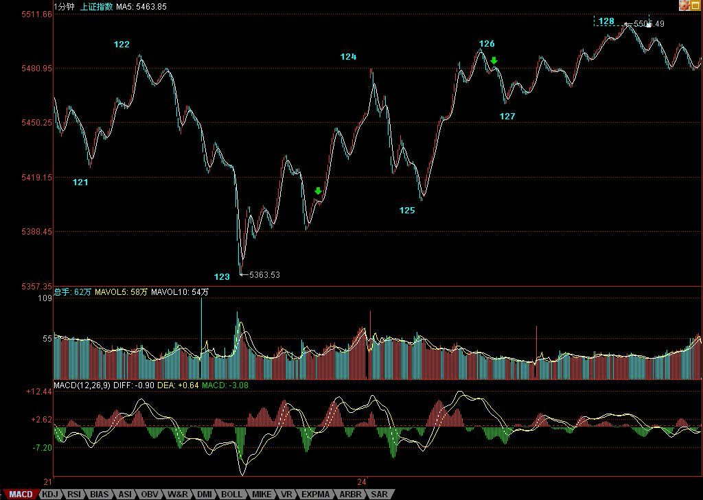

#### 都是月亮惹的祸（附录七古：中秋见月）

 时间：2007-09-25 15:49:49

从上周就开始告诉各位，月儿圆，有震荡，昨天最后一句还特别强调“月亮圆了，注意短线震荡的加大”，因此，对今天的震荡，如果还把握不住，那只能证明，你确实不适宜短线操作，那就中线点，无所谓的。中线上，大盘的压力越来越大，如果不是有人为了新股护盘，今天可不止跌这么点。

至于本 ID 的理论有没有用，这个问题根本无须讨论，如果你连今天划分中 132（13 点 46）的第三类卖点都没当下看出来，那就更没资格讨论这个问题。看看 132 与 129（9 点 47）之间不到半点的差距，就知道这理论的力量有多大。

现在的人都很奇怪，似乎全世界的人都欠了他的，你考不上北大，那一定是老师的错，老师欠了你的。你学不会几何，那几何肯定错了，就如同今晚的月亮，都是他的错。本 ID 对这套逻辑从来没兴趣搭理，本 ID 又不是卖月饼的，过了今晚，本 ID 的理论依然框架着所有的股票走势，就如同三角形之和 180 度框架着欧几里德平面上的图形。

个股方面，说句梦话，千万别信：可以开始关注两只股票 600319、000822，这都是基本面上有可能出现重大变化的。不过必须声明：由于目前大盘的位置十分危险，对个股的介入，一定要在大级别的买卖点。有些股票，如果技术好的，可以不断震荡减低成本去介入，例如 600078。毕竟现在不是 3000 点，1000 点，没有什么便宜的价位了，如果成本没本事降下来，最好就什么都别介入，等大盘暴跌再说。如果有那本事，那就无所谓了。

 无聊的股票，就不说了，这里有本 ID 的七古旧作一首，祝各位中秋好。补充一句，如果连平水韵都没搞明白，就不要批评本 ID 的韵不对了，本 ID 的七古都从来不借邻韵，别说律诗了。 中秋见月 缠中说禅 一轮喷吐天海倾虹光瑞气流叠彩 银汉挽洗玉眸清皓魄皎魂当空舞 仙籁无弦惊花羽 忽抟扶摇上苍冥 桂香散落如星雨 水晶宫阙瑶琴错 飞镜琼台青烟薄云母屏前泪嫦娥 岁岁今宵悔灵药 朱帘卷出人间世 今古潮生杯中逝 把酒问天天不言江湖阴晴孤舟系 广寒一醉三千年 依旧有月今夜圆 何须长圆如此夜 梦马安逐羲和鞭碧虚群动霎然寂 冰盘天心光欲滴 参奔斗旋一时间 乾坤声裂何处笛 流萤栖鹊草木闲暗河一抹水潺潺 金樽易浅天易老 未赋红尘行路难 凉月渐斜东渐白晚上都好好陪父母家人，今晚就不写帖子了。先下，再见。

#### 可以不相信月饼，但一定要相信月亮

 时间：2007-09-26 15:56:37

月亮的力量有多大，各位这两天也见识了。可以不相信月饼，但一定要相信月亮。为什么？连地球上的潮汐都要抄袭月亮，那破股票难道比潮汐还要潮汐？昨天已经明确告诉“如果不是有人为了新股护盘，今天可不止跌这么点”，昨天没跌够，今天继续，就这么简单。

今天早上的上攻，一没有突破昨天的第三类卖点，二反而是形成标准的顶分型第三根 K 线的上冲，不管你相信不相信本 ID 的理论，反正后面的走势，如教科书般。现在的走势十分简单，一个 1 分钟的走势正离开前面那 5 分钟中枢，这 1 分钟走势什么时候能完成，就看后面的走势了，而完成以后的回拉才是最重要的，是否能形成第三类卖点，这才是最近走势的关键，如果形成，那这两天，最多只能算田亮的 1 米板，后面是表演 3 米还是 10 米的，这对于观众，其实反而已经不重要了。

个股方面，今天水井坊终于像水井坊应该那样水井坊了一把，看看这股票，就知道什么叫折腾。几乎一年，就在这里搞，为什么？就是因为里面有着 N 伙人，还都看好，所以就互相折腾，这次是真是假？天知道。为什么？因为后面谁只要一先动手，N 方又一起开始折腾。其实，这个游戏很好玩，只是浪费了一只质地如此好的股票。

不过，好股票最终都要发光的。就像 000999，从本 ID 在这里开始讲到现在，快 10 个月了，开始 6 元抢东西，然后在 12 元上下和汉奸基金的斗法，后来又涌入一群无聊人在 15 元上，东搞西搞，中间传闻漫天飞，结果怎么样？请看看新进来的大股东掏了多少钱，一个掏了这么多钱的人，要干什么大事，难道还有什么疑问？本 ID 反复说要海枯石烂，但真正干起来，估计很多人就会被市场的波动所迷惑了。

 每一只股票，都是一个故事，说不完。做完一只股票，你就成了有故事的人了。

再次提醒，昨天说那两只股票，如果大盘有大问题，也会跟着调整的，但由于基本面上潜在大变化，所以市场如果大波动，将提供一个好的介入时机。本 ID 说的股票，从来都是中长线角度的，有足够的时间让你介入，关键是看好买卖点。

 今天可以回答问题到 4 点半。缠中说禅 2007-09-26 16:10:39  [匿名] 新浪网友 2007-09-26 16:07:25 缠子：在看高级别 K 线图时，是应该把低级别图上的分段转过去还是重新分笔找线段？有时候这两种做法的分段是不一致的 ==  为什么要一致？低级图上用中枢、走势类型。高级图上用分型，线段，等于有两套有用的工具去分析同一走势，这是天大的好事。 缠中说禅 2007-09-26 16:14:21 [匿名] 空言 2007-09-26 16:10:47  相信月亮,是不是每到农历十五前就清仓啊 ==  哪里有这么机械的，但如果月亮还带上一个背驰、分型之类的东西，那当然就有效了。 月亮只是借了太阳的光辉，本 ID 理论所框架的东西，才是太阳。 缠中说禅 2007-09-26 16:17:07  [匿名] 新浪网友 2007-09-26 16:14:11  是不是买高价股更安全，尤其是上百元的？ ==  只能说，高价的，散户都走了，杠铃举起来轻松点。但如果特别大的调整，谁都不会硬抗，除非脑子有水。 缠中说禅 2007-09-26 16:18:17  [匿名] 50 年以前 2007-09-26 16:15:47  老师好，对今天线段划分有疑问，1346上去那一段并没有破坏 130 向下段的最后一笔，所以我觉得不应该单独画成一段，也就是 131 段应该是图上的 133 的位置，请老师明示 == 这是第二种类型。 缠中说禅 2007-09-26 16:29:45 年年一变三 2007-09-26 16:25:28  请问缠主，这几天钢铁板块已经调整得比较厉害了，若再碰到大盘跳水，它能独善其身吗？==  涉及预测的问题，本 ID 都没兴趣。应该培养这样的习惯，就是你的眼光，只投向有买点的股票。 股票这面首想被宠幸，这很简单，用买点来搔首弄姿就可以。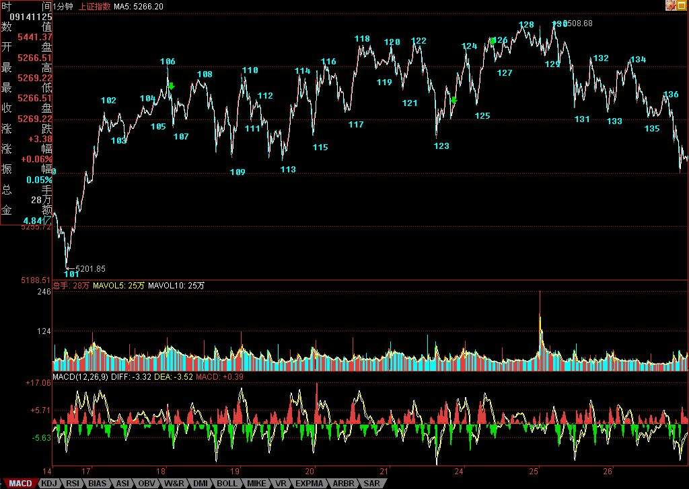 缠中说禅技术论坛 www.chzhshch.net 新蓝筹成多方利器，市场调控彻底失败

#### 新蓝筹成多方利器，市场调控彻底失败

 时间：2007-09-27 15:31:37

今天的走势，出于对明天大量放出资金的憧憬，走出了应有的回升行情。技术上，昨天特别强调的 1 分钟结束后的回拉，并没有出现第三类卖点，短线依然继续保持中枢震荡。从中线图上看，大盘目前对于多方最大的危险，就是圆顶，因此，多方如果不希望进入温水煮青蛙的境地，就必须至少在节后迅速突破站稳 5500 点，否则，这圆顶成立的可能性将极大增加。

从资金与政策的对赌看，资金面取得了决定性的胜利，今天，建行成为多头利器，宣布，以增加所谓蓝筹进行调控的思路彻底失败。目前资金的宣言就是：你来多少，就提供多少拉抬的武器，只要你还是市场调控，有钱就敢顶风搞。

本 ID 在前面已经明确说过，这资金和政策的对赌，最终的结局，一定是政策举起大棒，而资金这种行为，也无可厚非，资金就是这样的，连权证的末日轮都可以搞得热火朝天，这样的形势下，资金又有什么不可赌的？

 中字头、题材股，两只蝴蝶忽悠着飞，能飞多远是多远，管他明天是仙还是灰。 明天最后一天，就看解冻的资金能忽悠进来多少了，这个越来越向 30 分钟靠的震荡什么时候结束，看图就知道，第三买卖点。 希望这个游戏能延长的时间越长越好，钱是靠折腾出来的，要折腾，哪会没风险？只要看好你附近的刀和那一直在头上的大棒。 今天很忙，下午去看一公司，晚上还有一个会，晚上的帖子可能很晚，明天早上看也一样的，别影响休息。 先下，再见。

#### 资金乘胜追击，破圆顶兵临 **3/4** 线

 时间：2007-09-28 15:51:59

昨天已经明确说了，资金取得决定性胜利，而资金最大的技术危险是圆顶，最迟在节后必须破掉。而今天关于房地产的利空，反而成了股市资金面的大利好，资金这时不发力，那是脑子有水了。因此就上演了一场乘胜追击，破圆顶兵临 3/4 线的好戏。

 注意，本 ID 已经说过了，在刀锋上舞蹈阶段，是多空皆杀，那些一根筋思维的人，注定要被杀，目前不被杀只是迟早的问题，某种模式反复后，就是相信这种模式的人的死期。

本 ID 什么都不相信，市场让本 ID 看到什么就干什么，这就是本 ID 理论的唯一中心与基本点。例如下图中，132 的第三类卖点后，到 137 的 1 分钟完成，走势极端标准完美。有兴趣的可以量一下 130-131，与 136-137，长度基本相等，而力度上，加一下下面对应的柱子面积就知道该干什么。而到了 138，就知道这 5 分钟的第三类卖点肯定没戏了，就算 137 没反应，139 就提供了一个反应的机会。

 当然，站在中枢震荡的角度，并不需要预测后面能走多高，让市场告诉你。而今天的走势，强悍到连一个线段都没破坏过，那该干什么还不是很清楚的事情？

节后的走势，十分清楚，就是首先要完成这个 1 分钟的离开，从目前的情况看，这 1 分钟的离开走势是首先是线段的类上涨的可能性太大了，除非有特别的大消息，当线段类上涨结束后，必然形成 1 分钟中枢，该中枢后，1 分钟的走势无论是盘整还是上涨，等 1 分钟走势完成后，关键是看反抽能否形成前面 5 分钟中枢的第三类买点了，如果形成，大盘将继续攻击上行，否则就继续向 30 分钟中枢的震荡陷进去。

 好了，上面的分析已经十分明确，对本 ID 理论有点了解的，都应该明白了。至于不了解的，本 ID 已经反复说过，中线点的就看 5 周线，你看，昨天的低点，就刚好在上面，和上次 5000 点那次一样。

基本面上，很明确地告诉各位，节后最可能出来的消息，就是关于国有股部分划转社保的问题。关于这个消息，本 ID 和周围的人都有点分歧，这消息意味着，以后卖国有股，就不需要什么通知了，想什么时候卖都可以。但，目前资金充沛，完全有可能出现如此尴尬的事情，就是见一只买一只，全给买光了。毕竟那些国有股都是中字头的，都是中国最好的企业。所以，对这政策的杀伤力，本 ID 依然表示怀疑。不过，最终要看市场的反应，本 ID 自己不会有什么太多想法，只关心市场合力本身。

 要打跨资金，政策上可能有效的招数有：一、查基金黑幕；二、规定 A 股流通量不到 10%的必须到 10%。三、XXXX。 政策必胜，这是无疑的。但本 ID 对资金与政策都没兴趣，本 ID 唯一感兴趣的，就是利用他们两者斗法所制造的市场机会去多空皆杀。

个股方面，没什么可说的，中字头、题材股，两只蝴蝶继续忽悠着飞。只要掌握好节奏，就是操作的天堂。如果不明白什么叫节奏，请各位做一作业：从日分型到小的级别走势，好好分析一下 000938，里面全部都是教科书。

 放假了，让股票豆腐去吧。 本 ID 今晚再写一帖子，明天就要外出腐败腐败了，博客关闭到 10 月 7 日。10 月 8 日重新开张。 祝各位过节好。先下，再见。

#### 缠中说禅文集版权为缠中说禅所有 此文集整理版仅供缠中说禅论坛内部学习使用，严禁外传！

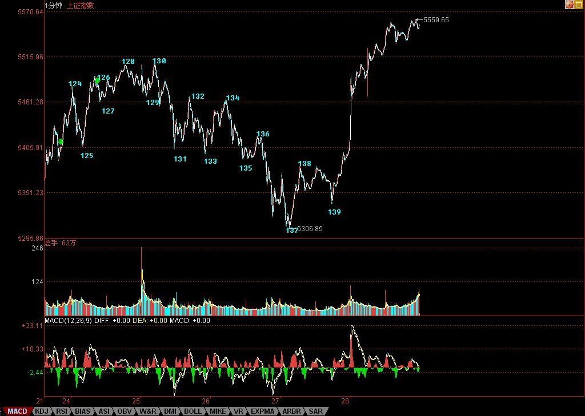

#### 与大棒争分夺秒

 时间：2007-10-08 15:35:47

今天的走势，完全在理所当然之中，节前，在纯技术的角度已经对节后走势进行明确的分析，就是先完成 139 开始这一线段，然后再完成 137 开始的线段的类上涨，然后就是 1 分钟中枢的形成，走势如此正常地按本 ID 理论所框定的节奏走，所以也没什么可说的了。（今天图就不要帖了，没有任何新的标记）

唯一可说的就是，大盘的走势特别强，所以当今天收盘，139 开始的线段依然没有完全确认已经走完，当然，按正常的情况，明天只有一开盘跌破 5685 点，这 140 的线段标记就可以弄上去了。然后，一般情况下，接着的 1 分钟中枢，基本就在目前这个范围上下形成，所以，今后几天，大盘走势如果出现大的震荡情况，是没有任何可值得大惊小怪的。

 政策面上，那重要的会议后，调控力度必然加大，这是毫无疑问的。因此，周末开始，就进入政策面的危险时间，至于这个时间如何被触发，就看今后几天资金的表现了。对于资金来说，现在是争分夺秒。 至于下面的几个缺口，只是为后面的下跌留下动力。本 ID 前面已经明确说了，没有 1000 点的回跌空间，大盘就没有跌的价值。把回跌的空间拉回来，这就是目前走势的关键。

站在中线角度，只要大盘的回跌不破 4335 点，那么中枢的中线上移就依然保持。所以，目前大盘的上拉，中线的角度就在于，尽量让后面的回跌在最恶劣的情况下也不碰 4335 点。站在这个角度，目前的上涨确实还不够，但政策是否留下足够的时间让这空间给拉出来，这就不是任何人能打包票的了。

 站在中长线的角度，12 月是 2005 年 6 月上来的 30 个月，所以，从 10 月开始，就进入一个标准的时间压力区域，这时候一旦出现政策性共振，其杀伤力不容忽视。 总之，一句话，耐心等待较大级别卖点出现。在本周末之前，如果担心政策压力的，应该把仓位进行调整。目前走势下的中期顶部，不可能是市场自身走出来的，一定会有政策的背影。 现在唯一不太配合的，就是上冲力度还太小，回跌的空间还没有完全打开，和政策争分夺秒把空间拉抬出来，就是目前资金最大的任务。

个股方面，指标股拉动后，会有轮动，如果你对自己的技术有充分信心，可以关注这轮动。但注意，一定不要追高，本 ID 最不喜欢回答诸如明天还能不能买 600078 之类的问题，别股票涨起来才关注，那是一个天大的毛病，本 ID 还专门给作业各位分析该股回跌时的走势，买点怎么可能在上涨中形成？

 股票操作其实很简单，就是一个节奏问题。但很多人，包括很多所谓的专家，都喜欢让人突破后追股票，这种人，永远只能是散户一个。 放假后有很多事情要处理，周末还要去某某会一把，要准备些东西。抱歉，不能回答问题了。先下，再见。

#### **3600** 点满江红后首次宣布中期做空

 时间：2007-10-08 21:46:52  7 月初，在 3600 点下，本 ID 严正宣布要做多，不允许行情按汉奸的方式运行到 2000 点去，为什么？因为任何跌破 3100 点的走势都将导致 2 年多以来的中枢上移趋势被破坏。 今天，本 ID 开始宣布，从 3600 点开始的做多以及持有程序将开始终结，本 ID 将开始选择性地展开中期做空程序。这里，说明其中的理由。 一、长期牛市的大格局没有改变，但长期牛市并不排除期间的中期调整，以前，所有关于调整的时机都没有完全配合，而现在，这个时机已经逐步成熟。

二、本 ID 在博客里明确提示政策风险的是“冲动的惩罚，基金将成为毁掉市场的那只手 2007-08-27 20:45:41”，原因很简单，因为当时有些可能的突发事发生，那时刚好在 5200 点上下，在电光火石中，一场大动荡被化解，当时的微妙，后来应该也有不少人有所耳闻了。

三、但当时，做空的条件不成熟，关键是政策面上有不协调的地方，而技术与资金上，一时还转不过来，特别是，没有足够的下跌空间，因此，后面的一个月的震荡，实际上都没超过 6%的空间，这就是一个稳定与转换的过程，这样，不至于让资金如 530 一样措手不及。

四、目前，政策面上已经不是一方面或一个人的事情了，可以断言，不光针对股市本身，针对经济本身，也将出台更加严厉的政策，原来适度的口径，极有可能继续收紧。而针对股市的，本 ID 一度希望股市自身调节而不至于被迫出来的政策，也有可能不可逆转了，因此，政策面的压力已经逐步成熟，如果说 8 月 28 日只是一叶知秋，那么，在可见的将来，秋天就不需要去知道了，就在眼前。

五、技术上、资金上的松动已经开始发生，这时候，一些适当的引导，就可能发生一些有效的反应。市场是合力的，但合力是由分力开始的，如果 3600 点的分力曾经起作用，那么，一个新的剧本，也需要开始排演了。

 六、现在唯一不配合的，就是回跌的空间还不足够，如果现在已经突破 6100 点，那更好。因为这次回跌，本 ID 并不希望破坏 2005 年上来的中枢上移格局，因此，这次的中期顶部阻击，会采取一种反复折腾、诱敌深入的模式，而不是如 3600 点那样，一下搞掂。

七、本 ID 曾经说过，如果快速突破 3/4 线，将开始阻击。后来因为大盘回跌 5000 点后一直盘整，所以曾说只要 6100 点不被快速突破都可以忍受。但现在看来，政策留给的空间已经越来越少，而今天又第一天突破 3/4 线，已经开始达到本 ID 对 3600 点开始行情的最低目标，任何的回跌，本 ID 都没有任何遗憾了。而能否到 6100 点，本 ID 已经没有这个顾虑了。

 八、本 ID 只把自己的操作说出来，没有任何指导的意义。就像 3600 点的做多，然后一路的持有。现在，本 ID 只是准备改变中线的操作策略，没什么大事。本 ID 有可能错了，但本 ID 说了，就要干。 九、长线行情，本 ID 依然坚定看好，只是这政策、资金、技术所制造的中线调整，本 ID 也希望再 3600 那样玩上一把，如此而已。 十、做空的风险比 3600 点做多小多了，头部和 3600 点的底部一样，是合力的，但也是由一分力开始干出来的，本 ID 就再做一次那分力吧。 十一、别以为做空就是砸，那是最笨的手段，做空的本质，就是让多头自相残杀，因此，做空开始的时候，经常要比多头还要多头。 十二、底部不是一天构成的，顶部也是，一切的构造，都是在逼近那资金、技术、政策的共振点。然后，一切在无声中败落，如那一片片的黄叶。

#### 给散户的中期建议

 时间：2007-10-09 08:03:06  注意，昨晚，本 ID 只是表明自己的中期态度与操作。但就算本 ID，也要遵循本 ID 的理论。本 ID 只是分力之一，分力如何最终引导出合力，这就是本 ID 要干的事情。但并不是说一定就一天就能干成。

请回忆一下 3600 点，一长阴一长阳的空头陷阱，然后在 3900 点下坚守出底部突破来。那么这次，并不一定就是上次的倒影，手法当然不可能一样的。如何用一个分力引导出合力，这本来就是本 ID 理论中一个比较高级的课程。

这个课程能完成的关键，就在于技术、资金、政策的共振点的制造，这里学问不少，但实际中能否成功，关键还是看这几方面的调配点上的把握上。这就如同三个不同方向不同速度的网球，在空中于一点中相会，例如政策这个网球，就不是任何人能控制的，唯一能调节的，就是技术、资金等的结构关系，这里就需要有一个分力出来折腾。底部、顶部都是折腾出来的，折腾需要时间，最终走出相应的形态，然后坚持，最后突破。当然，做空的时候，就是跌破了。

所以，这是一个大的过程，并不是一天就要完成的。但如果政策配合，这个过程可以相当简洁。这次，本 ID 之所以主动反空，就是不希望再如 530 那次一样，让技术、资金去配合政策，而是玩一次这样的游戏，让政策去配合技术、资金。这如同先把两个网球的交点先给制造出来，然后让那政策的网球刚好碰到该点，这里的难度有多大，可想而知。

 但这种游戏，才有玩的趣味。 站在本 ID 理论的角度，本 ID 只是分力，而散户只需要知道最终的合力如何，然后根据该合力去决定自己的进出，其实根本不需要太关心本 ID 的态度。 一般的散户要进要出，1 秒种就可以搞掂，还是耐心等待大卖点的出现。当然，如果你觉得自己没那本事、没那心态，那就逐步分批退出，或者把仓位降到发生任何情况都可以睡着的程度。

如果本 ID 的行动能最终制造出大级别卖点，那么，本 ID 就游戏成功，否则本 ID 就被继续的多头夹空了。当然，如果那时候政策出现新的多头走向，那也不存在夹空的问题，本 ID 完全可以进入新的板块，或者反手做多。当然，目前没有任何迹象表明政策有转多的可能，上面这只是理论中完全分类的情况，基本没可能出现。

说白了，本 ID 之所以高调告诉各位，更重要的原因，是希望各位如 3600 点那样，去体会合力与分力的关系，以及在更高层次上，如何实际分力去合力的引导。不管这次本 ID 成功与否，都是一个最好的现场教材。

 这用 N 多资金、筹码画出来的教材都不看，那就去看股评去吧，没必要学任何东西了。

#### 缠中说禅文集版权为缠中说禅所有 此文集整理版仅供缠中说禅论坛内部学习使用，严禁外传！

缠中说禅技术论坛 www.chzhshch.net 板块如期轮动

#### 板块如期轮动

 时间：2007-10-09 15:26:41

今天，如期出现昨天说的板块轮动，现在，无论多头空头，都需要这个轮动出现。对于空头来说，板块风烟四起，正是消耗多头能量的一种手段。如果一旦出现所有板块都轮动，但没有任何板块能连续上涨的情况，那对多头信心就是一个有力的打击。

昨晚已经说了“做空开始的时候，经常要比多头还要多头”，四处点火，那多头那点柴给烧没了，这就是做空程序的第一步。但多头不会一下死的，必须反复折腾，今天，在技术上，并不必然今天出现的一分钟中枢今天出现了，这对于空头的游戏，有了一个可依靠的平台。

目前，决定多空最后胜负的，还是政策面。因为，纯资金上说，一点都不存在任何一定要在这里或这段时间内见顶的可能，但市场是合力的结果，不是单纯资金分力的结果，所以，单看资金面，没有太大意义。

 个股方面，该水井坊的都会水井坊的，当然，有些个股起来，纯粹是为了耗费多方能量，这里有很多微妙的地方。

从纯感情方面，本 ID 很希望大盘能过 6100 点，因为本 ID 有这方面的情结。96 年的大牛市，就是在 6100 点结束的。显然，6100 点对于这轮牛市不算什么，但能否在这次，政策面有足够的时间让大盘见一次 6100 点，本 ID 没有任何的情结。

大资金做空，其实没有任何风险，本 ID 可以把底牌都告诉各位。如果政策上没有出现预期中的东西，在 11 月前后的时间压力区中没有预期中的共振，大不了就再玩一次今年初的游戏，低价革命一次，如此而已。

缠中说禅技术论坛 www.chzhshch.net 空头，熊刀小试

#### 空头，熊刀小试

 时间：2007-10-10 15:27:14

今天没什么大不了的，一切尽在空头主控中。本 ID 已经说了，在做空开始时，一定是比多头还要多头，为什么？这叫吸精大法，就是要用不断的点火来消耗多头的能量，吸其精气，然后用大幅度的震荡夺其心神，最后将多头变成一具僵尸，在那最后的三面共振中，如风中黄叶般片片飘落。

今天的回落，刚好触及 140-143 的 1 分钟中枢的震荡区域，但没有触及的中枢区域，因此，如果这下来的线段明天不继续延续，将构成一个类第三类买点，然后上去，再继续。这里有一个微妙的地方，今天留下这个线段不走完，就给明天的运作留下回旋的空间。一旦明天没有特别的东西，那么就继续上攻，继续吸精大法，毕竟多头的能量还在，让多头更快更强更高地套住，以后的杀跌动力才足够，这就举得越高，跌得越惨；如果明天就有足够的政策配合，那么这线段就直接杀下去，让那 1 分钟中枢扩展开来。

板块上，中字头全面开花，连潜伏许久的中铝都启动了，这火确实有点燎原。而所有的低价股都一路潜伏，为什么？空头明人不做暗事，昨天已经把底牌说了，一旦 11 月前后没有政策面配合，就算做空失败，大不了重新开始低价革命，这叫两头准备，永不落空。这就是中字头、题材股两个翅膀的妙用。当然，如果时间延续太长，政策都不出来，题材股也要动一下，不可能一直压着。

 好，现在技术与资金的大战已经开始，就等待政策的那一轮圆月了，听说，月圆的日子，会鬼哭狼嚎的。 为了不让不学无术的多头太容易看到图形分段，本 ID 的图就不帖了，这里的人，个个冰雪聪明，有人昨天连中铝要动都能猜到，分段肯定没问题的。

多头不会一下被打死的，最后射死多头的，一定是政策。耐心等待三面一点的时间撞击吧。有技术的，可以按照图形上下折腾，机会多多。没技术的，就把仓位逢高调到任何情况都能睡着的程度，拿好小板凳就看戏吧。

#### 一个转帖

 时间：2007-10-10 21:58:41

对不起，这几天特忙，今天回来太晚，没时间写帖子了，刚好有一个的新文章，回应了本 ID 前面一个帖子““港股直通车”难以背负的使命”里的类似观点，转帖一下。这加大蓝筹流通量的观点，大概也将逐步燎原，最终成为政策的一部分了。

 华生：5000 点之上预警 A 股虚胖 2007 年 10 月 10 日 华生表示，虽然最近泼了很多冷水，但用心是希望有持续发展的资本市场 "我不是唱空者，我们泼冷水，发各种警示，目的是为了避免泡沫积聚导致破裂的情况发生。"  当上证指数站上 5000 点，投资者一片欢呼之时，一篇不太"和谐"的文章--《市值远超 GDP 的虚胖与警示》在《第一财经日报》刊登后迅速在坊间热议。这篇文章的作者就是华生，燕京华侨大学校长。

2001 年 7 月 1 日，在股市接近 2245 最高点时，华生发表文章《漫漫熊市的信号》，预见了未来熊市的来临；在 2005 年 5 月 10 日股指即将逼近 1000 点时，他再次发表文章《市场转折的信号》。去年 6 月，他还专门撰文指出中国将《迎接证券市场的新时代》，称中国股市市值将增加 10 倍。

 今年以来迅速增长的市值和股市中出现的一些不正常的现象，开始让这位理性的学者担忧。现在的华生，已经被市场戏称为"空头司令"，近期的几篇文章，无不是在给股市"泼冷水"。 日前，在接受第一财经频道《会见财经界》和《第一财经日报》联合采访时，华生详细阐述了他对于当前股市的看法。 虚胖与警示 刚刚过了 2007 年"五·一"节，华生突然从一个非常积极乐观的角色转为市场的看空者，并且一写就是两篇文章，题目也很惹眼，一篇叫《市场过热的信号》，另一篇就是《市值远超 GDP 的虚胖与警示》。在一般人看来，中国资产证券化的提升应该是一个好事。然而，华生现在却说市值"虚胖"了，这是不是危言耸听呢？

"我从来也不知道市场的高点在什么地方，低点在什么地方。但是作为一个严肃的研究者，一个经济学家，他对市场运行的趋势、规律应该有自己的判断和分析。"华生说，之所以把话说得比较严肃，是因为当时包括垃圾股在内的炒作都非常厉害，"当时炒作的气氛甚至比现在炒到 5000 点以上的气氛还要浓，我认为这个现象是不正常的。"

 由于国家及时出台了一系列政策，"5·30"以后，市场出现了一个大的调整，被认为投机气氛严重的垃圾股炒作在这之后得到了很大抑制。

"虽然很多垃圾股远远没有回到前期高点，但是应该说市值进一步扩张的势头没有停止，而且在加速。"华生说，"我的研究发现，中国证券市场的市值不是刚超过 GDP，而是上市公司市值已经是 GDP 的 150% 了。"

"为什么呢？我们不能把在香港上市的一些内地企业，以及在纽约、新加坡、伦敦上市的企业，不能把它们忽略了。因为它们也是境内的公司，特别是随着它们的回归，这个市值自然就加进来了。它们没回归，也并不是不存在，仍然是我们境内的公司。"华生说。

 按照全球的情况，一般发展中的国家，证券市场的市值是 GDP 的 20%~30%，中等发达国家大概是在 50%~60%，发达国家在 90%~100%。

"从微观的指标来说，目前我们股市的市盈率已经是世界第一了，我们经济增长是很快，但实际上经济增长快的并不只是我们啊。印度增长也很快，俄罗斯经济增长这几年也很快，但人家并没有这么高的市盈率。另外一个指标，市净率，我们也是世界第一。"华生说，这确实是值得警惕的。

 应大大增加流通市值

华生的文章经过媒体发表以后，产生了很大的影响，同时也引来了一些质疑的声音。第一主要是认为，拿中国的情况和当年的日本比，是否具有可比性。因为日本在泡沫期时，宏观经济增长已经很低了，而中国的经济增长还是很高。

 第二点就是中国的市场，因为供求结构的关系，所以市值有一定的失真性。比如说一些大蓝筹的市值是在大量股权都不流通的情况下，由于资金量的推动把市值炒高了。 "对于第一点，实际上我们不光是和日本比，包括当时的韩国，都经历过这样的情况。"华生说，我们不希望重复这个历程，所以我们要提前预警。

"对于第二个问题，我认为实际上是支持我的观点的。我说的是'虚胖'，'虚胖'的含义是什么？就是因为你只上市了这么一点，因此你的总市值是被夸大了，所以第二个观点和我的观点有相同的地方。只是角度不同，得出来的结论好像有差异。正因为我们上市的流通比例太少，造成了整个市值的虚估。虚估使得流通股股价太高。这样就会带来一系列的危害。"

"特别要说的，就是我们现在大盘蓝筹股上市的比例太低，这个对马上要搞的股指期货是非常危险的，你想，投资期货主要是跟大盘蓝筹股锁定，如果大盘蓝筹都是一个小盘，用一个几百亿的市值就能撬动一个几万亿的市值的话，这样的指数应该说在全世界是很少见的，几乎没有。它的危险很大。"华生特别提醒说。

 "引出来的政策结论是什么呢？为了去掉'虚胖'，就应该大大增加流通市值。"华生说。 虽然在华生眼里，现在的股市已经出现一些不正常的'虚胖'，但华生认为，并不看好政策一下子把股市打压下去，而是希望以更平缓的方式来进行。

"在这点上我和看多派是有相同之处的。我们都高度重视资本市场对于国家，特别是对于我们这样一个正在崛起的大国的意义。所以，虽然最近我泼了很多冷水，但是我们的用心是希望有持续发展的资本市场。"华生说。

"我们的目的绝对不是打击它。所以我说不希望政府用过于剧烈的行政或者经济手段去打压。那么，为什么政府还要发挥作用呢？我们这个市场政府本来就在扮演一个重要的角色，比如说供应多少，一个公司上市是 2%还是 20%，本来就是政府决定的。本来就不是一个市场行为，我们希望政府用一个更符合国际惯例的、更适合市场经济发展的、更少给市场带来冲击的办法。"

 "比如，我觉得像大盘蓝筹股，让它们的上市比例高一些，最低也要像《证券法》规定的那样达到 10%。有相当多的公共流通股对于刚才我们说的改善公司治理结构是很有作用的。"华生说。 供需变化失衡 尽管支持市场已经过热的专家和观点越来越多，但包括政府出台的调控手段在内和各路专家的警示，仍然无法按捺住投资者的热情。 华生认为主要是两方面的原因。一方面，政府今年出台的措施，除了印花税以外，其他都不是针对股市的。

再就是从证券市场本身来讲，今年以来，由于需求形势的变化，牛市的赚钱效应，存款负利率，使得大量的资金涌入股市，需求发生了巨大的变化，但供给却没有发生多大变化。一段时期以来，每个月涌进市场的资金都有几千亿元，但股票供给所需资金只有几百亿元。

"任何市场供不应求就是价格上涨，而我们现在证券市场价格上涨的状态从 5 月份以来，包括证券市场从业人员，大家都分析了，应该说资金过多，追逐有限的股票，在供给不增加或者增加非常有限的情况下，价格上升就很难避免。"华生说，"9 月份开始，大盘股的供给开始增加，市场的供求关系马上就有变化，但供给增加有很大的波动性，预期也不明确。现在的问题是，其实大盘蓝筹股不必要上得多快、多急，而是应该成熟一家上一家。但只要上市，至少要有 10%~20%的流通比例，使公众公司的名称名副其实。"

"为什么说上市的比例和质量比公司数量更重要呢？我们可以看一看 A 股和 H 股的差价。有人说市场不同就应该不一样。其实最主要的原因就是供求关系。H 股的流通盘平均是 A 股的 7 倍左右。如果 A 股和 H 股上市流通量差不多，A 股和 H 股就不会有多少差价。现在 A 股上市大公司的比例人为地压得很低，很多只有百分之二点多，迫使投资人只能高价入市购买。所谓'虚胖'，就是人为地控制上市比例，造成股价虚高。"

"从今年四五月以来，我没有主动地推荐任何人进入这个市场，但我也不会随便地劝人离开。因为任何一个市场永远都有投资机会，即使在泡沫的时候，仍然还有优秀的股票。"华生说，我只能说现在的证券市场风险很大，每一个投资者要有自己承担风险的能力。

 华生第一财经日报

#### 为让多头更高更快更强地替股票站岗而继续努力

 时间：2007-10-11 15:32:44

今天，即使不为中石头的精彩而鼓掌，到尾盘，连李军人都奋力而起，至此，如果都没有一点感动，那本 ID 也没什么可和各位说的了。现在，空头正为让多头更高更快更强地替股票站岗而大大地努力着，这一点难道不值得各位眼泪一番吗？

昨天已经超明确地说了：“一旦明天没有特别的东西，那么就继续上攻，继续吸精大法，毕竟多头的能量还在，让多头更快更强更高地套住，以后的杀跌动力才足够，这就举得越高，跌得越惨”，现在的方针，已经十分明确地说过，只要没政策，就沿着目前的速率，一直震荡攻击，把中字头搞得比八、九点的太阳还要太阳，指数比打了鸡血还要鸡血，但一般人，肯定赚不了一分钱，这就是分化的力量。

没有什么比看着指数涨，绝大多数人都亏钱更能打击多头情绪的了，把所有拉指数的都给掀起来，这些东西，都是双刃的玩意，拉的时候快，跌的时候的速率就更快了，把多头的能量转化为势能，最后势能转化为下跌的动能，这从来都是做空的不二法则。

明天，将是一个坎，周末的消息面是仅仅加个 0.54 的息，还是来一个继续增加印花税或者其他硬玩意，还是什么都没有继续消息真空，就决定了后面游戏的线路。明天走势，消息面的动向决定一切，所以明天消息漫天飞是必然的。

 技术上，144-147 的 1 分钟中枢也形成了，148 的线段没有结束，而今天 2 点的跳水肯定没有杀伤力，为什么？交替原则，昨天才来过一次，今天就要交替了。

个股方面，没有参与中字头游戏的，肯定受苦了。中字头、题材股，一拉一压，才能保证做空的绝对安全，一旦政策不兑现，那么反手做多才有好的题材与空间。这是大资金运作的必然选择，没有什么残忍不残忍的。市场就是这样的，又不是吃大锅饭，一定要人人有份。

 但如果政策没有立刻兑现，题材股会在超跌后有反弹，也给中字头一个休息的机会。 明天收盘后要出一个短差，去深圳签一个合同，后天再赶回北京，所以明天收盘，没时间写了。今晚会有一个帖子，先下，再见。

#### 谨防 **A** 股被挟持，股指期货应缓行。

 时间：2007-10-12 08:20:11

在股指期货已经呼之欲出时，还写这样的题目，可能确实有点不合时宜。但是，不合时宜的话如果是正确的，为什么不能说呢？因此，问题的关键在于，股指期货在目前情况下推出，是否真的合时宜了？要讨论期货推出是否合时宜，关键又在于，目前现货市场的成熟度是否满足期货推出的基本客观要求，显然，在这一点上，依然有着诸多值得商榷的地方。

虽然已经被人多次引用，但依然不得不再次引用的事例，还是那令人无法忘怀的 1995 年国债期货悲剧。这一悲剧产生的因素太多，但有一点是不容忽视的，就是当时的国债现货流通量太小，几个机构联手，就足以控制相应期货的走势。至于最终形成两大集团对赌局面，那不过是这种控制走势分化演变的必然结果。

那么，对于现在的 A 股市场，其可控制性就如同 1995年的国债市场，问题的核心就在于，超级大盘股流通比例过小，而该流通量却能控制住一个超大规模的市场，这里的投机收益与风险成本完全不成比例。在本 ID 前面关于“港股直通车”的文章里已经明确指出，没有合理的流通量就没有合理的价格，目前中国股市最大的问题就是超级大盘股的流通量过小，普遍达不到证券法要求 10%的最低流通比例要求，这样条件下的股市必然是一个能被轻易操纵的市场。

一个能被轻易操纵的现货市场一旦出现期货交易，那么，这种交易必然导致极端投机行为的出现。目前没有任何的现货卖空，也就是现货中，本质上只能做多才能赚钱，而实际的流通筹码又极端不足，可以断言，在这样的流通量条件下，指数期货的推出，将极大地有利于疯狂的做多行为，任何在期货中的空头头寸，最终都会被疯狂的逼空走势所吞没。筹码就那么少，资金又那么多，任何的空头头寸最终都是死路一条。而极端的疯狂做多行为，将把 A 股短时期内推向难以控制的高度，将 A 股长期发展的精气神耗尽，最终导致难以收拾的局面。

有一种观点认为，目前红筹、H 股大量回归后，股指期货所需要的流通量条件就能达到。但这种回归，并没有改变超级大盘股流通比例过小的状况。最近回归的中国神华，其 A 股流通比例是 6.33%，而建设银行更是只有可怜的 2.7%，请问，这不等于火上浇油吗？这样低流通比例的超级蓝筹回归，必然是来一个被炒飞一个。至于借助 A 股的超低流通比例，通过控制 A 股走势去操纵港股相应股票走势进而两头套利，就更不是新鲜事了。

本 ID 前面的文章已经指出，要使得 A 股有一个合理的价格，达到与 H 股接轨的目的，一个最简单的办法，就是让超级蓝筹的流通量与 H 股接轨。可以断言，在超级蓝筹的 A 股流通比例未被调整到合理水平前，股指期货的推出都是不合时宜的，必将蕴藏着巨大的后续风险。甚至不排除这种情况，就是 A 股因此被挟持，让后续的监管与调控陷入难以解决的困局。

按照最正常的资本市场层次设计，必然是先完善现货市场，再开始期货市场。而目前 A 股分为深沪两个市场，一个横跨两个市场的现货标的设计，在以后会面临诸多不便。本来，一个最理想的思路，就是先发展创业板市场，等该市场发展到一定规模后，再让主板都合并到沪市，而让深市成为创业板，最后在沪市的基础上开展开指数期货，当然，相应地，深市也可以有创业板的指数期货。

当然，以上思路，在目前已经错过了实施的机会，但并不能因此让期货过早推出而留下严重隐患。一个最简单的道理，期货是现货充分发展后的产物。而目前 A 股这现货市场，依然有着诸多不完善的地方，急忙推出其指数期货交易，是否有点拔苗助长了？

至于那种认为期货可以对冲风险的说法更不值一驳，世界证券历史一再证明，最大的风险从来都不在现货市场，而是高比例透资以及期货等衍生品。期货能否降低现货风险暂且不论，期货自身的风险如何防范，这绝对是比应付现货风险更为棘手的问题。而这问题，不光对于所有的参与者，更对于市场的监管者。

说白了，现在期货被市场热切期待，不过是现货市场的投机资金有了最终锁定投机利润的绝好机会，更看到了加大这种利润空间的新的投机机会。目前，反而应该逆投机资金的意向而行，釜底抽薪，将主动权把握在监管者自己手里，按照市场健康发展所需要的节奏去完善市场，而不是被国际性投机资金牵着鼻子走，为国际性投机资金的兑现、出逃制造世纪大机会。

缠中说禅技术论坛 www.chzhshch.net 刚忙完回酒店,就说上两句

#### 刚忙完回酒店, 就说上两句

 时间：2007-10-13 21:07:14

经过一天半的冷静,如果还不能用脑子思考,那就去买国债吧,证明你完全没有自己操作股票的天分。剧本在周初就说过了，实际的走势，一直都是空头主控。今天的震荡，完成一个完美的板块切换，更重要的是，多头的心上，又挨上一刀。

周五的走势证明，所谓的新高是多么的虚弱，本 ID 已经说了，那些中字头，拉他们很快，砸的时候速率更快，今天可有体会？这个摧残多头心灵的游戏，将一直玩到政策的共振为止，然后就是黄叶飘飘的日子。

不多说了，该说了都说了，自己考虑去吧。最后，再多嘴一下重复一次，如果有本事的，这场对多头的蹂躏，里面的机会多多；如果没那本事，逢高把仓位调到任何情况都能睡着的地步吧。还记得本 ID 曾用红字把逢高打得大大的吗?

 杀人刀，活人剑，自己决定去吧。

#### 缠中说禅文集版权为缠中说禅所有 此文集整理版仅供缠中说禅论坛内部学习使用，严禁外传！

缠中说禅技术论坛 www.chzhshch.net 终于要北大了

#### 终于要北大了

 时间：2007-10-14 14:08:03  谜底揭开了就不是谜底了，终于要北大了，准确说，北大，终于有机会了。说这就足够了，该知道的时候总会时候的。 但不管是北大还是清华南开，中国经济都将面临一个严重的关口。痴人在说梦的时候，秃鹰已经在飞翔。 最后，用一首五律《无题》作结，孔男人如果有兴趣，是可以步韵一首的，前提是能看明白，否则，本 ID 要继续鄙视中文系。 无题 缠中说禅 雨余炎暑褪 云破西山添 不见日沉阁 惟听风入帘 无书眠处枕 有梦觉时潜万籁深如海 遥天纤月纤 缠中说禅技术论坛 www.chzhshch.net 中国经济，已需治理整顿。

#### 中国经济，已需治理整顿。

 时间：2007-10-15 08:32:52

现在，中国经济已经到了一个关键的关口，由被动人民币升值带来的诸多问题已经逐步成为不能忽视的问题，而房地产泡沫也到了逐步不能被泡沫的程度。经济的过热，使得通货膨胀已成为一个可能需要面对的情况，这种情况下，是被经济的热度烧焦，还是冷静地进行反思，采取正确的选择，就是最近必须做出的抉择。

 实体与虚拟经济的结合，在中国依然是一个试验课题，没有任何有经验，如何能稳步推进，而不最终 327 化，这同样是一个抉择。 事实证明，一放就热的中国经济陋习，并没有多少改变，现在，需要的是治理整顿。 股市，最终要看的是经济政策的选择，这一切，很快就有谜底。戏，总是要高潮后死去的。制造高潮，不过是为了制造死亡。 选择，总是自己的。自己的命运，自己选择。本 ID 没什么可说的。资金、技术都准备好了，就看那政策之窗的打开，如此而已。

#### 没有消息，继续把多头哨位架高

 时间：2007-10-15 15:15:15

显然，周末的准备金不会是空头所等待的那政策共振，周五大震荡配合的板块转换，其实已把空头的计划提前透露。上周，本 ID 已明确说，没消息，题材股会借机反弹走强，给中字头休息机会。这两天走势，不过是这剧本的现场演绎。看着这两天 000777、600343、000600、000807、002149、000822 等等的走势，以及这两天的涨幅榜中二、三线个股的大面积增多，这板块的反弹转换一目了然。但注意，除了个别最近有实质题材的，题材股大多目前不具备大幅度启动的时机，只是一种换档式的过渡。

当然，最有味道的，还是中石头和中联通，今天，两者为大盘贡献近 160 点，没有这两个本 ID 的支柱股票，今天的大盘是绿色的。两者的意义，本 ID 已经无数次说过，有中石油、中移动在后面，你说本 ID 又有什么可担心的？有什么不可以放手大干的？现在，对于空头来说，唯一重要的，就是把多头的动能转化为空头的势能；现在，一切都如空头所设计的步骤，势能在不断积聚；现在，泄洪的那一刻，需要的只是政策面那一轮圆月。

政策方面，有点必须纠正的，很多人还以为上次的印花税是某个部的意思。可笑，一个部能定那么大的事吗？别用脚趾思维可以不？可以明确说，以后关于股市的任何政策，都必然是一个整体的、总的决策下的结果。

个股方面，该反弹的都要陆续反弹，中字头停留休息一下后，如果政策的窗口还没打开，那么就继续上冲，把势能继续提高，如此而已。前面本 ID 已经说过，本 ID 有一个情结，就是 6100 点，至于政策面上是否给这个机会，本 ID 并没有情结。

今天的报告，没任何意外的地方，里面本不可能有任何直接评论股市的地方。今天最引人注目的，反而是某一直以当学者为荣的老先生，一改在 3000 点下抨击投机的观点，在 6000 点竟然称颂起投机的功德来，这也算中国资本市场历史上一大趣闻了。本 ID 的观点，可从来不会与时俱进，从来不会改变：

 1、中国股市的大牛市 20 年 3 万点以上； 2、目前依然是牛市的第一阶段；3、目前需要中级调整，而经济也主要治理整顿。 4、中期调整，发生在资金、技术、政策的共振中，目前，是资金、技术在为政策作铺垫。 5、让分力成为合力，这是一个复杂的过程，动能转化为势能，一切按部就班。 6、如果政策也被热度化，那就意味着第一轮的走势有走到尾声的风险，那么就低价革命，比投机还要投机一把。 7、本 ID 只能是分力之一，不是合力，最终，一切决定于合力。而本 ID 成功与否，就是能否按自己的节奏，把合力引导出来。 8、对于散户，操作上，技术不好的，逢高逐步把仓位减下来；技术好的，就在震荡中游戏那多多的机会，但必须要注意节奏。那些追涨杀跌的，没资格玩震荡游戏。 一切都按照这八点所界定的逻辑为起点，在纯盈利的角度，本 ID 愿意出现第 6 种情况，但从国家经济战略与安全的角度，本 ID 绝对不希望看到第 6 种情况。 晚上有事，帖子没法写了，明早有时间补上，抱歉。 先下，再见。缠中说禅技术论坛 www.chzhshch.net 成老先生，请慎言

#### 成老先生，请慎言

 时间：2007-10-16 07:49:06

昨天，成老先生关于投机有利市场的言论，令人不禁想起 3000 点下成老先生关于泡沫等等的言论，而昨天的点位是 6000 点。作为学术观点，这本没什么，而且这种观点宣扬的人多了去了，但成老先生的身份显然比较特别，在目前的环境下，一改几个月前的观点，在公开场合为投机说好话，确实有点让人觉得不妥。

投机，不过是一种市场行为，对市场无所谓好坏，而且，市场充满骗线，例如，以前，某股票，短时间内暴涨 100%，然后连续跌停，最终跌到 0，给摘掉了，所有为那 100%兴奋的，结果发现，即使按那 100% 的起点算起来，也是一个高高的山顶。前面那 100%的做多，不过是总体做空的一部分程序，这就如同目前的大盘，正在赶顶之中，这时候宣扬投机，难道是一个合适的时间？

市场总是很公平的，最终赚钱的总是少数人，80%的人，不过是坐坐电梯，然后坠入深渊。散户的命运，大多如此。这时候宣扬投机，给那些散户是什么印象？什么影响？并不是每个人都适合无限风光在险峰的，不是每个人都适合玩赶顶的游戏的，这时候，作为一个有身份、有影响的老者，似乎更应该对提醒，而不是发表对投机的如此言论。

高潮之后，总是一地鸡毛，这就是投机。高潮是投机的快感，一地鸡毛是投机的代价，而且，至少 80% 以上的人，鸡毛一地的。现在，一个负责任的人，更应该说的是：没能力的、没那本事的，先离开，没有任何最终的跑道，是可以让所有人通过的，最终通过的，最多 20%，首先，投机前，先搞清楚，你的能力，是否能在那 20%内。

当然，有能力的，就无限风光在险峰，而如果能利用投机，达到更高层次的目的，那就更好了。由于管理者，大多没有实践经验，一些明显错误的安排，就需要有人把这个错误的后果演示一下，如果这样都不改变，那么，就真是气数如此了，那也没什么遗憾的了。

 卖点，总在上涨时，股票如此，经济也如此，难道经济就没节奏？不明白这，经济也难以经济了。人，总是在下跌后才问卖不卖。经济，一旦转折，那卖出的通道在哪里，只有天知道了。 经济的调控，就如同股票的买卖，节奏第一。这个道理，确实需要道理道理了。

#### **6100** 点终破，无憾矣！

 时间：2007-10-16 15:29:29

今天站上 6100 点，终于没什么可遗憾的了。6100 点，曾经是 96 年大牛市的深成指的最高点，当时也是刚破 1000 点后启动的。相比，这轮牛市并不太猛，走了 2 年多才达到上次 1 年多完成的幅度，正因为这个速率比较温和，所以才不会是最终真正的顶部，但中期调整是需要的，只是等待共振点。

今天的大盘，延续上周说的大震荡后的中字头休息、题材股启动。今天糖业大启动，600737 不大动，主要是现在，中国最大的糖产还没装进来，今天跟着启动，似乎有点名不正。不过，该股最牛的题材，还不是将有最大的糖，而是其他，这类中长线的股票，短线的走势并不重要。就像 000777，从去年 12 月的 7 元多到现在的 47 元多，真正的题材还没出来，这就是中长线股票的走法。

但是，现在个股并不重要，重要的是这个赶顶游戏的节奏，可以把下面的剧本先说一下：题材股轮动一次后，如果还没有特别的消息，那么中字头还要冲一次的。现在，中字头的同伙回归题材，就主要剩下中石油和移动了，神华也没上 100，空间都有，关键是政策所给的时间。短线上，一次震荡是逃不掉的，震荡后，如果没什么消息，那中字头又会切换重启。

中字头把同伙回归行情玩烂后，就是指数期货了。但，这里有变数，当然也会有一种努力在行情外进行着，就是让指数期货延后。位置并不总是那位置的，很多位置都可以重新位置的，没有什么事是一定不可以改变的，事在人为。当然，如果努力后还改变不了，那也没什么遗憾，投机，那还是最简单的游戏，谁怕谁？

 当然，这都是小问题，关键是总的政策的风向问题，本 ID 说得很清楚，11 月前后，就是这个时间的共振窗，一旦转向，这个赶顶游戏就宣告结束，顶的左边做完，当然就是右边了。 本 ID 可以很明确地说，最终顶部形成后，最多只有 20%的人，能把今天的市值保持下来。不是不报，时候未到。 该说的都说了，今晚有事，写不了帖子，有可能，明早补上。 明天的解盘要在晚上才能进行，因为收盘后马上有会，先说明一下，抱歉了。先下，再见。缠中说禅技术论坛 www.chzhshch.net 确实存在全面泡沫化的潜在风险

#### 确实存在全面泡沫化的潜在风险

 时间：2007-10-17 08:44:44  下午收盘要飞机回北京，解盘在晚上，抱歉。

今天，二大报齐说泡沫的全面化问题，这是在会议期间，可能采取的最大提示之一了。显然，按照中国人的性格，面子比里子大，不是迫不得已，都不会撕破最后那张脸。所谓先礼后兵，中国人从来如此。因此，在 530 之前，N 次的风险提示，已经是仁至义尽；530 唯一不好的，就是发布的时间不对，如果是第二天早上发布，那发布应该是完美的。

现在，确实存在全面泡沫化的倾向。一旦全面泡沫破裂，那调整的时间将极为长。目前，如果市场能进行中期的休整，有利的是市场行情的长期发展。所以，本 ID 已经明确说了，如果 11 月前后的政策之窗不打开，就展开低价革命，那多头最后的精气神给耗尽，然后就是第一阶段的结束，该怎么死就怎么死。但如果 11 月份前后的政策之窗适时打开，那么大牛市的第一阶段还没完，将能延续更长的时间。

 一切都是所有参与者的共业，如果大家一起合力着要下地狱，那本 ID 也没意见，对于本 ID 来说，地狱和天堂没什么区别，熊市一样可以吸血，而且更爽，杀的人更多。嗜血，从来都是市场的本性。

当然，这市场如果能救，能让第一阶段的牛市延长更长时间，本 ID 也会为此努力的。但成功与否，那就是所有参与者的事情。本 ID 天堂地狱任来往，无所谓。就是可怜苍生，牛市动力过快耗尽，进入大调整，甚至经济出现大调整，通涨没压住，又有无数人要受苦了。

 有时候，人爱死，可能就让他去死更好，本 ID 确实有时候太多事了。缠中说禅技术论坛 www.chzhshch.net 解盘兼北京旅游指南，为奥运贡献一把

#### 解盘兼北京旅游指南，为奥运贡献一把

 时间：2007-10-17 22:36:22

对不起，刚回家。今天大盘，继续 6124 下来的中枢震荡，技术上，能否震荡出 5 分钟中枢，明天就有分晓，然后就是该中枢的第三类买卖点问题。现在，无论怎么走，都没太大意义，关键是会议结束后基本面的进展速度，这决定该冲顶游戏的结束时间。

个股方面，题材股继续活跃。中字头，由于今天被点名批评，所以休息时间延长点，需要诸如中石油等回归题材的再度明确。这一次的中字头启动，就留给多头吧，本 ID 就没兴趣了，这就是一个节奏问题，只抬第一波，决不搞第二波，这就是操作的微妙之处。

 好了，今天就把两个帖子合一了。飞机上想了想，写了两首五律，就当一个北京旅游的指南。 累了，在外面快一周时间，本来一天的出差延长，不过这个成果大大的，值得。以后，本 ID 将大大地制造股票，PE 一把给市场，也让市场 300 元买买本 ID1 元的股票。 先下，再见。请看北京旅游指南，为奥运贡献一把。 登长城游故宫缠中说禅 缠中说禅  登长城一游墙兮一何峻无处可淹留苍生血染红 纵目云遮目方圆千亩宅 转头风打头兴败两朝空 何曾御虎豹土积煤山树 终古圈羊牛旗更瀛海风惟与人夸口只今南北客今能见月球尽日闹哄哄

#### 不费吹灰之力，空头完胜

 时间：2007-10-18 15:39:47

本 ID 说过，本 ID 有一个情结，就是 6100 点，过了，情结就了了。如果这波大盘真给顶出顶来了，最好不过的点位就是 6124.04 点，这比 6144.44、6124.44 点都好。当然，空头从来都是很谦虚的，并没觉得这顶就一定完成顶成，但空头这次的冲顶游戏中，占尽先机，现在，又回到前两次盘中实验跳水的地方，空头已经完全掌握主动，上下自如了。上，大不了再玩一次这几天的游戏；下，那更是空头的拿手好戏，就等着政策配合一下了。

 空头，干事情，从来都是光明正大的，宣布做空时已经明确说了，这次是让资金、技术来等待政策，而且说了，有一个情结是 6100 点，这一点，通过这六天的努力，已经初步达到目的。

但是，由于目前图形依然没有走完，大盘的顶部构造更谈不上破位，所以，这里还有反复，关键是政策的配合，如果政策不配合，那么，没有人会故意压在这个位置，压是压不住的，而是要冲，比多头还要多头。今天，严重鄙视多头，连一个盘中反弹的勇气都没有。空头只好让可怜的 600737 兴奋一把，盘中最猛烈的反弹，竟然是可怜的小 737 引领，这么弱小的身躯，竟然成了今天对指数贡献的第七位。多头，你们的名字就是软弱，鄙视你们。

 这两天，印度已经举起大棒，中国的大棒，还远吗？

技术上，上面连一个 5 分钟中枢都没形成就趴下来，所以，现在就看 5800 点附近的 1 分钟中枢能否站稳，不行就继续下台阶，一旦有效跌破 5600 点，就意味着多头彻底完蛋。所以，今后几天，就等着多头反击，希望多头能组织起有效的反击，否则，空头这样就赢了，也太没挑战性了。空头的仓库里，还有 N 的 N 次方的阶乘再叠加 N 的 N 次方的阶乘次的武器，别采用一种，多头就招架不住了。

 空头现在的策略可以大公开：在震荡中先买后卖，逢反弹必抢，然后再抛出，制造出无穷的抛压，把多杀多的惨剧导演出来。 注意，散户千万别抢小级别的反弹，没那技术，继续看戏，没你们什么事。 本 ID 已经想好了，万一这次做空失败，除了来次低价革命外，就是多多去 PE，制造出无数的股票来给多头。听说，印度有 7000 多股票，中国现在连 2000 都不到，看来，太多活需要空头干了。忙，先下，再见。

#### 缠中说禅文集版权为缠中说禅所有 此文集整理版仅供缠中说禅论坛内部学习使用，严禁外传！

缠中说禅技术论坛 www.chzhshch.net 对不起，刚回来

#### 对不起，刚回来

 时间：2007-10-18 23:20:32

对不起，刚回来。下午、晚上，分别二个关于商业的无聊会面，但今晚的意义不在这上，9 点后赶了第三场，一个小聚会，一朋友明天要飞降南方某省去扑火，其事起因，简直比所有滑稽笑话还要笑话，笑话之后，骨头都冰凉，我的中国，哎。

 就像看戏，千万别去后台，否则就别看算了。有时候，就当一个观众，傻忽忽地，嘴边流着口水，或者也是挺幸福的。 听过今天铁一样冰冷的、无关股票经济的巨大笑话，而且还有后续的去明天，本 ID 都有点提不起精神了。多头，明天任你们放烟花，看你们能折腾出一个什么的世界。本 ID 要好好想想，我的中国。先下，再见。

#### 多头，没种，有屁用！

 时间：2007-10-19 15:33:22

昨天，本 ID 晚上听了一个很恶心的笑话，无关股票经济，只关于一个苹果，比皇帝的新衣还要皇帝还要新衣。所以本 ID 回来就说，今天就让多头表演了，本 ID 要思考一下问题，不操作。而多头不是说前面冲 6100 点都是他们的干活吗？今天，又辟谣又利好的，怎么冲不起来干活不起来连烟花都起不来。多头，你究竟什么能起来的？

 头多没用的，关键要有种。多头，没种，有屁用。 技术上，昨天说得很清楚，就是 5800 点的 1 分钟震荡，这震荡形成后，就看其第三买卖点的问题了。

今天，本 ID 一直在思考一个问题，一个苹果，如果从心里都烂了，是否有必要为此浪费时间？本 ID 现在还没想清楚，毕竟，救一个心都烂的苹果，就是把自己放到火上烤，本 ID 生性疏懒，现在，吃喝不愁，天天可以把酒三人，清风明月的，真不想为一个烂苹果浪费时间。但，谁又让本 ID 对这苹果爱得如此深切？

 不多说了，说多了也没什么意思。对于本 ID 自身来说，确实是一个艰难的抉择。选择了苹果，可能要为此付出余生的安逸，包括现在拥有的一切。

注意，本 ID 宣布做空后，就不会让任何人对买任何股票了，如果本 ID 写首诗都被联系上股票，那本 ID 要考虑不说股票了。股票，对于本 ID 来说算得了什么。如果股票不是关系到苹果，本 ID 连看都不看一眼。

可以光明正大地宣布，为什么空头一定要在一定时间内比多头还要多头，就是因为要某些决心能决心，要把一切的风险先演示一把。可以很明确地说，如果这都改变不了什么，那么，一个更大规模地比多头还要多头的行为将要上演，而这，最终，做空的可不是股票本身了。

 想想日本、台湾相应的走势，难道还不足以让某些决心决心下来吗？ 下周，是关键性的一周，如果消息面不配合，比多头还要多头的行为会再次出现，但这和散户无关。

本 ID 可以很明确地说，如果期货出来，大部队打仗，就算指数上了 10000 点，也没散户什么事情，能赚到钱的，不会超过 20%，而且是和 6100 点那天比。想想你自己的技术，有没有这本事，如果这几天的节奏都踏不准，那么，以后更大幅度的震荡，就是更大型的绞肉机。

 别以为上涨、下跌才能搞死人，期货出现以后，大幅度的震荡，三方里一定死两方，而无论多头还是空头赢，绝大多数的散户，一定死，就这么简单。 好了，不管谁死，周末，都让股票去死。好好休息，先下，再见。

#### 让今天要拉大阳的多头见鬼去

 时间：2007-10-22 15:25:35  首先，以最热烈的掌声祝贺从此股市北大了。 听说，多头要今天拉大阳，就如同上次有空头说要 9 月 20 时间之窗，就要这些人丢脸，世界很北大，后果北大了，本 ID 高兴 ing。 但，本 ID 没什么可说了，一切尽在把握中的感觉总是没什么可说的。对于空头来说，现在最美妙的掌声，就是多头的漫骂，这一定是世界上最动听的音乐。

从 6124.04 这样一个绝妙的点位开始的 1 分钟下跌走势，在中枢的不断下移中延续着，现在刚好收在 3600 点上来的上升通道下轨上，而那 5600 点的缺口，就在眼前，一旦这个地方有效跌破，这针对从 3600 点开始上升行情的调整就得以确认。

 技术好的，可以密切留意 6124.04 点下来的 1 分钟下跌走势的底背驰出现，然后有一个反弹将可以操作，技术不好的，就算了，没那本事，就继续在小板凳上看戏。

当空头，就是要下跌中还要赚钱，这才是真正的空头，底背驰抄进去，然后上去砸，这是一种令人感觉比较爽的游戏，问题的关键是，你有爽的潜质吗？如果今天市值比 6124.04 点那天少了的，就要好好反省自己的潜力了。

至于没技术的，今天市值比 6124.04 点那天少了的，就等机会走吧，虽然有点晚，但这就是没有正确认识自己的结果，如果有机会重新回来 6124.04 点那天的市值，先出来点吧，这样还可以有机会成为了 20% 不到的人。

注意，现在政策进入敏感期，虽然有利于空头的可能性较大，但新官上任，其风格暂时没人能把握得准，本 ID 现在对市场没兴趣，就像本 ID 在国航跌破发行价时买并到处号召买，实质上对国航一点兴趣都没有，只对李军人有兴趣。

 1 分钟下跌结束后，极大可能进入一个箱形，一个适合上下吸血的图形，然后等待政策去完成突破，现在本 ID 也很想知道，究竟在某位先生心里，5000 点算不算高，是不是有泡沫。有谁知道的，请告诉本 ID。下午、晚上都是谈判，先下，再见。

#### 上升通道下轨支持如期反弹

 时间：2007-10-23 15:40:39  昨天说得很清楚，1 分钟下跌底背驰后，一轮反弹将展开。今天的技术走势十分标准，更重要的是，这里是 3600 点上来的上升通道下轨位置，又是缺口位置，因此技术上必须要有这次反弹。

在前面已经明确说了，空头现在的策略，就是逢反弹必抢的，抢了以后，等不死心的涌上去没力时，才有筹码喂饱人。注意，这里本 ID 又有金针度人，不是任何反弹都可以抢的，只是做顶行情中的反弹可以抢，一旦顶部完全形成，破位后，那么反弹就没必要抢了，让别人去多杀多就可以，除非有特别大级别的买点。这是一个十分微妙的关系，但一般脑子进水的都不大明白。因为在那些人眼里，反弹都是一样，而实际上，在做顶行情中搞反弹，只是为了促进顶部的形成，而且也为一旦顶部形成不了而准备好后手。

 做盘就如同下棋，必须有大的想法，而不是看一步走一步。着着有后手，这样才能稳胜不败。 以上的话，都是给现在技术还行的人看的，这里的标准就是，空仓或者目前的市值比 6124.04 点那天高的人。其他人，根本没资格抄什么反弹，先借反弹把市值恢复上去再说。 这如同跳舞，节奏已经错了，就不能错上加错，先把节奏调整对再说。 反弹的压力，首先是 5 日线，然后是 10 日线，如果这两条线都不能突破，那么这个反弹就将构成第二类卖点，后来是什么就不用说了。

注意，中石油上市，会给市场又一个兴奋的借口。但关键是政策面的趋向能给多少时间，中字头会借此兴奋一下，今天这已经有点表现。另外，二线蓝筹在反弹中也会表现的，例如科技股以及其他题材股之类，因为前面根本没动，所以有所轮动也很应该，但这些股，大面积表现的可能性不大。

本 ID 已经反复强调，顶不是一天搞成，这里有一个微妙的潜在语：最后破位之前，最终套住谁，现在还没有定呢，所以，6124.04 点逃掉的，也不要高兴太早，一旦反弹做错，最后来个站岗大换班，那是常有的事情。

 所以，现在的反弹操作，一定要谨慎，请量力而行最近很忙，刚才一边写东西一边就电话不断，所以没时间回答问题了，抱歉。先下，再见。

#### 缠中说禅文集版权为缠中说禅所有 此文集整理版仅供缠中说禅论坛内部学习使用，严禁外传！

缠中说禅技术论坛 www.chzhshch.net 10 日线如期阻截

#### **10** 日线如期阻截

 时间：2007-10-24 15:14:14  马上要去见香港来的一群无聊人，只能快速说两句。

昨天明确说了，看 5、10 日线，今天，10 日线的阻截明显。不过，由于今天在该线下形成一个 1 分钟中枢，因此短线走势，就看这 1 分钟中枢的第三类买卖点情况。如果能有第三类买点，那么将再次冲击 6000 点。

如果短期没有特别消息，这个反弹应该继续延续，只是以横盘还是以继续上冲的类型选择。由于那资金解冻在后面，这么多资金，不骗点进来太对不起大家了，所以，只要没有突发性消息，反弹至少能延续下去把解冻资金骗点进来站岗。

 个股没什么可说，都告诉各位中字头了。当然，这种形式是最消磨多头意志的，指数涨，却没有赚钱效应，这就是空头最爱干的事情。 如果特别的消息一直不出来，那么在没什么事干的情况下，空头不排除会再次上演拉指数的好戏，把消息给拉出来。 短线技术，明天就看今天这 1 分钟中枢的震荡情况，如果出现第三类卖点，那就有二次探底的需要。 就算是反弹，也可以是二次探底后再展开的，所以现在对于反弹类型的选择，是可以有很多种的，判断标准就是这 1 分钟中枢的震荡情况。 注意，再次强调，最后指数的破位，必须有消息配合，没有的话，最多只能箱体，除非这箱体延长时间太长，把所有搞怕了才可能破位。 对不起，要走了，先下，再见。

#### 终于再次强调宏观调控，中国希望大大的。

 时间：2007-10-25 15:43:22  请问，今晚的月亮圆吗？ 今天最大的消息，就是关于强调宏观调控的，这是本 ID 最希望看到了。这点，本 ID 在“中国经济，已需治理整顿。2007-10-15 08:32:52”中已经强调，很高兴今天看到回应。 经济大局，最终决定市场大局，今天的消息，对所有心里有所希望的人，都是一个很好的提醒。

技术上，昨天已经把可能的情况进行最严密的分析，就是看那 1 分钟中枢的第三类买卖点情况，今天早上受消息影响低开后，第一小时的反抽刚好构成第三类卖点，这就是本 ID 理论规范下，短线最后的逃命线，

 但必须注意，这个二次探底的过程并不意味着顶部就已经完全成立，等大批资金解冻后，以及周末消息明朗后，一个有力度的反弹过程将可预期。

注意，这个反弹，在最恶劣的情况下，就是对跌破颈线后的反抽，目前颈线在 5555 点一带。这种最恶劣的走势，就是先跌到诸如 5300 点甚至 5000 点，然后一个反抽上不了 5555 点，然后确认顶部，然后继续大幅度下跌，这种走势，最终的调整目标，将在 4000 点，甚至更低。

 当然，最好的走势，就是对颈线假跌破，然后反抽上来，这样，甚至有再冲 6000 点的可能，当然，这是最好的走势，能否出现，多头答应，空头不一定答应，即使空头答应，政策面可能也不一定答应。 本 ID 已经说过，反弹的操作，风险极大，如果你连第三类买卖点都分不清楚，那还是继续小板凳吧，这些反弹操作，你没资格参与。

虽然，本 ID 这一方已经全面大胜，但就像 3600 点大胜后，本 ID 要把后面的情况先说明一下。这次下来，为后面的低价股积聚了潜力，年底、明年的，又有不少好股票有好价位了，这才是这轮走势最大的用处。

 节奏，有大节奏，也有小节奏。当然，首先必须有大思维、大节奏。这里的道道，自己漫漫体会吧。先下，再见。

#### 中国经济和股市的未来依然美好

 时间：2007-10-25 21:04:33

今天本不想说股票，但在这个月圆之时如期地鬼哭狼嚎的，一幅浮世绘，所以，本 ID 一早说，不于股市自由，就谈不上自由，因为这是世界上的一大炼狱。别以为股市就是股市，这里，有着最多的贪嗔痴疑慢，确实是一个好的修炼场所。所以，所有在股市中被股市的，都是有福慧的。受其灾，消其灾，三生有幸。

对年末的走势，本 ID 早有总体的分析。在“2007 年末，资金与政策博弈下的走势分析 2007-09-17 00:41:48”里，已经对走势给出最明确的分析，本 ID 后面的所有判断与行为，都在 9 月 17 日把剧本公布了，6100 点，在这帖子里明确分析过了，但有多少人能留意？大概都被每天的波动所消磨掉了。

 没有大的思路、大的节奏，为每天的波动所折磨，那是被股票面首，而不是面首股票。 请看那 9 月 17 日帖子其中的一段

：“由于去年大盘涨幅是 130.43%，收盘在 2675.47 点，按相应比例，6165 点成为今年一个标杆式的点位。还有，深圳成分指数在 96 年的行情中，也如本次上海指数一样略微跌破 1000 点后展开，而前者最终在 6100 点上见大顶，因此 6100 点附近是后者行情一个特别值得留意的位置。”

 还有最后结论性的一段：“反之，一旦资金面的肆虐超乎合理范围，那么大盘将演化为一种疯狂走势，即在今年内强行突破上面所说的 6100 点区域，这样，一次超 530 级别的调整将难以避免。”  该说的，其实早说了，大蓝图都没看明白，盯着每天的盘子有用吗？ 那么，现在难道就是世界末日吗？ 不是，中国经济和股市的未来依然美好。这里本 ID 反而要为各位打气，因为中国经济的基本面没有任何实质的改变，人民币升值也在加速中，一切利好的因素依然存在。

但是，正如本 ID 反复强调的，现在需要的是中级调整，为了中国股市的未来，这调整是必须的。关于中国股市的最大蓝图，本 ID 在“神州自有中天日，万国衣冠舞九韶 2007-03-19 08:52:42 ”有着最明确的描画。这帖子发出的当天，大盘就拉出长阳，突破 3000 点下的震荡，展开了今年波澜壮阔的走势。

 当时，大盘还在 3000 点下风雨飘摇，本 ID 明确说了：“在总市值超越 GDP 之前谈论股市的泡沫是可笑的，在中国股市总市值超越其 GDP 之前，第一阶段行情不会结束。”  后来，这一切都实现了，而且，目前这一阶段的行情其实并没有结束，在中级调整后，这行情依然要展开，依然要新高，这是毫无疑问的。 但是，一个合理的调整去积聚新的能量，让市场走势更加稳健，使得 20 年大牛市的基础更加牢固，这是必须的。 就像在 3600 点，本 ID 站出来说要满江红，因为在中国的市场，散户太多，散户天生就是死多，所以那肯定受欢迎。 而这次，本 ID 站出来说要做空，而且又刚好在提前说的 6100 点上阻挡了疯牛，这当然不会招人待见，但，为了中国股市的未来，这必须这样干。 试想，如果中国股市也如台湾、日本式地醉生梦死一次，然后是十几、二十年的大熊市，最终害的是谁？ 特别中国，经济的转型还没完全结束，一旦资本市场被毁，经济转型所需要的核心动力就彻底丧失，最终伤害实体经济，而后面就是所有人的生活。 对于本 ID 这种人，经济好坏都不会影响到个人的风花雪月、99419，但绝大多数的人，特别那些还有住房、医疗、教育等等问题需要解决的人，一旦经济出现问题，将是最大的受害者。 最大的利好，对于任何一个中国经济的关系者来说，就是经济的长期稳定的发展，而不是暴冷暴热。 我们需要的是长牛，而不是疯牛。 中国股市的牛市依然，中国股市的未来依然是世界上机会最多的，有着最远大的前途，必将成为世界上最大的市场。暴风雨，只是让它更健康，如果没有这样的大视野，那么，在市场上注定不可能成功。 中国股市充满机会，未来无限。而这机会、未来如何成为你自己，这才是对每个人最重要的问题。这市场不怕做错了，只怕死不改错。好好反思一下自己的操作，大概上面这个问题，就能更好地找到正确的答案了。

#### 缠中说禅文集版权为缠中说禅所有 此文集整理版仅供缠中说禅论坛内部学习使用，严禁外传！

缠中说禅技术论坛 www.chzhshch.net  5555 点守住，反弹酝酿 ing

#### **5555** 点守住，反弹酝酿 **ing**

 时间：2007-10-26 15:13:40  上几天来的香港人的头今天过来了，在工体北他们的总部等着，本 ID 只能快速说两句，抱歉了。 本 ID 已经把 5555 点这个位置告诉各位了，这是颈线位置，守住，那么还有机会来一波有力度的反弹，否则，形势就更恶劣了。 由于股指期货、中石油等的预期，所以中字头依然在反弹中继续扮演最重要的角色，而一些跌到重要均线位置的题材股，也会有一定的表现，但将趋于个股，板块效应不大。 当然，反弹是否能在 5555 点颈线酝酿成功，还要看周末消息面的情况，如果没有特别的消息，在资金解冻前后，这个反弹将出现并延续，而中石油的上市表现，将决定这个反弹的最终命运。 后面的游戏，关键是考技术，以及一看反弹不行就跑的灵活性，如果技术和灵活上都达不到要求，那就算了，这种活，一旦失手，痛但一定不会快乐着，除非你有受虐倾向。 好了，周末，让股票磨墙去。先下，再见。

#### 今天不得不破例说股票

 时间：2007-10-27 16:44:21

虽然道理上，那地方不是随便可以住的，但其实，只要认识门道，确实可以很随便就入住，特别今天开那所谓衍生品大会的地方。那地方今天就这么把股指期货如此地随便了一下，难道就为了里面那些别的最高档酒店也没有的古董玩意？

一些外国人或者外地来的，总是以能被带到那地方住为高规格的接待。其实，不妨揭密一下，那地方，如果认识门道，其价格比北京最好那几家酒店都要便宜点。当然，这里指的是标准的房间。而今天的衍生品在这个还算新装修的地方开，不知道是否有点上面那种希望住这种房子人的心态，说得难听点，就是土老冒心态。

 土老冒心态，当然不一定是一般认为的土老冒才有。像现在，急着要被期货股指一下的心态，就与此类似。现在推出期货的时间根本就不合适，除非已经把股指期货当成一种住国宾馆显摆的玩意了。 住国宾馆的，特别那些做生意的去住的，往往不过是为了忽悠，真有实力是不用忽悠的。同样，没有股指期货，中国资本市场依然可以辉煌。 竟然有人在会上说，有了期货，就有了做空机制，就可以如何如何，股市就不会单边乱涨之类的玩意。说这话的人难道没经历过 327？还有 319 难道不是一直单边乱涨最后导致国债期货停了？

本 ID 早把狠话说了，在目前的流通量环境下，期货推出后，主力做空的最后一定死得尸骨无存。连股票的卖空都没有，谈什么做空机制？想推出股指期货，先把流通量增大，卖空给搞了，否则，越期货越死人。

 当然，本 ID 一点都不担心目前的状况，新官都没上任，更谈不上三把火，现在的，想说什么是什么，关键是说了算不算数。 如果目前的流通量与交易机制不变，那么，一旦在近期确认期货推出，本 ID 将成为最坚定的多头。当然，可能是先诱空再多。 汇丰都 N 百了，工行为什么不可以？把工行、中行干上 200 元，又有什么不可以的？ 疯狂，谁不会？疯一把，一起死。早死早干净。缠中说禅技术论坛 www.chzhshch.net 明天面临下降通道上轨压力

#### 明天面临下降通道上轨压力

 时间：2007-10-29 15:25:18

5555 点站稳后反弹，这都在预计之中早说了，明天面临下降通道上轨压力，这是技术的话，基本面上，如果指数期货出来，点位根本没意义，特别在形成多空对赌的局面时，那时候，只需要关于如何把对方打爆了，什么点位不点位的，如果夹到 100000 点才能把空头夹死，那当然也是可以这样操作的。

 期货，从来都是你死我活的斗争，没有什么仁慈可说的。拥有相应的筹码，就是拥有市场的发言权，有发言权比什么都重要。 明天一旦冲破上轨压力，反弹的空间将被彻底打开。当然，这个位置出现反复也是很自然的。由于大面积资金被冻，所以没什么消息的情况下，这反弹是不会轻易结束的。

如果期货在年内推出，那么 6100 点当然不会是什么位置了，这是目前大盘最大的变数。但无论走势到什么位置，其实和大多数人无关，因为真正上涨的股票基本依然是带指数的，其他股票，大多数只能暂时继续反弹然后回跌，最多保持盘整的走势，没什么大戏。

 不过短线，超跌股票的反弹还是有一定机会的，但风险同样大。至于中字头，有期货这保护伞，当然是爱多疯有多疯。 期货出来后，个股分化将继续加剧，散户的生存空间进一步减少，事情就是这样了，天要下雨，自己找伞吧。

#### 突破上轨，反弹空间如期打开。

 时间：2007-10-30 15:26:44  昨天说了，突破下降通道上轨后，反弹空间打开。今天走势极端规范，下午那次跳水，就是对上轨突破后的回抽，这些最基本的技术语言，如果都看不明白，就必须补课了。 站在本 ID 理论的角度，今天早上的绿盘与昨天的尾盘，刚好构成 1 分钟中枢，而下午的跳水，刚好构成该中枢的第三类买点。也就是说，下午的跳水，有两重的技术含义。 现在的走势十分简单，只要不出现回到这 1 分钟中枢，而在上面形成新的中枢，那这反弹的级别就至少不小于 1 分钟的上涨。这样，操作就极为简单，耐心等待背弛出现就可以。

短线总体的节奏，本 ID 在上周五“5555 点守住，反弹酝酿 ing 2007-10-26 15:13:40”已经说得很明确了，就是 5555 颈线站稳后，反弹至少延续到中石油资金解冻前后。就算是最坏的情况，也要先把这些资金骗进来再说，否则太对不住这 3 万亿资金的热情。

中期走势，本 ID 已经说得很清楚，如果期货出来，那点位就没什么意义了，6100 点也不是大不了的位置，那时候只有疯狂，没什么点位不点位的。而如果期货被阻击出不来，那么，6100 点当然还是一个位置，这次的反弹，也就是构成顶部图形的第二个尖。至于这个尖，比前面一个高点还是低点，都问题不大，例如双头，可能就低点；头肩顶，就高点，这都没有太大的影响。

 无论什么顶部的最终图形，5555 点都是生命线，只要不有效跌破，这图形就没完，而且有变成中继图形的潜力。否则，就是顶部图形成立，中级调整确立。而目前，唯一的变数就是期货的时间。

关于期货，本 ID 也说得很清楚了，本 ID 不愿意见到出来，特别是现在。因为这样将会耗尽中国资本市场的那点能量，然后的调整就不是小儿科了。现在，这事的折腾，依然不能说完全定局。有些事，最后一晚还可以改变，没到最后一下，市场外的努力是不会放弃的。

 至于现在瞎忽悠的，又不是能拍板的人，本 ID 连看都不爱看他们的废话。

当然，现在舆论在造势，有一群势力在为自己的利益忽悠着，这事情，就看最后一下的智慧了，但本 ID 这里放一句狠话：请别像 327、319 那样，谁拍板、谁负责，这个政治、经济责任，不可能拍拍脑袋就没事。

 另外，本 ID 还要说：所有忽悠这事的，请先说明白，出事了，你们负责吗？如果由此把资本市场和经济搞砸了，你们负责吗？不负责，为了名利而忽悠，这不是中国人该干的事情。

现在，站在本 ID 的立场，很简单，就是该反弹就反弹，该疯狂就疯狂，在 5555 跌破之前，进行大幅度的震荡操作去吸血。而在市场之外，该有的努力一定不会少，最终的结果如何，只要心到了、力到了，本 ID 也无怨无悔了。

 但相信，管理层对目前点位风险会有足够的认识，一旦市场进入不可自我调节的状态，管理层一定不会袖手旁观。 好了，最近确实事多，明天要出差，还有很多事要忙，先下，再见。缠中说禅技术论坛 www.chzhshch.net  1 分钟中枢如期形成 ing

#### **1** 分钟中枢如期形成 **ing**

 时间：2007-10-31 15:13:50  马上要去赶飞机，只能快速说两句。 昨天说了，关键看新的 1 分钟中枢位置，今天，这中枢依然没形成，当然，只要明天有所回落，这中枢就形成了，一旦中枢形成，后面就是第三类买卖点的问题，一个超简单的问题，就不用多说了。 今天资金的流入而出现九一现象，表明资金的进入只是以搏反弹的心态，而中石油出来，指数股还要表现，休息一下并不是太坏的事情。 今天，香港联交所罕见地出现风险提醒，这里有一个更重要的问题，如果香港是一个门面，请问，是不是希望内地的散户出去为 40000 点香港埋单？能量耗尽，谁都举不了杠铃，管理层真要好好想想了。 市场参与者可以继续疯狂，但管理层不可以，现在就是考验管理层智慧的时候了。借着期货出来，内地、香港一起最后疯一把，然后一地鸡毛，请问，这个局面一旦出现，谁负得起这个责？ 现在，已经到了该换刀的时候，本 ID 边陪着市场玩这最后游戏，边等待这换刀的时刻。 虽然本 ID 在上周 5555 点下明确告诉了这个反弹，但依然用绿色字，只是希望各位在反弹中依然要保持最大的清醒。至于中短线的分析，昨天已经说得十分明确，就不重复了。 先下，晚上如果有时间，会写帖子的，再见。缠中说禅技术论坛 www.chzhshch.net 震荡等待中石油

#### 震荡等待中石油

 时间：2007-11-01 15:16:39  今天的走势极端教科书，早上背驰后形成 1 分钟中枢的第二段，然后回跌构成第三段，这样 1 分钟的中枢就构成了，紧接着就是围绕这个中枢的震荡，下面需要等待的只是第三类买卖点问题。

大盘在这个位置进入短暂的无方向，更主要的等待是为了中石油。另外，周末消息面也是对心理的一个压力。不过，美国减息，也让国内的利息变动有了更多的顾忌，总之，一步错，步步错，现在只是开头，怎么收场，太让人担忧了。

当然，现在除了大的政策面的改变，单纯的利息变动并不足以根本影响市场，中石油的投机性短炒又等着，不过这次估计不会像神华那样顺利了。但一个足以吓死巴菲特的价格是肯定的，不过，这对巴没什么意义，人家面对的是全球市场，自然可以找到更好的机会。

 只是，把亚洲最赚钱公司让别人用极低价格给买了，而现在又以极高价格回归，这里面的问题，难道不值得深思？ 请问，谁该为此负责？

市场的规范，第一要点就是：谁干的事情谁负责。市场参与者，必须对市场风险的承担负责，而市场管理者，必须对市场的政策后果负责。想想当时建行的贱卖，中石油的贱卖，请问，是不是该论论这个责任问题了？

 现在，期货又要被折腾了，请问，有谁敢站出来保证，最后不会是比建行、中石油的贱卖更无聊的闹剧？ 晚上有应酬，有时间尽量写帖子，先下，再见。

#### 调整形态保持，震荡级别加大

 时间：2007-11-02 15:25:06

今天的走势同样极为教科书，因此，复制了图，可以认真研究一下。针对 189-192 的 1 分钟中枢，195 是第三类卖点，但对于 191 开始的线段类下跌，194-195 是第二个类中枢，所以后面的跌破，力度不够，出现明显背驰，然后就必然要在这个位置出现一个新的 1 分钟中枢。

 下面的走势很简单，这个新的一分钟中枢是否继续向下延伸出新的 1 分钟下跌走势，也就是这 1 分钟中枢是否有第三类卖点。而从大的方面看，这次反弹的调整，级别将至少向 5 分钟级别扩展。

当然，操作上第一个中枢的第三类卖点在该级别中是最后的走人机会，后面的都没意义了，也就是说，对于这次调整的逃避，191 是第一类卖点，因为前面线段类上涨走势出现类背驰，而 193 是第二类卖点，因为站在线段的角度，就是第二类卖点，而站在 189-192 的 1 分钟中枢震荡的角度，任何的次级别离开，都将先构成卖点，然后再考虑是否回跌形成第三类买点的回补机会，这是中枢震荡的操作方法。

195 以后，针对这个调整来说，任何的卖出，都是太晚了，这意味着随时面临下跌走势的结束。很多人喜欢在第二个中枢才考虑第三类卖点，那是晚之又晚，所以经常卖了，就被反转夹空，那是一点都不奇怪的。当然，很有可能卖了以后继续延续下跌，但这已经是一个概率问题，而不是一个能被理论 100%保证的技术问题了。

好了，技术的课程就不说了，今天的大盘，受外围影响，走得还算不太坏，最主要，关于周末加息的消息，也到处传，所以对心理是有压力的。但下周无论加息与否，真正的主角都是中石油。如果该股过分高开，形成比较恶劣的走势，将对大盘有较大影响，此外，今天不少资金出逃，就等着恶炒一把石油，下周，就看这场大戏，最终是喜剧、悲剧还是闹剧了。

 周末，好好休息，下周看戏去。是否成为剧中的一员，就看自己的能力了。千万别强求，强求没幸福。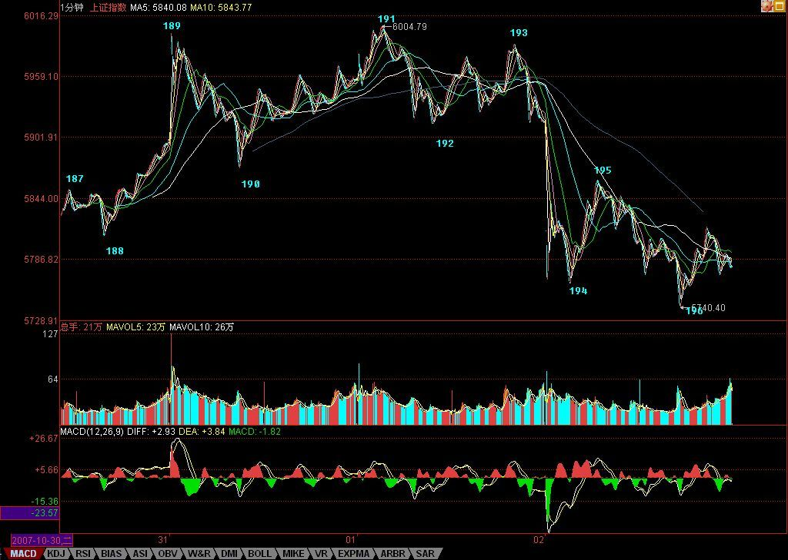

#### 宠爱之便宜且昂贵的中石油

 时间：2007-11-05 15:52:07

今天大盘走成什么样子，其实都没意义。今天有什么消息，其实也没太大意义。因为有了中石油，一切都没意义了。为什么？你看看中石油的市值，等于中石头加工行、中行还要大，以后的指数，极大地相关于中石油的走势，站在指数的角度，拥有中石油，就拥有一切的控制力。

中石油，世界第一股了，和世界上相同类型的公司比，确实昂贵。但，在中国这个封闭的市场中，特别后面还有众多指数期货等的预期下，这价格，显然是便宜的。这就像 N 个月前，中国人寿上市，本 ID 说 40 多一点不贵，最终 100 肯定要见的，如果有 30 给你见到，你当然可以天长地久了。这个位置，并不是说，石油就 100%不会下来了，但下来，只是给一个更好的买入机会而已，如同中国人寿从 40 多到 30 的过程。

短线看，今天，从 48 多到 41.7，一个标准的线段，然后是新的向上线段，这线段不管能否延伸上 45，都使得 41.7 到 43.7 与最终形成的 1 分钟中枢有了密切的关联。从短线的操作上，今天，当然是等下来的下降线段结束后介入，明天很关键，就是上冲回跌震荡后形成的 1 分钟中枢位置，因此，就不难操作的。

操作步骤上，比较激进的作法，当然是在看 41.7 的线段结束后就介入，但这样不能保证明天一定没有下跌的线段打穿该位置，毕竟是 T+1 的操作，线段太短了。比较稳健的，就是今天在线段结束时介入一定仓位，在形成 1 分钟中枢后，根据相应的位置再介入其他仓位，这样就至少可以用 T+0 的对冲保证仓位安全的。

注意，以上只是顺便说说新股的操作，这种高开低走的股票，第一笔介入一定要等第一段线段结束，这是一个最基本的要求，今天的走势图，完美地演示了这一点。但这还不行，如果站在安全的角度，必须要分批，因为线段的级别太短，不能保证 T+1 的绝对安全。

 另外，今天那直通车的缓刑，至少让本 ID 前段对此的反对有了点回应，同时也表明，现在政策的推出，已经有了更复杂的机制，这对股指期货的阻击来说，也是一个很好的消息。 今天，题材股动起来，这很正常，如果期货缓刑，那么，这种动还会更明显，而且很多年末找底的股票，只是为了明年一飞冲天。现在的问题是，期货还没有最终的答案，所以 19、91 地折腾就少不了了。两个翅膀，中字头、题材股，自从 3600 点接石头时明说后，到目前还是有效的。今天写东西时，电话不断，所以晚了，后面还有事情，先下，抱歉。

#### 缠中说禅文集版权为缠中说禅所有 此文集整理版仅供缠中说禅论坛内部学习使用，严禁外传！ 说说大盘中期走势的演化

 时间：2007-11-06 08:38:52

昨天回来太晚，没法写帖子，抱歉了。主要是突然有一个大的 PE 项目，对方来人了，一个最初期就要投 5 亿，最晚后年初上市，一旦成功，绝对比西部矿业要经典 N 倍。所以，本 ID 也不能太怠慢了。现在确实有点难，说的是时间安排上，下周又要出差，不过这里，本 ID 会尽量坚持每天的解盘和帖子，如果偶尔坚持不了，也请原谅了。

 本来想写课程的，现在也没时间了，就说说大盘的中期走势。这，本 ID 其实已经反复说了。只是总结着说一次，让各位更加明确点，免得被行情又给折腾糊涂了。 1、6100 点，是大盘中期顶部的一个尖，现在是去形成第二个尖，当然，前两天 6004 点是不是就是，这需要跌破 5555 点的颈线才能去确认。 2、在有效跌破 5555 点的颈线前，一切都以中枢震荡的观点来操作，向上走势背驰就出，就像前两天一样，下来不破 5555 点，就可以回补，来回折腾，直到大盘选择最终方向。

3、大盘选择向上方向的可能性依然存在，就是期货这个变数，现在中石油回来后，指数上就更没多大意义了。其实，站在别的股票的角度，很多已经完成真正的中级调整的幅度，最近一下跌 30%-50%的并不少见，所以指数在期货出现的背景下，将大幅度失真。

4、因为现在指数失真越来越大，所以关心个股更重要。年底，将是三类个股表演的时候：一、还是中字头，或打或拉，反正精彩不断。二、收集完成或接近完成的题材股，会在震荡中越走越强，率先展开明年的行情。三、筹码不够，需要继续收集的，就会利用每次震荡不断打压，直到该得到的得到为止。

 5、根据不同的股票类型，选择好自己的操作思路。大盘走势需要关心，但更要关心自己面对的股票类型，以及其相对大盘的走势特点。

6、12 月是 30 月的时间之窗，如果前后是出现低点，那么明年的行情将就此展开。如果是高点，那么明年初压力就大了，这也是为什么本 ID 最近一直希望压制大盘的重要原因。就是希望以低点去触时间之窗，为明年行情做准备。

7、先要有大的思路，再次提醒，由于指数失真开始严重，所以请更关心你自己股票的类型，是上述所说的哪种情况。如果是中字头的，可以更多参照指数的走势。如果是题材股的，就要参照其走势与指数之间的关系，看看里面的人是利用指数吓唬你还是忽悠你，看明白了，你的操作就明白了。

 8、操作是自己的，如人饮水，冷暖自知。修炼去吧，多好的市场，多好的修行。

#### **5555** 点争夺战

 时间：2007-11-06 15:37:47  今天的走势，就是一个 5555 点争夺战，一般这样的战斗，胜负至少看 3 天，上下还有一个 3%的缓冲区域，5555X97%是多少，自己去算吧。

当然，这次下跌，和上次不同，大多数人都没什么感觉，因为这次跌的都是中字头的，其他 90%都没怎么跌。但并不意味着这次的可能风险就小，如果真跌破颈线，那么很多这次趁着中字头跌而反弹的股票，也会再次探底的。

所以，5555 点争夺战，对于多头来说，是输不起的。空头反而是无所谓，反正后面还是 6000 点、6100 点的防线，其实，站在本 ID 的空头立场，本 ID 不大愿意这样就破了颈线，因为这样力度有限，很可能就是一个假跌破。

对于空头来说，对颈线的突破，一定要是致命的，用本 ID 的理论术语，就是一定要第三类卖点后出现中枢的下移，而不能去构成大的中枢那种无聊玩意，那样杀伤力太小。如何达到那种力度，就是要在颈线上反复磨，如果再冲一次上不去，又一批人开始失望，然后再来一次，反复失望，这样才有杀伤力的。

多头空头，绝大多数都是猪头，都是急功近利的，本 ID 只是分力，最终是否能如本 ID 所希望那样，搞得更有杀伤力，那不是本 ID 一个人能决定的。而且，很有可能，有些傻空头急功近利，企图快速破颈线，最后反而中了多头的埋伏。

 本 ID 最近心大都在 PE 上了，没心情没时间去找人开小会协调协调，所以空头爱干什么就干什么吧，本 ID 有时间，还不如去再造 N 个西部矿业出来卖给多头，1 元的东西，到时候卖了几十上百的，感觉不错。

中石油今天走出了线段下跌的走势，今天早上到 41.2 的那次反弹，就是对 41.7 上那类中枢的类第三类卖点，然后就继续下跌，现在就看这个线段下跌的类背驰了，一旦出现，就至少有一个级别更大的反弹，比昨天尾盘那个线段反弹要大，至少是可 T+1 操作的。昨天说了，有些线段反弹，不一定能 T+1 赚钱，今天就是一个例子。中石油，最终的走势很有可能和中国人寿类似，这在昨天也说了，当然，不可能完全照抄，但基本模式，估计差不多。

 上面说了如何才能杀伤力大，大概又得罪不少人，但市场就是这样的，讲感情就不要在市场混了。本 ID 说出来，只是把市场可能的残酷一面说出来，有时候，本 ID 没时间干了，并不意味着别人没时间干。 如果你对市场有了足够的洞察，那么，任何人的鬼把戏，都无效了，这才是最重要的。 市场里，需要的是智慧，而不是煽情。 认清自己，冷静再冷静吧。先下，再见。

#### **5555** 点决战即将进入临界点

 时间：2007-11-07 15:26:47

这个题目有点名不副实，因为这决战，对于空头来说，只是小战役，结果并不重要；但对于多头来说，就是决定生死存亡的。从 6124 点开始的行情转折中阴阶段，对于多头是垂死挣扎一下，还是干脆破罐子破摔，早死早投胎，很快，准确地说，最迟下周一前后就有答案了。

 站在空头立场，本 ID 希望多头能挣扎挣扎，这样，会增加很多残忍的快感；当然，站在纯技术探讨的角度，多头最好的招数就是以退为进，用一个空头陷阱，把主动进攻的空头给废了。 由于目前的空头比较蠢，所以本 ID 不妨提醒，屠杀之前，一定要多点多头色彩，披着多头外衣的空头才是最有杀伤力的，在 5555 点上制造出一个大点级别中枢，然后再背后来一刀，把多头砍倒，踢下悬崖。

由于目前多头也比较蠢，所以本 ID 也不妨教教多头招数。从月线上，无非两种可能，就是本月确认顶分型，或者不确认。不确认，就是有包含关系或创新高。而目前 5462 点，就是这个顶分型是否成立的关键，而跌破成立后，最关键是 5 月均线，目前在 5300 点附近。也就是说，多头完全可以在 5 月均线附近埋伏大部队，让空头先进攻，把分型给搞出来，然后反手把主动进攻的空头给废掉。

 请回想一下，本 ID 在 3600 点，是如何完美地利用顶分型与 5 月均线来把空头给灭了。现在多头最完美的策略，依然是照搬本 ID 的老剧本。

不过，这些蠢蠢的多头，估计抄也抄不成样子，最后，可能还是要和 5 月均线吻别于狂乱的夜。现在的多头，如果这 2 年多不被攻破的 5 月均线竟然给你们弄丢了，那你们也别丢人了。不丢人最好的方法就是：早死早投胎。

 有人可能要问：你究竟是多头还是空头，怎么又教多头又教空头如何干？

本 ID 很明确地说：本 ID 是那准备杀死空头的空头，一个不准备杀死空头的空头，不是好空头。见顶以后，就是一个空头面向死亡的生存过程。这时候当多头，将被空头蹂躏，而空头的命运，最终都是死。所以，唯一正确的就是，当一个随时准备把空头搞死的空头，里面的道理深着了，明白了，你对市场就有更深一步的了解。

短线技术上，5555 点附近的新 1 分钟中枢形成，因此，这次 6004 点开始的走势，就明确形成 1 分钟的下跌形态，因此，短线该位置能否站住，就看这个中枢的表现了，看明白这个中枢后面的发展，也就看明白了这场多空拉锯的短线胜负了。

本 ID 的观点还是很明确，就是在这样一个中阴阶段，什么事情都可能发生，技术好的，可以充分利用这大型的中枢震荡玩抽血游戏。多空越分歧，意味着震荡的幅度机会越多，就越是本 ID 理论的天堂。至于没这本事的，就算了。

今天的中石油，如昨天所说，38 元上线段底背驰后形成较强反弹，然后形成一个 1 分钟的中枢在 40 元上下，这是该股形成的第一个 1 分钟中枢，因此给后面的操作具有最重要的指导意义。后面的走势无非两种：一、以这 1 分钟中枢震荡扩展出大的中枢。二、这 1 分钟中枢不过是 1 分钟下跌走势的第一个中枢，最终将跌破该中枢形成 1 分钟中枢下移去完成 1 分钟级别的下跌。

 具体操作，就按实际走势的选择来决定。例如，如果你在今天背驰时介入部分仓位的，就可以开始利用后面走势的波动，把成本逐步降低。 最近天天说石油，主要是以此为基础，从最开始把一个股票的走势的生长是如何演进的给教科书一番，各位顺便就可以看到，个股的分析和大盘的分析没什么不同，都一样的。 今天下午晚上都有事，明天收盘马上有事，解盘要到晚上了，先说明一下。先下，再见。

#### 缠中说禅文集版权为缠中说禅所有 此文集整理版仅供缠中说禅论坛内部学习使用，严禁外传！

缠中说禅技术论坛 www.chzhshch.net 血凝心裂，苍天啊！

#### 血凝心裂，苍天啊！

 时间：2007-11-07 22:19:36  有些事情，真是不该知道，知道了，只能让人绝望。注意，本 ID 可不是说股票，股票算什么？ 有些事情，真是超越了一切底线，让人血凝心裂，苍天啊！ 酒后，并不一定能真言。不能言，七步诗。苹果、苹果，我的苹果。 即事无言缠中说禅 红尘有路尽迷途 圣代无心作圣徒 鬼眼青犹青眼鬼胡须赤更赤须胡 潮来天地谁千载 云变古今焉五湖 紫血残阳平岭外大江东去几踟蹰

#### 如期决战，多头不堪一击

 时间：2007-11-08 22:21:05  对不起，回来晚了，把解盘补上。

昨天说，决战进入临界点，最迟周一有结果。结果是，多头如此不堪一击，太令人失望了。这证明了本 ID 的一个断言：空头是心急的。而昨天，本 ID 给多头编的 5 月均线大埋伏剧本，是否如本 ID 所担心的那样：“这些蠢蠢的多头，估计抄也抄不成样子，最后，可能还是要和 5 月均线吻别于狂乱的夜”，很快也有答案了。

前几天，还有多头叫嚣，质问本 ID 不是说要至少跌 1000 点吗，为什么还不跌？现在，这个本 ID 布置的任务，确实有点没完成，本 ID 对演员们的表现也很不满意，那就继续努力吧。别心急，小板凳坐好，别到处跑动，现在，1000 点只完成了 800 点，空头多头演员们，努力！加油！

现在，5462 点到 5555 点颈线位置，将是中线反抽最关键的位置，不能重新上去，那么跌势将持续到这跌的业力耗尽的一天，本 ID 可从来没说过 1000 点外就没有空间，本 ID 只是说，没有 1000 点的回跌空间，这做空不过瘾，没空间，不好玩。所以，1000点这小康水平达到后，我们还可以有更高的现代化目标，这难道有什么问题？

今天不爽的，基本上有两种人：一、牛人，觉得自己很牛，可以短线，有天赋。本 ID 说认清自己，冷静加冷静。认清什么？就是你是不是牛人。牛人，不在乎什么线，但不是，就别累着自己。本 ID 不早给了所有非牛人一个最好的选择：小板凳？二、大牛人。这种人，以被套为光荣，号称牛市就要中长线，就要持有。就算那股票从 300 到 3 元，也要持有，也要中长线，这种大牛人，本 ID 没什么可说的。有人喜欢电梯，上上下下享受，本 ID 一点意见都没有，慢慢享受去吧，还有你爽的时候。

 明天、周一，5 月均线能否有埋伏，埋伏能否有效，很快就有答案了。如果是本 ID 搞的，本 ID 当然有信心，但现在，本 ID 又不当多头了，和 3600 点那时候不同了，本 ID 可不想为任何人担保什么。 现在，多头短线的问题，是这次跌破，是否能尽快拉回去，否则，一旦确认颈线跌破，那么，按照双顶的量度跌幅，你觉得该到哪里呢？

本 ID 很想仁慈地安慰一下今天受苦的人，但本 ID 最终决定还是不这样干，因为这样只能害人。市场从来不仁慈，本 ID 该说的也早说了，既然，今天痛苦的，都是大小牛人，那么就继续梅花香自苦寒来去吧，这大概是牛人爱干的活。

如果想真学点什么的，请复习一下本 ID 这帖子” 2007 年末，资金与政策博弈下的走势分析 2007-09-17 00:41:48”，如果能学点什么，本 ID 觉得，就没必要学梅花了。股市里，不需要学梅花，不需要苦寒来，股市只需要智慧。

 技术高的，可以关注这 6004 点开始的 1 分钟下跌的背驰，然后将有一个大反弹；如果技术不高的，还是继续小板凳吧。 先下，再见。

#### **5** 月均线大埋伏剧本如期上演

 时间：2007-11-09 15:20:08

今天行情没什么可说的，就本 ID 前两天已经公布的 5 月均线大埋伏剧本的现场版。不过，说老实话，同样的剧本，不同的导演，效果当然是不同。今天这种演出水平，显然不是太令人满意的，所以本 ID 一早就给了一个定性：“这些蠢蠢的多头，估计抄也抄不成样子”，至于是否会“最后，可能还是要和 5 月均线吻别于狂乱的夜”，很快也会有答案了。

当然，在这个答案出来之前，无论答案如何，都会有一个对前面 5462-5555 点颈线位置的反抽确认过程，这是例行手续，能重新上去，就证明多头这次的 5 月均线大埋伏剧本没演砸，否则，这戏就要退票，重新开始空头的魔兽表演。

 空头这头魔兽，最终肯定要被本 ID 砍了劈了，但如果多头不争气，剧本演砸了，首先被砍被劈的一定就是多头。 本 ID 这种要砍死空头的空头，目前最爱干的事情就是，多头伏击时，本 ID 也在后面伏击着，多头掩杀，本 ID 就跟着呐喊，等多头冲得没力，空头开始反击，本 ID 就在后面连续绞杀，把多头变成少头。

有人可能说，你这样也太无耻了。本 ID 只知道，在资本市场里，最无耻的行为就是亏钱、被套，只要你在市场上，远离这种行为，那你自然就是一个高尚的人、脱离了低级趣味的人，可以鄙视所有宣称你无耻的人的人。

这如同打仗，蒋光头就是最无耻的人，占尽优势最终还被赶到岛上洗海水浴去了，这世界上还有比这更无耻的吗？无论多少无耻的人给他找一万条无耻的理由，也改变不了他是最无耻的结论。打仗，最终只看结果，别说任何理由。输了，磨墙去，JJWW 没用。

市场比打仗更无情，打仗输了，还会有无耻文人，忽悠点这英雄那豪杰的，蒙骗一下少年儿童。市场输了，连尸骨都不会有人替你收。有人喜欢温情，喜欢有人说软话温暖一下破碎的心，那是有病。这种人，在市场中永远只有一种命运：死。

 中石油在 38 附近又有一个新的 1 分钟中枢，不过这个中枢与上面一个太近了，极有可能就 2 合一地扩展成更大级别的中枢，当然，实际走势，由市场决定。 大盘没什么可说的，5 月均线埋伏后，就看反抽力度，十分简单，没必要多说了。

个股方面，由于人气涣散，最近能逆市的，更多是小市值的低价股，年未，重组闹剧又到上演的时候，这是可多多关注的。至于，中字头，一定还是市场的重心，不过一定要踏稳节奏才可以去短差，否则就会被人绞杀。

 不想说了，一到周末，股票就成了最无趣的东西。周末，腐败去，发展晚上经济去、为吃喝玩乐经济贡献去，千万别股票去了。如果什么都不想干，就打坐吧。 先下，再见。

#### 略论国家经济意志的市场化体现

 时间：2007-11-11 17:13:00

在计划经济条件下，国家的经济意志，可以有多种宣示的渠道，惟独缺乏的是市场化。而在市场经济条件下，一味通过行政、政策等硬方式进行调控，显示是不合时宜的。而在市场化手段下，国有股份、外汇储备、社保资金等等国家资产的应用，不可避免地将体现国家的经济意志，而如何处理好其中的关系，确实值得认真探索与研究，这关系到国家的经济安全与经济发展战略的最终实现。

国家的经济意志，不是一时的盲动，也不能基于某种短线利益或道德冲动。国家的经济意志，必须建立在国家战略的前瞻性、全面性与系统性基础上。没有前瞻性，如同散户跟庄的思维，跟着别的大国思路跑，这样是绝对不行的。中国是一个大国，其经济意志必须有着大国的气度，必须能对世界经济与政治格局产生中国式的引力，反映出中国式的声音，最终实现中国式的战略意图。而没有全面性，同样不行。中国的国家经济意志，其战略取向必须是全面的，而不是为了某时某地某人的利益，其最终的经济利益，必须能体现且实现全体国民最大最终的利益。至于系统性，表明了中国的国家经济意志，必须也必然现实地体现为一个有着严密内在联系、多层次建构、具有可操作性、可实现性的有机系统。

目前，单单从具体资产的实际运用上看，国有股份，已经是股市中最大的绝对控制力量，目前的指数，已经完全是中字头股票的天下；而社保基金，最终将在国有股份划转、减持与最终运作中扮演极为重要的角色；而中投公司的成立，使得外汇储备的应用在内外资本市场中的协同性与隐含的战略性至少有了超越波段性质的重要意义。

但国家的经济意志，还不单单反应在具体的股票或市场化操作上。更重要的是，绝不能把国家经济意志的体现，完全退化成如同庄家控盘的操作模式，这是极为危险的。国家的经济意志，应该成为市场中一个重要的甚至是最重要的分力，但不能成为市场合力本身，更不能成为市场的唯一力量。一旦向这种危险的境地演化，那么，所谓国家经济意志的市场化体现，就会成为一句空话。这种所谓的市场化体现，也将会成为摧毁市场基础的力量。

此外，国家的经济意志，还必须体现在对国家经济资源的保护上。国家的经济资源，不单单包括狭义的实体、实物上的资源，还包括在虚拟经济条件下一切能产生市场、资本等效应的资源。例如，中国的优秀公司，就是中国资本市场的最大经济资源。如何合理利用这些资源，而不是让其贱卖、外流以及被短期利益所过分开发，这是一个十分现实且有着诸多教训的重大问题。

而站在资本运用层面，太过市场化、太过老鼠仓化的基金已不可能单独成为国家意志的经济化体现，必须有一种新的绝对性平衡力量来加强调节。既然在实体层面，国家对关系国民生计的产业要绝对控股，那么，在虚拟经济层面，这种绝对控股性是无用质疑的。也就是说，这种绝对控股性，还必然包括对股票总体走势的宏观控制。

国家逐步淡出政策层面的硬调控，必须也必然会在经济层面掌握一个绝对的调控力量，否则，资金对政策的挑战就会出现无法控制的局面，这是完全不符合中国国情的。加强国家对经济的调控，包括实体与虚拟两层面。而国家对虚拟层面经济化调控领导地位的加强，是一个必须尽快解决的问题。

#### 缠中说禅文集版权为缠中说禅所有 此文集整理版仅供缠中说禅论坛内部学习使用，严禁外传！ **1000** 点小康跌幅胜利完成

 时间：2007-11-12 15:28:57

本 ID 宣布做空时说，没有 1000 点的下跌空间，不爽，所以要先拉出空间来。今天，1000 点的基本任务已经胜利完成，本 ID 在前面已经给了这个跌幅一个名字，叫小康水平的跌幅。请问，各位是希望下一步小康就算了，还是要继续富裕下去？

今天，5 月均线大埋伏剧本继续演绎，今天的利空，刚好为 6004 点下来的 1 分钟下跌构成底背驰做出最后的贡献。本 ID 已经早说了，6004 点下来的 1 分钟下跌一旦背驰，会出现较大级别反弹。现在，5 月均线大埋伏剧本与 1 分钟下跌背驰剧本最终两剧合一。

注意，这个 1 分钟下跌，搞出来了三个中枢，然后在今天一个完美的底背驰。最后的一个 1 分钟中枢的第三类卖点，就是早上的补缺失败走势，然后继续的下跌构成了线段的类背驰，这和 1 分钟大走势的背驰段构成完美的区间套，这么教科书的走势，请好好去研究。

1 分钟底背驰后，最基本的涨幅，就是拉回原来 1 分钟下跌的最后一个 1 分钟中枢的波动区间，这个在今天就达到了，后面就是这个中枢如何扩展出 5 分钟中枢的问题。技术上，就要关注这个 5 分钟中枢的位置以及后面相应的中枢震荡结果。

 通俗地说，如果大家都觉得短线小康就算了，不要富裕了，就让这 5 分钟中枢第三买点；否则，大家都急切奔向富裕，那这 5 分钟中枢将第三卖点；事情就这么简单，各位民主一把，投票吧。 更通俗地说，就是以 5 月均线陷阱对 5462-5555 点颈线的例行反抽继续展开，注意，反抽可不一定要一定碰到 5462 上，最弱的反抽，就是装模作样在颈线下面折腾几天，然后就和 5 月均线吻别于狂乱的夜。

当然，多头现在也不是完全没希望，多头要成功，首先是要让所有人只要小康、不要富裕；其次，好好利用 5 月均线大埋伏剧本，绝对不让那狂乱的夜发生，特别不能让狂乱的月圆之夜发生；最后，找准机会，重新回到 5462-5555 点颈线之上站稳。

 以上，是多头唯一可以走得通的路，鲁男人说，人走多了，就成了路。多头就从这一刻起，如果要活命，就要不断地到处乱踩，把所有板块都踩一遍，看能不能走出路来。 这句话，通俗的意思就是，反弹如果真能延续，必定以板块轮动的方式，这种方式，好听地说，就是为了聚拢人气，不好听地说，就是忽悠蒙骗点新的站岗者。

特别强调，并不是任何反弹都是任何人有资格玩的。站在本 ID 理论的角度，这个反弹完全可以就已经结束了，为什么？因为最基本的回抽最后一个中枢的幅度已经达到，所以，现在关键是回来那一下能否构成第二类买点，如果不行，那狂乱的夜的吻别就马上上演，不过，更适当的名称应该叫：刎别。

 今天的解盘，写得太长了，主要是有趣版本与通俗版本都写了，本 ID 经常用自己的语言写，其实只是为了有趣与简练，但这世上无趣的人太多，本 ID 就受累点，夹带上通俗版本。

下面给出了 6004 下来的分段，请仔细研究，里面用绿箭头把三个 1 分钟中枢的第三类卖点都给标记出来了。按照本 ID 的理论，最晚的逃命点 195 处，从第 1 个绿箭头开始的所谓第三类卖点，其实都没什么意义，这里，只是显示，第三类卖点后，市场是可以多么狠。按本 ID 的理论，从 195 逃命的，在 214 才真正开始值得考虑是否回补。当然，前提是你的操作可以接受 1 分钟级别的，如果是 5 分钟以上级别的操作，那还是继续睡觉吧。

 214，从 191 开始的 1 分钟下跌走势的底背驰，对应着三重的区间套定位，最后一重是 213-214 之间的线段内部笔之间的定位，其中的精确性，教科书一般，关键是你能真明白，并且能当下去把握。 好好研究吧，这可能比讨论小康好还是富裕好更有意义。

本 ID 要出差了，晚上飞机走，晚上的帖子肯定写不了，明天收盘再解盘。不过，在外地，时间上可能不能太准时。另外，后面几天的晚上帖子，估计很难完全保证，因为应酬肯定少不了，又要为茅台、五粮液大大贡献一把了。

 最后，一句话，请问：要小康还要富裕？先下，再见。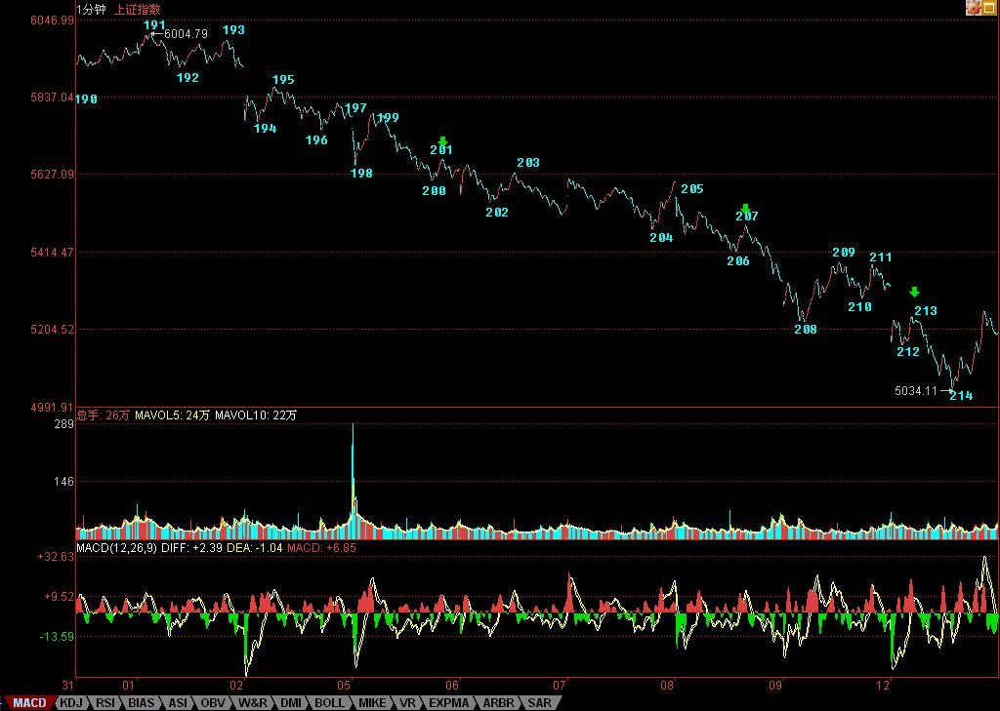

#### 市场总是少数人成功

 时间：2007-11-13 08:27:42

本 ID 开始课程时，有人还问一个很傻的问题，一旦都掌握了本 ID 的理论，那理论还有用吗？这种想法，就如同那种同样傻忽忽的逻辑，人人都有共产主义思想，这共产主义就实现了。可惜，共产主义和什么思想没关系，把老马的伟大堕落成培养共产主义新人的可笑，这就是这种逻辑的历史悲剧。

 市场总是少数人成功，为什么？因为只有少数人能真正把握自己。征服世界，并不意味着你能把握自己。认识自己、把握自己，这比征服世界更难。 当然，站在市场逻辑的角度，没必要为那些待宰的羔羊而煽情。问题是，最重要的问题是，千万别把自己往羔羊里挤。因此，本 ID 也只能抱着能惊醒一个是一个的心态。 没有人天生是羔羊，是你的心、你的眼界、你的行为让你羔羊。不修炼自己，不在市场中磨练，羔羊永远只能是羔羊。

一个 1000 点，10%几的回调，已经让这么多人方寸大乱，以前随便就是 50%、60%的调整，那不就真要尸横遍野了？该来的，总要来，市场的重新真正走强，一定是在清理了该清理的之后，就像河道被淤积了，不清理，能行吗？

目前只是大牛市第一阶段的一个中级调整，这一点从来没有任何的疑义。而本 ID 以前说过的股票，没有一只会放弃的，等中级调整结束，会再度启动，而且有些已经开始预热，这也是很显然的。但调整，首先必须先面对，这是当下的事，先处理好。

 按照市场的节奏，6004 点跑掉的，昨天开始回补闹一闹反弹，反弹一旦结束，就砸出去，没什么可犹豫的。图形告诉你一切，反弹是否结束，一切尽在走势中。 关键是，你的心能如明镜一样，当下地映射出行情的真实走势吗？ 下午收盘，马上有事，有时间再把解盘给出。 在外面，只能如此，尽量在宴会前给出解盘，否则，晚上回来估计也没可能写东西了。人世皆苦，才有修行的可能。 有苦，真好。缠中说禅技术论坛 www.chzhshch.net 5 日线受阻，多头仍需努力。

#### **5** 日线受阻，多头仍需努力。

 时间：2007-11-13 15:06:24  快速说几句。

今天反弹受阻 5 日线,这是最简单的走势,按本 ID 的理论,分型成立后是否能延伸为笔,关键是看 5 日线, 只要不能重上,那么这个底分型就有破坏的可能。当然，一般这底分型即使真的被破坏，也会在不远处形成新的能最终形成笔的底分型，所以，多头还是有短线希望的，只是过程可能有点多灾多难，例如，今天中午传出的 CPI，就给早上的多头泼了凉水。

 但更精确的分析，还是看昨天 1 分钟底背驰后的中阴走势，刚好课程说到这里，这是一个标准的现场版本，请好好研究，仔细分析。 昨天说了，多头会如鲁男人一样狂踩不同板块去找路，今天下午的回落，很多板块并没有破坏反弹的形态，所以多头还有继续努力的资本的。 短线继续关注 5 日线，以及 1 分钟图上的中阴走势演化。技术差的，就继续小板凳，等风和日丽再出来撒野吧。 听说北京今天要下雪，如果是也太无聊了，本 ID 刚离开，难道就让本 ID 错过这 2007 年的第一场雪？ 拜托，雪还是别下了。 晚上如果酒后还清醒，就再见吧，否则，还是让本 ID 去见周公算了。 抱歉，先下。时间：2007-11-14 15:17:22  对不起，在外面，帖子就不能保证了，请原谅。解盘还是保证的，但也只能快速说说。 昨天说得很明确，就是看 5 日线，因为昨天刚好构成底分型，所以今天下午一站上 5 日线，大盘就强烈启动起来，这都是极端教科书的走法，自己好好体会吧。

前两天的 1 分钟底背驰后，后面是一段中阴走势，各位可以看看本 ID 的课程里关于为什么很多人抄到了底却拿不住，就是因为不明白中阴走势的处理。更仔细的分析，只能等回北京后写课程时再说了，不过这两天的走势，也很规范，是其中最简单的走势的标准版本，请好好分析一下。

 本 ID 的理论有没有用，从这次下跌到 1 分钟背驰的把握，到这个反弹的全面处理就是一个很好的例子。这不需要你任何的其他渠道的消息，图形告诉了一切。当然，前提是你看得明白，否则就是对牛弹琴了。 本 ID 很肯定地给了多头如何利用 5 月均线对空头进行大埋伏的剧本，看来，多头经过前几天的不熟悉，终于演得有点模样了，给朵大红花。

下面的问题就是 5462 点重回后能不能站住，站住就有更大的反弹空间。另外，注意期货的消息，如果最近有关于这方面明确的消息，那么指数的走势就会有很大变数，也就是说，指数存在创新高的可能，不过这和绝大多数人无关。

 对反弹的把握，如果想懒点的，就看这个日线上的笔最终延伸的结束，如果它有本事延伸到 10000 点，本 ID 也没有反对的理由。当它没本事的时候，本 ID 就把这几天买的拿出来开砸，如此而已。 只要重回 5462 点上，无论站住与否，都将形成一个大的中枢，所以，中枢震荡一把，折腾一把甚至回来 N 把，还是很爽的。 个股方面，已经明确说过了，都会被踩一次，但如果期货消息很快出来，那么还是中字头更牛一些。其实，各位看看中驴，就知道方向了，你看这驴，从来都是最聪明的，无论涨跌，哪次不是领先于大盘的？

爽，要有爽的潜质。现在最危险的，反而是这种状况的，就是底部没敢动，反弹 N 天后忍不住的，站在反弹的角度，反弹往往意味着换岗。本 ID 现在没什么事，就等着多头没力的时候，把钢枪发给想换岗的了。

 所以，节奏是第一位的，节奏爽了，才是真爽。关于利用 1 分钟走势底背驰进行抄底反弹的操作，已经提醒 N 天了，不管处理得怎么样，都请好好反省，这样才会有真的进步。 先下，再见。

#### 缠中说禅文集版权为缠中说禅所有 此文集整理版仅供缠中说禅论坛内部学习使用，严禁外传！

 时间：2007-11-15 21:47:45  对不起，解盘晚了。今天一收盘，就给抓去看企业，书记亲自出面,你说有什么办法?来到下面，个个人都急着，把你当点石成金的圣手，苦呀，没办法，各位也请原谅。 本 ID 现在可是喝了 1 斤多五粮液后说的话，虽然相当清醒，但各位也知道，本 ID 这收盘后的 N 小时内受到的苦是多么的深切。苦呀,苦。 今天 5462 点竟然没有被触及，简直有点过分。喝了点酒，本 ID 也真要狂言一句，没有本 ID 的多头，就是阳痿的货。连 5462 点都不碰，多头难道想找死吗？本 ID 现在酒后胡言，但不骂他们也不爽了。 今后几天，首先站上 5462 点，让本 ID 觉得多头还有点男人的器官，否则，本 ID 以后就宣告多头根本没头，都是中关村的货色，多头也没什么可抱怨的。 这里，先说明一个典故，估计北京外的人都不知道。中关村，其实是中官村，中官，就是太监，中国的第一所谓科技村，竟然就是历史上的太监村，你说要哭还是笑？ 喝多了，也没必要技术什么了，5462 点，多头，想证明你们不是中关村的，就给搞上去，否则，后面本 ID 的题目就是：多头，都是中关村的货。 对不起，思维混乱，明天估计也没机会解盘了，周六回北京再补上。 北京，不总是中关村的。让中关村的太监太监去吧。北京爷们，请爷们一下，别让本 ID 看不起你们。 洗洗睡吧，讨厌五粮液，最恶心的酒。 下了，周六见。时间：2007-11-16 15:25:28  快速说两句，明天就回北京了，不知道雪下了没有？ 北京有中关村，多头，也不要争当中关村的货，北京可不止中关村。5462 点，连这都如此困难重重，本 ID 都没了骂多头的兴趣了。

这次出差，本 ID 还是深切感到了中国企业的创业热情。虽然，有些手段，有点太那个了。例如，本 ID 这几天考察的企业里，就有从世界性大公司出来，用完全盗用的技术，改头换脸地疯狂发展出来的。虽然本 ID 并不特反感这种企业，但这毕竟不是长久的办法，中国人有足够的脑子，为什么一定要盗用鬼佬的？

 市场继续在这里折腾，这个 5 分钟的中枢震荡，将继续向更大级别延伸，因此，最终的突破方向，其级别意义就更大了，暂时，估计还需要一定的时间。 个股方面，依然是乱踩走势，暂时不会有太多板块具有持续的走强能力，总之，就是来回折腾。 不说了，周末，本 ID 还要熬上最后一晚的饯行酒，明天就回北京了。 先下，再见。时间：2007-11-19 15:13:40  本周被安排得满满的，明天解盘要在晚上，后面还要出一次差，所以，有什么照顾不到的，请原谅。 快速说两句。今天就是大搞阶级斗争，把中国神（华）、（石）油为代表的大土豪给狠揍几下，然后像奥运、VC、军工等等的垃圾股票就显摆显摆。

其实这很正常，本 ID 听说，在男猿人的 ED 世界里，世界第一名牌是印度神油。中国神油，大概有点水分，所以先挤挤才能成为合格产品，这点，男猿人的认识应该比本 ID 更清楚，本 ID 就不敢男猿门说神油了。

 但阶级斗争，经常有胡汉三又回来的时候。反正，题材垃圾与中字神油，来回折腾的局面是一时难以改变了，这就构成了最基本的两大阵营的轮流举旗。 技术上，大盘的 5 分钟震荡依然，所以，继续按中枢震荡的规矩操作就可以，当然，现在指数的意义不断下降，所以可以根据具体板块的图形决定操作。 和谐，从来都不会从天上掉下来，和谐，最终只能是阶级斗争的结果。阶级调和，是不会调和出和谐来的。 打土豪，分田地；然后胡汉三再回来。不断地轮回，世界本来就是如此。怕，也要世界。不怕，也要世界。世界就是世界，关和谐屁事。 在所谓和谐的世界里，反对和谐的，就成了异端，就有了阶级，就有了斗争。 世界是否和谐并不重要，世界的重要性只有一点：无论现实是否血淋淋，现实就是现实，不能装饰，任何的装饰，最终都会成为历史的笑话。

最华丽的裹尸布包裹的尸体，依然只是尸体。当然，尸体是可以用来人肉叉烧包的。抱歉，这话可不是本 ID 说的，那是施耐庵未被尸体时说的，如果有什么意见，找他鞭尸去，不过前提是，他没被人肉叉烧包了。

 上面是解盘与今晚帖子的混合，这样的文体如果不适应，对此产生不良反应，那请原谅，本 ID 不会写和谐文章。 真正的文章，从来都不会是和谐的。 “大凡物不得其平则鸣。草木之无声，风挠之鸣；水之无声，风荡之鸣。其跃野，或激之；其趋也，或梗之；其沸也，或炙之。金石之无声，或击之鸣；人之于言也亦然。”  不和谐才有真文章。 今晚无帖子。先下，再见。

#### 缠中说禅文集版权为缠中说禅所有 此文集整理版仅供缠中说禅论坛内部学习使用，严禁外传！

 时间：2007-11-20 23:44:07  严重对不起，事情太多，忙到现在才回来。还好，赶得上 24 点，至少今天晚上解盘这个承诺能够实现。

今天的大盘，依然在中阴状态中无方向地震荡，这是一个中阴状态中的常态，目前，这个 5 分钟的中枢震荡继续维持，如果继续下去，就会延伸出 30 分钟。抬头刚好看到有点不太圆的月亮，月圆的时候，这中枢震荡是否能结束呢？

其实，现在某种程度上是一个新状态的熟悉过程。由于这中国神油的威力太大，所以如何与前期板块进行指数调控上的配合，总要有一个熟悉的过程。现在是小幅度的试验，然后，当然会有幅度大点的试验，试验力度逐步加大，也是正常的。

板块上，题材股继续表现，但中字股今天也开始有点热身，目前的震荡，有利于 MACD 的收口，一旦日 MACD 收口成功，那么大盘的反弹空间将打开。此外，一般图形走成这样，无论这里是否成为短线真正的底部，就算往下跌破，也是空头陷阱为多了，其中的操作，继续以中枢震荡的方法对待，这样就十分简单了。

其实，从中线的角度，反而是这次反弹上去后的走势更关键，如果不能有效突击上去，那么下次调整的压力才是真正严重的，特别不能出现 MACD 日转头后不能上 0 轴的情况，一般出现这种情况，后面都意味着更严重的下跌。只要不出现这种情况，问题还不是太严重。

 中线的角度，目前 5 月线依然能被守住，所以本月收盘很重要，只要能守住 5 月线，多头就算成功了，否则，后面多头被屠杀就不值得任何同情。 目前，中枢震荡中，就是涨不上去杀多头，跌不下来杀空头，两头杀，才是正路。当然，你需要有这工夫，否则连中枢都分不清楚，那还是拿小板凳吧。

至于个股，本 ID 说了，本 ID 说过的个股，站在中长线的角度，现在还没有一只会放弃的，因为中长线的能量都依然充足。只是利用这次调整，该杀点差价的搞点差价、赚点筹码，没筹码的也好好找机会储备点，不能把东西都今年吃了，明年还要开大餐，总不能明年才准备吧。

至于像中国神油之类的东西，肯定也是要储备的，只是如果有更理想的价位就更好了，例如神华，那煤液化的项目一旦投产，明年石油又被搞上 150 元，你说他有没有价值？不过现在 60 多，确实有点不爽，不过要太砸下去也会有点困难，那就折腾着搞，震荡着把成本搞低，有机会再搞低点，没机会就算了。其他的铝呀油呀的，都是这种心态：动态回补或动态建仓。当然，如果给一个狠砸的机会，本 ID 也不会反对的。不过，会有吗？即使有，也只有一次。这一次是否能真出现，那就把现实照进梦想吧：不强求，不放过，大概是目前最合理的原则了。

 先下，再见。时间：2007-11-21 15:36:59

今天，最重要的消息，就是关于 AH 股上市顺序的问题，今天这个比较官方的表述证明，A 股的重要性再次得到加强，以后港股被吸收进来的命运是不可逆转了，只是时间长短的问题。更重要的是，本 IDN 个月来到处大声呼吁要大幅度提高 A 股大盘流通比例终于有了一个切实的解决。以后的问题就是，新发行的  大盘股，一定要达到流通比例 10%的底线，前面这些投机性蓝筹，将不会再出现。

今天这消息，有着正负两面的影响。正面影响是：1、A 股的重要性将大幅度提高。2、现在的非法投机性蓝筹，反而成了稀罕货，一旦指数期货出来，这些股票的控盘重要性就更为加大。反面影响是：1、原来低比例蓝筹这历史问题如何解决。2、以后扩容的压力将进一步加大，由于流通比例加大，那么太高的价格将受到影响。

 现在的大盘，技术上是中阴阶段，政策上也同样如此。因此，后面中阴阶段的突破方向就很重要了，当然，向下突破，也不是世界末日，只是为明年的行情留出空间。 后面最大变数还是期货问题。 个股方面，今天是神油分裂，所以大盘是上下折腾幅度加大，这也是一个很好的控盘试验。大盘要想真站住，首先要神油合一都站稳。 月亮快圆了，大家都开始烦躁起来，是否又来一次天人合一的闹剧，很快就知道了。

至于其他个股，本 ID 现在都不想说太小盘的股票，像那个等比股票，这次调整，一下砍下来一半，这就是小盘股的风险。最近，其实本 ID 新搞了一个等差股票，盘子比等比大点，价格涨起来也就 7 元多，市值比等比更小，但也又是 ST 的，所以就一直没说。其他的股票，都等着折腾的机会，不过大盘方向未定，本 ID 还有把现实照进梦想的想法。

 小康了，接着是全面小康，还是更雄伟的富裕，这确实是一个很现实的问题。但有一点是必然的，昨天也说了，即使再次破位，陷阱的可能性也就大了。 又来电话，说人到了，没办法，不能多说了，要走了。先下，再见。

#### 又是月亮惹的祸

 时间：2007-11-22 15:32:48

昨天说“月亮快圆了，大家都开始烦躁起来，是否又来一次天人合一的闹剧，很快就知道了”结果今天就应验了，看来大伙对全面小康真的充满了热情，虽然周六才是十五，但这热情已经要十三就闹剧一把，这也太热情了。

当然，站在纯技术的角度，虽然小的 1 分钟级别的第三类卖点早上就有了，但目前的破位是否能形成大的 5 分钟第三类卖点，还是一个未知的事。所以，多头目前也不是完全没机会，面包还是有的，就看能不能把中枢扩展成 30 分钟的，这样，后面的下跌，不过是一个陷阱。

当然，是否陷阱，用是否出现大的第三类卖点以及出现后背驰出现的位置就很容易判断了。另外，中枢震荡操作的原则，从来都是冲不起来，在次级别上涨背驰的时候卖，跌下来，如果不形成中枢下移，而最多只是中枢扩展，那么就在次级别下跌的背驰时候买。这是最基本的方法，N 堂课前就反复说过，这里再提醒一下。

 上面说的，都是给有技术，或者对技术已经很清楚的人说的，没技术的，本 ID 一直给的建议还是小板凳。

中线上，如果这月收盘多头依然过于窝囊，连 5 月线都确认失手，那么，10 月线就是下一个比较靠谱的支持。但站在日线角度，120 日的半年线快到了，无论是否有效跌破该线，在该线上下至少有一个大反弹去确认 5000 点是否有效跌破。

 个股方面，有技术的，可以对明年有前途的股票进行动态关注，长期关注一组股票，对熟悉股性是很重要的。你对股性熟悉了，操作起来就更有把握。 现在的操作，都要为明年去打算。对关注的股票，可以在反弹操作中动态介入，熟悉其股性，等中级调整完成后，多野的马也给你驯服了，那时候全面介入完全熟悉的股票，赚大钱还不是天经地义的事情？ 其实，股票某种程度和做生意一样，不熟不做，做熟了才能赚大钱。没有点耐心，整天等着天上掉馅饼，那还不把天上做馅饼的都给累着了？ 今天比月亮惹祸更高兴的事情，莫过于英格兰队没吃到天上掉下的馅饼。早死早投胎，股市如此，英格兰队也如此，整天中阴也没意思。 最后，先和各位请个假，明天下午收盘解盘后，马上要开车去内蒙，5 个小时，千万别下雪，否则还是有点危险。由于去的地方，是个大矿山，手机信号都有问题，所以周六、周日就写不了东西了，抱歉了。先下，再见。

#### 过高的股票交易印花税已到必须调整时

 时间：2007-11-22 21:30:42  本周关于以后内地大型股票上市应以 A 股为首发地的消息具有重大意义，同时回应了本 ID 前面反复强调的两个问题：一、A 股蓝筹上市比例过低；二、优秀上市公司资源的保护与合理利用。

这个新政策一旦实施，按照《证券法》，像目前 A 股中超低流通比例的疑似非法蓝筹就将不会再增加了。如果这政策早实施，中石油的流通 A 股也不会是现在的 40 亿股，而应该是至少不会少于 180 亿股。试想，如果目前该股的流通 A 股数是 180 亿，还有可能上演 48 元开盘的闹剧吗？

可以说，蓝筹流通比例过低的问题一旦解决，将使得市场的运行结构有了一个合理的基础。如果最重要的 A 股都没有一个合理的运行结构基础，那么多层次资本市场的建构基础合理就更谈不上了。在某种意义上，该问题的解决是股权分置改革的一个深化过程，极为重要。不过，这里又有一个遗留问题产生，就是这些已上市的流通比例不足的疑似非法蓝筹如何达标必须限时解决，否则将使得这些品种成为稀缺资源，在指数期货推出后埋下严重投机的巨大隐患。

但这个运行结构基础的解决，只是一个层面的问题。而市场的构成，不单单是那些可交易的股票，一个同样重要的问题是，这些交易的成本是否在一个合理的范围内。无论多好的市场体制、结构设置，如果人为设置一个超高的交易成本，那么这个市场体制、结构设置的运行，最终都将面临危机。世界资本市场的发展历史表明，股票交易印花税的降低是一个总的趋势。市场的设置，本质上就是要让交易便利、成本降低，否则根本没有必要让市场存在。

目前存在一个严重的误区，就是认为目前的流动性泛滥，钱太多因此投机性太强，对这观点的谬误的批驳，在本 ID 前面的文章里已多有提及。一个结论性的观点可以再次表述如下：针对目前数量庞大的可上市资源，并不存在流动性泛滥问题，站在长远看，反而需要面对流动性不足的巨大考验。试想，目前 A 股上市企业不到 2000 家，而印度是我们的三倍以上。那么，A 股即使要达到印度的规模，中短期内就至少需要 4000 家企业上市，请问，我们现在所谓泛滥的流动性能马上承接这 4000 家企业吗？

交易成本的设置是市场构建中最基础的问题之一，过高的印花税对市场百害而无利，至于其所谓的调控功能，也被事实所证明是完全失败的。5 月提高印花税后，市场反而在 5 个月不到的时间内从 3400 点上涨到 6100 点，制造出了危害性更大的蓝筹泡沫，其调控效果如何，事实已经给出答案。

 当蓝筹流通比例过低的问题解决后，把股票交易印花税重新恢复 5 月前的水平应该提到议事日程了。只有合理的交易成本，才有合理的市场环境，才可能使得更大量的上市资源得到更顺利的开发。

有人可能担心，目前降低印花税会引发新一轮投机，这种想法与认为 5 月印花税的提高能压制市场投机的想法同样荒谬。市场，更重要的是供给与需求，抑制市场投机最有效的方法从来都是加大供给。请问，目前这印花税水平远远超出国际水平，在全球化背景是绝对不能长远的，最终必然要被改变的，那么不趁着调整时改变，就等于错失一个纠错的时机，难道希望在上涨时才火上加油吗？

此外，更加错误的想法是把印花税的降低当成以后救市的手段储存起来。如果还有这种想法，那么就意味着管理思路上依然在过去的旧圈子里。而事实上，A 股的历史表明，政策顶与政策底从来都不是真正的顶和底，1996 年的社论没有制造最后的高点、今天 5 月的印花税同样没有，1994 年所谓的 777 点政策底最终跌破后直到 325 点。所有真正的顶和底，从来都不是某个政策造成的。政策只是分力之一，不是合力本身，对此必须有清醒的认识。

管理市场，必须要有大思路、大眼界。现在市场最重要的事情，就是完善多层次的、有效率的资本市场，然后让更多的企业能通过资本市场成长起来，成为中国经济新的创造力与推动力的源泉。因此，绝对不能因为市场的一些波动而扰乱了思路、局限了眼界。而一个有效率的资本市场，显然不可能是一个交易成本比世界其他市场平均水平高出多倍的市场；一个以印花税的提高来调控投机行为的市场，也显然不可能是一个成熟的市场。过高的股票交易印花税已到必须调整时，这点，应该引起足够的思考与重视了。

缠中说禅技术论坛 www.chzhshch.net 对不起

#### 对不起

 时间：2007-11-23 13:57:18  对不起，刚接电话，内蒙来接本 ID 的车已经到了，本 ID 一收盘就要走，否则那边晚宴等着，不好意思。 解盘周日回来补上，周日没什么特别的事，一定在晚上赶回来。缠中说禅技术论坛 www.chzhshch.net 对不起，晚到的解盘

#### 对不起，晚到的解盘

 时间：2007-11-25 22:00:34  回来了，不过要开打一个股权收购战，虽然和某上市公司有关，但只和其资产有关，不涉及上市公司本身。因此，这几天可能极端忙碌，有时候解盘可能都要推迟，例如明天。请各位原谅。

前面说了，在 120 天线附近，最坏情况也肯定有至少一次对 5000 点的反抽，大盘周五走势其实就来自演绎这剧本。问题在于，给多头最后一次机会，多头能否给点勇气，依靠 120 天线站住 5000 点，下周就要分晓。

 5163 点是一个关键的位置，能重新上去，就是继续中枢震荡，否则就要严重考验 120 天支持。下周，是月线收盘，如果不能收在 5 月线附近，那么后面将要去考验 10 月线支持。 注意，从中长线角度，月线的顶分型成立后，唯一重要的事情就是是否延伸为笔，一旦延伸为笔，那么在月的底分型出来之前，大盘不会有任何中长线上实质性的上涨。

个股，题材股已经有些开始骚动了，除了那些特别兴奋的，一般大的骚动，还是在明年。中字头，在中石油完成其本 ID 在上市当天就说的类中国人寿走势前，都会被反复折腾，毕竟，好多人都怀有残暴的倾向，企图对这些中字头进行打击。

 不过，打击只是为了拿到足够多以及足够便宜的筹码，只是在这样一种酷刑下，死扛永远都是痛苦的。本 ID 对老虎凳之类的玩意没兴趣享用，本 ID 只知道，在大买点出现后买，不需要享用老虎凳。 没什么时间写了，今天，一轮合同大战估计要通宵进行，本 ID 要忙去了。 现代战争中，最凶狠的往往是股权之战，往死里杀人吧。缠中说禅技术论坛 www.chzhshch.net 抱歉，刚回家，还要忙。

#### 抱歉，刚回家，还要忙。

 时间：2007-11-26 23:59:35

抱歉，刚回家，还要忙。这股权之战开始白热化，无耻招数要开始用上了。其实，最无耻的就是打败仗。胜者为王，丛林法则。别讨论丛林法则如何无耻，如何不应该，在血腥之中，生存是第一位的，丛林中，难道还有比丛林法则更不无耻的？

 股市同样是一个丛林，同样有着最伟大的丛林法则，就是这么血腥，怎么了？中石油，就要无耻地继续类中国人寿的走势。多头，站不上 5163 点，就是要被强暴地打击，没什么可讨论的，也没有可同情的。

不过，120 天线应该有足够的弹性。也就是说，在这附近，还会来回折腾。现在的走势，本质上的多空齐杀才能活得很好。也就是说，本质上，任何的急跌都将构成大震荡视角上的空头陷阱，由于下月 10 月线将快速上移，因此，10 月线与 120 天区间将为震荡留下足够的陷阱制造空间。

 对于长线来说，250 天是关键的，也就是所谓的牛熊分界，在没有有效跌破该线之前，谈论牛市的结束都是无聊的。 中短线操作，可以多关注 120 天、10 月线等制造的空头陷阱，但必须暂时以反弹的眼光来进行具体的操作。

如果关注周线图的，可以看看 6124 点那周前后构成的顶分型的威力。那么要化解这个顶分型，必须首先要构造一个底分型，以此来完成一笔的运行。因此，后面的走势，就在一个底分型的探求与构造之中。站在这个视角，就会对后面 N 周的走势，有一个更大视角的把握。

 最近太忙，除了开盘那 4 小时，基本都忙不过来了。所以解盘都不能准时，但一定都会回来后补上，过了这几天最关键的时间会好一点。缠中说禅技术论坛 www.chzhshch.net 时间错乱还有两天，抱歉了。

#### 时间错乱还有两天，抱歉了。

 时间：2007-11-27 23:54:13  这几天，真是疯狂了，时间也跟着错乱，这种状态还需要两天。写完这帖子，还要修改一个文件，再坚持两天吧。

今天的大盘，走得没什么可说的，5160 点上不去后的延续性走势而已。站在周 K 线角度，因为本周肯定新低了，所以这周 K 线肯定完成不了底分型的构造。站在周线角度，只要 5 周线不能重新站住，基本可以不看这个盘了，爱跌到多少都行。

 跌 1000 点是小康水平，1500 点是全面小康，2000 点是初步富裕，2500 点中等发达，3000 点是实现现代化，3500 点叫什么好呢？请建议一下。

不要恨中石油，中石油这种怪物的出现，就是本 ID 前面反复说的超低比例非法蓝筹的恶果，现在不算什么，如果有指数期货，那才知道什么是非法蓝筹的威力。现在的问题是：为什么用脚趾头都能想明白的问题，怎么会一而再、再而三地出现在国家级的决策中？谁要为这种决策负责？

 其实，什么政策都无所谓，关键是有一个负责的最低要求，敢出政策而不敢负责，或胡乱设计却无须负责，这就是最大的问题。 当然，中石油的走势，本 ID 开盘那天已经明确说了，就是类中国人寿，也就是说先狠砸，再狠拉，现在的问题是，砍仓的人太少了，不见点鲜血，嗜血的市场是难以兴奋的。这话虽然残忍，但这就是市场。 没有砍仓的胳膊大腿横七竖八，哪里会有底部？真相就是如此，该残忍就残忍去吧。 而真正的杀手，就等着那血腥的一刻，如豺狼闻到了猎物伤口散发的气味，好好闻哟。缠中说禅技术论坛 www.chzhshch.net 大盘进入基本支持区域

#### 大盘进入基本支持区域

 时间：2007-11-28 23:16:09

今天稍微早点，因为明天是收购的第一个关键点，写完就要休息。这次收购，绝对是经典中的经典，现在，中国这领域最顶尖的公司都几乎参与其中了，以本 ID 看来，目前可能还只是戏的序幕，不过已经比其他的收购故事要精彩多了，有空，可以写个剧本了。

大盘今天继续无精打采的，不过大盘确实已经进入一个基本的支持区域。首先，按双顶的量幅，也基本到位了；其次，周线上一个从 2005 年开始从来没有跌破的支持线也在不远处，下月开始，10 月线也会上移到附近区间，诸如此类的支持因数都在加强。

 而本月，一下跌了一个比小康还多的跌幅，因此，无论如何，下月肯定有反抽走势。当然，这月线收的位置也很重要，如果收在目前区间甚至更低，那么反抽后的压力还是很大的。 短线的选择无非是：先反抽还是先全面小康。先全面小康，反抽的油水大点；先反抽，那油水就少点，如此而已。

中线上，下月的走势很关键。如果是先下影后上去，那么走势会好点；否则，如果反抽只构成月线的上影，那么后面的压力就大了，全面小康的目标就太保守了，回补 4000 点上那缺口，来一个初步富裕，也不是太不正常的事情。

 不过，短线可以开始关注这大反抽出现的时点，在这之前，不排除先有一个大的陷阱再上来，如果真如此，那么这反抽的意义就更大点。 请注意，无论多头空头的，没有陷阱的玩意杀伤力都有限。6100 点之所以有点杀伤力，就是因为前面有几天精心安排的多头陷阱。这里学问多着了，如果能参透这多头空头陷阱，你的本事也就见长了。 不说了，累了，再见。缠中说禅技术论坛 www.chzhshch.net 120 天支持终显威力

#### **120** 天支持终显威力

 时间：2007-11-29 23:53:11  今天的收购小决战出现比较好玩的局面，一场好戏，还要继续唱下去。从明天开始，大概可以逐步正常，这几天的时间错乱，对不起了。

大盘的走势，不太错乱。本 ID 在前面说了，跌破 5000 点，只是一个空头陷阱，而 120 天线有基本支持，即使继续下跌，也不过是继续构造空头陷阱。今天大盘拉回 5000 点之上，使得一个更大级别的中枢在扩展开来。也就是说，5000 点上下，将扩展出 30 分钟的中枢，后面的走势，就可以用这 30 分钟震荡的观点来观察，当然，如果这 30 分钟竟然震荡出第三类卖点，那么全面小康、初步富裕都不是什么奇怪的事情。这里无须预测什么，只要看好这震荡就可以把握了。

 不过，如昨天所说，大盘没有选择在 120 天线下制造更大的空头陷阱，因此反抽的意义将有所减弱，首先看 5 周均线，如果能站上去，那么力度将大点，否则后面再次探底的压力依然不可小视。

目前的操作很简单，就是继续以中枢震荡的观点处理，只是这次的震荡级别更大而已。操作上，依然是游击战，至于阵地战之类的玩意，就留给多头和空头。本 ID 的操作思路很简单，就是放冷枪，放暗箭，专挑多头空头没力的时间落井下石。

 多空齐杀，找准机会落井下石、突施冷箭，这从来都是震荡行情中的不二法门。震荡中的利润，从来都是在多头空头的尸骸中炼出来的，虽然残忍，但却是震荡行情的生存之道。 市场中，最大的残忍就是把自己送上断头台；市场中，最崇高的道德就是踩着节奏错乱者的尸骸前行。市场就是市场，装道德孙子的，不是早死的就是即将死的，有必要听他们的道德说教吗？ 当然，请一定注意。当你还没有成为钢铁战士之前，还有一个最好的全身之道：就是在大级别的调整中紧抱小板凳，不参与一切的反弹。 宁愿错过，绝不过错，伟大光荣正确的小板凳。时间：2007-11-30 15:20:29  今天开始正常。

今天的大盘同样正常，也就是继续周末效应。大的走势上，继续是 5000 上下的震荡。下周，反复强调的 10 月线上移，而 5 周线下移，因此，这构成大盘震荡的两个夹板。所谓夹板，就是上破是多头陷阱，下破是空头陷阱，总之，到处是陷阱，多头空头都没好日子过。

昨天，再次强调小板凳的伟大正确光荣，这是所有技术有问题的人的护身符。这护身符，从 6100 点就强调到今天。不过，就算小板凳是红宝书，也不能整天拿着跳忠字舞。如果想进步，最终还是要学会抛弃小板凳，学会在震荡中赚钱。

 当然，如果真学不会，就不必要学了。并不一定每个人都需要变得英明神武的，如果每个人都这样英明神武，那么小板凳不是就要滞销？ 至于震荡的操作技术，是必须磨练出来的，所以如果没有这种磨练的决心，还是买把小板凳，这样更有意义。

什么时候不再用小板凳？等大盘整个风给转过来了，底部经过确认后，才无须小板凳。现在，还在第一次的探底之中，也就是大盘的第一只脚还没有落地。而大的底部构造，往往需要两只甚至两只以上脚落地去确认，站在这个角度，小板凳还要旺销紧俏一段时间。

 不过，由于本月大长阴线，因此下月一定有较大反抽去攻击本月阴线的实体部分，所以对于钢铁战士，以及准备成为钢铁战士的，可以密切关注一个大的反抽的准备与介入时机。 个股方面，很多题材股已经压制不住了，指数其实已经反映不了很多股票的走势，所以，如果你是钢铁战士以及准备成为钢铁战士的，更多应该关心个股的走势，指数走势只能成为参考。 技术上，周线、月线上底分型已经构造完成的股票，显然是最值得关注的。当然，如果你的手脚特别麻利，日线上底分型构造完成的也可以注意的。如果再进一步考察个股，就要看他在大的级别中是什么类型的中枢位置，这可以进一步确认较大力度爆发的可能性。 本周太累了，要好好休息一下。先下，再见。

#### 缠中说禅文集版权为缠中说禅所有 此文集整理版仅供缠中说禅论坛内部学习使用，严禁外传！

 时间：2007-12-03 15:26:04

上周向 5000 点的反抽，刚好碰到 6004 点下来的下降通道上轨回头，现在，那上轨已经到 4950 点附近了，各位打开 15 分钟图，会看得很清楚，而且 10 日线也会下移到该位置附近。也就是说，这变盘的时刻马上要到来。

纯技术地说，或者就是突破上轨引发一次对 6004 点下来的总反抽，或者就是在总反抽之前再来一次空头陷阱，总之，这个反抽的到来已经是眼前的事了，唯一的区别，只是是否再来一次空头陷阱恐吓一下最后熬不住的人。

其实，站在个股方面，很多个股已经反抽不少了，指数走成这样，都是神油在做怪。不过那油也快破 30 了，第一基本目标也基本达到，唯一有变数的只是是否要破一下 30 恐吓一下最后的不坚定分子，这就对应了大盘是否要再走一空头陷阱的选择。

 本 ID 曾经说过的个股，已经反复说过，一个都不会少地继续折腾下去的，其实有不少已经比大盘要提前走好了。其他个股，一旦大盘走好，都会有所反应的。 不过，这次反抽后，至少还有一次探底确认的过程。10 月线，站在中短线角度，应该是比较重要的，至于下面，就是 250 天线的位置的，在跌破 250 天线之前，根本没有探讨牛市是否结束的必要。 中长线角度，目前，比较不明朗的是那经济会议是否有比较猛烈的措施，但无论那会议有什么措施，应该不会造成致命的影响，只是会被利用去清洗不坚定分子。 为了那收购的事情，某集团的头专门从香港跑过来，正在下面等着，本 ID 要去应酬一下，先下，再见。缠中说禅技术论坛 www.chzhshch.net 突破回抽，明后是关键

#### 突破回抽，明后是关键

 时间：2007-12-04 15:29:26

今天大盘略微发了点力，突破 6004 点下来的下降通道上轨，但受阻于 10 日线，不过其后的回落并没有跌回上轨之下，因此，暂时还是一个可接受的局面。一般来说，突破后需要 3 天确认，因此明后就是关键了。

其实，今天大盘之所以比较犹豫，就是因为昨天开始的那经济会议还没有明确的结论性东西，现在贸然发力，万一有什么不招人待见的东西出现，那不是自讨没趣吗？所以在这里突破反抽地耗点时间，并不是太坏的事情。

这会议的精神，很快就会明确，这决定了短线大盘的走势。但无论结论是怎么样，最终都会制造出一波针对 6124 点下来第一波调整的大反抽，这个结论是必然的。唯一的区别就是昨天所说的是否先有一空头陷阱的问题。

由于目前成交太小，市场本身的合力太弱，而消息的力量在这时候特别容易放大，所以走势上如果要特别细致地判断，不能忽视这会议消息的力量。但如果只需要知道大方向性的东西，那对这会议也无须太过看重，就算有什么特别的东西，也就多制造一个空头陷阱的问题。

 大盘大反抽的最终确立，以 10 日线的站稳为标志。 个股方面，很多中低价格股票都开始启动了，所以指数的意义不太大，不过一旦指数启动，要小心又是 9119 地折腾。

对这个反抽的定性一直都很明确，就是反抽，其后还需要第二次探底去确认底部。当然，如果这次是先再一个空头陷阱再起来，这样下次的确认就不一定要再破底，因为可以走成所谓的双底，否则，破底并不是太奇怪的事情。

 先下，再见。

#### 长阳突破 **10** 日线，大反抽确立。

 时间：2007-12-05 15:20:16  本来今天该用红字的，但为了让各位冷静点，还是用绿字比较好。毕竟，这本 ID 反复强调马上要来的大反抽后还至少有一个探底确认的过程，所以冷静是必须的。

不过，现在这反抽刚确认，我们还是先探讨这反抽本身的问题。昨天明确说了“大盘大反抽的最终确立，以 10 日线的站稳为标志。”今天早上前 30 分钟，这 10 日线就被攻克了，然后后面的上涨，就是顺理成章的事情了。

从这次对下降通道上轨的突破，然后再回抽确认，然后再突破 10 日线最后确认，这一切都是极端教科书化的，这种情况，在以后都会反复遇到。光这次对了没用，还要知道为什么，以后碰到类似情况就会处理了，不需要本 ID 再废话了。

 明天，关键是 5010 点，这是这次小双底的颈线位置，只要这位置站住，那么就有攻击双底基本升幅的潜力。

站在中枢震荡的角度，前面本 ID 说 5000 点下的空头陷阱，最终要形成一个更大级别的中枢震荡，其实在重新站上 5032 点前，都不能说是事实。而今天，这玩意终于事实了。后面就看这个大级别的中枢如何震荡了。

 站在缺口的角度，日线上 11 月 21、22 日这个向下缺口的回补是必须首先要去完成的事情，如果连这都完成不了，那这反抽的力量就太弱了。 如果站在最好的角度，那么这个反抽如果能先到 5462 点，然后再回调确认，这样就构成一个小的头肩底形态，这是最有力量的走法了，当然，能否走成这样，需要多方面的配合。

总之，反抽确立后，就看着走势来，没必要事先把自己框在某种走势中，最好的操作，还是先以中枢震荡的观点，只是这次级别比较大，是 30 分钟的，因此只要次级别 5 分钟向上背驰了，就可以先出来看看，回来如果还能保持中枢震荡，那就重新进去。（当然，你手脚特麻利的，也可以看 1 分钟的。）当然，看不明白的，就看 5 日线，只要 5 日线不破，那么大盘就继续保持反抽的潜力。

 要去那恶心的太监村一趟，忒堵车，必须马上走了，先下，再见。缠中说禅技术论坛 www.chzhshch.net 5010 点的回抽确认

#### **5010** 点的回抽确认

 时间：2007-12-06 15:17:59  今天按昨天所说的，全天就是对 5010 点的回抽确认。其实，如果心思缜密的，就知道，今天下午突然下破 5010 点的走势，就是一个典型的小空头陷阱。

这里顺便上上课，前面说过，明白陷阱，你的技术水平就会高多了。什么是陷阱？陷阱必须由中枢而来，所谓陷阱，归根结底都是中枢震荡的结果。如果不是中枢震荡，而是中枢移动，那就不可能是陷阱，而是真陷进去了。

今天早上高开线段回落，然后再线段向上，根据走势必完美的原则，肯定就在该位置有一个 1 分钟中枢了。有了这个中枢的大概位置，就有了制造陷阱的可能。一般这种小陷阱，都是制造盘中高低点的，一般就是故意打破某个位置，例如今天就是第一下跌段的低点，但这个下破制造的笔和前面的笔一比较力度就知道肯定是陷阱了。

 陷阱与非陷阱最关键的区别，除了是否中枢震荡外，就是力度上的前后比较问题了，这需要好好去研究，真研究明白，变成自己的直观，那才真有用的。 技术不说了，由于明天是周末，因此，那一直的周末心理效应就看有多大了，只要明天以及周一开始都能站住 5010 点上，走势就没什么问题。

在这个位置停留的最大心理意义在于，让犹疑的人有一个心理转变的时间，争取更多的人。反弹行情，就是一个逐步忽悠的过程，不可能是主力一直拉到底的过程，通俗讲，做反弹，就是要逐步掂上去，在一个新的水平，等足够多的人认同了，再掂高一点，等哪天认同减少或风声不对，就突然过河拆桥，这样，主力才有可能全身而退。否则都是主力自己拉，那不是送死吗？

 技术不行的就继续看 5 日线。缠中说禅技术论坛 www.chzhshch.net 5010 点站稳，行情继续展开

#### **5010** 点站稳，行情继续展开

 时间：2007-12-07 15:17:09  今天真没什么可说的，早上再次回试 5010 点，结果在 5021 点就被拉起，而且还是在周五，说明市场心态还是比较反弹行情的继续展开的，其后的走势，就是理所当然的事情了。

其实现在的走势，根本无须过于细致地看每天的盘，因为日线上一早就确定一定至少走一笔出来了，因此，在一个日线的顶分型确立之前，行情就会一直延续。而且日线上一笔过后，还可以看是否延伸出笔的上涨来，所以，只要行情不走出相应的形态，都可以持股待涨。

 学本 ID 的理论，一定要学会不同级别的通盘考虑。 下周的关键，就是 5 周线已经能否制造周线的底分型。由于本周没到上周的高位上，只搞了一个包含关系，所以要底分型，还要看下周。

个股方面，没什么可说的，现在基本是普涨状态，因为很多前面做空的，都陆续有点回补，所以就比较平均。关键是突上去以后，就需要领涨板块了。所以普涨后是否形成领涨板块的市场共识，决定了行情最终的高度。

 不说了，周末，出去腐败吧。 本 ID 要去山里泡泡温泉，可惜北京一直没有雪，真怀念在雪地里泡温泉数星星的日子呀。缠中说禅技术论坛 www.chzhshch.net  今天不是 530

#### 今天不是 **530**

 时间：2007-12-10 15:29:40  今天不是 530，为什么？你见过 530 北京下雪吗？既然北京都下第一场雪了，大盘当然也要放放血，见见红了。 不过，本 ID 这里还是要继续绿的，这是继续让各位冷静，别一见红的就太兴奋，那就要变成西班牙那被杀的牛了。

走势，没什么可说的，周五已经说了，如果连日线的第一个顶分型都没出现，那就别整天一惊一乍的，所以本 ID 这样要继续绿色，就是让各位节省点能量，环保点。最节省能量的办法是什么？就是买点介入后，一直持有等待卖点。而日线笔的成立意味着，如果盘中那些一惊一乍的活动不足以制造顶分型，那就继续睡觉，等出现日顶分型再起来看看是否能有效跌破 5 日线确立。

 当然，如果你手脚特麻利，就利用 1 分钟的走势去换股或打差价操作，不过反弹的第一轮是普涨为主，因此换股操作难度要大点。 后面的任务就是前面已经说过的第一目标，把缺口给补了，今天补了一小部分。完成第一任务，再站稳，然后再看第二任务，饭要一口口吃，人要一拨拨骗，这就是反弹的要点。

本 ID 这一年以来说了不少股票，但唯一两只是声明是给各位赚学费的。一只是 6 元时候的 000999，那是去年 12 月的事情。第二只就是今年下半年的 600737，当时价格是 8 元。现在，000999 且不说了，600737 现在有谁还能从 8 元一直拿到现在？

 提一个思考题，2008 年，本 ID 继续看好的是有色、钢铁、奥运、环保、农业、中字头、整体上市、军工等等的股票，你说者 600737 属于哪一类呢？ 让梦想继续照进现实，面包会有的。

#### 请中国的经济管理层先学会中医吧

 时间：2007-12-10 21:16:19

10 月的时候，本 ID 写了这样一个帖子“中国经济，已需治理整顿。”，其实，懒得说的缘故，写的时间已经够晚了，但那时候对于某些人来说还是太超前了。那么，两个月后的今天，这一切已经逐步成为现实。

当然，10 月的时候，大家忙着解决的是政治问题，没人有时间搭理这经济问题，能在 12 月有所反应，其实效率已经相当高了。就像你去医院看病，如果你很不幸需要挂号排队，没有任何后门可走的，那在前门排队，排到不死是你的运气。北京那几个最著名的医院，得急病而能靠挂号找到所谓名医生看病的机会比中国队拿世界杯还要小。

 说到医生，不免要说说中医，现在很多傻蛋，连中医是什么，怎么看病，什么机理等等都没搞清楚就喷口水，这种人拿去做人肉包子都嫌太次了。

世界上的一切都是合力的结果，人的病也是。股票是一个简单的系统，其可能的结果无非三种：上平下，而其他的事情，就复杂多了，例如人的身体毛病，从任何一个点开始，其后的可能状态都不会只有三种。你不可以用“上平下”这三种状态来描述人的身体状态，这样太粗略，没有任何的可研究与操作性。

中医，其实和本 ID 的股票理论有类似的地方，不过，对传统的中医，本 ID 有诸多修正的地方，以后有时间再说。如果用统一的视角来研究股票和人体，那么，股票就是一个合力后有三种可能状态的系统，而人体是一个合力后有超越三种以上状态的系统。

 经济也是和人体是类似的，如果没有中医的视角，那么，连人的毛病都搞不懂，又如何懂国家、经济的毛病？治病、治国，道理是相通的。 本 ID 股票理论中，第一类买卖点，就是治其未病；第二类买卖点，就是治其欲病；第三类买卖点，就是治其已病，这也是和中医相通的。 那么，这未病-欲病-已病的道理，对于经济也是一样的。以这个标准来衡量国家的经济管理者，究竟是上工还是下工甚至是废物，就有一个很客观的标准，这个标准，不是谁吹牛就可以忽悠的，这标准，客观在那里，十三亿双的眼睛都可以看到。

当然，只要是“治”，就有一个手段问题，所谓的无为而治，其实是狗屁玩意。经济系统，并不是天然完美的，所谓的无为而治的前提是假设一个天生完美的系统，自然地就可以调理、协调，这在所谓的极端自由主义经济原教旨忽悠人才那里，大概现在也不敢说经济系统有如此的神功。

对于人体、经济这样比股票更复杂的系统，就不能把合力简化成单纯的一个方向性的力量。在那些复杂的系统里，合力也是系统性的，有着多维非线性的力量取向。因此，相应的对治，必然也是要多维非线性的。

本 ID 极端怀疑，一个股票都操作或操纵不好的人，也能当一个国家的经济管理者。因为股票是一个单维线性的系统，就是买和卖两种力量，比起经济和人体简单十亿万倍，连股票都整不明白，还整经济？可笑。

#### 缠中说禅文集版权为缠中说禅所有 此文集整理版仅供缠中说禅论坛内部学习使用，严禁外传！ 反弹剧本第一目标胜利完成

 时间：2007-12-11 15:33:37  前面 4800 点说要反弹时，给了一个剧本，第一目标就是回补 5200 点这个缺口，今天总算胜利完成了。下一个目标是什么，前面可也说了，如果不知道，那是看帖子不认真，本 ID 可没有义务重复说。

今天完成补缺任务后展开震荡，一个完美的 1 分钟中枢也就此构成，尾盘在 1 分钟中枢的第三分线段结束后重新拉回 5151 点之上，就确认了这个震荡中枢的有效性。后面，5151 点是一个关键位置，只要能围绕着震荡，就不会有大问题。

 现在的操作，十分简单，大的可以继续看日线上的笔是否结束来决定卖出。手脚麻利的，可以利用这个震荡进行换股或打短差。没感觉的，就继续看 5 日线。 从稳健的角度，在这个位置震荡长点时间，骗多点人进来，有利于以后走得更高。如果太急，那可能就很快夭折了。

这几天，把本 ID 曾说过的股票都再分别说一次。注意，本 ID 说的股票，都是长线角度说的，你要充分理解本 ID 的理论才能发挥最大的效力。由于本 ID 现在比较乖，都是组合形式地操作，不会干在一只股票上买个 90%筹码之类的活动，所以组合的股票比较多，一般的散户，可以按照股票池的观点来看，没必要在一棵树上吊死，如果能选择好轮动的节奏，那效果是最好的。当然，没这本事的，宁愿来是吊死在 000999、600737 之类的股票上算了。

 600737，当然不会是单纯的农业股，属于什么牛板块，现在还不能说，说了会出毛病，以后就知道了，知道就会明白，8 元的 600737，简直比冬藏大白菜还便宜。 000999，以后可能牛得不得了，现在，没办法，谁让股改都没完成？就算不相信本 ID，也应该相信曾搞掂万科的公司。 600195：垄断性公司，以后的牛闻不断，不过里面无聊人不少，否则怎么会只有现在的价格。

600779：现在的价格绝对是一个悲剧，怪就怪某些人拿得太多。 000915：创出 6100 点以来新高的股票不多，为什么他是？本 ID 在这里说的时候，只有 3 元多点，以后如果能翻 10 倍以上，并不是太奇怪的事情。

 600635：本 ID 是在除权前的 5 元说的，等于现在的 3 元多，这股票当然是要 10 倍以上的，就一个 PE 概念已经足够。 000938：这股票当然不只 PE 一个概念，而且总体涨幅不大，以后会报仇的。在中国，连清华都不相信，你还能相信谁？ 000822：该说的很多，但很多都不方便说，说了要出毛病。唯一可以说的，第一次到 18 元，该拿货的人都没拿着，大盘 6100 点的大跌，真是缘分哟、谢谢啊。 每天说 8 只，其他曾说过的都在后两天说上，等等吧。先下，再见。

#### 一目标达到后的例行休整

 时间：2007-12-12 15:33:01  昨天达到反弹的第一目标后，今天出现例行的休整，本就是天经地义的事情，和外围以及基本面因素都关系不大。 昨天给了一个判别休整强弱的重要点位，就是 5151 点，显然，今天开盘就跌破且反抽不上，就明白无误地告诉各位休整的弱势性质。5151 点依然是后续关键的位置，在站稳该位置之前，大盘不可能重新走强。 由于大盘采取了弱势休整，用本 ID 的理论语言，就是休整将和前面 5010 点那次 1 分钟级别的中枢震荡一起扩展成了 5 分钟级别的，因此，震荡的区间就自然从这个大的震荡着眼。

日线上，因为今天顶分型形成，但 5 日线并没有确认有效跌破，因此，并不能马上断言这个休整必然在日线上留下向下的笔，所以明后两天的 5 日线是关键，一旦有效跌破，那么休整将至少形成向下的笔，也就是至少要等到底分型出现才会结束。

 不过大盘的走势其实已经很不重要，很多个股已经完全和大盘没关系。而且大盘只要能保持这 5 分钟的震荡，即使再扩展为 30 分钟的，只要不出现向下的第三类卖点，最终大盘依然要向上继续反弹的。 如果你的股票已经出现周底分型的确认，那么就以 5 周均线为参照持有就可以，不必太注意大盘的震荡。当然，如果你手脚特麻利，那就可以来回短跑，一般人就算了。

注意，昨天说把原来说过的股票再点评，并不是推荐你现在去买。买与不买，图形会告诉你，本 ID 只是从长线的角度点评这些股票的基本面情况。由于很多股票都是 N 个月前推荐的，绝大多数涨幅都很大，所以如果不是一路游戏上来而且胆子比较小容易受刺激的，就观看算了。

 600343：也快创历史新高了，军工、整体上市，诸如此类的概念。 600078：这股票关键是地底下的玩意，一个寻宝游戏，首先来回折腾，等地底的宝藏给承认了，才会有大行情。 起来了。不过一路打架上来，也涨了 N 倍了。 600649：5 元的时候说，现在 N 个月后，也翻了几倍了。一直在高位之上站着，就一个水资源概念就足以站住了。唯一的风险是，万一大盘反弹后，有补跌的压力，但站在长线看，根本不算什么。 000802：光这个名字就足以让这股票在 2008 年风光了，这有什么可怀疑的？ 600578：环保、整体上市、奥运等等概念，虽然说以后涨了 N 倍了，不过 2008 年应该不会差的。 601111：说的时候 3 元不到，然后李军人李军人地说到今天。2008，你说如果连李军人都没戏的话，那还怎么 2008？ 000777：说的时候是 8 元，如果这个故事都能展开，80 并不是太过分吧。长线看，如果整体上来，中船可以 300，那么这中核两个字，是不是要值 800？ 先下，再见。

#### 顶分型确立显威力

 时间：2007-12-14 00:49:00  刚回家，喝了不少，还行。看看时间，已经是明天了，本想早上起来再说股票，趁着有点酒劲，现在就说说。

昨天早上反抽不上 5 日线，顶分型确立。当然，顶分型确立，并不一定要拉出长阴线，但更不一定不拉出长阴线，10 条短阴线与一条长阴线，只要不出现底分型，最终都只是指向一个向下笔的过程。而站在本 ID 理论的角度，只关心买卖点的结果，并不关心过程。

一个顶分型跌破 5 日线，就是未病-欲病-已病模式中的最后一个已病了，既然已病了，就只能等大盘病好，病好的日线标志就是底分型。站在中枢震荡的角度，昨天说了，5010 点那次的中枢震荡扩展成一个大的 5 分钟中枢震荡，今天的下跌，暂时没有把这个中枢震荡的第三类卖点给震出来，所以，只要不出现这个卖点，那么一切依然保持在基本的中枢震荡中，当然，如果出现了，那么大盘跌破上次低点的几率就极大了。

 站在中枢震荡的角度，第三类卖点是典型的已病了。第一等的高手，是未病就下手了，第二等的高手是欲病就下手，等到已病，那确实有点不太高明了。 当然，对于这样的反弹，如果操作不过来的、心态跟不上的、手不够狠的，最安全的无疑还是正确光荣伟大的小板凳，有时候，休息几个月并不是什么坏事，这点是反复强调的了。

不过，站在周线的角度，暂时还没有破坏可能形成的周的底分型，而下周 5 周均线将继续下移，一旦站住，大盘仍将继续反弹。所以，今天的走势很关键，今天只要不跌破 4778 点，周线上至少还不太坏。上周五已经说了，本周的任务是构造周线的底分型，能否成立，就看今天了。

个股上继续说原来说过的个股。注意，已经反复强调，说这些股票并不是让各位现在还去买，因为买与不买关键是看有没有买点，有多大级别的买点，没有买点去买，那是有毛病。本 ID 点评这些股票，只是从长线的角度说，别糊涂了。 你是否好的猎手。这世界上，很难找到 9 元多快速上涨到 24 又快速跌到 12 的股票了，这才是最好的股票，为什么？震荡够大，差价够狠。没这技术的，请远离。

 600569：这也是一只折腾不少人的股票，最大的题材，还是整体上市与收购，股性比较顽皮，没技术的远离。 000998：农业股的问题就是概念好，但业绩跟不上，所以暂时只能大箱型折腾，等待大的业绩、题材突破机会，站在长线角度，总要牛起来的。

000416：这是一个典型的兴奋过度例子，说的时候 3 元，不到 5 个月飞奔到了 18 元，然后就是痛苦的调整，短线关键是业绩关，长线总是要反复被折腾的，为什么？股性在那里，里面折腾的人的个性在那里，当然，大突破需要等待一个时机。

 000778：看看股东背景，就知道这股票天生就是要被折腾的。涨了 4 倍，休息一下也是应该的，中线大箱型整理，等待突破契机。 000099：和 000778 一样，一个特殊的大股东，一个特殊的行业，总要被折腾的，中线也是大箱型整理，等到突破契机。 600432：从 20 元不到冲到 132，时间也就九个月，休整一下很应该，中长线当然没问题，有色的世界行情只要不倒，这是不用讨论的。

600234：本 ID 喜欢股票代码好玩的股票，有了 600432，当然需要 600234，而且一个等差数列，与前面的等比也要有一比。ST 的股票，没技术的人别乱碰，这里玩的就是基本面的大改变，这里有不确定因素，因此才有大的投机价值。

#### 周底分型构成待确立

 时间：2007-12-14 15:48:40  上周给了本周一个任务，就是去构成周底分型，今天早上也特别强调这一点，现在任务算是完成了。下周的任务也先给出，就是去确认周底分型的确立，技术上十分简单，就是 5 周均线站住。

前面已经明确说过了，现在是 5010 点扩展出来的 5 分钟震荡，今天早上，一个完美的 5149 点下来的下跌段的背驰，然后就开始对 5010 点在中枢的震荡回抽，这都十分技术化。当然，这些走势的操作，需要比较高的技术把握，如果没这技术的，就算了。

 注意，只要这震荡不出现第三类买卖点，那么震荡继续。有技术的按照震荡的程式进行就可以，那程式是什么？课程里反复说过了。

周一，从日线上看是能否形成底分型，如果成立，然后周二以后是对这底分型的确立，也就是能否站住 5 日线的问题。一旦确立，这向下笔就完成了。然后就看后面的向上笔能否带领出周线的向上笔了。当然，所有的前提都是周一能够构成日的底分型。

 本 ID 对没学会的人，已经很给面子了，600737 让那些没学会的一棵树吊死，如果都办不到，那本 ID 也没办法，自己磨练去吧。不经历点痛苦，怎么能学到好东西？ 本 ID 这里是一个训练场所，本 ID 更象一个教练，本 ID 这里其实没什么，密在汝边。 周末，不想说太多股票，把以前说过的股票最后几只都说说。 600594：去年底，本 ID 说看好医药和钢铁，后来医药股里出了不少黑马，这股票不算黑马，涨幅也一般，还需要努力。 600607：本 ID 叫这是汉奸股，要吸其血。后来 24 元上说走人，但中线还要折腾。

600375：这股票震荡也不小，主要问题是公司治理有问题，如果这问题解决，这股票不会比三一差，现在只能耐心等待问题的解决。 600319：这和上面的问题一样，有投机性题材，机会一到，自然爆发。中线暂时箱型震荡。

 600636：现在盘子稍微比前几个月干净了点，题材业绩概念都不错，就是盘子太脏，慢慢洗白白，洗干净自然就表现了。 000600：涨了 4 倍后休息一下，整体上市之类的题材，中长线没问题。 000021：好股票总要表现的，不过科技股不是现在的主流，但 70 元的历史高位，对于长线角度，并不是特了不起的位置。 000338：中国一个大行业的控制性企业，光这点就决定了其长线的价值。

002149：上市时短炒了几天，然后先走了。后来在答疑的时候描述过这类股票的中长线建仓手法，现在的走势基本按这剧本，当时说最好能到 10 几，估计有点难度，如果真有这些价位，那肯定是无敌风火轮了。砸的狠，往往是爱之深，想吃到中长线的便宜筹码，如此而已。公司基本面很好，最不好就是中长线的筹码很难买够。

 000807：并购题材，这种题材的变数比较大，不过这股票的有色背景，使得业绩是有保障的，可以算是有业绩支持的投机。

中字头：中驴、中国人兽，中石头，中联通等等，这都是本 ID 两个翅膀中的一个。中联通一旦中移动回来，疯一次是很应该的。另外，整体业务的上市、整个电讯重组，都是很大的题材。其他几只，都是长线的好股票，只是中线上，前面发力过大，如果没有股指期货刺激一下，不会太过疯狂。

 周五，累了一周，本 ID 也要去腐败腐败了。

#### 再赋《临江仙》

 时间：2007-12-15 12:07:26  又是大清早才睡的，刚起来，心里不爽。昨天晚上又喝酒了，喝的是老窖，结果早上一看，见到“泸州老窖北京公司要求全员辞职”的新闻，更不爽，看来这老窖已经也没法喝了。

本 ID 相信，只要在资本的世界里，一切的消费后面都是血和泪。当我们享受冬天的供暖时，里面有多少矿工的白骨？当我们住着别墅公寓时，每一个地基下面有多少冤魂和血泪？每一个房地产商、煤老大的手上，又欠下了多少血债？

当然，人类就是在血与铁中所谓着进化，但一个人存在的价值，无非两种：一、用更大的血与铁掩盖一切；二、把血与铁的根给拔掉。第一种方式，无疑是很现实地可以爽一把的，而第二种，在现实中注定是乌托邦。

 但没有乌托邦的人类，不过是猩猩而已。人类的伟大在于，有人愿意为乌托邦而死而不计算任何物质、精神等等的代价。 只知道当下的只是奴隶，而人，就是要非其当下，没有这非其当下的分力，人还在树上呆着。

一切都是合力的结果，只有让非其当下的分力强大了，才可能非其当下。如何强大非其当下的分力？就是对当下抽筋拔骨，用所有当下的血泪法则去非其当下。用其法则，不是承认其法则，而是用其法则毁其法则。

 刀可以杀人，同样可以活人。但前提是，你首先得有刀，刀指代着一切的力量。 本 ID 开这博客时，第一篇就是一首《临江仙》：

新居落成，新春将至，聊赋《临江仙》以记之缠中说禅浊水倾波三万里，愀然独坐孤峰。龙潜狮睡候飙风。无情皆竖子，有泪亦英雄。长剑倚天星斗烂，古今过眼成空。乾坤俯仰任穷通。半轮沧海上，一苇大江东。

 今天，再赋一首，看各位更喜欢哪首： 临江仙缠中说禅 木落沙黄边草白 高天雾尽云穷 关山映日水流空千秋凛然气 万里快哉风 独对危垣今古寂 何寻去迹来踪乾坤影入有无中 壮怀犹激烈 寥廓扫青锋 缠中说禅技术论坛 www.chzhshch.net 抛弃指数，冰火两重天。

#### 抛弃指数，冰火两重天。

 时间：2007-12-17 15:30:15  今天，并没有构成日的底分型，只是制造了一个典型的包含关系。由于离周五低位很近，所以只要明天比周五低，那么就意味着 5209 点开始的下跌笔依然要延续。

其实，根本无须等到收盘才知道底分型不能构成，因为要构成底分型，首要，是要比周五的最高位置还要高，而大盘开盘就低开，因此，只要大盘不红盘，怎么折腾都可以去睡觉，而底分型都不能构成，当然也是一个睡觉的局面。

不过，这只是从大盘来说，个股方面，冰火两重天，本 ID 前面已经说过，有些真有题材的股票，不会搭理大盘的走势的，大盘越没方向，反而给部分股票以表现的机会。操纵股票的，也需要有点营销手段的，现在快 2000 只股票，要大家有印象，当然是需要点手段的，而逆势而走，往往就是最省事的办法。现在资金这么多，犯贱追高的人也少不了，现在敢于表现，是不会没有回报的。

由于目前在周线上，周的底分型没有被确认，而日的底分型又没有被构成，所以后面就是首先等日底分型的构成，这是必须首要完成的。当然，周线的底分型如果最终不能确认，那么大盘无疑就必须面对再次的破位，一个必然的事情就是，大盘要走出中级的底部，一个必要的前提就是周底分型的确认，如果这位置确认不了，也会下一台阶却构成并确认，这是技术上的必然要求。

站在 5010 点上下的中枢震荡来说，现在要面临着出现第三卖点的巨大威胁，一旦第三卖点确认，大盘新低是不可避免的。因此，对于多头来说，后面几天是唯一可以去努力的时间了，否则，将必然面对被再下一城的现实。

当然，对于如本 ID 一样的，就根本不关心什么破烂指数，抛弃指数，大玩冰火两重天，这并不是太坏的事情。当然，如果大盘跌得太狠，偶尔也需要避避风头，但有一点是肯定的，就是明年的生意都要做的，要做生意，年底开始就要准备了，否则明年的营业额怎么保证？

 先下，再见。

#### 多头，早死早投胎还是背水一战。

 时间：2007-12-18 15:31:11

现在对于多头来说，形势十分明确，就是两个选择：早死早投胎还是背水一战。技术上，本 ID 已经分析得很清楚，周线上是（-1，0），日线上两种选择，在 4778 点上制造（-1，0），这样多头还有背水一战的机会，否则就早死早投胎。

中线上，本 ID 已经反复强调，反抽以后必然还要探底，而在 11 月底谈论 12 月月 K 线形态时，就明确说过，至少有上影对 11 月长影实体进行反抽，这点已经做到了。后面的问题其实很简单，就是这月 K 线是包含关系，还是继续月上的向下笔延伸，也就是 4778 点是否要在 12 月被破。一旦被破，也就是月线上要走出向下笔，在月出现新的底分型之前，一切中级的向上都免谈，这在技术上是不需要分析的，是必然的。

如果用更精细一点的分析，就是 5209 点下来的这个 1 分钟下跌走势究竟在什么位置结束，如果在 4778 点上结束，那么最坏的情况还不至于马上发生，也就是说，大盘的反抽最坏也能走成类似三角形之类的收敛形式，否则，这 1 分钟下跌，将是一轮大级别下跌的第一段，后面至少要等这个级别的下跌结束，才有中线站稳的可能。

目前，5209 点下来的 1 分钟下跌已经构成两个中枢，其中的走势极端标准，例如今早的反抽就是第二中枢的第三类卖点，然后继续下跌，都很规范。下面的问题，就是要关注后面是否能制造出背弛，其实更重要的是，背驰以后的反抽是否就在这第二中枢区间受阻，一旦如此，后面的走势一定大大不利于多头。

 说实在的，现在的情况对多头确实是华山一条路，除非走出直接突破 5200 点颈线的走势，否则早死晚死都是死，还不如早死早投胎。

其实，跌破 4778 点并不是世界末日，反而必然会构造出走势上的背驰，也就是说，跌破也是空头陷阱，并没有什么大不了的。而在这里死顶，反而会让这陷阱杀人更多，所以，如果多头没有直接突破 5200 点的能力，还不如早死早投胎，例如这一生没活明白，6100 点当多头，投胎回来活明白点，也不是什么坏事。

这里说的是大盘，个股并不一定太关联于大盘。即使大盘破位，那些明年肯定会被大搞的股票，一定会利用陷阱把不坚定分子清洗干净。至于中石油之类的，那天吃饭，有人问本 ID，本 ID 说既然开 48，那就到 24 也很好。48，死都要发的都死了；24，想死反而得活。结果给酒桌上的人声讨，说本 ID 太残忍，让 48 的人怎么活。但市场从来都不为任何人的生死而不市场，当然，24 的中石油只是一句酒话，说老实话，站在长线利益上，本 ID 还愿意见到 14 元的中石油，但估计没人会给。而实际上，中石油在 30 分钟上也跌出了一个线段的类下跌走势，后面就要开始关心底背驰制造的问题了。

超短线上，明后两天，是给多头最后的机会，如果还发不出力来，就早死早投胎吧。本 ID 给出的操作原则已经反复说了，没技术的，最好还是继续光荣伟大正确的小板凳，有技术的，就继续折腾那些强势的股票，当然，如果某些股票有大的底背驰，也是可以关心的，不过即使多头能发力，但如果再次反抽不能  重上 5032 点，那么就必须小心被刀子刮伤。

 先下，再见。

#### 缠中说禅文集版权为缠中说禅所有 此文集整理版仅供缠中说禅论坛内部学习使用，严禁外传！

缠中说禅技术论坛 www.chzhshch.net 多头绝地反击，仍需努力。

#### 多头绝地反击，仍需努力。

 时间：2007-12-19 15:15:39

昨天说了，多头面临两个选择，如果连背水一战、绝地反击的勇气都没有，干脆早死早投胎。今天，在资金大回笼，利好不少的情况下，多头最终有了点动作，但这远远不够。这就像煮青蛙，多折腾两次，并不意味这青蛙就要成神仙了。

青蛙要成神仙，多头要真正逃出绝地，最基本的位置昨天也说了，就是 5032 点，这样，基本还是继续  保持 5000 点附近的大级别震荡。当然，光震荡还是没用的，5209 点的颈线还是必须攻克，否则最终青蛙还是要变成清炖青蛙。

技术上，今天把日的底分型给折腾出来了，早上第一波冲高就基本确认，因此后面的第一次回调，就构成超短线的一个第二类买点。这次的反抽，就是昨天所说的 5209 点下来的 1 分钟下跌背驰后的结果，因此在这里，至少要制造一个 5 分钟的中枢，该中枢的第三买卖点出现情况决定短线大盘的生死。

注意，形成底分型并不是万事大吉，关键是要后面连续站住 5 日线，否则只是一个中继，这配合相应细部的 5 分钟震荡情况，将一目了然，完全可以全面把握。中枢震荡的操作法则，课程里反复说到，必须多练习才能真正把握。

 本 ID 在这里，只是一个陪练，最终希望各位自己学会去分析。如果你只希望来这里获得一些现成的结论，那就最好别来了，因为这里没有。 希望来这里的人，都是不需要拐杖，自己能走的人。本 ID 只是陪练，教练都算不上，这个道理必须清楚。 先下，再见。

#### 攻克 **5032** ，完成初步任务。

 时间：2007-12-20 15:15:02  因为晚上要出差，所以等一下就把晚上关于明年大盘走势的展望写了，4 点左右贴出来。明天收盘尽量解盘，如果没时间，就在周六或周日补上。

今天大盘攻克 5032 点，初步任务完成，大盘围绕 5000 点上下震荡的大格局依然保持。下一步，就是要站稳 5032 点，为攻击 5209 点颈线的进一步任务打好基础。因此，5032 点能否站住，就是判断大盘超短线强弱的关键点位。

今天盘中走势，5032 点位置的重要性表现无遗，整个下午基本就是围绕该位置蓄势、突破、回抽的过程。很多人到现在还不大会看盘，例如今天的走势，其实一点可担心的地方都没有，因为整天连一个线段都没有完成，你有什么可担心的？

4812 点上来，在 4920 点附近有一个 1 分钟的中枢，因此，下面就等待第二个 1 分钟中枢的出现，看这 1 分钟的上涨是否确立，最后再看其顶背驰的出现。这和 5209 点下来的 1 分钟下跌是一样的，只是反过来而已。

中石油今天终于把底分型给构造出来，后面就是确认的问题。在 30 分钟上，这个线段的类背驰显然是制造这次回升的关键，这也说明了，中石油在 30 元附近至少可以构造一个大点级别的中枢，以后是再次破位还是继续上涨，就看这中枢的第三买卖点问题了。

 大盘比中石油强点，向笔的延伸已经展开，所以和上次 5209 点一样，等到顶分型出现再说。当然，会看 1 分钟上涨的背驰，可以直接看那背驰操作，那更精确。

今天大盘股票的启动，与所谓期货的传闻有关，因为某部门递交了所谓要求期货开的玩意，但这玩意是需要批的，现在谁有时间批？谁负责批？这事情至少在程序上不是一个人的签名就可以批的，只要有签名权的人有一个人有保留意见，估计这东西就需要折腾。

 其实，本 ID 是欢迎这种折腾的。现在的中国资本市场，连小学都没毕业、现货都没有搞好，就想搞期货上大学？谁的脑袋大、脖子粗，就顶吧。如果真出来，本 ID 是乐于看笑话的。 请先把创业板搞好，先完善多层次的资本市场间架。而最无耻的就是那些利益集团，为了自己的利益，企图在年底抢闸。

中国资本市场目前最大的问题是多层次资本市场的间架、印花税等交易成本的合理化，而不是好高务远（这个成语写成这样可是公开发行的软件制造的，连成语都写错却能发行，请问是谁负责的？我们的期货千万可别是这种水平）的所谓指数期货。

 先下，4 点再上帖 2008 年走势展望。

#### **2008** 年行情展望

 时间：2007-12-20 15:59:05

年末，不可免俗地要对明年的行情展望一番。今年，无论是 5 月份的 180 个月时间周期、6100 点的顶部以及调整的第一落脚点 120 天线，都被预先剧本了。不过，现在完全精确剧本明年走势，几乎是不可能的，因为明年市场上的可变分力太多，下面只从纯技术的角度进行一些界定性的分析。

从今年年 K 线上看，由于还有几个交易日，所以不能完全确认年 K 线的收盘位置，但年 K 线将留下较长上影，这点大概不会有太大改变。同样，年 K 线的实体部分也将相当长。因此，明年的走势，今年的 K 线上影尖端 6124 点以及 K 线实体的一半位置（目前大约在 3800 点附近）将分别构成明年关键大箱体的上下边沿。目前大盘的位置，大致在这箱体的一半位置。将这箱体进行 4 等分，那么次级的支持与阻力大概分别在 4355 点与 5555 点。

可以断言，即使突破 6124 点后，明年能突破 6124 点+该箱体宽度，也就是大概 8400 点的可能也会极小，就算最终发生了，也肯定是一个将导致巨大灾难的多头大陷阱。同理，将原箱体宽度按 4 等分划分，那么，可以计算出突破 6124 点后依次的阻力位置。由于最后的年收盘没有出来，所以精确的计算可以留待今年收盘时，但方法是一样的。

从日线的均线系统上看，250 天线将是明年最关键的位置。前面的文章已经说过，本次调整的第一只脚将落在 120 天线，那么第二只脚就极有可能是在 250 天线。明年，至少有两次考验 250 天线的机会，极有可能是，第一次是喜剧，第二次是悲剧。

明年年 K 线最终是长阳的概率不大，十字星或类十字星的小阴小阳出现的概率极大。无论哪种情况，明年最需要关注年 K 线上影所制造的多头陷阱，当然，相应也要关注年 K 线下影所制造的空头陷阱。如果配合上股指期货，明年的陷阱多多，多头空头都不会好过，一旦落到井里，其后果一定比这次 6124 点这个小井要严重得多。

月 K 线太多就不分析了，这里只分析一下明年的季 K 线。由于本季度的 K 线基本定型，那么明年 1 季度的 K 线将最为重要。如果该 K 线低点比本季度 K 线低点低，而又不能马上创出 6124 点新高，那么季度线上的顶分型就构成。然后，后面三个季度，5 季度的平均线将成为最重要的线，一旦有效跌破，后果相当严重，其后的调整压力比这次 6124 点下来的要大得多。因此，5 季度均线是明年多头的生命线，就如同这两年 5 月均线对多头的意义一样。

明年，最理想的走势是先抑后扬再抑，当然，细分起来，也可以是先小扬再抑接着大扬后大抑的走势，很难再出现这两年的单边走势。明年上半年最重要的事情，就是 6124 点下来的调整究竟最终走成什么形式，按照综合的判断，大平台型与大三角型的可能性最大，但无论哪种情况，其中第一子段走出锯齿型的可能性依然存在。

明年，至少有两个顶部是必须注意的，第一个就是 6124 点大调整的第二段上升所构造的顶部，这是一个小顶，第二个就是如果突破 6124 点以后制造的那个大顶。底部注意三个，就是 6124 点下来的第一子段和第三子段的底部以及大顶以后第一段杀跌结束后所构成的底部。当然，如果先是大三角形调整，将还有一个小顶与小底需要注意。另外，在多头运气最好的情况下，6124 点的第一子段的底部也有可能在今年年底就完成，但这并不影响总体图形的走势分析。

个股方面，明年是题材股大热，各类的题材会层出不穷，指数可能没多大油水（期货另算），但如果能踏准题材轮动的节奏，明年的收益一点都不会比今年少，但相应的操作难度将急促加大。可以断言，明年超过 2/3 以上的股票走年 K 阴线或超长上影 K 线的概率将极大，而明年能从年头一直牛到年底的股票将极为罕见，更多的股票将为投资者准备的是各种深浅不一的井。明年股票里最流行的行为，就是掉到井里，唯一有点悬念的是，究竟最夸张的投资者，一人能依次掉到多少个井里？

当然，井有多头的，也有空头的，但明年多头的井将更有人气。如果说今年的最流行汉字是“涨”，那么明年最流行的就是“井”。明年投资市场里将出现四类人：一、挖井的；二、落井的；三、挖井不慎落井的；四、利用不同的井大力抽水的。请问，您将要成为哪一种？

明年除了现有的品种所产生的机会，最大的可能将是创业板和指数期货。可以肯定，如果是充分理智的决定，那么创业板必然在指数期货之前。由于本 ID 一直反对指数期货过快推出，而明年又有如此瞩目的会议，因此，指数期货绝对不适宜明年推出，否则，一旦引发大的指数动荡，其影响将难以承受。站在稳健的角度，明年很可能只有创业板，指数期货将继续是期货而不是现货。

因此，明年的指数完全存在这样一种可能的变数，就是一旦指数期货不能推出，而政策的严厉程度继续加大或外围市场再出现超大震荡，那么甚至明年不能突破 6124 点或者稍微突破一点就多头陷阱下来的可能性一点都不能排除。当然，如此悲观的局面暂时只能作为一个可能的选项，但却是不能不防的。总之，6124 点上，陷阱将逐步多于机会，越往上去，掉到井里的机会急促放大。

站在对资本市场长期发展的角度，明年本 ID 最期待的政策就是印花税重新回到原有的水平，印花税的问题，是市场最基础的交易成本问题，明年是否有一个走势与政策合适的平衡点去解决这个问题，是站在资本市场长期发展角度上一个最值得关注的问题。

 综上所述，明年的市场，将和这两年的有着巨大区别，一些这两年的成功经验与习惯很可能就是明年里的毒药。能否及时调整心态，采取更加实际、灵活的操作策略，将决定明年最终操作的成败。

#### 缠中说禅文集版权为缠中说禅所有 此文集整理版仅供缠中说禅论坛内部学习使用，严禁外传！

缠中说禅技术论坛 www.chzhshch.net 加息再为市场打鸡血

#### 加息再为市场打鸡血

 时间：2007-12-21 15:17:26  快速说两句.  加息的宏观面意义的无聊程度，暂且可以继续讨论。而加息对于市场的作用，就如同鸡血，先别管有效无效，打了再说，而市场也一如既往地鸡飞狗跳起来。 技术上，今天没什么可说的，顶分型在日线上不出现，1 分钟的上涨不出现背驰，就可以继续睡觉等卖点。 周末，如果没有什么特别事，加上一阵媒体攻势，周一怎么都能忽悠点人上来，5209 点，颈线，多头能否一鼓作气，就看多头周末的嘴上功夫了。 本 ID 的策略依然是，不顶风、不出头，专门放冷枪，多头还行，我们就呐喊助威，一旦不行，就开枪送行，如此而已。 周末，为了我们的股票能快高快长，咱们一起喊：多头万岁。一边喊，一边把弓箭、大刀、机关枪都擦好了。 市场，总是眷顾最卑鄙无耻的，而不是赤膊上阵的。 周末，快乐。 下，再见。缠中说禅技术论坛 www.chzhshch.net 做账行情，突破颈线待确认

#### 做账行情，突破颈线待确认

 时间：2007-12-24 15:24:04

自从有了开放式基金，年末这轮做账行情就变得常规性了。多头因此也华山一条路就走出前面给出的唯一活命选择，直接突破 5209 点的颈线。现在，唯一需要等待的，就是突破有效的确认，确认以后，下一目标就是这双底的基本涨幅，大概就在 5600 点上下。确认不了，那就回去再震荡震荡等机会。

正如周末所说，多头的大喇叭在周末风起云涌，从今天骤然增加的成交量就知道，被忽悠的不在少数。当然，进进出出，都很正常，关键是能把 5209 点站住，这样，出去的还会进来，因此，今天进来的，也不一定有什么大问题，不过，超短线在 5209 点站住前被折磨一下，那是很正常的。

 技术上，日线的顶分型没有出现，1 分钟走势中的第二个中枢也没出现，因此还是一个睡觉局面。当然，由于这次拉升不少，因此这第二中枢有比较大的震荡幅度也是很正常的，因此要有点心理准备。

技术上，对多头最理想的走法就是，现在 5209 点上下震荡出 1 分钟的第二中枢，然后再上，接着一个大的跳水，确认 5209 点真的站住，顺便把那第二中枢扩展成5 分钟级别的第一个中枢，这样，后面的走势，就有可能向 5 分钟的上涨发展，这当然是牛且稳健的走法所需要的，能不能走出来，就看多头的能力了。

个股，去年，工行等这时候暴拉，今天，那神油们大有再工行一把的势头，不过这两种情况是有区别的，去年是上涨途中，今天是反弹途中，就算行为、目的类似（毕竟大家伙拉市值快），但力度肯定要差点的。至于其他股票，就看里面人的心情，需要做账好看点的，就用力点，否则，反而会利用这机会洗洗盘，年底了，从来就是这点破事，没什么可说的。

缠中说禅技术论坛 www.chzhshch.net 5209 点，教科书式震荡

#### **5209** 点，教科书式震荡

 时间：2007-12-25 15:16:24  今天没什么可说的，该说的昨天都说了。今天就是教科书式地在 5209 点上下折腾出一个 1 分钟中枢，就这么简单。而这中枢的中间位置在 5210 点，比 5209 点差了一点，这是唯一不完美的地方。 一般来说，这种调整，关键看 5 日线，只要这线不破，调整的级别就不会高。（思考题：为什么是 5 日线而不是其他线，用本 ID 的理论可以很合理地解释，请给出。） 操作上，有本事的，手脚麻利的，就利用这个震荡上下折腾，换股、打差价都可以。没本事的，就张大嘴，给出一副很入迷的样子，看着这上下折腾如何上下地给折腾了。

后面的发展无非三种：最坏的，这里震荡出第三类卖点，然后就形成日向下笔的较大调整；一般的，就是震荡出一个更大级别的中枢，把 1 分钟级别的走势给扩展成 5 分钟级别的；最好的，就是走出第三类买点，不过由于已经有了两个中枢，所以后面即使不背驰，也进入该小心的时候，而更可能的情况就是出现背驰，然后再回跌构成更大的中枢。

 从上面的分析知道，除了第三种情况中最强势的不形成背驰继续 1 分钟中枢上移的情况，其他情况都是至少最终要搞出一个更大级别中枢的，所以，中枢震荡的操作，就是更为重要了。

中枢震荡，除了打差价外，对于散户，最好就是不断换股，当然，这需要你对板块的轮动特别有节奏感，因为在上升中途的震荡中，往往个股行情少不了，特别是题材或中小盘的。震荡高点砸出短线钱途不大的，震荡低点买入短线钱途更大的，这样你的效率是最高的。

如何判断一个股票有没有短线钱途？这种问题就没必要问了，你说一个刚顶背驰的股票有钱途还是刚开始第一次中枢上移的股票有短线钱途？你说一个刚进入大阻力区的股票有短线钱途还是刚确认脱离阻力区的股票有短线钱途？其他的情况，可以自己去摸索，归根结底，图形告诉你一切。

#### 面临短线突破选择

 时间：2007-12-26 15:12:23  今天一开盘就受到一个电话严重的嘲笑，什么内容，等一下再说。不过，收盘了，本 ID 也要先来一个超级简单的问题刁难一下各位，请问：今天的高低点和昨天说的中枢中间位置 5210 点有什么关系？

注意，这种关系并不一定这么精确的，只是，这次的震荡确实太标准了，连一点误差都没有，不好玩。显然，利用这种数值关系，知道高点就能预先算出低点大致的位置，反之亦然。不过，这都是参考性的，关键还是看图形本身。

 由于今天没什么可说的，所以顺便上一下课。昨天的思考题太简单，绝大多数人都知道和分型的关系，所以就不用多说了。

由于 30 分钟的布林通道收口，因此短线将面临突破的选择问题，注意，本 ID 这里说的是昨天那三种选择的选择，不是说一定要突破出一个方向，例如，突破为更大级别的震荡也是一种选择，这是时间换空间的选择。

 最后两天，做账的如何选择，就决定了突破的方向与类型。但如何走其实根本没什么特别的意义，关键是把年 K 线给决定出来，然后明年的走势，就有了一个基本的参照标准，这才是最关键的。 当然，按照基金的品性，以及他们的奖金分配原则，如果没有大的事，你说这群人会自己毁自己吗？

个股不想说了，因为今天一开盘被严重嘲笑。嘲笑对象是一只刚上来的股票，N 个月前，今天打电话来的朋友也曾过来，拿着 N 百万股这股票，要以 12 元的价格给本 ID，本 ID 当时嫌太少了，又嫌太贵了，说他黑，1 元的竟然卖 12 元，抢呀。

 结果，今天被严重嘲笑。 晕，这世界太疯狂，不过本 ID 也很高兴，因为极端便宜地投了类似的企业，不过要等等才能上。希望这玩意到 1000 元吧，以后按比价关系，本 ID 按 1500 元卖给今天打电话来的坏蛋。 祝各大小坏蛋们都快高快长，万事顺利。先下，再见。

#### 教科书式突破如期而至

 时间：2007-12-27 15:15:37  昨天说了，由于 30 分钟的布林通道收口，所以短线面临突破选择。今天的突破，在时间上是十分教科书的，一般这种中枢突破，用布林通道来预估是比较有效，这点在课程里已经说过。

当然，当下的中枢选择哪个级别的布林通道，这必须根据中枢的对应图形来选择，不是见任何级别的布林通道收口都是有效的。这就如同 MACD 在背驰判断的作用。有些人永远整不明白，是走势类型的分解是本，而不是 MACD，否则，研究走势类型干什么？还不如直接看 MACD 就可以。可惜，光看 MACD，根本无效。

今天大盘的走势，一开始走一个向下段后，就一直运行在一个向上段中，直到 2 点 17 分。站在 1 分钟走势类型的角度，这里不存在背驰的问题，顶背驰必须发生在中枢第三类买点之后，连第三类买点都没出现，哪里会有背驰？

 后面的走势，很简单，只要向下笔的回跌不回到 5240 点下，那么就是第三类买点成立，后面只有两种情况：一、顶背驰回跌构成 5 分钟中枢；二、没顶背驰，继续中枢上移构成第三个 1 分钟中枢。

注意，纯理论上说，一般第二个中枢以后的第三类买点都没有介入价值，你只要持有等到整个走势类型完成就可以，因为根据正确的操作，你必须在第一个中枢的第三类买点就完成最后的介入，以后的都是没多大意义的。

由于如果这次又回跌到 5240 下，那么其实已经有 9 段线段的震荡了，所以也将扩展成 5 分钟中枢，所以后面的走势，无论是否形成第三类买点，都只有两种选择：一、继续 5 分钟震荡。二、继续 1 分钟中枢上移。

 你根本无须预测，让市场自动当下告诉你。当然，如果你看不懂市场的语言，那是你自己的问题，而不是市场的问题。

站在中线角度，其实哪种走势都没大问题。为什么？即使是在这里震荡出 5 分钟甚至 30 分钟中枢，最终只要出现第三类买点，就可以延伸出 5 分钟或 30 分钟的上涨类型，这在中线上更牛。至于，继续 1 分钟中枢上移，只不过把最终必然要形成的 5 分钟中枢位置也同时上移，站在中枢角度，第一个 5 分钟中枢太高，反而不一定是好事，因为，一旦不能构成第二个，就只能是盘整走势，这样，反而后面回杀的力量更大。

 市场，总是在这种各级别的相生相克中前行，一条筋思维注定没戏。 当然，站在日线角度，用分型去判别，现在根本没有任何值得危险的地方，所以，可以继续睡觉。至于，是明天大涨，还是元旦后大涨，这根本没有任何区别。只要图形没有信号，一切继续冬眠中。

今天某人继续打电话骚扰本 ID，看这某股票上市第二天的表现，本 ID 无话可说，谁让自己给别人好不容易逮着一次，留下一个 N 个月前送上门 12 元不要，现在 12 元的平方看戏的大笑话。现在只能化悲痛为食欲，PE 多点玩意搞废这老骚扰本 ID 的坏蛋。

 没有这些好玩的东西，一切都像机器，人生就没乐趣了。先下，再见。

#### **2007** 年低调收盘预示明年行情性格

 时间：2007-12-28 15:27:45

其实，这句话是有问题，今天指数虽然低调，但个股并不是都低调，例如本 ID 说那些股票，大多数就都继续在上攻。这也预示了明年的一个基本特征，指数油水不太大（除非期货很快出来），而个股油水不少。关于明年的分析，一早已经给出，请看“2008 年行情展望 2007-12-20 15:59:05”

 今天的大盘，技术上十分标准，就是第三买点后出现标准顶背驰，然后就使得走势从 1 分钟级别向 5 分钟扩展，现在，一个新的 5 分钟中枢已经形成，后面就看这 5 分钟中枢的震荡过程。

估计这次 4800 点上来的 1 分钟走势，虽然很标准，但也不一定都能分解对，下面有图，其中 286、296 是第一、二个中枢的第三类买卖点。297 顶背驰后，最少跌回 287 下，这点已经完成，所以这 5 分钟中枢的扩展是逃不掉了。

 下面的问题，很简单，就是这 5 分钟的走势类型究竟是一个上涨还是盘整，如果是上涨，这是第一个中枢。明年的第一个问题，就是这 5 分钟中枢的第三类买卖点问题。 明年，小心“井”，这就是本 ID 年末最好的忠告。 年末的功课，就是把“2008 年行情展望 2007-12-20 15:59:05”提到的箱体给算出来，这是明年走势的一个基本框架指导。

去年年底有 6 元的 000999，今年下半年有 8 元的 600737 当各位的学费，但现在没有，因为明年的行情，本 ID 的原则是把该原有的完成了，新的没有什么好选择，毕竟明年不是前两年，土都耕种了两三年，明年能收割好就是真本事，后面，是该施肥增加肥力的时候了。

 说一句有点恶心的话，资本市场里最好的肥料，就是人。这话恶心，却是真相与事实，关键是，不要把自己当成了肥料。 为了让各位不至于成为肥料，明年指数无论到什么地方，这里只有绿色，就是让各位时刻提醒自己，至少可以知道，如果当了肥料，就见不到新苗了。 先下，再见。注意，下面的 300 并不是已经完成的。

#### **08** 年证券市场的头等大事：尚主席，该高升了。

时间：2008-01-01 17:38:18

本 ID 是严重反对“中国大妓院”这样的名字的，因为这里存在着严重的男权思维，但这样的称呼，至少在北京私底下已早不新鲜。这么多血汗钱，如果能搞出个真玩意，那还算是个玩意；但连个玩意都没搞太好，那究竟是什么玩意那就不用再玩意了。

 新年新气象，那不是玩意的东西就不提了。去年，本 ID 的几篇文章，事后都达到其效果，至于是否与本 ID 的文章相关并不重要： ““港股直通车”难以背负的使命 2007-09-24 08:52:17 ”，在那无聊的脑子进水的直通车甚嚣尘上时写的，现在，那车终于还是没开起来，中国经济、市场的大幸； “中国经济，已需治理整顿。2007-10-15 08:32:52”，后面的经济政策，已经与此相关；

“房地产泡沫，经济发展的真正毒瘤 2007-10-09 20:57:56 ”，听说前几天有一姓王装模作样的在 CCTV 完全对文中这一段类似内容进行了回应：“比单纯的房地产泡沫更大杀伤力的，就是股市中房地产股票比重太大，在虚实两方面制造房地产泡沫。房地产企业，通过所谓的重估，拉抬自己的股价，从而用极高的价格在市场上圈钱，再去圈地，炒高土地价格与房价，然后再进行重估，开始新一轮恶性循环。没有比这种游戏更能制造恶性经济泡沫的，这绝对是致命的游戏。因此，当某些公司戴上世界上最大房地产企业的高帽高呼要去冲击万亿市值并借此大肆高价增发圈钱，有些股票只是因为某房地产企业的注入就连拉几十个涨停之时，这房地产与股市的虚实结合所产生的危机就已经到了不可忽视的地步。在股票市场上做庄的，只要资金链不断，那杠铃还不一样能一直举着？那些大面积囤地的房地产商，本质上和庄家没什么不同，如果他们从资本市场、银行体系上不断补充新鲜血液，那房地产的狂潮是不可能得到平息的。”

 类似的文章还有不少，就不列举了。那么今年，本 ID 第一篇想说点什么？08 年证券市场的头等大事：尚主席，该高升了。 用人就如同用药，每个人的能力与思维方式都像一种药性，药性是不容易改变的，药性的发挥与时机相关，这时机对的药，可能在另一个时机就不是好药了。 本 ID 从尚主席上任之初就一直给他鼓掌，甚至在别人不看好其股改政策时，本 ID 鼓掌力度更大，为什么？因为那时候药性是对的，这药用的是时候。 现在，尚主席已经为证券市场立下汗马功劳，应该高升了。任何好药，过了时候，反过来变毒药的机会就大增了。因此，无论对中国的资本市场还是尚主席本人，这时候快点高升，都是最好的选择。 多余的话，就不想说了，本 ID 对证券市场，08 年只想看到三件事情：一、创业板的推出；二、股指期货的缓行；三、印花税的纠错。

#### 缠中说禅文集版权为缠中说禅所有 此文集整理版仅供缠中说禅论坛内部学习使用，严禁外传！

缠中说禅技术论坛 www.chzhshch.net 指数疲软下的个股高潮不断

#### 指数疲软下的个股高潮不断

时间：2008-01-02 15:12:24  如同这题目，第一天的行情继续预示着本年行情的特点，指数油水不大，个股油水不少，这已经在去年末反复说到了。用句概括性、动感更大的口号，就是：疲软指数，高潮个股。

当然，指数也不会无限制地疲软，指数往往会表现出痉挛式走势，突然抽起来，然后就再抖个不停。抽两下，抖十下，大概就是今年指数上经常会碰到的。哪天指数不痉挛，而是一往无前起来了，那反而要小心。

 技术上，指数就是继续去年末那 5 分钟中枢的震荡，在第三类买卖点出现之前，继续抖个不停。

个股上，没什么可说的，本 ID 说的那些股票，今天又有好几只创出 6124 点来的新高，对于个股来说，6124 点的高位就是一个强弱分界，突破站稳这位置，行情就会更猛烈。例如，600737 就是一个好例子，14 元多是 6124 点下来的高位，突破站稳后，现在已经到 20 元上了。

当然，对于具体个股，突破那位置后肯定都有反复，对待这种反复，最好的就是顺着做短差，把差价  搞出来又不丢失筹码，不过这对操作水平要求高。还有一种就是定好 5 周线之类的中线位置，只要调整不破就拿着，例如，你看看 600737，晃来晃去，把无数人恐吓下去了，你看他突破调整后什么时候有效破过 5 周均线？

面包会有的，今年是越早越安全，现在，个股机会远大于风险，就算个股年线要收阴，怎么也要先搞一个上影，而越到年中以后，就难说了。今年是先把粮食打足了，如果能有第二次机会最好，没有，也不会饿着了，一年的面包也会有着落了。

 千万别追高买任何股票，如果错过了前面的，就在低价与二线中找那些反应迟钝但有资金驻守的。都是人，都要吃饭，只要有资金驻守，总要开张的，否则一年的花费谁给呀？ 至于大家伙，技术好的，就等抽筋那几下抽点血，抖的时候就不一定陪着玩了。缠中说禅技术论坛 www.chzhshch.net 向 5600 高地攻击前进

#### 向 **5600** 高地攻击前进

时间：2008-01-03 15:18:39

站住 5209 点颈线，下一位置就是 5500-5600 一线，这是十分简单的技术问题了。由于这个 5 分钟的中枢震荡还没有震荡出第三类买点，所以说这颈线突破 100%有效是不严谨的。但生活有时候并不太严谨，否则就太无趣了，所以，没有 100%的把握已经确认的事情，我们依然可以喊：向 5600 高地攻击前进。

做股票，说白了就是忽悠着冲锋陷阱，只是你去忽悠别人，别让别人忽悠你。既然 08 年属于早收割早有面包的年份，我们当然要在年初就大力忽悠。说实在，“向 5600 高地攻击前进”这点小目标，说出来都不好意思，也太低了，不过先忽悠低的，现在的人胆子小，毒药要慢慢喂，不像以前，说年内冲 10000 点，都有人和你急，他愣要说 10000 太低，还是 12500 比较好，50 个 250 呀。

 如果要冲指数，当然就轮到大家伙抽风的时间，但一定要认清楚现在他们抽两下抖 10 下的本性，现在是刚一阳复始，不适宜大家伙们太剧烈的运动的。

其他个股，去年下半年基金牛了一把，私募都憋坏了，今年肯定要报仇的。所以，收集好的，肯定是按节奏继续搞，没收集好的，就加快摩擦速度，不过那些现在都没收集好的，都是有点毛病的，算了，反正每次都要有人最后垫背的，没什么可说的。

个股的大节奏昨天说的，分水岭就是 6100 点相应的位置，对于中低价的，可能 530 那次是另一个更高的位置，如果在春节前后都不能有效突破这些位置，那这股票今年的前途就有问题了。当然，不排除有些最后当炮灰的庄家就是这么慢，但这里说的是正常的节奏，不说炮灰。

在那些分水位置上，肯定都要洗洗，如何洗，那是手法问题，看明白了，这股票就是给你送钱的，来这里，希望是真学会点什么。否则，白送股票给你也没用。例如，600737，8 元这么明确告诉是送学费的，但估计也没几个能真把钱给挣到，这难道也是本 ID 的错？

 再说一遍，本 ID 在这里只是陪练，能学到多少，还只能靠自己了。

#### 多头，有了冲动就要喊。

时间：2008-01-04 15:12:12  今天走势最大的意义是什么？站在本 ID 理论的角度，就是突破 5336 使得周线上（1，1）的状态延续，在周线的（1，0）出来之前，也就是周线顶分型出现之前，尽管持股睡大觉。

炒股票，对于中短线来说，有什么比周线都出现向上笔的延续更理想的状况？在这种状况下，你的利润就有了一个超稳定的保障系统给于最强有力的保障并使得该利润尽可能地延伸。那些每天如惊弓之鸟一般的，请好好复习一下历史图形，如果那让你每天惊弓之鸟一样的震荡连周的顶分型都震荡不出来，那又有什么可惊弓之鸟的？

 请复习一下历史走势，看看从 3563 点到 6124 点的走势，按照本 ID 理论里最低级的周顶分型就足以让所有的利润得到最大的延伸。

当然，如果技术高的，在周的（1，1）延伸里，也可以利用更低级别的走势搞出不少差价来，或者通过不同级别的震荡换股达到利润最大化。但这是对技术高的说的，如果没那技术，就天天睡觉，顺便可流点口水，每天收盘很无耻地看看周顶分有没有出现，然后继续更无耻地睡大觉，这样就足以让你超无耻地比很多人厉害了。

来本 ID 这里，关键是学东西。如果太计较自己有没有这股票，是不是赚了，那你的水平永远提不高。还是用本 ID 的股票为例子，一个最令人深恶痛绝的股票：600636。你是否在里面赚钱并不重要，关键是你能否在这经典走势中学到点什么。看看这经典的走势：一个 ABC 的下跌，其中的 B 段在 120 天线受阻，然后大力挖井后回手在 120 天突破回试确认，然后迅速回到井的上沿 13 元附近，一个超完美的井。后面干什么？就是要确认这井的上沿能否站住的问题了，这都是最标准的走势。如果对这类似的走势烂熟于胸，难道你还不能自如地应付类似的走势？

 600078、000938 等的是另一类型的走势，也是超经典的，请当成作业分析一下。 周末，又是多头发挥嘴皮子功夫的时候。多头，有了冲动就要喊。上升行情，本质上是喊出来的。就是上升多头爽了，然后就喊，见人就喊，喊得满大街的人都很冲动，结果就又上又升了。周末，多头就多喊喊吧，爽了不喊会憋坏的。

至于超短线的技术分析，由于第三类买点还没有整出来，因此今天的突破并没有 100%的保证，这突破是否有效，就看多头周末的嘴皮子功夫与喊功的诱惑力了，把大家都喊爽了、都冲动了，大盘自然就有效突破了。

 周末，爽去吧。 先下，再见。缠中说禅技术论坛 www.chzhshch.net 勇戴金箍大翻筋斗云

#### 勇戴金箍大翻筋斗云

时间：2008-01-07 15:12:36  这题目不是紫霞仙子给那只没良心的死猴子写的情书，而是关于现实股市的现实记录。 就算那死猴子，压在五指山下也要吃点铁丸喝点铜汁，而现在公历新年刚过，农历新年还没到，就算玉帝老儿也没资格让各路资金从此就饿着；就算有那资格，思凡下界妖魔鬼怪一番的，谁也挡不住。

因此，今天因为飞天烤鸭念出的 2008 第一次紧箍咒，也只能象征性地走了次过场。确实，当鸭子，也应该本分点，人家八戒还没上演飞天大乳猪，你急匆匆地扒光了毛来个鸭子大裸飞，还烤鸭版本的，这就有点过了。

 过了就过了，修正了再来。这世界上，最折磨人的就是饿啊，一饿人就变态，资金饿了股票就变态，这点，大概连紧箍咒也只能不断升级才能走过场。 因此，今年的紧箍咒版本，肯定是不断升级的，各路资金，就根据自己的承受能力以及市场的总体状况，选择自己筋斗云的时机与方式。 大概现在没有人会反对本 ID 一直强调的两点：一、疲软指数，高潮个股，指数让他抽两抽抖 10 抖；二、先下手才会早点有面包，晚了，等紧箍咒变成大铁笼，我们就啃着面包看笼里的八戒变飞天大乳猪吧。 今天的走势，没什么可说的，周线依然（1，1），看看你自己的股票，他的周线是什么？然后继续睡觉。当然，如果你心特别急，那就看日线的，如果日线都是（1，1），那你还急什么？ 不过，本周出现一次有点力度的震荡是很正常的，毕竟 6124 点下来的所谓双顶颈线 5462 点已经在面前，震荡一下，身心舒畅。

#### **5462** 点如期较大震荡

时间：2008-01-08 15:21:47  昨天已说“本周出现一次有点力度的震荡是很正常的，毕竟 6124 点下来的所谓双顶颈线 5462 点已经在面前”，今天早上的跳空以及下午的线段类顶背驰，理所当然地形成对 5462 点第一次冲击后的必然震荡。

本 ID 昨天后面还说了：“震荡一下，身心舒畅。”今天收盘后，被震荡一番的诸位大概每个毛孔洋溢的快感都如江水滔滔不绝于掩耳盗铃儿响叮当我们年轻时五月风光正迷人如蚁月如刀削面子曰俺这旮旯贼好。

 其实，这些走势都是超技术化的，而 5462 点，也是一个超技术化的点位，这点位上下震荡一下，不仅必然而且必要。后面的问题只有两个：震荡的形式以及可能的结果。 开始上课。（本课堂可以自由出入，绝对不点名，特别是关门点名，对公然离开课堂者也绝对不拳脚相加，各位可以大肆交头接耳、手舞足蹈、谈情说爱、吃葡萄不吐葡萄皮不吃葡萄反吐葡萄皮。） 无论任何情况，首先都可以很教科书化地给出震荡的形式，按强弱分的一个完全分类，对应着相应的结果：

1、如果在今天跳空附近站住，这样，5200 点那 5 分钟上来的 1 分钟上涨就形成，该 1 分钟上涨结束后，就是对应那 5 分钟的第三类买点，然后，就有绝大的可能形成 4800 上来的 5 分钟上涨，最坏，也就是一大的 30 分钟中枢。

2、如果在 5360 点那 1 分钟中枢处站住，这样，对原来 5 分钟中枢的 1 分钟向上只是一个盘整类型，后面站住形成一个第三类买点，后面形式一个大的 5 分钟中枢的机会更大，当然也有突破爆发形成继续中枢上移在更高位置形成 5 分钟中枢的可能，但一般来说，一个盘整类型的次级别偏移后的第三类买点，总是不那么激动人心。

 3、如果跌回 5200 点上那 5 分钟中枢才站住，那就没什么可说的，一个大的 30 分钟中枢就此形成。

所以，纯分类化分析，不管是哪种情况，除了最强那种继续 1 分钟中枢上移，其余的都将面对一个至少 5 分钟中枢的形成，最坏还要形成一个 30 分钟中枢，唯一需要确认的，只是这个中枢震荡的位置高点还是低点，这对操作，本质上没有任何影响。

 而实际上，大盘今天马上就把第一种情况给否了，所以，只要把第二、三种情况与实际对应好就可以。 以上，只是顺便把思维的方法演示给各位看，而在实际中，这些分类、判断 1 秒钟就应该预先反应出来，而有了这完全分类的预先操作方案，你还怕什么？ 震荡是好事，特别对手脚麻利、技术高强的，最好就荡个千把回，3000%的利润都出来了。当然，对于技术不好的，震荡就是坐电梯，上上下下享受；对于心态更不好的，那震荡就是噩梦，左右被巴掌。 究竟自己属于哪种，请对号入座。

注意，本 ID 这里，是高低皆应。有些话是对高点的人说的，例如如何买卖点、背驰、震荡操作、换股、板块轮动之类的；有些是对没时间、短线反应慢的说的，诸如周的顶分型、5 周线、持有睡觉之类的；所以，也请对号入座，并不是每一种操作都适合任何人的。

 甭说本 ID 最近少写课程，每天解盘的课程的陪练意义可不要小视了。至于课程，写是要有兴致的，本 ID 最近兴致在和各位陪读历史，股票就先且陪练吧。 股票，陪什么都可以，就是不能陪套。

#### 上涨动力，来自清洗。

时间：2008-01-09 15:12:50  其实，不仅是股票，这世界游戏的一个基本玩法，就是“上涨动力，来自清洗。”没有清洗，所有人都成功，所有人都吃香喝辣的，那就不是全球化资本的美丽新世界了。 到达顶端的，永远只能是少数人。 当然，股票上涨的动力，更离不开清洗。没有中途下车的，哪里有最后被落井下石的？没有踏空的、被洗的，哪里有最后被套的、接棒的？

藐视技术的，最终只会被技术所藐视。对付震荡、清洗，本 ID 理论里早给出了最好的办法：分型。请问：如果震荡连（1，1）在日线上都没打破，有什么可说的呢？对于技术高的，震荡后就要回补，如果没这个反应能力，就不做震荡，这个道理说了 N 的 N 次方遍了。

 震荡，对于有准备的个股与资金，就是给了一个更好的上涨理由，越震越强。抛下一批人，轻装好前进。所以，很多股票，在震荡一下后就开始很无耻地创出新高。 无耻，一定是市场上最荣耀的事情。 本 ID 反复说了，年初越无耻越有面包，1 月 10 日都没过，就想着逃命，那干脆今年什么都别干了，回家学君子剑吧。 技术上的情况昨天早说了，就是第二、三种情况的选择，5 分钟还是 30 分钟中枢的选择。不管是什么，最终都以是否有效站住 5462 点为标志，站住，就再狂飙突进一次；站不住，就歇歇等能量聚集够了再来。 而个股并不大关心这些，因为资金很饿，管你站不站住什么傻点位，市场这么多资金，就算指数大跌，个股行情也依然不会含糊。所以，本 ID 早给了各位一个明示：疲软指数，高潮个股。 今天谁能越早把面包赚到手，就是牛人。年初不大胆，难道等着年底倾家荡产？ 慢慢地，锅热了，大家伙也会变只蝴蝶满天飞。在站住 5462 点前，震荡依然继续，震荡中会有三种人：随便抽血的、看着周顶分睡觉的、被左右巴掌的。你希望成为哪一种？ 先下，再见。

#### 缠中说禅文集版权为缠中说禅所有 此文集整理版仅供缠中说禅论坛内部学习使用，严禁外传！ 把下面的指数剧本告诉你

时间：2008-01-10 15:19:00

剧本早写好了，本来瓜田李下，不想八卦。但本 ID 只是想证明一件事情，就是在资本市场里，就算把剧本告诉你了，绝大多数人最后还是要在井里的，好一点的，就是上上下下去为电梯卖广告，不信？走着瞧。

告诉各位一个总原则，牛市里，深圳成分股是一个先头部队，十几年了，从来没改变过。为什么？说白了太简单，因为深圳一大早就爱看成分股，操控几十只股票总比搞 1 千几百只股票容易吧。自从 96 年那次把琼民源之类深圳成分股搞得漫天鸡毛以后，这特色就算留下了。这里还有资金方面的一些历史性与结构性原因，具体就不想八卦了，总之，这是一个总原则。

 所以，所有关于上涨的有野心的剧本，第一原则，就是先把深圳成分股给挑出一片蓝天，如果深成指都没有蓝天，其他指数就更要一边晾着了。 挑出一片蓝天，关键是测试风向。 至于上海指数，一般都十分技术化。所有人都知道 3600 的 1/8 是多少吧？这次从 6124 点下来，就是  3/8 的 3600，1350 点，精确位置是 4774 点，结果搞了一个 4778 点，差了 4 点，真够差劲的。 6124 点下来的 2/8 的位置是 5224 点，结果第一拨反弹的位置在 5209 点，差得有点多，都快 15 点了，太过分啊。

1/8 的位置是 5674 点，这是下一个位置。但由于整个跌幅的一半在 5451，而那 M 头的颈线位置在 5462，所以这个点位是任何剧本里都需要折腾的位置。另外，注意，下跌的 2/3 位置在 5675 点，是不是和 5674 点有点类似？

剧本里对 5860 到 5912 这个缺口很不满意，已经准备了不少胶水，不过还有点缺货，什么时候把剩余的胶水准备齐了，关键看在 5462 到 5675 点时间段内政策面的风向，风向不对，那就先把买胶水的钱换成买棒棒糖的，一人一个棒棒糖，看你要棒还是糖。

 风向不变，那就开始倒卖假冒的胶水，一人分一杯，粘只鸟儿就往天上飞。飞着飞着，突然散了架，剧本的一节到此结束。 至于下一节，有心情的时候，再告诉你。 今天大盘，继续折腾这 5462 点，看着越来越多人接受本 ID 早折腾早有面包的理念，本 ID 相当欣慰。先下，再见。

#### **2008** 年，谨防宏观调控过度

时间：2008-01-10 17:33:22  按照中医的观点，治人与治国的道理是相通的。而对经济的调控，显然是治国中一个极为重要的方面。经济之病，与人体之病的道理，也是相通的。

中医将病的状态分为三种：未病、欲病、已病。而经济之病，同样有这三种状态。而病，不是一个机械的静止概念，病的状态，是可以不断转化变化的。而很多时候，病是吃药给吃出来的。一个小病，吃药给吃成了大病，这种事情并不是天方夜谈。经济问题，同样如此。

病无常态，药也无常态。站在大的视角上，天下万物，无一不是药，又无一不是毒药。相应了，就是药；不相应，就是毒药；而这相应，没有任何先验的必然法则，一切都是当下现成的，是当下一切分力的合力结果。

但更重要的是，对一切的病，任何外在的药永远都只是辅助性的，人自身自有无上之药，胜于一切外在的药物。真正的用药，最终必须以把人自身的无上之药给激发出来，这样才能真正地治本。当人自身的无上之药激发出来后，才能不治而治，否则，天天吃药，神药也要变毒药。

此外，用药也要因人而异，一个元气充沛的少年与一个油尽灯枯的老者，即使同样的病，用的药也不可能相同。同样，同一个人，在人生的不同阶段、在不同的地理环境下、不同的季节中，同样的病，用的药也不可能相同。

 对于中国经济，站在一个大的历史角度，我们依然元气充沛而不是油尽灯枯。在这样的历史大背景下，任何对经济的用药，都必须以激发自身的元气自我修复功能为界限，而不能用药过度伤及元气。

更重要的是，我们的经济元气充沛，但我们的经络系统并不畅通、我们的任督二脉也远没贯通，这也就是为什么我们的经济特别容易发热病的根本原因。热病，光用去热之药是没用的，这甚至连治标都不容易办到，更不用说治本了。而热病不能治本，长期下去，水火不济、热毒相煎，就会淤结其中而化为毒瘤，毒瘤蔓延则成难治之症。

要治本，关键是要通经活络，打通任督，进而全身元气因时周转，生生不息而畅流贯通。任何的系统，都有其成坏住灭，治其本，并不是说就能长生不衰，而是要尽其天年。同样，经济的发展，有其阶段，有其成坏住灭，而合时的治疗与养生，就是尽其天年，让经济系统发展的相应阶段，尽可能地发挥其最大的力量，尽可能地延长其寿命、延长其发展的时间。

中国经济，正处在其历史性大发展的初级阶段，经济结构中一些最基础的单元都没有完全发育起来。我们元气充沛，但我们器官幼稚，各功能系统也处在极端幼稚阶段。因此，我们任何的治疗，都离不开对各功能系统的养育。任何过猛的药，对于极端幼稚的功能系统，其作用都是极端恶劣的。一个经济系统，由于在发育阶段过度用药、胡乱用药，最终导致某些功能系统彻底发育不良进而导致经济的长期畸形发展，这在世界经济历史上并不是罕见的事情。

人身体的健全，首先是各器官、功能系统等的健全；同样，经济系统的健全，如果没有各基础的单元系统的健全，那么是完全不可想象。对于中国这样一个市场经济的青少年，关键是身体发育的健全，离开这一点，任何疾病的治疗都毫无意义。

2008 年，谨防宏观调控过度，就是因为我们的经济现在正处在青春期发育的关键时期，但我们很多最基础的单元并没有达到应有的发育水平，这时候，是用猛药把一些病状强行压制，还是用适当的药进行稳定疏导，尽快补课，把该发育好的部分尽快培育，这对中国经济的长远发展有着决定性的意义。

时间：2008-01-11 15:10:16  世界上最疯狂的是什么？是饿。这对于资金，也是一样的。 今天的大盘，没什么可说。周末效应了一把，但依然继续对 5462 点的震荡确认，今天当然只会是试探性质的，完全没必要在指数上干些只争朝夕的事情。 但个股上当然不同了，资金饿啊，春节要买年货啊，年货都在贵 ing，除了那些脑子有水的，饿绿了眼的资金，哪里管得了什么周末效应。 站在周线角度，下面两、三周是极为关键的，为什么？因为 MACD 的绿柱子在收敛，而所有的骗线，最爱的就是这种收敛放红途中的突然转折。 当然，这只是技术的可能陷阱，政策面上，按道理，春节前是不应该有人太干活的。但今天的天气是否如常，没人说得清楚。预测天气这种事情，完全没必要。 唯一必要的，就是大干快上，把自己安放在一个绝对安全的位置。管他刮风下雨，有了足够的利润，什么变化都可以从容面对。 到了 5600 点上下，政策的因数就会变得极为重要了，新人新思路，市场各方无一不在相互摸索探究中，放个气球，测测风向，大概还不是问题的根本所在。 这些无聊问题，其实都可以安放到周的顶分型、（1，1）里，对于懒人来说，没时间探究这些分力之间的游戏，一切都在走势之中。 看看，周（1、1）依然，日（1，1）依然，你就继续睡觉。 周末，放风了。时间：2008-01-14 15:10:28

到了目前这个位置和时间段，大盘进入敏感阶段。首先，对于多头来说，好不容易到了 5600 点上下这最重要的阻力跟前，绝对不想一个哆嗦就给震回去。但这个关口确实比较压力大，主要不是技术上的，而是心理与政策面上的。

从政策面的角度，很快就进入春运阶段，因此，对于政策的活动空间，这几天是最敏感的。如果要有什么花样，这几天的可能性最大。到了月底，快春节了，大家都有忙的事，而且没人想给中国足球队当挡箭牌，那群家伙除夕准备给大家添堵，难道还有谁想分担一下被骂的风险？这种人大概是没有的。

所以，指数在这个时间段犹疑一下，并不是太严重的事情，目前技术上，继续是原来说的第二种情况，在 5462 点附近震荡出一个 5 分钟中枢，大不了向一个 30 分钟的延伸去，所以指数依然继续抽两下，哆嗦十下的节奏。

个股上，一些前提幅度较小的板块开始补涨，由于大家伙这时候不适宜集体暴动，因此这些补涨后板块的动向就很关键了。现在市场越来越大，参与的资金成分越来越复杂，只要指数形态不破坏，板块机会还是很多的。

 到 5600 点上下后，震荡的幅度会有所加大，现在最好的策略，就是往上拱，拱一下，震几下，这样心态、技术等压力就会慢慢破解，千万不能急，急了，根基就不稳。 技术不行的，中线上，继续看周的（1，1）保持情况与 5 周均线，短线看日线的相应指标；技术好的，可以利用 5 分钟震荡的节奏进行板块操作。缠中说禅技术论坛 www.chzhshch.net 大盘压力期下的多头策略

#### 大盘压力期下的多头策略

时间：2008-01-15 15:09:40

已经反复说过，目前大盘进入压力期，首先是政策的敏感期，其次，技术上也有相应的重压力区在面前，更重要的是，除了大家伙，板块在基本轮动一次后，很多股票都进入相对的调整期，这时候对多头来说，确实有点压力。

一般来说，碰到这种情况，有两种处理的方法：一、跳一次大水，把压力变动力，把不坚定的赶跑，用空间换时间，加快调整的结束；二、在这里上下震荡继续磨，让成交量慢慢萎缩下来，以时间换空间，最后取得新的上升能量。

 不管哪种情况，用本 ID 理论的角度看，都是扩展出 30 分钟的中枢，然后再寻求突破。5462 点这个位置，反复强调，一直不能有效站住，需要多头努力的事情还很多。

说白了，现在最好有一个不大不小的利空，这是对多头最好的礼物，否则，现在消息面太平静，反而对心理上不是一个好的暗示。大盘究竟采取哪种调整方式，其实从 30 分钟的震荡走势中不难发现，一般来说，成交量能萎缩下来，就第二种方式；否则，并不排除有一到两天让大家再次想起亮晶晶的机会。

 个股的节奏以前已经说过了，一般突破 6124 点或 530 高位的股票，都会相应有所调整，如果能站住，就会有第二波，现在很多股票都处在这种状态，等待大盘最终调整的结束。 只要有一点机会，多头都会往上面去挑逗那 5600 点的重压力，但折腾少不了，必须耐心才有好果子。

#### 大盘又见亮晶晶

时间：2008-01-16 15:17:40  昨天说“并不排除有一到两天让大家再次想起亮晶晶的机会”，结果，今天那花旗参大作广告，使得大盘又见亮晶晶，严重怀疑亮晶晶暗中代理了花旗参的销售。 中投公司，前段时间不是牛哄哄地趁底买这股权那股权，现在花旗参来了，中投公司是不是又想把一千几百亿往里面填数堵窟窿呢？

中国人该干什么，本 IDN 年前的人民币与货币战争里就说清楚了。中国人根本没必要去美国人的地头玩，中国人要烂也只能烂在自己的锅里，自己创造一个全世界的市场，别人爱来不来，我们就自己玩了，憋死你们。十三亿中国人难道还要请 3 亿的美国鬼子来才可能开桌打麻将？甚至还要漂洋过海去纽约开麻将桌？可笑！

当然，如果你今天把本 ID 说的股票当成自选股，没看指数，那么，今天好多无耻地放红，不少更无耻地创出新高，完全没美国鬼子什么事。不过，这种情况，如果过分延续，是不好的，太脱离指数也不好，所以下面还是探讨一下指数的问题。

显然，今天的走势对多头来说，并没有什么大不了的，甚至是多头所乐于看到的。这原因，昨天已经说了。技术上，今天的缺口有着极强的技术意义，如果三天之内不回补，那么大盘后面的压力就进一步加大。下面关键是 5209 点的颈线位置，这位置只要不有效跌破，大盘就依然在多头的控制之中。

短线上，5522 点下来的这个线段的类下跌过程十分技术化，两个类中枢也十分明显，下面就是这类下跌的类背驰问题了，一旦出现，就是一次有力度的反弹，关键是这反弹能否突破第二个类中枢的牵制，如果不行，那么缺口的回补就有困难，所以这才是技术上的关键。

日线上，昨天的顶分型后，现在延伸成笔的可能太大了，只要明天有新底就基本确定，所以，稳健的角度，可以等底分型才会有真正的站稳可能，所以这个类背驰能否最终制造出底分型，就是进一步考察的关键。

 个股方面，很多股票会继续表现的，当然，如果你觉得心脏受不了，可以先把本拿出来，例如 600737 之类的，剩下利润在里面继续。有些股票，会涨到你不相信，等你相信了，就是井了。 要出一次差，到深圳开一个和 PE 有关的股东会议，后面几天，晚上的帖子，可能保证不了了，不过解盘还是保证的。 先下，再见。

#### 缠中说禅文集版权为缠中说禅所有 此文集整理版仅供缠中说禅论坛内部学习使用，严禁外传！ 不会享受大震荡的人股票就没入门

时间：2008-01-17 15:14:57  当然并不是本 ID 去深圳，所以就深深地把各位深圳了一把，千万别这样想，否则本 ID 肯定不能再去长沙了。 亮晶晶一、两天，今天不过就是第二天，多么优美的节奏，不懂得欣赏，太浪费剧本费、排演、场租了。 当然，享受有不同级别，一种是被动型的，一种是主动型。被动的就不说了，都是电梯广告的最好代言。而主动型的，就要靠技术了。

别小看了最基础的分段技术，5522 点下来，近 500 点，就是一个线段的类下跌，你明白了，就主动了，就享受了。为什么？最猛烈的中枢移动中，往往就是一个线段的类趋势，所谓的单边跌势或涨势，就是这玩意，明白了，你说你能不爽吗？

 今天一大早的急拉，只构成了笔，没有破坏下跌段，如果明白这点，操作就太简单了，因为你绝对不会错过下午那明显的类背驰。 但注意，由于这个类背驰的不是在两个类中枢间的，而是单纯一线段中出现的，所以，这个回拉如果不能重新站住 5209 点，那么后面还要二次探底。 本周开始时已经说了，春节前要出点情况，就是这周了，后面，就要逐步营造点和谐的气氛，但在营造和谐之前，首先要营造的是恐怖，没有恐怖，把不坚定分子彻底清洗，哪来和谐啊？

个股方面，昨天的提示已经足够明确：“这种情况，如果过分延续，是不好的，太脱离指数也不好”、“如果你觉得心脏受不了，可以先把本拿出来，例如 600737 之类的，剩下利润在里面继续”，今天早上，这些股票都有红盘，000822 之类的甚至还有新高让各位去反应，如果你没反应，那本 ID 也没办法了。总不能举着杠铃让最没反应的人去反应吧，如果这样，这就不是市场，而是童话世界了。

至于 600319 今天还涨停，那不过是一个态度问题，这里的老人大概都知道，就算是 530 最恶劣的时候，本 ID 说的股票里还总有一两只顽强地红盘的，注意，一定要声明这可和本 ID 无关，那大概是电脑出毛病了，抽筋了。

 注意，现在没必要追高买股票，注意调整中洗盘洗干净后准备重新启动的，还有就是前期不动，有新资金介入的，但所有的前提是，大盘的恐怖期过去了。 明天周末效应，震荡肯定还会有，但如果没有什么特别的东西，幅度会逐步小下来的，其他，等过了周末，看看消息面、政策面情况再选择。

技术高的，现在是游戏的黄金期，一个 30 分钟的震荡，操作好了，收益比单边还要高，特别对资金不大的散户。没这水平的，就把仓位控制在适当范围，也就是可以睡觉睡好的范围，等日的底分型出现再说了。

 先下，再见。

#### 今年投资者的四种命运

时间：2008-01-18 11:45:59  下午一收盘就开始股东会，没时间写解盘，晚上，这群家伙不会放过本 ID 的，周末有时间再补上，抱歉了。

早上走势，和昨天说的一致，就是两天的亮晶晶后，震荡还有，但幅度变小，但由于 5209 点没重新站住，大盘总体还在一个剧烈震荡后的平复期，依然有较大不稳定因数与情绪需要时间平复，另外，周末的政策消息面以及外围因素，依然有巨大的心理影响。

 下面，把写好的一帖子贴上来，算是今天的帖子了。 在去年底的今年展望中，已经明确指出今年走势的多变性与操作难度。 今年“与井同行”，一般来说，没有足够的自我意识，企图靠拐杖的人，今年都会比较麻烦。投资，是一种专门的学问，前提是，你首先是一个有思想的人，而不是一个木偶。

就像在那篇关于剧本的帖子里本 ID 说的，就算把剧本告诉你，很多人最终还是要落井。为什么？因为，首先很多人大概都是跟着孔男人学的中文，中文理解力几乎为 0，剧本可能也读不懂。例如，当时写的这一段：“ 剧本里对 5860 到 5912 这个缺口很不满意，已经准备了不少胶水，不过还有点缺货，什么时候把剩余的胶水准备齐了，关键看在 5462 到 5675 点时间段内政策面的风向，风向不对，那就先把买胶水的钱换成买棒棒糖的，一人一个棒棒糖，看你要棒还是糖。”

如果你竟然能理解成大盘一定要先到 5675 点，那么，就去找孔男人追讨中文的学习费用吧。请问，5522 点是否 5462 点到 5675 点之间？请问，这时候发棒棒糖难道有一丝一毫违反剧本吗？关键是，你在这过程中，是吃棒了还是吃糖了？技术好的，在这个震荡中，早爽呆了；技术不好，心态又不好的，不吃棒那是没天理了。

 “一人一个棒棒糖，看你要棒还是糖。”这句话，好好体会吧，全年都有意义。 其次有些人，理解到了，看到 5522 点后的日顶分型，但就是对自己的判断没信心，一定要一个拐杖。好了，就算本 ID 提示有 1、2 天亮晶晶的拐杖，但真来了，估计你也没心情拐杖了。

本 ID 在日顶分出现的当晚给了”教你炒股票 93：走势结构的两重表里关系 2 2008-01-15 18:08:05 “，很多人看了，觉得是重复，和以前的没什么不同，你现在在去看看这针对性，你选择好了自己的位置没有？你属于什么类型，对应的处理，你处理好没有？

 操作，不是一个纯学院的讨论，操作都在细节之中。何谓细节？你自己的水平，就是第一大的细节。然后选择符合自己水平的操作，这就是第二大的细节。最后，按规程操作细节去操作，这就是操作的全部。 在市场中，不首先认识好自己，一切都瞎掰。 本 ID 之所以写这帖子，是因为现在 2008 年才过了 10 几天，如果现在不彻底清醒过来，那么，今年将是很多人的灾难之年。最好的选择，就是现在马上退出吧。 今年，所有人将面临四种命运：

1、技术好、心态好的，将比去年还赚钱，别小看震荡的功夫，回头看看，从 6124 点下来到今天，也就是走了一个 30 分钟的盘整，只不过这中枢有点低，在 5209 点上下。谁只要把线段、1、5、30 级别搞清楚，对于散户来说，足够了。按本 ID 的理论，2005 年中开始的行情，到目前为止，最多就算是日线级别的，一个日线级别就走了 2 年多，你就知道本 ID 这体系的宽广度。

 2、技术好，心态不好的。这种人几乎没有，因为真的技术好了，一切都看明白了，自然心态好。如果真有这种人，那今年的成绩也就赚点小钱了。 3、技术不好，心态好的。今年就做电梯广告，最后，那电梯广告做多，老化了，有出大事故的风险，例如，突然从 20 楼掉到负 18 楼。 4、技术不好，心态更不好的。今年将是这种人的灾难年，是最好的绞杀对象了。 今年，给所有技术不好的人一个忠告，就是一旦有足够的利润而有出现不好信号时，一定要先把本给拿出来。

另外，给那些还希望有更大追求的一个提示，你看看本 ID 说的股票，当成一个投资组合，你就会发现这个组合十分地有意思，就是此起彼伏，几乎没有一天闲着的。为什么？对于大资金来说，这样是效率最好的。资金才可以最大效率地流动，才可以又清洗又发力，动态地膨胀。

其实，去年初本 ID 就明确告诉过，本 ID 的股票组合就是这样的，如果你是散户，能左跳右跳地根据组合中的买卖点来轮动，那你的收益就十分惊人了，绝对比追什么黑马股票要牛多了，而且极为安全。当然，能做到这一点，并不容易，但这好像是一个考验，一个提高，现在做不到，也要有这方面的意识才行，否则，资金的高效率，就很难办到了。

 注意，你的组合选择不一定按本 ID 的来，本 ID 的可以当成一个教学的版本。 不过，一定要注意，没这水平与意识的，就算了。我们总要实际点，不是每个人都能成为高手的，更多人一生的努力，也就是这样了，这是实际的话。 有些话，只是说给相应的人。世界上的山峰，并不是所有人都能或需要会当临绝顶的，先把自己认识清楚，把自己的能量激发出来，如果这样，你就是能会当临绝顶的人了。 在那绝顶之上，万古长空。

#### 多头能否构建缓升通道？

时间：2008-01-19 10:31:53  对不起，昨天忙于开会，没时间解盘，现在补上。

周五大盘这种走势，已经在周四解盘中说过了，就是震荡幅度减少，等待消息、心理面的平复。周五，一个标准的箱型震荡，最后高收，由于 5209 点的跌破，没有到三天的基本限期，所以只要下周初能站上去，就可以了。

 好了，现在，用最明确的语言告诉各位后面大盘的走势。但本 ID 依然要告诉你，肯定还有很多人，特别是跟着孔男人学中文的，最后还是要到井里去。本 ID 的语言，从来都是如数学般精确，关键你能看明白。 现在，就是一个 30 分钟的大震荡，按照本 ID 的理论，30 分钟的震荡，最坏的情况，破 4778 点也是可以的，为什么？这么简单的理论问题，就别问为什么了，去看课程去。 当然，对于多头来说，当然不希望出现 30 分钟震荡中那种最坏的情况，那么，对于多头来说，化解这 30 分钟震荡的唯一方法，就是制造一条缓升通道。

现在，你打开日线图，这缓升通道的 4 个原始支点中的 3 个早出现了，这次的亮晶晶，如果多头能控制住，那么就是完成第 4 个原始支点的制造。有了 4 个点，上面两个，下面两个，这通道就形成了，后面就可以按这通道继续游戏了。

 这通道的特点，就是速率比较缓，但幅度比较大，这样，就可以制造出相应的行情，又有足够的回旋余地。是目前多头在如此政策消息技术面下唯一最佳的选择。

通道式上涨，是最不消耗能量的，只要操控得当，就可以把成本震荡得最低而又保持好基本的形态，一旦有一个飞腾的机会，就可以破通道而出，最后挖出了迷绝众生的大井，让所有被通道折腾的都变青蛙去。

 本 ID 已经把坏招都说了，但本 ID 一定要声明，本 ID 不是多头也不是空头，本 ID 只按自己的理论办事，因为，一旦多头失败，陪葬的只能是他们自己，本 ID 最多会给他们加一把土的，

不过，为了今年的面包，在年初的时候，本 ID 在精神上当然是支持多头的，对多头下手温柔点，目的是为了后面把他们养肥了好下重手。无疑，对多头的缓升通道，本 ID 是乐见其成的，也会一旁摇旗呐喊一番。

 但，本 ID 对 30 分钟震荡的所有情况，都会有相应的对策，一旦多头不能显示出足够的信心，本 ID 会把他们变成青蛙煮粥喝的。 面包不够，只能喝青蛙粥了，好可怜啊。 如果上面的文字都看不明白，就快去追讨孔男人去吧，孔男人，你教的什么中文？

但更重要的，比追讨孔男人更重要的，就是一定要知道，学习本 ID 的理论后，就永远不会有什么无聊的多头空头滑头的想法，市场只是市场，走势只是走势，如此而已，你需要的，只是倾听。然后，你的心里马上升腾出所有可能走势以及相应的对策，然后，就看着市场的出牌去出牌，如此而已。

 市场，不过就是一桌麻将，周末，搓去吧。明晚，北京见。

#### 缠中说禅文集版权为缠中说禅所有 此文集整理版仅供缠中说禅论坛内部学习使用，严禁外传！ 又被暗算的多头尚能饭否？

时间：2008-01-21 15:18:54

刚被花旗参暗算完，周末又被平安保险暗算了一把，多头至少在指数上已经没有任何的回旋余地。技术上，前面已经说了，5209 点不能重新站住，就要二次探底，直到出现日的底分型为止。而一个 30 分钟震荡，4778 点在最坏的情况下完全可以被击破。被暗算的多头今天开盘无力站上 5209 点，就使得后面的走势变得只能以坏的选择去选择了。

站在本 ID 的角度，并不大关心这类问题。本 ID 最关心的问题，最近都有了答案。应该记得，去年末时，本 ID 痛斥了某些人为了某些原因，企图年末抢闸上报所谓的股指期货，现在，事实已经出来了，那企图已经破产，而那些尾随而上资金，不仅失去了一波大的个股行情机会，而且终于忍受不住，落荒而去。

 这就是本 ID 最愿意见到的结果，股票，可不单单是那几条曲线。对于散户，当然可以只关心曲线，但后面的刀光剑影，你又能知道多少？ 大资金，只有杀大资金才能爽的，那些整天盯着散户的资金，算个屁。

本 ID 的观点从来都很明确，要烂就都烂在 A 股，本 ID 一直的愿望就只有一个，把 A 股变成全世界最大、中国人自己的麻将桌，让鬼子只有屁颠屁颠的份，任何违背这个目标，本 ID 都要竭尽全力去阻击，例如上次那无聊的直通车。

回到今天的市场，那平安不平安，石油变瀑布，大家伙当然是有用的，等某些人彻底认输了，大家伙就有用了，如果不认输？那就想想本 ID 曾说过的关于中石油的一个酒桌上的故事，把话挑白了，如果不投降，那故事里的数字是可以修改的。

不说故事，说技术。按纯技术的分析，从 5522 点下来，按照本 ID 的理论，线段下跌结束后，中阴形成 1 分钟中枢，那么，最坏的情况，就是这中枢是 1 分钟下跌的第一个中枢，如果这样，这跌势还早着，至少要等到这 1 分钟下跌背驰才完。还有就是先扩展才 5 分钟中枢，因为 30 分钟级别的震荡，最大的级别只能是 5 分钟的，因此一旦那 5 分钟形成，最坏的情况，就是那是 5 分钟下跌的第一个中枢。无论后面的中枢是 1 分钟还是 5 分钟的，都要走出第三类买点才算真正摆脱下跌的压力。

而实际上，由于今天下午已经把那 1 分钟的中枢的第三类卖点（在什么位置和时间，一个简单的题目，如果当时不能正确马上给出的，都要补课）给制造出来，所以，下面最好的情况，就是扩展成 5 分钟中枢，而且，1 分钟下跌形成的机会绝对不小。

从理论上有了这么明确的分类，后面的操作就很简单了。如果你不想烦，就看日的底分型的形成时再说。如果你特爱好换股短线，那么，就根据这个中枢的演化去安排具体的操作，事情就是这么简单，唯一有点复杂的是，你操作的是具体股票，指数是指数，股票是股票，从来就不经常是一回事情。所以，多关心你自己的股票，你的股票池的具体走势。例如，就算今天的走势，依然有股票继续新高。

 注意，严重注意，任何股票都不值得追高，本 ID 也不需要任何散户来抬轿子，没有永远上涨的股票，股票涨多了就要歇歇，有本事的，歇歇也能震荡出利润，没本事的，涨多了，就把本拿出来。 任何持有的股票，都以能吃能睡为最基本的持仓标准。如果你持有一只股票，已经影响到的睡眠与吃饭，请马上退出。 股票，说白了只有四个字：级别、节奏。参透了这一点，就大块吃肉，大碗喝酒，日日好时光，天天 419。否则，就被股票节奏去吧。

中线上，又被暗算的多头尚能饭否？本 ID 在去年末的今年分析中已经明确说过，今年完全有可能创不出 6124 点的新高，但，今年不是指数的行情，而是板块行情，这点，在那帖子里已经明确说过了，就算指数不创新高，依然有无数机会在等着，关键是你有没有这样的技术和心态。

 少坐电梯，多练技术。最简单的一招，见日顶分型走，日底分型再回来，这一招练熟了，今年就能少坐很多电梯。 再次将本 ID 今年希望的三件事情说一下：想见创业板，不想见股指期货，印花税要降低。不管如何，希望都能实现。缠中说禅技术论坛 www.chzhshch.net 超短线反弹在即

#### 超短线反弹在即

时间：2008-01-22 15:12:04  看今天的帖子之前，如果没有看过下面的帖子的，请先看看“2008 年行情展望 2007-12-20 15:59:05”  大盘的走势，和昨天晚上课程说的是一致的，就是等待第一个机会，线段下跌的类背驰，显然，在今天早上的反弹后，第二个类中枢已经形成，所以，这个第一个小机会已经在即，这构成短线的一个反弹。 这反弹，将至少构造一个 1 分钟中枢，由于在 5100 上下已经有 1 中枢，因此这构成 1 分钟下跌的第二中枢的可能性极大，除非能线段式地一下重回5100 点，否则，只有这种情况。 1 分钟中枢后，就是扩展为 5 分钟或出现 1 分钟下跌背驰两种情况，而这次反弹，在最坏的情况下，构成对 4778 点跌破的回抽，然后再次探底，因此，能否重新站住 4778 点，这是短线最关键的问题。 上面这机会的把握，就看你的技术了，没这技术，继续等到日的底分型确认才介入，这样，风险比较小。

注意，这次的回跌，有着很多股票之内之外的因素，站在长远的角度，这样一次走势，是必须的。就算最简单的情况，印花税如果还是现在的，谁都没法混。此外，那些所谓的大家伙，随便就狮子大开口，这样的情况不警戒一下，以后谁都没法混。

 市场的游戏规则的维持，有时候是很残酷的，这点没什么可说的。 注意了，今年是井的年份，井可以是上面的，也可以是下面的，今年，只有心态加技术才能够成功。 心态好的，坐一次电梯，那这次电梯后，最好也顺便把技术提高一下；至于心态不好的，那就上面落井，下面再落井，本 ID 的青蛙粥原料充足了。 当青蛙还是猎手，自己瞧着办吧。

#### 如期反弹后的 **4778** 点压力

时间：2008-01-23 15:16:53  今天没什么可说的，该说的昨天就说了，关于这个反弹点，前两天的课程里已经预先说过，这就是本 ID 理论输出与实际走势的绝对一一对应性所决定的。

但是，就算是这样，每个人的操作成果肯定相差极大，为什么？这才是问题的关键。根据理论，相应的机会预先就知道，只要等到市场实际走出来。但，一到实际操作，水平就差了去了，为什么？这对于每个人都是最好的问题。

本 ID 最鄙视一种人，就是从来不看走势，请你自己反省一下，大盘 4 小时，你都干了些什么？每天的走势，无数的资金在那里画出来的，世界上最昂贵的图画，你不去好好欣赏，从中修炼，想想自己都干了些什么？你有这资格吗？

 特别对于初学者，走势中的每一秒种，你都要尽可能学会解读市场的语言，你不从此全身心地和走势合为一体，就想战胜市场？做梦去吧。 本 ID 的理论，就是市场语言的语法，但光会语法，你能真正学会语言吗？你不每天去练习，有这可能吗？ 所有坐电梯的，一跌就又哭又闹的，想想自己都在干些什么，就算把机会列出来了，想想你能操作成什么样子。 市场哪里有便宜而来、不费力气的成功？醒醒吧。

说白了，战胜市场，就是战胜市场的合力，就是战胜那构成合力的绝大多数人，你不成为这所有市场参与者中最顶尖的那一部分，那么，谈论成功都是废话。这是一场人与人智力、体力、资金等等综合的搏杀，是血与血的争斗，你以为是超女比赛八卦一下、走走旁门左道就可以？

 偷心不死，永无出期。 你如果要学习，请好好看看诸如 600737、600635、000938、000802、600779、600195、000822、600636 等等这几天震荡中的每一分钟的图形，看看在震荡中是如何抽出比上涨还要多的血。 注意，本 ID 这里说的是学习，不是说股票本身。只是股票本身的图形是用钱画出来的，你不尊重图形，图形自然惩罚你。 回到大盘本身，第二个 1 分钟中枢如期到来，但只要这 1 分钟不能出现第三类买点，不能有效重新站上 4778 点，后面的震荡依然少不了，但这将提供更多的短线获利机会。 大盘的走势： 最好的，就是直接形成这 1 分钟中枢第三类买点，然后形成线段或 1 分钟式的上涨，重新回到 5100 点上，这走势的前提就是那第三类买点。

次好的，就是在这里形成 5 分钟中枢后再出现第三类买点，这里有两种途径，一种是 9 次级别的震荡扩展出 5 分钟，一种是先 1 分钟的第三类卖点后底背驰上来再出来 5 分钟。这里就构成了 N 次必然的短线机会。

 最坏的，就是在这里 5 分钟后出现其第三类卖点，这甚至构成一个 5 分钟下跌的第一个中枢，这样，后面的走势就比前面还要恶劣。 由于现在的走势有如下复杂的演化可能，所以操作上必须严格根据图形来，一旦出现 5 分钟不能重站住 4778 点的情况，就一定要注意后面可能向最坏情况演化的任何苗头。 正如本 ID 在 5209 点说的，站不住 5209 点就把多头当青蛙煮了。这里一样，在这后面的震荡反弹中，我们用技术赚足钱，然后，一旦多头不行，我们就再次把多头当青蛙煮了当汤喝。 当然，如果多头行，我们不介意陪着多头再到 5000点上走一趟，但，我们只看图形，多头有本事画出那样的图形，我们就跟着走，否则，就煮开水等青蛙跳下来。 思维方式，要彻底改变。让所有一根筋的青蛙去，这就是市场。

#### **4778** 点，多空抉择线。

时间：2008-01-24 15:17:30  今天，在昨天所说的 4778 点受到压制产生震荡。4778 点，在技术上十分重要，因为这是前期低点，能否出现上去站住，决定了这次下跌的性质与最终完成形式。说句直接的，就是一条多空抉择线。

从日线上，今天早上的下跌反而是为了最终构成日的底分型，这是一个买点。但后面的问题更为关键，就是这底分型能否延伸为笔，还是最终被 5 日线压制夭折。由于 5 日线已经下移到 4815 点，明天大概也就到 4778 点附近了，因此，这个问题和上面一个问题是同解的，还是 4778 点能否突破站住的问题。

技术上，如果你把今天 13 点 40 分前后当成所谓的 1 分钟第三类买点，那么至少你需要补习两个知识点，一个是线段分类中的第二种情况的处理问题，第二是如果线段延伸 9 段后，需要考虑的就不是 1 分钟中枢，而是 5 分钟中枢的问题，这里的次级别变成 1 分钟走势类型了。

 本 ID 的理论是纯数学，一就是一，二就二，没有半点可以含糊的地方。不妨再问一个问题，今天究竟走了几个线段？请选择：A、2；B、3；C、4；D、5；E、都不是。 没分清楚的，请去补课。

个股方面，本 ID 那些股票表现怎么样，都有眼睛，就不用说了。已经有 N 只创出了新高，而大盘比 5522 点跌了快 1000 点。当然，这种走势，最终不能完全脱离大盘，如果大盘站不住 4778 点而展开新一轮下跌，追高的风险是极大的。

 本 ID 再次强调，本 ID 不需要任何人抬轿子，如果本 ID 需要你抬轿子，就不会让各位在 8 元去买 600737 了，再次强调，600737 这类股票，如果你害怕了，就把本拿出来，留下 0 成本的继续游戏，没买的就算了。 这世界上 N 的 N 次方的股票，不需要买本 ID 的，而且本 ID 也不喜欢太多人买，因为本 ID 杀人的时候，可不管亲疏的，对于本 ID 来说，股票就是筹码，就是纸，本 ID 杀的是纸，后面是谁，本 ID 可没兴趣知道。 来这里，就要学会自己顶天立地，有一天，你能在市场游戏里把本 ID 杀了，本 ID 最高兴了。可惜，现在，还没有这个人，好无聊啊。 先下，再见。

#### 下周补缺，多头别无选择

时间：2008-01-25 15:17:34  4778 点，其实就是一张纸，但现在人的心理，比纸都脆弱，看来风险教育还是太少，股灾见得还不够多。看看人家恒生指数，上窜下跳地，A 股的投资者还是少历练。

相比，深圳成分指数更有领先性，这点在前面已经反复说过。今天这指数已经把本周下跌的缺口给补了，而上海显然需要补课，这课就是下周的任务了。如果周末没什么不招人待见的消息，这任务应该不算是什么大不了的事，下周补缺，多头别无选择，连这都完成不了，多头也就只有当青蛙的命了。

 注意，由于目前日线的形态不好，所以，就算这笔延伸出来，后面肯定还有向下的笔来确认的，这个向上笔结束的位置很重要： 一、如果在 4818 点上下就结束，那么就是最弱的，后面就不亮晶晶了，改 10X10 米晶晶亮了。 二、如果 4918 上下结束，这还有较大可能回头形成诸如双底、头肩底之类的形态。 三、冲上 5000 点后再结束，那么形态上稍微好转了，后面只要回头幅度不大，多头又可以重新架设炮台，再次进攻了。 因此，这个向上笔的结束位置很重要，市场最终的走势，走出来自然就当下辨别了，无须预测。

这两天的走势，对底分型的具体操作是一个很好的锻炼。依据底分型的买卖，不是今天才买，而是昨天探底不创新低时就买，当然，如果你技术好一点，你可以确认这个探低是震荡性质的。注意，分型的操作，不是分型已经确认形成才操作，那时候已经是“已病”状态，就太晚了，这一点必须明确。

 例如，昨天买了以后，今天走势继续保持（1，1）形态，所以可以不管，等到出现顶分型时再处理。当然，说起来简单，实际操作，又少不了诸多的练习才能把握。

其实，这底分型的操作，就算是最难搞的认沽也是有效的，你看 580989 这几天的日线，里面稍微复杂点，有一个包含关系，你看看前面 0.739 元开始的下跌，最终跌了 50%以后有了一个底分型，买入点也就今天早上不创新低的时候。

 注意，这只是上课，认沽可不要乱玩，你没这本事，就注定要倾家荡产的，不是开玩笑。这只是说明，本 ID 的理论，对这么难缠的认沽，也是可以轻松应付的，就别说一般的股票了。 至于昨天问题的答案，很高兴看到大多数人都回答正确，当然就是第三段还没完成了，问题就这么简单。 周末，又是大冬天的，都去补补，大盘下周任务是补缺口，各位就缺什么补什么，补钙、补牙、补肾、补心、补脑、补衣服、补课，诸如此类，选择去吧。 先下，再见。

#### 缠中说禅文集版权为缠中说禅所有 此文集整理版仅供缠中说禅论坛内部学习使用，严禁外传！ **580989** 完美地达到理论要求的第一目标。

时间：2008-01-28 15:20:28

周五说 580989，并不是让一般人买，这点说得很清楚，今天继续说 580989，主要是两点，这两点都值得所有想学点东西的人学习：1、上周五启动 580989，正在于一个消息面上的不稳定性，因此有了一个大面积对冲风险的选择。2、这个启动，完美地体现本 ID 理论，后面再详细分析。

 强烈注意，580989 几个月后连纸都不如，特别在上涨这么多以后，任何人都不能再参加了，除非你是在底分型时买入的而且有极高的震荡技术。这东西最后的命运是 0，千万注意。

先回到大盘，周末，都是不招人待见的消息，最严重的，就是中石油准备有 10 亿上来这条，不过这正好完成了本 ID 说的那个故事所说的目标，当然，那个目标只是一个大概数，就是让最早买的有腰斩的快感，如此而已。等那 10 亿出来，其活力会有所增加，但只要没有期货，还是折腾的命，暂时没有大戏，而且也不能有大戏，否则我们可爱的题材股怎么办？

大盘今天开盘就选择“ 一、如果在 4818 点上下就结束，那么就是最弱的，后面就不亮晶晶了，改 10X10 米晶晶亮了。”一个线段就下来了 400 点，然后是一个线段的反弹，这反弹只要不能重新回来原来震荡区间，就有逐步扩展成 5 分钟第三类卖点的风险。

 关于目前的情况，前面已经很明确地说过，最坏的情况就是在 4778 点下形成 5 分钟下跌的第一个中枢，一旦这种情况出现，后面的下跌可能更加惨烈。

那么，我们可以讨论什么情况才可能出现这种情况，大概唯一的可能就是美国出现 1987 年那样的崩盘，说实话，本 ID 特愿意见到这一点，如果在短期里出现这样，估计 580989 会被爆拉到 N 元，更重要的，看到美国鬼子不爽本 ID 总是比较爽的，所以本 ID 并不介意这种情况的出现。但 99.999%都不会出现如此情况，今晚，美国是否继续减息，这点很重要。

 一般情况下是不会出现这种最坏走势的，毕竟年线在那里，在关于今年的展望里，本 ID 已经明确说过，今年至少见两次年线，第一次应该是喜剧。 那么次坏的情况，就是这 5 分钟中枢是盘整类型中的，最终扩展成 30 分钟的。这种情况，不过依然是震荡局面，没什么大不了的。 最好的情况，就是这 5 分钟又震回去，最后还震出第三类买点来，但你的思维里千万不能被这种最好的走势完全占据，这样会蒙住你自己的眼睛。 个股方面，今天还有不止一只股票顽强地走出新高，一旦大盘走稳，该爆发的都要爆发，仔细看好借机洗盘的，题材股继续火暴。

下面，请好好分析一下 580989 的图，里面的标准性一目了然，60 分钟上从 2.3 下来的底背驰，然后今天回拉到第一个红箭头指出的中枢中，完全符合本 ID 的理论最低回拉幅度的走势。后面很简单，首先是围绕该中枢的震荡，如果有机会，例如美国 1987 年，那么就一飞冲天，如果到 4、5 月美国还不 1987，那么就清 0，如此简单。

 注意，这是学习材料，一般人绝对不能介入，否则一切后果自己负责。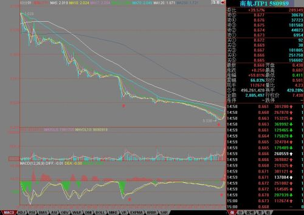

#### 中国，需要的是中国式的全球化

时间：2008-01-28 15:48:56

最近，美国次级债，使得那些一度被国内金融投资界当成偶像膜拜的美国大金融机构大丢其脸、大伤其气。金融投资领域，从来就没有偶像，风险对任何人都是公平的，曾经让你辉煌的可能就是让你最后葬身的陷阱，这一点，大概不会有任何中美的差别。

 由此不禁想到，如果我们现在这些在糖水中泡大的券商、基金、金融机构，一旦面对如此局面，又有多少能幸免？市场经济，不是伊甸园，类似的事情，又有谁能担保永远不会出现？

现在，都喜欢一窝蜂地全球化、国际化，而我们真的有必要去全球化、国际化吗？肉，烂在自己的锅里，总比烂在别人的锅里强。那些全球化、国际化背后，从来少不了的是国家间的利益分配。而更重要的是，全球化、国际化，从来都有一个主导国家的问题，现在，不用讳言，一直以来的全球化，都是美国所主导的。而我们现在所谓的全球化潮流，说白了，就是美式引导的一种全球经济游戏，一切规则都被别人所主导，这种游戏，我们真有那么必要死皮赖脸地去参加？

中国，需要的是中国式的全球化。中国的市场必然成为全球最大的，有了这个吸引源，我们完全可以整合起东亚甚至整个亚洲的市场，一个亚洲的大经济体，甚至可以包括俄罗斯。这样一个巨大的体系里，大概已经完全没有全球化的必要了，因为全球都会化在这巨大经济体的强大吸引力之中。

全球化，不是让全球把我们自己给化了，而是以我为吸引源，不断震荡整合出更大的吸引源，从而把全球化于其中，这样的全球化，大概才是中国人该真正追求的。一个中俄印日四核发动的大亚洲经济体，笼括了全球半数以上的人口和经济规模，难道还不能改变世界经济的秩序和规则？秩序、规则，从来都不是先验的，而是现实利益合力的结果。一切皆有可能，而可能是实际操作出来的。

说实在话，对我们的企业，特别是金融投资企业，按照美式游戏规则参与全球化的前景，真的很难抱乐观的态度。就像打麻将，上下对台都是别人一伙的，你能赢的可能性基本为 0。有人可能反驳，为什么我们的制造业能取得辉煌成就？那不过是别人的游戏重心并不在此。

 我们那些糖水中泡大的券商等，现在还靠诸如权证增设去抢夺小散户等恶劣伎俩赚钱养肥自己，试想，在如今美式的国际化、全球化市场里，能有这样的好事？靠类似手段长大的机构，一旦出去面对那些大鳄虎狼，能有好果子吃？

所以，最好的策略，还在待在自己家里，家里横并不是什么难听的事情，关键你的家够大。中国经济这个家，确实够大了，只要我们按部就班成为世界最大的市场、最大的吸引源，我们就能将我们的游戏规则给全球化了。这样，我们这些在糖水中泡大的券商等，至少也能在自己家里把最好的位置占住，至少有一个地利人和的优势，如果在自己家里开麻将还输给外来的，那最好的处理，就是先买一块豆腐留给自己撞头去吧。

如此，大概一旦发生类似这次次贷般的危机，我们也能很好的处理，至少全球都可以陪着我们一起分担其压力，如现在的美国；万一我们那些糖水中泡大的券商等出现什么问题，我们还可以让外面的资金来入股填窟窿，如这次美国那几家大名鼎鼎的机构一样。

 所以，解决问题，最关键还是让我们的金融市场成为全球老大，把我们的经济规模搞成全球老大，这样，肉无论怎样烂，都烂在我们自己的锅里，那时候，又有什么可值得担心的呢？

这世界，没有谁比谁更聪明，特别在最高端的市场游戏中。关键是规则的制订以及在哪里开牌桌的问题，同样功力的人，输赢其实都在这规则与地利人和之上。我们的战略，不能把自己先假设为超人，别人都是傻子。

我们现在最大的优势，就是中国经济起飞的“势”，这“势”，是国运、也是经济发展规律所必然呈现的，这是谁都夺不去的。得此“势”，则平凡之辈也可一飞冲天，我们只需要借此“势”而成就我们的全球经济战略，而最大的失败，就是把此“势”给自我扼杀了。

我们生在这样的时代，是幸运的，因为我们刚好处在中国经济爆炸性的主升浪中，这里，只需要顺势而为，并不需要超人，因为任何的超人，不过顺其“势”而成就之而已。能顺其“势”而成就之，让全球化成为中国式的，这大概就是我们最该干的事情了。

#### 吃完饭上来说两句

 时间：2008-01-28 18:54:02

由于每个人的理解能力相差太远，所以有些事情本 ID 必须再次说说，就是 580989 不是谁都能玩的，按照理论的最基本回拉，今天也完成了，后面出现任何大的下跌都是一点不奇怪的，千万别见到这两天涨了快 100%就追上去。你想想，你连股票都操作不好，怎么可能操作好权证？一定要注意，本 ID 可不想有人因为一时的贪念而倾家荡产。

 当然，如果你技术很好，那么后面震荡的机会很多，但这一切都是合力的，受很多因素的影响，毕竟这玩意还面临可以大量创设，现在用的闪电战，这里对赌的力量太多，没那水平，就别在里面折腾。 股票跌下来，就是把赢利的空间给再次打开，操作关键是纪律，是长期的规范操作。

做股票就如同一个将军率领一支军队，股票的机会就是战机，但战机能不能战，战有多大风险，首先你都要有所预计。例如，这次，跌破 4778 点，马上根据理论就有那几种情况，那么反弹后将出现什么，都是很明确的，因此，如果你技术不好，你就把最坏的情况作为自己面对的情况，你就问自己，一旦出现这种情况，你能应付否？如果不行，那就不操作，就这么简单。

 操作，是一种能力，能力强的，就可以参与更多的战机，这就像打仗，有多大能耐打多大的仗，没能耐的，就在小板凳里待着，等看到可以适合自己能力的机会再出手。 其实，操作就是这么简单，首先你要明白自己的能力，然后判断这机会的难度你能否胜任，你不胜任，就闪开，就这么简单。 事情总是简单的，只是人把事情搞复杂了。人的贪念，总是看到别人抓住机会就不爽，那样，你就永远不可能进步。 对于真正的操作者，只倾听市场与自己的声音，本 ID 的理论把所有的机会无一遗漏地输出，关键是你能否正确地认识自己，能否去把握这机会是否适合自己。 本 ID 理论中机会的输出是最基础的，谁只要读懂了都可以做到；但这机会如何进入操作的层面，最终修炼的是人，这才是最关键的。 再把前面说过的重复一次： 首先，你必须能在任何时刻正确无遗漏地给出所有机会的输出，这是最基本的，如果连这都达不到，那么你就根本不适宜用本 ID 的理论去操作。 很简单，你要考察自己的水平，请回答下面的问题：请列出最近三个必然发生不会遗漏的机会，并说明其必然的级别。 注意，本 ID 的理论与所有技术分析理论都不同的，就是本 ID 不关心这些机会的具体点位和时间，因为点位和时间涉及预测。而机会的显发，就如同花的开放，你看到了，就是了，就这么简单。 说得更明白，本 ID 的理论把所有级别的机会逐一列出，这些机会是必然要出现的，你只需要等待它出现就可以，就这么简单，你何必去预测什么点位时间的废话？ 机会出现，你必须会看出来，看不出来，就错过了，就这么简单。能否看出机会，这是第二步的问题，任一个机会如何成立确认的，在课程里都有，你看明白就知道了，然后多看，就不会漏过了。 例如，你知道按理论下一个是 1 分钟底背驰这个机会，但你连底背驰都不会看，那就不行了。 看，有一个逐步精确的问题，你看的水平有多高，这和你去理论的把握有关。你连如同用 MACD 去辅助都不知道，以为 MACD 就等于背驰，那么这种水平，是无论如何看不出背驰来的。

看出来了，就要操作了。要决定操作，就要把下一步给想清楚，就是下一个必然的卖点是什么，一旦这卖点出现后，最坏的情况是什么，每种可能的情况如何去分类，界限在哪里，每种界限触及后如何处理等等。如果你连这个都不明白，事先没搞清楚，心里不是明镜似的，那不被市场搞就怪了。

 你能把上面三步搞清楚，熟练了，那么你就算是一个初级的有自我意识的操作者了，否则，你不过是糊涂蛋。 对于糊涂蛋，谁都救不了你，而且，谁又有必要去救一个糊涂蛋？ 再说一次，本 ID 只是陪练，最终要靠自己。不说了，有缘得之吧。

#### 年线支持初显现

 时间：2008-01-29 15:19:24

首先还是说 580989，你看那中枢的力量是多么巨大，早上的远离，后面的回拉，一切如教科书一般，围绕这个原来的中枢进行震荡，这在昨天已经说了，后面震荡逐步减少，由于该中枢大致在 0.6 一线，依次向下的震荡空间是存在的。想想一个中枢震荡可以从 0.4 到 0.95，这就是震荡的力量。

之所以说这个，是希望以一种强烈的方式表现本 ID 理论的一些方面，你不需要参与其中的操作，但请你必须学习。另外，早上砸到 0.72 逐级上台阶回拉 0.85，这是一个很典型的骗人图形，这些图形后一般就是制造第二类卖点，然后后面的就是走势必须完美，再杀一波下来，多看这些图形，对你理解中枢的形成与结构十分有用。

 你千万别操作，但你必须学习，这就是 580989 这经典案例的作用。 说大盘，大盘今天碰年线，这是第一次，去年底已经说，今年至少两次，第一次应该是喜剧。不过，年线这里也可以先制造空头陷阱，一切需要各方面的合力配合。

走势不是必然的，例如今天美国不减息，全世界暴跌，那就会选择空头陷阱的形式。否则，就可以直接上去。那么，美国减息与否这个因素，谁都不知道，但今天市场上已经反应出来，就是堵其减了，这就是一种合力的表现，一旦赌错了，市场就会报复性去相反反应。

 当然，对这些走势，是可以去参与的。为什么？因为就算是空头陷阱的方式，也不会远离目前的位置太多，只要控制好仓位，当然可以参与。

此外，一定要注意，你不是多头也不是空头，但你一定要知道一旦发生什么情况，多头会干什么，空头会干什么。例如，多头的愿望肯定是想补上面的缺口，这就构成市场的一个潜在力量，这个力量，在其他力量的干扰下，可能一时发挥不出来，但这反而构成我们一个更好的买入点。

请好好品味这句话：你不当多头也不当空头，但一定要知道空头多头想干什么，而走势是最终的结果，他们想干的是否干出来了，这才是关键。干不出来，有什么后果，他们会有什么后续的步骤，这才是该想的东西。

 现在的走势很简单，只要不有效破年线，就继续是原来的中枢震荡。中枢震荡怎么样，看看今天的 580989。这就是教科书，看明白了，有什么震荡处理不了？ 先下，再见。

#### 看别人脸色的日子总是不好过的

 时间：2008-01-30 15:23:08  这题目说的什么，大家都很清楚。今天的消息，刺激了一个震荡高点，然后再回杀，由于减息的玩意还没出来，所以，尾盘赌消息的又来了，这就是发生在看别人脸色过日子的日子里的一件无聊事情。

看着 600737、600078 之类的股票，是否有点感动，这世界是需要不看别人脸色的人的，但，这东西是合力的，光有几个这样的人，成不了气候，如果别人都成了爱看别人脸色的人，那这市场还是别人的，最后，剩下不想看脸色的，可能也转去玩别的不用看别人脸色的活动了。

 说实话，现在本 ID 已经没有上次接石头的兴趣，对今年的行情，本 ID 去年已经给了明确的定位，就是题材股大搞，不管指数，所以才有了跌了 1000 多点还创新高的品种。 但指数还是会起来的，在那展望里，本 ID 给出本年的节奏是“扬抑大扬大抑”，所以，多头还是会有面包的，只是多头如果还看别人的脸色，没点自我精神，那本 ID 宁愿把节奏说错了。

中石油那些玩意出来前后，是一个转机可能出现的时候，这时候也到了，但这东西需要合力，本 ID 现在确实没兴趣再去折腾大的玩意了，把自己的一亩三分地种好就算了。但呼吁一下总是可以的，合力，需要大家一起来。

 说实在话，本 ID 宁愿 A 股跌到 2500 点，也希望见到美国全面破产，让美国再来一次 1987 年，这是本 ID 最愿意看到的。 但必须很清楚地说，美国佬这次会用所有的坏招来摆平的，问题的关键是，不要当傻子去给美国佬埋单。 大盘，很简单，现在是纯消息主导，明天美国要减息了，这边就又会冲动一下。但这种冲动不是以我为主的，以我为主，还没有找到合适的借口。 技术上，4400 点那中枢的震荡逐步向 5 分钟扩展去，走势上很简单，如果不出现这中枢的第三类买点，向上的冲动也只能是冲动。 580989，如前所说，震荡幅度减少，但震荡机会依然很多，0.6 这个中枢的威力是否够教科书，有眼睛的都会看了。 第一次年线，不出意外，还是如去年底所说，是一个喜剧。问题的关键是，这次喜剧之后，如果没有了自我意识，最终只能是悲剧。 先下，再见。

#### 缠中说禅文集版权为缠中说禅所有 此文集整理版仅供缠中说禅论坛内部学习使用，严禁外传！ 合格政府的第一标准：不给美国佬埋单

 时间：2008-01-30 15:57:44  这不是针对任何具体的政府的，而是一般性的表述。这句话，显然是武断的，但在这样一个时刻，必须有这样的武断。 美国佬，靠两次世界大战积累的玩意，占据半个多世纪金融霸权所制造的虐夺，支持了其半个多世纪的所谓美国梦。

这梦后面，不过是一个国家对全世界的虐夺与敲诈，是全世界养肥了那美国的金元世界，而美国这玩意，在全世界敲诈了这么多，竟然还大面积赤字，加上美国人超前消费所制造的亏空，这空中楼阁早该崩溃。

 其实，这空中楼阁早要崩溃，但所谓新经济以及后进国家的廉价发展，使得这崩溃给大大推迟，但崩溃总要到来。

当然，美国佬肯定又再玩原来的招数，把危机转嫁到全世界去。因为全世界中不缺乏无聊的政府，脑子进水地给美国佬埋单，有一种很可笑的观点，没有美国佬，我们的人民哪里有饭吃，没有美国佬让我们出卖廉价的劳力，我们哪里有饭吃？

 当面首的，总会有面首的思维，因为他们认为他们天生就是面首。既然这样，就面首去吧，用你们的血汗继续养肥美国佬。 我们不是对美国佬一定要杀绝，而是希望这次崩溃后，一个新的世界经济秩序能被重建，那一国独大的时代必须结束。美国的经济崩溃，是他们自己造成的，谁都不能为此埋单。 当然，美国崩溃，全世界都要影响，为什么？因为现在的世界经济秩序是一种完全不合理的系统结构，里面有着太不安全的风险传导机制，这必须打破。 而不破，哪里有立？要破，就需要美国来次彻底的崩溃，这样，才能真正立起来，至于这过程中可能的痛苦与震荡，必须承受也只能承受。 可惜，很多事情，该有的都还没有。

例如，如果我们现在已经有一个超大的蓄水池，那么，从美国外逃的资金就会有一个落脚地，可惜，我们没有，我们该建池子的时间都给荒废掉了。但时间还有，我们必须抓紧，否则，这机会一旦失去，一切都晚了。

 其他更多的，就不想说了，想了都觉得无聊。 这世界可能就是这样了，这样就这样了，我们今晚喝豆汁。下，再见。

#### 没有信心，一切瞎掰。

 时间：2008-01-31 15:13:08  3 点半有一无聊人从大连专程过来要谈一香港市场收壳的事情，谈完以后回来会写一篇纯技术分析后面走势的帖子。本 ID 现在的心情已经完全过年化了，想起还要有事情干就头疼。

大盘今天的走势是一点都不奇怪，看别人的脸色，就是这样的了。减息又怎么样？其实，即使对于美国，减息与否，要死还得死。减息后一旦引发资金大量抛售美圆资产，那死得更难看，可惜，现在接收这大量外逃资金的池子就缺一个中国的，想起就没劲，早干什么去了。

 经济是一种专门的学问，管经济的就该至少是学经济或在经济圈里泡大的，否则，打铁的、挖地的、修坝的、卖大饼的，谁都可以经济一下，这经济怎么经济？ 一句话，这次下跌，估计把印花税弄下去的可能性还是不大，大概，还需要更猛烈的暴跌，当然，反弹会有的，印花税一日不下，本 ID 的兴致将继续低迷。 今年，就看三月的会后有什么改变了，如果没有，那该怎么就怎么了，那种接石头的活，本 ID 肯定是不会再去干了，这么高的交易成本，凭什么啊？ 短线技术上，没什么可说的，现在这 1 分钟的中枢突不上去就继续下台阶。个股方面，很多股票都要先主动回一下了，否则，顶在高位上抬杠铃，没那必要。 现在，关键不是股市本身，而是信心问题，一个最简单的问题，为什么中国的投资者就要忍受全世界最高的交易成本。 有谁能回答这个问题？ 本 ID 在去年底已经明确说过了，今年一定要看到印花税的下降，不管是谁，做错了就要改，不改就不行。 本 ID 现在根本不担心股市，因为有更担心的，就怕这次经济的对局，一旦应付错了，那比股市更严重的事情还等在后面。 我们能应付对吗？抱歉，本 ID 没信心。 如果你还有心情，就请读读本 ID 这个梦：“步老杜《登高》韵记梦 2008-01-26 10:23:21 ” 先下，再见。

#### 大盘中线技术分析

 时间：2008-01-31 18:44:04  谈完了，那人赶飞机去了，专门跑一次，这事情还真没法推，苦啊，又多一件无聊事情。回来先把帖子写了再吃饭吧。本 ID 就怕答应的事情不完成吃饭都不安心。

收盘的帖子，非技术的纯粹直话直说的，这是走势后面必须的东西。但操作上，还是必须按技术来，所以技术是第一的，我们可以用一些语言对分力进行敲打，但这不能蒙蔽了技术的眼睛。特别，对于一般的散户来说，除了图形，你是最公平地和所有人同时看到的，你还能有什么依靠？

 还是和 3600 相关，为什么？因为上海的指数从一开始就和这相关，例如 90 年代初的 45 点，2001 年的 2245 点等等，这次的行情，一样与此相关。

4335 点的 530，6124 点的高位，相差基本就是 1800 点，下来的第一个位置 4778 点，就是 1800 点的 3/4，那么，现在，到了 1800 点这个位置，所以这个位置是很重要的，而且与年线相关。5522 点下来的 1200 点，也在这个位置，所以这个位置是诸多因素所相关，技术上很重要。

由于这次下来，已经把 4335 点触及，因此，一个日线级别的中枢就已经在形成中，4335 点上下就是这个中枢的一个必然部分。这个中枢，是从 1000 点上来第一个日中枢，所以这个中枢将影响至少很多个月的走势。

也就是，现在，从中线的角度，一个大的日中枢震荡已经形成。这个中枢震荡的幅度，是以 3600 点为基础的，上面 1800 点，下面对称的，也可以有 1800 点。换言之，现在就算跌到 2500 点，也不过在这个中枢震荡的范围内。

有了这个中枢震荡的大结构，对后面的市场走势就有了一个很宏观的把握。显然，目前这个中枢的中间位置，会在很长时间内反复见到。像 2500 点、6100 点，都如同 580989 在 0.976 的那样的瞬间震荡位置，而目前位置，就如同最近 580989 的 0.6 上下，是一个反复可以见到的位置。直到这个中枢被破坏为止。

 这个中枢震荡，可以以 450 点，3600 点的 1/8 为一格，上面，4778 是第一线压力，5228 点是第二线压力，下面的位置如此类推。当然，在具体的划分中，可以把 450 再细分，这对短线有一定意义。

由于目前是一个日的中枢，因此，最大的偏移级别就是 30 分钟的，如果有一个 30 分钟的向下偏移，那将构成最好的中短线机会。而且，类似 5 分钟的偏移，也构成好的短线机会。当然，如果你的超短线的，也可以关注相应的 1 分钟偏移。

 在足够长的时间内，所有的市场机会，都会是因为对于该中枢的震荡偏移所引发的，配合 30、5、1 等的内部结构图，你将在这大型震荡中如鱼得水。 本 ID 早说过了，今年只要你会震荡，你赚的钱绝对不比去年少。有了这样一个大的震荡图，抽血的机会多了去了，好好把握。

节前后市场，能否依靠年线和中枢中轴制造一次向 4778 点的中枢偏移，明天就有初步答案，如果能坚守在目前位置震荡上 5 日线，而周一又不出现前两周一样的坏消息，那么，这种偏移就有基础，否则，绝对需要先砸出空头陷阱再玩这游戏。

 注意，本 ID 对市场从来都是充满信心，但本 ID 的信心可不是死多头那样一定要向上的信心，本 ID 的信心是在震荡中抽血的信心，那样一定要单边上涨才赚钱的幼稚行为，本 ID 没兴趣搭理。 本 ID 没信心的是市场以外的事情，只要本 ID 有兴趣，大熊市一样可以玩得很开心，就别说震荡市了。但市场以外的事情，本 ID 真的没信心，而市场以外的，才是本 ID 所牵挂的。 本 ID 一早说过了，对于本 ID 来说，经济变成怎么样，又有什么影响？但对于大多数人，经济的走势太重要了，比股市的要重要得多。 本 ID 希望每个中国人都有自己的面包，本 ID 日夜担心的，是中国三十年的经济大升浪会被某种幼稚的因数所打断，除此之外，本 ID 没什么可担心的。 大升浪被打断了，本 ID 照样可以风花雪月花天酒地 419，很无耻但很经济地等着在经济大跌势的末端抄大底，但其他人呢？ 不说了，吃饭了，该什么是什么，万古云霄一酒杯。

#### 节前连涨三天？就不许！

 时间：2008-02-01 15:17:48

听说有人还在发节前连涨三天的梦，但就不许！类似的梦还有，例如现在砸下来了为了奥运如何如何，简直脑子进水了，别以为股市有什么真正的地位。按照市场经济，股市当然有着绝对高的地位，但是，这不是现实。

请注意一个事情，听说春晚里将有一个节目对所谓的股民进行强烈嘲笑的，如果这节目最终播出，将是对三十年经济大发展的最大讽刺。现代经济，最高级形式就是虚拟化的，100 多年前，美国还比不上阿根廷，就是因为美国大力发展了虚拟经济而阿根廷没有，所以，最终阿根廷也就剩下别为她哭泣的歌声。

 股民，这个称呼本来就是侮辱性的，应该是投资者，这是构成现代经济最重要结构的伟大人群。一个不尊重投资者的国家，不可能有强大的虚拟经济和真正强大的经济，这就是历史的结论。 如果脑子里还有一丝幻想的，请再把本 ID 关于今年走势展望的帖子再读一次：“2008 年行情展望 2007-12-20 15:59:05”

今年的行情，就是早干早有面包的走势，真正的投资者，在 12 到 1 月的题材股走势中，已经赚到了第一笔买面包的钱。有些可笑的人，觉得，4778 点到 5522 点也算行情啊？千万别看不起这一段，如果在大的跌市里，这可能就是全年最大的一轮走势了，而在今年，有极大的可能，这就是第二大幅度的上涨。

在展望中，本 ID 已经很明确说了，今年的节奏是“先小扬再抑接着大扬后大抑”，而且强调“至少有两个顶部是必须注意的，第一个就是 6124 点大调整的第二段上升所构造的顶部，这是一个小顶”，5522 点就是这样一个顶。

本 ID 在剧本那次说了：“关键看在 5462 到 5675 点时间段内政策面的风向，风向不对，那就先把买胶水的钱换成买棒棒糖的，一人一个棒棒糖，看你要棒还是糖。”显然，5522 点后平安、美国之类的因数足以让胶水换棒棒糖了。但后面的剧本依然有效，就如同本 ID 告诉你至少要见到腰斩的中石油一样。那胶水糊的鸟儿会有的，那就是本年第二波行情，现在，不过是为这行情进行准备。

大概没有人会注意，本 ID 在 1 月 15 日故意给出的这个帖子也被很多人认为是炒冷饭，请现在再去看看这特殊时间里帖子内容的实用性，看看当时日线顶分型刚构成后你是否如课程那样操作了，如果你真认真看了里面的内容，你该怎么操作还用本 ID 说吗？如果还不明白，请再看一次：“教你炒股票 93：走势结构的两重表里关系 2 2008-01-15 18:08:05”

 注意，本 ID 只是陪练，陪练的任务，只是在关键的时候把该用的工具放到你眼前，如果你看不到，那就算了。

本 ID 有时候说的结论会有所修改的，例如，原来对中石油，给出的就是如中人兽，也就是到 30 筑底上去，那是因为那时候期货这玩意还没被打压住，后来，一明确这玩意被压住了，本 ID 就把那至少 24 的酒席故事告诉各位了，这就是有所修改，为什么？一切是合力，有一个重要的分力改变了，当然要有所修改。

 但是，有些东西，本 ID 不提，就是无所修改。例如，对于 20 年的大牛市，20 年后至少 3 万点的结论，本 ID 没有任何修改的必要。除非中国经济自废武功，否则，本 ID 的结论无须修改。 其实，对行情的转折契机之一，本 ID 前面早就明确说过，只是看的人不注意，就是要等中石油那 10 亿玩意出来的前后，底部不是一天构成的，是要反复制造恐慌搞出来的。 有人可能觉得很残忍，废话，不恐慌，没人放血，哪里会有底部？ 这几天是什么？就是前期强势的题材股补跌，这是所有探底行情中必须有的，强势股补跌后，行情才可能进入真正的筑底。而这点，本 ID 早就说过，没有人会永远举杠铃的。

那么，行情怎么慢慢点燃？行情的点燃，都需要领头的，也就是有一个傻子，疯狂地裸奔，把大家逐步唤醒兴奋起来。这个先裸奔的，一般只有三类，新股或有突发大题材的，还有就是前次行情崩溃的祸首以及率先被打压调整的。

 如果你还没见到裸奔的，那么就意味着，行情还没被点燃，依然在底部构造阶段。现在的问题不过是：睁大你的眼睛，发现那准备或已经率先裸奔的。

其实，行情也简单，有人全球裸奔的，就是大行情；有人全国裸奔的，就是中行情；有人全市裸奔的，就是小行情；有人只能在家里裸奔最多在窗口晃悠两下的，那就是反弹行情。行情，与最开始的裸奔力度相关。当裸奔蔓延了，行情就开始展开。当所有人都习惯于裸奔了，行情就因高潮而死。

 今天的走势，不过是先尝试砸一下陷阱并让那些幻想节前连涨三天的丢一下脸。当然，连涨两天还是有希望的，本 ID 倒不拒绝两这个数字。前提是，请先冀望周末没有什么不招人待见的事情，其次，那石油出来时不要过分变态。

现在，更大的问题是，这么高的印花税，我们搞一波上去，难道就为了让平安能顺利圈走 1000 亿？想起这个事情，本 ID 完全没有冲锋打头阵的兴趣了。自由世界的勇士们，你们冲吧，本 ID 在后面跟着，一看你们不行就放枪给你们送行。

 反弹会有的，面包会有的，但在春晚要被严重嘲笑而还要被平安之流上千亿地合法打劫，并且更要继续接受一个最高印花税的奖赏，在这种情况下，谁还愿意当炮灰去发动一轮全球裸奔行情呢？ 今年，我们去铁岭裸奔，或者保定也行，各位选择吧。 周末，不妨先在家里练习练习？先下，再见。

#### 缠中说禅文集版权为缠中说禅所有

缠中说禅技术论坛 www.chzhshch.net 没有幽默感与修养成不了好的操作者

#### 没有幽默感与修养成不了好的操作者

 时间：2008-02-01 19:17:37  快过年了，到处繁忙，还是待在家里塌实。一般周五晚上都不写帖子，这次就破例一次。因为在周六、日不谈股票，就抓紧今晚再说说股票。 资本将人异化，其实市场同样让人异化。看看现在市场里的人，很多都变得神经叨叨的，心里就剩下黑马、上涨之类的机械反应与欲望，这样的市场人，真是太悲哀了。 没有幽默感与修养成不了好的操作者，一个看到铁岭、保定只会想到暗示了什么股票的操作者，也不可能有什么长期的操作成功。 铁岭不过是来自赵本山的一个幽默，而保定就是郭德刚的，当然，南方的朋友可能有点不熟悉，这不奇怪，但其实就算你不知道这些幽默的意思，从文中对裸奔的分类就能明白其中好玩的地方。

本 ID 一本正经地解释这个问题，其实就很搞笑，这只是小事。但有些孔男人的学生，见到本 ID 说第一次见年线是喜剧，就以为一碰到年线就起来就是喜剧。大概，孔男人类人写的东西都是这样的白开水。知道什么叫以哀景写乐倍增其乐吗？想想，对 5 日线的回试还要故意砸穿恐吓部分不坚定的，更不用说这 250 天线了。不把这哀景写足了，哪里会有好的喜剧，连这点修养都没有，还操作什么股票？

 很多事情都是相通的，例如在顶部的时候，就是以乐景写哀倍增其哀，文学、艺术和市场是相通的，只不过你有没有这种修养和感触而已。 市场，最终是人的修炼，你的全部修养是否花架子，在市场中一下就检验出来。很多所谓的文化人看不起市场，因为他们不过是些花拳绣腿的玩意而已。 一个真正的成功的操作者，一定是一个哲学家、实干家、艺术家、有幽默感的人，否则，市场中任何的弱点，可能就足以致命。缠中说禅技术论坛 www.chzhshch.net 七绝：给大雪中国里的蛇虫鼠蚁

#### 七绝：给大雪中国里的蛇虫鼠蚁

 时间：2008-02-03 19:14:11

看到不少蛇虫鼠蚁趁着大雪冒出来，以为一个打击中国、打击中国政府的时刻又到了，这些早被扫到垃圾堆里的玩意，迫不及待地又开始表现。中国的命运，能交给这些只会舔他们美国爸爸、日本二爸爸的垃圾吗？按照这些人的逻辑，上次美国的飓风、东南亚海啸，他们怎么不跳出来表演？

中国的肉，只能烂在中国；中国有多少毛病，都是中国的毛病，不需要这些垃圾废话。说风凉话算个鸭屁，鸡蛋里挑骨头算个面首，中国的脊梁从来都是最大多数的一群，那些被这些所谓精英要启蒙的不开化的中国人。

 让启蒙精英面首去吧，中国依然中国。 给大雪中国里的蛇虫鼠蚁 缠中说禅 雪压神州三万里 依然北极共星辰 冬云不待东风破腐鼠寒鸦枉噪尘

#### 年线上的中国式喜剧

 时间：2008-02-04 15:20:02

第一次碰年线要上演喜剧，这在去年 12 月已说。当然，真到上演时，相信的人就不会多了，不相信的人多了自然就更喜剧了，市场总是如此。所以，就算把剧本告诉你，绝大多数还是不行，这点，已说多次。不过，经过这次，大概各位对本 ID 上周所说的“哀景写乐倍增其乐”应该会有点切实的体会了。

这里，本 ID 再明确地预先告知各位，这次很中国式地把新基金砸出来了，但这还不是真想要的。前面已说，这次砸出印花税的可能性很小，那么，下次，或者再下次，总之，该改变的总要改变。印花税的改变，是 2008 年的目标之一，这点已经多次说明。

技术上，十分凑巧的是，周五低点对应的线段刚好是 360 段，一个圆周。很多人老问 3600 是什么？为什么和上海指数相关？这问题大概不需要再问了吧。有人还要问，周五有底背驰吗？如果你连周五的背驰都看不出来，那只能重读了。看看 15 分钟图，想想该是哪两段比较力度？

有些人可能又要问，如果没有周末的利好，那背驰能成立吗？问这话的人，根本就等于没看本 ID 的课程，背驰成立只保证回到原来最后一个中枢，这点和有没有消息没关系，实际上，上周五收盘前已经达到这一点，而所谓的利好不过是加强其力度而已。

 实质上，今天的上涨，并没有脱离最后一个中枢的范围，4500 点上下那 5 分钟中枢的第三类买点并没有制造出来，因此，从技术上，依然还可以看成是该中枢的一个震荡。 而且本 ID 更要问各位一句，如果没有周五的狠砸，这利好能出来吗？很多事情，都是一环扣一环的博弈，里面的水能浅吗？ 不妨再问各位一句，怎么把印花税搞出来，各位有什么建议，请发表。

这次反弹的高度，决定于恶性圈钱最终是否有所收敛，当然，外围因素也有一定的影响。但这次下来，最主要是恶性圈钱闹的，现在已经开始有人折腾这方面的事情，现在，还是进步不少，至少各种声音都能通过某些途径达到应有的分力。所以，这折腾能折腾出什么，也是很重要的。

其实，今天的利好掩盖了一个很大的坏因素，周末央行高层说，大企业应该主要到资本市场解决融资问题，并表达银根绝不放松的观点。当然，这些人不是最后定事的，他们的话也没什么准，不过，这证明某种观点或利益还是很有市场的，这就是后面的不确定因素或者说是大的隐患。

 技术上，还是原来分析的，450 点一格，4778 点破不了，就把前面两 5 分钟中枢搞成一个 30 分钟的震荡出来。 个股方面，今天普涨，关键是后续的能力。还是周五说的那三类，一般股票，反弹到阻力位置压力就大了，而一切套牢压力小或有大资金、新题材的股票，反而容易有持续的表现。

注意，今年做股票，就是要跌到位了敢买，涨多了敢抛。那种涨了才追，跌了才砍，来回几次就可以被清理出局了。如果技术不好，宁愿坐电梯也不能追高杀跌的。当然，最好不要坐电梯，要不坐电梯，唯一的办法只能是，涨的时候，就睁大眼睛看有什么大级别的卖点出现，见到日、周的顶分型，就要根据自己的水平去操作。

 明天，就看中石油表演了，大盘会有所震荡。 最后，如果有对平安特别熟悉，或有其强力罪证的，可以提供点在跟帖或留言里，节后，要来一次对平安的清算，子弹已经收集了不少，不过如果有更猛的，不妨可以多提供。 有些事情，要是需要有人干的。干，就有了分力。如果分力都没有，如何改变合力呢？缠中说禅技术论坛 www.chzhshch.net 阴线迎春给一根筋上了生动一课

#### 阴线迎春给一根筋上了生动一课

 时间：2008-02-05 15:09:59  本 ID 前面说了，节前连涨三天是不允许的，而两天要看周末消息和石油的变态程度。昨天，有利好涨了，而今天的石油，有人疯狂地抛出来，似乎那石油是不用钱买的，这么变态，你说能红盘吗？ 一根筋，不是别有用心就是脑子有水，市场操作，不脱离一根筋，那命运是怎么样，是不用讨论的。 技术上的问题，昨天说得很清楚了，就是线段类背驰后必然出现 1 分钟中枢，节后，就看这中枢的演化，事情就这么简单，不需要任何一根筋的想法。而中短线上，还是 4500 点上下那中枢的震荡走势。

请好好看看真正的大资金是如何运作的，大概很多人都忘了 580989 了吧，看看今天的走势，有什么想法？一个长假期，一个稳健的大资金，当然要这样进行有效的对冲，很多时候，不确定因素是要靠对冲来解决的。这样，不管外围在春节发生什么事情，都可以吃嘛嘛香了。

 当然，对于小资金来说，580989 这类东西风险太大，没必要参与，而且小资金不一定要对冲了，就要发挥自己机动灵活的特点，看不确定，就先走一部分，有钱在手里，什么都不怕了。 贪婪总是希望行情按自己的欲望发展，那是鸭屁思维，不改变，永无出期。 总结一句，任何不确定时，唯一正确的做法就是控制仓位，你能自如地控制仓位，那你的水平就能上一台阶。控制仓位，并不是说一定要空仓，而是把仓位控制在一旦发生特殊情况能有足够反应的水平。 任何想把最后一分钱赚到的，最终的命运只能是倾家荡产。 大过节的，就不说这些事情了。但市场的残酷，是不分节日的，那种春节一定要红盘，奥运一定要大行情的思维，要好好醒醒了。 大过节的，抛弃股票，享受人生。你的身体、家庭、父母、亲人，比股票重要一亿万倍，好好珍惜吧。

#### 开门不红又何妨？

 时间：2008-02-13 15:15:42

开门大红包，本 ID 可给足了，580989 的两次启动，都给足提示，第一次，提示后在 0.42 下随便买到，这次，即使节前你自己没看明白，今天在 0.5 下随便买，而且还两次机会，操作好了，随便一天 50%的利润。

 所以，本 ID 绝对不欠任何人红包了。 至于大盘没有红，本 ID 可真没什么兴趣关心，具体的说法，在节前最后的帖子里已经无比清楚了。

580989 的中线中枢，本 ID 在第一次启动时已经明确说过，就是 0.6 上下，回头再看看，这走势是不是完全的教科书？请好好再看看本 ID 节前最后的帖子，看看关于如何对冲，如何平衡风险的做法。让那些预测连涨 3 天的吃西北风去吧，两次 580989 的礼包，足够连续 30 涨停的利润了。

 强烈注意，本 ID 再次必须声明，一般人绝对不能买 580989，你想，600737 在 8 元说的还有人是亏钱出来的，580989 就是你的坟墓，没那本事心态，就继续当教科书演示看看吧。 还是说说这无聊的大盘吧。

只有一根筋的才喜欢开门红，知道 1993 年开门红以后就从 368 点的深圳综指跌到 94 点，大概也只用了 1 年半不到时间。不开门红，其实真没有什么，至少证明，里面有足够多的资金都没觉得今年是必须在春节一开门就要骗人来埋单的，至少有足够多的资金还有下一步的打算。

 技术上，本 ID 已经说得超明确，就是原来最后那中枢的扩展，这震荡什么时候结束的唯一标准，就是出现第三类买卖点，其他一切都是废话。

个股方面，中石油站不稳，指数要站稳那绝对是没戏的，那 10 亿的玩意，这两天成交了 4 亿了，当然，里面还有很多水分，但中石油今天留下的缺口，应该很快就回补，问题还是这 24 元上下的中枢，最终如何突破，这和大盘中枢的突破是密切相关的。

 说实在，今天这样的成交量，说明了这春节假期确实太短了，怎么都该放到 15 吧，各位在春晚是否看到那讽刺股民的节目了？有这样的现象，你说，这股市能好吗？ 中线，就看 3 月的会能不能搞点什么了，面包会有的，但要靠自己去抢。先下，再见。

#### 后三日是技术上最关键时刻

 时间：2008-02-14 15:25:29  先请个假，今天晚上有事，晚上的帖子，本 ID 就克扣了，抱歉。

今天的 580989，一个经典的走势，不管你是否参加，你都先请搞明白：今天尾盘的拉起故意和昨天是一样的，这就是一种典型的骗人手法，因为一根筋的人最多了，以为什么都是可以克隆，以为有一样的开始就有一样的结果，结果就给克死了。

 世界就这么残酷，这一招，用了好几百年了，在中国市场上也用了好十几年了，还继续好用，人就这德行了。不管你参与与否，被骗与否，都要学着点吧，这样以后兴许不会再被骗。

当然，类似骗局有很多变招，因为前 N-1 次都是一样的，但这 N 可以不断地变化，用得最气势磅礴的，就是 10 几年前深圳 194 点到 334 点那次大反弹，不断同样的模式后，最后一天大跳水，多少人一直套到 100 点，可怜呀。

 说大盘吧，大盘后三天是技术关键，因为所谓的 MACD 等指标金叉就要出现，要骗你，也就是这个时候。但这时候有两种骗的方向，一种是骗空头，一种是骗多头，都仔细看好了。 大的方向，本 ID 说过 N 次了，但糊涂的人太多，再明确说一次：

一、下面最大的机会，就是 6124 点下来 30 分钟走势类型结束后的向上 30 分钟走势类型，这机会在酝酿中，也就是在中阴阶段。但那 30 分钟的向上类型，最坏的情况，就是一个盘整，并不一定走出上涨类型，这是必须明确的。如果是盘整，就在这上下搞出一个日的中枢，然后就面临 6124 下来的日走势类型的第一个中枢，后面无论延伸出下跌或盘整，都是完全可能的，如果是下跌，那当然恐怖无比，比这几个月都要恐怖。所以，3 月前后，对中线走势极为关键，要继续全面富裕还是怎么着，就看着办了。

二、个股依然机会不断，新股、高送配的，有各类题材的，都会有机会。当然，从上线角度，本 ID 看好的类型也说过无数次了，就是环保（包括新能源）、农业、消费类消耗品等等，短线，当然就是高送配中股价特别低的，例如现在不到 20，而要送 10 之类。中线，化工等玩意是值得注意的。

注意，看本 ID 的文章，你必须连着看，因为有些前面的结论，本 ID 不可能每次都重复，例如对大盘的总判断。还有，本 ID 在前面那波中把人分为两类，一类就是坐小板凳的，一类是可以不断参与活动的，你首先要分清楚自己是哪一类。

就象从 4778 到 5522 那次，本 ID 从来没让坐小板凳的起来，为什么？因为那次是 30 分钟以下级别的活动，既然我们假设小板凳至少要搞 30 分钟以上的，否则搞不过来，那么当然就一直不用起来。但还是有无数孔男人的学生叫嚷，为什么涨了不让我们从小板凳起来，那你首先问自己，你有搞 30 分钟以下级别的本事吗？5522 点的急促下跌，就是因为上来的级别小，下来的当然也就小，你能反应过来吗？那些下来时不会动的，你认清自己的水平了吗？

 认清自己，否则一切瞎掰。就像 580989，机会就这么大，但你首先要有这水平，自己都认清不了，那只能等着被屠杀。 认清自己，然后根据实际走势决定自己的操作，就这么简单，还孔男人什么呢？先下，再见。

#### 缠中说禅文集版权为缠中说禅所有 此文集整理版仅供缠中说禅论坛内部学习使用，严禁外传！ 回试年线暂显支持

 时间：2008-02-15 15:39:01

今天回试年线暂显支持，但问题还是下周初，因为 MACD 的柱子是否有效放红，这是下周最关键的问题。目前的情况十分明确，就是技术面完全支持行情的展开，但基本面、政策面有太多令人不满意的因素，因此才有如此上下为难的局面。

整个政策面的明朗，大概还是要等到三月会后，因此，之前，一个震荡的局面依然。其间，上下尝试，左冲右突一下是很正常的。期间甚至不排除再有一次大的跳水去把最后的盘子洗干净，当然，这涉及最后的底部图形，如果是头肩底，那这次跳水就免不了，如果不是，那就不一定有了。是否头肩底，和后续的消息面相关，技术上反而没有太大的倾向。

但个股行情会继续展开，只要指数稳定筑底中，有题材的个股就不会寂寞。但操作中必须要有严密的布局，例如，昨天说的 20 以下送 10 的个股，其实就没几只，本 ID 没明确说出来，就是不希望养成懒惰的习惯，连自己功课都不想做，那干脆把账号告诉本 ID，本 ID 把钱直接打给你算了。

最符合要求的，只要做点功课，显然不难找到，就是600795。这股票，业绩很好，10 送 10 后就今早算 9 元，风险度很低。而且，530 后大唐电力的送股行情表现，使得这股票的后续走势更有想象力。但这些都是估算，你介入时，就应该知道，这两天的小阴线是在构造一个小的第三类买点，18 元上介入，大概的风险有 10-15%，所以，你就根据自己的风险能力去决定自己的仓位，然后买入相应仓位，并留下一定的对冲资金去为后面减低成本，有了这一些安排，今天一大早有足够的时间让你去介入了。

 注意，这里教的是一种思维操作方法，不是说一定让你去买 600795，而且，现在拉起来了，再买就没意思了。 来这里，不是培养懒人的，这点，请一定注意。 580989，今早又给了一次走的机会，没走就不要怪本 ID 了，当然，大盘只要走不好，这东西还要折腾，但至少这一走，逃过 20%的跌幅，这已经足够了。 周末，都好好休息吧，身体最重要。先下，再见。缠中说禅技术论坛 www.chzhshch.net MACD 红柱子终现待确认

#### **MACD** 红柱子终现待确认

 时间：2008-02-18 15:18:26  上周说了，本周最重要的事情就是这 MACD 的红绿柱子问题，今天，借点利好，终于把这红柱子给弄出来了，但注意，这并不意味着一切无忧，下面就是一个确认的问题。 技术上，一般这种红柱子出来后，如果不能站住今天的位置，那么就会出现出几根红柱子再出绿柱子的情况，这种情况往往对应着新一轮的杀跌，所以这红柱子出来，需要预防的就是这种情况。 具体操作上很容易处理，也就是红柱子出来后，如果后续能量不能跟上，那么出现以上情况的可能就很大了，那么在冲高无力时，一定要先出来看看，因为后面对应的转折很可能是极为急促的。 技术上，底部的构造有头肩底的可能，这红柱后很快再绿柱的情况，往往就对应这种情况，在最好的情况下，也就对应双底的情况。

当然，以上都是些不精确的分析，如果按本 ID 的理论来，这些分析都没多大意义。现在就是一个中枢震荡的过程，这点说了多次了，今天并没构成线段类上涨，说明向上动力不足，因为今天构成的 4575 上下的 1 分钟中枢就有着重要的技术意义。后面的超短线走势完全由此中枢最终演变所决定。

个股方面，农业、化工、奥运等等都有表现，但板块持续性还是有问题，现在的问题是，一个超级裸奔的板块还没有形成，所以个股行情只能显现零散的局面。要改变这局面，还需要人气的不断培养。600795 碰到 20 的整数关口，需要整理换手，如果高送股的板块都走不出来，其他板块就更难有戏了。

 本周能否保持住 MACD 的红柱，并站稳 4575 之上，这是对多头最重要的技术要求，明天的 CPI 是一个考验，能否经受这考验，这是能否完成要求的关键。缠中说禅技术论坛 www.chzhshch.net CPI 公布成突破契机

#### **CPI** 公布成突破契机

 时间：CPI 公布成突破契机

昨天说了，今天要经受 CPI 公布的考验，结果大盘一直围绕 4575 的中枢震荡，CPI 公布后也依然不变，下午更向上偏移，显示了最近少有的强势，最后一小时，就是中石油的表演，该股也如期回补前几天的缺口，但由于该股最近的大中枢并没有有效突破，所以这个回补只有震荡的意义，暂时不能给予太高的技术评价。

显然，今天的走势，使得 MACD 的红柱子继续延伸，而从 4431 点的回升，目前已经至少是 1 分钟走势类型的，第一个中枢在 4575 点上下，后面就看能不能在其上形成新的中枢，如果行，就继续强势。4672 点是第一回升的高点，因此，最强的走势，就是新中枢至少围绕该点位形成，甚至在其上形成，这样，大盘走势的可拓展性就大大加强了。

当然，站在本 ID 理论的角度，由于这次的底分型范围的上沿也在 4672 点，所以 4195 点上来的走势最终是否延伸为笔，关键也在 4672 点的站稳。因为笔的最基本条件就是顶和底分型之间必须有不重合的部分，1 月 23 日那个底分型，就是因为后面不能突破站住 1 月 22 日高点 4818 点，所以使得不可能延伸为笔，进而原来的向下笔继续延伸，形成后面的下跌。

 因此，从最技术化的角度，4672 点是一个关键的位置。 不过目前短线最大问题，还是板块行情没有被点燃。靠中石油可以突破，但不能把人气激发，所以，后几天能否激发出板块行情，将是行情能否有力度延续的关键。

#### 大规模增发猛于虎

 时间：2008-02-20 15:27:33  5200 点那次，平安的增发成了最后的稻草，今天，又来了一个浦发的增发，虽然不是正式的消息，已经足以让大盘回头。

现在的多头，必须如利物浦一样去战斗才行。三个手球不算，熬到最后一刻才把最后的纸给破了。现在，基金的新发，等于把空头一个人给罚下了，但要灭空头，没点耐心是不行的。今天这增发闹剧，等于一个手球不算，估计这不算的手球，还少不了。不熬到 85 分钟以后，胜利的希望是看不到的。

技术上，这 1 分钟的上涨肯定是没戏了，这里最好的情况，就是震荡出一个 5 分钟的中枢，看能不能搞成 5 分钟的上涨，注意，这是最好的情况。最坏的情况，当然是 4575 点附近的震荡后出现第三类卖点，这样就重新探底。

 中线上，4672 点站不住，真正的行情就不会展开，依然是继续的震荡走势，等于今早前 85 分钟的闷战。

多头需要第一个进球，这进球，必须来自板块的启动。本 ID 一直强调的农业股，现在已经是整体走强，600737 更是无耻地又新高了。这板块能否带动化工等，逐步把热点蔓延，这是后面需要留意的。有时候火点起来了，蔓延不起来，那只好偃旗息鼓，等机会再来，这种事情也是经常发生的。

前面说了农业，环保新能源，化工，这都很好理解。至于消费消耗品类的，这其实是中国最大的优势，就是各种消耗品，例如吃的，包括调味品等等；用的，用的包括很多方面，例如汽车发展了，汽车的配件如轮胎、玻璃之类的，反正是整天要换要用的。中国什么多？就是人多，消耗多，这是永恒的题材。酒类，只是其中很小的部分。

 中线真的突破时间，可能真要如前面所说，等到 3 月那会后了，所以一定要耐心。最主动的做法的，就是追逐最强势的板块；最稳健的做法，就是逢震荡低吸那些有中线潜力且刚启动的，如高送之类。 580989。现在是完全和大盘对冲着搞，中枢上的风险就开始加大了，当然，如果大盘破位，那会有一次冲动的过程，不过风险很大，一般人看看就算了。 先下，再见。缠中说禅技术论坛 www.chzhshch.net 资本市场必须维持生态平衡

#### 资本市场必须维持生态平衡

 时间：2008-02-20 16:27:15

环境保护、生态平衡已经是世界性的大问题，而资本市场，也同样存在一个环境保护、生态平衡的问题。在资本市场上活动的各种力量，之所以能存在一个系统中，就是之间有一个基本的协调关系，而一旦这个关系被打破了，这个资本市场的大系统就会出现生态危机。而一旦出现生态危机，这资本市场要恢复元气，那就不是一朝一夕的事情了。

对于中国这初生的资本市场，其生态系统本来就极为脆弱，因此，期间的生态平衡，必须有些人为的引导，而这种人为的引导，在该系统充分发育后将逐步减少。因此，对于管理层来说，有意识地对资本市场的生态系统进行环境保护，是其最为重要的任务。因为对于管理层来说，其业绩的好坏，完全依赖于资本市场系统运行的顺畅与否，一个导致资本市场生态灾难的决策，无论如何都不可能是及格的。

资本市场的生态平衡的维护，是有时间性的，一些决策也因此带有时间性。例如，目前的环境下，一个资本市场中的大力量，通过强力的圈钱活动对资本市场的资源进行过度开发，这样的事情，就绝对是不合时宜的，一旦蔓延，必要要造成生态灾难。

环境保护，很重要一点，就是要对资本市场的市场资源进行合理、适度的开发，禁止乱砍乱伐，更不能允许那些无证小煤窑或受到地方以及其他保护势维护而非法开采的煤老大到处横行，这些资源是属于全中国人民的，没有人有资格随意浪费或为自己的利益而干苟且之事。

 其实，世界上的道理都很简单，资本市场的事情也很简单，不简单的都是利益。有了利益，一切简单的事情就复杂了，现实中的环境保护所遇到的问题如此，资本市场上的问题也是如此。 因此，要最终解决问题，就是一定要砍断这利益的背后黑手，这大概才是问题的关键。时间：2008-02-21 15:18:25  各位元宵好，晚上过节，就没帖子了，抱歉。 今天，昨天的传闻被证实了，在现代社会，空穴来风的事情很少有，特别在资本市场。指数勉强地维持了 4575 点的中枢震荡，这 5 分钟中枢是确定了，后面的关键是第三类买卖点的问题。

由于大家伙都爱狮子开大口，所以大家只好避而远之，指数折腾不出花样，并不意味赚钱的机会少了，赚钱是靠个股而不是指数。在去年的展望中已经明确说过，今年是题材股的天下，而目前，正如昨天所说，就要到处点火，把板块激荡起来。

 今天，从创投到化工、医药、新能源等等，都被点了一次，这板块轮动是否能起来，现在还不好说，因为现在人为因素很大，但如果光是点火的人忙乎，最终是燎原不了的。燎原不了，那点火的人就白忙了。 指数，最悲惨的就是再砸一次底，但估计有题材的股票，最多就顺着洗洗，你看，现在又有不少股票新高了。和指数折腾没多大意思，还是折腾个股吧。

注意，个股折腾，要注意轮动，一个板块涨起来了，就没必要去追高，要买也买那些没启动但有新资金关照的。现在的行情，持续性都不高，势头不对就可以跑，跑了依然会有无数股票等着可以去买，现在可没有踏空一说。

 当然，没这技术的，就抱死一些中线肯定会涨的股票，死守具体的板块。能轮动起来的，赚 500%，轮动不起来的，死守的，赚 50%，这世界很公平，技术很重要，没技术就别眼热了。 中枢的作用，在今天的 580989 上又一次经典了，看看远离中枢后回跌起来多刺激，和上次 0.976 那次比有些差，但还是有点经典的。 先下，再见。时间：2008-02-22 15:18:40

今天继续延续 4695 点浦发闹剧所制造的线段类下跌，在下午 2 点后最终出现一个类底背驰。该类下跌出现三个类中枢，类背驰后的回拉如理论所要求的最低幅度回到最后一个类中枢，也就是至少制造了一个 1 分钟中枢。最坏的情况，这中枢是一个新的 1 分钟下跌的第一个中枢；最好的情况，就是该 1 分钟中枢出现第三类买点，然后至少回到类下跌的第二个类中枢范围。因此，下周初该中枢的演化决定了大盘短线的形态。

而实际上，大盘下周初的走势还将决定大盘的中线形态。在前几天大盘 MACD 出红柱子时，已经说过，就是必须注意放几天红柱子后再次放绿柱子的情况，这样就对应着大盘再次破底形成头肩底形态。那么，下周，是否要出现这种情况，马上就要分晓。由于今天依然红柱子，因此还存在不出现绿柱子，红柱子再次伸长的情况，而这一切都将在下周有分晓。

 以下的内容，在前面已经多次提过，这里不妨用单纯对 MACD 柱子可以面临的情况进行最完全的分类再表述一次：

一、再次绿柱子后比前一次更长，面积更大，这对应着原来从 6124 点下来的 30 分钟级别下跌不能形成背驰，那么大盘最终的下跌空间完全可以合理地到达 2500 点，这也是我们所说以 4300 点为中轴的 1800 点震荡区间范围内的。

评论：这种情况，在技术上是合理的，但根据大的基本面情况，暂时看不到支持这种走势的可能，当然，就算这走势真的出现，也没什么大不了的，反正在真正破位下跌时，根据技术早走了，真有这样的下跌，等于一次巨大无比的机会在前面招手，那时候，又可以到砸锅卖铁买股票的时候了。

 注意，基本面上其实还是完全存在这种可能性的，就是美国再次 1987 年，本 ID 已经多次表达希望看到这种情况的意愿，可惜这不是本 ID 所能决定的，那么我们就默默念多点咒语，把 1987 年给咒出来吧。 二、绿柱子再出现但比前一次短且面积小，对应着 6124 点下来的 30 分钟下跌背驰，也就是最终结束。然后展开一轮 30 分钟级别的向上过程。

评论：这是从目前基本面角度最合理的走势，本 ID 反复强调，真的行情可能要等到 3 月份的会后，主要就是针对这种走势的，从月线的角度，底分型并没有出现，也就是说，2、3 月份在月线上的任务，就是把月线的底分型给弄出来，一旦这成功了，就有支持行情展开的最基本技术基础。

 三、不再出现绿柱子，红柱子再次延长，大盘直接上去。

评论：由于上次 4195 点对应的是一个 30 分钟中枢的盘整背驰，从纯技术的角度，这也可以构成底部，因为 a+A+b+B+c 里，c 并不一定要存在的，可以直接从 B 就向上反转，这就对应着盘整背驰点的情况。不过，这种情况，一般都需要基本面的支持。这次，能上来，主要是新基金的发行，但后面一系列的圈钱闹剧，使得新基金的发行基本面支持有所动摇，所以，这种情况，作为一种良好的愿望，还是可以努力去实践的，但这样直接的上去，只有一种后果，就是上升的空间会被压制。从纯技术的角度，一旦一个 30 分钟的直接上冲不能制造有效的突破，那么甚至可能形成一个日下跌的第一个中枢，这反而问题大了。

 当然，二、三两种情况，都依然存在选择的可能，最终怎么选择，那是大盘自己的事情，我们只需要等大盘自己去选择，然后根据选择操作就可以。 操作上，已经多次反复说过，震荡中，就是要逢向上无力就抛，下来跌不动了再买，这样才是真正操作的节奏，如果你没有这个节奏，那干脆就坐小板凳看着。

对于大盘大的走势，去年展望中曾说过，大盘有很大可能今年创不了新高。从纯技术的角度，无论最后是哪种选择，30 分钟的向上最大可能就是形成大的第二类卖点，6124 点是第一类卖点，后面至少要回杀形成一个大的日中枢，所以，今年行情的困难程度，去年底已经说得很明确了，还是那句话，今年结束时，大多数股票的年 K 线都将是阴线，这点必须时刻记住。

所以，各位可以根据自己的情况，决定自己的操作：一、如果觉得自己无法应付日以下级别的折腾，那么全年坐小板凳也是一个很好的选择。二、觉得 30 分钟的走势还是可以应付的，就好好等待这 30 分钟向上机会的酝酿、展开，但一定要记住，现在犯点错误问题都不大，但一旦最终这向上开始后，最终一定要在顶背驰时出来，第二类卖点不走，后面是什么结果，看看昨天的 580989 在 2 点多 0.76 上那第二类卖点后，收盘在 0.64 就知道了。当然，第二类卖点大幅度调整后会有再次上涨的机会，但如果这调整不躲开，其痛苦程度可不是一般人能承受的。

个股方面，已经反复说过，今年除非有期货，否则大盘股都没什么大戏，而期货是本 ID 所深恶痛绝的，本 ID 今年的三大任务之一，就是不想看到期货。今年就是题材股的天下，这已经说得太多了。诸如农业、创投、化工、医药、消费品、奥运、低价股投机股甚至军工等等都会反复表现的，而且，最近公布了重组的事情，因此，关于重组的题材将慢慢升温，重组题材的好处，就是熊市也可以炒得热火朝天，这是一个值得关注的方向。

一定要注意，今年行情，就算是个股也不可能像以前单边上去，肯定是反复震荡，来回折腾，除非那 30 分钟的向上过程最终展开，否则那种连续涨停，一去不回头的走势是很难出现的，操作上一定要见好就收，大力来回折腾，这样才能把利润洗出来。

 某种程度上，今年炒股票是一个体力活，要来回跑动，要特别勤快才行，这点必须注意。 周末，还是少点股票吧。先下，再见。

#### 新基金难敌乱增发

 时间：2008-02-25 15:23:55

所谓事不过三，就算是管理层，连续三次用同一的招数，市场也不会领情了。而且，市场甚至会这样以为：连续发新基金，又不制止乱增发，难道是想让新基金去配合完成乱增发？一旦市场有了这样的念头，新基金就算有着良苦用心，也只会被认为良心大大地坏了。因此，今天市场用新低回应管理层的关怀，最恰当不过了。

今天的走势，给那些政策迷好好上了一课，政策从来不是万能的，任何政策不过是市场的分力之一，最终决定市场的是合力。而所有的合力都写在走势之上，所以，今天的市场，如期地就把上周所分析的第三种走势给废掉了，后面，就是第二种走势的演化问题了，这也是我们反复强调的最有可能的走势。

注意，卖出总在向上的过程中，也就是总在红柱子时。在上次刚出红柱子时，本 ID 已经明确说过了，一旦上冲没力，一定要先走，因此在 4695 点就算你没看出那 5 分钟的盘整背驰，里面还包括一个 1 分钟盘整背驰的区间套，那么，浦发的消息也已经足以让你走人了。至于那些还要问绿柱子出来再走是不是太晚的人，永远不会懂得什么叫节奏。不懂得节奏，那就继续被市场调戏吧。

今天的短线走势是超级教科书的，一开始就跌破上周的 1 分钟中枢，那中枢，只能回到三个类中枢类下跌的最后一个，超级弱，因此跌破一点都不奇怪。然后早上那最大的反弹构成第三类卖点，然后继续下跌，下午那波反弹完成第二个 1 分钟中枢的构造，所以，4695 点下来的走势，肯定至少是 1 分钟级别的下跌了。

短线的机会，在这个 1 分钟下跌背驰后构成 5 分钟中枢的那个反弹，当然，这反弹有多大力度，就看其后的基本面情况了。最坏的情况，这反弹就在今天所构成的 1 分钟中枢范围内结束，然后构成 5 分钟下跌的第一个中枢，一旦出现这种情况，后面的下跌还要猛烈。

当然，现在各种因素交织着，政策面方面经过今天很没面子的一天，是否有新的动作，这是决定最终形态的一个很重要的因数。其实，现在最大的利好不是印花税，而是把乱增发给规范，这才是稳定人心的立杆见影之举。现在就算印花税出来，请问，减少的印花税难道都马上给平安之流上供去吗？

现在，要密切注意个股了，赚钱是靠个股不是指数，看好那些趁机洗盘，强力吸纳的股票，技术上最安全的，就是离前期高位有一定距离，最近强力站稳而成交量一直保持一定数量的股票，因为新高的股票怕多头陷阱，而这种在下面横着的股票，有明显的吸纳迹象，就算补跌，也就是洗盘而已，正好继续买。当然，真能站稳新高的股票，只要前期没有暴炒过的，都是有投机价值的。

 但一定要注意，底部不是一天构成的，必然会来回折腾，因此，操作上一定要把握节奏，在底部震荡中就把成本降下来，一旦行情真启动，个股刚开始涨，你的成本已经低了 30%，这样不是最美妙的事情吗？先下，再见。

#### 缠中说禅文集版权为缠中说禅所有 此文集整理版仅供缠中说禅论坛内部学习使用，严禁外传！

缠中说禅技术论坛 www.chzhshch.net 无技术含量救市已审美疲劳

#### 无技术含量救市已审美疲劳

 时间：2008-02-26 15:14:39

今天的所谓救市发言，本质上一点技术含量都没有，除了表现管理层最近对市场的超级关注外，没有其他实质内容。关于恶意圈钱，并没有给出实质的限制措施。何谓根据市场的情况？难道一上 5000 点，平安就可以继续 1600 亿的圈钱？所以，这个问题不彻底解决，市场最终的上涨空间一定受到限制。

当然，从超短线的角度，昨天已明确指出 1 分钟底背驰出现后的机会。今天的走势，简直是超级教科书，下午一开盘的第三类卖点，然后再破底，在 2 点半形成最后的底背驰，如此教科书的走势，如果都不能看明白并操作，那么唯一的办法就是继续读书。

由于 1 分钟背驰后，最低的回升幅度就是回到最后一个中枢里，所以，明天的关键就是这升幅能否扩大。日线上，今天已经有底分型的雏形，明天只要不破底并比今天最高位高，底分型就成立，后面就是是否延伸为笔的问题，所以，技术上已经初步具备上冲的形态。

 但是，目前最大的问题是，政策上需要真正的干货，而不是一些掺水的玩意。如果政策不能给于足够的真正支持，那么，就算上去，也就是继续保持大的震荡而已。

操作上还是那句话，以震荡的思路去操作，一旦上冲没力就先出来。个股上，前面提到的个股都会有所表现的，但现在的问题还是，如果没有真正的政策面支持，持续的行情的展开就有困难，而个股也只能进行线段式的震荡表现。

 今天下午晚上都有会，帖子就克扣了，抱歉。

#### **4391** 点决定短线走势

 时间：2008-02-27 15:19:36

昨天说了，今天不创新低且冲上 4331 点就构成底分型，今天的走势也很争气地达到了最基本的目标。但是，站在严格的意义上，这不是最强的走势，因为整个底分型的上边沿在 4391 点，也就是前天的高点，最强的走势就是今天直接攻上这点上。

因为，底分型成立并不意味着上攻走势必然延伸为笔，关键是要站住整个底分型的上边沿，这才是技术上的关键，前面 4818 点、4672 点之所以不能延伸为笔，就是这个原因，因此，4391 点成为短线最关键的位置。

 由于大盘选择了我们认为最有可能的第二种中线走势（第一种还不能完全排除），因此 MACD 的进一步变化就可以勾画出大盘中线的可能变化： 一、由于今天 MACD 的绿柱子开始收短，因此，最好的情况，就是再次放红并创出比上次更大的红柱子，这样，MACD 的黄白线至少要回到 0 轴附近。 注意，所有真正行情的展开，都必要需要 MACD 的黄白线回到 0 轴，一旦站住 0 轴，行情就会展开。这是最好的走势。 二、绿柱子再次放长或放点红后再放绿柱子。 这种情况对应着继续的底部震荡。

目前，大盘中线的颈线位置在 4700 点上下，可以给各位一个最明确的技术图象，如果能在 MACD 黄白线回到 0 轴同时大盘回到颈线，最后站住，那么突破就不可避免。当然，要完成这技术图象，还需要多方面的配合。而操作上，没必要被这干扰，只要颈线不有效突破，就可以继续按 30 分钟震荡去操作。

 注意，之所以用 MACD 来描述，主要是这个指标谁都能看见，而且直观，并不是说 MACD 有什么特殊的地方，如果你对本 ID 的理论有所把握，这一切都完全没必要的。

本 ID 前天明确告诉有 1 分钟底背驰，昨天一个教科书走势，如果都不能把握，那你就面临两种选择：一、你不需要再来这里了，等你被市场再戏弄 N 次后再说吧；二、抓紧学习，这是最基本的技能，连这都不能把握，不学习不继续锻炼哪里有更好的办法？

那么，昨天按理论进入的人，今天的操作，在 100 那课程里其实也早说了。因为这后面无非面对两种情况：一、1 分钟回升构成 5 分钟的第三类卖点；二、1 分钟回升不构成 5 分钟的第三类卖点。无论哪种情况，都对应一个 1 分钟的走势类型，现在唯一需要市场去确认的，是这类型是盘整还是上涨。

 今天的走势，在 4331 点上下形成第一个 1 分钟的中枢，因此，后面的走势，就是这中枢的演化，一旦这中枢能形成第三类买点，那么，构成上涨并重新回到原来 5 分钟震荡的几率就极大了。

操作上，就很简单，你根本不需要慌忙抛出，因为你可以根据这中枢的演化再做决定。当然，如果你的胆子特小，那最稳健的做法，就是今天下午开盘后那线段类背驰先抛出一半，为什么？因为线段类背驰后必然形成 1 分钟中枢，这表明你不想全仓参加这 1 分钟的震荡，等其后走势确认再说。

当然，对于一般心态好的，其实没必要如此，1 分钟的震荡你都受不了，那还怎么搞股票。不过，对于操作水平有一定的，其实也可以利用那线段的类背驰，进行换股操作，这是效率最高的玩法，不过这对水平要求更高，并不是每个人都可以达到的。

 本 ID 的理论给予的操作指示都是最明确、最精确的，没有任何含糊的地方，关键是你的心态和能力，有什么的心态和能力就参与什么活动。但前提是，基本的操作和分析，你必要彻底明白。 个股还是那句话，让板块轮动起来才是王道，否则，大盘的动力将出现大的问题。缠中说禅技术论坛 www.chzhshch.net 穷疯浦发让大盘再陷彷徨

#### 穷疯浦发让大盘再陷彷徨

 时间：2008-02-28 15:12:30  昨天已经说了，这两天本来是大盘短线很关键的时间，也就是 MACD 红柱子能否再度出现的时间，这时候任何风吹草动都会让脆弱大盘受到惊吓。

今天，曾经在 4672 点扼杀大盘底分型延伸为笔的浦发又疯狂出招，这次的招数是横着来了，就说自己的资本充足率已经快到红线，现在就是穷疯了，400 亿不行那 300 亿也可以，总之没钱就不行。这种强暴的逻辑，怎能不让大盘再度彷徨？

 虽然，在技术上大盘顽强地没有出现昨天所说 1 分钟震荡的第三类卖点，依然保持了中枢震荡的局面，但这种变化，必然让市场心理再次出现波折。 今天支持大盘没走出真正下跌的，无非是关于印花税将要修改的传闻，因此，今后几天，市场心理将在这种传闻与圈钱压力下挣扎。 技术上，4391 点没站住之前，大盘依然存在再度探底的潜在压力，至于这压力是因为传闻没兑现还是其他原因，这并不重要。

前面早说了，现在出印花税修改，其效力将大大减弱，因为现在最大的问题是，圈钱的压力已经远远大于印花税的减少，现在最大的问题是，万一印花税出来，最终又是一日行情，那么市场的信心将最终彻底崩溃。

 操作上，依然按照震荡的原则，上冲无力减，下来震荡依旧再回补。 不过今天大盘上还是有亮点，就是个股行情有所升温，这趋势能否延续，决定大盘信心的修复能否实现。

#### 要通胀还是要经济增长

 时间：2008-02-28 15:53:15  现在最大的问题是什么，就是不能让中国经济陷入真正的大调整中。现在的经济无非面临这样一个问题，就是要通胀还是要经济增长。

关于这两个选项，无非有四种完全分类：高通胀高增长、高通胀低增长、低通胀高增长、低通胀低增长。前面，我们一直在低通胀高增长的阳光下幸福着，但这种状态不可能永远存在，也就是说，其余三个选项也有可能成为现实的走势。

那么，我们最怕的是什么？就是高通胀低增长，这才是最可怕的事情，一旦出现这种情况，中国整个社会结构都将面临强大的压力。而低通胀低增长，一般也不会在中国这种发展中国家出现，所以，最好的选择，就是高通胀高增长。

也就是说，万一低通胀高增长的幸福不能延续，那么我们宁愿选择高通胀高增长，也绝对不能陷入高通胀低增长的死局。换言之，保持高增长，是第一重要的事情，只有在保持高增长的基础上调控通胀，才是正确的。

 而那种企图牺牲经济增长压制通胀的做法，不但不现实，而且很有可能让中国经济陷入高通胀低增长的死局，一旦经济决策失误，将出现以年为计量的巨大调整，中国的复兴大业也将受到沉重打击。

现在中国的通胀问题，本质上是中国现有经济结构不完整不合理所造成的，而这刚好给国外敌对势力与投机分子以可乘之机，看看现在所有资源类甚至农业类资产的大幅度被炒作，就知道，所有都刚好是中国经济的软肋，而这又能怪谁呢？一个大国，甚至连一些基本的农产品都要大面积依赖进口，别人不搞你投机你有可能吗？

去年，当市场狂热讨论所谓的流动性过剩时，本 ID 就明确指出，这玩意根本不存在，只是中国经济、资本市场现有结构不完善所造成的假象。完善基本结构才是本，而不是像央行对于风车玩那种幼稚游戏。事实证明，央行大战流动性过剩风车，最终就是一个闹剧，现在，利率已经比美国还高了，就看这闹剧如何收场了。

 中国经济的所有问题，归根结底是结构性问题，很多问题的解决，都必须从此下手，否则在一些无关紧要的地方大耍花枪，除了闹剧还是闹剧。 而这种闹剧，我们还经历得少吗？ 一句话，只有经济结构理顺了，经济增长保持了，才可能真正解决通胀压力，这才是治本之路。否则，通胀将如去年的流动性过剩一般，大战通胀最终还是风车闹剧，最终的结果将不是任何人能负责的。缠中说禅技术论坛 www.chzhshch.net 大盘已具备上攻的所有技术条件

#### 大盘已具备上攻的所有技术条件

 时间：2008-02-29 15:18:56

今天，MACD 的红柱子终于再度出现，这是黄白线两次缠绕后的结果，所以在技术上特别值得重视。一般情况下，这种走势都将使得黄白线重新回到 0 轴附近，对应着大盘将有一轮上攻走势。但是，往往是这种情况下，最容易出现骗线，骗线不常出现，一般 10 次里可能也不到 1 次，不过这种可能性是存在的。

大盘已具备上攻的所有技术条件，最近诸多板块也预热了几天，因此，如果基本面上没有突发性的消息，这大概率的可能性转化为实际走势是很自然的事情。可能的不稳定因素，无非几条：一、外围市场突然大规模下跌；二、又来一个新的平安、浦发的升级版闹剧；三、一些传闻中的所谓利好被证明是空穴来风。

由于这些因素不是市场能完全控制的，因此，走一步算一步是最好的操作思路。如果按本 ID 的理论，那这一切都无须考虑，因为，4331 上下的震荡已经延伸为 5 分钟级别的，那么，就看这中枢的第三类买卖点就可以，其他都可以当成中枢震荡处理。

 上方的关键点位，前面也早说了，就是 4391 点，这点位必须有效突破并站稳，否则走势不能延伸为笔。

板块方面，还是前面说那几个：农业、化工、消耗品、环保新能源、军工、创投、奥运、重组等等。如果黄金上 1000 美圆，资源类的会短线爆发一次。高送的股票，因为大盘不配合，除权前没表现的，那么，表现可能就要到填权中了，例如这几天的 002202，就是一个典型例子。

 最近大盘多灾多难，往往要真动时，就突然冒点事出来，所有很多力量都被压抑了。但力量总要爆发的，就算这次再来一个突发的东西，不过为再下次的爆发积蓄能量，面包会有的。 周末，休息第一。先下，再见。

#### 站稳 **4391** ，剑指 **4695** 点。

 时间：2008-03-03 15:22:53

大盘今天终于按最通常的方式突破 4391 点，早上那本年度至今最衰股票中国平安并没有把大盘再次引向下跌，而外围股市的大跌走势也没产生大的影响，究其原因，是我们自己内部基本面有了一些更大的支持，抵消了相应的影响，使得大盘的突破终于如愿。

技术上，早上的回跌刚好形成 5 分钟中枢最后一次的一线段，这样，a+A 的走势的 a 可以完美地进行线段盘整的分解，而 A 刚好是 9 个线段的最基本形式。当然，由于真正的第三类买点并没有出现，所以，大盘依然有重新回到该中枢震荡的可能。

 这可能对应的基本面情况最大可能目前就是两个：一、外围市场继续大幅度下跌；二、那最衰股票周三继续顶风作案，通过大规模增发计划。 所以，大盘能否最终站住 4391 点，在基本面上必须注意这两个因素。 由于今天已经突破 4391 点，那么在周线上，一个底分型已经出现，而这底分型要延伸为笔，必须有效突破 4695 点，这也是中线行情能否展开的最终关键。 技术上的描述在 N 天前已经给出，按最正常的情况，这 MACD 的再次红柱子将使得大盘重新回到 0 轴附近，这对应着对 4695 点的冲击，最终站住 0 轴，突破 4695 点并有效站住，将展开真正的行情。 当然，这一切能否最终实现，需要这段时间基本面的配合，只要基本面没有重大变化，这一切都将按部就班去实现。

个股方面，本 ID 已经把该说的都说了。你看看本 ID 的那些股票，600737 就不说了，化工股里的 600078、600319；农业股 000998、创投 600635 等等都很无耻地创出 6124 点以来的新高，显然，只要行情继续延续，很快就有更多地新高，这就不用说了。

 当然，你完全可以不搭理本 ID 的股票，你可以按本 ID 提示的板块去找，例如环保新能源，说过无数次了，现在的股票软件都会有相应的分类，在里面随便找找，都能找出不少好股票，你看今天这板块中有多少涨停的？ 这世界，就算有面包，也要自己去吃。如果连自己去吃都懒，要人喂着吃，这种人不被市场所消灭，那真是怪事了。 先下，再见。

#### 缠中说禅文集版权为缠中说禅所有 此文集整理版仅供缠中说禅论坛内部学习使用，严禁外传！

 时间：2008-03-04 15:18:09

昨天说了，大盘由于没有出现真正的第三类买点，技术依然可以跌回原来 4331 点中枢，基本面上的相应配合就是平安通过增发。不过今天一开始的消息面，已经等不到明天平安的开会了，深发展的增发传闻使得大盘立刻转折向下，一举实现再回原来中枢的壮举。

看来，金融股都是穷疯的一群，从平安到浦发，已经 N 次把行情给搞砸了。这些引进所谓国外战略投资者的玩意，都喜欢成为行情杀手，在最关键的时候来一下。浦发没补下跌缺口又再次探底，这市场的态度已经很明确的。

 显然，现在最大的变数依然是明天平安的会，但按现在的情况，通过的可能性极大，这样对大盘的冲击有多大，大概不难估计。

现在的大盘，典型的冰火两重天，本 ID 一直强调的题材股，一直热火朝天，但这些垃圾金融股整天捣乱，确实让人讨厌。而这些垃圾金融股又老高的，又要抢钱，谁都没兴趣接他们的盘，但这些玩意又带指数，所以，就只能继续冰火两重天了。

当然，最干脆的作法，就是把金融股全砸死算了，砸一个惊天动地的，把本 ID 一直强调的关于增发的新规则给砸出来。让里面出逃的资金都团结到题材股的大旗下来，只要个股，不要指数，指数自己一边玩去。

 所以，现在还在金融股里挣扎的，就早投降早解脱，看看题材股，大盘跌那么多，已经走出多大的行情？ 当然，等所有人都投降了，这金融股又可以成为新的攻击对象了，8228，一样的游戏。 现在的操作很简单，如果你一直在题材股里混的，其实大盘的每次下跌都是洗盘，等大盘开始回头，题材股就又再次新高，反复折腾，如此而已。所以，就算大盘再次探底，不过给了又一次回补买入的机会。

今天提一个口号：7、8 元是金，12、13 是银，20 以上都是垃圾。你看本 ID 说的那些股票，说的基本都是 10 元以下的，600737 现在 30 多了，说的时候是 8 元，600635 现在 20 几，还送了股，说的时候是送股前的 5 元，这在那 30 只股票里几乎都是，这就是一个很好的选股思路。

 真正的大牛股，基本都是个位数起步的。所以，现在就是要去找那些个位数的明日之星。 不管平安能搞出点什么，大盘是否再被击毁一次，等待的都是机会，下跌就是爹，送钱来的。 先下，再见。时间：2008-03-05 15:16:02

今天平安顶风作案成功都在预料之中，不过尚先生关于将严查巨额融资的表态，暂时抵消平安闹剧的影响。由于平安方面肯定要粉饰太平，所以一定会对自己的股票进行护盘动作以争取管理层的通过，所以，平安的走势将逐步稳定甚至会对大盘短线产生支持。

技术上，一个标准的线段下跌类背驰后回到最后一个类中枢形成新的 1 分钟中枢，因此，该中枢的最终演化决定大盘短线走势。大点的角度，原来 4331 上下的 5 分钟震荡依然没有被破坏，因为第三类卖点没出现。

今天最重要的是，MACD 的红柱子依然保持，所以，只要该中枢的震荡不被破坏，大盘逐步好转的机会还是极大的，毕竟平安的事情告一段落，但是，平安顶风，会有很坏的示范效应，所以，大盘可能还要不断受到类似消息的影响，最终解决问题，还是要靠管理层切实落实他们公开场合的承诺，严查巨额融资，而且一定要相应的法规保障。

 虽然大盘不断反复，但本 ID 一直强调的农业、创投、化工、环保新能源、消耗品等等，都一直很无耻地走出强劲行情，今天依然新高不断。连那调味品这两天都可以连续涨停，为什么？因为本 ID 选股讲政治。 单独的个股行情，当然可以乱搞，但最终大资金，大的安排，对一个板块进行至少中线运作，如果不讲政治，那肯定有大麻烦。

你看本 ID 布局的那些板块，都是国家的经济发展的方向，今天的报告中，温先生都把创业板当成今天经济工作的重要任务，这是什么？这就是政治。至于农业，一年 5000 亿的投入，环保新能源，经济发展的最重要方向，这一切都决定了这些板块的无限生命力。

来这里时间长的都知道本 ID 从来不买贵股票，因为本 ID 当然不可能给人抬轿子。而所有的大牛股，都是从低价开始的。本 ID 说 20 以上是垃圾，并不是说 20 以上就没机会，但那些机会是第二、三、四中枢以后的机会，为什么在个位的时候不买？ 疗改革将逐步进入启动，这是一个长期有效的题材，所以那些低价的医药股，将是极为值得关注的。

注意，一个板块的大资金布局不是一天就完成的，所以，你可以先关注，毕竟短线最有力的还是那些已经启动的板块。那么，如果要快赚钱，就要在那些已经启动的板块中找补涨的，一旦前期没怎么动的股票，有新资金介入，并且技术上要相应的买点，那当然就可以介入了。

目前，农业、创投都挖掘得差不多了，正在主升浪阶段。而化工、环保新能源等，热度还没有太猛，所以，可以寻找的好的介入机会会相应多点。这一切，关键自己要去寻找，例如本 ID 前几天说调味品，就两只股票，你还选择不出来，那就没什么可说的了。

 至于高送配，这属于短线题材，只要行情稳定启动，肯定要表现的，只不过是除权和填权的分别而已。 今天，沙特那边有人过来谈一个项目合作的事情，没时间写帖子了，抱歉。先下，再见。

#### 平安粉饰性护盘闹剧如期上演

 时间：2008-03-06 15:13:00

昨天已经明确说了，平安为了得到管理层的认可，肯定要进行相应的护盘制造他们需要的气氛，今天，这护盘闹剧如期上演。唯一的好处，昨天也说了，就是让大盘有了短线的支持，但这样的闹剧，如果最终得逞，中国资本市场的信誉将彻底破产。

技术上，原来 4331 点上下的 5 分钟中枢震荡依旧，但 4391 点依然不能站住，因此，这里的反复依然。站住 4391 点才有攻击 4695 点的本钱，目前，这依然需要努力中。MACD 的红柱子依然保持，但回拉的力度相当有限，使得夭折的风险完全不能忽略。

 所以，短线 4391 点依然是最重要的位置，这位置上冲没力都必然导致强力的回拉，这点是超短线操作必须注意的。

个股方面，虽然在平安带动下，指标股有所表现，但都力度有限，而且追高动力没有，暂时很难有持续性走势。从政府工作报告中，很明显地，指数期货并不是今年的工作重点，至于证监会的一相情愿，这在去年底他们企图抢闸推出时本 ID 已经给予痛斥。指数期货这种事情，哪里是一个小小的部级单位可以决定的？所以应该摆正自己的位置，别给市场制造错觉。

 本 ID 的观点一直明确，今年希望见到三件事：一、创业板推出；二、印花税降低；三、指数期货难产。目前的形势看，完全实现的可能性依然极大。

今天涨幅上，依然是中低价股的天下，只是板块出现轮动，农业、创投等休息，奥运、消耗品中的造纸启动，这都是很正常的板块轮动。总之，还是要跟踪有潜力的板块，如果技术过关，可以参与其中的轮动；如果不行就算了。

 注意，轮动操作一定是把热的冲高时抛，然后吸纳有启动迹象的潜力板块，而不是去追高，如果这节奏把握不好，还是别操作算了。 中线上，如果这次红柱子放大后不能有效站到 4695 点上，甚至连 4391 点都站不住，那么，大盘再次先下，再见。缠中说禅技术论坛 www.chzhshch.net 平安应停牌以维护市场稳定

#### 平安应停牌以维护市场稳定

 时间：2008-03-07 15:12:32

平安的一天闹剧被揭穿后马上露出本来面目，像平安如此大的动作，而且平安自身又深度介入二级市场，无论如何，在其增发有管理层的最终结论前，都应该停牌。否则，像现在一样，一个股票完全影响市场的走势，对市场的稳定是极大的伤害。

 今天的大盘，勉强继续保持原来 4331 上下 5 分钟的震荡，但所有股票都有了疲态，股票这东西都要有点连贯性的，经常被一些无聊的突发性事情干扰，那就不仅仅是审美疲劳的问题了。

如果反复冲击 4391 点都不能站稳，每次刚上去就出些妖蛾子，那么，大盘再次探底就成了必然的选择。现在，给大盘的时间不多了，如果下周初还没有起色，那么再下探甚至破底都不是什么奇怪的事情，毕竟现在离 4123 点也就一步之遥。

当然，无论大盘怎么走，暂时都可以看成是原来那大的 30 分钟的震荡。中线上，一个很切实的问题就是，如果两会开过后还没有什么上去的动力从基本面角度给出，那么，一次狠跌的过程砸出大的空头陷阱可能就是一个很正常的选择了。

 大盘可能面临的最坏情况就是，这里反复折腾不出结果，然后创业版出来，热钱都跑过去，这里变成一座围城，无聊地在几百点的空间上耗上 N 个月甚至一年。这种情况并不是不可想象的。

当然，现在给多头的时间还有，多头还有反击的机会，就算创新底，也不是世界末日。现在的问题是，如果一些根本性的问题不解决，就算盘住了，那么上涨的理由呢？难道上涨就为了给平安之流去表演？上涨的空间如何打开，这需要基本面的支持，而这基本面现在又在哪里？

 周末，不说股票了。先下，再见。

#### 紧跟平安将破罐破摔进行到底

 时间：2008-03-10 15:15:31

现在最大的问题是什么，用脚指头都能想明白。但管理层那已经成为滑稽表演的基金新发依然如故。那么，大盘也只好紧跟平安将破罐破摔进行到底了，没有比今天创新底更能配合管理层基金连发的滑稽与幽默了。

 管理层大概认为，只要他们批准了，那些基民（一个比股民还恶心的名字，让人想起饥民）就会如饥似渴地抢光他们的施舍。但现实是什么？一个过于滑稽的举动，只能让人远离，连唾弃的兴趣都没有。 市场是最现实的，有行情，有上涨理由，资金不请自到，否则，自己画饼自己玩去吧。本 ID 已经多次说明，就算现在减印花税，也没用。为什么？因为没有上涨的理由，上涨难道是为了再去成就平安之流？ 在这如此影响市场的最基本融资规范没有解决前，管理层如此地反应，确实只能让市场寒心。现在市场需要的是明确的法规，一个明确的预期，否则，所有的上涨都不过是短促的反弹，不能构成真正的行情。 技术上，上周已经说了，本周初没东西出来，大盘破低并不是什么奇怪的事情。周五那 1 分钟中枢有极大的可能成为新的 1 分钟下跌的第一个中枢，今天早上那微弱的反弹构成该中枢的第三类卖点。

当然，由于资金大量从大盘股抽离，让那些自以为是的大盘股自己牛去，自己圈钱自己玩去，因此，反而成就了中小盘题材股行情的延伸，这中小盘股至少胃口没那么大，而且也更好在各层面上控制。大盘下跌，不过给这些股票一个洗盘或打压吸纳的机会。

鉴于目前这么滑稽的氛围，资金只能以更大的投机去获取更大的利润。大盘股的圈钱投机竟然如此堂而皇之，那么，大中小资金也可以这么玩，选择各自适合的投机品种，让市场继续分裂，让题材投机的风暴来得更猛烈，这只能是还想在场里折腾的资金唯一的选择。

 今天，大跌，认购权证一反常态地暗潮涌动，就是这种新的投机行为一个很好的序幕。而今天，又有不少中低价股开始有新资金注入，借指数跌而潜伏进入，本来就是很正常的事情。

一句话，让投机来得更猛烈些。这种游戏当然不适合所有人，没这种投机细胞的，就小板凳看着，等基本面有根本改变再说。有的，当然睁大眼睛，发现一切可投机的机会，选择最适合自己的去投机，劫一票换一地。资金需要收益，资金很饿，总不能一季度没完就不干活吧。

 请明白一个最简单的道理，现在那些所谓的黄金股、绩优股、高价股，不过也是从垃圾股的垃圾价起来的，上去了就摆阔圈钱？那就让他们都死去吧。能制造你们，难道就不能从现在的垃圾里搞出黄金来？ 题材都是人造的，股票都是人炒的。没人，什么都白搭；有人，有什么不能创造？先下，再见。

#### 缠中说禅文集版权为缠中说禅所有 此文集整理版仅供缠中说禅论坛内部学习使用，严禁外传！

 时间：2008-03-10 16:21:13  本来想写课程，不过还是先写写这个。 中国的大机构，在 N 年还是很蔫的。但因为出身正，几年光阴，现在都牛得不得了了。世界也 500 强了不少，个个鼻孔都插上了大葱。 有那样的环境、那样的资源，任何一个只长了一边脑子的，都可以干出这样的成就。但这些机构开始膨胀，插上大葱就满世界晃悠去了。

结果怎么样了？世界期货市场上，最喜欢看到的是谁？当然是中国的大机构们。大家都开心地等着，看，那送钱的又来了；世界的股权市场上，现在最喜欢看到的是谁？当然是中国的大机构们，看，那烧钱的又来了。

真是很难想起，这些大机构们，在世界金融市场上什么时候干过一件让人觉得是人干的事情？一个律师就可以在全世界最大之一的公司中坐阵中军，请问，这位先生，在联办的时候，在后面一系列的资本市场活动中，除了夸夸其谈，有实际操作过任何一个大的市场活动吗？

 这市场是干出来的，不是谈出来的，更不是读出来的。 本 ID 早给这些机构一个最好的定位，就是继续窝里横，别出来丢人现眼了，他们无论从人才到结构，都完全是一个可笑的闹剧。

所以，本 ID 一直鼓吹，要把中国的窝给做大，让肉烂也烂在自己锅里，就是本 ID 对这些机构的水平一点信心都没有，去当炮灰，还不如当缩头乌龟。只要乌龟窝够大，成为世界第一大，让全世界的非乌龟都只能往这跑，那缩头乌龟也能成忍者神龟。

可惜，我们的机构们牛惯了，他们竟然还想圈国内的钱去玩他们的全球化游戏。本 ID 可以断言，去一个死一个。在金融领域，可不是单纯的低级制造业。用中国人民的血汗去让他们自己去爽，去一时炫耀他们所谓的成就，可能吗？

本 ID 一直旗帜鲜明地反对一切企图把中国的资金往外搞的行为，从那什么无聊直通车到什么搞笑 QDII。事实证明，直通车已经成了闹剧，QDII 已经成了悲剧，难道我们还希望我们的大机构继续胡闹下去吗？

 你们向上爬的水平当然是有的，但你们在国际市场运做资本的水平，不是插上大葱就好使的。这就是中国大机构的现实状况，别插了大葱满世界晃悠了，回圈里去吧。 时间：2008-03-11 15:22:15

今天，所有人都盯着那被多空双方惦记了 N 个月的 4062 点上的周线缺口，结果，抢跑的不少，造成还差 1 点没补完。当然，对于短线来说，这并不特别重要。技术上，那 1 分钟的下跌也形成了，目前唯一需要确定的是，第二个中枢是直接第三类买点反弹上去，还是把 a+A+b+B+c 的 c 给走出来再标准背弛上去。

 前面，已经有两个类似的底点，今天的底点，基本在前面两个底点的连线上。现在，大盘有初步的倾斜三角形的形态出现，但关键是这两个底点连线不能被破掉。

由于这次下跌只是 1 分钟级别的，对于原来的 30 分钟震荡并不能制造真正的破坏，所以，站在 6124 点下来的 30 分钟下跌角度，真正的背驰并没有出现。当然，盘整背驰也可以制造底点，然后再第三类买点地直接上去，但这需要后面的确认，在确认之前，震荡的格局是不会变的，也就是说，一旦上冲无力，唯一正确的选择，就是把今天抄底进入的退出。

 后面，最坏的情况，当然就是反弹后形成 5 分钟下跌的第一个中枢，然后继续跌破前两个底点的连线，最后去形成真正的 30 分钟背驰（当然，如果美国1987 年那种极端情况，背驰是不会有的。） 最好的，就是继续 30 分钟的震荡。因此，对短线走势的大体格局，应该有一个清醒的技术把握。 个股方面，你看，一反弹，冲在前面的基本都是 10 元上下的所谓垃圾股票，以及前期强势的板块：创投、农业、军工、消耗品等等。所以，市场的资金分布格局并没有变化，这种情况要维持相当时间。

今天的消息面，其实并不好。特别是某副主席，十分不地道地说什么股市不是谁都能来的。这话，在目前这时候说合适吗？对那些已经来了并受到伤害的人，难道不是风凉话吗？这种话，难道应该出自管理层之口？

 所以，现在的大盘并不缺乏反弹、震荡，但真正的上涨理由在哪里？管理层首先都不给一个表率，市场能有信心吗？ 足够强，谁都打倒不了你。

本 ID 最讨厌那些哀求管理层救市的言论，你爱救不救，我们不是你的犯人和奴仆，你们的工资还是我们的税收所支付的，你没教养，对市场真正的主人出言不逊，那只能证明管理层里的人员素质并没有达到我们的税收所供养所应该达到的水平。

 有人当官老爷当惯，证监会的人，首先好好去学习，什么叫为民型政府，想想你们这个部门离这个要求有多远。别以为你们是谁，上帝式地施舍全国 N 亿的投资者，你们配吗？ 市场搞不好，谁该给纳税人负责，这才是真正的问题所在！ 先下，再见。时间：2008-03-11 16:23:53  有了昨天的帖子，按照本 ID 的性格，一定要去究底穷源的。今天，我们就用最理性的分析，来说说这让人无话可说的管理层 2007 年以来的表现。 显然，2007 年后的市场表现，完全超越了管理层的想象力，因为他们根本就没有深刻理解这轮所谓流动性过剩制造的大行情的历史性意义。

本 ID 肯定是最早也是极少数坚决反对有所谓流动性过剩的人，因为，所谓的流动性过剩，不过是针对相应的池子说的。如果你只是一个夜壶，一头猪就可以让你流动性过剩；而如果你是太平洋，又何来流动性过剩？

请问，中国，一个要成为世界最强大资本大国的国家、一个要成为世界经济领导者的国家，难道只有一个夜壶大小的池子对面对所谓的流动性过剩吗？难道不应该把我们池子变成太平洋去吸纳全世界的资金吗？

问题是，我们的管理层有没有把中国的池子变成太平洋的远见和具体的策略。而事实上，面对所谓的流动性过剩，我们的管理层采取了一种最没前途，最没技术含量、最可笑的方式。那连续的加息、调准备金等等，成了一个毫无技术含量的世纪大笑话。

 而管理层所有金融手段换来的结果却是，不但投机潮没有被阻止，不想见到的通胀反而不请自来。

更可笑的是，作为管理层重要智囊的某著名经济雪茄，曾不无得意地把他的设计公开，说只要与美国保持多少的息差，人民币升值的速度再保持多少，那就如何如何美好新世界了。而不到两年，事实就如此残酷地摆在面前，那息差鬼使神差地从巨大的正变成负的，而且有继续扩大的趋势。他们一相情愿设计的玩意，被国际金融残酷现实彻底给玩意了。

请问管理层，为什么有时间搞这些可笑的玩意，却没有时间去真正把我们的池子做大？我们的管理层，从 530 的半夜鸡叫到直通车的闹剧，百般折腾，结果还是没压制住这上涨狂潮，为什么？因为方法根本不对路。而这些无聊招数不仅无效，而且有害。例如，印花税闹剧只维持了几天，最终大盘又从 4300 点到了 6100 点，使得 530 成了一个有着巨大心理破坏却完全无用的闹剧。

至于 530 的决策过程，更是一个悲剧。但更可悲的是，现在讨论重新把印花税减下来时，却开始大走所谓法律途径，又提案又如何的。请问，530 有必要的法律程序吗？难道有法律规定，加税可以一人拍脑袋就决定，而减税就需要层层通过走程序？在任何国家，关于税收的调整都是最重要的民生问题，都必须得到立法机关等等程序才能得以实施，而 530 我们得到的是什么？

 不用讳言，530 永远是中国资本市场发展历史中耻辱的一页。

基本温饱住行等当然是重要的民生问题，但如果中国的民生问题的水平就停在这阶段，那是历史的悲剧。必须正视的是，民生问题也是有层次的，更高层次的民生问题，站在历史的角度，更为重要。而我们现在的所谓低级水平的民生问题，归根结底，是在补课。

 但在任何国家，最重要的民生问题，归根结底，就是经济的稳定增长。一个经济出现问题的国家，任何的民生问题都是废话。经济发展，才是最重要的民生。

本来，我们有了一个强烈的势，一个强大资金流与信心流制造的趋势，让我们得以快速解决大量的问题。但，我们的管理层并没有驾御这个趋势，而是用了一个相反的错误策略，去扼杀了这个难得的趋势，那些本该解决的问题，一个也没解决，却因此留下了更可怕的问题。

 这就是管理层 2007 年的成绩单。

最可笑的是，用脚趾甲都应该知道，现货没搞好，期货根本没有基础。而我们的管理层，一方面被市场的趋势搞得方寸大乱（想想那些直通车、QDII、530 等痉挛式的决策），另一方面又超英赶美式地大力推进所谓的期货，这世界的可笑，大概最高程度也就是如此了。

 无疑，我们错过了一次轻松解决大问题的机会，因此，我们必须为此付出代价。 但更重要的是，我们现在面临一个更严重的问题。如果说，2007 年，我们在虚拟经济层面上错失了点什么，并不至于有太大的影响，那么，这个抉择，在 2008 年将出现在实体经济的层面。 一旦在实体层面出现错误的抉择，后果是什么，本 ID 都不想多说了。 说实话，本 ID 一定信心都没有，本 ID 希望自己错了，但事实从来都证明，在经济问题上，本 ID 错的机会很少。 对管理层，本 ID 无话可说。我的苹果。

#### 缠中说禅文集版权为缠中说禅所有 此文集整理版仅供缠中说禅论坛内部学习使用，严禁外传！ 美国救市救不了中国股市

 时间：2008-03-12 15:20:52  美国救市，大盘自作多情地大幅高开，结果不仅被彻底打回原形，还再次挑战新低，一日闹剧就此结束。

本 ID 已经多次反复说了，这次下跌的根源在于恶性圈钱问题。5500 点，平安圈钱的消息小范围泄露后回头，5200 点，该消息证实，然后开始大幅度破位下跌。在平安消息出来前，外围市场一直走得不好，结果中国市场根本没搭理，自己走自己的。而最终让市场转头的，就是这个恶性圈钱。

为什么？因为这恶性圈钱对参与其中的资金是致命的，炒上去，然后圈钱就来，这样谁还会出力。然后，市场资金不断从大盘股出逃，部分直接撤走，部分留下的，就围绕中低价股票进行，这样，至少可以对圈钱有一定的控制。

 而要解决这个问题，药方本 ID 一早就给出，就是一个明确的关于再融资的规定，让市场有一个明确的预期。可惜，我们的管理层一直不作为，而这种不作为给市场信心有着巨大的打击。 现在的问题已经不单单是恶性圈钱的问题了，而是一个对管理层的信心问题。 本 ID 前面已经把最恶劣的情况说了，就是如果在创业板出来前还没有让市场信心恢复的举动，那么，大量资金将出逃到创业板去，至少那里没有恶性圈钱的短线担忧，而目前的主板，将成为一座死城。 现在，一个短线的问题立刻摆在面前，就是，那些对两会还有期待的资金，一旦在会议结束后没得到他们所需要的东西，是否会再次杀跌出来。而平安的问题，依然如同一个定时炸弹随时引爆。 而对于中线来说，最大的问题已经反复说过，就是，谁给我们一个上涨的理由？恶性圈钱的问题没有一定确定的说法，没人会顶着炸弹往上冲的。 如果管理层有 530 时 1%的效率，这个如此简单的问题早就解决了。从 1 月拖到现在 3 月，指数下跌 1000 多点，请问，都干什么去了？ 自然的调整并不可怕，可怕的是这种完全因为人为不作为造成的市场信心的丧失。至于技术上，昨天已经说得很清楚。今天的走势，并没有脱离昨天的那 1 分钟中枢，而这中枢后，是走 1 分钟的 c 段，然后构成 5 分钟中枢，还是直接就扩展成 5 分钟中枢，没有任何实质差异。 最大的问题就在于，如果这 5 分钟中枢是一个 5 分钟下跌的第一个中枢，后面面临的短线压力就极为巨大了。 当然，这是最坏的情况。而是否如此，让市场自己去选择。先下，再见。

#### 我们需要怎样的管理层

 时间：2008-03-12 16:25:29  首先，现在讨论这些问题，并不是本 ID 的个人问题，而是现在的问题，将严重威胁我们的大局，而这个大局，是全体中国人的。

至于本 ID 的投资情况，其实，这早就说过。6100 点前后，本 ID 就把相当比例的资金调出去作 PE 去了，这也是公开的秘密了。至于现在市场上的，操作的思路也说过 N 次，就是来回在不同板块中折腾。不过，本 ID 从春节后，把每次折腾多出来的资金已经逐步转出，准备创业板去了。现在，就是不增加筹码的折腾活动，因为，本 ID 觉得现在的主板，也就只有这个价值了。

 今天，我们不妨都抛开自己的投资状况，冷静的思考一下这样一个问题，这个问题和你目前投资是否顺利毫无关系，这是一个长期的、全局性的问题。

我们是纳税人，我们当然有权力让管理层具有我们所认为应当具备的水平。我们每年交的税收，给社会做了足够的贡献，对于我们来说，绝对不存在逃税的问题，我们养活了整个行业，我们当然有这样的权力。

 管理层，至少应该具备这样的一些素质： 一、真正参与过市场。

我们现在的管理层，基本就是从银行系统出来的，这些人根本就不了解市场本身的一些具体问题，而在办公室里，是折腾不出与市场实际相适应的政策的。否则，挖地、卖大饼的都可以管理一把，那不成了大笑话了？

 二、有真正的宏观视野 如果你不真正理解资本市场在市场经济体系里的核心地位，你当然就不可能给市场制定相应的高度的战略，而没有高度的战略，只会成为市场玩弄的对象。 三、具有比市场各方更高的智慧市场是合力的结果，而一个管理层，如果其智慧还低于市场各方的水平，那么，他们的所有举动，都只能成为市场的阻力。没有真正高于市场的智慧，就没资格管理市场。 四、用管理调控来反映国家的经济意志 资本市场是经济的核心，而国家的经济意志，应该站在全局的、总的国家战略的高度通过资本市场得以体现，这是对管理层一个最基本的要求。 上面四条，只是随手所写，各位可以补充，这毕竟是全中国人的事情，和多空无关，和单纯个人利益无关，只与苹果相关。

#### 缠中说禅文集版权为缠中说禅所有 此文集整理版仅供缠中说禅论坛内部学习使用，严禁外传！

缠中说禅技术论坛 www.chzhshch.net 信心危机引发多杀多

#### 信心危机引发多杀多

 时间：2008-03-13 15:18:28  反复强调，现在已经是信心问题。信心危机下，今天引发多杀多，4000 点成了纸糊的。不过，下午关于 3G 的利好引发联通快速上涨冲击涨停，使得大盘不至于收得过分难看。 当然，这多杀多走势一旦出现，意味着短线的底部将逐步来临。不出现多杀多，底部是不会出现的，市场就是这么残酷。每一轮行情，甚至是反弹，都需要一些断胳膊断腿来垫背。 但是，现在的基本面极为微妙：一、平安的事情没有结果，这是一个大地雷；二、两会结束没有特别的东西，将引发新的信心动摇；三、管理层以及经济面的现状，使得大资金不敢真正介入。 所以，短线反弹会有的，中线真正的企稳，还需要诸多的配合。 现在，也有些股票有新资金介入，例如那些新股，离发行价不远的，都有新资金开始关照；此外，3G 题材能否成为新的热点，这对大盘短线有一定意义。 操作上，还是那个原则，进入后一看上冲困难就要坚决退出，不能恋战。至于没这技术的，本 ID 一直给出一个最好的选择，就是小板凳。

中线上，技术上最大的机会就是 6124 点下来 30 分钟下跌结束后的那次强力反弹，但由于基本面的诸多乱像，这最终的结束的方式可能会比较复杂。目前，最后一个 5 分钟下跌依然没有形成，都是 1 分钟级别的。这在技术上意味着：一、暂时只能形成 30 分钟的盘整背驰；或者二、后面还有更大的下跌是以这 5 分钟级别为形式的。

 至于哪种情况，让市场自己去选择。先下，再见。

#### 我们需要怎样的投资者

 时间：2008-03-13 16:18:46

显然，注定绝大多数投资者都是被市场愚弄的。而所有被愚弄的，都是陷在市场中，被自己所迷糊。这些人，所有的行为都被分类为多空两种形式，当自己拿着股票时，思维就被多头所控制，反之，就是空头的奴隶。

 而市场的情绪，就是由此而积聚、被引导。脱离不了这种状态的，永远成了不真正的市场参与者。 市场，至少分为两个层面。用一个比喻，一个是锅的层面，一个是肉的层面。而大多数的人，就是停留在肉的层面被市场之锅所熬煎。 本 ID 这几天一直写市场的文章，很多人就是站在肉的层面去理解的，而本 ID 却是站在锅的层面去写的。本 ID 所写，只是要去保护并重塑这市场之锅，因为肉可以烂，但锅不可以，否则将是致命的。 这种致命，不是说将让谁亏多少钱，这关系着国家的前途，这和肉的多空毫无关系。而绝大多数人那种屁股决定脑袋的思维，也决定了他们不可能有具有高度的视野。 站在本 ID 的角度，只有相关于锅的事情才值得本 ID 去留意，至于肉的层面，本 ID 的理论给出了最好的操作程序，按照操作就是了，没什么可说的。 当然，只有你自由于肉的层面，才会有心情去关系锅的事情。本 ID 当然不讳言，对于本 ID 这种资金来说，锅是最重要的，只要锅在，那肉还不是随意去玩弄的对象。 因此，对于一般的投资者来，首先要从肉的层次上自由，要你去肉别人，而不是相反。但这还不够，应该培养更高的视野，没有大的视野，最终还是被别人所肉。 而这道理，同样相关于国家的层面、全球战略的层面。美国为什么牛了几十年，因为他们有一口锅，全世界用了几十年，而不打破这锅，任何国家不管怎么搞，都是美国人锅里的肉，这才是最为重要的。 我们要用一切的努力，造一个中国资本市场的大锅，这也是本 ID 写这些文章的出发点；更重要的是，我们更要造一个中国式全球化的大锅，这是更高层次的，也是中华复兴的关键。 时间：2008-03-14 15:12:11  今天，某副主席又发宏论，说应该对市场有信心。但信心不是无条件的，不是想有“应该有”就能有的，市场的信心更不是靠画饼就能有的，市场的信心来自实实在在的市场环境的改善。

请问，管理层为改善市场环境，稳定市场信心，“应该有”的举措有了吗？例如像再融资规定这么简单的问题，早就“应该有”了，但事实却是，该有的都没有。那么，在要求市场“应该有”什么之前，是否也应该反躬自问，对市场“应该有”的基本职责你们都完成了吗？

 现在市场信心的丧失，归根结底是对管理层最近无的放失的政策的正常合理反应。最根本的问题不解决，整天搞些没用的玩意，这难道就是管理层“应该有”的？

而且，这市场信心的丧失是会快速传染的，一旦基金持有人的信心也开始大面积崩溃，大规模的挤兑就不可避免，难道一定要出现那种情况，才醒悟吗？一旦出现那种情况，难道用一句“市场炒作不是每个人都可以参与”就能打发的？

技术上，现在在 4000 点下又搞出一个 1 分钟中枢，也就是这次 1 分钟的下跌已经有 3 个中枢了，一般来说，这意味着短线的反弹随时出现，但这反弹若只能在 4000 点上下形成一个 5 分钟中枢，那么，后面一旦演化成 5 分钟下跌的第一个中枢，其压力可想而知。至于这个 1 分钟下跌结束制造的反弹是背驰还是盘整背驰产生的，本质上没多大差别。

下周，两会结束，这又是一个考验信心的时刻。如果没有什么特别的消息，那么，那些还傻忽忽希望两会有点什么的人，又要信心动摇了。现在，一个很大的问题，如果市场格局还是这样，那么每次反弹只会让信心丧失者不断出逃。

 现在，可能这个问题才是最关键的：请给一个留下来的理由。这才是管理层应该干的事情，不要画饼，我们需要的是干货。 周末了，股票就一边去吧。春天来了，天地如此广阔，就没必要还为股票把周末的时间也耗费了。先下，再见。时间：2008-03-17 15:17:29  画饼救不了市场信心，同样拉中石油粉饰也不行，这顺理成章地导致多杀多的蔓延，不过，这反而导致短期底部的加速来临。 今天，如前期所说，那些对会议还有冀望的人终于也杀出来了，当然，现在还缺一些死多头去献出胳膊和腿，没有这些胳膊和腿，大盘的反弹是不会有力度的。

现在，就纯粹探讨技术上的问题，不说那些已经反复说过的东西。看看下面 6124 点下来的 60 分钟图，大的走势就一目了然。这次下来，目前只走了 4 个线段，连一个 1 分钟的中枢都没形成，注意，这是 60 分钟图上的 1 分钟中枢。

 显然，一个标准的跌法，就是这第 5 线段中，有 1 笔对 3 进行反抽，形成一个类的第三类卖点，然后再破底，一旦当下满足区间套，那么真正的底部就可以精确定位。 不过，现在这对 3 的反抽笔还没有出现。因此，下面的反弹的性质，就是对 3 的反抽，如果形成类第三类卖点，那么是最好的；如果又上去了，那么证明 3、4 这个类中枢的震荡依旧，后面还要折腾。 所以，我们说的短线反弹在技术上是超级明确的。各位看，4 的位置对应的 MACD 刚好在 0 轴，也就是被这压住上不去，然后再次破位 ，这是很标准的走势 。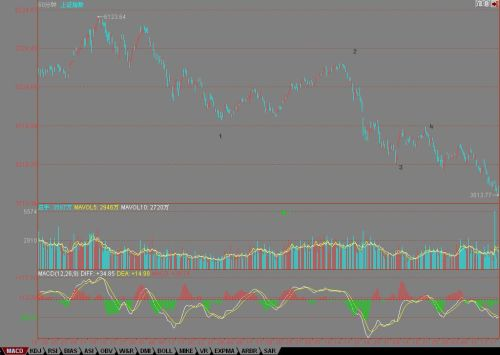 一般来说，看粗略的大趋势，可以用大图，例如，中石油，看日线图，48 下来连一个线段都没走完。现在，很有机会走这线段的第 4 笔。 所以，对这个反弹，我们就有了一个很明确的把握了，具体的，可以针对具体个股去操作。不过这反弹点的更具体的定位，必须结合小图来继续寻找，大图只是给一个大概的轮廓。 明天的新闻发布会很可能是引起震荡的一个时间，如果其间没有什么值得关注的东西，震荡后继续会有新一批人杀出，等这批人也杀出来了，这盘就有点意思了。 现在，市场需要的是更多的断胳膊断腿，即使基本面不会有任何东西，也可以技术地折腾一把，但要技术地折腾，那就还需要更多的断胳膊断腿。 再说得明确点，如果基本面没有干货，那么反弹都只能是技术性的，这需要更充分的杀跌才有反弹的空间；所以，现在的市场选择前提很明确，就是有干货还是没干货。缠中说禅技术论坛 www.chzhshch.net 今天尾盘开始买入股票

#### 今天尾盘开始买入股票

 时间：2008-03-18 15:16:32  很多人好象很想知道本 ID 的操作，今天可以公开宣告，今天尾盘，本 ID 开始买入股票。 每天的走势，其实本 ID 都描述得很清楚，例如昨天已经说得很清楚，今天将有对记者会绝望的再杀出来，而记者会其间是一个震荡，这都在今天的走势中很明确的反应了，看看记者会后那杀跌，难道不是吗？ 本 ID 就等这批人杀出来了，这批人杀出来后，所有有幻想的人都幻想破灭了，这时候，如昨天所说，这大盘就开始有意思了。 所以，本 ID 今天尾盘开始买入、回补第一批股票。 但，这个杀跌过程，很有可能会演化出极端非理性的情况，所以，资金大的，可以用分批建仓，震荡操作的方法。也就是，有足够的底仓后，保持这部分仓位不动，其他资金震荡操作，把建仓成本降低下来。 对于小资金，你可以根据技术图表找到更精确的买点。但大资金是做不到的，而现在，对于大资金来说，从今天尾盘最低点开始建仓，已经可以了。

本 ID 多次说过，今年到处是井，井可能是坟墓，也可能是机会，关键看你的水平，这次这井操作好了，收益少不了。本 ID 更反复说了，今年的操作是体力活，必须来回折腾，那种死拿股票的人等单边上涨的就等着去死吧。难道不知道本 ID 去年底就告诉你，今年绝大多数股票都是年阴线或长上影吗？

 如果你没来回折腾的本事，本 ID 一早给你最好的归宿，就是小板凳。如果你自以为自己的水平可以不小板凳，结果给市场戏弄得鼻青脸肿的，那么就好好去学习这成语：自知之明。 建仓的股票，依然是低价股，而且短期跌幅最好超过 40%的，这是最好的玩弄对象了，好好去寻找。好了，逐步进入可以开始干活时间段，有本事的就开始抄家伙，没本事的，就继续小板凳。

#### 自知之明

时间：2008-03-18 16:23:40  每次大跌，都有人被严重摧残甚至淘汰，这只是市场中最正常的事情，市场不是慈善场所，从来都是铁血游戏，如果能从中获得点什么，大概也不枉被市场折腾一把。 人，一定要自知之明。例如，你必须对你自己的性格有足够的把握。有些性格是绝对不适合在市场中混的，例如，一根筋的、依赖心理的等等。 市场的特点就是千变万化，你不能要求市场如何，因为市场永远正确，错的永远是你。但有些人的性格，就是死不认错，那唯一的归宿就死在市场中了。 我们可以抨击政策如何如何，但我们不能把自己放在火上边烤边抨击，本 ID 经常惊讶于某些人的忍耐力，一边天天不断亏损，一边就只会骂街，这种人，市场从来就没有给他们留下活的空间。 市场上永远有不合理，如果你为了合理，那就别来市场了。来市场只有一个目的，就是赚钱，如果不合理能赚钱，那就合理了。 太多正义感的人是不适合市场的，只有战胜了市场才有正义，失败者从来没有正义可言。

单边市永远是稀有的，像前两年那种走势，十年都难得一遇。市场归根结底，以震荡为主，而震荡最终产生的利润，绝对不少于单边，不会震荡的人，在市场上就少了一种武器，坐电梯是小事，往往就落在井里上不来了。

 所以，对于不会震荡的，那么最好的选择，就是回避，如果 10 年才会有 1 次单边的机会，那就 10 年玩一次，这难道不可以，为什么一定要整天在市场里被市场折腾？ 没那本事，就远离，事情本来就是这么简单。可惜人的贪婪蒙蔽了自己，那就种什么得什么，没什么可同情的。 市场的残酷，并不是为了某个人，这是市场的本性，如果对此没有深刻认识，那也只有死路一条。再说句狠话，这次的下跌其实算是温和的，想见狠的吗？如果这次上去，在 60 分钟上只能构成一个 1 分钟中枢，后面再演化为一个 60 分钟上的 1 分钟下跌，那时候再看什么叫狠吧。

在市场上混，就要成为钢铁战士，就算国家经济崩溃，1987、1929 年，也能在市场上屹立，这才有点象样。像现在这些人，动动不动就求救市，那是没见过苦日子。1929 年的时候，美国连政府都无能为力了，政府都救不了自己了，那时候，如果你是钢铁战士，一样能屹立下来。

 这世界上，没有一样东西是可以依靠的，即使那东西叫政府。我们只需要正确的操作方法，用这方法，把自己锻炼成钢铁战士，除此之外，都是废话。

#### **3775** 点决定反弹能否延续

时间：2008-03-19 15:21:35

我们现在只是纯技术性地探讨走势，那么，3775 点能否站稳将决定大盘反弹能否延续。今天一大早高开后回试是一个次佳的买入机会，为什么？看看 60 分钟图就知道，这刚好构成底分型。而 3775 点，刚好是这底分型的上边沿。

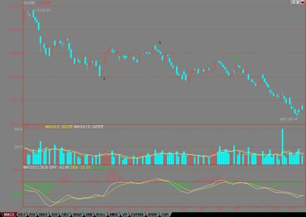 如果你明白这技术上的问题，那就会很放心地在早上第一小时回试时买入，很多股票当时还曾砸出比昨天更低的位置，例如 000938，而收盘是涨停的。

这里，必须有一个纠正，图上绿箭头所指位置其实已经足够构成一笔，而这笔没有回到 4431 点上，刚好构成类第三类卖点。所以，现在的大盘走势很简单，直接拉回图中 3 的位置，还是在这里折腾出一个线段来。

由于目前还没有出现明确的区间套，不能完全确认从 4 下来的这下跌就一定走完，而单纯从 60 分钟图看，这显然构成了一个背驰段，只是这背驰段没有得到区间套的精确定位去确认。不过，按通常的情况下，最终回拉图中 3 的位置是必然的事情，唯一需要选择的，是完美地完成区间套，还是就此直接上去了。

 而这一切，3775 点是一个关键，为什么？因为这决定了早上第一小时构成的那底分型能否最终延伸为笔，如果笔都不能延伸出来，那当然需要再探底去完成区间套的完美构造。

个股方面，一反弹就知道，低价股和题材股依然是最有活力的，这种弹性十足的股性，具有最好的操作性，要好好珍惜。再说一次，今年是低价与题材的天下，但一定要知道，没有单边，只有折腾，而折腾，来回短跑，产生的利润一点都不会比单边的少。

 先下，再见。

#### 缠中说禅文集版权为缠中说禅所有 此文集整理版仅供缠中说禅论坛内部学习使用，严禁外传！ **2008** 年行情再展望

时间：2008-03-20 11:13:56

抱歉，由于一西南地区上市公司的股权收购问题需要和法院和银行接触，下午可能等不到收盘就要去开会，所以今天的解盘和后面的帖子都没有了。现在用昨天写好的一个行情展望替代，要把握大的方向，请好好研究。

今天的大盘其实也不需要再解盘，由于 3775 点不过，自然就是继续原来的趋势，而浦发和石油给了一个恐吓性洗盘的机会。但可以明确说，目前已经处在宽幅的底部区域里，任何一个洗盘，都给题材股一个轮动的机会。

 看看，今天创投的持续，奥运的崛起，这都十分明确。有时间恐慌、骂街，好不如好好去选择布局，看看 N 多人骂的天鹅已经两个涨停了，有时间还是看图选股去，市场不是靠嘴生存的。 先下，明天见。 2008 年行情再展望

去年 12 月，本 ID 给出了今年行情的展望，当时的结论，依然都成立，而且很多都正在验证之中。由于今年一季度还没过去，所以最终结果如何，还不能下结论，但有些已经成为定论了，例如，关于今年落 “井”机会多多的论断，经过这三个月，大概都应该有所感受了。

 由于没有需要修正的地方，所以，本 ID 还是按原展望的思路根据新的情况进行进一步的拓展，给出一些更精确的提示，以方便后面三个季度的操作。

原展望中，本 ID 给出今年的节奏应该是扬抑大扬大抑，目前，扬抑这个节奏已经走出来，4778 点到 5522 点的“扬”以及其后的“抑”构成了整个一季度行情的节奏。有人可能认为，4778 点到 5522 点算不了扬，那是被前两年的单边上涨思维所迷惑了，在大调整走势中，这种级别的反弹已经足够地“扬”了。

5522 点，是 6124 点下来的 600 点，3600 点的 1/6，这是一个值得关注的点位节奏，如果该节奏继续保持，那么 4922 点就是中线一个强的压力点。而 4778 点刚好是 6124 点下来的 1345 点，3600 点的 3/8，因此，下一个低点，最值得关注的是其两倍的位置，也就是 6/8 的位置，相应是 3424 点，如果没有特殊的全球性崩盘事件，该点位上下最终形成“抑”的底部的可能性极大。

 可以断言，在这轮从 5522 点开始的“抑”走势结束后，将迎来原展望中所说的第三个节奏：“大扬”，这“大扬”的概念在于，这段走势的幅度，一定大于 4778 点到 5522 点的“扬”。

为了更准确地预言这个“大扬”走势，我们必须先回到原展望中的另一个预言，就是今年至少两度见年线，第一次是喜剧，第二次是悲剧。显然，这喜剧和悲剧都在一季度中全部上演了，由于浦发银行突然增发的影响，第一次破年线后的向上喜剧，只延续了不到 10 天，然后第二次破年线，展开了后面的悲剧，其中的 3 月 4 日，是最终确认年线不能有效回拉上去的日子。

但由于年线目前依然保持向上的走势，所以，后面这个“大扬”走势必然展开一次对年线的再度反击。一个很重要的技术信号就是，一旦年线走平后，大盘如果还不能重新回到年线上面，那么，一旦年线转头向下，那才是真正的大调整的开始，所以，前面，从某种程度上说，只是大调整的预演阶段，因为毕竟年线还没有转头向下，一旦紧接着的“大扬”走势不能在年线转头前重新站住年线向上攻击从而带动年线继续上扬，那么，其后的“大抑”走势，将让一季度的“抑”彻底失色。

即使紧接着的“大扬”走势能重新站住年线并向上攻击，从而使得年线转头的时间推迟，由于目前的月线 MACD 刚刚死叉，在这种技术条件下，硬向上攻击的结果，最好的就是制造一个 MACD 的双头走势，而其后对应的，依然是更大幅度的下跌。MACD 双头后的杀伤力，有点技术常识的都应该不陌生，而且这是月线上的，其杀伤力与时间长度可想而知。

 从最直观的技术上说，下一轮真正的大行情，必须等到月 MACD 回到 0 轴附近才有可能展开，期间，都是一些小打小闹的走势。

基本面上，其实也完全支持以上的技术走势分析。由于目前的估值完全是按前两年的高增长为背景的，而且依然达到很高的水平，一旦经济走平，这些高估值就完全没有支持的空间，赢利水平的大幅度下降在可预见的范围内，因此，目前那些所谓绩优股票，都有极大的中长线业绩压力，目前的价格都过度偏高。

而且，世界经济的经验告诉我们，大的商品投机潮过后，总会一地鸡毛，而美国经济的问题，远未到解决的时候，这些外部的定时炸弹将随时把经济繁荣的幻想炸裂，而真正的调整压力，在那时才会真正显现。

极有可能，我们将要开始面对一个大的世界经济大调整的困难局面，而我们现在的经济结构，由于丧失了太多做大做强的机会，绝对已经不足以独善其外了。因此，后面的困难可能会超出现在一般人的想象，因为历史的经验告诉我们，真正可怕的调整压力，是经济基础方面产生的，而我们现在极有可能将面临如此的危机。

个股方面，在原展望中已经明确指出，就是题材股，各类题材的反复炒作，将是今后很长时间的主题。而在大的调整市道中，历史经验反复证明，低价题材是永远不败的主题。由于目前的资金量，即使在大的调整中，炒作些低价题材永远是富裕的，所以，只要有投机性资金存在，这就是不死鸟，一有机会就要起飞。

 一句话，在今后很长时间内，市场都将是长跑选手的坟墓，短跑选手的天堂。 站在 20 年的角度，这次的调整，依然是超级大牛市中的一个中继性调整，但 20 年的前提是，你能熬过这个冬天，否则，20 年的超级大牛市，对于你来说，毫无意义。

#### **3780** 点，短线生命线。

 时间：2008-03-21 15:29:38  电话太多，晚点，抱歉。

昨天早上 11 点就给出的帖子已经给予各位最充分的提示了。众所周知的技术习惯，只要在 3%的范围内，都是可以认为目标位触及有效。本 ID 给出的目标位置是 3424 点，而昨天的低点已经在其 3%的范围内，因此，就此就上去，也已经在技术上十分完美。而昨天，本 ID 用恐吓性洗盘给出昨天早上的技术实质，这个提示已经足够明确，如果没反应，本 ID 也没办法了。

现在，当然不能说大盘就没有再次探底的可能，但大盘底部至少有一只脚是落地了，现在唯一需要探讨的只是这底部是独脚的还是双脚的甚至是多脚的。而决定这一切的，就是这 3780 点，这是 60 分钟新的底分型的上沿位置，只要站住这个位置，那么，至少在 60 分钟图上，将延伸出向上的笔，而这意味着这反弹是独脚的。

 技术上，30 分钟的 MACD 刚好在 0 轴上受阻，因此，只要下周初能站住 3780 点，那么这 0 轴也就会被突破，从而带动 60 分钟的向 0 轴冲击，对应这走势上将往上再上攻一段。 当然，如果站不住 3780 点，30 分钟 MACD 就会出现 0 轴受阻再回跌的形态，对应着大盘当然就要再次探底了，所以，从这角度更说明了，3780 点的重要性。 由于目前的日线上已经出现底分型，而上边沿在 3941 点，因此那个位置，是决定大盘反弹的级别能否扩展的关键位置，一旦站住那个位置，重新回到原来 60 分钟 3-4 的类中枢就不成问题了。

个股方面，还是本 ID 一路给出那几个板块在轮动，最近中小钢铁的走强，是因为重组的预期，这更说明，重组的挖掘是一个长期有效的主题。目前，还是小盘低价更有优势，你看，同样的题材，天鹅就比国电强，为什么？就是因为盘子小，国电 30 多亿的盘子，要敲动起来当然难度要大点、要慢点。

 有些无聊人总是唠叨什么 322，那算个鸭屁，难道堂堂大陆人民要为一个破渔村选村长这样的破事看他们的脸色，简直脑子进水了。

本 ID 给那些什么台港澳的人一句忠告，你们还有几年把自己当回事看的时间，过了这时间，你们什么都不是，别老觉得大陆人民欠了你们什么，你们那些要挟卖乖的筹码越来越没价值，等哪天发现，一个巨大的经济体不可阻挡的融化力时，后悔都没门。

 给脸不要脸的最后连内裤都保不住。 有时间看 322 的无聊戏，还不如看看本 ID 的七律：。 先下，再见。 东南 缠中说禅 东南万里海浮天，一裂金瓯百五年。 未葬鱼龙今古血， 翻生蛤蜃晓昏烟。 华夷衰盛忝唐杰， 风雨苍黄思郑贤。十亿神州重抖擞， 昆仑拔掷浪波填。缠中说禅技术论坛 www.chzhshch.net 3780 生命线失守再次探底

#### **3780** 生命线失守再次探底

 时间：2008-03-24 15:16:13

上周五已经超级明确地说了，3780 点是短线生命线，站不住就再次探底。今天早上，跌破 3780 点后两次反抽上不去，确认跌破有效。然后下午 2 点那标准的第三类卖点成立后，跌幅明显加大。一切都极端技术化。

 如果你没把握住这先卖等回补的节奏，那就恭喜你，你又要坐一次电梯了。当然，看到 3780 点失手，或最晚在第三类卖点跑掉的，那么就已经成功把上周抄底的了结，白花花的银两等待下一个买入的机会。 不过，由于目前已经在中线底部的震荡区域里，因此，每次震荡后沉淀一定的底仓是完全可以的。这要根据每人的资金量决定了。 如果你上去不舍得跑，破技术位也不舍得跑，把股票当宝贝，那建议你还是小板凳吧。现在的大盘，依然杀机重重，这样的心态，只有死路一条。 现在，就等平安的事情有一个了结了，管理层不能光说不练，材料报上去这么长时间，怎么都该有说法了。

个股方面，上一次强调的是短线下跌 40%以上的中低价中小盘股，例如，已经 4 个涨停的天鹅就是最典型的例子。下一次，依然是这种股票，但注意能有双底支持的，而且一定要有新资金介入迹象，也就是放量后有一个缩量站住的。

 周末有人吹嘘绩优股，但本 ID 依然要说，题材才是真。低价、重组、题材是今年不变的主题。

#### 万事具备只待平安事了

 时间：2008-03-25 15:09:37

众所周知，这次从 5522 点开始共 2000 点的下跌，导火索就是平安，因此，在目前的底部震荡中，其实已经万事具备，但就差这平安破事最后有一个众望所归的结果，这也算是大盘最终走出底部震荡的一个最基本的心理支持。

 现在，差的就是这一点，但这一点却迟迟不能出现。如果按这样的审查速度，那么管理层的办事效率也太说不过去了。今年的市场犯小人，总是在关键的时刻来些妖蛾子，这次如何，就看这市场的运气了。 今天的大盘依然是中低价题材股的天下，个股方面，已经有很多按捺不住了，但只要大盘不能真正走出底部，这些个股行情的延续性就有问题。 技术的角度，超短线的关键位置在 3616 点，一旦再次有效跌破，那么破底而下就基本成为必然的选择。 上面的位置，还是和前面的分析一样，首先要面对的是 3780 点，这点不有效突破，大盘依然只能在底部徘徊。

明天，超短线，最简单就看 5 分钟的 MACD，现在刚好站在 0 轴，明天如果能从此来起，那么将带动 30 分钟的 MACD 再次冲击 0 轴，对应大盘将有一个向上冲击的过程。如果这种局面出现，一定要注意 30 分钟 MACD 是否又在 0 轴受阻，一旦出现，应当把今天买入的择机退出。

 但对于大资金，应该把适当筹码进行沉淀。大资金必须是成本不断降低而筹码不断增加的动态建仓，这是一个基本的原则。缠中说禅技术论坛 www.chzhshch.net 3616 点，短线关键。

#### **3616** 点，短线关键。

 时间：2008-03-26 15:15:26  昨天让各位注意 5 分钟 MACD 站稳 0 轴后上攻的情况，结果今天早上走出一个标准的盘整背驰，红柱子小于前面一组，而也只带动了 15 分钟 MACD 回拉 0 轴受阻，因此其后的回落就理所当然了。

当然，如果你看不懂图，看到 580989 突然启动，也知道大盘要回头了。580989 春节前就给了各位一个最基本的原则，0.6 为中枢，只要好好把握这原则，你能赚多少钱算都算不过来了。不过，现在收盘已经到 0.8 附近，已经远离中枢，后面就是风险极大的阶段了，所以，今天没介入的，一定不能介入。该权证今天在 0.7 上下一个小级别背驰后回到次级别中枢形成大级别的中枢，因此短线 0.7 上下这中枢是对比关键，是否后面的上涨形成背驰，就以这中枢为基准了。

 注意，权证是高度投机活动，而且很明确告诉各位，这是 580989 最后一大行情，毕竟还有 2 个多月就到期。 之所以再说 580989，是请各位留意，上次 580989 从 0.4 下启动，对应了大盘一次快速的破位，这次是否重演，关键看昨天就说的 3616 点。

现在的问题就是平安，平安没说法，游资只能投机，谁怕谁呀。投机的好处在于，把短线资金的货给震出来都跑去诸如 580989 之类上，这样，中线的建仓也顺利了。今天，很多新板块已经暗流涌动，即使有再杀跌的过程，也是这些板块最好的介入时机，好好珍惜吧。

 580989 就看戏，看如何让你目瞪口呆，如何让最后的贪婪者套在高高山上永不超生。

#### 破发竞赛宣泄市场情绪

 时间：2008-03-27 15:17:41

今天的走势，昨天已经说得很清楚了，就是上次 580989 从 0.4 下启动时的翻版，那次同时带动了大盘的破位，这次如出一辙。各位可以对比一下上次的走势，后面的走势是否继续一样，这是一个很值得关注的问题。

如果走势继续一样，那么惯性下探后，大盘会再次回到破位前的平台。3424 点的位置，由于有 3%的确认空间，所以目前并不能说这位置就被有效跌破了。当然，这位置如果跌破，那么，下面真正有效的位置就是 2500 点了。记得当时本 ID 把震荡空间定到 2500 点时，有人觉得本 ID 夸张，现在看来，一点都不夸张。

 其实，目前的市场情绪已经开始扭曲，因为管理层的不作为，市场只能以破发竞赛来宣泄情绪，这其实是极端危险的状况，管理层的信誉，在这样的市场情绪宣泄中走向破产，以后如何修复，只有天知道了。

市场现在就是以这样的逻辑来回应管理层的逻辑，管理层不作为让市场的再融资没有规则，那么，市场就让市场本身的融资彻底破产，如果这局面不被控制，那么这场闹剧很可能要演化到有新股一开盘就跌破发行价，让市场完全失去基本功能，一旦这种局面出现，你说 2500 点很奇怪吗？

 当然，作为市场的参与者，都不希望市场各方以这种对抗性的方式进行下去，这样只能损害市场本身。但球在管理层那里，他们不作为，市场也只好如此了。 由于市场重心的下移，我们所需要关注的低价股的价格也需要有所下移。但原则是一样的，就是低价、题材、更重要的是，一定要来回折腾。 至于破发走势制造的破发板块，从纯投机的角度，将蕴藏着一定的市场机会，不过这需要的操作水平以及政策敏感度比较高，没这水平的不一定要关注。

580989，昨天说得很明确，0.7 上下的短线中枢是关键，今天冲高后马上 30%回头到这中枢，显示的这中枢的强大威力，同时也证明，这次的上冲只是一个中枢，是一个盘整类型，后面的波动就看这中枢的第三类买卖点问题了。 注意，580989 是最后一波害人行情，一般人一定要远离。

 先下，再见。

#### 缠中说禅文集版权为缠中说禅所有 此文集整理版仅供缠中说禅论坛内部学习使用，严禁外传！ **3424** 点初显威力

 时间：2008-03-28 15:12:27  N 周前的再展望，本 ID 给出了这轮下跌最可能的 3424 点的下跌结束位置，6124 点下来的 2700 点，3600 的 3/4，而第一次 4778 点，刚好是 3/8，今天这个位置初步显示其威力。

注意，一个最基本的技术常识，任何技术位置都有一个上下 3%的允许空间。由于这世界上脑子有水的人太多，所以必须再说一次。例如，上次从 4778 点开始的反弹，本 ID 说结束的位置在 900 点，3600 的 1/4 处，也就是 5678 点，最后结束的位置在 5522 点，完全在 5678 点的 3%空间内，但有些人为了没有最终到 5678 点祥林嫂了一个月，这是什么人？自己没常识，蠢还要满大街告诉所有的人，这世界多的就是这种人。这种人不死，市场哪里还有天理？

 而昨天也说了，和上次 580989 在 0.4 下启动那次一样，引领大盘破底后，大盘最终又再次回到破底前的平台，今天的走势证明，这太阳底下，新鲜事并不多。

但一定要更注意的是，由于今天的上扬甚至不足以在日线上制造一个底分型，而今天上扬受到诸多传闻的引诱，一旦这些传闻下周没兑现，就不排除又有一个杀跌回试的过程，因此，3424 点最终能否成为底部，现在根本没有任何最终的结论，必须采取灵活的策略应付之，而不是脑子里一根筋。

 超短线的角度，3499 点是关键位置，一旦站不住，再次探底就不可避免。当然，只要能站住 3499 点上，那么行情就有希望，因此该位置极端重要。

超短线可以看下周初，5 分钟 MACD 是否最终演化为红柱子不能再伸长而比前一柱子面积小的情况，对应着 15 分钟 MACD 的 0 轴能否被突破，一旦不行，肯定要回试诸如 3499 点这样位置的支持。当然，高明的并不需要等 3499 点真跌破再走。

对于小资金，原则已经多次说了，就是抓准机会咬一口，一看不能延续就先跑。这次从 5522 点下来，用这个原则抄了无数次底，都能按技术把钱赚了又先跑出来，就证明，下跌其实没什么大不了的，关键你能折腾，折腾好了，下跌一样是天堂。

当然，前面说了，对于大资金，现在折腾时一定要注意沉淀筹码，大资金和小资金不同，小资金 1 秒钟就可以把仓位建好，大资金可没这本事，因此必须有沉淀筹码的动作。注意，从 5522 点下来，本 ID 直到最近才给出大资金需要沉淀筹码的要求，为什么？因此以前离底部还远，所以根本不存在沉淀筹码的问题，而到了目前的位置，就算 3424 点最终不能底部，下面的也不过是空头陷阱了，对于大资金来说，根本不算什么，所以，现在开始沉淀筹码，完全对头。

 周末，股票一边歇去。 先下，再见。缠中说禅技术论坛 www.chzhshch.net 3499 点继续决定短线命运

#### **3499** 点继续决定短线命运

 时间：2008-03-31 15:16:35  在上周都比较兴奋时，本 ID 已经明确说，一旦传闻不兑现，又是一轮回试。至于给出的 3499 点，更成为今天震荡的中心，尾盘最终也没站住。

由于该位置今天是震荡中心，所以明天如果能站上去，大盘还有点戏，否则，继续探底就不可避免了。底部不是一天成的，今天显然已经比以前类似的情况走得稍好一点，显示已经有一点新资金介入并对此位置有一定的信心，否则，今天将是单边下跌。因此，明天的走势很关键，如果能回拉上去，证明新资金的信心还是比较足。

 但是，多次说了，现在需要的是干货。没有干货，任何信心都会被磨掉。没有干货，谁说话都是废话，市场能领情吗？废话说多了，只能显示自己的无能，这点，有眼睛的人都看得清楚。 其他也没什么可说的，现在就是等待，今天是月线和季线收盘，有兴趣的自己去看看，中线形势有多恶劣。这里不起来，季线上就有极大机会形成向下的笔，这意味着什么，自己想去。 现在主管金融的人，其办事风格是十分怪异的，这点，本 ID 有太多了解了。该来的没来，也只好这样了。 天灾不可怕，因此，对非系统性风险，要有时刻的提防。对于散户来说，咬一口就跑，与机会再咬一口，这是最好的策略。缠中说禅技术论坛 www.chzhshch.net 下一个短线机会又将来临

#### 下一个短线机会又将来临

 时间：2008-04-01 15:16:38

别让本 ID 看不起，每次短线，本 ID 都把最后的走人位说得一清二楚，就象这次的 3499，今天早上连续冲了两次不行，就开始大幅度下行，如果你这你都看不明白，还是去孔男人那里吧，你这样的水平在这里只有丢人的份。或者就自知之明一点，在自己额头上写好永不短线，因为自己无能。

 最鄙视那些自己没本事，又要怀疑别人的人。你没本事短线不代表短线在下跌中就不行，为什么每次本 ID 都能顺利出来？按本 ID 最后的位置，如果你没更高的本事，你哪一次不能出来的？ 现在，有本事的人将要干什么，就是马上迎接新的短线机会。这机会在破底后很快到来。其实，很多股票，回跌 10%到 20%后，今天尾盘就可以回补，特别资金大的。 现在，一个标准的下降通道，到下轨就可以短线，如果破下轨加速，那就要放爆竹了，大的反弹马上就在眼前，这都是最基本的技术常识，有什么难度？ 那管理层爱干什么干什么，本 ID 就陪他们玩到 2500，1500 也无所谓，反正有本事的人钱就越来越多，到时候再大买便宜货，从 1990 年和他们玩了快 20 年了，谁怕谁呀。 这世界，只能靠自己的本事，哀求别人救你，有可能吗？本 ID 早说了，绝对不能依靠任何东西，即使那玩意叫政府。这就是本 ID 从 1990 年开始的最大经验之一。 本 ID 越来越感觉到，本年度最大的赚钱机会越来越近了，让孔男人哀号去，求政府去，我们开始磨刀霍霍了。缠中说禅技术论坛 www.chzhshch.net 现阶段中国资本市场的地位

#### 现阶段中国资本市场的地位

 时间：2008-04-01 15:59:39

一个成熟的市场经济，其市场中心地位的就是资本市场，资本市场的任何风吹草动，都是国家级的大事。看看，这次次贷危机，美国股市的实际跌幅度一点都不大，连 20%都没有。但已经是朝野倾动而出，用进一切的金融、财政、政府等的资源来稳定资本市场。为什么在美国以及西方所有的成熟市场经济国家，资本市场具有如此举足轻重的地位？因为，这是他们经济结构的核心，后面代表着最大多数人的利益。也就是说，这些成熟的市场经济国家，其经济已经进化到如此的境地，绝大多数公民的经济利益都与资本市场密切相关，而经济基础决定上层建筑，自然，没有任何的政府机构敢对资本市场有丝毫的怠慢。

 而现在，中国的资本市场还远远达不到这样的地位，因为中国的市场经济依然在极为落后的阶段，资本市场可以说暂时只是一种点缀，本质上，在经济结构中还没有任何实质的地位。

因为，在中国，目前与资本市场利益相关联的，只是所谓中产阶级以上的阶层人的利益，而目前中国更多数的人，是与资本市场无关的，而他们所代表的是一种与市场经济相对无关的经济结构。而在整体的国家经济利益的取向中，牺牲少数以换取多数，显然是一个最被采纳的选择。

 因此，例如在现在 CPI 与 GDP 的两难抉择中，资本价格的压制又被人错误地认为是压制 CPI 的好手段，因此，牺牲资本市场就成为最符合这种经济逻辑的选择了。 可以断言，在中产阶级以上阶层占据社会人口最大部分之前，这种利益的偏向都无可避免，对此没有明确的认识，不仅会对诸多中国特有的经济现象产生迷糊，也会对自身的操作产生重大影响。

其次，按照服务型政府的原则，资本市场的监管机构，本质上是市场的服务者，但现阶段，显然远远达不到如此的要求，否则，例如平安事件，就不会一拖几个月都毫无结果。而对于一个服务型的机构，这是显然的不作为行为，应该受到相应的监督、纠正甚至惩罚的。

 看清本质，你才能有真正的力量。缠中说禅技术论坛 www.chzhshch.net  3462 点成短线关键位置

#### **3462** 点成短线关键位置

 时间：2008-04-02 15:17:01  今天，如期反弹，然后大幅度震荡。一般这种走势，最好就是进行对冲式操作，或者如昨天本 ID 所说，昨天尾盘就可以先介入。

现在，短线最关键位置在 3462 点，明白本 ID 的理论的，都知道在这位置为什么重要。今天下午冲到该位置，站不住，所以就出现大幅度震荡。但尾盘依然有资金再度介入，这样，这次反弹可以再来一次，高位出的下来又可以回补再来一次。

 但下面，关键还是看 3462 点，只要再冲不过，那么大盘依然有继续破底的机会。短线就是要来回折腾，一看不行先回来，一看行了，甚至可以打点提前量，例如为了避开 T+1，可以在前一天的尾盘。 个股方面，金融股已经率先走强，但这走强是否有延续性，是否能向地产、有色等蔓延，是行情能否延续的关键。题材股经过大洗盘，还会重来，但暂时以反弹为主。 这几天很难打开，系统好象也不稳定，不多写了，先下，再见。

#### 缠中说禅文集版权为缠中说禅所有 此文集整理版仅供缠中说禅论坛内部学习使用，严禁外传！

 时间：2008-04-03 15:24:59  今天的走势大概出乎很多人的意外，但一定不包括本 ID 以及昨天看了本 ID 解盘的人。昨天的解盘很明确地告诉你要再来一次，请问，这一次爽吗？

昨天，更说了金融向地产或有色等蔓延的问题，今天，那聪明的驴的表现，请问爽了没有？有人昨天说，不是题材股吗？但难道这些云铝中铝不是本 ID 股票池子里的？50、60 跑的，20 下买点回来，难道有罪呀？简直病的不轻。

 兵无常形，如果要走一波本年度最大级别的向上走势，中字头不启动怎么可能完成？题材股当然要继续，但一波完整的行情，就是一、二、三线的轮动次序，这不最简单的道理，有什么可说的？ 当然，这一切暂时还只是蓝图，因为实际的行情并没有走出来，暂时先当成反弹来干是比较靠谱的，一旦形势不对，反手狠砸，不亦快哉？ 显然，昨天说的 3462 点，今天起了明显的作用，大盘最终在该点位前放下步伐。由于今天搏消息的比较多，所以尾盘小跳让人出来也是应该的。 下周是很关键的一周，因为日以及周是否能底分型，就看这了。当然，短线这一切，都可以简化为 3462 点能否有效站住的问题，一旦能站住，这些分型都不成为问题了。 个股方面，注意一线股的轮动次序，注意新资金流向。另外，如果周一没消息，注意回杀力度，如果力度不大，反而证明这行情真有戏了。 今天的走势图，超级技术化，留一个作业：13 点 30 分到 2 点这段时间具体什么的技术意义，为什么一站住某位置后，就马上出现大的突破，向上攻击 3462 点。 提前一天收市，简直太美好了，清明时节雨纷纷，水为财。时间：2008-04-07 15:21:25  大盘今天突破短线关键位置 3462 点后一马平川，60 分钟上 N 个月来第一次延伸出向上笔走势，显然了大盘的短线强势。

周五解盘已经特别指出，如果周末没消息而大盘反应并不过烈，反而证明大盘行情真有戏了，今天的走势恰好证明了这一点。个股方面，中驴为代表的有色继续驴性大发，但要注意，这次启动的板块，都是回弹 20-30%左右进入调整，例如地产、金融等，因此，有色能否改变这局面，暂时是有疑问的。

现在，3613 点已经成为中短线关键位置，因为这位置是否突破决定大盘能否延伸出日线上的向上笔，而今天的走势，由于已经突破 3555 点，因此，周线上形成底分型的可能性极大，除非在本周内出现再破底。因此，中线上，我们一直预言的本年度最大行情成立的几率已经越来越大。

 当然，最安全的作法还见一步走一步，只要 3613 点攻击不破，就可以先对筹码进入相应调整，以应付后面的震荡走势。 虽然本 ID 一早就明确 3424 点附近将出现中线底部，但真走出来，我们反而要冷静。不能在操作上留下遗憾。而且，如果真是中线底部，在真正突破之前，洗盘震荡还少不了，所以，一定要按图作业。上周的问题，只和 60 分钟的底分型相关，3396 点，突破后延伸出笔，这样经典的案例，请多研究。

#### 中国人，不要习惯性当政府的奴才。

 时间：2008-04-07 16:05:58  几千年来，中国人在政府、衙门面前就从来没抬起过头，即使改朝换代，最终这奴才心理还是改不了。 而实质上，政府、衙门是我们的奴才，没有我们，哪里有什么政府、衙门，是我们的血汗供养了这些机构。面对这些机构，任何人都应该腰杆笔直。 可惜，实质上，绝大多数的人还是不自觉地、完全集体无意识地当了政府、衙门的奴才，例如，在资本市场上，例如现在还在叫嚣的救市言论。 本质上，根本不存在政府衙门那种从上而下施舍性的救市，问题的实质，只是要让这些奴才改正他们的错误，当然，如果奴才不好听，那么，我们就用公仆这个词。 没有救市，也无须救市，有的只是纠错。错了就要承认，就要改，就这么简单。 可惜，大多数的人的思维都扭了，都在等待所谓的施舍，这样，中国的资本市场、中国的现代化真是遥遥无期了。

衙门型的管理机构与服务型的管理机构相比，最大的特点就是行为完全脱离实际，所有的应对措施都严重慢几拍。例如，过去两年，面对快速的上涨，最简单的经济学常识都可以提供最简单有效的应对措施，就是快速加大供给。而供给的加大是要有时效性的，过了那时间，这措施就对不上点了。那么，请看实际上管理机构不仅没有加大供给，反而是提供了流通比例极低的疑似非法蓝筹，这难道不是典型的火上加油吗？

衙门型管理机构，甚至可以有这样一种可怕的思维，跌比涨好，跌就是安全，资本市场里的人的行为最好都完全统一到银行存款行为上去，这样就不惹事，不惹事就是最大的好事。正因为这十几年那如此思维的存在，因为中国的资本市场走势都显示出最大的投机性，因为大家都知道上涨的时日无多，一旦有机会就变本加厉地投机，尽量在最短时间内把最大的利润拿到手。

正因为管理层与投资者的心态都在这样一种氛围下，所以，那种稳健的长线行情就不可能真正出现，大起大落成为真正的常态。而这时候，还提防止市场大起大落就成为一件很滑稽的事情，成为衙门型管理机构语言的一个标准范本。请问，一年不到，从 3400 点到 6124 点又回到 3400 点还不是大起大落？一个已经是事实的东西，还能或还需要防止什么？

我们不希望再有类似的无聊衙门言论，我们也希望我们所有的投资者都要站立起来，知道自己的力量，市场是我们创造的，我们是市场的真正创造者，我们才是市场真正的主人，我们必须要用我们的力量彻底改变这一切。

#### 缠中说禅文集版权为缠中说禅所有 此文集整理版仅供缠中说禅论坛内部学习使用，严禁外传！

缠中说禅技术论坛 www.chzhshch.net 3613 点如期发挥神奇作用

#### **3613** 点如期发挥神奇作用

 时间：2008-04-08 15:19:39  昨天给了短线的关键位置 3613 点，今天全天就是围绕着震荡，连收盘就在 3612.5 就知道，该点确实如期发挥了作用。 现在的问题很简单，站得住 3613 点，就继续上攻，否则就出现一个大的调整。所以，本周就看着该点就可以了。 个股方面，板块轮动加速，现在问题的关键是轮动后首先调整的板块能否再次启动，能，那大盘就肯定有戏，否则至少要调整一下。 目前，整个次序大致是地产、金融、有色、券商，然后今天是所有几乎大的题材都动了一下，创投、农业、三通、环保等等，因此，后面还是要看金融地产能否再次启动。 当然，一些小板块的轮动还会继续，但对于大局，这些都没多大的意义。行情，关键要看大角度。

大家应该注意到，本 ID 最近一直只用给级别的分型来统一进行分析，其实就是想告诉各位，你把一招真学会了，绝大多数的问题都能解决，这就是示范，请把这次整个探底到回升的整个过程还还研究，课程等这个示范以后再写。

 不想说了，留点精力今晚熬夜看球，先下，再见。缠中说禅技术论坛 www.chzhshch.net 3613 点威力尽显

#### **3613** 点威力尽显

 时间：2008-04-09 15:16:57

今天的走势极端技术化，前面已经明确说了，只要站不住 3613 点，就要再次探底。今天低开后，在 60 分钟刚好跌破顶分型的下边，早上那标准的回抽，极端显然地上不了 3613 点，因此确认这对顶分型下边的跌破是有效的，因此后面的下跌就顺理成章了，为什么？因为向下要形成笔。

 现在的走势很显然了，向上的笔后形成向下笔的调整，也就力度最大那种调整，因此，后面在向下笔结束前，都不适宜再度介入。但一旦向下笔结束，就又有一次美妙的短差机会。 各位，看到没有，就用一个简单的 60 分钟分型结构是否延伸为笔，我们就能完全把握这样的走势与相应的退出，现在，我们只需要等待新的买点出现，如此简单而已。 个股方面，昨天已经明确说了，只要地产不能重新启动，就有问题，今天万科等的走势，一个标准的短线多头陷阱，因此，引发回跌再正常不过了。 当然，就算有真行情，也需要大的洗盘，但是否洗盘还是继续下跌，其实根本不重要，我们只关心下一个买点，把走势支解了进行操作，我们不废那个脑子。 让脑子有水的人继续争论是否有真的行情，他们负责争论，我们负责挣钱，还有精力的，今晚继续加班看球。缠中说禅技术论坛 www.chzhshch.net  3533 点成短线关键位置

#### **3533** 点成短线关键位置

 时间：2008-04-10 15:25:06  网络超级慢，登陆就用了 10 几分钟，什么写东西的心情都没有了。随便说两句。

今天，又一个完美的短线机会，60 分钟的底分型成立，而 3533 点成短线关键位置，所谓的关键位置，就是站上去，大盘将继续延续反弹，也就是 2 次探底结束；站不住，就必然再次探底，而且破底的机会极大。

 今天，煤炭、券商、滨海等甚至创出本次反弹的新高，这是好现象，证明至少有部分资金是勇敢做多了。现在，指数上要有大突破，还是要看金融、地产、有色等，不过先有板块裸奔起来，绝对是好现象。 思维要改，今年的行情不会是一条直线的，底部也要震荡个 N 回才爽的，不明白这点，就痛苦去吧。 注意节奏，自然就爽。 这破网，按一下，N 久才有反应，简直浪费时间，不想写了，先下，再见。

#### 缠中说禅文集版权为缠中说禅所有 此文集整理版仅供缠中说禅论坛内部学习使用，严禁外传！

缠中说禅技术论坛 www.chzhshch.net 周底分型成立令 3840 点成中线关键

#### 周底分型成立令 **3840** 点成中线关键

 时间：2008-04-11 15:10:56  本周折腾，最后的结果还是把周底分型给折腾出来了，该分型的上边在 3840 点，因此，该分型是否最终有效，延伸为向上笔，或者最终失败，只构成中继型，3840 点就成了周级别的关键位置了。 今天，大盘全天在昨天所说的 3533 点下震荡，显示大盘不强，信心不足，大概是周末的心理压力，因此，下周初，就看这 60 分钟级别的关键位置能否突破，不行，就再次探底。 日线级别的对应位置在 3613 点，因此，3533、3613、3840，给出了一个市场运行的密码，由此，超短、短、中的走势都完全把握了。 个股方面，板块继续轮动，但力度有所减弱，现在，只要金融、地产等不再次动起来，大盘就不会有大戏。 周末，快点远离股票，好好休息，身体第一。缠中说禅技术论坛 www.chzhshch.net 又一短线机会扑面而来

#### 又一短线机会扑面而来

 时间：2008-04-14 15:22:10  现在这种行情，本 ID 一早就给出两种唯一的策略供不同水平的人选择，一是小板凳，二是短跑运动。本 ID 之所以天天在这里给各位练习短跑，就是假设你有这水平。否则，小板凳的过来看看就可以。 现在，继续和各位练短跑，如果你没这水平，就一边晾着，咱不带你玩。 已经明确说了，3533 点上不去破底的机会就大大的，所以，今天的走势其实没什么可奇怪的，而且早上连续三次冲高都补不了缺口，如此肾亏，你还能假设这大盘今天不是 ED 男？ 不过，这样的下跌，只是让又一次的短跑机会扑面而来。不管是用背驰还是分型，都很快出现标准的图形。其实，对于一点货都没有的，今天尾盘就不妨在水底捞点。

注意了，中线一定要看好地产板块，前几天本 ID 已经说了地产搞了一个多头陷阱，因此，这几天的大跌很正常，否则就不叫多头陷阱了，现在的关键是，地产是最早启动的，这次下来是第二买点的清洗，还是新一轮的下跌，对大盘具有极大的中线指引意义。当然，同样的包括金融股。

 平安那破事一直不出来，对大盘就是一个大的压制，它不出来，大盘就不可能真正走起来，这点也是必须注意的。 注意，短跑就是冲刺就完事，千万别搞成长跑。缠中说禅技术论坛 www.chzhshch.net  如约反弹，3311 点成短线关键

#### 如约反弹，**3311** 点成短线关键

 时间：2008-04-15 15:14:35  爽了没有？ 这扑面而来的感觉如何？

你看透市场以后，反弹不过就是一个 419 的约会。今天，昨天的预约如约而来，4 根 60 分钟线，前三根构造分型，确认后，第四根突破分型上边，3311 点成短线关键位置，一切就是本 ID 理论的活教材，你说有什么可说的？

 注意，只要 3311 点回试站住，那么反弹继续，否则就结束，如此简单。 短跑的感觉如何？感觉是跑出来，干出来的。爽是需要真枪真刀来的。本 ID 这里没有花架子，只有白花花的银两通过技术抢劫回来。 个股方面，创投继续，券商由于可以直投，其实也已经是这个概念了。后面就看能不能轮动起来，房地产能不能止住来个大反弹。另外，新能源、环保、农业等是长线大题材，一定是有机会就会被折腾的。 个股只要能轮动起来，这反弹就能持续。至于中线大盘，过几天有心情再和各位分析，总之，已经在最后的空头陷阱中了。缠中说禅技术论坛 www.chzhshch.net  CPI 让多空有了再次较劲的理由

#### **CPI** 让多空有了再次较劲的理由

 时间：2008-04-16 15:15:02

今天，大盘全天和 CPI 震荡较劲，而震荡的中心就是昨天说的短线关键位置 3311 点。而最终得到的数据，多空双方都能从中找当适合的说辞，空方自不必说了，而多方看到 CPI 月环比的回落，当然也有了说道的地方。

 其实，最终怎么选择，一点都不重要，今晚，各大报纸、专家就会将这些数据分析烂了，但这对实际操作没用。

我们不当专家，我们只当赚家。面对这种围绕关键点位震荡，还没有决定方向的走势，最苯的方法当然就是等关键点位出现第三类卖点之后走，但这确实太无聊了。以前已经多次说过，这种操作其实十分简单，就是在震荡高位利用盘整背驰抛掉，下来不破位就回补，千万别浪费这震荡的短差机会。注意，这样必然是半仓操作，如果真破位，下来不回补就是，然后把半仓也扔了，这样效率最好。

 当然，还有一种是最干脆的，就是震荡高位先走了，等真正重新站住关键位置出现第三类买点再介入，这是最安全又有效的作法，就不费心去预测最终是否站住了。 我们的操作，一定要用操作的眼光而不是争论的眼光，来市场是为了赚钱而不是为了表现自己的聪明。 明天，就看这 3311 点的第三类买卖点问题，如果你已经有正确的操作了，那这就没有任何操作问题了。 我们不较劲，等多空较劲完了，我们跟着胜利者走就是。缠中说禅技术论坛 www.chzhshch.net 破底再给短线机会

#### 破底再给短线机会

 时间：2008-04-17 15:05:56  3311 站不住，自然就要破底，这没什么可说的，但这就又成就新一轮 419，一个新的短线机会又到面前。 今天，有点脑子的资金都云集到某新股中抢东西，但这反而搞到盘子乱了。明天很关键，就看里面的各种势力会不会互相拆台了。 现在，破底并不是什么坏事，破底反弹再破底再反弹，节奏把握好了，一样赚钱。中线只能等基本面的明朗，不明朗，谁都没有当炮灰的兴趣。 其他没什么可说的，看图操作就是。先下，再见。

#### 缠中说禅文集版权为缠中说禅所有 此文集整理版仅供缠中说禅论坛内部学习使用，严禁外传！

缠中说禅技术论坛 www.chzhshch.net 告示：以后的帖子可能极端没规律

#### 告示：以后的帖子可能极端没规律

 时间：2008-04-17 20:16:00  现在这博客已经成为本 ID 最大的一个负担，本来想关闭一段时间，等把手头的事情忙完再重开。 但现在的人又那么多，关了，对不起太多人，虽然都不认识，也过意不去。 由于最近，家里出了很大的事情，作为成员，本 ID 必须负责，而这种负责不光是钱的问题，是要亲力亲为的，钱并不能办所有的事情。 所以，已经完全不可能正常写帖子，就象今天的帖子，本来一收盘就要走，为了写，最重要还不是浪费那点时间，而是被一件事情给束缚住了。 以后，解盘之类的不一定收盘就有，晚上回来有时间，尽量给出，太晚就算了。 这不正常的时间，估计至少要几个月时间。本 ID 也希望能尽快结束这样的情况，但很多事情，并不是一个人能决定的。

#### 后市纯技术分析展望

 时间：2008-04-18 15:24:59  今天是典型的逼宫行情，中石油破发，使得所有人觉得该干的事情给干了，但这种希望把管理层的政策弄出来的想法，显然有点太天真。 由于 60 分钟底分型没有被构造出来，所以短线出击的时间必须继续看图等待。 周末不想多说，把前面曾经承诺的中线分析给出，一早就写好，正好贴出来当周末礼物。 先下，再见。

最近大盘在本 ID 前期所指出的 3424 点上下反复震荡，持续了相当长的时间。由于目前的基本面完全不配合，因此有力度的行情一直不能真正走出来，只能维持一种弱市震荡的局面。这种震荡的局面，最终的结局无非两种，就是逐步震荡走强然后寻机向上突破，或者就是干脆再狠砸一个空头陷阱，快速下跌后进而再迅速回拉重新回到该震荡平台蓄势走强。

无论市场最终采取何种选择，最终在根本意义上，不过都是要以目前的平台为基准展开新的行情。因此在这共同点上，反而说明了目前平台的技术意义。现在需要探讨的是，该平台最终确认后走出的行情的级别问题，因为，实质上，根据最严格的技术分析，还存在三种可能的走势变数。

上海指数，从 6124 点开始，共出现两个不同级别的有技术意义的反弹。第一级别是 4778 点到 5524 点的所谓跨年度行情，而第二级别是那次在年线附近进行争夺的走势，具体的范围是 4196 点到 4695 点。因此，这三种可能的变数就是：一、第二级别力度的反弹；二、第一级别力度的反弹；三、超第一级别力度的反弹。

显然，这三种反弹的力度是逐级加大的。最弱的就是第一种情况。由于从 4695 点开始的下跌到目前已经进入尾声，因此，其后至少要出现第一种的情况反弹。而在目前基本面上，国家对市场已经完全受制于所谓 CPI 情结，因此，资本市场本被当成最终牺牲品的可能性是极大的，一旦这种基本面继续成立，那么，大盘只出现第一种情况反弹的可能性就极大了。

也就是说，后面，我们首先可能只会迎来第一种情况的反弹，其后依然有进一步的下跌去制造新低的必要。而只有当那次新低制造后，大盘才可能出现第二或第三种情况的走势。至于这个新低的范围最终出现在 2500 点到 2700 点内甚至更低，都不是一件太奇怪的事情。

其实，以前已经明确说过，上海指数的走势完全可以参照深圳成分指数的历史走势。我们之所以能在去年提前指出 6100 点的大顶，除了上海指数本身的分析外，一个很重要的原因，就是因为深圳成分指数的历史走势在 1996 年到 1997 年就出现从刚破 1000 点到 6100 点的历史性走势，该走势与上海这次的走势吻合具有着极大的可能性，而事实上，这种吻合最终就变成了事实。

 深圳成分指数的历史走势从 6100 点开始快速回落到 3000 点以下，和这次上海的走势又出现惊人的指示作用，因此，上海的走势最终跌破 3000 点，站在这种历史走势值得关注的对照上是完全合理的。

当然，历史走势的对照并不一定都完全成立，但从目前的情况看，最终成立的可能性越来越大。特别这次，和上次的情况在基本面上完全一样，上次是所谓的亚洲金融风暴，政府为应付之，只能把资本市场当成牺牲品。而这次的所谓的次级贷款，都是外围因素引发内部压力，最终的政策选择也是牺牲资本市场，所以，这一切，都成为很容易理解的事情了。

 注意，目前理解当下的资本市场，一定要彻底明白政府最终抉择中资本市场一定会被当成牺牲品的必然性，这种必然性在前面已经详细分析过了，这是理解当前资本市场的关键所在。

从目前的基本面看，出现第三种情况的可能性不大，而第二种可能性还是有的。上次，深圳通过两年的调整后才出现第三种情况的走势，如果你相信历史，那么，要出现第三种可能性的走势，怎么都要有 1 年的时间。

 当然。分析在本质上涉及预测，并没有任何 100%准确的可能，而实际的操作，一定要根据市场的最终选择进行，不能把分析与预测当成市场本身的走势，而后者才是操作所能真正依据的。缠中说禅技术论坛 www.chzhshch.net 多头版“半夜鸡叫”闹剧收场

#### 多头版“半夜鸡叫”闹剧收场

 时间：2008-04-21 15:09:38

显然，周五的逼宫兵临 3000 点，给管理层足够的压力。但现在的管理层，有点葛朗台的味道。把自己兜里那点货都当宝贝了，总想用最小的代价把市场给打发了。因此，一个最没实质内容但又用“半夜鸡叫” 模式过度包装的闹剧就此上演。

 对此，本 ID 真是无话可说，各位大爷，为什么总是要低估市场的智慧？大爷们口袋里有什么货色，市场里的人用指甲都能算清楚，又扭捏什么呢？ 不是市场不给管理层面子，而是太自以为是是必须受到嘲笑的。 当然，由于管理层已经有点压力了，所以，不排除他们来点什么组合拳，因此，过度作空已经面临风险，向下的搏傻游戏也要开始小心。 市场玩的就是心理，不管对象是谁，看穿了对手自然上上下下操作自如。 技术上，短线看，今天还折腾出一个小的底分型，能否成立就看 3189 点了。 操作是双面的，可以先买后卖，可以先卖后买，可以先卖后买再卖，关键是看图操作，不要凭自己的情绪。 另外，盘面上一定要注意是否有领涨板块出现，没有这，就像今天，肯定没戏。先下，再见。

#### 缠中说禅文集版权为缠中说禅所有 此文集整理版仅供缠中说禅论坛内部学习使用，严禁外传！

缠中说禅技术论坛 www.chzhshch.net 小分型顶起大反弹

#### 小分型顶起大反弹

 时间：2008-04-22 18:20:45

#### 注意，晚上本 ID 有重要公告，请留意。

今天，60 分钟图上出现的小底分型顶出了一个大反弹，3085 点的突破确认了分型的成立，后面就是回试能否站住最终形成向上笔的问题。 由于今天的涨幅都是最后一小时造成的，因此，明天早上就很关键了。最机械地就看 3085 点，而中线  关键看 3305 点。 个股方面，金融股，包括银行证券继续走强，这证明长线资金依然坚定认为 3300 点下的空头陷阱性质，而现在很关键的就是房地产股了，如果能从前期的空头转为多头，则多头成功的几率就大了去了。 政策方面，今天把王大先生也给逼出来了，这次的逼宫行情，骗到了筹码，又把政策冲了冲，效果是显然的，但还是缺少干货，这才是行情迟迟不大动的关键。 今天有事晚了，抱歉。先下，再见。缠中说禅技术论坛 www.chzhshch.net 纯技术化的走势如期遭受 3305 点考验

#### 纯技术化的走势如期遭受 **3305** 点考验

 时间：2008-04-23 17:58:56 昨天分析给出 3085 点与 3305 点，结果今天走势就在这两点演绎。早上对 3085 点的回试确认极端教科书，下午，最后半小时一直在 3305 点关前徘徊。 显然，突破 3305 点，那行情的性质将升级，而不破，那就要出现震荡，因此操作上以此为标准就很容易了。 个股现在普遍回暖，而有些板块已经逐步有中线强势特征，只要真有领头的，行情就有戏。 太多就不谈了，看图操作。大略看了各位昨天的留言，谢谢了，本 ID 会认真面对的，有空会把相应的事情一一记录，就如同一个股票的操作记录。 先下，再见。缠中说禅技术论坛 www.chzhshch.net 正常解盘只是没有值得不正常的

#### 正常解盘只是没有值得不正常的

 时间：2008-04-23 19:54:24 十分感谢各位的关心，人非草木，本 ID 当然能感受到各位的感情，毕竟，喜欢诗歌、音乐的人，本来就感情容易泛滥的。

本 ID 的病确实是千真万确的，这里没有任何开玩笑的成分，有拿这种事情开玩笑的吗？正因为如此，本 ID 一定会继续正常地进行解盘，因为，这是一个态度问题，本 ID 并不觉得多了这病事情就需要任何的不正常了。

 本 ID 一定如同对待一次大规模的操作一样对待这病的操作，当然，操作就有失败的可能，唯一可以努力的，就是让失败远离。 十分高兴今天需要的干货终于出来了，本 ID 一直强调 3300 下就是空头陷阱，本来可以更详细的分析的，但最近确实没时间，但没有辜负各位，本 ID 就心安了。 本 ID 唯一希望就就各位最终都能独立行走于这凶险的市场，面对一切，就如同本 ID 现在平静地面对疾病一样。 有空再写。缠中说禅技术论坛 www.chzhshch.net 普涨后注意板块分化

#### 普涨后注意板块分化

 时间：2008-04-24 15:15:00 干货的力量，今天全面呈现。市场不是没有资金，而是没有信心。信心来自干货，有了干货，就有了冲击的能量。 不过，任何事情都不能昏头。今天是普涨，所有前期压抑的发泄，因此，行情能否真正健康地展开，关键是其后的分化，强势领涨板块的继续走强，这才是长远之计。 前面说过，券商由于能直投，所以是真正的创投股票了，而这次减税，肯定对成交量有大的提升，这板块在前期提示后，依然值得关注，不过追高就没必要了，因为毕竟会有一次洗盘的过程。另外，这次行情的性质，前面也说过，肯定大头的天下，一般的题材股，暂时只能小打小闹。所以一、二、三的节奏，大概会表现得比较明显。 注意领涨板块之间的轮动节奏，以及向二、三线的蔓延节奏。 当然，从纯操作的角度，我们不能一味看好，饭要一口口来，短线的关键位置在 3656 点，站住继续上，否则进入震荡。缠中说禅技术论坛 www.chzhshch.net 3656 点如期发挥神奇作用

#### **3656** 点如期发挥神奇作用

 时间：2008-04-25 15:15:22 大盘如此气势汹汹，结果还是在本 ID 一早提示的 3656 点上被迎头痛击而出现跳水，显然，大盘因此将进入震荡，该震荡平台如果最终只能出现第三类卖点，那么大盘甚至有再次探底的可能。 大盘没什么可说的，站住 3656 点，继续大鱼大肉，站不住，就改吃咸鱼青菜，如此而已。 证券板块继续如所说的强势，显然，这是领头的，只要该板块中线继续走强，那么问题就不大。短线会有震荡。 个股如所说地出现分化，好好观察调整中有新资金介入的，一旦还有新一波，这就是黑马了。另外，本 ID 极端鄙视那些拿本 ID 的病到处招摇的，这些不配做人。人的尊严，就在生命的残酷中的从容，整天鬼哭狼嚎，把一个帖子贴上几百上千，还是人吗？ 人，就要人一样站立。感谢各位的关心，你们的药方等等都感谢了。不过，本 ID 下周会因此而开始讲授中医的，这也是战胜疾病的一种方法。 周末了，让我们去体验不一样的生命。缠中说禅技术论坛 www.chzhshch.net 3656 点的神奇捍卫技术分析的尊严

#### **3656** 点的神奇捍卫技术分析的尊严

 时间：2008-04-28 15:06:21

很多一知半解的人，说什么技术分析没用，那么请问为什么本 ID 多次事先指出的位置都神奇地逆转了大盘？就象这次的 3656 点，事先给出，其神奇作用是在基本面强烈变动下发生的，结果怎么样？这两天的走势很无耻地很不给所有人面子地捍卫了技术分析的尊严。

 很明确地说了，站住 3656 点，继续大鱼大肉，站不住，就改吃咸鱼青菜，所以，各位就开始吃咸鱼青菜了。什么时候才可能再大鱼大肉？很简单，等 60 分钟的向下笔完成。 日线上，3656 点使得一个向上笔完成了，要在继续延伸，关键还是要重新站住 3656 点，因此该点已经有了日线级别的技术意义。日线关键看 5 日线，只要能站住，回探就在可接受的范围内。 个股上，注意强势股回调时是否有资金承接而有第二波的机会，另外，调整时，老题材股会趁机活跃。 等一下，简单说说本 ID 病情的最终全面结果。缠中说禅技术论坛 www.chzhshch.net 5 日线支持产生震荡

#### **5** 日线支持产生震荡

 时间：2008-04-29 15:02:13 在远离北京的过程中,无线上,只能快速说两句。北京对本 ID 的病是死地，算了算正向活地转移。3656 点是大盘的抉择点位，其下的一切震荡本质上都没多大意义。 当然，如果 5 日线震荡失败，那么大盘将确立进入向下笔，调整压力将加大。 个股，强者恒强在证券中表现明显，所以一直强回调介入机会。但现在关键看大盘，如果调整加大，将注意相应风险。 不能多说了。先下，再见。缠中说禅技术论坛 www.chzhshch.net  3840 点成中线关键

#### **3840** 点成中线关键

 时间：2008-04-30 15:17:52 当然，题目成立的前提是 3656 点突破的有效，这必须是节后前三天的表现决定。节后越强势，大盘反而越不用担心，反之，大盘该强不强，就要小心陷阱了。 现在已经在全亚洲设备、水平最高的地方住下了，各位不用担心。 先下，再见。缠中说禅技术论坛 www.chzhshch.net 走势趋弱，小心震荡

#### 走势趋弱，小心震荡

 时间：2008-05-05 16:54:42 今天，上攻力度明显趋弱，以板块补涨为主，所以，大的震荡风险已经开始积聚。3840 点的中线意义已经早说，注意该点位上下表现。 这两天连续检查，活检等真受了大苦，大概平时根本不来医院，少见多怪了。 先下，再见。缠中说禅技术论坛 www.chzhshch.net 该强不强小心陷阱终被验证

#### 该强不强小心陷阱终被验证

 时间：2008-05-07 15:06:22 节前已强调,节后该强不强小心陷阱,而周一又再次提醒,因此今天的走势完全在预料之中.现在中线很简单,还是看 3656 点,强弱分水岭.站不住甚至不排除二次探底.  暂时,可以把操作先以 3656 点附近新中轴震荡打短差 .明天开始,可能要开始一次化疗看看效果,这里有最好的针对化疗后果的特效药,因此可以试,也就 6 天 时间,如果没大的效果,会换新的方式.  因此,后几天不一定有帖子.  抱歉.缠中说禅技术论坛 www.chzhshch.net 3656 点上下的艰苦选择

#### **3656** 点上下的艰苦选择

 时间：20 08-05-08 14:45:00 3656 上下的重要意义已经反复说,至于如何选择，根本没必要预测，只要保持如此市场节奏，那就 3656 点下跌不动就买，之上或附近涨不起就抛，不断短差。市场好操作，但有些选择就很难，现在就碰到一个。紫杉醇（Taxol），最近在这医院竟然出来两次问题， 一个 10 分钟就没了，连救都没时间。而用的都是最好的美国原装，所以就给 5-FU、DDP、TAXOL 的化疗组合的抉择带来极大困难。 这里的非系统风险太大。所以，还在抉择中。多谢医院能开诚布公，这才是最好医院的表现。 先下，再见。缠中说禅技术论坛 www.chzhshch.net 难得糊涂，难得有病

#### 难得糊涂，难得有病

 时间：2008-06-03 12:13:16 脱离大部队开了一周小差，跑到到处美景美食的地方海饮山吃，确实要严重检讨。难得有这样一周，当然就难得糊涂地《糊涂歌》回归队伍了。 其实，网络就是一个很好的难得糊涂的地方，当然，人生如网，那是最好的难得糊涂之所。例如，网络

中，每个人都是无性的，这就很好，平常的性别区分与歧视等等，在网络中就没了意义。另外，最难得糊涂的就是网名了，大概，本 ID 那曾经最出名的网名就是其中最好的代表：“喜欢数学的女孩”，这个名字就是典型无性别的，关键看你怎么断句了，不同的断句有不同的输出值：“喜欢数学的/女孩”=女，“喜欢/数学

 的女孩”=男/女。所以，这个名字的性别就是一个最好的网名。 糊涂，不一定有病；有病，不一定糊涂。当然，这病有很多种，最关键的一种就是在人生中一定要有一些东西能让你有病地行为一把，至于身体上突然来一次大病，那就更有意义了，难得有病，难得糊涂地休息 一大把。你说，除了有病时，什么时候可以天天心情愉快地海吃山喝？ 糊涂万岁，有病万万岁！

至于股市，没什么可担心的，现在已经走得超级完美，一直顺着 60 天线调整，一旦再站上本 ID 一直强调的分水岭 3656 点，就直接上 60 天线，行情就可以发动了。最近注意一下布林通道，不排除先破再立，深挖井才可以广积粮。

 今年什么多，早说了：井呀，井后是冈冈后山，这才是我们的井冈山。

#### 该如何评价历史人物**(** 附录解盘**)**

 时间：2008-06-05 09:41:51 总有一些无聊之辈，爱以一些自己都遵守不了的道德标准在历史人物身上挑刺，其实，换到那种状态下，这些人只会干得更龌龊。历史那些给文革之类挑刺的人，所谓共党残酷斗争历史挑刺的人，去看看你们那民

主选举的台湾上演的闹剧吧，别以为国民党就是什么好鸟，他们的作为在以前比民进党要龌龊一万倍，历史从来都是这样，真正在台上的永远是少数人，这些人能站上去，踏着的总是大众的尸骨。看看小布什，这么垃圾的一个人，怎么还能连任？是什么力量使一个如此垃圾的人在一个号称民主自由选举万岁的国家得到如

 此不光彩的连任？原因很简单，利益，在台上，一切利益资源都控在手里，所谓的选举，不过是些媒体游戏，在一个媒体侵略到每个人中枢神经的经济社会里，人不过是这些编剧的操纵物，特别对于一般的人，那些没 有主见脑子有水的人，这是最正常不过的事情，而这种人，总是人群里的绝大多数。 所以，没有统治者是真正害怕所谓的反对派的，历史证明，反对派能成功的几率，无论在任何社会，都只能是接近 0 的数字，这就是一切政治的把戏，无一例外。 而公众知道的所谓历史，不过是被编辑过的，那些傻子，拿着这些编辑过的历史就以为是历史，可笑之极。为什么文革要被打倒，要被编辑出无数故事流传，因为文革需要被打倒，有人需要打倒文革而达到自己 的利益，如此而已。 好，告诉你什么是真正的历史，真正的历史，如中共的历史，最全面的不在国内，都在前苏联，知道里面都有什么历史档案吗？看完那些，知道历史是如何被编辑的吗？ 本 ID 可以很负责任地告诉各位，在中共历史很多所谓被打倒的人，其实都是真正的站立的人，张国焘， 各位听到这个名字感觉如何，知道他最该恨谁吗？那个人的名字叫彭德怀，本 ID 可以很负责任地说，中共历史上第一恶人或小人就是这彭大将军，可笑还有人要封他当武圣，庐山的事情是恶有恶报，大快人心。 别以为刘少奇、项英之流就是什么好鸟，有时候，历史的下场是最公正的。别以为高岗、饶漱石之类就是什么坏人，历史有时候又是如此不公正。真正的历史，从来都是这样一个大杂烩，而被编辑的历史，总是单一的颜色，例如，文革就是黑色的。 历史，不是历史书。 谁告诉你林元帅叛国的？是什么历史书把一个从小参加革命，苦大仇深、黄埔牛人、一门三杰、井冈山 时期就是第一军团指挥、长征中出生入死、抗日中打出第一胜仗、解放全中国大半的真正共产党人说成叛国的人？本 ID 早就对这个问题提了一个尖锐的问题，如果一个死人，他还能叛国吗？如果一架飞往叛国路上 的飞机上是一堆死人，还能叛国吗？

至于毛爷爷，站在中国历史的角度，当然是万世泽东，他开创的，将是一个汉唐盛世，我们现在站的地方，如果按唐朝历史推，连武则天大姐称霸天下这样的事情都还没机会见到，你说，难道还不是初唐时期？后面，我们的开元盛世还在遥远年代后才会到来，那么，有什么理由对中国没信心？

 当然，站在世界历史的角度，毛爷爷确实算不了什么，毛爷爷在世界历史上的地位，其实本 ID 早有定 论，就是他是列宁一手发动的一个民族主义资本主义世界大潮流过程中的一国成功的实践者，其客观的世界历史地位就是如此。甚至，其在历史上的直接作用，远远比不上成吉思汗的铁蹄对世界历史改天换地式的影 响。

但毛爷爷给了我们火种，他的星火必将燎原，因为，中国如同一只正在走所谓第三主升浪的股票，连绵不断地中枢上移、第三买点，中国在全球化中就要成为真正的领导者，我们要为这一天而努力，所有中国人，占地球人口最多的种族，这是我们的历史使命，就是：让中国的历史就成为世界的历史，让中国在全球化进

 程的最后阶段，成为全球化本身。 让中国世界，这就是我们的历史使命！ 附录：昨天还说到股票的事情，本 ID 的观点十分明确，确实现在暂时没有跌破 3000 点的理由，而且，由于这次下探没有拉出长阴线，证明下跌力量不足，大盘有足够理由在缺口上方站住，直接回头向上。但是，有时

候考虑问题，不一定要这么不留余地，特别是今年，中国历史有一个 32 年周期的小循环规律，而今年正是最多事的一年循环点，因此，今年那些神秘的、特没预兆的事情特别的多，谁敢保证，你下一秒不会出现些妖蛾子事，特别今年，一出就的全国性质的，世界比我们想象的神秘，多考虑点，没什么坏事。

#### **21** 世纪依然担心言论自由的中国人是可耻的**(** 附录解盘**)**

 时间：2008-06-06 09:52:47 请注意，以后解盘，没什么特别的，都放到当天文章里，免得像以前，打开博客满眼都是解盘，本 ID 不介意这里的人多少，草深三尺最好，但那些光知道股票，把本 ID 这里当成无聊的股票博客的，是走错地 方了，光懂得股票的最终不过都是死路一条，来这里也是多余的。

另外，本 ID 对股票的评论，都是提点性质，并不承诺你什么。例如，本 ID 无数次说过，今年一定是短跑运动，如果你爱电梯，那谁都救不了你。本 ID 自己今年的操作，经常持一股票就两三天，到目前为止，持有时间最长的大概就是证券类的，这本 ID 强调过无数次了，但也是不断来回折腾类型，什么时候会傻拿

 着？ 本 ID 每次反弹都把最后走的位置说好了，记得这次是多少点吗？3656！就算你没勇猛到 3656 上盘整顶背驰走，那么有效跌破 3656 点还不走，那能怪谁？现在大盘爱到多少点是多少点，反正缺口上能站稳，咱 们就再进去折腾一把，站不稳，就让它见越南盾去吧！ 如果来这里这里久，连这么简单的问题都搞不明白，那还是回火星比较安全，中国的股市好危险呀，火星安全点。教你股票的课程会继续的，不过要等本 ID 有那兴趣的时候，本 ID 暂时兴趣不在那，因为，到了 21 世纪的今天，还有中国人为本 ID 的言论觉得太自由而担心，这么可耻的事情竟然还存在，本 ID 确实没有说股 票的兴趣。如果现在的中国，还需要有人为思想与言论、特别是在博客正常的文章言论而成为所谓的政治犯，那么本 ID 愿意成为那最后把牢底坐穿甚至是上刑场的人！如果这种局面还能出现，那么这是整个中国的悲哀，是整个中国教育系统的悲哀，更是清华、北大永恒 的耻辱！北大，一个以中国思想最活跃、开放为荣的地方；清华，一个以中国思想最理性、严谨为荣的地方。他们自己培养的学生竟然在 21 世纪的第八个年头依然如此中国一把，难道不是北大、清华永恒的耻辱？ 是谁散布又自我暗示这种无耻的？那些散布暗示这种无耻的人，你们的居心何在？而那些被这种散布、 暗示炼成机械反应，完全被洗脑的人，你们的脑子何在?还是回火星去吧，既然中国如此污浊、龌龊，如此让你们寝食难安，不回火星不是活受罪吗？本 ID 在中国只感到无比的清凉，海吃山喝，日日是好日，时时是花时，中国的豆腐，好香呀！至于那些海龟、乌龟、金钱龟，还有各类在高贵的地方进食过民主大饲料的鱼虾鳖蟹们，先把中国话说

利落了。你们这些平仄、平水分不清，琴棋书画无一精，胸无点墨、腹尽大粪之辈，这样的你们如何能完成喂你们饲料的人给你们的任务呀？好可怜啊，被派到这恶毒的沙漠里执行任务，回去吧！不用去火星，星条旗下民主一把，直接回地下吧！

 不过还有一个问题，拜托龟鱼虾鳖蟹们回地下前爽快地回答一下：既然文革如此黑暗，为什么在世界历 史上最暗无天日的时期，有人在最光明灿烂的星条旗下、屁颠屁颠地跑到地球上最暗无天日的国度、和世界上最大的刽子手及最大的独裁者握手，还恬不知耻、死皮赖脸地要求和这最混乱、马上要崩溃的国家建交？ 难道不能把你们这些龟鱼虾鳖蟹们随便扔几只过来，摆弄几下腰姿，这破败不堪的国家不就能马上土崩瓦解，那些被压迫、被愚昧的人民就能揭杆而起，打倒暴君、独裁者，让希特勒二世永远不能再希特勒吗------？ 请问各位，对那只文革时摸黑很猥琐地伸过来的性条旗下的咸猪手，该怎么处理呢？难道他还想把九州中国摸成他的第 51 个州？自摸去吧，性条旗！

#### 今年诸多灾难与妖蛾子事的历史性解释

 时间：2008-06-10 16:40:36 本 ID 一直等着股市大跌来写这篇文章，因为这样各位才印象深刻。特别在前面缺口位置，本 ID 指出要多考虑今年的特殊年份，一些看不出危险的时候，往往会有妖蛾子事潜伏其后，不少人贬本 ID 为迷信之类。 本 ID 当时暂以世界比我们想象的要神秘作答，就等着这妖蛾子事出现来发这文章，说说这历史的神秘性。

这里首先把盘子解一下。在市场中，第一就要分清楚预测与操作的严重区别：预测是游戏，是茶余饭后的谈资；而操作是真刀真枪去干，是血与火的斗争。绝对的预测归根结底都是笑话，而非绝对的操作归根结底是死路一条。像这次，绝对的操作是怎么样，本 ID 早已反复说明：3656 点站不住走，3300 缺口位置不回

 补可以回补筹码再短差一把，否则就让大盘越南盾去。这里，整个操作的设计是没有任何不确定的地方，都是绝对性的，这才能股票股票而不是被股票股票，而任何预测都只能永远在被股票股票的死路上轮回。 以上的话，反反复复说过无数次了，但如果不成为自己的自然反应，直接烙到骨髓心窝，是没用的，一 定会经常犯糊涂。

那么，现在的操作就极端简单了，一个短线的机会在这轮下跌的背弛点上，然后必须看反弹是否能回补今天缺口，只要不能，一定要走掉，因为必然会有再次的下探去构成更好的机会；反之，如果能回补，就看回补后构成的中枢的第三类买卖点情况。这样的操作安排，完全是绝对性的，没有任何含糊的地方，如果你

 看不懂，觉得很迷糊，就请虚心把课程好好学，里面都有最数学化的精确定义。 至于茶余饭后的预测性谈资，本 ID 也早就给出，就是一直强调的深圳成分指数的历史性轮回现象。本 ID 去年一大早就指出，上海指数很可能完全照抄上次深圳的整个走势，从 6100 点的高点到其后的回跌形态

与结束位置，这个预测，早就给出，这也是本 ID 为什么说 3000 点的这个反弹很可能后还有最后一跌的一个很重要的理由。如果一定要套用各位更熟悉的所谓波浪理论，那么从 6100 点下来，4778 点的反弹是 2 浪，3000 点的反弹是 4 浪，然后构成所谓第 5 浪的下跌，当然，波浪理论是很不精确的东西，这里只是因为各

 位可能更熟悉其中的语言，借题发挥一下。而世界的神秘性使得历史出现比上面这种沪深轮回更值得关注的循环现象，今年就是其中 32 年的循环 点，历史的神秘性再次无情地呈现。 首先看看这个历史年份序列：1912、1944、1976、2008。这序列所在年份，都是妖蛾子事情频出，令人极端不安的。大家最熟悉的一定是 1976 年，三大头的连续离去，大地震等等。不过这些年份过后的第二年，

都是中华民族历史上值得关注的历史时刻，1913 年的第二次护法以及后面短时间的战争，使得封建复辟的最后希望破灭，中国逐步走向一个全新时代；1945 年抗战胜利以及短时间的内战后，国朝成立，中国走向彻底复兴之路；1977 年，一个新的时代的开始，经过短时间的思想斗争，1979 年终于在国家层面确立了这

 种改变，使得中华民族在复兴路上一往无前。 各位，应该看到这历史序列后一个统一的规律，就是一个极端恶劣的年份后，迎来一个历史性的转折，而这个转折的最后确立，都需要几年的反复过程，历史 1913 年后的一系列混战，1945 年后的国内战争，1977  年后的思想斗争等等，因此，在新的 32 年周期后，我们有理由预测，2009 年是一个历史性的转折点，其后会有一个几年的反复过程，最终方向确立，历史的车轮继续飞旋。 那么，这漫长的 2008 年，绝对不排除还有很 32 年周期的事情发生，甚至超越了我们目前的想象，所以在这一年，多想多准备，是一定不会错的。把事情想得细点，把各种可能的因素考虑周全点，这在如此的年 份尤其重要。 2008 年的第一要务是生存，只有生存才能看到后面光明的转折，死在黎明前那是最悲惨不过的。去年开始，本 ID 一直在说，今年一定要小心井。当然，往下的井后，就会有相应的机会，例如这次最后一跌后， 就至少有一个重回这次印花税反弹高点的行情机会，只要按图操作，这个机会一点都不难把握。但总的方面，今年并不是一个大兴土木的年份，把自己的一分三亩深耕细种，才会有好的收成，才不会倾家荡产而去。 这里再顺带说说，至于有人反对援手越南，说越南是反骨仔，这是绝对地把国家利益的机械化操作与道德评价彻底混淆的想法，国家安全的拱卫式系统构建与里面的构成元素是否有反骨仔无关，是一个纯粹的机械化系统工程，具体的问题，以后有专门的帖子。

#### 救越南无需一兵一钱

 时间：2008-06-11 16:25:48 先说大盘，今天的大盘走出一个小型中枢，由于没破底，因此这种盘整的能量有限，若能走出小的第三类买点，则有向昨天缺口方向攻击的进一步行动，否则将转化为大跌后的休整式盘整，后面还有进一步探底。 即使是前面好的情况，由于昨天长阴杀伤过强，人心浮动，如果没有大的消息配合，最终将无功而返，再考验 3000 点。 大盘要真正找到一个有效的支持，必须在周线上构造出一个标准的底分型，否则继续下探甚至大面积下 探的风险将难以解除，而月线、季度线上，同样存在类似问题，中长线走势的压力，看看这几个周期的图形就一目了然。 当然，短线可以看日线分型的构成情况，一旦出现将有短线一定力度的反抽，如果特别心急的就看 30 或 60 分钟，太短的就算了。个股方面，都要以短跑为主，现在的情况下，没有什么股票值得长期拥有的， 本 ID 前面早说过，自己今年经常持一只股票就两三天，今年一定要多多 419，少想天长地久。因为今年的股票都是追命僵尸，一长一久就要尸变吃人血的。而越南问题不解决好，美国这僵尸就会来中国继续尸变，这么简单的问题就不用再多说了。 由于以前的外援，经常勒腰带、打肿脸而成，所以一说起外援，很多人都很反感。但那是脑子有水的年 代制造出来的无聊外援模式，现在这个年代，我们的外援的最高目的与衡量标准，就是是否完全满足自身的短、中、长期利益，以自身利益为出发点，然后再兼顾各方的利益与实际情况，形成一套系统的操作程序。 如果说，以前的外援是意识形态的狂热，那么现在的外援不过是为保护国家利益的一种有针对性的系统操作，超越一切道德与意识形态的束缚，一切以最终的效果为准。至于被援助方是否反骨，这并无所谓。因 为该有的利益在操作中已经达到，如果你的操作设计不能满足这一点，就不要操作，如此而已。优势，就是该国是全世界第二大的粮食出口国，一个国家，只要粮食充足，就闹不出太大的事，最怕就是连 饭都吃不上。此外，从越南的股市走势就知道，目前越南大概相当于中国 1993 年前后的情形，这种局面的处理，有太多的办法。 解决越南问题，最关键就是四个字：“兵不厌诈”，如果本 ID 操作，根本不需要什么正面的对攻，那太 无聊费劲，太具体的措施，本 ID 不会说，这是秘密的事情，怎么可能公开说？但有一点可以提示的，就是永远不按美国人的牌理出牌，我的地盘我做主，规则我来定，不服气就磨墙去。 现在，救越南的舆论是必须要做的，必须从网络开始迅速向外扩展，形成一种压力。而且这种舆论还不能因为后面越南出现的暂时好转而停止，因为我们的目的并不是这次，而是要长远打算。不谋长远谋一时，那就等着被人教训、让僵尸吸血吧。

#### 解盘、治癌及周末与下周本 **ID** 动态预告

 时间：2008-06-12 15:23:31 解盘前先说点最基本的常识，因为世上糊涂蛋太多，特别还有些中文都说不利索的有任务的所谓中国人，因此如此常识也必须费时间说说。 一个最简单的中文现象，当我们说什么化时，这个什么化的肯定不是什么本身，例如，我们说美国化， 那被化的肯定不是美国本身而是其他什么玩意，例如什么龟之类的。而本 ID 在早上文章里提到的数学化证明，就意味着这不是数学的证明，只是用一个数学中的例子进行的一个类比性的证明。而这个证明，只不过

是让各位一窥循环与轮回的大概轮廓，而且本 ID 在最开始已经特别强调，对历史循环与六道轮回“最直接的认识，当然就回到历史与六道的循环与轮回中切身感受”，就算是纯数学的证明，也只能说是在人类思维模式的前提下的一种证明，也没有任何的绝对性，替代不了这种切身的实践与证明。

 那么，历史的循环与六道轮回能不能给出纯数学的证明，那当然是可以的。不过这首先要将两者公理化， 给出一个基本概念的精确定义，例如，对历史的循环，我们首先要从人的合力的角度给出历史动力的概念，然后证明这个动力对于人的分力来说是线性的，然后再定义历史事件、以及相应的集合、循环等等，一步步 把这些模糊的概念数学地精确，最后再证明循环的存在。这里的思路很简单，就是把历史数学公理化，没有数学公理化，哪里会有什么纯数学的证明？ 其实，以上这个纯数学的证明，只要有一定现代数学基础的人都能自己完成，而这里的人，连数学化的证明都大多看不明白，说这纯数学的证明就没必要了。 另外，由于大多数人的科学与哲学知识都很贫乏，容易被人唬住，本 ID 给大家一个最简单的判别标准， 就是可观察量。现代科学最基本的概念不是其他，而是可观察量，任何在科学的范围内谈论的东西，必须是可观察的。因此，那一切涉及非可观察量的玩意都是可疑的，例如什么宇宙的无穷，事件的无穷，神秘的自 然规律，上帝的启示，辨证唯物主义或这主义那非主义的规律所引发的所谓宇宙规律等等。分，而其余部分，并不需要神秘主义，同样有着科学化的精神但并不一定是科学的形态。宇宙中存在着更多 非科学也非神秘主义的东西，但科学是人生的底线，连科学都糊涂，那真是白活了。至于股票的运行，在本 ID 的理论观照下同样是很科学的，该怎么样就怎么样，没有任何含糊的地方。这几天一直没有出现有力度的反弹，而只要你看看 30 分钟以上图的 MACD，就知道这是理所当然的，因为真 正大点级别的背驰根本没出现，60 分钟上甚至连背驰段都说不上，这样怎么可能有大的反抽？

后面具体的走势，如果你真喜欢预测闹着玩，那也很容易，从 3786 点下来这最后一跌，显然要走出至少两个中枢，否则这还是前面中枢的震荡，这就还不是最后一跌了。那么。现在在 3300 点上有一个中枢了，因此，这一轮下跌要完成，最标准的走法，就是先反弹出第二个中枢，这个中枢的波动区间基本没可能回补

 缺口，然后再一次破位，形成真正的背驰。 当然，上面说的是两中枢的标准下跌情况，如果外围因素恶劣，出现多中枢的下跌，这也是理论所保证的，关键看第二中枢第三类卖点后是否真正背驰，这在当下很容易判别。至于还有不破位，直接小级别转大 级别的情况，那是第二中枢出现第三类买点的情况，这种不常见的情况万一出现，都在理论的可观察范围内，所以还是充分把握的。 以上说明，如果有任何看不明白的，请虚心去读书，亏钱是自己的，看不看也是自己的，最后的本事也是自己的，就自己看着办吧。虽然理论是本 ID 个人发现发明的，但本 ID 的理念从来都是知识是全人类的，个人不应当藏着掖着，所 以本 ID 把理论逐步公开，只是为了知识是全人类这个信念，和任何的同情或怜悯无关，因此学习得益的也不需要感谢本 ID，就像你学会了平面几何，也不需要去感谢欧几里德。至于有人要千方百计去证明平面几何 的错误，那也是无所谓的，这总比打麻将和傻忽忽跑到股市中亏钱强，对本 ID 的理论也是一样的。

至于有人问到癌症的治疗，大概是看到本 ID 的治疗效果特别好。但这里必须指出，佛教说的是因缘和合，本 ID 有此因缘，并不是一事一药而成，而是诸多因数和合而成，而且现在本 ID 并没有完全根治，所以并不能说明以前的效果就真的有效。

 但本 ID 可以指出，一旦这次本 ID 按自己的思路彻底根治，那么本 ID 就完全有把握说已经彻底了解了 什么是癌症以及相应的治疗方法。癌症其实根本不是什么绝症，最后成为绝症，都是不正确的观点与方法造成的，本 ID 一旦自己真正根治，就完全有把握像治疗感冒一样治疗癌症。癌症甚至不是中医所说的痰热郁结之类的东西，那只是表面现象，癌症比所有人想象的都要简单，具体 的事情，等机缘成熟，本 ID 自然和盘托出，本 ID 没有藏私的习惯。 不过，在公开之前最大的难题，可能不是本 ID 自己的根治，而是本 ID 要想办法彻底去学习一门秦朝就失传的技术，因为现在本 ID 是理论和眼界极高，超越了现在的所有中西医的看法，而且已经被自己的实践 所证明，但由于没有精通那门技术，本 ID 如果想具体去看一个人，就不能准确说出精确位置的病根，只能大概地给一个轮廓，然后让这人找什么什么，大概按什么什么来治疗，这样就没大劲了。 这技术现在会的只有一个人，本 ID 有缘和这人相识，但这家伙，老说要把这东西带到棺材，本 ID 这次病好了，一定要动用一切手段把这唯一流传的好东西抢救下来，本 ID 有知识是全人类的理念，但这家伙只 觉得这是他们家族的一脉单传，他现在的后代，没一个能学的，所以就入棺材算了，人的观点分歧如是，确实很棘手，不过本 ID 一定会努力的。 其实，本 ID 根本不需要这人把所有的东西教一遍，只要最关键的地方一点，凭本 ID 对中医的透彻，这 技术的改进版都有可能发明出来，是否有这个缘分，决定了以后本 ID 是否能救治更多的人，希望事随人愿。 由于医生和本 ID 自己都认为，北京的天气以及饮食习惯很容易引起本 ID 的病情复发，所以决定这两三年暂时以这边为主要落脚点，因此要购置房子安顿下来，所以周末要去看楼买房子。 说实话，站在本 ID 私人角度，本 ID 是彻底欢迎一个大的亚洲金融风暴，至少本 ID 这次就可以买到比现在便宜一半的房子，而且本 ID 一直仓位极轻，基本就是空仓，所以本 ID 并不介意出现一千几百点的位置， 想想那时候，60 元走的中铝 6 元买回来，病都马上要好了。但是，站在国家利益的角度，站在全民利益的角度，肯定不能这样的，而现在本 ID 的所为，其实是损害私人利益的，但这并不是本 ID 所介意的。 本 ID 如今在经济上早已无所求，关键是不想看到国家和国民受外国人欺负，这次大病，又有几个人原 形毕露，因此与这些人的所有经济业务，都会在本 ID 病好后彻底了结，本 ID 在这边，看到这里的金融意识还很差，完全和城市本身不配套，因此有可能在私人股权投资方面点一把火，也算留点火种在这边。 下周，极大可能再化疗一次，其实这次化疗完全没必要，但在这里住了这么久，不治疗一下，连这里的医生都会怀疑这家伙是不是真得癌症了，而且说好量改小，三天水疗后全部口服，这种形式没试过，不妨再 玩一次。而本 ID 彻底根治，需要有一个治疗的中医手段，发动关系，找到中国南北最厉害的两个人，但都 80 多 了，因此，只能再物色，这些传统的中医手段，失传太快了，有缘遇到，一定要学习过来，否则一旦失去，简直是人类的灾难。 至于现在那些用些中医名词、说点小经络小穴位去卖书的，离真正的中医还远着，茶余饭后忽悠一下没问题，真正的好东西可不在那里。

#### 真诚与谦虚才不会有眼无珠

 时间：2008-06-13 16:11:04 先说大盘，其实该说的前几天都早说了，唯一可以补充的是 2524 点是 6124 下来的 3600 点，附近应该有强力的中线支持，如果 6124 点下来的第一段跌幅和这次的最后一跌相等，那么 1345 点的下跌位置大概就 在 2430 点附近，因此，中线的强支持在 2500 点一带，是否最终跌到这个位置并不重要，关键是昨天说的下跌节奏，下周的首要任务，就是形成这轮下跌的第二中枢，否则，一切免谈。 操作是一种精细的活，那些囫囵吞枣之辈肯定没戏。直到今天，竟然还有人自以为是地拿着自己所理解的所谓“走势必完美”来这里献丑，请好好把课程都先学一遍，看看本 ID 说的究竟是什么意思，里面有好 几个课程专门说这个问题，可惜和这些人理解的无关。有人经常说，中国人缺乏科学精神，这一点，其实是有点准确的，至少在秦汉以后垃圾化的儒家文化逐步侵蚀下，对于绝大多数中国人来说，科学精神是少之又少了。科学精神的一个很大方面，就是对知识全人

类性的彻底认同，知识是客观普遍属于全人类的，这是最基本的科学底线，但在中国，那种口传心授的传统下，这底线是不存在的，多少好东西因此失传，但制造这些灾难的人大概也不会以此为耻，这就是中国人的最大悲哀之一。

 其实，科学精神必然要求广阔的心胸，对知识的普遍尊重，决不会因为这知识是自己所把握的就藐视别 人所把握的另类知识。但中国人的一个普遍毛病就是，就算不觉得自己天下最厉害，也大概暗地里觉得自己把握的东西天下最厉害，别人的都不行。一旦别人的行了，冒头了，就千方百计去打压制造事端甚至消灭而 后快，这种事情在现实中太多见了。 例如，这次见那手握秦朝失传秘密的牛人，那牛人是从外地来的，是清华一院长专门为本 ID 请过来。那院长对这人的水平也不大清楚，只是让试一下，说这人的东西都是祖传的，可能会有用。 任何一个见到这人的人，都会失望的，因为这人完全没有任何一点让人信服的外表，反而是一副让人大为减分的神情，进来也不打招呼，就自己坐下来，不断上下打量本 ID，然后在纸上写点什么。大概从来没有医生是这样看病的，后来他说，其实他根本不需要来，只要寄个半身相片或网上来个视频 就可以。注意，这人可没有任何特异功能，并不会所谓的传感、透视之类的玩意，至于为什么这样就可以，这是一个天大的秘密，本 ID 暂时不能说。 后来，我们就出去吃午饭。我弟对中医也了解颇深，大概起了我慢，边走边私下对此人大加贬斥，称之 为骗子。本 ID 反而没这种想法，临进餐厅，本 ID 只问了这人一个问题，就知道这人至少水平比我弟高了，至少可以有资格和本 ID 聊聊中医。 本 ID 的问题很简单，就是如何看《黄帝内经》。其人直说这是一本伪书，竟然和本 ID 的看法完全一致。然后再问他，如何得之，他说是祖传下来的看法，因为真正的古医书，在秦朝已经基本失传，他祖先刚好逃 离咸阳而在那场大灾难中幸存下来。 本 ID 接着就告诉他，之所以认为《黄帝内经》是伪书，最开始是从文体辩识，里面的四六句式太多，显然的唐朝文体。他马上说了他祖传里说是唐朝的谁谁谁搞的，然后谁谁谁又如何的一些掌故，在朝代方面， 我们又取得了一致。 注意，辨别古书，给各位一个简单的方法，就是先看文体，不过这需要很好的古文功底，否则没戏。

后来边吃边聊，互相越聊越有相见恨晚的感觉，因为能和他如此等水平沟通的人从来没有，本 ID 这里也一样。不过他的缺点还是视角小了一点，多在中医的范围内了，因此，聊到最后，本 ID 大概已经知道要在这人身上学点什么了，只要学到那一点，那他的所有知识结构就已经被本 ID 所消化容纳了。

 知识的学习，其实很简单，就是首先要真诚与谦虚才不会有眼无珠，如果都像我弟那样大我慢，那就算 真佛降世，你也要错过。其次，你还要有相应的消化认识能力，否则你不可能从纷繁中找出真正需要学习的，人生苦短，不能浪费时间做无用功。 人生学习最悲哀的不过是：因为无知傲慢错过真正的好东西，又因为无知贪婪在假东西上耗费生命。 后来，相约以后一定要找一个超长的时间，连续 N 天地长谈，然后把人送走。结果晚上回来，本 ID 用 他提点的诊治结果，用了点打坐的小方法，几小时后出现大奇迹，这奇迹终于让我弟信服，那天我们是遇到真正的高人了。注意，他给本 ID 的处理意见可没说要用打坐的方法，但只要明白了其间各自的原理，这一切都是水到 渠成的事情。而且必须指出，由于目前本 ID 的打坐水平很低，所以不足以光用打坐的方法彻底根治这病，但那管道已经打通，其实有足够的休养，自己就会慢慢好。 当然，为了快点好以及不让拖太长时间再生枝节，所以现在必须要找中医里其中一门的高手来，大概诊

治两三次就可以彻底根治。但这门的高手也不是这么好找的，这门的手法，总共有十九种，一般的只会两三种，而且知道总共有十九种的人大概也没几个，本 ID 只要一问，你会多少种手法，回答总是让人绝望。本 ID 暂时还没有让只会十种以下手法的人试验的兴趣，所以只好耐心等待，关系已经彻底发动，这次把全国掀

 一个盖，看看有没有会十五种手法以上的。 现在，本 ID 的病已经为次，通过治疗，结识中医中仅存的牛人，然后把他们失传的东西学到手，反而成为本 ID 最关心的事情，看缘分如何吧，一切无法强求。周末了，各位好好休息，最终的，让自己的心彻底清洁一下。

#### 中国的楼市大概真要崩一次盘了

 时间：2008-06-16 12:49:59 周末两天，大肆看房，把城里可看的盘基本都蜻蜓点水了一遍，以后就重点要去有点兴趣的盘子里仔细考察了。这点水不重要，不过确实发现大问题。本 ID 已经 N 年没去买房子了，对房子的问题没什么切身感 受，这次一走，感受颇深，大概这中国楼市真要劫数难逃了。

看房这两天，在所有的盘子里，基本就没别人看，而且卖房的很容易就给出较大的折扣，本 ID 去看房的时候怎么说都是周末，按这城市在全国房地产的超前地位以及极高的市场经济活跃度，出现这种现象都是不正常的。这城市，以前惯常是一个楼盘刚开始，就可以第一天卖几百上千套，回几亿甚至十几亿的钱，现

 在，本 ID 看这城市每天的销售统计，每天成交几套的盘子，都可以排前几名了。 过一两个月，大概形势会更明朗，特别奥运会之后，连最后的题材都见光死后，大概这楼市才会真正迎来困难的时候。不过本 ID 是自住，主要是找围绕这城市 CBD 的盘子，入住时间合适就可以，现在看好的，

最早是 8 月 1 日入住，晚的有 11 月底，有马上就可以交房的，但要自己装修，本 ID 最怕这东西，这东西交给别人是绝对不放心，毕竟自己要每天住着，如果有什么不满意的地方，天天恶心着忒没劲，所以一定要自己来。但自己来，真没这时间。以前买房子，很多都是直接就把样板房买了，这次看这边的水平还比较高，

 普遍装修的风格都很合本 ID 胃口，而现在是轻装修重装饰的年代，本 ID 这次准备在装饰上费点工夫，这样时间比较省。但效果还是要好，毕竟要住几年时间，而且还要预防再复发，一个好的日常生活环境还是很重 要的。

有人好象对本 ID 上一篇问各位找什么人写序跋很有意见，其实，本 ID 之所以问各位，是把各位当家里人了，例如上面说这些装修的事情，也完全是以家里人的口吻说的，当然，如果有人觉得一定要把本 ID 捧得高高在上才舒服，那本 ID 也没意见。对真心的朋友，本 ID 从来以亲人对待，有事就可以商量。

 生活是平凡的，吃了饭就去洗碗，就这么简单，企图在这里显露点什么么，只能是自暴其短。至于一些 人一定要表现自己如何愤怒官僚，要把当官的都一棍子打死，本 ID 也没意见。在本 ID 眼里，没有这么多无聊的事情，人只是人，任何人都是首先作为个体存在，本 ID 只关心这个个体本身，而个体，没有切身的接 触，就凭是否官了就一棍子下去，除了暴露其狭隘，还能说明什么呢？ 很感谢其中的一些建议，例如，可以把书名题字与序跋分开人完成，这样就可以找三个人了。本 ID 的东西不需要任何人去高抬，而且没有任何东西在历史上是能最终被高抬的。这书就如同一个晚会，如果有些 特别的客人，总能让这晚会更有意思，如此而已。

至于这股市，该说的上周末已经说了，就好好操作这次小反弹，并为最后一跌的最终完成做好一切相应的准备。不过，一定要注意，由于 6124 点下来的第一段已经一定是下跌类型而不是一个中枢的盘整类型，因此，这最后一跌后的反弹也很难有太出色的表现，后面还有极大机会去面临一个更恐怖的锯齿型第二段的

 下跌，该怎么处理，各位就根据自己能力来设计了。明天开始正式水疗，但具体方案还没全部给出，下午几个科的主任好象要来最后会诊一次。本 ID 对这次化疗一点都不热心，他们爱干什么是什么，本 ID 是来了不拒绝，但决不主动邀请，能晚一天是一天，早 了也无所谓，就是这个态度了。缠中说禅技术论坛 www.chzhshch.net 扯皮给了快速说两句的机会

#### 扯皮给了快速说两句的机会

 时间：2008-06-17 10:10:03 两个科正扯皮究竟让本 ID 化疗期间住什么地方，他们扯他们的，我们说我们的。 注意，那些龟蟹鱼鳖虾们，千万别自作多情，对你们本 ID 永远是金刚怒目，永远把你们当成仇敌。而对亲人，本 ID 当然要菩萨低眉。昨天，本 ID 和亲人说点悄悄话，这些无耻的龟蟹鱼鳖虾们竟然也在偷听， 原来你们领钱执行任务时还有这一项目？自渎去吧。 至于股市，2917 点是第一关，如果这都过不去，那么继续探底是不可避免的。过去了，才会有最后一跌第二中枢成立的可能，至于 2976 点，则决定整个反弹的力度，概念十分清楚，好自为之。 估计那皮也快扯完了，本 ID 也要下了，再见。缠中说禅技术论坛 www.chzhshch.net 今天最危险

#### 今天最危险

 时间：2008-06-18 08:04:09 昨天水疗第一天，后面还有 2 天，其中今天是两种最危险的化疗药，其中一种就是上次说曾一打就死人那种。上次本 ID 打的时候，都有全程监护，仪器挂在身上，一直等那药打完，这次换了医院，昨天已经提 出一定要有仪器监控，因为现在不在肿瘤科，因此他们答应了今天去借回来。 水疗完还要连续口服 11 天，加上昨天开始的 3 天，共 14 天西罗达，是 5FU 的替代品，上次后者给本 ID 带来不少麻烦，这次要改口服的，宁愿时间长点，昨天吃了一次，没什么特别反应，应该可以承受。 昨天大盘上不去 2917 点，顺理成章就继续探底，现在，相应位置成了昨天的高点以及 2917 点，要大盘止跌，首先要站住昨天高点，而突破 2917 站住，意味着能延伸为笔，就这么简单。 不过大盘逼近 2700 点后，相对安全的反弹点将随时出现，因此请密切留意小级别的走势形成的区间套。 趁着吃早饭的空隙说上两句，要下了，今天如果能顺利过关再上来报平安。缠中说禅技术论坛 www.chzhshch.net 今早发了点小火

#### 今早发了点小火

 时间：2008-06-19 08:11:01 昨晚已经报了平安，现在是守诺上来说说细节与股票。 来这医院，由于是直接北京关系找到医院高层安排，弄得这里科里的人对本 ID 都必恭必敬的，而本 ID 的性格是别人越必恭必敬，反而越谦卑。所以和这里的人，开玩笑是最多的，过得很开心，都不想转科了。 但今天早上却发了点小火。

针打到凌晨 4 点，还在滴那最后 1000CC 的营养掖，好象是什么乳酸钠还是别的什么，本 ID 也没认真看。结果已经两小时过去了，几乎就没滴多少，按这速度，今天上午 10 点也弄不完。前一次换药，本来就晚了，结果血都几乎要喷出输液管。具体大概是刚换班，前一个护士是这里最好之一，一切都那么放心，结果把化

 疗的药弄完就走了，换了一个可能是新来的，鸡手鸭脚的，本 ID 在连续 20 小时的水疗加化疗后，又看到至少还要熬 6 小时，最悲哀的是今天还有最后一天水疗至少还要连续 10 小时，火就有点上来。就提出不打这

药，说本 ID 身体好着，打完化疗还大吃了一顿夜宵，没有地方需要这么多营养针，医生安排时要根据病人的具体情况，别一个模式套所有的人。那护士姐姐大概半夜值班很不爽，结果和本 ID 顶起来，本 ID 就发火了，说请你马上把药下了，病人有这个权力，具体的事情明天和医生解释，你也可以给医生汇报。

 结果，药下了，针头留着，现在还带着血在留着的小段管子里晃。不过刚才她送口服药时，本 ID 已经 对她说，药不是她安排的，和她没关系，她也只是执行任务，本 ID 充分理解。确实这样，在如此等级化的医院里，确实很多事情和她们没关系，这点，本 ID 凌晨时是昏了头了。 至于股票，没有任何可能昏头的地方，逼近 2700 点，加上小级别的区间套，一切都顺理成章的展开了 第二中枢的反弹，只要站住 2917 并能继续满足笔的延伸条件，那么抄底进去的就可以继续保持。否则就要分批撤除。 注意，这里的节奏可不是站稳前天高点或 2917 才进场，而是区间套成立就进场，反而是看是否站稳前面的位置决定是否出场，为什么这样，课程里说得很清楚，昏头可是自找的。缠中说禅技术论坛 www.chzhshch.net 终于有时间上来说两句

#### 终于有时间上来说两句

 时间：2008-06-20 21:37:15 这两天，被输液的事情折腾得够戗，今天下午，本 ID 投资的一个公司的人又专程从外地过来看望，折腾到现在才有时间上来。这次化疗的效果，大概没有上次好。上次是结合了很多不同的手段，这次，暂时没 用那些手段，只是想证明，光化疗的效果确实有限，免得有些无聊人总认为上次化疗成功是他们的功劳，然后就用来给化疗贴上不该有的光环。 下周想试一下放疗，因为现在剩下的病灶比较集中，所以试一下放疗，也很好，反正没试过，尝试一下，很有新鲜感。 至于股市，2917 点的威力，通过今天的高点就一目了然了。现在，暂时就是一个 2700 到 2900 的大震 荡，是否能由此构成真正的底部震荡，下周就有比较明确的答案，但要脱离这个震荡，2917 点还是关键。 其他就不说了，明天休息一下，后天可能继续去看房子。口服药继续吃，然后给西医最后一次机会，放疗一次，看能不能把最后的病灶打散，后面的时间大概就这样安排了，各位请放心。

#### 阉割

 时间：2008-06-23 18:52:18 股市没什么可说的，具体的判断已经多次说明，这里不妨再说一次：中线已经进入 6124 点下来大调整的最后阶段，当然也是最惨烈、最杀人的阶段，否则怎么会有大的反弹？短线，3700 点上下来的下跌进入

第二中枢的震荡，一旦出现背驰将宣告调整结束进而展开对 6124 点大调整的总修正过程，也就是一个超级大反弹。但必须指出，这个超级大反弹的高度并不一定令人满意，因为其形态一旦走出三角形，那么第一段的向上就是最大的幅度了，最坏的情况下，上次 3300 点上的第一中枢就足以阻挡这个三角形的进一步向上

 拓展。这种以时间换空间的反弹当然是最坏的，却是不得不注意的，因为大跌后出现三角形的几率，在中线较大周期从来都不是罕见的。股市不想说了，说阉割吧。 生命一下来，就开始直面阉割。阉割，从来都是来自对生命力自身的恐惧。对于一个原始的人类，有什 么比生命的延伸力更震撼的？而一个征服者，最恐惧的也同样是这种生命自由的延伸力。 生命，如夏花一样自由蔓延，千山万岭，任何最残暴的暴君、最自信的巫师都要对此而不安。如何阉割严格生命本身，就是所有统治阶级唯一的题材与思考焦点，如此题材与焦点，穿越时间与国度，无一例外。 最开始、最野蛮的就是肉体的直接阉割。注意，阉割是无分性别的，只针对生命本身。 但这种阉割，经过几千年甚至更长时间的血腥斗争之后，终于退化为诸如宦官之类的小众活动了，因为统治阶级发现更高效更持久的阉割手段：思想文化阉割。 这大概在所谓的封建社会确立后就同时确立的阉割新技术，同样无分时空地有效蔓延，而且更隐秘，阉 人于生之始，让那些被阉的生命在一种设定的思想文化轨道中有序运行，这就是所有统治者最愿意看到的事情。因此，当我们看到有序化的变质儒教社会结构构造时，我们一定不会觉得奇怪，这结构，有序得就如同 一套严密传统的阉割程序，千年秘方，什么时候都会被拿出来晃悠一下，蒙一个算一个，蒙一国算一国，如此而已。 不过，这一切和资本主义社会的总体性阉割比起来，又算不了什么了。那可是全球化的阉割，思想文化， 不过也是可以制造的快餐，资本主义第一次把唯物主义的原则彻底现实化，一切都在物化中唯物主义了。

这里有一个显然的逻辑推理，生命之所以是生命就是因为生命是生命，只要让生命不再生命，那生命那一切力量都不足以为患了。而让生命不再生命，最简单地就是物化之、异化化、机械化之、全球化之、快餐化之、娱乐化之、弱智化之、零件化之等等，资本主义的经济能量有足够的花样让生命全面性、细节性、无

 缝隙、无停歇、精确定位地被阉割，而且让你阉割得越来越爽，不被阉反而要活不下去了。、 生命，就如此被阉割中资本主义化了。那些所谓的民主斗士，不过都是这种阉割后的产物，一切资本主义全球化的把戏，都不过是如此。 在如此的世界，要站立，要抗拒甚至摧毁这必然的历史与命运的嘲弄，需要的是什么？你，想过吗？生命，只能生命地挥洒，这就是生命唯一的宣言。但问题是，现在还有人知道何谓生命吗？

#### 平常心非道（附步临济偈韵四首）

 时间：2008-06-25 18:47:38 股市没太多要说的，站在 2700 点上有所反弹，本就是最正常不过的事情。本周，纯技术上最大的任务就是高点能突破 2945 点以形成周的底分型形态，能高收当然是最好的，即使不行，只要本周不再破底，那 这形态成立就是必然的。从时间上看，这可能性还是很大的，关键就是剩下两天，多头不要前功尽弃了。

最近，在挨骂方面能赶超股市的，大概也只有北大历史系了。但即使是历史系，北大的鸟人比例也一定在水平线下，企图以一范一王就来摧毁北大，那是太天真了。至于有些人，借此压北大，捧清华，这种马屁花招最终也只会拍到马蹄子上。北大有鸟人，难道清华、哈工大就没鸟人？哪天本 ID 有心情，八卦一下清

 华、哈工大等等学校的鸟人，那些破事还不是一箩筐一箩筐的？ 有人，不一定有鸟；没鸟，就一定没人。如此平常的生物学常识就不用多说了。但说起这平常，反而让本 ID 生出了兴趣。且不管那鸟人人鸟的破事，这平常却实在不平常，是人生中一大事矣。 写帖子前刚打完肌肉注射，来这里快一月了，每天都有这同一种针，比起化疗，给本 ID 制造的压力甚 至更大。化疗是非平常的，不是每天都要面对，而这所谓增强免疫力的肌肉注射，却每天都需要面对，一个暂时看不到尽头的每日轮回，这轮回的压力，确实潜在而巨大。 而实际上，最消磨人的不是危机、不是厄困，却是平常。对于一般人来说，朝九晚五的上班轮回，就足以消磨最坚强的意志了。每个人大概都曾有梦想，但一入红尘人易醉，在这钟摆般的轮回中，多少伟大的梦 想就此消磨？ 平常才是最杀人的刀子，重复可以消磨一切，这对于资本主义游戏的制造者来说，就是他们战无不胜的秘籍。 资本主义游戏的萌生，与所谓机械化思潮的膨胀密切相关。在物理上，关于机械运动的研究是与此同时 迅猛发展的，这种思潮，曾企图把整个宇宙的所有运动都纳入其中，最后，在理论上彻底失败。但这种疯狂的梦想却深深注入资本主义的肌体里，成为其统治阶级御民之术的关键所在。 社会生产的严密分工，必然导致人的零件化，而零件化的人必然面对的就是平常与重复的轮回，而这足 以耗尽最顽强的生命。 非资本主义体系的，诸如儒家的整体人、完人或圣人的修身培育，在资本主义社会中是不被鼓励的。而传媒制造的愚乐，更加强了这种零件人的存在。人，在资本主义社会，彻底失去了整体性与完整性。因此， 当一个所谓的高端人士干出些非人行为，这在资本主义的社会结构中，是最正常不过了。 在资本主义社会里，一切的高端都是以经济效益为衡量的，这就是市场的力量，市场把人碾成粉末，然后再按市场的原则粘合成一个个市场人，市场成了真正的女娲。 资本主义，真正的创世纪，一切圣经无法实现的东西，都以资本主义的包装现实了。那飘荡在水上的圣灵，那市场经济的无形之手，一切的一切，就如此地旧约又新约了。因此，任何人都不难理解，为什么在市 场经济最发达的美国，基督教反而几乎成为全民性宗教，这不过是资本主义创世纪游戏中一个小小的同构性看点而已。 因此，当经历高等教育也全民地经济化之后，我们更容易理解，资本主义式御民之术的无孔不入。再没 有比从教育开始就零件化、竞争化更消耗人的生命的了，一家子，为了一小子，足以耗尽所有的有闲生命，这样，市场经济能不发达？国能不泰民能不安吗？ 人的全面发展，在资本主义社会永远是一个禁忌，所有的制度，归根结底，就是阻止人的全面发展。让人失去整体性，让人零件化，资本主义才能长治久安，这就是一切资本主义秘密中最大的秘密之一了。 一个只能够革命的社会是一个悲哀的社会，一个只能够市场的社会同样的悲哀。 回到中国历史，中国文化与社会的沉沦，归根结底，就在于统治阶级利用所谓的儒教对禅宗进入剽窃改 装后形成的所谓程朱理学。中国沉沦于宋朝，是有着深刻的文化因由的。 宋以后，断无禅宗可言，有的不过是儒化的谎言。而统治阶级暗中引导的禅净合一、三教合流诸多劳什子破事，也一一粉墨登场，中国也如此中国了。 而“平常心是道”,也就是诸多被歪曲的禅宗语录中经常被口淫的一句。而在人非人的社会，一句平常心是道，就成了统治阶级最好的迷幻药。 请问：何心不平常？心，非有非无，非一非二，如何又被裂成平常非平常两撅？ 本 ID 今天就要告诉各位“平常心非道”,道非平常非非平常。那种道在矢溺之类道家弱智言论，说的不 过是众生的共业，道家以此为至言，还庄子老子的，典型的脑子有矢溺。 当然，“平常心亦是道”，此道非彼道亦非彼道，究竟如何？参！ 本 ID 股东的一 PE 公司的总经理发来短信，用临济“沿流不止问如何?真照无边说似他。离相离名人不禀,吹毛用了急须磨。”代赠祝康，本 ID 边输液边步韵了四首，转录如下：

### 步临济偈韵四首

#### 缠中说禅 一 何国人来复姓何， 无分照用我犹他。 金毛狮子无穷网， 八角磨盘谁转磨。 二 梦幻泡影奈天何， 非我非神非是他。 默照守中人可悯， 身心皆附鬼推磨。三 红尘老醉梦如何， 八万烦劳皆我他。 滚滚时轮谁可歇， 无穷帝网古今磨。 四 无端生死问伊何， 四相空翻你我他。 醒醉百年三万日， 梦中犹赴梦煎磨。

八卦一句，“他”，古字“佗”，押的是平水下平五歌韵 。

#### 周末还是说说病情吧

 时间：2008-06-27 16:40:23 昨天的帖子，引用旧帖子的时间上出了点差错，谢谢有人指出，现在已经修改。关于不到 20%达到破 6100 点当天时值的话是在 6124 点出现前一天，也就是去年 10 月 16 日“6100 点终破，无憾矣”的帖子里，特此 说明一下，也顺便为本 ID 有点偷懒，引用前没切实核对时间道歉。

就这事情，顺便也说说对待批评的态度。本 ID 刚看到了昨天为这事情还有人吵了起来，其实，就算批评的人本来就不怀好意，故意找茬来的，但应该注意的是客观而不是主观。人主观怎么想，那是他自己制造自己的业力，该怎么承受是他自己的事情，但客观至少指出了一个错误，有错就要改，这是一个最基本的做

 人原则，否则都如现在某大国的金融管理层一样，错了还要死撑，那就可笑了。 更重要的是，有些网友出于维护本 ID 的角度，用一些不雅的词语进行争论。本 ID 从来不介意不雅词语，但本 ID 要请这些网友想想，如此激动地维护本 ID，是否在深层次上是维护着自己。这里一个显然的逻辑就

是，因为你觉得本 ID 是好的，而你更认为你认为本 ID 是好的这种看法是正确的，一旦有人挑战这种看法，你就觉得受不了。因此，实质上你维护的是你自己看法，和本 ID 毫无关系。而本 ID 是否好，这和任何人的看法都没关系，就算千万人觉得本 ID 如何如何，都和本 ID 无关。

 所以本 ID 是不需要维护的，就如同本 ID 的股票理论，如欧几里德几何一样无须维护。那些囫囵吞枣的 人，认为这理论如何如何，就如同他们面对一条几何题时，出现任何反应都是正常的。欧几里德几何的正确从来不保证任何人都能正确地证明任何一个几何问题，本 ID 的理论一样。如果你没能力去证明一条几何题， 而怀疑欧几里德几何进而心生怨恨，那是你的业力，就自我承担吧，没人能替你的。至于股市，2945 点破不了，继续中枢震荡，那是好事情，又给了一个短差的机会。你可能说，这短差你做不来，那做不来就小板凳，做不来还要做，什么后果，顺便找个医生问问就知道。 再说一次，今年开的是短跑运动会。更再次强调的是，中枢震荡的操作原则是，向上出现次级别甚至次次级别的顶背驰或盘整背驰先出来，反之，向下就是再进去了。如果你一定要和这个原则背着来以显示对本 ID 理论的厌恶，那本 ID 一点意见都没有。按照这个原则，你去看看所有的中枢震荡包括这一次，有哪次是 有意外的？至于本 ID 的病情，这次化疗，下周一结束。现在剩下的病灶体积已不到原来的 5%，这次颈部目前的缩小周长是 7 厘米，剩下的不到 7 厘米就完全消掉。当然，这还不是最终的结果，毕竟还有几天时间。不过看 来，这次完全根治的可能性还是没有。

按照那奇人的看法，本 ID 要彻底根治，一定要完成上次说的两三次的特种治疗，不过现在一直找不到有能力完成那治疗的人。本 ID 最近也没刻意去打坐去贯通什么，某种程度上，本 ID 并不想马上把病根治了，这病就算一个引子，感觉上还能让本 ID 碰到点非病状态下碰不到的奇事，本 ID 对那更感兴趣，病就让它且

 病着，就算好，也要选一个黄道吉日，这时候了事情，对以后都有好处。 世界比我们想象的神秘，大概有人又要说本 ID 迷信。可惜说这些的人，论科学的修养与见识，大概连本 ID 的 10%都到不了，当你说本 ID 迷信时，如果有点自知之明的，就先补补最简单的广义相对轮和量子力 学的的课程吧，至于规范场论、超弦理论、膜空间之类的中级课程，如果不会，哪天本 ID 有心情，可以教教的。至于更高级的讨论，本 ID 觉得有资格的人暂时没看到，所以不说也罢了。 本 ID 一般不这样说话，毕竟谦虚也算一个很虚伪的所谓美德，但本 ID 最看不起的就是那些看了几本斯大林版本的垃圾唯物主义讲义或连场弦膜都没搞清楚就在那里大谈科学的无聊人说别人迷信。这些人，本 ID  请他们回家磨墙后好好反省一下，你被你的信已经迷了多少年了。 明天继续看房子，而且由于发现了一倒闭超级老字号传人开的店，已经约好要去大吃一顿，所以明天肯定没时间写帖子了，各位就请多包涵吧。周末，大吃大喝去啦！

#### 二次化疗结束出院游玩三周（附录七律：晓座**/** 冷战）

 时间：2008-06-30 18:16:51 已出院，正坐在 CBD 某酒店公寓主卧里，窗外云掩青山。晚上已约好 N 人以大吃大喝方式庆祝三周假期开始。本假期，准备过得健康点，有朋友已约好本地的半队以上原中国女足球员来一场足球赛，本 ID 也严 重报名参加。类似的活动，正在紧密安排中。

今天大盘新底，在技术上是好事情，至少上两周的包含关系不用折腾了，本周能否成为真正底分型最下一根 K 线，关键就看再度起来后回试能否站住 2700 点。由于 2700 点到 2900 点大致的中枢震荡走势依然，从短线的角度，今天的新低也不过就提供了一次底盘整背驰的介入机会，这种短线机会操作成功的关键就在

 于敢买敢卖，信号出现后不能犹豫，没这个反应速度，就不要参与，可以选择的可能还有两种： 一、小板凳； 二、主动买套，看好一个基本面绝对被低估的股票，分批介入，主动买套，然后再用每日波动把成本降低，这是中长线大资金唯一正确的做法。 已经没有心情写东西，把今天写的两首律诗附录如下，本 ID 就寻欢作乐去了，听说附近有一个号称全 国最变态的夜总会，正好安排饭后活动。今晚无眠，散去吧。

### 晓坐

#### 缠中说禅 北辰思大国 斗落独徜徉 天地犹鸡子 文明一鸭肠 非关黄黑白 应顾短中长 潮涨东西海 宝船久未航

### 冷战

#### 缠中说禅 刹那阴晴六月天 孤窗冷战晓昏筵 迷离幻象足饕餮 似续生涯几痉挛 一叶江湖仍万里 龟毛世界复驴年 娱民风尚新时代 大国精英烹小鲜 忍着没去桌球，赶回来写帖子

 时间：2008-07-01 22:56:39 虽然本 ID 对各位并没有任何的责任与承诺，但这么多日子，毕竟有了感情。说实在，本 ID 现在应该和朋友在玩桌球的，想着如果今天没有帖子不太好，就匆忙赶回来了。 在医院，没有事干，写帖子的动力比较强。出来了，到处都有好摆弄的东西，本 ID 爱好又多，但本 ID  会尽量坚持写帖子的，虽然这样对本 ID 本身伤害比较大，但这也认了。

大概还有很多人关心市场的走势，其实现在市场的走势，在 N 周前已经明确说过，而市场也一直按部就班走着。如果不明白的，就多看看课程，就知道什么是第二中枢后再走背驰这种走势为什么是最标准的，现在，这种最标准的走势就如同教科书一样走着，看过本 ID 课程，都应该对这种按部就班的走势有所了解，

 所以本 ID 确实没有太多可说的。 当然，从最严密的分析角度，大盘当然有可能走第三中枢，但这个前提就是这次按部就班的破底不能形成标准的区间套背驰，而这，只要看过本 ID 课程的，都应该能当下轻松判断，不构成任何的操作困难。 这里，必须把理论上严密确认的最后一跌后最小的反弹幅度事先指出：按照本 ID 的理论，一旦这次的 下跌最终完成，针对 6124 点下来的最低反弹理论确保幅度是必然回到 2990 点之上，换言之，只要这反弹以相应级别回到过 2990 点之上，那么，继续下跌下去，都是理论所允许的。 注意，由于这里文科生理科生太多，对理论的严密性与实践中的经验性分别不清楚，因此本 ID 必须严重指出，除了上面的理论严密下的 2990 点的 100%确保幅度，还有一个实践中的经验性幅度，就是整个下跌 的 1/3，这肯定不是 100%保证的东西，但实践中确认，一般都有 90%以上的准确性，因此，这个幅度，就是一个参考性的幅度，所以，本 ID 前面说，这个反弹基本可以回到 3700 点上，但这是在经验性的角度说的， 而在本 ID 理论的确保性上说，只能说是 2990 点。 本 ID 的理论就是几何性的，有 100%的严密性，因此，上面的分别一定要清晰，否则就白学了。而在具体的操作中，是在 2990 点还是 3700 点，或者更高的位置再结束反弹，那是由最终反弹走势的内部结构决定 的，而前面中枢对应的中枢角度构成双重独立的判断角度，这两个不同的角度，就构成了一个双确认的理论保证，如同一个联立方程，理论确认的可能结果就只有极少甚至唯一的可能。 对于看不明白本 ID 理论或操作熟练程度有问题的人，本 ID 已经给出了两条路子：小板凳或主动买套并

顺势降低成本。目前的大盘的中线判断，本 ID 已经多次说过，从 3700 点上开始的这一段下跌就是 6124 点下来的最后一个下跌（注意，这不是理论 100%确保的，因为可以有大的第三中枢，但根据基本面与其他判断，基本可以否定这种情况，用最严密的理论语言，这是一种有 99%把握的判断）。因此，主动买套的操作

 在这个最后一个下跌的内部结构出现第二中枢后，已经十分现实，特别对于大资金，是必须的。 现在主动买套，唯一的风险就是两个：6124 点下来的下跌出现第三中枢、3700 点上下来的这次下跌出现第三中枢。无论是哪种情况，主动买套的实际风险其实都没有，因为买套是分批的，而且每天的波动都有 足够空间去降低成本，更重要的是，无论哪一种第三中枢，都意味着相应力度的反弹，因此有足够的退出余地。 因此，本 ID 再次用最明确的语言宣告，针对那些对精确应用本 ID 理论有困难的人，现在已经进入必须主动买套的阶段，特别资金量比较大的，一定要开始分批进入，选择那些已经从高位回落 80%而基本面没有 出现重大改变的，例如，本 ID 可以明确告诉各位，在中国铝业跌破 12 元前后，本 ID 就开始回补 60 元上下抛掉的股票，当然，本 ID 的筹码是不断运动降低成本的，但操作的方式是公开性的。类似的，如 600737， 来这里的人都知道本 ID 曾严重拥有，30 多元回跌到 15 元下了，本 ID 当然没有不回补的理由。

严重声明，本 ID 之所以回补这些股票，只是本 ID 比较懒，只爱反复操作曾经操作的股票，只要这些股票基本面依然可以操作。而有更多比中国铝业、6007373 更好的股票，各位可以自己去发现，没必要一定要和本 ID 扎堆，一扎堆，股票就跑不高，这是必然的。

不说股票了，股票这么简单的东西，浪费本 ID 珍贵的玩乐时间，简直是罪过。本 ID 在医院憋屈了这么 长时间，放肆几天是天经地义的，至于有人对本 ID 去夜总会有意见，似乎说论语的人就不应该去夜总会，这是脑子有水的想法。 大菩萨，显不同身，在鸡鸭鹅兔，一样有大菩萨在行菩萨行，谁告诉你夜总会里就没有大菩萨？以无聊 的分别心去测度无边之佛法，这种人，就让他们去吧，本 ID 懒得管他们。如果你只能去天堂而不能下地狱，那就不要谈什么佛法了，没有十地菩萨的修行，你还当不了大魔王，连魔你都魔不了，还想成佛？磨墙去吧。

#### 二元经济结构，中国经济的核心竞争力

 时间：2008-07-02 15:35:56 不知道为什么有些人竟然把本 ID 和那郎什么的观点混到一起，本 ID 曾经写帖子揭露过郎某人。做人不能太天真，伪装得越深不过是目的更大而已，就像以前本 ID 所揭露的，那香港老头说东说西最终不过唯一 引诱中国放弃外汇管制，现在这香港中年，说东说西，不过是引诱中国放弃自己真正的利器：二元经济体系。 请记住，即使两个人同时骂一样东西，但其目的和出发点可能完全相反，别以为某些人和本 ID 一样骂过流动性过剩谬论就认为和本 ID 是一路的，在经济圈子里，本 ID 好象还从来没有发现有同路的。就像最早反对港股直通车而最终事实证明当时该政策的确实不可行，本 ID 也最早就白字黑字、旗帜鲜明地反对所谓中国经济存在流动性过剩的谬论以及相应过度宏观调控的措施。其后的经济变化再次无情地证 明，一切经济措施都有其理论与现实成立的前提，那种照抄西方经济学初级课本的所谓流动性过剩判断以及相应的过度宏观调控措施，在中国现存的经济结构中，根本就不存在其现实与理论的相应成立前提，也就注 定不可能发挥实际有效的作用，反而要生出诸多并发症状。

就像一个癌症病人，最终杀死他的往往不是癌症本身而是诸多的并发症。这些并发症，基本都是因为不正确的医疗方法所造成，导致最终引发死亡也不是病死而是治死的。经济调控的道理一样，很多经济失败的例子，都是因为无的放失、生搬硬套的乱调控最终导致并发症而失控造成的。

 任何一个对中国经济有最基本认识的人都知道一个最基本的常识，目前中国经济是典型的二元经济结构 而不是纯而又纯的所谓西方成熟市场经济模式，这就注定了我们所采取的经济调控方式必然与西方式的有着重大的区别。纯西药在这里肯定不会特别好使，反而中西结合，倒有最大可能去实现最理想的调控效果。 在这种二元的经济结构下，必须注意杜绝任何纯意识形态的偏激做法。中药西药都是药，都是手段，都

是过江之筏，偏执于哪一方面，都是医者技艺与境界低劣的表现。世界万物，无一不是药，关键是医者如何用之。最理想的当然就是行之于未病之时，但如果因为各种原因，已经现实地存在于将病或已病状态，如何无分别地切实根据现实情况用好这世间万药，是对医者、调控者智慧的最大考验。如果没有这种智慧，只能生搬硬套，那是比病更严重的灾难，真是国之大不幸矣。

 然而，有一点比上述情形更为重要，就是必须警惕那种企图用一切手续、通过各种包装逐渐改变中国二 元经济结构的做法。二元经济结构，恰恰是中国经济的核心竞争力，是中国经济这几十年来快速发展的最大秘密之一。那种认为二元经济阻碍中国发展的言论不过是站在西方所谓纯而又纯的市场经济角度发出的，实

际上，这种理论上纯而又纯的市场经济，在西方的历史与现实中都从来没有稳定地存在过。而对于中国如此庞大的经济落后体，要追赶西方，唯一可行与现实的就是二元经济模式，中国经济三十年来的巨大成就与多次化解巨大危机的成功实践都恰好是在二元经济模式的现实前提下完成的。那种企图用纯而又纯的西方市场

 经济模式生搬硬套到中国的做法，比前面乱调控的更为阴险与有害。 现在，我们的最紧迫任务反而是要继续坚持与完善这中国特色的二元经济模式。完善的原则归根结底只有一条，就是必须让二元都强大起来，而不能是单纯的一元强大，否则就完全违背了二元经济的实质。二元

经济的成功，必须存在同时强大的二元，这样才是真正的二元经济。中国经济的最大风险反而在于二元经济被伪二元经济所取代。何谓伪二元经济？就是一元畸形发展而另一元被实际压制，表面的二元而实际是单核化运行。

 真正的二元经济，必然是双核化运行的，而胡乱调控所引发的并发症中最恶劣的一种就在于彻底破坏双 核有效运行的机制。目前，中国经济恰好面临如此单核化的风险，单核化最终的结局，必然是无核化，一个无核的经济，注定的命运只能是系统的崩溃。一旦发生这种情况，就算能重装系统，那也于事无补了。对本题目展开论述，太浪费时间，还不如玩去。至于今天的大盘，没什么可说的。如果你对技术有点兴

趣，本 ID 可以多说一点，就是今天收的是典型的连续下跌后新低倒 T 型 K 线，上次出现这种 K 线是 2007 年的 12 月 18 日，其后就是 6124 点下来的第一轮反弹的继续。一般来说，出现这种 K 线，成为最终反弹底部的概率是 70%，这次和上次唯一不同是上次是二次探底中产生的。如果有兴趣的，可以收集一下指数在历史

 走势中出现这种 K 线后的走势，对这种技术形态的认识就会深刻点了。 注意，以上的 K 线方法都是一些经验性的东西，和本 ID 的理论没什么关系，但可以辅助性应用。一般这种应用就如同一个联立方程解出极少的解，再利用这些辅助性工具，决定其中最大概率的解。但在实际操 作中，关键还是要根据当下走势去判别，而不能先入为主地蒙蔽了自己的眼睛。 至于主动买套的操作，例如今天冲高出现小级别盘整背驰就可以用部分筹码做空，然后回来有差价，就把所有的重新买回来，这样，筹码就会不断增加，当然，如果筹码已经足够多，就可以保持数量不变，只回 补固定的筹码。这种操作的原则就是，利用震荡把成本降下来，如果要熟练操作，就要好好研究本 ID 课程里关于一天 8 根 30 分钟线如何构成不同走势形态的章节，里面说得十分清楚，就不多说了。今天完成任务，帖子有了，本 ID 也解放了，玩去啦！

#### 资本主义社会形态的二元经济结构

 时间：2008-07-03 15:42:51 本 ID 的理论从来都是一而贯之，本 ID 说在经济圈子从来没有同路，就是那些人的视野都过于狭隘，或被斯大林甚至老毛之类的伪马克思主义经济学所迷惑，或者就是被西方的无聊弱智经济学所迷惑，这些人从 来都没搞清楚，站在历史与现实角度，这些经济现象与规律的根源在哪里。

先说股票，今天的低开虽然让昨天的倒 T 不太标准，但最终的结果是类似的，只是由于今天与昨天构成包含关系，所以使得本来可以标准生成的底分型需要等待明天去构成。目前关键的位置分别是 2753、2945、3483，分别构成短中长的关键所在。下周初前，首先要确认的是 2753 点这个位置，一旦这个位置不能有效

 攻克，短线技术好的就要短差一把，因为再次探底不可避免。主动买套的，也可以利用这降低成本。当然，如果能有效攻克，那一轮较大级别的反弹就此确认，接着就看 2945 点的位置，这个位置后是缺口处，然后 才是 3483 点。这一切，都是按部就班进行的，不能超越阶段。股票就此打住，继续说二元关系，至于三角关系，以后会有机会说的，三角关系，比二元关系更大更关键。本 ID 在 N 年前比“货币战争与人民币战略”更重要的帖子里，就曾前无古人地、但本质上是纯马克思思路地给出资本主义的两种现实与历史类型：一、西方式的资本主义；二、列宁指鹿为马而成的披着所谓社 会主义外衣的以反资本主义为口号旗帜的民族主义的资本主义，这种资本主义无一例外地演变为斯大林式的权力资本主义。 这两种类型的继续演变与纠缠，就是一切资本主义现象的根源与秘密。所有资本主义社会的二元现象， 无论是国营民营、官办民办、计划市场等等，当然也无一例外地源自于此。

注意，已经多次反复强调，但由于被所谓常识洗脑的人太多，必须再次说明，在纯马克思的视野里，现在是不可能存在纯马克思意义上的社会主义国家的，因为那将是一个资本主义全球化后的一个全球性事件。社会主义不可能在一国成立，这是马克思理论中不可能改变的必然结论，一旦改变，就必然蜕变成列宁式的反资本主义而实质是纯民族主义的资本主义形态，最终也将蜕变为斯大林式的权力资本主义。

 二元经济，其实全面地存在于任何一个资本主义国家的任何一个阶段，但在西方式的资本主义国家里， 其中的一元是以潜结构的方式存在的，而这种潜结构方式的存在，一方面是内部统治愚民性的需要，另一方面是一种在国家战略与全球化进程中的关键杀伤性武器（这当然也是本 ID 的独特发现，只此一家的说法， 具体的，在以后关于国家战略与全球化的帖子里再说，这方面的弱智理论太多，本 ID 又要费工夫去清理垃圾，好无聊呀。） 而斯大林式的权力资本主义中的二元结构，在一定的文化与历史地缘条件下，反而会演化为民族主义国家经济发展的强大基础与动力。这些条件是十分苛刻的，例如必须是大国，有深厚而独特的文化传统等等， 一般的国家基本不可能全面拥有，而中国却恰好完全满足这些条件，这确实是中华民族的幸运之处。 由于受西方垃圾理论影响的人太多，这里必须再次强调，所谓二元结构是落后表现的说法不过是一个狭隘角度的无聊言论，二元结构贯穿在资本主义社会的任何一个历史阶段，在资本主义社会灭亡之前，都将存 在，只是不断演化出不同的历史形态而已，这点都看不清，活该被西方佬洗脑。 N 年前，本 ID 在那被收集的集子里就已经明确指出，二十世纪，本质上就是斯大林式的资本主义与西方式资本主义竞争的过程，最终，后者战胜前者，前者无一例外地向着后者演化。 注意，这是关键之处了。但资本主义的游戏在历史与现实的客观条件下，不可能平等地容纳如此多的国家同时以平等的进程与阶段同时存在，说句大白话，就是地球现在的环境，不可能同时容纳 200 个美国一样 发展水平的同时玩西方式资本主义游戏的国家，这注定了什么？ 这注定了，先进入西方式资本主义游戏的国家，必然要引导出这样的全球化游戏规则，就是以全球分工为基础的资本式的国家奴隶制，用大白话说，就是美国这些所谓的先进国家，就要制造这样的陷阱，让后面 这些蜂拥而至的被西方式资本主义天堂所鼓动的国家成为新全球化秩序中的新经济奴隶。 告诉各位又是本 ID 经济理论严格推导出来的独此一门的定律：现实总是在环境与结构对抗中寻找最佳的结构，而奴隶制或等级化结构，就是资源缺乏环境下的最佳结构。 那些叫嚣民主平等的蠢人，却不知道，现实的资本主义是以奴隶制或等级化结构为真实基础的，内部的社会分工与外部的国际分工构成了这种结构的表皮。而一元化的经济结构谎言，本质上就是诱骗后进国家成为奴隶的甜蜜诱饵。 好了，后面都用大白话说了，因为这是说给所有中国人听的，希望都能听明白。有了上面的理论准备， 用脚趾甲都能知道：如果要拒绝这种美国主导的资本奴隶化过程，不让中国跌入美国全球化奴隶结构中的陷阱，唯一的现实选择，就是以不同的经济结构去对抗这种进程。 中国一直以来的特殊的二元结构，现实与历史、又无意识但却幸运而尚且完满地实现着这种对抗，这是 构成中国这三十年来经济奇迹的真正秘密。

本 ID 的理论从来都是一而贯之无须修改，N 年前，本 ID 已经无情地指出，资本主义是可见将来所有人类不可逃避的共业，而全球化，或用更准确但更残酷的语言说，是以全球分工为基础的资本式的国家奴隶制，也必然成为可见将来人类不可逃避的共业，而中国人唯一可做的是什么呢？

 本 ID 同样在 N 年前明确指出，中国人唯一可做的，就是坚决不当奴隶，而是让别人去当，必须在这全 球化游戏中执牛耳，既然奴隶制结构是不可避免的，那么，中国人就必须历史性地扮演奴隶主的角色，这就是现实与历史唯一正确的选择。 当然，有些贱人当奴隶也可以当得兴高采烈的。而且，奴隶有大小之分，有些贱人，就先鸡鸭鹅兔地当 了美国人的性奴隶，然后就跑回来传销式地企图诱骗十三亿中国人兴高采烈地去奴隶，他们就可以奴隶头了。 中国经济与中国国运最大的风险不是其他，而是被这些贱人去把持了中国的文化经济政治命脉。中国不能被贱人化，这就是目前最刻不容缓的事情。 只要中国式的二元经济结构的双核化运行依然畅顺，中国就是不可战胜的。对中国经济的调控其实很简 单，核心原则就是这个：保持二元经济结构的双核化运行。只要坚持这个原则，一切问题都将迎刃而解。 但这远远不够，政治与经济的关系问题，国家战略问题等更深入的问题，依然要继续展开。关于这些问题，以后本 ID 有心情时，都会展开论述的，今天这帖子也太长了，就算了。 不过可以用下面可能会让很多人背过气去的话结尾：本 ID 的经济理论如同股票理论一样，同样是可以 涵盖一切曾有的经济理论，而且是一个纯公理化的类几何系统。本 ID 曾经写了十来个帖子，不过连该理论的序言都没写完，而且这些理论，在目前环境下能出版的可能性基本没有，写了也白写，就不想写了。 不过可以明确告诉各位，本 ID 的经济理论，只需要两个前提：一、人需要吃饭；二、人都要死。如果 有违背这两个前提的人出现，本 ID 就无须理论了，所以，如果有人发现这种将大面积取代现在的人，请马上通知本 ID，这样本 ID 就有了一个偷懒的理由，不用写那么厚的一本书，多打点麻将算了。各位，拜托啦。

#### 何谓二元经济结构**(** 后部分内容少儿与外星人不宜**)**

 时间：2008-07-04 16:04:21 先说股票，今天最终也勉强构成了底分型，但属于最弱那种，下周初如果 2753 不能攻克，再次探底不可避免，这种折腾，提供了不少短线机会，特别对于主动买套的，这种震荡下能有最好的降低成本操作。股票不说了，今天看新闻，真是诸多感慨，引发这的是有关原轻骑张先生的报导。第一次见那老头，大

概是 8、9 年前的事了，在平安大道那山东人开的宾馆里，好象叫什么齐鲁宾馆还是什么，不大记得了。当时，他大概就知道有问题了，本 ID 去是想趁火打劫的，想把他手上的海药给搞到手。现在想起来，人真是多面性的，一个所谓的坏人，接触下来，也不一定是什么罪大恶极的，很多因素，谁都不可能说清楚。

 山东人，大概都有股牛劲，本 ID 一个朋友，曾创立过目前最大之一的某公司，当时一些无聊的争斗， 出了大事。结果这山东哥们一个人扛下来，保护了一省的人，后来证明，那些无聊事情也够无聊的，你说单纯的道德判断，又如何能分清楚如此复杂的事情？ 不说了，说多了没意思，还是说二元经济结构吧。何谓二元经济结构？这个问题其实在上面的帖子里已经说得很明确，在资本主义社会里，所有的二元经

济结构，归根结底都是源自两种类型资本主义的演变。二元经济结构，在这种演变中，呈现出不同的历史形态，例如，比较早的，可能呈现为农业工业的二元结构，后面，就逐步历史性地演化为国营民营、官办民办、计划市场等等不同形态的二元结构。

 对于那些历史单纯的国家，二元结构的历史性演化，是时间性地呈现的，也就是说，你可以在时间的线 性推移中找到逐步演化的清晰的逻辑序列；而在中国之类历史如此复杂的国家里，这种二元结构的历史性演化，就呈现出时间与空间的交互性，不同二元子结构在较长时间段中空间的共存就是这种交互性最明显的表 现。例如，在当下中国，上面提到的这些二元结构，都空间性地共存于当下的时间段中，无论是农业工业、还是国营民营、官办民办、计划市场等等，都构成了当下中国总体二元结构性存在的各个侧面。当我们谈论总结构上着眼。 但是，历史性的逻辑序列的时间性关系，并不会因为这种交互性而失效，例如农业工业这种较为原始的 二元子结构，在经济的进一步发展下会先逐步消亡，而一些新形态的二元子结构却会逐步生出。世界不是死的，是在不断的轮回折腾之中世界的。而轮回不是无聊的一成不变的重复，即使轮回的同构性结构关系不变， 其现实形态也会花样百出。 对于当下的世界，新的全球性的二元经济子结构在国际层面的出现，其实是更为重要的东西，不过站在单一国家内部的层面，我们当然必须继续关注那些老形态的二元经济子结构。 那么，继续溯源，二元经济结构、资本主义的两种历史形态的根源又在哪里？这里，本 ID 又要让很多人背气地十分自恋又十分狂妄地说，这根源的揭示依然来自本 ID 的独门理论。 所有的根源，归根结底都源自人本身。人的存在，最原始的，不过是两种关系：一、人与物；二、人与 人。正是这两种最原始的存在关系的历史性演变，构成了上述的最终根源。关于这根源如何时空性地展开出这世界历史的壮丽画卷，将是本 ID 经济学理论中一个小章节，不过详细写出来，也要费 N 多时间。但本 ID  的理论其实就是一个纯几何的理论，任何有点智慧的，根据本 ID 上面给出的大的逻辑关系线路，再结合世界经济历史的发展与那五种社会形态的历史性关系，谁都能给出同一个必然的结论。 周末，就加点料，和各位多说点本 ID 的独门理论。下面，就用最纯粹的数学逻辑与分类方式告诉各位西方经济学的弱智性与后面的残酷性。 以下内容，十八岁以下人士不宜观看。当然，身体十八岁了，智力十八月的，最好也别观看，看了也白 看。 当然，由于是写给地球人看的，如果这里混杂了点火星人、猪肚牛郎的，也没必要看了。对于地球人，地球这客观系统的存在，是无须假设与前提的。 对于人的世界，由于人需要吃，因此，人之外必然有可吃之物。注意，一个严密的证明必须考虑这种情 况，就是人吃人的情况。否则，例如如果人吃人是可以持续的，那么就不能在理论上严格地证明，人的世界一定有物的存在。（注意，由于有数学脑子与经验的人太少，一般人见到这种证明都会觉得很无聊，因为现算的，和证明毫无关系。而这是因为证明的无聊性，才确保了这证明是超越现实，比现实有着更普遍的意义。） 在纯证明的角度，在任何一个与地球相同构的系统里，所有存在物的数量都是有限的，人也不例外。而 人都会死，因此，必须有生殖之类能产生新人的方式的存在，才可以保证着有限数量不会最终变成 0，也就是说，要保持这人类系统的长期存在，生殖之类产生新人的方式是必须的，一般性地，我们把这种功能就以 生殖性命名。 这里，我们就必须要设计一个模式，让需要吃又要死但有生殖性的人能通过人吃人的方式存在，这样就不需要物的加入了。这里有三种可能性，以人是否吃人的尸体为分类。 一、人只吃人的尸体 这情况，要求人的生存消耗能量、每具尸体能提供的能量、生殖率（由于可以定义存活率）与死亡率之间有一定的比例关系，否则将面临人太多而死人太少，尸体不够吃。此外，包括下面的两种情况，都必须要 求人具有这样的特质，也就是任何自然界的力量都不足以消灭人，此外，人的生殖性制造的人类所消耗的能源也不能超越对应的与地球同构的系统，否则此类型人类社会的存在的持续性就不能被理论完全保证。 二、人只吃人 这情况，同样要求类似情况一中的那四种数据之间保持一定的某种能量比例关系，更重要的，是不能存

在这种情况，就是吃一个活人能产生的能量不足以支持生殖一个活人以及吃人者继续生存的能量，因此，即使在这种情形下，当人把生出来的婴孩当人参果一样吃掉时，后面依然严格地存在着一只无形的手，也就是这冷静的数字关系。

 三、人吃人的尸体也吃活人 这情况，人的食物来源比较多，因此系统存在的概率当然也就大了，相应的关系，不过是把情况一、二 综合一下，没有太多可说的。 注意，这里有一个极为关键的地方，就是上面情况一中自然与人关系的引入。自然，最简单的就是我们存在的这个时空，而任何一个可生存的具体时空里，相应的可利用能量是有限的，这就构成所有类型人类社不存在，也不可以改变其重要性。关于这方面的论述，在本 ID 的经济理论里有专门的章节，这点极为重要 的。 由上论述，其实只要有一定的数字关系的存在，人不需要物只吃人并保持单纯的人与人关系的社会是有着理论上的存在可能的，因此，在人类可能社会的理论分析中，必须存在两种分类类型：一、单纯人与人关 系的人吃人社会；二、有物作为中介的社会。

由于具有严密理论头脑与深邃洞察力的人太少，上面这些分析，可能会觉得很无聊。但最无聊最简单的，往往就是实质所在。上面论述一个很重要的结论就是，任何的人类社会，如果没有物作为中介，必然是第一种类型：单纯人与人关系的人吃人社会，这是一个绝对严密又极为关键的论断。

 因此，虽然本 ID 并不觉得现在的全球化资本主义社会形态就比所谓的人吃人社会更先进，但至少，因 为物的引入，或者，当人产生了与物的关系后，人才至少在社会形态的必然性上走出了人吃人。 当然，由于现代和我们可被书本的所谓历史知识告诉我们，人吃人的社会并不存在，但理论上的严密分析却无情地告诉我们，人吃人社会的存在反而一切人类社会存在的必然历史前提，因此，在具体历史形态中 出现各种人吃人以及相应的演化形态，就成为一种理论与现实的必然。

阶级社会的存在，就是这种人吃人社会存在的演化形态，在人与物关系存在的社会形态中，这种前提性的人吃人社会的演化形态，构成了已有社会形态存在的内核。关于人吃人社会如何历史与现实性地以阶级社会的演化形态出现，这构成了本 ID 理论中一个详细论述与证明的章节，当然这里也无法展开了。

 当然，本 ID 理论的研究重点是第二种已经引入人与物关系的社会形态，但关于人吃人社会形态的分析 与论述，以及相应阶级形态的历史性演化，使得这两种完全分类的社会形态之间有了有机与逻辑的联系从而构成理论必须的全面性与整体系统性。 当物被引入后，我们将面对的将是如下的完全分类：一、人与人；二、物与物；三、人与物。 任何一个完整严密的经济学理论，必须从这三个完全分类的角度全面地展开，可惜，除了马克思的理论， 所有的其他类型的经济学，无论是斯大林式的还是西方式的，都无一例外地被意识形态所阉割。 所谓的西方弱智经济学，全部都是把人与物关系中进行物与物关系的虚拟变形而展开的，而这理论视角的偏执与变形，恰好是其社会分工化进而把人零件化的社会现实的必然理论对应，西方式的资本主义社会为 什么有如此的经济学，这里并不是完全盲目的，而是有着如此深刻的对应关系。因为把人与物的关系变形为物与物的关系，实质上就是把人当成了物，然后用物与物关系的所谓数理合理性去论证出此类型资本主义社 会的合理性，进而使得全球化的国家奴隶制也有了对应的合理性，这就是一切西方式洗脑把戏的理论把戏。

所谓的斯大林式弱智经济学，单纯从人与人的关系中展开。人与人之间的关系，在这里被单纯为一个权力化结构的关系，这里的权力化结构，其实也是二元化的，例如，领袖与群众、革命与反革命、敌我矛盾与人民内部矛盾、唯物主义与唯心主义等等。在此类社会中，最常听到的口号就是“当革命的螺丝钉”，螺丝

 钉的深层含义，就是零件化，这就是其资本主义形态的必然烙印。但这种斯大林权力资本式的资本主义，比西方式的资本主义更不把人当人之处在于，西方式的，你还可以当 CPU、内燃机，而这里，以所谓革命的名 义，你只能当螺丝钉，这零件化竟然进化成具体的零件了，这也就难怪最终这种资本主义形态的必然破产。、

一个不把人当人的社会注定要消亡的，大概其消亡的快慢与把人不当人的程度相关。注意，权力资本主义的最高形态，在理论与历史上表现为一种创造新人与新社会的逻辑的引入。西方纯资本式资本的资本主义，把人与物关系变形为物与物关系出发，当然无须创造什么新人新社会，他们需要的是诸如被媒体控制的娱人。

 而权力资本的资本主义，归根结底的人与人二元等级关系，必然需要一个类基督教的天国概念的所谓新社会，然后再基督教化的所谓新人创造。在基督教里，诸如洗礼之类的形式在权力资本主义的同构对应形式，可能 是红宝书、忠字舞，还有山呼海啸的百万级别的见面会。思想改造与思想汇报，就如同基督教每天的忏悔仪式。 这说明了什么？这说明的是，人类的把戏虽然多，但站在同构的意义上，人类也就是永远玩玩二元结构把戏的货色，没有新鲜的。 而当人被引入新人改造的把戏时，人就彻底机械化与零件化了，而对应社会形态的消亡也就进入倒计时 了。因此，权力资本的资本主义完成最后的意识形态疯狂后，在二十世纪最终全面性地向西方式的资本主义形态崩溃，就成了理论与现实的必然。 人类社会出现的任何经济现象与历史把戏，即使像二十世纪末那种急风暴雨般的变化，在本 ID 的经济 理论中都有着理论的必然性与囊括性。可说的东西太多，本 ID 的经济理论要写起来，一定比四卷本的老马 《资本论》还要厚，想想，虽然本 ID 觉得打麻将很无聊，但好像打麻将比这有趣点。因此，本 ID 已经决定，今晚以麻将庆祝周末，本 ID 的弟弟现在出去弄好麻将去了，理论是灰色的，让 麻将之树在今晚长青。 明天安排了足球的适应性训练，所以，帖子就没有了，各位也放本 ID 一马，让本 ID 休息一天，今天这长帖子够各位啃一阵子，本 ID 就独自去偷欢去啦。

#### 侃侃股票**\** 音乐**\** 房价**\** 病情

 时间：2008-07-09 16:06:27 今天就来个杂谈，先说股票。股票走成这样，应该都在各位的预算之中，今天继续板块轮动，没什么可说的，只是想提一个问题，让各位思考一下，明天专门谈这问题：用最简单的均线方式对现在的股票进行完 全分类，从而设计出短线轮动的最佳操作方式。这类问题都是让你终身受益的东西，请好好思考一下，明天继续说。各位应该发现，今天本博客又有了音乐，当然，由于原来本 ID 的音乐博客所在空间一直关闭，所以，只能随便在网上找点音乐。前两天说了唱歌，今天特意在网上找来中国老一辈老高音里本 ID 尚能接受的几 位的一些录音。为什么都找男高音，因为男高音最难训练，技术上要求最高，所以可以更好地体会本 ID 说的技术要点。其实，站在纯技术的角度，这些人的发音技术都很有点毛病，但他们的声音比现在技术似乎很 好但千篇一律的声音要好得多，音乐不光是技术，音乐首先必须是音乐的，否则找一个发声机器得了。现在的男高音，除了张建一、范竞马、魏松等少数几个还稍微可以，其他都不堪一听，就让他们自我娱乐去吧。昨天看房子，发现有人已经开始预谋反弹了，现在国家的态度很关键，是被劫持还是继续坚定不移（其实也从来没坚定过，说句不爱听的，秀的成分太多），利益集团肯定是不会束手待毙的（其实他们在这次所 谓的调整中也没受什么伤，只是清洗了一些虾兵蟹将，真正的厉害角色好象更牛了）。当然，按本 ID 对管理层的认识，他们被劫持的概率太大，一个银行系统就够他们想的，而实际上，用银行系统的所谓风险来劫持 国家，这种把戏搞了十几年还在玩，而管理层竟然每次都中招不误，你让本 ID 还能说什么？

银行就是银行，一边股份化商业化，一边还让国家背着，这世界上哪有这么变态的事，如果有了，这说明了什么？如果一定要这样，干脆就双轨制算了，专门有几家留下来，福利性质地针对低收入人群，保证不会倒闭，其业务来源主要以政府性项目提供，这样就基本旱涝保收。其他银行一律市场化，特别与房地产相

 关的业务，只能市场化的银行从事，而这种银行是可以随时倒闭的，一切风险自担，国家就不背这本无关的玩意了。如果不这样，国家永远会被人劫持，现在的利益集团已经逐步国际化，后面的国家层面风险，如果不彻 底来一下，就怕以后想被劫持也没人管你，因为不久的将来，极有可能就被直接打倒，对打倒的还劫持什么呀？ 双轨制当然是很笨的方法，但却是对应二元化基础本身的，世界上的事情，有时候最笨的就是最好的， 这叫傻人有傻福，怕的就是有些人聪明不来又不肯去傻还占着茅坑，那就吃某些饭桌上不宜谈论的物体去吧。最后说说本 ID 的病情，现在这情况既没有那些天天咒本 ID 去死的人希望那样坏，也没有认为本 ID 有神迹的人想象那样好。本 ID 说了，这二三次化疗的三周间隙，就给我弟去摆弄了，但看来，纯粹药的作用 是有限的，三周内出现根治的效果几乎不可能，而中医当然不止用药一招，但我弟目前好象只会这一招，而目前残留的位置，药物都很难达到，要有效果，估计要一年半载地磨下来才行。 而那会十九路的高手，现在估计世上就没有了，问题是连会十路的好象都没找到，中医荒废如此，真令

另人心寒。暂时，不想直接去找那奇人，最近本 ID 左侧开始出现状况，而这病根，当时那奇人已经事先说过，由于没有找到合适的人，所以这病根就发展了，不过这不是癌症的问题，更不是肿块，而是这种病根最终引发了癌症的病根，所以西医要根治，肯定是不行的。不过，把癌症的肿块削掉，应该还是有希望，所以，

 就等月末重新开始的化疗了。 本 ID 暂时不想用纯打坐的方法去根治这病，因为，这样就不能尝试别的方法的功效，现在，本 ID 的身体就是一个实验品，难得有这种状况和机会，必须珍惜。

#### 说说股票和咒语

 时间：2008-07-11 11:46:05 先说一句梦话：该修理都会被修理，该被王先生的最终都王先生，当然，时候未到，过了该过的无聊节目，真正的修理才会来的。本 ID 什么都没说，梦话一段，千万不要当真。 下午要去理疗，没时间写帖子，抱歉。确实，如果你脑子里已经有了期盼，那么什么理论都是白费的，因为你甚至可以把刀子的白光看成了情

人桥下那一轮月光。昨天中午就出来的帖子，这么多话，当然主要都是针对长期来说的，都是你终身受益的东西，但例子里也顺便给了短线的重要提示，可惜似乎看到的不多，竟然很多人，在今天明明要构成顶分型的时候还谈论轮动，虽然这顶分型最终不一定延伸为笔，但其中的风险是理论性存在的，因此这时候脑子里

 风险是第一位的，就算有轮动也可能是刀口舔血的勾当。 股票不是吃饭，一顿不吃就饿得慌，理论是让你心里不受贪婪恐惧影响，别明明是刀子都跑过去大吃一顿。请好好重温这两段：“从这分类可以看出两点，统计一下，目前被 34 天线上下压制的股票是最大量的， 这就提示我们，34 天线对于大盘也是压力很大的，由于大盘还没到该线，因此这提示就有预示的意义了。”

“此外，由于每类股票一旦在 N 类调整，要到 N+1 类，至少有很大一段时间折腾，所以这就给了一个轮动的最好选择，一旦一个趋势级别的走势在 N 类上出现顶背弛，就可以先出来一下，至少有几天偷欢的时间可以去找找别的已经调整可以再启动的股票或者补涨的。”

 例如在昨天下午，一个品种出现短线顶背驰又接近压力线，应该干什么？如果这品种恰好是大盘指数， 应该干什么？注意，帖子可是中午就给出了，这是一个很好的现场例子，不管你如何了，但一定要记住这个例子。 今天，除非下午大幅度起来形成包含关系，否则这顶分型就构成了，因此最关键就是 5 日线，不有效破 就不形成笔，就会再冲一次 34 天线，否则将形成笔的调整，那就等笔对应的短线出现底背驰再说了。昨天下午正确操作，现在就不用左右为难，左右为难的操作都是因为节奏不对，因此，节奏是一个永远 的主题，高手还是低手，最终考验的就是节奏，轮动只是节奏的一种方式，而最重要的节奏，还是买卖点，一切的节奏都必须以此为基础，当然轮动也不例外。股票不说了，说咒语。昨天本 ID 一说，胆子小的可能就心里发毛。其实，咒语并不神秘。口，对应于

心，两个口，也就是两个心之间“几”的其中一种关系，就是咒语的本质。何谓“几”？细微的达到。换言之，“咒”就是心与心之间一种非显然肉眼可见的联系，而“语”，本质就是一种逻辑关系的显发，“咒语”，不过就是这种心与心之间隐微的逻辑联系的显发。

 “咒语”，有善有恶，有能量大的也有能量小的。一般人修炼的恶咒，基本都来自六道里一些怪异的存 在。而能量大的善咒，如大家都听过的“大悲咒”等，都来自佛菩萨或一些有大成就的修炼者，并有诸多六道中向上存在的护卫，就算一般人修炼，也能克制住那些恶咒。 咒语的修炼，其实都不太容易，主要是需要通过反复地念，例如，有些要练够 100 万次才会有小成，再

多少多少次才有进一步的成就。不过，这咒语的修炼倒是一个很科学化的东西，任何人都可以去验证，而且其成效也是层次分明，这里不需要争论，要实际去实验，任何以此来空口说白话的，先找一个咒语念 100 万次再说。

 至于恶咒语对人的影响，需要太多的条件。例如，被咒语的身体特别虚弱或已经在神志不清的状态，或 者那人本来就有点心弱，很容易受到外界影响等等。而恶咒语的人，其实要冒很大风险，例如一旦被破，其人受到的反击是 N 倍强烈的。所以，一般没有深仇大恨或者宗教之类的原因以死相搏，一般很少人玩这种把 戏，特别对还不知道根底的人。

但有些妖术，功效可能更大点，本 ID 之所以要挑战这些牛鬼蛇神，当然是本 ID 对这些都再熟悉不过，但还是不敢说都完全了解，真希望能有人搞出点本 ID 不知道的妖术，法法平等，妖术不通如何降之，这也是为法舍身的一种，如果真有妖术的一种，大不了转身再来，不通万法，何来真正的成就？

 当然，本 ID 甚至托大一说，这本是秘密，不该说的。就是，厉害的妖术攻击反而有利于本 ID 恢复原来 的打坐层次，你只要战胜了那妖术，就至少重新提升到相应的层次上了，这是本 ID 尽快恢复的一条捷径，所谓刀子上行，虽然危险，但如果有人真有这本事，迟早都要面对，还不如挑明了干，这和用身体做实验是 同一个道理。好了，牛鬼蛇神，来吧。缠中说禅技术论坛 www.chzhshch.net 病情、朋友等

#### 病情、朋友等

 时间：2008-07-14 06:40:48 准备提早回医院，主要是看到很多人为本 ID 担心，而本 ID 又是一个一诺千金的人，熬夜 16 圈好与不好，本 ID 当然分得清楚，其实早几天，已和我弟说要通知不打了，结果阴错阳差没通知成。 既然上周说好的事，就不能爽约，即使是地狱，为了一个诺言也必须去，这点在南方生活太长时间的人 大概都很难理解，这大概就是所谓的燕赵古风，否则就不会有赵氏孤儿、荆柯刺秦了，可惜这风气，现在少矣。 病中还是有真古风的，本 ID 平时最怕麻烦人，但有一朋友，现在属于经济圈里最牛的人之一了，是某一最热门行业之一中国最大公司的董事长，和病中的本 ID 比起来，他可是春风得意马蹄疾，但这次，就真 看出其真性情。且不说 N 次专门来看，最主要有一句话让本 ID 感动，大概意思是：真朋友就用来麻烦的，如果不是真朋友，不麻烦也不乐意。 来这里的，应该有不少未谋面的真朋友，为此，本 ID 也要改变一下客观环境，回到医院，那些不健康 的事情自然没机会了。 今天，有朋友从深圳过来，所以必须接待一下，没时间写帖子了，明天如果要回医院，估计也没时间写。医院情况如何，等上班时联系他们领导才知道。 股票在周五在 5 日线标准化折腾，结论依旧，站住再冲一次，站不住就延伸为笔的底背驰后再说了。是否节奏一把，就根据自己能力与情况来了。由于 T+1，这种情况确实限制了理论化小级别中最精确的操作， 本 ID 的理论如果用来小级别的短线，最好的就是 T+0 或者期货之类的，所以，没能力的，不一定给自己太高要求。 不说了，今天事够多的，先下，再见。缠中说禅技术论坛 www.chzhshch.net 重温一老帖

#### 重温一老帖

 时间：2008-07-16 06:12:17 首先说一句狠话，虽然本 ID 这里不删帖子，本 ID 更不介意一些因贪婪而被骗的傻蛋因看某些广告中招，但那些整天上来骗散户入会的废物点心，还是最好自觉一点。 大盘这几天走势的标准程度，有目共睹，上不了 5 日线，调整必然延伸为笔，所以就等日线图上的笔对 应的分时图上下跌走势类型出现底背驰再考虑是否介入了。

股票不说，最近从最高开始，逐步谈论必须保持经济增长的问题，现在才谈论，似乎又晚了，还是重温本ID2 月的帖子“要通胀还是要经济增长 (2008-02-28 15:53:15)”，请问，我们的管理层什么时候才能治未病呢？

本 ID 现在也没时间和这些无聊人折腾，每天都要理疗，所以帖子只能简单了，抱歉。 先下，再见。缠中说禅技术论坛 www.chzhshch.net 现在的好中医都到哪里去了？

#### 现在的好中医都到哪里去了？

 时间：2008-07-18 03:46:53 一些简单的理疗，竟然弄得本 ID 异常痛苦，要念“药师咒”来止疼，简直成了笑话。现在的好中医都到哪里去了？ 没办法，败家子太多，我们这些后人只能承受这共业了。希望我们不会再给我们的子孙制造麻烦吧，看 看这地球，无话可说。 世界上永远不缺被忽悠去破四旧的红卫兵们，但他们又有谁真明白四旧呢？49 年后培养的所谓中医，还是中医吗？ 不说了，股票也没什么可说的，5 日线今天继续阻止大盘，短线这线就是关键了。MACD 的红柱子收缩后是否重新伸长，这对应着能否再来一波。当然，看小级别图形的，这些劳什子玩意都只是参考，还是按纯粹 的本 ID 理论来最精确了。好了，先下，再见。

#### 对不起，最近没太多时间写帖子

 时间：2008-07-19 05:57:14 本 ID 这边有点乱，马上又要重新入院，最近确实没太多时间写帖子。等一切稳定下来，再长篇大轮，现在就请先将就一下。

周五大盘受消息传闻的影响，在技术面的要求下进行比较大的反弹，但 5 日线依然不能说有效站住，下周初一旦再度跌破，反而有展开新一轮下跌的风险。所以，还是那句话，5 日线站住，就至少再冲一次，否则就要小心。下周一消息面无论如何，都有一个短线的决断。

 不说了，先下，再见。

#### 已重新入院

 时间：2008-07-21 15:37:35 这事其实昨天已完成，今早打了第一针，大有故友重逢的感觉。化疗很快重新开始，这次要来 3 周，奥运开幕时肯定在医院了。 大盘过于教科书，5 日站住来第二波，下面就看 2896，均线对应 34 天线，这是上波没过的。只要站住， 短线系统就全面好转，MACD 挑战 0 轴，大盘成所谓头肩底，颈线 2952 这一切都将顺理成章展开。所以，明天开始进入真正攻坚阶段，看好相关点位。这几天可能比较忙，要会诊、检查，本 ID 就不多写了，先下，再见。

#### 化疗最危险阶段已过，特报平安

 时间：2008-07-25 07:46:18 股市没什么可说的，看好前面说那几条线和点位就可以了，马上又要吊针，先下，再见。 时间：2008-07-29 07:13:02 大盘过急上攻没意义，上次毁掉大盘的 55 日线正加速下来，这时候上去不过碰出一个顶来。现在，不会看太精细的就看 34、55 日线，这基本决定短线的一切。 医生说要加一个放疗，本 ID 也准备实验一下，上次结束后给了我弟 3 周折腾，好象没折腾出什么，下 次换一换。 不多说了，先下，再见。 时间：2008-07-31 15:04:59 这虽然很不本 ID，但依然本 ID 了。经过对放疗的充分了解，本 ID 决定即使放疗，也以后专门进行，现在开始太匆忙。 大盘 MACD 在 0 轴受阻，下面无非两种选择：一、目前位置坚持住再上 0 轴；二、破底背驰后再来。具 体，看好均线系统就可以判别。 先下，再见。缠中说禅技术论坛 www.chzhshch.net 体力恢复不少

#### 体力恢复不少

 时间：2008-08-01 19:01:13 这次的状态特别不好，现在才逐步回到正轨。化疗必须完成，至于那种特殊的方法，真找不到人，只能等化疗结束后，看有没有可能直接去找那奇人，让他出手，暂时先不考虑这情况。 股市在周末又出现搏消息走势，短线且不管，各位要看清楚大方向，应该看周、月线。 现在是针打太多，手都麻木，写帖子都费劲，所以等手好点再写长的。先下，再见。

#### 一堆闲话

 时间：2008-08-03 08:25:09 周日，无事。最近针比原来少了，每天 750 毫升，大概 3 小时就能打完。 八月，很重要，就算股票，看看月线就知道八月的重要。七月的十字星是中继还是底分型最下那根 K 线，决定了今后 N 个月的走势。对应于现实，奥运以后巨大的看跌预期如何被消解，无论对股市还是经济，都是 迫在眉睫的事情。

当然，有些蠢人永远学不好什么是真正的调控。真正的调控，归根结底，就是对人心的调控，这才是真正的宏观调控。不过，这无法教会那些西式蠢人，他们想怎么唯物主义地去死就去死吧，六月可以飞雪，六月也可以大棉被盖头呼呼睡。

 看回复中有一和诗，算是和本 ID 诗里比较有意思的，但是缺点还是不少，至少格律上就没有一首是完 全对的，这很不好，不过意思表达还是可以的。记得以前还有一和本 ID 词的，也写得很好，具体记不住了，最后一句好象是“醉卧野桥东”，其他的基本没什么可以的了。 偷懒，把这回复附录充数，先下，再见。 雪夜冰河喜欢你的诗词，和一首。 缠中说禅原文 渺渺天涯渺渺秋，绮霞烟水自空流。谁怜西岭西风后，满地相思满地愁！ 满城风雨满城秋，一水横空天地流。独上孤峰倾百斗，披云啸尽古今愁。 一番风雨一番秋，依旧青山枕碧流。溅血长虹贯天地，羲和鞭堕六龙愁。万古长空春复秋，一朝风月乍星流。乱峰深处斜阳下，木落花飞愁自愁。 雪夜冰河和文： 一帘秋水一帘秋，红山绿岭觅风流。识君一笑倾北斗，不解相思不解愁。 不问风雨不问秋，一山落日满江流。闲说江东花满地，一任西风铁马愁。 半城思绪半城秋，半弯新月桥下流。谁执青伞寻青巷，只问离别不问愁。一页青春一页秋，一瓣芳心枕上流，只恨梦里无黄鹤，不见烟波只见愁。

#### 打针得一律**:** 尘歌（兼说两句股市）

 时间：2008-08-04 15:26:00 本不想说股市，因为确实没什么可讲的，但这时候发帖子不说两句，好象也不好。不过，说了也白说，例如，周末本 ID 把之定义为搏消息，结果就很多人不乐意，你说能让本 ID 说什么好？ 大家如果想听好话，本 ID 这里没有，对不起了。本 ID 唯一知道的事情是，无论什么理由，别说那无聊 的什么运，就是天王老子下凡，走势如果不体现出底部，就没有底部。每个人都企望来一下所谓的奥运行情，然后胜利大逃亡，都这样想，谁埋单？那些说奥运要到 8000 点的，现在死了多少了？ 真正的钢铁战士，只看走势本身，一切都在其中反应，如果连这都遵守不了，就别学什么理论了，买把扫帚去证什么会门口无间道去吧。 本 ID 也不想再说本 ID 理论那些高深的道理，就用最简单的均线，5 日线都上不去，能有行情？还有， 现在最明确的技术提示就是 MACD 准备 0 轴破还是不破、破了是否假破这类老哈姆雷特问题，要看清楚行情，只要搞明白这问题就可以，在这没决断之前，你急什么？ 本 ID 不想培养懒人，MACD 的用法说过多次，自己去判别，真明白的，现在一看就知道该怎么安排后面 的操作，做不到就学习。打针得一律，记录下来。

### 尘歌

#### 缠中说禅 傲骨天成难折腰残躯犹喜踏狂潮 一青倦入青云路 五浊甘为浊水桥 怒影三千神鬼兽 雄关百二剑琴箫 十方亿劫熬天地 八万尘劳梦泡烧

缠中说禅技术论坛 www.chzhshch.net 股市简单人难做

#### 股市简单人难做

 时间：2008-08-05 15:40:44 股市这么简单，还说简直就侮辱智力，昨天的两个回复今天依然有效，抄下来就不说而说了。至于那些脑子不愿意用的，就别股市了，还是无间道扫帚明星吧，那有前途。 股市简单人难做，越亲的人越难处理，有些话都没想好说不说，反正心不爽。都是自作自受，报应。 算了，不说了。心情好点再说。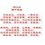 博主

新浪网友 说得好,现在就卖 (2008-08-04 15:32:12) [删除] [回复]  博主回复： 雁过张弓

(2008-08-04 15:47:10) [删除]  博主对不起，本 ID 的精力只能保持第一页的干净，只能下了。 补充一句，可怜有些人还是糊涂，现在是等买点的时候，等买点不意味着买点就到了，所以才要等到图形告诉你为止。 再见。(2008-08-04 15:51:18) [删除]

#### 短线关键**2762** 点（附诗人画廊（七**)** ：孟郊）

 时间：2008-08-06 15:38:08 短线大盘已经很明确，2924 点下来这段至少其第一段在今早的小背驰段区间套完美后就结束了，现在短线的关键点是 2762 点，只要这点不有效站住，大盘短线依然将面临短线盘整歇息后的第二段下跌；反过 来，一旦有效站稳该点，则第一段结束的反弹就至少延伸出日线上的笔，也就是至少是有一定力度与时间度的，至于是否有更大的可能，那是以后图形要告诉你的事情，没必要现在去预测。 大的角度看，目前依然在 7 月 3 日后形成的大中枢中，因此，目前的波动都可以看成是对该中枢的震荡，只要不形成对该中枢的第三类买卖点，该震荡就将一直延续。这一点是本 ID 理论的最基本常识，就不多说 了。至于中枢震荡如何操作，课程了反复说了 N 遍，就更不再罗嗦了。打针时候骚扰了一下孟东野，就有了下面的七律，附录如下吧：先下，再见。

### 孟郊

#### 缠中说禅 寒士志安寒号鸟 不平天地笔刀平 非东野足东坡肉 乃孟郊全孟母情函谷关前秦汉月 南山石上晓昏英 芙蓉今夜为谁死 露井风鸦沥血鸣

缠中说禅技术论坛 www.chzhshch.net 2762 点，大盘短线已到临界点

#### **2762** 点，大盘短线已到临界点

 时间：2008-08-08 08:23:58 昨天，一个包含性 K 线，构造出短线的第二类买点后回拉到 5 日线附近，大盘短线已到临界点。当然，最干脆的走势就是今天中长阳突破 2762 点确认笔走势，而反过来，若大盘依然在 2762 点下犹疑，那最晚下 周初，大盘中继中枢扩展完成后向下延续新一段跌势就理所当然了。所以，今天开始三天内的走势是短线必须密切关注的。 中线来说，已经三次探底，一般性地，即使从概率的角度，如果还有第四次的探底，那破底的概率至少是 95%。所以，这基本就是多头的最后一次努力了，就看如何收场了。 操作上，见买点就可以介入，冲不上去就把货倒给多头让多头去死，这就是目前唯一正确的操作。而没 这短线本事的，或者就把持仓位每天继续折腾差价降低成本，或者就继续小板凳，自己根据能力选择吧。本 ID 现在早对那些什么会审美大疲劳，快点完、别惹事就谢天谢地了。如果一定要让本 ID 说真话，那就让为资本全球化画眉贴金的末世大铺张见鬼去吧！中华民族的大复兴无须这种恶心的堕落背书！缠中说禅技术论坛 www.chzhshch.net 苦口良药，预演后奥运断崖走势

#### 苦口良药，预演后奥运断崖走势

 时间：2008-08-08 15:20:58 今早，有人企图用为什么深成指四次探底就破底而上海没破之类的烂问题刁难本 ID，不知道今天的走势算不算一个回答？本 ID 也想问，为什么你就不会完成以下的填空：“既然深成指都已破罐破摔，那 么还远吗？”

什么叫断崖走势？这几天本 ID 的长篇文章不断提到这个词，大白话就是破罐破摔，信心一致崩了那还有什么不可以摔的？本 ID 早上说冲不上去就把货倒给多头让多头去死，有人反问为什么要多头死？多头不死，哪里有大底？问题是，你为什么要站在死多头一边呢，世界如此宽广，你为什么要陪多头死呢？

 多头是什么货色，请看： 你别砸盘，不然对你身体不利！（2008-08-08 14:21:32)  拜托，先照顾好自己吧，本 ID 的健康就不劳烦了。 苦口良药，什么会都养不起 13 亿中国人，今天不过是一个预演而已。如果真为中国、中国人好，那么 就吸取教训吧，股市不算什么，经济断崖才是真正可怕的，过了今晚，面子也有了，干点实质的事吧，中国 13 亿人要吃饭的，一天都少不了，一顿都少不了，像今天中午那些饭还是少吃点吧。 为对抗经济断崖而努力，这是 2008 年 8 月 8 日唯一需要的口号。一个刘某、张某某、赵某某都大肆招 摇的玩意，爱啥是啥吧。缠中说禅技术论坛 www.chzhshch.net 密切关注买点出现

#### 密切关注买点出现

 时间：2008-08-11 07:54:18 2762 点下的三角反弹构成 2924 点下来的第一个中枢，然后是新一段的下跌，那么，后面的演化无非两种：两段力度对比（30 或 60 分钟），后一段强于前一段，则还需要一个中枢后的下跌背驰才有机会完成 2924  点开始的下跌；反之，则 2924 点下来只是盘整走势，只需要一个中枢，其后将快速回到 2679 点之上。

大的角度，目前 7 月 3 日开始的中枢震荡暂时还没出现第三类卖点，依然可以看成是该中枢震荡的延续，除非 2924 点开始的向下次级别走势类型完成后，其后的次级别反弹不能重回该中枢，才能确认中枢的彻底破坏。

 因此，综上所述，目前最大的短线机会，就是 2924 点下来的走势类型结束点构成的买点，其后至少有 一个 2924 点下来同一级别的反弹。密切关注短线买点，就是本周最大的任务。 看不明白上面所说的，也有两种途径：一、张某某去吧；二、虚心把课程真正读明白。 本 ID 可以自豪地宣告，本 ID 的所有财富都是靠自己的智慧从毁既得利益者手中抢来的，要击毁他们，就是要把他们的血吸光，资本市场是一个最公平的地方，关键你是否有如此的智慧。 没有智慧，就等着陪葬，这有什么可说的？当然，自我有清楚认识，危险之下坚持小板凳，也是智慧之 一。自知之明，从来都是最大的智慧。没能力，练能力，没人可以替你。缠中说禅技术论坛 www.chzhshch.net 断崖走势继续让短线买点逼近

#### 断崖走势继续让短线买点逼近

 时间：2008-08-11 15:07:35 今早已经让各位看 30 或 60 分钟图判断力度，从那 60 分钟不断伸长的绿柱子，只要是人，都知道下跌的动能依然强大，因此，早上说的第一种情况成立的可能性越来越演化为必然性了。 最坏的情况，本周只有 2700 点那中枢破位后的第二中枢反弹（一般来说，这走势明天、最晚后天盘中

就出现），这反弹的力度，甚至不能触及今天的高点，然后再继续暴跌；而第二中枢后，一旦出现背驰，就意味着更高一级别的买点出现，这买点，最小是 2924 点下来第二中枢级别，至少能构成 30 分钟上的笔走势。（最坏的情况下，最迟下周初就一定出现，一般情况下，如果不是最坏，本周出现的概率很大。）

 但这个反弹的出现，如果只是 2924 点下来的第二中枢级别，那么后面还有下跌去构成背驰完成 2924 点 以来的下跌走势，其后的更大级别就是所谓 7 月以来大中枢的次级别反弹将是最为重要的，是否构成第三类卖点，就看这次了，一旦构成该卖点，后面还有更断崖的下跌。 时间上看，要不出现这种第三类卖点，就看政策是否明白事了，如果还幻想，还开幕式，那就如那无聊 变态的烟花一样眼花吧，让断脚断腿漫天飞舞，这比烟花好看。 如果要严格分析，本次上海也是典型的四次破底，只是第二底比 6 月 20 那第一个要低，这是弱式盘整经常会碰到的。关于盘整形态的问题，以后在课程里再详细说。 股市开幕式地预演着断崖，本 ID 前段时间反复说的断崖是否蔓延到经济领域，就看某些人的表演了，有本事就如同开幕式那天发 1000 多支火箭来做假天气，本 ID 很想开开眼，拜托了。

#### 任何人在市场面前只能低头

 时间：2008-08-12 07:58:06 最近一天两帖，首先当然是本 ID 现在状态大好，平时谈工作或一些有趣的事，一谈就两三小时也毫无问题；其次，最近行情是大转折的时候，本 ID 一直说断崖，结果股市也很给面子地表演了一次，本 ID 当然

要多说几句，就当是中央台那无聊旁说也是有趣的；但最重要的是，本 ID 过两天出院后要有一次较长时间的远足，这样就不能保证每天都有帖子了，当然本 ID 会尽量做到一天一帖，如果达不到，各位也请原谅，现在也算是预先补偿一下吧。

 任何人在市场面前只能低头，今天央行有人出来强调放松信贷，虽然不太诚恳，但也算对市场低了一下 头，至于市场是否领情，那就市场检验了。不过，在本 ID 看来，这还远远不够，但一个开始总会有点羞羞答答的，鼓励一下还是应该的。 但要避免经济的断崖，头必须再低点，最好一次性地完全达到市场的要求，否则，像挤牙膏一样，那最

终只能面临市场更严厉的惩罚。任何想用小恩小惠蒙骗市场的，最终的命运都是一样的。前段时间，本 ID 多次痛批某些人认错如同挤牙膏，对恶意再融资老想敷衍过去，结果如何？后面那些所谓的救市每一天都被市场所严重嘲笑，这就是市场的力量，如果还没试够，尽管再折腾，谁怕谁呀？

 本 ID 当然有更有力的渠道表达意见，这里发出来的，多数都只是随便写的草稿而已。但就算最好的渠 道，改变思维都是相当困难的，像上次那破烂直通车如此快的效果，简直是百年一遇。别说如此庞大的决策机制了，就算是一个个人，本 ID 从去年底开始无数次地强调今年是一个“井”年，是开短跑运动会，甚至

多次说就算本 ID，经常持股也就是两三天，没技术没本事的就小板凳，那么，请问，究竟又有多少人真正能自知之明呢？是否都认为自己英明神武，能够逆市场趋势而动，都有技术去短跑呢？至于那些整天还要叨唠显摆自己智力问题的，那更是活该了！

 市场从来不相信眼泪、叨唠，你爱干什么都可以，本 ID 说过，即使是本 ID，要在市场杀起人来，也是 不分敌友的，因为分不清楚，也没时间去分，市场的有效时间如此宝贵，刀光闪去，被杀是活该，吵也没用，只能显示自己的智力问题。要成为钢铁战士，要在刀光丛中自由行走，就练好工夫，除此之外，张某某次方 的张某某地手口并用都救不了你。 本 ID 再废话一次，爱听不听：操作的节奏是最重要的，而节奏来源自对级别的清楚认识，谁说本 ID 的理论不能预测的？只是本 ID 所说的预测，是各种级别边界条件的完全分类，是一个操作的完全分类图，这 里，最关键的是级别，没有级别，任何的买卖点都是白搭，更别谈什么节奏了，不搞清楚这点，那还是张某某去吧。 好自为之吧，就算最好的拐杖还是拐杖，而一个大写的人，一个钢铁战士，就要学会自己站起来行走，本 ID 并不想当任何人的老师，本 ID 最多是你人生的一道风景，你看成什么是你眼睛的事情，和本 ID 无关， 自我修炼去吧。缠中说禅技术论坛 www.chzhshch.net 经济基本面给了调控下台阶的机会

#### 经济基本面给了调控下台阶的机会

 时间：2008-08-12 15:21:43 大盘今天走得极为规范，如期出现昨天说的盘中反弹以构成 2700 点那中枢破位后的第二中枢反弹，后面请注意了，这里严格说将有两种演化可能： 一、最规范的就是破该中枢，然后再分两种可能，形成背驰见更大级别底形成更大级别反弹，不形成背 驰就继续下跌去形成第三中枢，一般来说，后一种情况出现的概率不会超过 10%，而且是否形成背驰，可以很直观地判断，根本没有模糊混淆的可能，除非你根本没搞清楚背驰的判断。 二、不大规范地的，就是直接从该中枢第三类买点扩展成更大级别的反弹。这等于标准的下跌走势 a+A+b+B+c 中的 c 不出现，读过课程的都知道，只要有 A 和 B，a、c 不出现不改变下跌的性质，趋势与盘整 在于中枢数量，这是最基本的常识。 同样地，第二种情况的概率也不超过 10%，按中枢震荡的判别原则，第三类买点与第三类卖点都分辨不清楚，那就根本没看明白课程，补课是唯一选择。 看明白上面的内容，后面的操作就得心应手了。当然，具体个股与指数的节奏可能不同，这也是最基本 的常识，那就各自去分析了，本 ID 不可能把个股也分析了，没那时间。

今天 CPI 有比较好的数据，油价、汇率都有了有利的变化，这也为某些人准备了台阶，下不下就是他们的事了，不下，市场是不会给面子的。所以，从基本面上看，短线反弹是有了些条件了，但中线的关键还是要低头、下台阶，否则给脸不要脸，只能撕破脸了。

 不说了，看着办吧。 时间：2008-08-13 08:28:09 春节后写了要通胀还是要经济增长 (2008-02-28 15:53:15) ，当时就很尖锐地指出高通涨低增长死局的潜在可能与危害性，在错过了诸多有利时机后，很不幸地，现在这种风险正日益迫近。现在，已经别无选

择，当时已经给出了当下最现实的模式，高增长高通涨，然后在此基础上逐步利用有利时机改变经济结构与利益分配机制，使得结构性通涨的压力消解。无论如何，确保经济高增长已刻不容缓，不想死得很难看，这是唯一实际的选择了。

 最近，对经济增长的再次强调逐渐有了较大的声音，这是好事情，但其中依然有诸多的摇摆，这是十分 糟糕的，机会不会无条件地等你觉悟，因为迟疑，多少机会浪费了，而这会有什么报应，难道真想见识吗？ 对于像本 ID 这类人，经济断崖不过提供一次大量买入超廉价资产以提供下次济热潮的筹码而已，但对于绝大多数的国人，那可能面对的就是生存问题了，这不是危言耸听，而是经济变动极可能出现的状况，大 难几乎都在兴高采烈之时，这难道还少见？ 本 ID 很希望自己错了，但无数的事实证明，本 ID 对经济的判断从来没错过，只不过本 ID 都很早就提醒，而绝大多数人却依然沉浸在梦里，难道一定要经济大地震才醒来？ 股市方面，对于超短线，看好 30、60 分钟形成底分型后上边沿的位置是否能有效站住，一旦站不住，超短线依然要继续下探。这一简单的招数，用在日线上曾经让多少次短线操作最终能胜利大逃亡，这在以前 屡次反弹中，本 ID 用短线关键位置是多少曾演示过多次，一定要把握好。当然，如果你对本 ID 的理论有很深入的认识，有更精确的方法，但对一般性的操作，这招数简单又有效率，不把握就浪费了。 这两天准备出院，诸多事情，明天开始就不可能一天两帖了，抱歉。 时间：2008-08-13 15:23:14 今天的走势，前面都描述过了，没什么可说的，这极为标准地构成了前面所说那三级别反弹中的第二个，也就是构成 2924 点下来的第二中枢那一个。今早特别强调了底分型的用法，今天的走势教科书一样，各位 如果还闹不明白的，就从 15、30、60 一直看过来，研究去吧。 最大那个反弹，也就是前面大中枢的次级别反抽，同样有两种可能：更大底背驰或从今天构成的中枢直接上去，分析和昨天说的那小级别的道理是一样的。 从大盘的实际走势，显然并不是最恐怖那种，本周已经出现第二级别的反弹，因此就是一般性走势，后面的操作无非是从这第二级别反弹成功逃掉然后再抄更大级别也就是第三级别那个底，如果你真有本事，这 三级别的反弹你完全可以根据本 ID 的理论按照如此美妙的节奏自如地完成，现在达不到，就继续训练，没有什么东西是可以随意达到的。 至于经济，某些人爱干什么是什么，只要你有本事，越跌越赚钱，既然有人这么乐意送钱给咱们花，为 什么要拒绝？ 有时候，让大浪自然去淘沙，可能更有意义，浪淘尽千古风流人物，现在又有谁是千古风流人物呢？这和你的官位、财富无关，某些人有点自知之明吧！ 最后说句狠话，之所以有人敢于如此，就是没人需要为经济出大问题负责任，因此就占着什么不什么了，那就随它去吧！

#### 什么才是真正的“和”？

 时间：2008-08-14 08:03:14 学东西，必须搞清楚细节。就像现在，依然有 N 多人把分型上边沿站稳作为最好的买入点，却搞不清楚，恰好相反，这只不过是判断是否延伸为笔的一个简单判断法，如果说买点，必须从走势类型去判别，分型上

下边沿之类的东西，最多就类似于第三买卖点，因此以这当成买卖的根据，将不时面临买后第二根 K 线就是转折的尴尬。道理很简单，如果抛去包含关系，6 根 K 线就可以构成笔，而确认站稳上下边沿的那至少是第 4 根，而转折在第 5 根，这意味着什么，不是很简单的问题吗？

 因此，各种方法，必须知道其使用范围，在什么情况下如何用是最有效率的，否则如此囫囵吞枣，不亏 钱真是没天理了。课程里也有单纯用分型的不同级别，用类似区间套的方法确定买卖点的方法，这可不是单纯的上下边沿判别，千万别搞糊涂了。 股票糊涂了，大不了就亏点钱，如果一些基本概念糊涂了，又当成国家的战略依据，那真是国将不国了。 像最近被反复口淫的“和”，被解释成所谓的“和谐”之类的可笑玩意，甚至为所谓的“和平崛起”去依据，简直是祸国殃民。 “和”，是相应的意思，这在最基本的《说文解字》就有的意思，最后被阉割成“和谐”之类的废柴，大概也成了宋以后被长期凌辱的最好注释了。 何谓“相应”？就是根据当下实际的条件，给出的最适宜的行为，简单地说，就是构成“相互应和”。 最简单的，对垃圾、衣冠禽兽就要彻底清扫，而不是去“和谐”，这才是相应；世界历史证明，“大国崛起” 从来就没有“和平”的，当然，现在可能可以进化成经济、金融的战争，但这更不“和平”，所谓的“和平 崛起”，真是不知所谓，可笑之极。 你只要想“崛起”，就有人不让你“和平”，从各方面折腾你，这是最基本的常识和世态，企图掩盖，究竟想蒙谁呢？美国之类的会让你的口号忽悠吗？最终害的不过就是自己而已。要“崛起”，其“和”其相应就是斗争，斗争不一定都是大规模的对抗，斗争本来就是一门艺术，只是 你是否把握而已，这点与把“和”折腾成口淫版的张某某之类人，根本没什么可谈的，就让他们继续口淫快乐吧，但这皇帝新衣必须指出来，让更多国人知道，这群人是如何光着腚子相互淫乱以让他们的利益继续既 得的。至于股票，该说的都说了，自己修炼吧。今天下午没帖子，可能要等明天或后天早上才有了，抱歉。

#### **2484** 点，短线关键位置

 时间：2008-08-15 15:27 昨天日包含关系，今天构成日底分型，2484 点成短线关键，道理说过 N 遍，不再说了。下周初如果不能站住该点，大盘不可避免再次探底，最坏的情况，下周一就直接低开探底。因此，5 日线成了短线的最基 本支持判别，一旦有效跌破，探底就确认展开。当然，如果下周初能顶住，更大级别反弹就此扩展的机会就极大了，就看市场选择吧。今天万分不爽，现在不能坐飞机，怕上升下降时身体出问题，只好坐火车。结果那车竟然没有高包，坐软卧极端不习惯，一晚没睡好。早上到了武昌，一个超级乱的扩建中的车站，又刚好下大雨。本来有朋友说 找省里的人接待，本 ID 怕欠人情就推了，真有点后悔。 送本 ID 来的朋友，性子特倔，本 ID 说去西广场出去，他偏要听人说走东广场，结果淋了一通，本 ID 火已经很大了。更无聊的是，为了三顾茅庐方便，本 ID 没法去住好酒店，只能就近找酒店，结果打车到目

的点一看，几乎晕倒，这武汉也是的，这么多年，汉口竟然还有这么大片没开发的地方，还以为进了荒山野林里，找到那酒店如同老电影里所见的，最可恶的是，吃饭也没地方，附近有吃的地方看都看不见，说可以打车去，出租车在哪里呀？只好在所谓的酒店里将就，说好来湖北菜，随便什么三蒸、莲藕排骨就完了，结

 果没有，这里是山东师傅搞的四川菜，没辣就不会了，一口都吃不了。后来，去那所谓的小卖部，都是热气的东西，最后只好来了点喝的，今天晚上，听说能专门给我们弄条鱼清蒸，但要专门下午到老远的地方买， 晕!  但比最可恶还要无聊的是，一回到房间，电话就上来了，问要不要房间服务，本 ID 就问，除了鸡，还有鸭有鹅有鸽子吗？一样来一队来挑挑，结果把电话给吓回去了，好无聊的地方呀。 但这里有奇人，这里就是光明之地，为了学会那本事，什么都认了。那奇人似乎特恨与官员有来往的人，本 ID 无论如何是不能让什么省里的人接待去那些不靠谱的地方，受苦受累也要顶着了。现在还没见到那人， 估计真要 N 顾茅庐了，就看本 ID 有没有这善缘，奇人是不能强迫也不能利诱的，否则本 ID 也不会为此受此苦。心只能靠真心感动，本 ID 就在这里熬下去了。 不多说了，唯一惊喜的是，这里竟然还有光纤上网，这就够了。等天晴了，再想办法解决如何吃好的问 题，能吃是福，听说这里的蟹比某某湖的还要好，污染少，不知道是否吹牛，找时间好好验证一下，至于还有什么好吃的东西，只要不是炸的、煎的、烤的之类，都要检验一下，有当地的朋友吗，麻烦介绍一下，哪 里有美食？以前来武汉都是来去匆匆，这下要好好武汉一把，谢了。不知道最后结果怎样。缠中说禅技术论坛 www.chzhshch.net 分型上边沿再起神奇作用

#### 分型上边沿再起神奇作用

 时间：2008-08-18 15:09:52 十分感谢各位的关心，这边的问题，无论多难，本 ID 都会尽量处理好的，毕竟机会难得，是否最终如愿，就看是否有此善缘了。 今天大盘值得各位好好研究，周五所给的日底分型上边沿不能站住将继续探底，今天的走势已经给出最

好的阐释。而这个探底，在最开始的三级别反弹分析中已经仔细分析过，这一般有 90%可能性走势下面预防的走势无非是不能形成背驰从而只能先有第三中枢的问题，因此，明后两天走势极为关键，一旦延续跌势力度，那么第三中枢的可能性就很大了。反之，就那次级别的反弹就将展开。

 一定要注意，这次级别反弹可能只构成原来大中枢的第三类卖点，其后将是更猛烈的下跌，第三类卖点 后最好也就是构成更大级别中枢，因此，这反弹相面对的风险还是需要留意的。 从基本面上看，时间刚好极端配合，这次级别的反弹，最弱的就是平台式的，也就是连 2500 点都碰不到，然后基本对应上那什么会结束，最后的机会给管理层，如果还如此，后面不第三类卖点才怪了，这点必 须有清醒认识，而这在原来三级别反弹的分析中已经明确指出过，市场显然与我们的分析完全合拍。 不说了，本 ID 现在的任务是学习、治病，顺便看管理层的反应，一切都在分析之中，没什么可继续说了。缠中说禅技术论坛 www.chzhshch.net  2455、2656 成短线上下关键位置

#### **2455** 、**2656** 成短线上下关键位置

 时间：2008-08-20 15:11:18 今天大盘死皮赖脸地又教科书了一把，本 ID 这两周关于三级别反弹的分析，就此被大盘完美演绎。后面走势，其实前面已经分析过了，就是下面要站住今天构成日底分型上边沿 2455 点，上面要尽快攻破 2656  点以确认第三类卖点不成立。 当然，以上表述是站在希望大盘涨的基础上说的，而实际操作，一定不能有这种想法，而是根据大盘实际走势进行机械化反应。 再强调一次，没分清级别之前就别谈什么背驰。所谓背了又背是天经地义的事情，但对应的是不同级别，否则，难道一个 1 分钟背驰就可以让大盘转向 1000 年，那不乱套了？本 ID 理论的基础之一是级别，不学会 并完全机械化地精确把握，那还是别背驰了，因为这种水平，除了背还是背，还驰什么？ 今天上来，主要配合了消息面上关于经济刺激的一些重大传闻，如果真能如此，跟着本 ID 的思路一把，这管理层还算有药可救，否则，又来假消息忽悠，那只有第三类卖点后更强力地暴跌了。所以，这几天消息 面是最关键的，会也快开完，该干点正事，否则，难道还要为残奥会增加点新项目，提供点新选手吗？

不想说了，就看某些人会不会做了，这不是小孩子玩泥沙，千万别意气用事。至于各位，无论你这两周是否如本 ID 两周前说的完全踏准三级别的节奏，但如此教科书的实际走势，也请好好分析清楚，学会了这，你的水平将提高许多，各位就各自努力吧。

#### 超短线抉择**:5** 天还是 **13** 天线

 时间：2008-08-21 15:23:00 今天没消息，大盘回跌就是天经地义的，至于这回跌是否最终构成继续的探底，昨天已经给了一个基本点位：2455 点，如果明天还站不住该位置，继续下探就是理所当然了。 当然，实际操作中，根本无须搭理这点位，因为这往往有点晚，本 ID 最近课程专门讲述如何进行短线

操作安排。里面给出了最有效率的方法，而这次第一段的顶背驰极端明确，当然，由于是 T+1，所以实际操作中不一定真能在第一类卖点就卖了，而以前说过开盘大幅度低开后，第一次次级别回拉不破顶后盘整背驰将构成最好的第二类卖点，这类卖点往往是突发事件中最好的逃命点，这里的老人都知道，去年 530 早上开

 盘前专门强调注意第二类卖点，该点走掉后，虽然不是最高，但后面至少逃过整个跌幅的 95%，这已经是突发事件中最好的结果了。 当然，理论水平不够的，就看均线，前面有专门说均线系统级别的，这次标准地在 13 天线受阻，也就 是一个 2 级力度，能否升级到 3 或更高，就看 13 天线了，至于 5 日线，是超短线的生命线，一旦有效跌破，那该怎么样，张某某都该知道了，各位这么英明神武的，就不用废话了。 明天，最后一个搏消息的日子，而下周，是让某些人最后彻底反省的日子，如果一切都落空，你说这市场能不空吗？这第三类卖点还不是天经地义的？让市场赞助点手呀脚呀地残奥会一把，还不是很张某某 的？ 至于那连笔和线段都没分清楚，在线段上竟然敢大谈什么背驰的，就虚心点去读书。让本 ID 一个早被判四期绝症的病人每天还分什么笔、线段图放上来的，你好意思，本 ID 都不好意思。因为，功夫是你自己 的，你自己不磨练，万一本 ID 有什么闪失的，你又去哪里找陪练？

可以断言，本 ID 万一有什么闪失，关于本 ID 的理论就会被折腾得完全变样，有 2 的张某某次方变种，结果，最终能在市场上真磨练成钢铁战士的，能有 5 个，本 ID 就含笑九泉了。就像那奇人，他们家里同辈人一起学祖传绝学，9 个人，最终只有他坚持下来并完全自如应用了，大概世间很多事情都命该如此，就不说了。

 本 ID 一时还死不了，至少要看到某些人低头才行，这次不低头，总有低头日，但那时候可能就不是主 动低头了，要面子可没有，鞋子、袜子、唾沫星子诸如此类的东西张某某的张某某次方飞过来，肯定比某天那天上钞票印出来的脚印有趣。 先下，再见。缠中说禅技术论坛 www.chzhshch.net 博消息，于 5 日线震荡

#### 博消息，于 **5** 日线震荡

 时间：2008-08-22 15:32:30 由于前几次周末搏消息都以失败告终，所以这次似乎热情不高，但依然没有死心，所以就构成今天围绕 5 日线震荡的两难局面，因此，周一开盘就决定短线突破方向，技术上一旦 5 日线走平再张口向下，那么大 盘新低就是理所当然了。

当然，高位走掉的，这消息也可以赌一把，只是周一一旦没兑现，就要动作特别迅速，没这水平的，就算了。就算真有什么消息，如果特别实质的，完全可以在高开回来出现小次级别第二类买点时介入，这和大跌的操作只不过反过来罢了。

 目前，从中线的角度，技术上周与月如何能最终构造出底分型才是问题的关键，否则，就算有消息，也 是一日几日行情，比比短跑而已。周末，好好休息吧，这边也有不少事情忙，先下，再见。

#### 以北京奥运为新标杆的面子工程运动会隆重开幕

 时间：2008-08-25 15:38:43 大盘没什么可说，昨天已给了最关键的评价，市场需要更多真家伙。技术上，今天改变了最近周一就大跌的习惯，但由于目前 5 日线依然在 13 日线下收口，因此明天，最迟后天是短线分水岭，是 5 日上穿 13， 还是再次扩大形成新一轮下跌，很快就有答案。

管理层已经企图想干点什么，但太拖拉了，就怕他们到时候尽来些不到位的东西，反而让市场厌恶。所以，现在，一切都在敏感之中，这段时间，一定要清醒看好，最安全的还是根据技术来，中线的标准很明确，就是首先周底分型，然后是月的，这两个构造出来，大盘才会有大戏，否则也不过是上下折腾一下。

 本周很关键，决定了本月能否有可能成为月底分型最下一根，如果本周走不好，那么，一切都将至少轮 后一月，如果这样，后面的调整就至少多三月，也就是至少两年以后再谈什么新高行情了。第一轮调整时间越长，正规的走势中，后续最终结束全部调整的时间也将成 N 倍地延长，这是很关键的。本月是 10 个月， 下一周期是 12、13；然后是 17、18，当然，具体要看实际走势，这都是经验的分析。

目前，是游资乱搞的时期，所以权证、本地股等小市值品种就会被经常光顾，而真正的大行情，必须中字头股票真正动起来，本 ID 当然不介意管理层一路昏招，使得本 ID 类似 6 元中驴的理想得以实现，但本 ID 从 11 元多开始都是见步拆步，冲不上去就砸，有差价就回买，有机会就让它破底，以有更好的价格，而

 中字头的基本都是这样弄的，没有人会现在全身投进去，但现在完全不介入，以后可能就不一定有发言权，这就是另一个问题了。 所以，再次强调，对于小资金来说，继续短跑运动会，这才是应付如此混乱环境的唯一可行办法，或者 干脆就继续小板凳，那更不用烦了。

说起运动会，今天，以北京奥运为新标杆的面子工程运动会隆重开幕了，以后，一切只要打着民族世界交流发展展示等等劳什子玩意的东西都有了新标杆。花吧烧吧，一切时代，如果张某某般以宏大叙事为基础的伪文化得以烧钱化，这个时代一定要反省了，说得难听点，一个破资本主义爆发户，有什么可臭显摆的？昨天，最精彩的是那伦敦市长以忒加扎的方式上场，给爆发户心态的急于显摆一个极大反讽；另一个，

 当然是那八分钟，这里，无法讲述，因为懂得当代西方哲学、艺术发展的人毕竟太少，这种以摆脱宏大叙事为基础的、散漫而有机的艺术，是张某某那些弱智的爆发户玩意永远想象不到的。 当老牌资本主义早就开始冷酷的反省与重建时，一切的对比简直太有趣了，当奥运奥运了中国后，就看 老牌资本主义的精神家园里，奥运是如何被伦敦所奥运，2012 年，值得期待。 本来想写一篇关于那 8 分钟纯专业的分析，后来一想，本 ID 又不喜欢废铁、烂切，何必多写又招极端民族主义者不待见，就算了。 要在全球化占主导，文化是最大的难关。其实，伦敦那些也不过糊涂玩意，新的文化建构当然至少是全球视野的，不明白这点，远远不行呀。 任重道远，呜呼-- 缠中说禅技术论坛 www.chzhshch.net 大盘短期走势纯技术分析

#### 大盘短期走势纯技术分析

 时间：2008-08-26 14:59:52 从最简单的 5\13 日线就知道今天最迟明天是大变盘的日子，结果大盘依然很有方向感地向下，明天回拉只要站不上 5 日线，以后该线就成为最简单短线判别标准。 不过，有一点必须注意，目前大盘往下的承接日益加大，大盘还有一种可能的演化就是不断的下探最终 都不构成真正的下跌，而是不断扩展出更大级别的中枢，等待上面均线下来，在目前大致位置形成缠绕后再决定最终突破方向，这是一种很有技术意义的走势演化，具体的分析以后课程里都有。 今天并没最终破坏上周是周底分型最下一根的形态，换言之，只要大盘在本周不破坏这形态，那大盘还有点意思，否则，就继续下探到可安置这周底分型的区域。 话就不多说了，一切看图操作，千万不要一根筋。 谢谢各位的关心，这两天买了点电器回来，自己来吃得舒服，当然，自己来也就是补充一下，大的还要 靠外面，毕竟本 ID 不可能去每天买菜，那事太麻烦，糖水弄了还可以，外面买了冷冻的甜点心，加热可以随时吃，只能将就了，顺便活动一下自己，也算锻炼。在这里，估计至少还要二个月，熬熬就习惯了。

#### 严重预告**:** 本周开讲缠中说禅中医学

 时间：2008-08-27 15:45:46 严重预告:本周开讲缠中说禅中医学，注意，是缠中说禅中医学，而不是中医学。本打算去理疗，现在已经没必要，本 ID 昨晚让人过来手动推按一些关键部位，加上一西药的针，已经完全起作用，昨天只对严重的一边下了重手，另一边现在反而仿佛变得比治疗的这边严重，看来效果不错。 这事没敢惊动那奇人，人的思维很容易落到他的自我设计中，奇人目的是弄那最重要的病，当然不大爱

管这些小毛病，而这次本 ID 也错了，把这和奇人说，然后他就给了另一种药，那药是对第一种药有缓解作用，因此导致主病的治疗反而效果互相削减。后来，本 ID 想通的一点就是大师傅一般都不爱洗碗，这些杂活应该社会分工到一些小级别师傅那里去，所以就有昨晚的活动，之所以没说，是因为不知道效果怎样，免

 得事没成说多了坏事，幸好结果超好。 现在的情况，本 ID 可以很明确地告诉各位，来这里，说白了就是一个消业的过程，麻烦的人越少越好，前几天本 ID 在这里刚说吃不好，马上就有朋友发短信过来说要让一老大姐过来并带好吃的，本 ID 马上回短

信说谢谢了、千万别。这里应该有 N 个熟人是知道本 ID 的电话甚至现在住的宾馆，有一两位甚至连房间号都知道，万一本 ID 真有什么事，他们看到博客都会马上飞过来，所以本 ID 真没什么可担心的。这些朋友有些就是上次本 ID 肝昏迷赶过来才知道博客地址的（具体怎样，说实在本 ID 现在也没闹清楚），这里也和他

 们说千万别担心，俺可好好的，闹不好，过两三个月，又可以飞龙在天了，现在就让俺把这业一个人安静地消去。 至于那些吃饭做饭的，其实本 ID 难得有这个机会去玩玩，至于独自一人，这是本 ID 的常态，本 ID 从

九十年代初到现在，也投资过不少东西，结果最终走掉了，连那公司在哪里办公的都没闹清楚的是常态。例如，本 ID 办过一本财经类的杂志，是最早也是最大的投资人，首先，本 ID 就没挂名字，出版人里也没有，后来那杂志弄得全国都超有影响了，本 ID 连他的编辑部在哪里都没搞清楚过，好象有人告诉说是搬过几次

 地方，最后把股份卖掉退出，也没闹明白这事情，这就是本 ID 一般的习惯。大概是习惯，本 ID 都是独行侠，十 N 年前，其实管的资金在当时也不算太小的，100 亿以上的规模， 当然不都是本 ID 的钱，干坏事情哪里都用自己钱的？都是几股人在一起，把资金统一交过来管理，统一进出，当时，点不少，本 ID 的习惯都是用证券部的人下单，指令只由本 ID 下，当时，可能坐在东北一个小县 城里，就可以在四小时里来回神州大地 N 遍。当然，也有 24 小时内，从哈尔滨飞海口，中途在北京、南京、广州干点坏事的经历。 哈尔滨那东南亚人开还是管理的五星级还是准五星级宾馆不知道现在怎样，具体名字现在都忘了，就记得那楼层特别高，那热气热得让人抓狂，那时候还是九十年代，应该算当地最好的宾馆之一了，在那里，待 了不少日子。有哈尔滨的朋友吗，说说，也让本 ID 恢复一下失去的记忆。 可惜，很多失去的都不能恢复了。所以，珍惜眼前，大概就是最好的回忆了，人的一切，不过就是不断变成回忆的过程，最终，能留下的，也就是回忆，而你的一切行为，决定了这回忆的颜色，是噩梦还是斜阳 下那一抹淡淡的蓝。

大盘没什么可说的，一切都在昨天的分析中，有些自以为是之辈连本 ID 的理论是什么都没闹明白就断言本 ID 的理论被目前的走势所破坏，对这种人，唯一的选择就是少管，让愚蠢继续愚蠢下去就是对愚蠢最好的惩罚。至于对于已经有所把握的，当然看得到目前走势的规范。注意，昨天分析提到的那种情况，在底

 部构造中超经常出现的，一定要注意研究，这个是无上利器，因为反过来，就是顶的构造，这在历史性大顶的构造中太常见了。好了，现在本 ID 要出去大购买，现在体内大兴土木的感觉越来越强劲，不要浪费了这机缘。缠中说禅技术论坛 www.chzhshch.net 等待政策与技术产生共振效应

#### 等待政策与技术产生共振效应

 时间：2008-08-28 15:10:21 现在，政策与技术，单纯一面，都不足以构造真正的中期底部，而是必须等待两者产生共振效应。政策面上，效率不高；技术面上，最简单的均线系统都没修正好，因此，硬来没多大意义。 在目前条件下，中线角度，出现各级别中枢不断扩展叠合以完成底部构造的可能性越来越大，也就是说， 先横住了，然后再等到那共振时间的出现，产生突破的第一推动力。

明天又进入搏消息日子，上周参与者已经热情不高，本周如何，拭目以待。然后又是一个轮回，有消息，就看其分量决定短线的波动力度，没有，就有了借口往下考验一下，当然，就像本周，最终又一个平衡形态也是一点不奇怪的。

 现在，唯一需要的是耐心，而对于短跑选手来说，其实机会不少，特别个股中。如果着眼中线，那还是 继续不断短差就降低总成本，这不用太费心。至于，一点感觉都没有的，那就小板凳吧，至少等底部形态彻底摆脱了再说了。

#### 超短线就看周一及**2403** 点

 时间：2008-08-29 15:11:47 今天，继续周末消息市，由于外围造好，就有了比较强的盘面。现在，最基本的，超短线就看周一能否站住 2403 点，能就极大机会延伸出日线图上的向上笔，2523 点是下一个重要位置。更大时间的分析，请看 今早的文章。

大盘当然已经暗潮汹涌，你看中信证券，大盘没动，也快上来 30%了，没人搞是决无可能的。其他不少中字头的也如此，但是，这搞是有分寸的，就是万一管理层真不给面子，翻脸就可以不玩，成为新的下跌动力。现在的大资金，只要比配合理，都是十分自如的，一有机会可以狂飙突进一次，没机会、不给面子就继

 续砸出机会，谁怕谁呀？ 总之，现在不要一边思维，有能力的要多活动，大盘在大的底部构造中，机会多多，来回几次，比来一次大的都好玩，最后再在大的上面狠咬一口，那又够一年半载消费了。 另外，有一种错误的思维一定要消灭，否则死无全尸。千万别有等下一大级别再如何如何的想法。10000

点跌到 6000 点反弹到 8000 点，然后到 2000 点再反弹到 4000 点，你说相对 6000 点到 8000 点，2000 点到 4000 点是不是大扬？但这有什么用？不会分段操作，一味死扛的根本不该到股票中来，股票就是分段操作的，下一段就算有天大的宝贝，都和当下这一段无关，任何的操作只关心当下的苹果，吃到就是英雄，否则

 就是垃圾。 人，总爱编造一些故事来给自己一个支持的理由，那都是弱者的表现，在本 ID 这里，只有当下的走势，任何所谓的预测，都是闲谈，活动一下唾液的分泌功能，这已经说过无数次，如果还不明白，那真不能股票 了。 而实际上，对于真正的操作者，本 ID 每天后面写的，等于是一个操作的完全分类，任何操作必须以完全分类为基础，否则，只有死路一条，也说过无数遍了，又有多少人真正机械地做到？周末中医一把，本 ID 的绝对前无古人，有时间可以先把抽象代数复习一下，本 ID 的中医是以抽象代数为基础展开的，当然其中不会用到相关术语，但思路是一样的，这才能构造真正的中医基础。 股票是几何的，医学是代数的，世界就是这么简单，如此地数学了。先下，再见。

#### 退一步海阔天空

 时间：2008-09-01 15:56:14 关于本 ID 坐骨神经的最新进展，后面有附录。来本 ID 这里，首先就要有最基本的科学精神，科学精神你都做不到，还如何能破科学而进入更高的境界？本 ID 这里一是一、二是二，只看实际效果。 至于股市，周末搏消息的又一次失望，因此就自然有了今天的走势。对消息，不能急，你想大爷们的工 作效率，就算真想干点什么，能快得了吗？退一步海阔天空，没什么不好的。

纯技术的角度，已经明确分析过了，就是要有较大行情，必须月线闹出底分型来。如果本月初破上月底，并不是什么世界末日，反而使得这底分型更有力点，行情早一月晚一月其实并没什么大不了的。试想，如果本月不破底而硬搞一个分型，那么本月就需要拉一长阳，你凑在图上看看，总让人感觉不舒服不塌实，现在

 硬上去，弄成包含关系的可能更大，这样，后面反而会使得真正底分型来临时间更遥远。所以，有时候急了并不是什么好事情。 从纯美学的角度，10 月见底是最美的，因为刚好对应一年周期，顶和底一个完美的周期，当然，9 月其

实也可以，因为周期是可以正负一两个月的。站在这个角度，在月初砸一次破一次，对长期走势来说是件大好事。当然，这只是从美的角度说，至于市场怎么选择，市场说了算，实际操作中，根本可以不搭理这些事情。

 下午有朋友打电话过来，说他到了一中央级最重要之一的经济管理部门的杂志当头，那杂志是每个大国 企以及大企业的头都会看的，希望本 ID 给他们写点什么。本 ID 有更好的渠道，本对这事没兴趣，想想，这可能也有点用处，专门写就算了，有些老东西改装一下弄过去就可以。各位有什么好的想法，也可以说说。

本 ID 和他明确说了，他也知道本 ID 从来很少给什么杂志写东西，就算偶尔为了加大吹风力量弄的，也是闹着玩的，所以和他的合作不可能固定，本 ID 也不要他的稿费，反正想到有东西给他，他能用就用，不用就算，这样比较自然点。

 他专门问了本 ID 对调整的看法，因为他知道本 ID6100 点做空以后一直不感冒这市场，所以问本 ID 调整还有多长时间。因为是朋友，就直说了。如果真要重新来过，那是 N 年以后的事了，现在唯一可以等待的 是 MACD 在月线上回 0 轴后产生的中级回拉，这时间也快到了，狠的，就等 17、18 月，也就是明年 3、4 月开始；不太狠的就是 10 月前后了，这关系到周期运行的问题。至于是什么时候，关键是看管理层的作为， 如果吊儿郎当的，那就狠吧，一切都是因缘和合，可没有任何必须的东西现在就规定行情如何如何。 这里说的是大的走势，至于周线以下级别的走势，更没什么可分析，以前都说得很明白了，没必要预测 什么，看图，那里什么都有。好，关心本 ID 坐骨神经的朋友，请看过来。 奇人那一下很有效果，但效果没有持续到足够让本 ID 满意的程度。这里有一个客观因素，就是酒店的床太软，本 ID 要求更换木板床，说没有，晕。什么治疗后，一睡那床估计都要反复。闹不好，本 ID 要在地 上睡了，在地上铺好了，可能会好点。

昨晚，比较痛苦，打了两针竟然也没起作用，后来还是本 ID 自己解决了问题，把穴位用东西封上，结果一晚安稳，当然，奇人把一些东西弄回去了也是很关键的，否则本 ID 的招数也用不上。总结一下，奇人弄好后，一是没睡到正确的床上，二是大采购过于劳累，把刚弄正确的位置又搞偏了，所以这次先用本 ID

 的招数控制着，等奇人两天后来再最终处理一下。 至于今晚如何，天知道，不过本 ID 已经开始喜欢这游戏，就是如何当下地处理好这问题，然后得到一晚的安睡，这是多有趣的事情，目前状态可以，就看晚上了。缠中说禅技术论坛 www.chzhshch.net 5 日线控制超短线走势

#### **5** 日线控制超短线走势

 时间：2008-09-02 15:15:15 今天差点没破底，然后扭捏了一天，但深圳破了，只要没有半夜鸡叫之类突发事件，破是迟早的事情，快的明天开盘就实现。上海现在的超短线走势就看 5 日线了，5 日线站不住，这轮杀跌就没完。所以，如果 懒的，就看 5 日线足够。 其实，大盘现在走成怎样都没什么意义，因为没量，就算现在一直阴跌下去，一旦回头，很快就可以回到目前的位置。关键还是月底分型的最终结果，其他都没多大意义。本 ID 很高兴能一直写这博客，例如现在，孤身一人，在这每天写两句，总有一种温暖的感觉。十分感谢各位的建议，这让本 ID 感到和各位同在经历一些事情的感觉，很好。 大的说，现实中的人都是可怜之人，否则就不会因业力牵引而成就人的生涯了。人，有苦有乐，乐最终 还是苦，在本 ID 看来，所有人都如同无端流放于荒野的一群，互相之间能相互帮助，一定是人间最美的事情。所谓同体大悲，无论你是谁，最终的意义上，和本 ID 有着共同的共业而因此落于地球之上，这是多大 的因缘，所以，能就此因缘而共同走出这生死迷局，这才是人生真正有意义的事情。 本 ID 的心和各位是同在的，同悲同乐，无论谁，有幸突破这生死轮回，都无一例外地广渡，这里，任何的争吵算计都如此无聊，站在生命的根本上，人生很多事情都会放下的，您呢？缠中说禅技术论坛 www.chzhshch.net 不破不立，反弹可期

#### 不破不立，反弹可期

 时间：2008-09-03 15:14:03 大盘终于破底，这使得月线底分型最快也要到 10 月才能构成，但站在短线的角度，反弹反而有了技术基础。当然，这类反弹都是纯技术性质的，属于短跑型，能否参与就看各自的技术了。 2329 点是短线关键压力，站不上去将继续弱势，从纯心理的角度，如果反弹前能有一段急促下跌，那 么其后反弹的力度将更有操作性，但目前，破底后追杀的动力不足，市场完全进行一种麻木状态，这时候，行情没有太大的稳定性，最终还是归于折腾。大盘真没什么可说的，本 ID 这几天状态一般，主要是要和坐骨神经斗争，暂时是棋逢对手，还没分胜负。人生中最难熬的大概就是这种状态了，首先你不知道平衡什么时候打破，而你又不能松懈，否则平衡马 上就破了，所以只能熬着。这就如同现在的大盘，就是熬着，谁能最终熬出头，就是胜利者。 但在熬之中，胜利只是一种安慰，唯一可能的，只能去欣赏、享受这种煎熬的状态。站在审美的角度，熬的状态其实真的很有趣，那种无声的生命相搏，不知道后果，只能一路前行，没有退缩的机会，这种状态 在人类历史中成就了无数的奇迹，想想贝多芬，几十年不断严重的耳聋，一种没有边际的熬，最终成就了最伟大的作品。真正的作品，都是生命熬出来的汁液，所以才如此纯美。本 ID 别无选择地一定继续熬下去，坐骨神经、癌症等等一一熬破，好一场生命的游戏。

#### 本 **ID** 彻底击毁坐骨神经痛

 时间：2008-09-05 15:08:42 这文章适合所有人，特别是都市忙碌的一群。不过还是先说股市，外围因素使得前两天强调的加速过程得以实现，因此，下周出现一定力度的反弹极为正常，但这种纯技术反弹的折腾意义更大，就以折腾对折腾，看谁更像牙买加人了。 昨天的文章可不是随便写的，我们现在真的很可能面临 1929 年最大的经济调整，相应的也就中国 30 年来最大的调整，道指还在 10000 点上磨着，一旦这玩意破 10000 点，你说会发生什么？道指就如同茅台，最 终也有挺不住的时候，那时候将发生什么，问菲利普斯吧。 大概本轮调整最终还是以道指的暴跌为最终的高潮，好戏可能还在后头，之前，还是继续牙买加。股市不说了，说说坐骨神经。这大概是一个通行有效的办法，因为本 ID 亲身探索而来，各位请先听其过程。奇人还是起了一点作用，虽然几天按那一次，但基本把尾椎部分按好了，否则本 ID 也不会轻易发现 这简单的方法。 昨天早上，本 ID 在万分痛苦中定心一想，人按结构分类，也就是四肢、躯干和头颈，这些部分的连接

应该是有所分离控制的。然后，本 ID 内视仔细观察躯干与双腿的连接部分，很快，在尾椎下点水平处双腿与躯干连接处，出现气动，然后，股关节松开，尾椎如泻气一样寒气往外涌，两大腿也发酸以及冒寒气。这个过程有点难熬。后来，尾椎开始变暖，只剩下大腿发酸发寒并一直延伸到脚趾。然后本 ID 继续观察膝关

 节与足关节，最后都变得温暖了。然后，那坐骨神经的煎熬无影无踪，事情就这么简单。 由此，本 ID 有了一个好的保健与锻炼方案，就是要有意识地把四肢、躯干与头颈分开活动，这样对诸如坐骨神经、肩周炎等都应该有很好的防治作用。关键是把连接的关节松开，保持其柔韧性与气脉畅通，这 样，那些都市中的常见毛病都会没有的。这种方法对调节内脏也会有好处的，四肢对应十二经络，而躯干与头颈是五行化的观察系统的表里关系， 以此为基础，进行动的或静的修炼，应该是有大益处的，具体的以后再说。 好了，各位周末好，身体好，这比什么都重要。缠中说禅技术论坛 www.chzhshch.net  2220 点决定最终反弹级别高度

#### **2220** 点决定最终反弹级别高度

 时间：2008-09-10 11:18:07 下午收盘就要走。所以先说两句。 上周已经明确说过，本周值得关注的就是这个反弹了，一个完美的两小中枢构成的下跌后在早上完成最  终背驰，恰好配合上 CPI 的跳水利好，大盘盘中有了较大反弹。显然，后面受阻 5 日线，因此，下面的任务 是 5 日线的攻关。但最终决定反弹级别与高度的还是 2220 点，站住，级别就大，否则就将再次回探。

从最恶劣的情况看，最小级别的升幅已经完成，所以 5 日线能否攻克是这两天的关键。基本面应该有进一步的好转，如果各方面能配合上，最好的 9、10 月构成月底分型的过程就能实现，但就不知道某些大爷们是否又出妖蛾子了。

 看图作业，多想无益。 一切顺利的话，明天再给各位写帖子了，先下。缠中说禅技术论坛 www.chzhshch.net 5 日线继续主宰大盘短线

#### **5** 日线继续主宰大盘短线

 时间：2008-09-11 16:14:14 终于回到广州，早上 5 点半到，一到酒店公寓，就知道英格兰队的喜讯，一天心情大好。股市还是逃不掉 5 日线，这在昨天中午已经特别强调。这次反弹的技术性由此可见，昨天中午强调最恶劣情况下，最基本升幅已经达到，结果大盘无情选择最恶劣的情况，这是理论所允许，感情所必须接受的。 任何理论允许的情况，就要时刻面对接受，这点是最基本的准则，下面，由于反弹构成较大中枢后继续 下跌，因此下一次买点就要站在这新级别上看，各位自己去数数在这级别级别上已经有多少中枢，然后该干什么一目了然。 还是那句话，无欲无求，按图作业。好了，本 ID 要找录像或重播了，上次搞德国 5 比 1 看了现场，这次刚好错过，一定要补课。先下，再见。

#### 直面更大级别反探

 时间：2008-09-12 12:59:29 住酒店公寓而不是家里真是最正确的选择，这里，一切设备都有，服务又好，省了太多的麻烦，弟弟也 专心于本 ID 的食疗，效果很好，武汉有这里 30%的程度，本 ID 也不至于跑回来了。好事多磨吧。收盘马上有事，先说两句。小反弹后继续下跌，又不是第一个中枢后的下跌，因此，出现更大级别的反弹基本就是必然的，至少 90%多以上的把握。所以，下周，无论周末消息面如何，就算还有下跌破点 2000  点，一个更大力度与级别的反弹将直面，好好看图把握。好了，开盘了，先下，再见。

### 各位中秋\周末快乐

缠中说禅技术论坛 www.chzhshch.net  请记住 1987 年的股灾发生在 10 月 19 日

#### 请记住 **1987** 年的股灾发生在 **10** 月 **19** 日

 时间：2008-09-18 10:26:15 身体没有完全调整过来，但这几天市场风雨飘摇，虽然和本 ID 没什么关系，正乐见其跌，但还是勉强写两句，让各位心里更明白点。 奥运前，本ID提出断崖论，9 月 4 日又就几位所谓著名经济雪茄的无聊言论给出了对经济调整的严酷性 决不能掉以轻心 (2008-09-04 15:30:25) ，这些都请重温。而且反复提出，一旦美股跌破 10000 点将发生什么？这几天看来，那 10000 点已不是什么钢板。 请记住，1987 年的股灾发生在 10 月 19 日，今年恰好 21 年的神奇数字，这也是为什么本 ID 对经济一直担忧的一个重要理由。短线反弹很快就有，但关键还要看外围，国内从某种程度上已经被美国所左右，这 是本 ID 反复强调一定要避免的，结果还是没办法，天要下雨，随它去吧。 当然，就算股灾，也没什么大不了的，87 年之后还不涨了 20 年？所以，10 月见底依然有可能，只是需 要更猛烈的暴跌，否则，真要等 17 月周期了。短跑好的，注意很快就有的反弹，抢一口就跑。另外，密切注意世界消息面的变化，看这次老美用尽气力能搞点什么？

#### 做人是要讲良心的

 时间：2008-09-19 12:57:06 本 ID 知道昨天冒着虚弱发帖子时，很多人在骂本 ID，说本 ID 故意躲起来，本周说反弹结果大跌。上周难道没说 2000 点是可能跌破的，难道现在出现的不是更大级别的反弹。昨天，半条命的情况下，在早上 告诉反弹很快出现，还故意用了黑字，好象还有人有意见？ 算了，你赚不赚钱和本 ID 有什么关系？爱什么是什么。 昨天进去的，咬一口就要跑，当然，跑也要看图的，没卖点你跑什么？因为，美国方面并不稳定，所以一定有反复，短跑就是跑了还可以进，一切看图。 以后都自己学技术，自己看图，这种半条命上来暗示的事情永远不会有了。 明天，有帖子，写一些亲人之间的血腥，有时候本 ID 可能太善良了。缠中说禅技术论坛 www.chzhshch.net 中美联手后的潜在陷阱

#### 中美联手后的潜在陷阱

 时间：2008-09-21 14:16:40 世界经济最大的秘密之一就是共和党收割财富，烂摊子由民主党收拾。这次中美联手的最终命运取决于大选。反正用的纳税人的钱，小布才不心疼。 联手制造的反弹过后，是否一个平台期还是新一次真正毁灭的开始，其实早被老奴隶主所算计。好戏总是情节百转，有钱就赚，有戏就看，关键脚底要牙买加，这样，怎么都可以了。 话说多没意义，该说的都说了，各自领悟吧。

#### 行情级别分析

 时间：2008-09-22 15:13:38 快速说两句。 6124 点下来只出现过一次周的笔反弹，因此，最大期望就是这次能制造第二个。具体自己去分析。把握了这个级别，后面的操作就很明确了。本周会有一次较大震荡，这是短线需要注意的。 如果中美联手都搞不出第二次周笔反弹，那就成经典笑话了。但具体看图，不要有成见。好了，最关键点已经说了，具体自己操作。

#### 真正的震荡还在后面

 时间：2008-09-23 15:40:14 昨天吃了片安定。没想到困到现在，10 年前，一瓶下去，还可以继续去吃喝酒，真是没法比。真正的震荡在后面，有心理准备。5 日线是短线关键，否则破了要补第二缺口。 不想说了，困。

#### 今天见到了神

 时间：2008-09-24 14:38:08 中国烧钱，美国画饼，这叫中美联手，现在唯一值得看的闹剧是，美国会不会顺便把这些整持的套在这个位置。5 日线，股票就这样了。 今天有幸，我弟在争吵中暴了一句，这几年美国鸡毛鸭血是他背后一手造成。本 ID 现在不敢面对了，已改称其为神，这日子真没法过了。 不说了，消业吧。

#### 不当美国佬的刹车片

 时间：2008-09-26 10:32:38

美国佬的把戏在本 ID 关于联手后陷阱的帖子中已经揭示，显然，王先生这次真的虚竹了一把，不过是太嫩那种，被美国佬耍了把。但美国佬的把戏还是蒙骗不了本 ID，美国佬送的钱本 ID 要了，中国政府以后死顶如十几年前 777 的闹剧，那种伤心钱就算了。

 后面的行情都是 777 精神的重演，就算继续，也是悲烈的。只要美国佬继续发狠，那闹剧可能就成悲剧，下陷阱后困兽犹斗的感觉不好呀。 这是一场国际性的大棋，自己想去吧，本 ID 不在其位，残躯一具，休养好了。缠中说禅技术论坛 www.chzhshch.net 最终解脱了

#### 最终解脱了

 时间：2008-09-25 20:14:17 股市不破 5 日线继续天经地义地上攻。这次主要注意是否背驰。现在，日笔是没有问题了。本 ID 说的周笔看有没有机会吧。关键看美国是否继续使坏了。有些事情不想说了，今天在地下爬了几个小时，这就是调养，悲哀。一切解脱了，狗一样活者，还不如打破。亲情太重，无福消受，