# 《苏东坡传》

> 作者：林语堂　·　语言：zh

---

## 目录

[原序](../Text/Section0002.xhtml)

[第一卷童年至青少年时代 （1036-1061）](../Text/Section0003.xhtml)

[第一章文忠公](../Text/Section0004.xhtml)

[第二章眉山](../Text/Section0006.xhtml)

[第三章童年与少年](../Text/Section0008.xhtml)

[第四章应考](../Text/Section0010.xhtml)

[第五章父子行](../Text/Section0012.xhtml)

[第二卷壮年期 （1062一1079）](../Text/Section0014.xhtml)

[第六章神、鬼、人](../Text/Section0015.xhtml)

[第七章国家资本主义](../Text/Section0017.xhtml)

[第八章拗相公](../Text/Section0019.xhtml)

[第九章人为恶行](../Text/Section0021.xhtml)

[第十章手足情深](../Text/Section0023.xhtml)

[第十一章诗人、名妓与和尚](../Text/Section0025.xhtml)

[第十二章抗议诗](../Text/Section0027.xhtml)

[第十三章黄楼](../Text/Section0029.xhtml)

[第三卷成熟 （1080-1093）](../Text/Section0031.xhtml)

[第十四章逮捕与审讯](../Text/Section0032.xhtml)

[第十五章东坡居士](../Text/Section0034.xhtml)

[第十六章赤壁赋](../Text/Section0036.xhtml)

[第十七章瑜伽与炼丹](../Text/Section0038.xhtml)

[第十八章东飘西荡](../Text/Section0040.xhtml)

[第十九章太后恩宠](../Text/Section0042.xhtml)

[第二十章绘画艺术](../Text/Section0044.xhtml)

[第二十一章自退之道](../Text/Section0046.xhtml)

[第二十二章工程与赈灾](../Text/Section0048.xhtml)

[第二十三章百姓之友](../Text/Section0050.xhtml)

[第四卷流放生涯 （1094——1101）](../Text/Section0052.xhtml)

[第二十四章二度迫害](../Text/Section0053.xhtml)

[第二十五章岭南谪居](../Text/Section0055.xhtml)

[第二十六章仙居伴朝云](../Text/Section0057.xhtml)

[第二十七章海外](../Text/Section0059.xhtml)

[第二十八章终站](../Text/Section0061.xhtml)

[制作信息](../Text/Section0063.xhtml)

让我们共同使这本书变得更好，勘误信息请email至 [yhwxx1982@gmail.com](mailto:yhwxx1982@gmail.com) 邮件主题使用书名+版本号+“勘误”，如 “《苏东坡传》V1.00版勘误” ，谢谢！

---

## 原序

林语堂

我写苏东坡的传记没有别的理由，只是想写罢了。多年来我脑中一直存着为他作传的念头。一九三六年我携家赴美，身边除了一套精选精刊的国学基本丛书，还带了几本苏东坡所作或者和他有关的古刊善本书，把空间的考虑都置之度外。那时候我就希望能写一本书来介绍他，或者将他的一部分诗词文章译成英文，就算做不到，我也希望出国期间他能陪在我身边。书架上列着一位有魅力、有创意、有正义感、旷达任性、独具卓见的人士所写的作品，真是灵魂的一大补剂。现在我能动笔写这本书，我觉得很快乐，单单这个理由就足够了。

鲜明的个性永远是一个谜。世上有一个苏东坡，却不可能有第二个。个性的定义只能满足下定义的专家。由一个多才多艺、多采多姿人物的生平和性格中挑出一组读者喜欢的特性，这倒不难。我可以说苏东坡是一个不可救药的乐天派，一个伟大的人道主义者，一个百姓的朋友，一个大文豪，大书法家，创新的画家，造酒试验家，一个工程师，一个憎恨清教徒主义的人，一位瑜伽修行者，佛教徒，巨儒政治家，一个皇帝的秘书，酒仙，厚道的法官，一位在政治上专唱反调的人，一个月夜徘徊者，一个诗人，一个小丑。但是这还不足以道出苏东坡的全部。一提到苏东坡，中国人总是亲切而温暖地会心一笑，这个结论也许最能表现他的特质。苏东坡比中国其他的诗人更具有多面性天才的丰富感、变化感和幽默感，智能优异，心灵却象天真的小孩——这种混合等于耶稣所谓蛇的智慧加上鸽子的温文。不可否认的，这种混合十分罕见，世上只有少数人两者兼具。这里就有一位！终其一生他对自己完全自然，完全忠实。他天生不善于政治的狡辩和算计；他即兴的诗文或者批评某一件不合意事的作品都是心灵自然的流露，全凭本能，鲁莽冲动，正象他所谓的“春鸟秋虫声”，也可以比为“猿吟鹤唳本无意，不知下有行人行”。他始终卷在政治漩涡中，却始终超脱于政治之上。没有心计，没有目标，他一路唱歌、作文、评论，只是想表达心中的感受，不计本身的一切后果。就因为这样，今天的读者才欣赏他的作品，佩服他把心智用在事件过程中，最先也最后保留替自己说话的权利。他的作品散发着生动活泼的人格，有时候顽皮，有时候庄重，随场合而定，但却永远真挚、诚恳、不自欺欺人。他写作没有别的理由，只是爱写。今天我们欣赏他的著作也没有别的理由，只因为他写得好美、好丰富，又发自他天真无邪的心灵。

我分析中国一千年来为什么每一代都有人真心崇拜苏东坡，现在谈到第二个理由，这个理由和第一点差不多，只是换了一个说法罢了。苏东坡有魅力。正如女人的风情，花朵的美丽与芬芳，容易感受，却很难说出其中的成份。苏东坡具有卓越才子的大魅力，永远教他太太或者最爱他的人操心——不知道该佩服他大无畏的勇气，还是该阻止他，免得他受伤害。显然他心中有一股性格的力量，谁也挡不了，这种力量由他出生的一刻就已存在，顺其自然，直到死亡逼他合上嘴巴，不再谈笑为止。他挥动笔尖，有如挥动一个玩具。他可以显得古怪或庄重，顽皮或严肃——非常严肃，我们由他的笔梢听到一组反映人类欢乐、愉快、幻灭和失意等一切心境的琴音。他老是高高兴兴和一群人宴饮玩乐。他说自己生性不耐烦，遇到看不顺眼的事物就“如蝇在食，吐之乃已”。他不喜欢某一位诗人的作品，就说那“正是京东学究饮私酒、食瘴死牛肉醉饱后所发者也”。

他对朋友和敌人都乱开玩笑。有一次在盛大的朝廷仪式中，他当着所有大臣的面嘲弄一位理学家，措辞伤了对方，日后为此尝到不少苦果。但是别人最不了解的就是他能对事情生气，却无法恨别人。他恨罪恶，对作恶的人倒不感兴趣，只是不喜欢而已。怨恨是无能的表现。他从来不知道无能是什么，所以他从来没有私怨。大体说来，我们得到一个印象，他一生嬉游歌唱，自得其乐；悲哀和不幸降临，他总是微笑接受。拙作要描写的就是这种风情，他成为许多中国文人最喜爱的作家，原因也在此。

这是一个诗人、画家、百姓之友的故事。他感觉强烈，思想清晰，文笔优美，行动勇敢，从来不因自己的利益或舆论的潮流而改变方向。他不知道如何照顾自己的利益，对同胞的福祉倒非常关心。他仁慈慷慨，老是省不下一文钱，却自觉和帝王一样富有。他固执、多嘴，妙语连珠，口没遮拦，光明磊落；多才多艺，好奇，有深度，好儿戏，态度浪漫，作品典雅；为人父兄夫君颇有儒家的风范，骨子里却是道教徒，讨厌一切虚伪和欺骗。他的才华和学问比别人高出许多，根本用不着忌妒；他太伟大，有资格待人温文和蔼。他单纯真挚，向来不喜欢装腔作态。每当他套上一个官职的枷锁，他就自比为上鞍的野鹿。他活在纠纷迭起的时代，难免变成政治风暴中的海燕，昏庸自私官僚的敌人，反压迫人民眼中的斗士。一任一任的皇帝私下都崇拜他，一任一任的太后都成为他的朋友，苏东坡却遭到贬官、逮捕，生活在屈辱中。

苏东坡最佳的名言，也是他对自己最好的形容就是他向弟弟子由所说的话：

“吾上可陪玉皇大帝，下可以陪卑田院乞儿。眼前见天下无一个不好人。”

难怪他快快活活，无忧无惧，象旋风般活过一辈子。

苏东坡的故事基本上就是一个心灵的故事。他在玄学方面是佛教徒，知道生命是另一样东西暂时的表现，是短暂躯壳中所藏的永恒的灵魂，但是他不能接受生命是负担和不幸的理论——不见得。至少他自己欣赏生命的每一时刻。他的思想有印度风味，脾气却完全是中国人。由佛家绝灭生命的信仰，儒家生活的哲学和道家简化生命的信念，他心灵和感觉的坩埚熔出一种新的合金。人生最大的范畴只有“百年三万日”，但这已经够长了；如果他寻找仙丹失败，尘世生活的每一刻依然美好。他的肉身难免要死去，但是他来生会变成天空的星辰、地上的雨水，照耀、滋润、支持所有的生命。在这个大生命中，他只是不朽生机暂时显现的一粒小分子，他是哪一粒分子并不重要。生命毕竟是永恒的美好的，他活得很快慰。这就是乐天才子苏东坡的奥秘。

本书不附加太多长注，不过书中的对话都有出处可查，而且尽可能引用原句，只是不太容易看出来罢了。所有资料都来自中文书，注脚对大多数美国读者没有多大的用处。书目附表中可以找到概略的资料来源。为了避免读者弄不清中国名字，我将比较不重要的人名省略了，有时候只提姓氏。中国学者有四、五个名号，也有必要从头到尾只用一个。英译中国人名，我去掉恶劣的“hs”，改用“sh”，这样比较合理些。有些诗词我译成英文诗，有些牵涉太多掌故，译起来显得怪诞不诗意，不加长注又怕含意不清，只好改写成英文散文。

---

## 第一卷童年至青少年时代（1036-1061）

---

### 第一章文忠公

难怪苏东坡被列为中国的大诗人兼散文家。此外他还是第一流的画家和书法家，著名清谈客，也是大旅行家。他善于理解佛家哲理，经常与和尚为伍，也是第一个把佛教哲学注入儒诗的诗人。他曾说月亮上的黑点是山脉的影子，果然猜得不错。他开拓一种新画派“士人画”，使中国艺术独具一格。他开凿湖泊和运河，对抗洪水，建筑堤坝。他自采药草，被视为药学权威。他试行炼丹，几乎到死前还兴致勃勃寻找不朽的灵丹。他祈求天神并与魔鬼争吵——偶尔还赢。他想夺取宇宙的奥秘，半受挫败，却含笑而死。

---

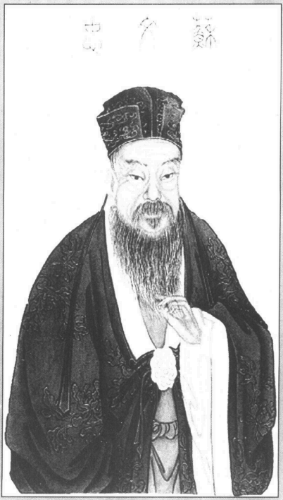

苏轼（1037-1101），字子瞻，号东坡居士。眉州眉山（今属四川）人。文学家、书法家。

要认识一个死去千年的人其实并不难。想想我们对同市的居民——甚至市长的私生活——所知是多么有限，有时候反觉得死人比活人更容易了解。至少有一点，活人的一生还没有过完，谁也不知道他碰到危机会做出什么事来。酒鬼会改过，圣人会堕落，牧师也许会和唱诗班的女团员私奔。活人总有太多太多的“可能性”。而且活人有隐私，某些隐私往往在他死后很久才真相大白。因此同时代的人往往很难批判，他的一生和我们太接近了。象苏东坡这样的古诗人就不同了。我读过他的杂记，他的一千七百首诗词和八百封私人信件。认不认识一个人不在于和他同一年代，这是共鸣了解的问题。毕竟我们只认识自己真正了解的人，而且只对自己真正喜欢的人才能充分了解。我想我认识苏东坡是因为我了解他，而我了解他又因为我喜欢他。喜欢一位诗人向来是口味的问题。以诗词伟大的标准——清新、自然、技巧和同情心——来说，我认为李白已达到更卓越的成就，杜甫更能给人大诗圣的完整印象。但是毫无理由我最喜爱的诗人却是苏东坡。

今日我觉得苏东坡伟大的人格比任何一位中国作家更突出，也更完整地蚀刻在他的生活和作品中。苏东坡的肖像在我脑海中十分清晰，原因有二。首先，它发自苏东坡本人杰出的脑袋，印在他的每一行作品中，就象我见过那两张苏东坡所画墨竹上的黑影，闪闪生辉，仿佛一个钟头前才着上去似的。这是一种奇特的现象，莎士比亚的情形也是如此。莎翁生动的诗行直接发自他敏感而丰富的脑袋，到今天仍然清新无比。虽然一代一代的学者努力研究他，我们对他外在的生活仍然所知不多；但是他死后四百年我们还觉得借着他注入作品中的情感，我们已深知他思想的隐秘。

第二个原因是苏东坡一生的记录比中国其它的诗人要完整些。材料包括各种记载他漫长而多采的政治生涯的史籍，他自己大量的诗词和散文作品（将近一百万字），他的杂记、亲笔题书和私人信函，以及当时人物把他尊为最敬爱的学者而谈起他的许多随笔——由他同代人物以杂记和传略的方式留传到今天。他死后一百年间，没有一本重要的传略不提到这位诗人。宋朝的学者都擅于写日记，著名的有司马光、王安石、刘挚、曾布等人；也有人不屈不挠地写传略，王明清和邵伯温就是最好的例子。由于王安石国家资本主义所造成的复杂情势，以及苏东坡时代政治斗争的炽热和刺激，这段时期作家所保存的资料——包括对话在内——特别丰富。苏东坡本人不写日记；他不是爱写日记的人——那样对他来说太有条理、太忸怩了。但是他写过一本杂记，是他对各项旅程、思想、人物、地点和事件按日期或不按日期的记载。别人也忙着记下他所说所做的一切。他的信件和附笔都由崇拜他的人仔细保存下来。身为大家争相寻访的书法家，他习惯在酒宴后做一首诗来描述那个场面，或者描写自己的思想和评论送给朋友。这些短笺都被人妥善保存，传给子孙，有时候也高价出售。这些即兴短笺包含了不少苏东坡最好的作品。他有八百封信和六百则著名的亲笔小记和题跋留传到今天。其实是因为苏东坡太受欢迎了，黄庭坚等后辈学者才争相收集他的随笔和便条，集成一册出版。苏东坡死后，成都有一位艺品收藏家马上开始收集苏东坡的亲笔短笺和私人信函，刻在石头上，把拓印本当做书法来卖。苏东坡为某一场合而写的诗篇立刻由国内学者传阅和背诵。当时所有好学者都被逐出京师，这些抗议政府作风的诗句天真诚实，使统治者的怒气完全集中在他一个人身上，几乎害他送命。他后不后悔？放逐期间他表面上对不太亲密的朋友说他后悔了，但是对好朋友却表示毫无悔意，若再有必要吐出饭菜中的苍蝇，他仍会重蹈覆辙。由于这种心灵的流露，他发现自己处在当时正派学者的领导地位，不免觉得悲哀。徒然和政客小人斗争一番后，他第二次遭到流放，远走海外的海南小岛，多少有点认命的意味，心灵倒分外平静。

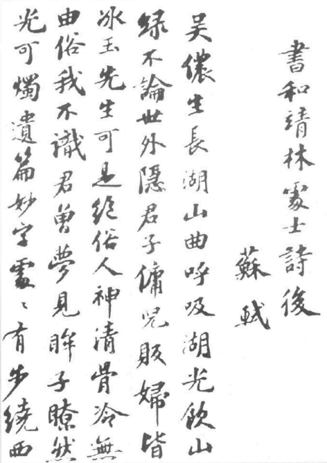

苏轼手迹

因此这个人成为文学闲话的中心，死后尤其受到深广的敬重，也是很自然的。拿西洋作家为例，李白可以媲美雪莱或拜伦，是一个燃烧自己展现出瞬间壮景的文学彗星。杜甫就象米尔顿，是一个热心的哲学家和老好人，以贴切、渊博的古典比喻写出了丰富的作品。苏东坡永远年轻。他性格比较象萨克莱，政治和诗词的盛名则象雨果，同时又具有约翰生博士那份动人的本质。不知怎么约翰生博士的痛风病直到今天还叫我们感动，米尔顿的瞎眼却不尽然。如果约翰生同时又兼有甘斯伯劳的特色，而且象波普用诗词批评政治，又象史维夫特吃过那么多苦而没有史维夫特的尖酸味儿，我们就能找出一个英国的类比了。苏东坡的道精神由于遭受许多困难而更加醇美，却没有变酸。今天我们爱他，只因为他吃苦吃得太多了。

中国有句俗话说，盖棺才能论定。人的一生就象一出戏，只有落幕后才能判断这出戏的好坏。差别是——人生的戏往往连最聪慧、最精明的演员也不知道下一幕会演些什么。不过真实的人生永远随一种必然性自然推展，只有最好的戏剧能够企及。因此写过去人物的传记有一项最大的方便，我们可以检视一幕幕已经终了的情节，眼见许多事情因外在事变和内在性格的必然性而自然发展。我彻底研究苏东坡的一生，明瞭他为什么一定要做所做的一切，内心却渴望弃官隐居。我觉得自己仿佛在读中国占星家笔下某人一生的预言，清晰、明确，绝对无法避免。中国占星家可以逐年列出一个人一生的过程，为了丰富的酬金也愿意把整个预言写下来。但是传记家的后见之明永远超过占星家的预测。今天我们能认清苏氏一生起起落落的明图，看出同样的必然性，但也确知无论间题在不在星宿，阴晴圆缺总要发生的。

苏东坡生于宋仁宗景佑三年（公元1036年），死于徽宗建中靖国元年（1101年），也就是华北被金人攻占，北宋灭亡前二十五年。他在宋朝最好的皇帝手下成长，服侍过一个用意良好却野心勃勃的皇帝，等那十八岁的昏君登上龙座，他就不断蒙羞受难了。因此，研究苏东坡的一生就等于研究国家因党争而陨落的过程，结果国力消减，政客小人横行霸道。《水浒传》的读者对这种暴政都很熟悉，正直的好人为了逃避税吏或避开贪官的“公理”，一个接一个走向绿林，成为书中受人爱戴的绿林英雄。

苏东坡年轻的时候，有一大群卓越的学者围在皇帝朝中，北宋末期却一个也不剩。著名的国家资本主义者王安石第一次迫害学者，整肃御史，任用属下，至少还有二十位名学者和正义人士愿为自己的罪名而受苦。等小昏君第二次施虐，好人大部分已经去世，或者很快流放而死。这种削弱国力的举动是由这位大信仰家以“社会改革”、避免“私人资本剥削”，维护可爱的中国人民“利益”的名称而发动的。对国家命运来说，最危险的莫过于一个思想错误却固执己见的理想家，诗人兼人道哲学家苏东坡以他的常识来对抗经济学者王安石的逻辑，他所颁授的教训以及中国所付出的代价我们至今还没有学会。

王安石热衷社会改革，自然觉得任何手段都没有错，甚至不惜清除异己。神圣的目标向来是最危险的。一旦目标神圣化，实行的手段必然日渐卑鄙。这种发展趋势逃不过苏东坡敏锐的心灵，甚至有点违背他的幽默感。他的行径和王安石不合；彼此的冲突决定了他一生的经历，也决定了宋朝的命运。

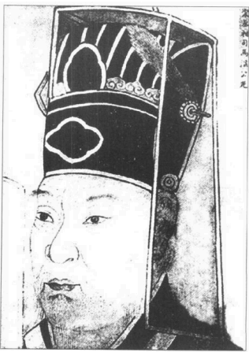

司马光（1019-1086）子君实。陕州夏县（今属山西）人。北宋大臣，史学家。

苏东坡和王安石都没有看见他们斗争的结局，以及中国被北方蛮族征服的情景，不过苏东坡亲眼看见广泛宣传的“社会改革”造成了可怕的结果。他看到王安石“热爱”的“农民”不得不逃出家园，不是因为饥荒或洪水，而是丰年怕回到村里交不出政府强迫农民借的贷款和利息，会被官吏抓去坐牢。他呼声震天，不能自已。有些不诚实的官吏觉得隐瞒政府的弊端——他们不可能察觉不到——颂扬它的优点比较有利。只要谎言够大，说得次数够多，谎言变成真话也不是现在的新发明哩。宦官要谋生。就这些不负责的人玩弄着国家的命运，仿佛他们自己逃得掉最终的结局似的。苏东坡至少能维护他的灵魂，为此付出代价。皇帝正直的本心不足以成为昏庸的借口，因为重大问题方面他判断错误。苏东坡却是对的。铁腕政治以社会改革的名义强加在人民身上。在疯狂的权力斗争中，党争超越了爱国的兴趣，国家的道德和经济纤维被削弱耗尽，正如苏东坡的预言，使国家轻易落人西伯利亚方向的强敌手中。小人甘愿在“区域独立”的名份下替北方的强邻当傀儡，效忠异族。难怪北宋覆灭，中国要退到长江以南。宋室焚毁之后，史学家在焦木废墟里漫步，才开始检视原野，用自大的史学眼光来考虑灾祸的原因，可惜太迟了。

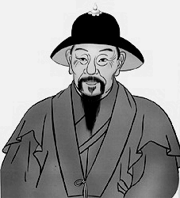

王安石（1021-1086）字介甫，号半山。抚州临川（今江西抚州）人。北宋名臣，政治家、文学家。

苏东坡死后一年，政客小人当道，北宋还没有断送给横跨蒙古野地而来的狼主，一件历史上非常重要的事件发生了。这就是元祐党人碑的设立，也是整个时期斗争的象征和总结。“元祐”是苏东坡党人当权时的年号（1086—1093），这个党人碑有309个元祐时代人物的黑名单，以苏东坡为首。圣旨规定这些人和他们的子弟永远不能在朝为官。忠贞家庭的子孙不准嫁娶“元祐党人”的子女，如果已经订亲，也要依皇令解除。列有黑名单的石碑在全国各区设立；有些至今还留存在中国山区里。这里根绝一切反对势力的措施，也是作者心目中让这些人永远受辱的方法。因为中国被社会改革家断送在北方强敌手中，这些石碑所带来的效果也就和作者当初的意愿大不相同。一百多年间，黑名单人物的子女为先人名列石碑而自夸自豪。因此元祐党人碑才会名留青史。事实上有些人的祖先并不值得尊敬，因为党人碑的作者一心要根绝反对势力，把所有仇敌都列上名单，其中有好人也有坏人。

仿佛是天意，崇宁五年（1106年）一月天空出现了一颗陨星，文德殿东墙上的石碑被闪电击中，分裂为二。再没有更清晰的天怒指标了。徽宗大惊，又怕首相反对，就叫人连夜将端（礼）门上的另一块石碑偷偷毁掉。首相发觉，十分懊恼，但却愤慨地惊叹说，“碑可毁，这些人的名字却永远难忘!”现在我们知道他的预言实现了。

闪电击中党人碑使苏东坡死后名望不断增高。最初十年，一切刻有他笔迹或文章的石碑都奉命拆毁，他的书本被禁，他也被除去生前的一切头衔。不过当时有一位作家在杂记中写道：“东坡诗文落笔辄为人所传诵。崇宁大观间海外诗盛行，是时朝廷禁止赏钱增至八十万。禁愈严而传愈多，往往以多相夸。士大夫不能诵东坡诗，便自觉气索，而人或谓之不韵。”

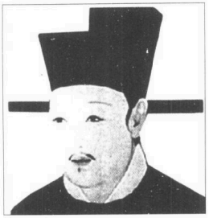

宋徽宗（1082-1135）宋神宗之子，哲宗之弟，庙号徽宗，在位25年。政治上腐败无能，崇信道教；艺术上多有成就，其书法被称为“瘦金体”，绘画作品也多有传世。

电击后五年，一位道士对皇帝说，他看到苏东坡的英灵在天宫担任文相。皇帝更加害怕，连忙恢复苏东坡生前最高的爵位，后来又加封一个比生前更高的荣衔。政和七年（1117年）皇室在同一个君主治下竟也收集苏东坡的文稿，每件出价高达五万钱。宦官梁师成花三十万钱（约三百美金，以当时生活水准来说算相当高价了）买英州石桥上（被人妥善隐藏）的碑文，还有人出五万钱来买苏东坡在一位学者书斋匾额上所写的三个字。生意旺盛进行着，不久这些珍稿就收人宫中或富豪的家里。金人攻下京城，他们特别爱搜掠苏东坡和司马光的作品，因为苏东坡生前大名就已传到中国域外的北方部族里。苏氏某些最好的字画随着两个身死异邦的皇帝被运往敌国，（当时徽宗已退位给儿子）。不过还有数万件苏东坡的文稿获得保全，由物主带到南方。

现在苏东坡已死，政治狂热的风暴已经过去，南宋的皇帝坐在杭州新都内，开始阅读他的作品，尤其是他的奏议表状。他们愈读愈钦佩此人大无畏的忠心。他的孙子苏符因皇上顾念他出名的祖父而获得高位。这一切都使苏东坡死后的盛名和地位达到最高点。乾道六年（1170年）孝宗谥给他“文忠公”的荣衔，并赠太师的官位。皇帝写下至今留存的最好赞文。圣旨和皇帝亲笔题的序文印在苏东坡“全集”一切版本的前端。颁谥“文忠公”头衔的圣旨如下：“敕。肤承绝学于百圣之后，探微言于六籍之中。将兴起于斯文，爰缅怀于故老。虽仪刑之莫睹，尚简策之可求。揭为儒者之宗，用锡帝师之宠。故礼部尚书端明殿学士赠资政殿学士谥文忠苏轼。养其气以刚大，尊所闻而高明。博观载籍之传，几海涵而地负；远追下始之作，殆玉振而金声。知言自况于孟轲，论事肯卑于陆贽。方嘉祐全盛，当膺特起之招；至熙宁纷更，乃陈长治之策。叹异人之间出，惊谗口之中伤。放浪岭海，而如在朝廷。斟酌古今，而若斡造化。不可夺者峣然之节，莫之致者自然之名。经纶不究于生前，议论常公于身后。人传元祐之学，家有眉山之书。肤三复遗编，久钦高躅。王佐之才可大用，恨不同时。君子之道阍而彰，是以论世。谠九原之可作，庶千载以闻风。惟而英爽之灵，服我衮衣之命。可特赠太师。馀如故。”

因此苏东坡在中国历史上的特殊地位不但是基于他诗和散文的魔力，也基于他敢英勇地坚持自己的原则和主张。他的个性和主张构成了盛名的“骨干”，而文风和用语的魅力则形成了灵性美的“肌肤”。我认为一个缺乏正气的作家无论文笔多么灿烂，多么迷人，我们不可能真心仰慕他。皇帝为苏氏“全集”所写的序文强调他“气节”的伟大，使他的作品不同于一般“佳文”，也使他的盛誉名实相符。

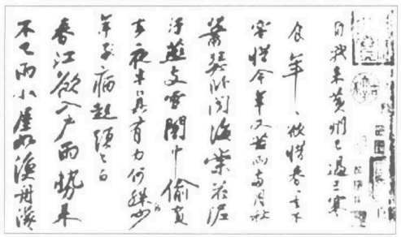

苏轼《黄州寒食诗》书法

不过我们别忘了苏东坡主要是诗人兼作家。他的盛名也靠这方面得来。他的作品有一种难以解说的特性，在译文中比较看不出来。名作就是名作，只因为各时代的人都觉得“佳文”应该如此，追根究底来说，文学上不朽的声名要靠作品给读者的乐趣而定，谁能说读者要怎么样才能满意呢？文学和一般写作不同的地方就是它有取悦心灵的音律、感官和风格的魅力。名作能取悦千秋万世的读者，超越一时的文风而留传下去，必定是基于一种所谓“真诚”的特质，就象真宝石能通过一切考验。“文章如精金美玉”，苏东坡写信给谢民师说，“市有定价，非人所能以口舌贵贱也”。

但是构成永恒特质的“真诚性”究竟是什么呢？苏东坡清清楚楚表达了他对写作和文体的意见。“大略如行云流水。初无定质。但常行于所当行，常止于不可不止。文理自然，姿态横生。孔子曰，言之不文，行之不远。又曰，词达而已矣，夫言止于达意，则疑若不文，是大不然。求物之妙，如系风捕影，能使是物了然于心者，盖千万人而不一遇也。而况能使了然于口与手乎。是之谓词达。词至于能达，则文不可胜用矣。杨雄好为艰深之词。以文浅易之说，若正言之，则人人知之矣。此正所谓雕虫篆刻者。”苏东坡为文体下定义，正好贴切地描述了他自己写文章的过程，动笔收笔都象“行云流水”，揭露出文章和修辞的一切奥秘。什么时候进行，什么时候结束都没有一定的规矩。如果作家的思绪很美，只要他能忠实、诚恳、妥当表达，魅力和美感自然存在。这些不是硬放入作品的东西，词达而造成的单纯、自然和某一种自由感正是好文章的秘诀。这些特质具备了，文体不虚浮空洞，就可以写出真诚的文学作品。

总而言之，苏氏作品的特色就是给人快感。写作的时候最快慰的是作者本人。“生平最快乐的时刻”，有一天苏东坡对他的朋友说，“就是写作时笔端能表达一切思想的脉络。我自忖道‘人间自乐莫过于此’”。苏文对他同时代的人也有类似的效果。欧阳修说他每次收到苏东坡的新作，就会快活一整天；神宗皇帝的一位侍从曾经对人说，每次皇帝吃饭半途放下筷子，一定是读苏东坡的表状。甚至在苏东坡放逐期间，每次有新诗传到朝廷，皇帝都会当着众臣赞叹一番。正因为皇帝的赞叹使群臣惶恐，只要神宗在，他们就尽量让苏东坡流放久一点。

他曾一度坚称，给人快慰的力量便是文学本身的报酬。他晚年曾想弃笔不写文章，因为一切麻烦都是写作惹来的。他给刘沔的回信中写道：“轼穷困，本坐文字。盖愿刳形去皮而不可得者。然幼子过文益奇。在海外孤寂无聊，这时出一篇见娱，由为数日喜，寝食有味。以此知文章如金玉珠具，未易鄙弃也。”由于作者自由创造活动中所得到的满足，以及文章给读者的快乐，文学便自有存在的价值。

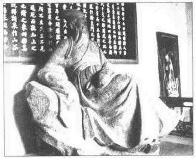

苏东坡石像

苏东坡具有非凡的天分，可以破除一切限制，似乎毫无疆界可言。他的诗词永远清新，不象王安石偶尔会达到完美的境地。苏东坡不必求那份完美。别的作家都受诗词字汇和传统题材的限制，苏东坡可以写诗描述澡堂按摩的滋味，可以结合俚语，使它在诗中产生美好的效果。就是那种别人达不到的特殊风韵使后辈诗人不得不佩服他。“词”本来限于描述相思，他对“词”的主要贡献是他能将这一种格调化为描写佛道和哲学议论的工具，这一项几乎不可能完成的冒险工作他却做得很成功。他通常写得比别人好也比别人快，因为他常常要在宴席上当众赋诗。他的思想比别人清新，类比和掌故也用得较恰当。有一次朋友在黄州为他饯行，席上一位女歌姬请他在披风上题诗。他驻黄州期间没有听过这位歌女李琪的名字，他叫她磨黑，并提笔写了一个平淡的开头：

东坡七年黄州住，

何事无言及李琪。

然后他停下来继续和客人谈天，在场的人都觉得这两句平淡无奇，而且全诗又没有写完。苏东坡继续吃喝谈笑，李琪上前要他写完。“喔，我差点忘了。”苏东坡说。他再度提笔，马上完成后两句：

却似西川杜工部，

海棠虽好不吟诗。

音韵完全吻合，这首诗的效果有如一颗小宝石，照例充满他漫不经心的美感。诗中微妙地恭维这个少女，李琪因此变成文学上不朽的人物。中国诗的技巧限制很多，用典及用同一韵脚来“和”朋友的诗需要高度的技巧。不知怎么苏诗押韵比别人自然，仔细检查，他的典故也含有更深的意义。他的散文具备各种力量，由最庄重的质朴古文到流俗作家可爱的闲话，无所不包。两者之间原本很难选择。他被公认为大文豪，原因在此。

难怪苏东坡被列为中国的大诗人兼散文家。此外他还是第一流的画家和书法家，著名清谈客，也是大旅行家。他善于理解佛家哲理，经常与和尚为伍，也是第一个把佛教哲学注入儒诗的诗人。他曾说月亮上的黑点是山脉的影子，果然猜得不错。他开拓一种新画派“士人画”，使中国艺术独具一格。他开凿湖泊和运河，对抗洪水，建筑堤坝。他自采药草，被视为药学权威。他试行炼丹，几乎到死前还兴致勃勃寻找不朽的灵丹。他祈求天神并与魔鬼争吵——偶尔还赢哩。他想夺取宇宙的奥秘，半受挫败，却含笑而死。

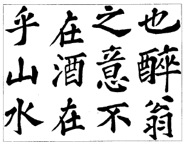

苏东坡醉翁亭记书法

要不是今天“民主”一辞已遭到滥用，我们会说他是一个民主大斗士，他接触人生百态，朋友中有皇帝，有诗人，有大臣，有隐士，药师，酒店老板和不识字的农妇。他的至交好友包括爱诗的和尚、不知名的道士以及比他更穷的人。他喜爱作官的荣誉，但是群众不认识他，他最高兴。他为杭州和广州建立良好的供水系统，建立孤儿院和医院，设置狱医，对抗杀婴的恶俗。在社会改革的余波中，他一个人热心赈灾，不顾官僚制度的巨大阻力。简直好象只有他关心广泛的饥荒和流浪的灾民。他始终替人民对抗政府，为穷人争取债务免还的德政，最后终于成功。他只想维持自己的本色。今天我们可以说他真是一个现代人。

---

### 第二章眉山

古今的川人都善争辩，最后写雄浑的长篇。就连中产社会谈话间也充满渊博的案例和明智的典故，在外省人眼中具有古典优雅的气氛。苏东坡也分享了这种内在的辩才和不服输的决心。不用提他和神鬼争辩好多回，就是他的策论也以清晰、有力而知名。苏氏父子的敌人都攻击他们象战国的诡辩家。朋友则称赞他们有孟子的雄风，象孟子一样善辩，引喻恰当。四川人应该是很好的律师才对。

---

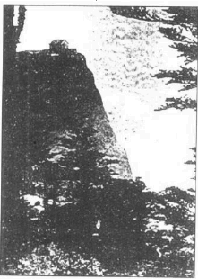

峨嵋山金顶

你若沿长江往上走，越过汉口市，经三峡进入极西的四川省，然后沿河经重庆上溯源头，你就会看到一座三百六十英尺高的大佛，由岸边的山壁雕刻而成。这里是本省西界，中国内地第一高峰峨眉山脚下的乐山，苏东坡时代叫做嘉州。岷江就在这儿注入长江。崛江由西夷居住的西市山区流下来，一涌而下，会合峨嵋山流下的另一条河，笔直冲向乐山大佛，然后大江慢慢转向东南，再向东弯，直接注入东海中。在云雾弥漫的峨眉山阴影下，在乐山以北四十哩的地方有一个眉山镇，隶属眉州，是中国文学史上最著名的文学世家所在地。那就是苏家，以“三苏”知名。父亲苏洵生了两个杰出的儿子苏轼（东坡）和苏辙（子由），父子三人都名列“唐宋八大家”。

古今的旅客可以由乐山上溯玻璃江，乘帆船到眉山。此江冬天呈透明的深蓝色，所以得名。夏天山上来的激流却使它一片浊黄。这条河是岷江的支流，眉山位在乐山和省会成都之间，要到省都的旅客必须穿过该城。你乘帆船往上走，会看到蟆颐山直立在溪流上。那是一个低圆的小山，和江苏常见的小丘差不多。这就是眉山，三苏的故乡。多亏了纪元前三世纪末期李冰父子的工程天份，这里有完美的控水和灌溉系统，一千多年来始终有效；使四川西部成为四季肥沃的平原，又没有水患。这座小山立在一片稻田、果园和菜园遍布的平原上，偶尔有竹林和奇特的矮棕榈点缀其间。你可由南面入城，沿着整洁的石阶路进人市中心。

那不算一座大城，却是很舒服的居家所在。十二世纪有一位诗人描写说，街道很干净，眉山在五、六月间以荷花知名，荷花的栽培已成为一种工业，因为附近城市都从这里购买荷花。走到街上，只见路边有许多荷花池，幽香遍野。到了纱行，可以望见一栋中等的住宅。一入大门，只见一座绿漆屏风抵挡路人的探视。屏风内是一间不大不小有院落的房舍。房屋附近有一棵高高的梨树，还有水塘和菜圃。小庭园内种了各种花木和果树，墙外是一片修竹密布的丛林。

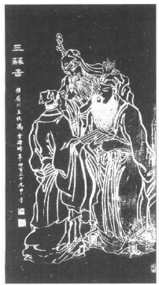

木刻三苏图

宋仁宗景祐三年（1036年）——海斯丁战役发生前三十年——十二月十九日，一个男婴在襁褓中哭泣蹬脚。由于长子夭折，他变成家中的长男。这个婴儿并没有特殊不凡的举动，我们还是来看看家中的一切吧。不过我们先谈这个生日，以免为中国人写传记的外国作家搞不清楚。中国娃娃生下来就算“一岁”，因为人人都想尽快达到德高望重的年龄。到了新年，人人都长一岁，他就“两岁”了。根据中国这种算法，若与西洋算法比起来，人在生日前总是多算了两岁，生日后也多一岁。本书的年龄都照西式算法，不考虑实际的生日，不过苏东坡本人却需要精确些。他十二月十九日出生后就算“一岁”，过年就算两岁——其实两周还不到。他生在年尾，他实际的年龄永远比中国算法年轻两岁。

关于这个生日，第二件要提的就是他属摩蝎（天蝎）宫。照他本人的说法，他一生遭受许多磨难，被人扯上好好坏坏、莫须有的许多谣言，都是这个原因——命运和韩愈相同，他也属于同一星座，也因议论而遭到放逐。

其中一个房间的中镶板上挂一幅张仙图。婴儿的父亲已二十七岁，正遭遇一生最大的精神危机，在市场上看到这张像，就用一个玉镯把它买回来。七年来他每天拜祭张仙。他太太几年前生过一个女儿，还有一个男婴小时候就夭折了。他一直想要儿子，终于如愿以偿。他一定很快乐；不过我们知道他正感受强烈的羞耻和折磨。

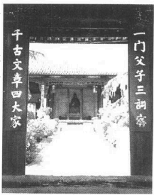

四川眉县三苏祠

他们家道小康，有田地，也许比一般中等人家富裕些。至少有两名丫环，此外家人还为苏东坡和他姐姐雇了一个奶妈。但弟弟出生后又雇了一个，这两名奶妈照中国风俗，终生跟她们养大的子女生活在一起。

苏东坡出生时，祖父还在世，已六十三岁了。他年轻的时候又高又俊，健康强壮，爱喝酒，为人豪爽慷慨。苏东坡成为当代第一流学者，官拜“制诰”之后，有一天搬入皇宫附近的新居。几位好友和门生来看他，那天正好是他祖父的生日，他开始谈起这位怪老头的趣事。他不识字，当时他们住在乡下，有一大片土地。他不象别人囤积食米，却以米换谷，存了四千石。别人都不懂他为什么要这么做，后来饥荒来临，祖父就开仓放谷，先给家人和亲族，再给太太的亲戚，然后分给佃户和村里的穷人。现在大家明白他为什么囤积稻谷了，谷子可以保存很多年，碾好的米却会受潮腐坏。他无忧无虑，衣食不缺，常常带着酒壶和朋友四处逛逛，坐在草地上享清福。他们大笑大喝大唱，使一般文静庄重的农夫感到很意外。

有一天正闹得痛快，一件大消息来了。他的次子——苏东坡的二伯——考中进士。附近还有一家人的儿子也考中了。那就是苏东坡母亲的娘家程氏。两家是姻亲，真是双喜临门。不过程家很富裕，属于有土地的贵族，早就准备庆祝，苏家老祖父却没有准备。儿子知道父亲的作风，亲自派人送了告示、官帽、官袍和手笏，还有一张太师椅和一个美丽的茶壶。喜讯送来，祖父正酩酊大醉，手上拿着一块大牛肉。他看到官帽上的红扣子由包袱里伸出来，知道是怎么回事。不过酒意未消，他接下官文，大声念给朋友听，并且将那块牛肉和告示、官帽、官袍一起塞入包袱内。他叫村里的一个少年扛包袱，自己骑驴进城。这是他一生最快乐的时刻。街上的人已得到消息，看见这个醉老头骑在驴背上，后面跟着古怪的包袱，不觉大笑。程家人觉得很丢脸，但是苏东坡说，只有优秀的文人才能欣赏那份纯真。这位老头也是自由思想家，有一天他醉醺醺跑进一间神庙，把神像砸得粉碎。他对这位神明特别反感，本区的人民却很怕它。也许他是讨厌敛财的庙公吧。

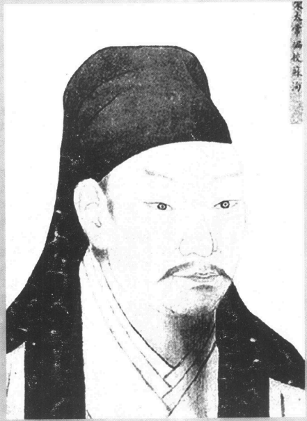

苏洵（1006-1066）字明允。眉州眉山（今属四川）人。文学家。

苏东坡并未遗传祖父的酒量，但是却继承了他对美酒的喜好，以后我们就会发现。这位文盲老头的智慧潜伏在他的血液中，后来却在孙子身上开出了奇花异果。老祖父具有特殊的身心活力，广大的心胸，以及强烈果断的正气。和许多显赫的世家一样，苏家的崛起也合乎进化和天择的法规。我们找不到苏东坡母亲家智力的记载，不过苏家和程家血统的结合却生出了这位文学天才。

除此之外，老祖父对这位大诗人的文学生命倒没太大的影响，只知道他名叫苏序。这是作家最窘的事，苏东坡身为名学者，不得不写很多序文。他忌用“序”字，所以作品中“序”都称为“引”。讳言父母或祖父母大名是古老的规矩，有时候会造成很窘迫的后果。大史家司马迁的巨著中找不到“谈”字，只因这是他父亲的大名。有一个人名叫赵谈——他只好擅自为他改名。同理，后汉书的作者不得不避开他父亲的大名“泰”字，今天一百二十卷后汉书内找不到一个“泰”字。诗人李翱的父亲恰好单名“今”字，于是他只好一直用一个古字来描写眼前的一刻。讳言当代皇帝的姓名也常常产生相同的结果。参加殿试的人如果学名有一个字和当朝的先帝们相同，就会被逐出殿外。而皇帝们通常以年号或追封的头衔知名，很多学者常常忘记先皇的名字而被人赶出去。有时候皇帝自己也会忘记，谁也不能老记着十代祖先的名字嘛。皇帝一时健忘，为新殿取了名字，后来才想起他用了忌字——祖先的大名。殿名刚取得又不得不换掉。

苏东坡的父亲苏洵沉默寡言，就政治野心来说，他失意而死，不过他死前两个儿子却实现了他对文学和政治功名的愿望。苏洵智慧很高，脾气刚烈，思想独立，个性又古怪，不是一个好相处的人。直到今天大家还知道他是一个二十七岁才认真向学的大学者。大家通常拿这个例子向小孩证明，只要有决心肯努力，成功永远等待着我们；不过聪明的小孩也许会得到相反的结论，认为童年不必发愤读书。事实上苏洵小时候有充分的机会学读书学写字；这位仁兄似乎生性鲁直，爱反抗，讨厌当时的正规教育。我们知道很多聪明的小孩都是如此。他小时候不可能完全没有学过读书写字，只是他荒废了童年的时光罢了。不过程家对这个年轻人印象却很好，才会挑他做女婿。说也奇怪，他虽然二十七岁才发愤读书，却赢得了至高的文名，他的名声并没有完全被他出众的儿子所掩盖。

大约在儿子出生后，他开始认真起来，深悔自己浪费了少年时光。他看到自己的哥哥、大舅子和两位姐夫都通过考试，在外做官，心中一定很惭愧。这些事对平平庸庸的人不会有什么影响，但是对一个智力超群——由他的“全集”可以看出来——的人来说，这种情况一定很难忍受。他后来在妻子的墓志铭中指出，她一直激励他前进，因为苏东坡的母亲是一个受过良好教育的女子。不过老祖父对儿子倒没说什么，也没有管他，由各方面看来他似乎只是一个执拗、古怪、游手好闲的才子。朋友们问他儿子为什么不读书，他又为什么不管，他平静地说，“我不担心”。表示他充满自信，知道这位聪明而迷路的儿子总有一天会看出自己的错误。

即使在那个时代，四川人已是一个吃苦耐劳、善辩、自信、大体能自治的人民，和许多边区或殖民地的人民一样，还保留某些古代的风俗习惯与文化。尤其要感谢一百年前本省发明了印刷术，川人突然热中求学，在苏东坡的时代，不少官员或成功的学者都来自四川。当时那儿一般的学术水准比现在划归河北和山东的省区还要高，这两省进京赶考的人诗词往往做不出来呢。成都是文化中心，以好信纸、蜀锦和美丽的寺庙闻名全国。有才气甚高的名妓，也有天赋不凡的美女，在苏东坡之前的一两世纪，那儿至少出过两位著名的女诗人。学者的作品仍然遵守先汉纯朴的古风，与当时各地流行的颓废、空洞华丽的文体截然不同。

古今的川人都善争辩，最后写雄浑的长篇。就连中产社会谈话间也充满渊博的案例和明智的典故，在外省人眼中具有一古典优雅的气氛。苏东坡也分享了这种内在的辩才和不服输的决心。不用提他和神鬼争辩好多回，就是他的策论也以清晰、有力而知名。苏氏父子的敌人都攻击他们象战国的诡辩家。朋友则称赞他们有孟子的雄风，象孟子一样善辩，引喻恰当。四川人应该是很好的律师才对。

因为这个原因，眉州人得到“难管”的恶名。苏东坡有一次辩解说：这里的人不象低文化区的人民，他们不会轻易被长官吓倒。仕绅家中都有法典，畅谈法律和规条而“不以为非”。这些仕绅守法度日，也要官吏守法。如果地方官公正廉明，他任期届满大家会把他的肖像挂在家中，膜拜五十年。但是他们就象现代的学生换了新老师一样，自有一套顽皮的把戏。新官上任，他们会考考他，他若精明练达，他们就不再捣蛋。如果他好管闲事，气势凌人，日子就不好过了，苏东坡解释说，只有不善应付的官吏才觉得他们难管。

除了某些古怪的风俗习惯外，眉州人还有一种社会门第制度。著名的老世家可分为“甲”“乙”两级，称为“江卿”。江卿的儿女不和其它家族联姻，无论对方多么有钱有势，只要不同类就不相嫁娶。还有一种农民合作的风俗。每年二月农夫开始种田，到四月初割草，农夫数百人一起工作。他们选两个人当领袖，一个管更漏，一个管敲鼓，大家都根据鼓声动工或收工。迟到或偷懒的人要罚钱，田多人少的家庭要出钱做公款。收成时全村的人都一起来庆祝。他们打破“更漏”，用罚金和规费来买肉买酒祝丰收。先举行农神祭典，然后大家吃喝玩乐，尽兴而归。

---

### 第三章童年与少年

背书是辛苦而费力的工作。传统的方法是让学生阅读不加标点的史书，试加标点，以确定他完全明白其中的意思。不过最用功的人会逐字抄下所有的古文和断代史。苏东坡学生时代就这么抄过；想想中国散文和诗篇的规则，想想历史巨作中经常引用人名、事件和比喻，这种方法确实有深远的益处。逐字抄下全书，读者就开始对这本书产生了多遍阅读所无法达到的了解。这件事日后对苏东坡有很大的好处。

---

苏东坡八岁到十岁间，他父亲进京赶考，落榜后就四处游历，远达现在的江西省，由母亲在家教导他。有一件事宋史本传和他弟弟写的长篇墓志铭都有记载。母亲教他《后汉书》中的一篇。后汉由于治理不当，政权落人宦官手中；学者都反对中性人治事。当时盛行贪污、贿赂、敛财和滥捕，地方官都是宦官的手下和门人。忠贞的学者一再冒死进谏。一再的改革和抗议风潮带来了一再的审讯。学者遭受酷刑，由圣诏逼供杀害。

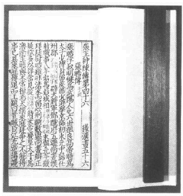

《后汉书》书影

这群正直文人中有一个名叫范滂的青年，母子两人读的就是他的传记。

“建宁二年，遂大诛党人，诏下急捕滂等。督邮吴导至县，抱诏书，闭传舍伏床而泣。滂闻之，曰：‘必为我也。’即自诣狱。县令郭揖大惊，出解印绶，引与俱亡，曰：‘天下大矣，子何为在此？’滂曰：‘滂死则祸塞，何敢以罪累君，又令老母流离乎!’其母就与之诀。滂白母曰：‘仲博孝敬，足以供养，滂从龙舒君归黄泉，存亡各得其所。惟大人割不可忍之恩，勿增感戚!’母曰：‘汝今得与李、杜齐名，死亦何恨!既有令名，复求寿考，可兼得乎？’滂跪受教，再拜而辞。顾谓其子曰：‘吾欲使汝为恶，则恶不可为；使汝为善，则我不为恶。’行路闻之，莫不流涕。时年三十三。”

小苏东坡抬眼看看母亲说，“妈，如果我长大变成范滂，你容许吗？”母亲答道：“你能当范滂，我就不能当范母吗？”

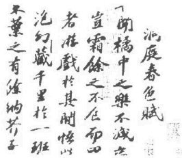

苏轼《洞庭春色赋卷》书法

他六岁入小学。那是一间相当大的学堂，学生有一百多个，大家都由一位道士教导。聪明的脑袋马上脱颖而出，一大堆学生中苏东坡和另外一个小孩最得老师的夸奖。这个学生姓陈（陈太初），后来也通过科举，但却变成道人，追求“不朽”去了。陈氏晚年打算升天，前来拜访他的朋友。老友给他食物和金钱，他出来把食物和钱分给穷人，就在门外按道家规矩打坐，一心一意想饿死。几天后，他其实已咽下最后一口气。这位朋友叫佣人去抬尸体。不过正当新年，佣人都抱怨说，这么一个大吉大利的日子还要抬尸首。死人听了就说：“没关系，我自己走。”他站起来走到乡间，死在一个比较方便的所在。这就是很多道士“升天”的实际情景。

苏东坡小时候除了读书，还有很多别的兴趣。放学后他常回家偷探鸟巢。他母亲严禁孩子和丫环抓小鸟，日子久了，小鸟知道这儿不会受到干扰，有些就在低枝上做窝，小孩都看得见。苏东坡特别记载，有一支桐花雀曾在他们园中待了四、五天。

东坡的伯父已经作官，偶尔会有官吏经过小镇，顺便来看他们。于是家里会热闹一番，丫环赤脚到园中摘青菜，杀鸡备酒，官吏来访在他心中造成很深的印象。

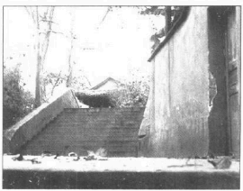

苏东坡读书处

他常和表兄弟一起玩耍，他和弟弟偶尔会参观市集，在园中挖土。有一天他们掘出一片色泽优美，带着细致青纹的石块。敲击之下发出清脆的响声；他们拿来做砚台，效果好极了。砚台必须用渗水性特别强的石块，能吸收湿气，保留湿气；和书法艺术有很大的关系。上好的砚台一向被学者所珍爱，因为那是他案头大部分活动的工具。父亲把这块砚石送给他，他一直保留到成人；还在上面刻过一篇碑铭。这是他崛起文林的好预兆。

根据记载，他十岁就写过不少佳句。有两句出现在《黠鼠赋》中。《黠鼠赋》是一篇短文，描写一支小老鼠落入袋中，被摔到地上，装死骗过捕鼠人的经过。就在这时候他的老师读一篇描写当朝名士冠盖云集的长诗给他们听。他望着教师肩膀上端，开始提出有关这些名士的问题。他们都是中国历史中赫赫有名的人物。因为苏东坡幼年中国正逢宋朝最贤明的君主，他特别支持文学和艺术。国内太平，和北方及西北长年惹事的金人、辽人、西夏也相安无事。在这样的政府中，好人当道，不少文学天才都起而点缀朝廷的文采。这时候他才开始听到欧阳修、范仲淹等人的大名，深深感动。幸亏这是他童年唯一不凡的表现。虽然苏东坡记载过不少他成年后所做的梦以及梦中未完成的诗篇，其中倒没有什么不经心的言辞可供现代传记家凭分析、直觉和幻想而编造出他潜意识的机理。苏东坡没有提过尿布或便秘之类的事情。

他十一岁进入中等学堂，认真准备赶考。为了应付官家的考试，学生必须博览经书、史书、诗篇和选文。他们自然要背古文，在课堂上一再记诵，学生背向老师以免偷看老师桌上摊开的书本。比较用功的人会背下史书的篇章。重要的不止是内容和资料。用字措辞也不可忽略，一位作家的词汇就由此得来。引用著名的成语掌故却不说明来源，往往使渊博的读者产生一种高贵而自我中心的乐趣。那是一种志趣相投的语文；读者佩服作家写得出来，也佩服自己能够了解。成语借重暗示和观念的联想，往往比不带暗示的直述法有效得多。

背书是辛苦而费力的工作。传统的方法是让学生阅读不加标点的史书，试加标点，以确定他完全明白其中的意思。不过最用功的人会逐字抄下所有的古文和断代史。苏东坡学生时代就这么抄过；想想中国散文和诗篇的规则，想想历史巨作中经常引用人名、事件和比喻，这种方法确实有深远的益处。逐字抄下全书，读者就开始对这本书产生了多遍阅读所无法达到的了解。这件事日后对苏东坡有很大的好处。他上书皇帝或者替皇帝草拟圣诏的时候从来没有用错史例，当时学者都用史例，就象今天的律师举用“判例”一样。此外抄书也可以练习书法。

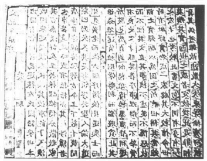

北宋时泥活字版（示意模型）

印刷术发明之前抄写是必要的，不过苏东坡那个时代商业印书已经存在一百多年了。活字版印刷是商人毕升发明的。特殊的粘土刻字弄硬，做成不同的字版，然后装在涂好松脂的金属盘上。字版排好，将松脂加热，用一张金属片压在版面上，使表面平整。印完后松脂再加热；字版很容易由金属盘上掉下来，准备清洗排下一页。不过一个木块刻印两页的木板印刷术也还十分盛行。

苏东坡和弟弟子由正在积存大量的文学和古籍知识，他父亲落榜回来了。公职考试要遵守固定的标准和格式。就象博士论文一样，要合乎一定的标准，下过定量的功夫，善于记事实，有相当的智慧。太聪明太创新反而成为考试成功的障碍，于事无补。很多杰出的作家——如秦观等诗人——始终无法过关。苏洵的弱点大概是诗韵；考诗词需要相当的措辞技巧和机智，苏洵却只对概念有兴趣。不过做官是学者唯一飞黄腾达的出路，除了教书也是唯一的职业，他父亲回家想必一定很泄气吧。

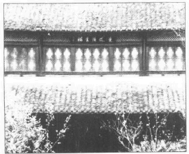

东坡楼

国人习惯由子弟朗读，父亲躺在长椅上听他们读书的声音，据说是世上最悦耳、最快活的音律之一。父亲可以纠正发音的错误，初学者容易念错的地方太多了。欧阳修和苏东坡本人日后也卧听儿子朗读，现在苏洵则躺在长椅上静听儿子悦耳的童音，眼睛盯着天花板，心情类似最后一箭落空的猎人，仿佛正重铸新箭，想把儿子发出去射那只糜鹿。孩子们流利念出古文的音节，他们的眼光和书声使他相信，他们定会成功，于是他恢复了希望，受挫的自尊也自然痊愈了。说不定两兄弟在记诵历史和写作诗文方面都超过父亲。日后有一位苏东坡的门人说，苏洵天赋较佳，不过苏东坡学识比较渊博。父亲还没有放弃作官的野心，但是他自己虽落榜，却料定儿子必会考中。这不是贬低他父亲，我们都知道他教导两个儿子研究时代兴衰的法则，趋向纯朴的文风，认真关心历史和政治。

幸亏苏东坡的父亲一向支持简朴的文风，反对当时流行的华丽风格；后来东坡进京赶考，礼部主试欧阳修决定改革文风，作品虚华空洞的人都不予录取。虚华的文体就是为不断堆积深奥的名辞和暖昧的典故以“美化”文章。这种文章连一句单纯自然的句子都很难找到。他们怕事物正名，也怕任何句子朴实无华。苏东坡形容这种可怜的作品是一句一句堆砌而成，不顾及整个效果——就象歌剧开场时老太太的臂上、颈上挂满珠宝似的。

他家的气氛似乎很适合培养文学倾向强烈的少年。图书室里堆满各种书籍。祖父变了一个人；因为次子官拜造务监裁，老头也被封官，担任大理评事。这种官位是荣誉性的，主要的功能是让大官提起父亲可以称为“顾问”或“海军准将”，就算他一辈子没上过朝廷，没见过一艘船也没有关系。似乎墓志铭上能刻这种头衔就是人生一切的目标——人若不能生为仕绅，至少希望死为仕绅。如果他不巧死得太快，还没得到这些荣衔，也可以死后追封。尤其宋朝，连一般官吏的头衔也很少名实相符。读到苏家墓志铭的人也许会误解，以为他祖父是大理评事兼太子太傅，他父亲是太子太师，那些衔头都是苏子由当门下侍郎时颁赠的。事实上，两人生前都没有做过这些官。苏东坡现在还有一位大官伯伯，还有两个姑姑嫁给做官的丈夫。祖父和外祖父都有官衔，我们已说过祖父是虚衔，外祖父则是真的。

不过家中陪他成长、学习，一辈子和他最亲近的就是他弟弟子由。两兄弟的友爱和坎坷中所表现的忠诚是他一生最常歌颂的主题。他们悲哀中互相安慰，灾难中互相帮助，常常梦见彼此，也常写诗互赠，就算在中国，这两兄弟的友爱也算是相当难得了。子由脾气安稳、冷漠、重实际，不知怎么官位始终比哥哥高，虽然他们政见相同，整个政治生涯也同起同沉。子由却比较不情感用事，常常给哥哥一些忠告。也许他没有那么固执；也汗他文才和文名都不如哥哥，政敌们觉得他没有那么危险吧。这段期间苏东坡不但是弟弟的同学，也是他的教师。他在一首诗里说：“我少知子由，天资和且清。岂独为吾弟，更是贤友生。”弟弟则在苏东坡的墓志铭中写道：“我初从公，赖以有知。抚我则兄，诲我则师。”

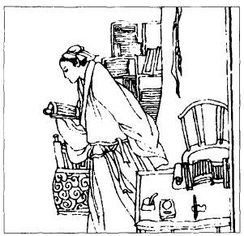

苏洵应考图

说到这里，我们先谈谈二苏的许多名号。根据古风，中国文人向来有好几个名字。除了姓氏之外，他有一个“名”宇，专签在信件或官文末尾。有一个“字”供朋友们叫喊或写信。通常正式写信给朋友都用“字”不加姓，附上“先生”的尊称。此外很多文人在各种场合还用“号”做为藏书室或书斋的名称——常刻在图章上，一旦成名就家喻户晓。还有人用文集的书名来称呼他。少数举国知名的人物甚至被冠上故乡的名字（中国的温德维基也许会被人称为“印第安维基”，罗斯福也许被封为“海德公园罗斯福”），很多显赫的官员死后还有追封的荣衔。

老苏名洵，字明允，诗号老泉，是他家乡祖茔的名称。长子苏轼，字子瞻，号东坡。最后这个名称来自诗衔“东坡居士”，是他贬居黄州东坡的时候取的。后来就变成他的代称，在中国家喻户晓。中国记载上通常称他为“东坡”，不冠“苏”字，有时候也叫他“东坡先生”。他的全集有时候用“文忠公”的封号，是他死后七十年皇帝颁给他的。诗评家偶尔也敬称他故乡的名字，叫他“苏眉州”。弟弟苏辙，字子由；晚年退休自号“颖滨遗老”。于是中文作品中有时叫他“苏颖滨”，有时叫他“苏栾城”，栾城是他选集的名字，也是苏家老祖先居住的地方，在北平以南，靠近正定县，苏家两百年前才搬到眉州。

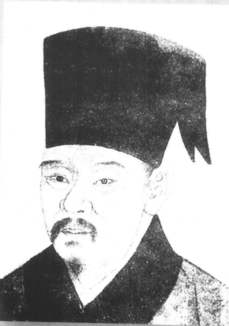

苏辙（1039-1112）字子由，号颖滨遗老。眉州眉山（今属四川）人。文学家。

每人一个中文名字已经叫西方读者弄不清了，所以我就一直叫父亲苏洵，长子苏东坡，次子苏子由吧，沿用中国流行的叫法。一个学者用那么多名号，使研究中国史的学生混淆不清，浪费不少时间。苏东坡的时代至少有八个人名叫“梦得”，表示那个人的母亲怀孕之前己梦中得子。

东坡十六岁的时候，家里发生一件插曲，使父家和母亲的娘家关系恶化，也泄露了他父亲的性格。按照中国家庭的惯例，父亲把苏东坡的姐姐嫁给母舅家的一位表兄，我们不知道详情，只知道新娘在程家很不快乐。也许她被夫家虐待也未可知。反正她不久就死了，使苏洵大大不满。新娘的公公似乎是一个无耻的坏蛋。苏洵写了一则苦涩的诗篇，为女儿之死而自责。然后他做了一件不寻常的事。他编了一份族谱，刻在石头上，又立了一座亭阁。为庆祝这个场面，他召集苏氏全族，打算当众宣读他妻舅家的檄文。族人倒酒祝告祖先之后，苏洵对族人说，村里“某”人——指他的大舅子——代表一个有势力的家庭，他给村中带来道德的混乱；他把兄弟的遗孤赶出门，独占了家中的财产；他宠妾压妻，沉迷肉欲；父子同乐，女德丧尽。他们都是势利小人，“惟富者之为贤”；美丽的车马迷乱了穷邻居的耳目，金钱和官位足以影响朝廷；最后又说他“是州里之大盗也。吾不敢以告乡人，而私以戒族人焉”。他父亲无疑得罪了太太娘家，不过他早就准备断绝一切关系，还教儿子不要和姐夫来往。从此四十年间苏东坡兄弟和姐夫程之才没有任何交情，不过父亲死后他们和其它表兄弟倒处得很不错。对豪门挑战、公开谴责的语气显示他父亲具有嫉恶如仇的性格，东坡后来也显出这些特性。

母亲对这件事很不快活。她也为失去爱女而难过。在这桩家庭冲突里，很难猜出她是支持亡女还是支持娘家。我们说过，他母亲受过良好的教育，其父现任京城的高官，就我们所知，她也许会反对娘家的势利眼，至少反对她哥哥的放荡作风。她哀痛欲绝，一天天衰弱下去。

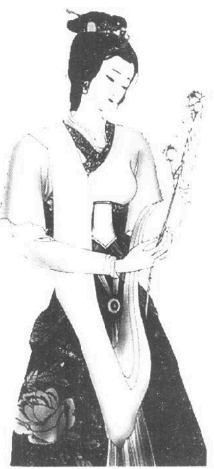

苏小妹，苏洵的女儿，自幼聪慧，据说写诗作文都胜苏轼。

中国民间的传奇都认定东坡有一个不美而才高的妹妹。她也是诗人，嫁给名诗人兼东坡的门生秦少游。据说她新婚之夜不让新郎进房，要他对上她所出的对子。因为对子很难，新郎无计可施，在院子里踱来踱去，最后苏东坡帮他解出来。还有小说描写两位恋人交换怪诗，可以正读倒读，形成一个圆圈。故事里苏东坡曾对妹妹说，“你若是男人，一定比我有名。”大家乐意相信这些传说。不幸历史上并无根据。苏东坡兄弟的几百封书简和记载中常常提到秦观，竟找不出丝毫联姻的迹象。当时学者所写的十几本传略中也不曾提到苏东坡有一个妹妹。而且秦观二十九岁才见到东坡，当时早已婚配，苏东坡的妹妹就算真有其人，等秦观认识东坡她早已四十岁了。传闻是后人捏造的，往往和茶余饭后的趣谈连结在一起。这种通俗传闻的存在只是表示苏东坡其人吸引了中国人民的幻想罢了。

不过东坡有一个堂妹，是他初恋的对象，他至死对她柔情万缕。她是他的亲堂妹。祖父死后，东坡的父亲倦游归来，伯父一家也回来参加葬礼，因此堂兄妹有机会见面玩耍。苏东坡说她“孳孝温文”。既然同姓，当然不可能嫁娶，如果她是表妹——也就是说，她不同姓——一切就不同了。后来这位堂妹嫁给柳仲远，日后东坡四出游历，曾在靖江她家住过三个月。其间他写过两首诗，若非情诗就很难解释了。这段时间的作家和研究苏东坡生平的人都没有提过这一层特殊的关系，因为谁也不愿意提。不过他晚年流放在外，听到堂妹的死讯，曾写信给她儿子，说他“此心如割”。他流放归来，经过靖江她的墓园，虽然病重，还勉强起来祭拜他们夫妇的英灵。第二天朋友去看他，发现他躺在床上，面壁流泪。

---

### 第四章应考

苏氏兄弟都高分入选。东坡写了一篇文章，欧阳修后来拿给同事看，还欣赏了好多天。文中谈到国家行政求简求宽的原则，也是苏东坡基本的政治哲学。不过其间发生一项不幸的误解。欧阳修很欣赏那篇试卷的文体和内容，以为一定是好友曾巩所写的。为了避嫌疑，他把卷子由第一名改为第二名，于是苏东坡考了个第二。嘉祐二年（一〇五七年）四月八日苏东坡通过殿试，四月十四日年方二十就被点为进士，在三百八十八位考中的学子中名列前茅。得到这个荣誉就表示他立刻变成全国一流的学者了。

---

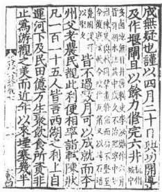

《苏文忠公集》

苏东坡兄弟长成少年，即将应考，婚配的问题马上发生了。如果他们未婚进京，通过考试，一定会被有女儿的人家提亲。当时盛行求婚；京城有女未嫁的富商都在等待考试的结果，打算向金榜题名的单身汉提出财政条件。公职考试的期间也是婚姻市场的旺季。从父母的立场来说，他们宁愿儿子娶本乡本土的女孩，身家也彼此熟悉。一切照例由父母安排。东坡十八岁娶王弗小姐为妻，她年方十五，是江畔十五哩以南的青神人。第二年他弟弟才十六岁，娶了一个小他两岁的新娘。都算早婚，却不稀奇。

原则上早婚——不一定象苏家兄弟那么早——可以省掉年轻人不少择偶求爱的时间、精力和情绪纷扰。最好年轻人的爱情和恋史都定下来，不妨碍工作。中国父母养儿媳妇是天经地义的，年轻人根本不必要耽误佳期，也许女孩子爱一个已成夫婿的男人要比爱一个还没有娶她的男人来得好些。只是在浪漫的社会里，后者显得比较刺激罢了。反正苏家兄弟高高兴兴娶了亲。这倒不是说，父母安排子女的婚姻不会出错，或者幸福婚姻的比例一定较高；不管怎么安排，一切婚姻都是赌博，都象在茫茫大海中行船。就算亲自安排，也没有一位父母或预言家能确知儿子的婚事将来会变成什么结果。在理想的社会中，婚姻由十八岁到二十五岁的未婚男女在黑森林中盲目匹配，只要社会伦理和社区生活很安定，婚姻幸福的比例还是一样的。男人不管是十八岁还是五十八岁，择偶仍然以大自然设计的性魅力为基础，很少例外，女人也以同一基础来吸引人，但是不主动挑选。他们更了解明智抉择的企图。光是这一点就使现在婚姻不至于完全沦于动物中的交配。父母作主的优点是简单、方便、不浪费时问，而且有更多选择的自由和范围。一切姻缘都是天定，却在地上实行，男女必须在走出圣堂后才开始建立关系。

小儿子成婚后，兄弟俩随父亲进京。他们先到省会成都，拜会大官张方平。他日后和苏东坡情同父子。父亲也希望得到官位。他现在年届四十七，不过上次落榜后他大大下了一番功夫。这时候他写了一本巨作，讨论政治、战争、和平的原则，极富深度及创意，应该能吸引京师学者的重视和尊重。当时有一条门径，可由某位大官特别推荐而得到官职。他把作品呈给张方平看，张方平十分赞赏，准备指派他担任成都的州学教授。老苏不甘只任书院教席。最后张方平被他的热诚所感动，虽然和全国第一大学者欧阳修没有什么交情，还是写了一封介绍信给他。另外一位姓雷的朋友也写了一封介绍信，说老苏有“宰辅之才”。带着这两封给欧阳修和梅尧臣的信件，父子三人就由陆路进京，走了两个月的时间，经过四川北部和陕西的山区。

仁宗嘉祐元年（1056年）五月，三苏抵达京城，住在一间佛庙里，等待秋天的考期，这是礼部的初试，考中的人才能参加明春皇帝的殿试。在眉州来的四十五位考生中，有十三个人考中，两兄弟也包括在内。父子们一心等待明春的殿试，没有别的事可做，就留下来参观京城，进入社交界。苏洵把作品呈给士林中最受敬爱的欧阳修。面容和煦的欧阳修耳朵奇长，上唇很短，笑起来露出上牙床。他外貌不英俊，但是会见这个文人领袖，得到他的好感，却是读书人共同的心愿。欧阳修赢得士林的爱戴，主要是他总以发掘后进、奖掖后进为己任。他诚恳接待苏洵，又介绍老苏到枢密韩琦家作客，引见高官大员。不过苏洵态度冷淡自负，没有在大官面前留下好印象。

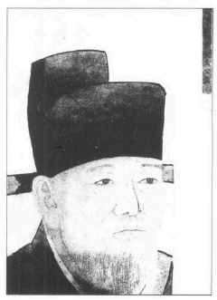

欧阳修（1007-1072）字永叔。庐陵（今江西永丰）人。文学家、史学家。

苏家兄弟没事就逛逛街，到著名的饭馆吃饭，站在冷风里瞻仰名臣座车的风采。宋朝有四个都城，以河南开封为主。开封当时名叫东京，外城周长十三哩，内城周长七哩。城门有十二座，都设置双层或三层的防敌工事，城墙顶端按一定的间隔设立“马头”，类似现在的枪墩。京都位在低矮的平原上，没有地势之利，只有北面受到黄河两百哩左右的保护——现在的陇海铁路就沿河而建——于是他们设计了一套完整的军防计划。

西京在一百三十哩外的洛阳西面，专门用来保护西北经潼关重镇入侵的通路。东面八百哩外的商邱建有另一个军事要地南京。南方倒不怕人侵略。相反的，公元十世纪前叶，北方的蛮族曾侵入中国。当时有一个军阀另成立政府，与蒙古那边的异族结盟，对抗中国其它的兵力。石敬塘变成鲜卑皇帝的儿子，却满口说他爱中国，关心人民的安宁与福利。他自称“儿皇帝”，叫鲜卑人“父皇”。他保全性命，破坏了中国的统一，却赢得异族的喝采。因此政府采取特别的措施，避免分离政权重现，因为古代也好现代也好，总有不少“爱国志士”甘愿借中国老百姓的名义担任外国政府的傀儡，追求自己的权力。这位异国暴君的“儿子”失势，蒙羞而死并不能阻止十二世纪另一个傀儡张邦昌；张邦昌饱受利用然后被推翻，也不能阻止十六世纪另一位“爱国者”吴三桂领导异族军队进入长城，毁灭中国政府。因此宋朝在河北南方的大名府建立北京，严防北面的蒙古异族入侵。

京师是中国的首府，饱藏帝国的繁华，全国的财富、天资和美质都集中在朝廷四周。城外有一百英尺宽的壕沟，两岸遍植榆树和垂柳，露出后面白白的扶墙和朱漆大门。四条河流过市区，大抵东西向，最重要的是汴水，由东南部安徽与河南的平原运送货品和食物到京师。四条河的水门晚上都关闭起来。城内大街每隔一百码就设一个岗哨。城内河面上布满精雕的木桥，皇宫前的小桥由用精心设计的大理石雕刻而成。皇宫位在城中心，南面由宣德楼下的一列石砖墙开始，有精美的龙凤半浮雕，上面露出亮晶晶的屋顶，都是用各色琉璃瓦建造的。宫外四边就是主要街道，依照罗盘的四点来命名。皇宫西边是中书省和枢密院。朱雀门外的南外城有国立大学和皇家庙宇。街上挤满行人、官车、牛车和轿子，这是一般的交通情况，少数二轮小车子则由人力拉动，是近代洋车的雏型。牛车上的妇人都把帘子拉下来。京师有一个特色，谁也不能光着头走来走去，连最卑微的算命先生也打扮得象文人似的。

殿试的时候到了。欧阳修被皇帝任命为主试，还有不少名学者担任判官。这是读书人一生最重大的时刻，向来充满兴奋、希望和患得患失的心情。多年的寒窗苦读就要见出成果了。应考人必须半夜起床，天亮就到皇宫，自备冷饭干粮，要到考完才能出来。考试进行中他们分别关在隔室里，有宫中卫士看守。当局有一套严防贿赂或徇私的制度。应考人的试卷都由书记重抄一遍，再交给考官，以免负责人看出他们的笔迹。重抄的卷子不写姓名，另记在档案里。应考人考完出来，判官开始入禁宫中，不准和外面的人接触，通常由一月底关到三月初，把试卷批好呈给皇帝看。应考人先考历史或策论。第二回再考古文，等成绩揭晓，得中的人必须在皇帝监督下考诗赋和策问。仁宗皇帝特别爱才，对这些测验也十分关心。他常派身边侍仆送出考试题目，有时候为防泄露，又在最后一分钟更改。

苏氏兄弟都高分入选。东坡写了一篇文章，欧阳修后来拿给同事看，还欣赏了好多天。文中谈到国家行政求简求宽的原则，也是苏东坡基本的政治哲学。不过其间发生一项不幸的误解。欧阳修很欣赏那篇试卷的文体和内容，以为一定是好友曾巩所写的。为了避嫌疑，他把卷子由第一名改为第二名，于是苏东坡考了个第二。嘉祐二年（1057年）四月八日苏东坡通过殿试，四月十四日年方二十就被点为进士，在三百八十八位考中的学子中名列前矛。得到这个荣誉就表示他立刻变成全国一流的学者了。

不过，这位才子在试卷上随便引用史例，还杜撰了一则对话，却是史上少有的。他畅言奖赏宁可失之过宽，处罚若有疑问则应慎刑免杀无辜的道理。他写道，唐尧时代有一个人即将被判死刑。“皋陶曰杀之三。尧曰宥之三。”对话不错，也颇能支持圣君愿起用坏人，给他表现才华机会的权威说法。考官读到这则故事，不敢置疑，怕承认自己没有读过这些不出名的古书。于是苏东坡过关了。考完后，有一天考官之一的梅尧臣问他：“对了，尧帝和皋陶的故事刊在哪本书里？我不记得在哪里读过。”

“我杜撰的。”小学者承认说。

“真的？”老考官说道。

“咦，圣君一定会这样做的，对不对？”苏东坡回答说。

文人在某一位主考官手下金榜题名，就得感激他的知遇之恩，两个人之间从此建立“恩师”和“门生”的关系。考生要拜见恩师和考官，并写信道谢。欧阳修是文学权威。他的一句褒贬就可以造就或毁灭一个文人。当时有一位作家说，文士不怕刑罚，不爱晋升，也不贪生怕死，只怕欧阳修的意见。欧阳修对一位同事说，“读苏东坡的信，我全身喜极流汗。我应当退隐，使这个青年出人头地。”想想这句话对苏东坡有多大的影响!欧阳修这句话一说出来，全京师都听到了。据说欧阳修还曾对他儿子说，“记住我的话，三十年后没有人会谈起我。”预言果然实现了，苏东坡死后十年没有人提欧阳修，人人都在谈苏东坡，偷读他被禁的作品。

东坡正要开始做官，他母亲去世了。根据儒家的规矩，这是一件大事，连宰相也要立刻辞官，守丧二十七个月，才能复职。东坡的姐姐几年前就死了，家里的男人都出去应考，母亲和两个媳妇留在家中。她临死还没有听到京师的好消息。父子匆匆赶回家，发现母亲已死，房子乱七八糟，篱笆倒塌，屋顶漏雨，“如逃亡人家”。

办完丧礼，他们在一片山坡下的“老翁泉”选了一块墓地。根据地方传说，晴朗的月色里可以看见一个白发俊脸的老头在泉边或坐或躺，但是人一走近，他就消失在水中，因此命名“老翁泉”。后来苏洵也葬在同一个墓穴里，他诗号“老泉”，就是由这个地方而得名。

苏洵在亡妻的祭文中写道：“我知母心，非官是好，要以文称。昔予少年，游荡不学；我知子心，忧我泯灭。感听折节，以至今日……有蟠其丘，惟子之坟。凿为二室，期与子同。……磋予老矣，四海一身。自子之逝，内失良朋。我归旧庐，无有改移。魂兮未泯，不日来归。”

强迫蛰居的二十七个月期间是苏东坡年轻时最快乐的日子。两兄弟都和年轻的夫人住在一起。东坡常到青神拜访他太太的娘家，那儿青山围绕，山顶有溪流、深塘和佛寺。一片神秘、浪漫和传奇的气氛。苏东坡常和太太的叔叔、堂兄弟姐妹一起游庙，在瑞草桥畔野餐或喝酒。夏夜他就坐在茅屋外吃瓜子和炸蚕豆。那是一个大家庭：有他太太的父亲王方，她的两个叔叔和家眷。在王家三十多个堂兄弟姐妹中，有一位“二十七娘”，后来竟成为他生命中的一部分。

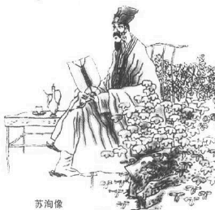

他的著作以史论和政论为主，文章笔力雄健，议论精辟，善用比喻，语言明畅，具有独特的风格。是唐宋八大家之一。

这时候老苏正在等他的派令。他可以做官，因为哀悼亡妻不象哀悼母亲，不至于成为出仕的障碍。京里的高官答应帮忙，不过他等了一年多还没有消息。最后圣旨来了，叫他到京师接受特别的考试。这使他惊惶失措，如今他对一切考试都感到害怕。他写了一封回函给皇上，以年老体衰为借口，拒绝应试，但是他写给朋友的信里说：“仆非固求仕者，亦非固求不仕者……何苦乃以衰病之身委曲以就有司之权衡，以自取轻笑哉……向者权书论衡几策，乃欧阳永叔以为可进而进之。苟朝廷以为其言之可信，则何所事试。苟不信其平居之所云，而其一日仓卒之言又何足信耶？”另一封给梅尧臣的信里也说：“惟其平生不能区区附合有司之尺度，是以至此穷困……自思少年尝举茂林，中夜起坐，裹饭携饼待晓东华门外，逐队而人，屈膝就席，俯首据案。其后每思至此，即为寒心。……”

第二年——嘉祐四年（1059年）——六月，他收到政府另一道命令，重申前一次的旨意。文中没有说特免考试，但是他只关心免考的问题。政府领袖应该信任他——要嘛就接受，要嘛就算了。他不愿象小学生被人考来考去。所以他第三次恳辞。他写信说，他已经五十岁了。这个年龄能为国家做些什么？毕竟学者从政只是为国效力，否则就该安份的做一个穷学者。如果他现在决心从政，既不能得到为国效命的机会，又不能享受大隐士的殊荣。不过他最后说，现在已是夏季，他儿子的服丧期下个月就满了，他就陪他们再度入京。他希望到时再会见众官，讨论一切。由整封信的语气看来，他不反对五十岁从政，只要这些大人妥善安排，不让他的试卷象小学生一样受人批改就行了。

事实上老妻已死，老苏打算永远离开四川。他显然很适合京都的生活。两个儿子已得到功名，下一步就算不为自己求官，也该看一看政府有什么空缺留给他们。孝期刚满两个月，父子就再度进京，这次还带着年轻的太太同行。他们为亡母的灵魂做了一番妥当的安排。苏洵叫人塑了六座菩萨像，放在两个木刻镶金的圣龛里，安置在极乐院的如来厅内。六菩萨是观音娘娘、势至菩萨、天藏王、地藏王、解冤王者和引路王者。动身前苏洵正式把佛像献给庙方，又到亡妻灵前告别。祭文末尾说，“死者有知，或升于天，或升于四方，上下所适如意，亦若余之游于四方而无系云尔。”

---

### 第五章父子行

过了虾蟆培，自然狂暴的魅力开始消失，怒石怒水的戏剧告一段落。宜昌以下风景就一片安详宁静了。落日照着一大片稻田、屋舍和炊烟，旅客发觉自己又回到了可以住人的世界。依照风俗，旅客都互相道贺，庆幸怒水余生。大家都买酒肉来酬谢船夫的辛劳，人人快快乐乐，心怀感激。回头一看，仿佛做了一场难以相信的怪梦。

---

现在父子媳妇向京师进发。这回和上次不一样。他们的文学功名已经实现，未来的官职也几乎有了保障。他们要迁居到京城，所以不走西北陆路，改由长江顺流而下。一共要走一千一百多哩，其中七百哩是水路，四百哩是陆路，十月出发，次年二月才到。不必赶时间，又有妇女同行，他们就慢慢走，在船上喝酒玩牌，一路欣赏湖光山色。两兄弟的太太都没有离开过故乡，她们知道自己正陪进士丈夫出门，却想不到她们家里有三个当代的散文大家，其中一个还是大诗人呢。两兄弟一路作诗——不过当时文人习惯用诗来记载某一风景或心情，就和我们今天写信一样。子由的新娘来自四川古老的史家。苏东坡的夫人身份和年纪都居长，她是现实、明理、能于的一型，弟媳妇很容易和她相处，何况一家之长的老父还在身边，不听话、不和睦可就有失妇范，她看出二个男人中她丈夫最冲动、最狂放、最健谈。子由高瘦些，不如哥哥活跃，东坡颧骨突出，下额匀称，显得英俊而壮硕。他那一年才生的儿子——苏家的长孙——也和他们在一块儿，一切都刚刚好。如果小孩早一年出生，就表示他在母丧的第一年内就放纵自己，那就有点难为情了。宋朝的理学家对这种不孝的憾事会大不以为然哩。

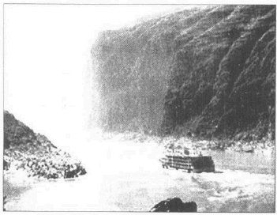

长江三峡

他们在大佛所在地嘉州上船，两对小夫妻开始了希望之旅；心中又敏感又热诚，充满自信。“故乡飘已远，往意浩无边”。四川是中国最大的省份，面积和德国差不多，与三国历史有密切的关连。他们走了一个月才到四川东界，三峡就在那儿，山顶的城镇庙宇使他们想起古战士和道家仙人。两兄弟上山拜访“仙都”，据说一个古仙人得道前曾在那儿住过。他初期作品中有一首诗描写老仙人身边的传奇白鹿，已经表现出他精神的高超。

日月何促促，

尘世苦局束。

仙子去无踪，

故山遗白鹿。

仙子已去鹿无家，

孤栖怅望层城霞。

至今闻有游洞客，

夜来江市叫平沙。

长松千树风萧瑟，

仙宫去人无咫尺。

夜鸣白鹿安在兮，

满山秋草无行迹。

长江三峡风景壮丽，旅程危险刺激，延伸两百二十哩，激流在悬崖绝壁中流进流出，水里藏着大石头，船夫必须特别灵巧。山峡每年要吞掉许多船只和游人，因为这是深水大江，沉下去就没命了。不过三峡壮观诡丽的风景是中国任何地方都比不上，世界也很少地方能够企及的。四川一向被视为独立的王国，东面有高山和长峡为屏障，任何敌人都攻不进来，这也是主要的原因。

上溯峡谷是船夫最费力的工作，由六、七十个船夫把一条长缆套在肩上，合力拉一条逆流的小船。顺流而下更危险，船只被激流往下推，只靠掌舵船夫极高的技巧来把持方向。这段危险的江面就是长江三峡，瞿塘峡和巫峡在四川，西陵峡在湖北境内。每一峡都包含一连串险滩，还有漩涡和激流在矗立水面几百尺的峭壁间流过。

危险和刺激都由瞿塘开始，先看到一堆石头，有时候伸出水面三十英尺，有时半隐在水中，江水随季节而涨落，水位也时高时低。当时是冬天，最难航行的季节。由于通路窄，夏季泛潮时和干冷的冬天水位相差一百英尺左右。船夫通常都照江中这堆石头来判断水位。这些石头名叫滟滪堆，因为漩涡打在上面形成雾珠，很象女人迷蒙的乱发。石堆完全淹在水中，就造成更危险的涡流。俗语说，“滟滪大如马，瞿塘不可下；滟滪大如象，瞿塘不可上。”不过这句话也没有多大的用处，因为河床多变；有的地方水位该低，有的地方该高，全看水底藏石的高度而定。如果突然遇到暴风雨，船夫会在某处待几天，等水位回复安全的高度才动身。不过大家还是愿意走三峡，为名为利而冒险，苏家兄弟现在正是如此。旅客只能把一切交给天神，他自己毫无办法。不管上行下行大家往往在入峡前祷告，出峡后又祷告拜谢，比较危险的地段神明永远不缺酒食祭品。

说也奇妙，三峡的环境产生了不少山顶仙人的怪谈和传说。快到瞿塘峡入口处有一个“圣母泉”。这是岸边的一个小裂缝，能应人声出水。旅客到缝口大叫“我渴了”，溪泉就流出一杯的水量，然后停止。要第二杯的人得再叫一遍。

三苏求神庇佑，然后顺流而下。船只太密很危险，所以按规定一只船要走到半哩外，第二只船才能出发。大官出门有士兵按一定的间隔站岗，手上拿着红旗，等前面的船只安全通过危险的地带，他们就摇旗示意。苏东坡描写说：

入峡初无路，

连山忽似龛。

萦迂入浩渺，

蹙缩作渊潭。

风过如呼吸，

云生似吐含。

堕崖鸣窣窣，

垂蔓绿毵毵。

冷翠多崖竹，

孤生有石楠。

飞泉飘乱雪，

怪石走惊骖。

偶尔他们会驶过孤零零的小屋，看见乡下少年砍木柴，顶天立地。空旷的小屋证明他们一无所有，屋顶是木板做的，连瓦片都不铺。苏东坡想起人生的劳苦，注意力被天边自由盘旋、无忧无虑的灰鹰吸引住了。他怀疑功名利禄是否值得牺牲文明生活的自由。灰鹰遂变成人心解放的象征。

现在他们进入延伸五十哩的巫峡。这里山峰加高，峭壁贴近，江面也变窄了。白昼的光芒换成永恒黎明的微光。由船上望去只见一线蓝天。中午才能瞥见太阳，晚上月亮在天顶的时候能瞥到一丝月光。两岸怪石林立，山峰永远藏在云端。高风吹着云朵，变幻莫测，高耸的山峰也不断改变形貌，造成一幅艺术家无法描绘的活动奇景。其中神女峰很象裸露的女体，自从西元前三世纪一个诗人用热情幻想的文章加以描写之后，它已成为巫山十二峰中最著名的一峰。在这风云际会、天地相接的山顶上，阴阳显然结合成一体，至今“巫山云雨”仍是性交的含蓄形容辞。空中似乎充满仙人和妖精，在云端嬉戏。这时苏东坡的理性主义说话了。古传说不合逻辑嘛。“世人喜神怪，论说惊幼稚。”他作诗说，“楚赋亦虚传，神仙安有是。”

但是老船夫开口说，他年轻时爬到山顶，曾在山池洗浴，把衣服挂在枝上晾干。山上有猿猴，但是一爬到峰顶，鸟声猿啼都消失了，四野俱寂，只有山风。虎狼不上山顶，他一个人什么都不怕。神女庙有一种特殊的竹子。软竹垂地，仿佛祭拜仙云似的。风吹枝摇，永远把石龛扫得干干净净，真象女神的侍仆。苏东坡非常感动，“神仙固有之，难在忘势利”。苏东坡和当时其它的人一样，终生对遇仙、成仙的可能抱着开朗的看法。

一入巫峡“神鸟”开始追随在船边。这些乌鸦只是采取明智的举动罢了。在神女庙上方或下方几哩处，它们注意寻找来船，一路追踪觅食，游人常逗它们。他们把糕饼丢到半空中，看乌鸦俯冲下来接住，觉得很好玩。

这些地方自然没人住，也不能住人，三苏穿过“东濡滩”，波涛汹涌，船只就象小漩涡中的一片枯叶被人打来打去，刚以为惊险已过，谁知又遇上更险的“怒吼滩”。狰狞的怪石排列两岸，延伸到江心里。然后又到一个名叫“人鲊瓮”的地方，可见很多游人都在此地送命，和一罐死鱼差不多。这是一块大石，占了五分之四的江面，使长江变成一条窄巷，强迫船只急转弯。任何游人经过“人鲊瓮”而不死，一定把船夫当作再世爹娘。

走出巫峡，不久就到秭归，开始看到岸边高高低低的简陋房舍。这是一个小镇，只住了三、四百户人家，位在山边的陡坡上。居民很穷，不过一想到该地迷人的风光必定会深人民心里，这个半开化的小村出过两位大诗人，一位名后，一位历史上著名的女子，也就不足为奇了。山中男女都习惯在背上背水桶或竹篮，不过大部分由女人来背。肌肉很累，但却可以培养优美的身材。未婚女子常梳一个双髻的高髫，两端插上五、六根银针，背后别一个手掌大小的象牙发饰。

但是游人才经过二峡，最险的还在前面哩。三十年前有一次山崩，尖石都落入江心里，船只根本无法通行。江运阻隔了二十年左右，最后才开出一条窄路来。因此这个地方名叫“新滩”。苏东坡家人在这里被暴风雪阻留了三天。

缩颈夜寒如冻龟，

雪来唯有客先知。

江边晓起浩无际，

树梢风多寒更吹。

青山有似少年子，

一夕变尽沧浪髭。

方知阳气在流水，

沙上盈尺江无澌。

随风颠到纷不择，

下满坑谷高陵危。

江空野阔落不见，

入户但觉轻丝丝。

沾裳细看若刻缕，

岂有一一天工为。

霍然一声遍九野，

吁此权柄谁执持？……

山夫只见压樵担，

岂知带酒飘歌儿。

冻吟书生笔欲折，

夜织贫女寒无帏。

高人著屐踏冷冽，

飘拂巾帽真仙姿。

野僧砍路出门去，

寒夜满鼻清淋漓……

舟中行客何所爱，

愿得猎骑当风披。

草中咻咻有寒兔，

孤隼下击千夫驰。

敲冰煮鹿最可乐，

我虽不饮强倒卮。

楚人自古好弋猎，

谁能往者我欲随。

纷纭旋转从满面，

马上操笔为赋之。

本地人由大然灾害得到不少利润。他们打捞沉船，卖木板来修理其它的船只，已变成一种生意。旅客往往被迫在那儿停儿天，他们就象其它的名胜地区一样，可以赚旅客的钱。此地激流险恶，船只通常要卸下一切客货，乘客也宁愿走陆地，保身体。

由秭归望去，地平线端的大牛背依稀可见，高耸在近处的山脊顶。现在他们来到黄牛山俯视的地区。这儿岩石很怪，山影立在天空中，很像一条大牛被一个穿蓝衣、戴笠帽的牧童牵引。有一句土话描写大牛俯视的面貌：“朝发黄牛，暮宿黄牛。三朝三暮，黄牛如故。”这里的女人肤色白皙，头上都系着小黑圆点的头巾。风光可媲美巫峡，有些人甚至觉得比巫峡更棒。这是国画中常见的山水，一颗颗难以置信的独石耸立在天边，象天神设计的石屏风，也象一群石雕的巨人，有的低头，有的跪拜，正对天祈祷。岸边的层石叠峰令人感叹自然的壮丽，有时候平滑的大峭壁就象一把巨剑，剑端直伸入土垠里。向下走一段距离，还没有完全离开危险的地带，就来到虾蟆培。虾蟆培是一个大扁石，外表酷似青蛙头，水滴流入江中，活象嘴里吐出的水晶帘幕。大石头呈苔青色，尾背布满小水珠。尾巴末端有一个石洞，泉声潺潺可闻。有些文人进京赶考，特地从蛙口收集水珠，留来考试磨墨用。

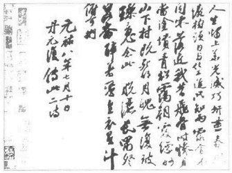

苏轼《李白仙诗卷》书法作品

过了虾蟆培，自然狂暴的魅力开始消失，怒石怒水的戏剧告一段落。宜昌以下风景就一片安详宁静了。落日照着一大片稻田、屋舍和炊烟，旅客发觉自己又回到了可以住人的世界。依照风俗，旅客都互相道贺，庆幸怒水余生。大家都买酒肉来酬谢船夫的辛劳，人人快快乐乐，心怀感激。回头一看，仿佛做了一场难以相信的怪梦。

他们在江陵下船，换车走陆路进京，走完这一段，两兄弟已写了一百首诗。都收在“南行”集里。不过苏东坡的好诗有不少是在陆路上写的，完全注重音乐、曲调和气氛，韵律丰富，形式也变化多端。他在襄阳写了几首乐府诗，《野鹰来》是追忆刘表的故事，《上堵吟》则追忆孟王舀因两位手下不才而失去沃土的经过：

台上有客吟秋风，

悲声萧散飘入宫。

台边游女来窃听，

欲学声同意不同。

君悲竟何事，

千里金城两稚子。

白马为塞凤为关，

山川无人空且闲。

我悲亦何苦，

江水冬更深，

鳊鱼冷难捕。

悠悠江上听歌人，

不知我意徒悲辛。

苏氏全家二月抵达京师。他们在宜秋门附近买了一栋花园住宅，占地半英亩左右，离闹街很远。房子四周有高大的老槐树和柳树，朴实的气氛很适合诗人一家。定居以后，父子就等待官厅的派令，通常要很久才能下来。两兄弟又通过两次考试，一次考京师各部的任务，另一次更重要，考“制策”，公开批评朝政。仁宗皇帝求才若渴，下令举办这个特殊的考试，以鼓励公开批评的精神，一切文人都可以靠各部推荐或提出作品而报名。两兄弟在欧阳修推荐下报名，通过考试，苏东坡的分数自宋朝以来只有另一个人得过。他还提出二十五篇史论，其中几篇至今仍是学校最爱选的范文。后来仁宗皇后告诉别人，仁宗曾说：“今日为子孙得二相才。”

他父亲被任命为校书郎，不必考试，正合他的心愿，后来又在官厅主编当代皇帝的生活史（《太常因革礼》）。那是作家的工作，他高高兴兴接下来。不过其中牵涉到真实性的问题，因为先皇都是现在皇帝的祖先，苏洵认为，这是史家的工作，史家对自己祖先的过错也不该粉饰。大家对这个论点意见纷纷。苏洵“全集”中有一篇报告说：“洵闻巨僚上言，以为祖宗所行不能无过，差不经之事欲尽芟去，无使存录……编集故事非曰制为礼典而使后世遵而行之也。然则洵等所编者是史书之类也，遇事而记之，不择善恶，详其曲折而使后世得知，是史之体也。若夫存其善而去其不善，则是制作之事，而非职之所及也。班固作汉志，凡汉之事悉载而无所择也。欲如之，则先世之小有过差者不足以害其大明，而可以使后者无疑之。”

三苏的学术和写作声誉一天天增高。他们结交国内最著名的作家，自己的诗文也受到广泛的敬爱，大家已经把苏家视为文坛的奇景。两兄弟才二十出头，青春有时候反成为天才的障碍。苏东坡愉快、冲动、野心勃勃，心境象一匹纯种马，焦急地猛抓地面，打算冲入旋风去征服全世界。但是他有一个沉默的伴侣子由，还有一个见解深刻、精神不屈、性格孤傲的老父，使这对纯种马不能立刻往外飞奔。

---

## 第二卷壮年期（1062一1079）

---

### 第六章神、鬼、人

我简直想说，苏东坡的精神代表“火”，他二生和水灾、旱灾奋斗，每到一地就忙着修建供水系统、水运系统和水井。火的象征很恰当，因为他活力充沛；换句话说，他的脾气和一生都象烈焰，到处给人生机和温暖，也一路烧毁了某些东西。

---

尽管苏东坡有那么辉煌的记录，他还是得从基层干起。嘉祐六年（1061年）底，他被任命为大理评事，签书凤翔府判官，有权连署报告和送往朝廷的通讯。唐代国家饱受地方分权之害，唐末竟因藩镇之乱而覆亡，藩镇又往往是皇亲国戚。因此宋朝想改正这个流弊，采中央集权制，军队都集中在京师附近，另有一套考核和控制的系统来管理各省长官。地方官的任期通常是三年，不断换来换去。副长官有权连署公文也是制度的要点之一。子由也被任命为商州军事长官。但是他父亲的工作在京师，两兄弟得有一人留下来，总不能撇下鳏居的父亲。于是子由拒不赴任。他送东坡一家人到四十哩外的郑州，两兄弟生平第一次离别，东坡远走，子由要回去陪妻子和父亲住三年。东坡眼看弟弟在郑州西门外的雪地上骑着一匹瘦马，路面逐渐沉落，他的头一起一伏，终于消失在视线之外。东坡写给弟弟的第一首诗函说：

不饮胡为醉兀兀？

此心已逐归鞍发。

归人犹自念庭闱，

今我何以慰寂寞？

登高回首坡陇隔，

惟见乌帽出复没。

若寒念尔衣裘薄，

独骑瘦马踏残月。

路人行歌居人乐，

僮仆怪我苦凄恻。

亦知人生要有别，

但恐岁月去飘忽。

寒灯相对记畴昔，

夜雨何时听萧瑟。

君知此意不可忘，

慎勿苦爱高官职。

《夜雨对床》的诗境是一位唐代诗人写给他弟弟诗中的主题。后来就变成苏氏兄弟的信物，也是他们退休后打算过的理想生活。后来两兄弟作官重逢，曾两次在诗中提起这个许诺。信件从京师送到风翔只要十天，两兄弟每个月按时互寄一首诗。由这些诗函我们可以看出苏东坡作官初期魂不守舍的心境。两兄弟常常“和”诗，用同一韵脚。这是作诗技巧的一大考验，因为押韵要自然，古代中国文人都能办到。大家都在寻找意外、悦人、清新的思想应和，用规定的韵脚表达，诗句必须自然连贯。就象纵横字谜一样，愈是困难的韵脚，若能毫不费力完成，乐趣也就愈高。东坡最初“和”子由的诗篇中有一首已显出大诗人的风范。规定用“‘泥”、“西”做韵脚，东坡写道：

人生到处知何似，

应似飞鸿踏雪泥，

泥上偶然留指爪，

鸿飞那复计东西。

这是东坡的佳作之一，飞鸿象征人类的精神。事实上这本书所写的苏东坡生来事略只是一个伟大心灵偶尔留下的足迹，真正的苏东坡是一个幻鸟般的灵魂，说不定今天还在星宿间梦游呢。

凤翔位在陕西西部，靠近渭河，陕西是中国文化的摇篮，整个渭河河谷充满历史地名和古史上有关的名称。不过，此地因为和甘肃南边的强邻西夏纠纷迭起，人力缺乏，民穷财尽。到任第一年，苏东坡盖了一栋花园小屋做官舍，屋前有池塘，花园里种了三十一种花，屋后还有一个小亭子。

现在他定居下来，判官也没有太多责任。他可以到处走走，到东面和南面的高山玩几天。有一次他因公到附近地区调查案情，以便早日解决未判的案子，尽量多释放一些囚犯。他最适合出巡，曾经到太白山、黑水盆地的庙宇，以及周朝开国君主诞生的地方，有时候没事可办，他甚至远走西安附近的终南山。去看他一位朋友收藏的名画家吴道子的珍本或真迹。

苏东坡还年轻，魂不守舍。他第一次和太太、小孩搬出来住。现在他已初尝做官的滋味，并不如他想象中那么美好。远离京师的刺激，在偏远的地段担任连署文件、审判讼案的副首长，他觉得很厌烦。有时候他觉得孤单，不过有时候看看酒杯中的月影，他也会兴高采烈。

头几年还未成熟，他需要妻子的忠告。苏太太似乎比他讲求实际。苏东坡大事清楚，小事糊涂；但是生命往往由许多小事所构成，大事通常不多，时间也相隔很远，东坡只好听太太的话。苏太太提醒他，他现在是第一次脱离父亲的指导。东坡相信任何人，他太太却比较会分好坏。她常站在门帘后边，听丈夫和客人说话。有一天，客人走了以后，她对丈夫说：“你何必浪费时间和这个人说话呢？他一直注意你要说什么，好设法迎合你。”

她要他当心那些表现太露骨的泛泛之交，以及他根据“世间无恶人”理论而交上的朋友。他的麻烦就出在这儿；他无法看出别人的错处。他太太对他说：“当心那些朋友。太快建立的友情不会长久的。”东坡承认，她的话总是应验，我想她这方面的智慧是来自中国“君子之交淡如水”的古训——没有令人兴奋的味道，却永远不会生厌。诚挚的友情从来不表现太多。真正的好友不常写信，因为全心信任彼此的友谊，根本不必写。分别几年又重逢，友情依然如故。

苏东坡是一个没事做就难受心烦的人。不过，旱灾眼看就要发生了。很久没下雨，农夫都担心收成。除了求雨，也没有其它的办法。求雨是地方官的事，苏东坡突然活跃起来。一定有什么地方不对劲，神明生气了，如果雨不快来，农夫马上要遭殃，他打算使出一切辩才，替农民哀告神祗，于是他动手实行。

渭河南部有一个高山区，通称秦岭，其中最高一个最有名的山峰就是太白山。太白山顶一座道观前面有一个小小的池塘，“龙王”就住在里面，可以化身为各种小鱼。苏东坡入寺祈祷。他替农民哀求，不过他好象一个律师，尽量使龙王知道旱灾对神明不利。他拍了龙王一阵马屁之后，就在官方祈雨文中说：“乃者至冬徂春，雨雪不至。细民之所恃以为生者麦禾而已。今旬不雨，即为凶岁；民食不继，盗贼且起。岂惟守土之臣所任以为忧，亦非神之所当安坐也熟视也。圣天子在上，凡所以怀柔之礼莫不备至。下至愚夫小民，奔走畏事者，亦岂有他哉，凡皆以为今日也。神其盍亦鉴之？上以无负圣天子之意，下以无失愚夫小民之望。”

由太白山下来以后，他拜访了几处地方，尤其是上回错过的地点。他七日献上祈雨文，回到城内，十六日有一阵小雨，但是不敷农民作物的需要。他寻找原因，有人告诉他太白山的祈祷并未失败，不过宋朝皇帝只颁给山神济民侯的封号，求他再也没有用了。苏东坡翻阅唐史，发现前朝太白山君被封为神应公。实际上山神爵位已降，也许正为此事而不高兴呢。他立刻替太守写了一篇奏文，要皇上恢复太白山的公爵位。然后他和太守沐浴一番，派特使去通知山神，他们已替他争取高位，同时由山上的池塘带了一盆“龙水”回来。

十九日苏东坡出城迎接“龙水”。整个乡村的人都很兴奋，大家全关心这次的成败。几千人由乡下赶来，闹哄哄的。“龙水”还没到。不过一大片乌云袭来，天空渐渐昏暗。大家等了很久，还是不下雨。苏东坡再度进城，陪宋太守到真兴寺祈祷。半路上看到一堆乌云低低飞过，往他这边飘来。他向农民借了一个篓子，抓一把云入篓，紧紧盖住。他入城对这片云祈祷说，“开缄仍放之，掣去仍变化。云兮汝归山，无使达官怕”。说完他和宋太守又出城去。一到郊区，冷风大作。族旗、小旗和枪上的流苏都在风中猛烈摇摆，密云象一群野马从天而降。远处雷声轰轰。这时候“龙水”来了。苏东坡和宋太守上前迎接，把水盆安置在暂放的神龛上，又说了一篇祷文，现在那篇文章还和其它祝文同收在他的“全集”里。仿佛回覆祷文似的，阵雨竟翩翩下满了四乡。两天后又有一次大雨，连续下了三天，枯萎的小麦和玉米又恢复了生机。

现在到处喜气洋洋，最高兴的却是他自己。为了纪念这个欢乐的场面，他将官舍后面的亭子命名为“喜雨亭”，还写了一篇碑记。这篇碑记是学校最爱选的苏东坡散文之一，因为用字简单，又能代表苏东坡的个性，他最高兴分享百姓的快乐。

结果太白山神升官了，被皇帝封为公爵。苏东坡和宋太守又上山道谢并贺喜。第二年七月再度干旱，这次求雨没有反应。苏东坡很失望，就到蟠溪祈求姜太公的英灵。太公至今仍是中国百姓相当欢迎的神祗，他是公元前十二世纪的一位老智者，传说他钓鱼常把钓线提到水面上三尺。可见他是一个仁慈、公正的人，如果鱼儿跳出水面三尺来上钩，那就怪鱼儿自己了。

苏东坡祭姜太公有没有效，史上并无记载，不过任何善男信女——信的是佛教也好，是一棵老树也好——都没有理由怀疑祈祷的功用。谁也不能证明祈祷无效。根据佛家的训示，若有毛病总是祈祷的人不对，通常都是诚意不够的关系。一切神明都灵，否则人类就不会对他们感兴趣了。此外，祈祷还基于人类最深的本能之一。毕竟祈祷或者有心祈祷才是最重要的，灵不灵倒在其次。

不过苏东坡在各地做官，必要时就继续求雨。他知道他的做法正确。他相信上苍公正讲理。他既然相信有神明存在，自然也相信神明会尽量解除人生的痛苦，带来幸福与正义。如果讲理是人类最高的属性，上苍也一定明理，肯听人劝说和理论。不过在他日后的天灾报表中，他也依据中国正统的说法，说政府应该解除压迫的作风，祈祷才会生效。这就是中国常识的信仰，所以最早的古籍上曾说“尽人事，听天命”。我见过中国人所做的一切蠢事，这种说法却恢复了我的信心，中国人毕竟是真正伟大的思想家。

我简直想说，苏东坡的精神代表“火”，他一生和水灾、旱灾奋斗，每到一地就忙着修建供水系统、水运系统和水井。火的象征很恰当，因为他活力充沛；换句话说，他的脾气和一生都象烈焰，到处给人生机和温暖，也一路烧毁了某些东西。

根据记载，这团烈焰曾两度和魔鬼争辩。苏东坡始终认为，不但神明，连鬼魅也应该接受他逻辑的大辩论。他讨厌不讲理的东西，连魔鬼也该看出他做的事情有没有道理。鬼魅有时候也许健忘或糊涂了，不过他们若能在苏东坡劝导下看出自己行为的错误，他们就会终止自己的恶行。

后来他由凤翔回京，沿山路直走，曾经通过白华山，有一个卫士突遭魔鬼附体，开始一路脱衣服，全身赤裸。苏东坡叫人替他强穿上衣服，把他绑起来，衣服照样脱光。大家都说山神发怒，士兵中了邪。于是苏东坡到庙里献了一篇祝文：

“某昔去之无祈，今之回也无祷。特以道出词而不敢不竭而已。随行一兵狂发遇崇。而居人曰‘神之怒也’未知其果然否。此一小人如虮虱耳。何足以烦神之威灵哉。纵此人有隐恶，则不可知。不然以其懈怠失礼或盗服御饮等小罪尔，何足责也，当置之度外。窃谓兵镇之重，听隶甚广，其间强有力富贵者盖有公为奸慝，神不敢于彼示其威灵，而乃加怒于一卒，无乃不可乎。某小官一人病则一事阙，愿恕之可乎。非某愚其谅神不闻此言。”

苏东坡祈祷完毕，走出庙门，一阵冷风迎面吹来。不久飞沙走石，游客都看不见路。苏东坡对随员说：“山神更气了吗？我不怕。”他继续往前走，暴风比原先更猛烈了。只有扛行李的人跟着他走，其它的人马都想找地方避风，大家都觉得寸步难行。有人劝他回庙里向山神道歉。“我的命运由苍天掌握，苏东坡回答说，“山神若要生气，就由他气吧。我要向前走。山神又能把我怎么样？”说着暴风就渐渐小了，大家平安无事，那个士兵也痊愈了。

苏东坡始终相信他的机智能对抗无形的神鬼，有一次还和鬼魅讨价还价呢。几年后他在京师担任高官，他的二媳妇是欧阳修的孙女，刚生产完毕，遭魔鬼附身。这位儿媳妇露现出一位死者的人格，对在场的人说：“我叫王静。冤魂不散，已在这儿盘桓多时了。”苏东坡对中邪的妇人说：“我不怕鬼魅。何况京师有很多道士能驱除厉鬼，他们也可以把你赶出去。别傻了!你生前显然是愚妇，才会冤死，现在死了还想闹事。”然后他向鬼魅说明佛家人气的概念，并且告诉她：“现在静静走开，明天傍晚我替你向菩萨祈祷。”于是鬼魅双手合十说，“谢大人，”他媳妇就恢复了。第二天傍晚他写了一篇祷文给菩萨，并烧香备酒肉，把鬼魅请走。

不久他次子的小孩说他看见一个小偷在内屋乱跑，样子又黑又瘦，穿一身黑衣服。苏东坡叫佣人搜查，却不见人影。这时奶妈突然倒地尖叫。苏东坡上前看她，奶妈大喊说，“我就是那个穿黑衣的瘦子!我不是贼，我是冤鬼。你若要我离开这女佣的身体，你就请一个巫师来。”

苏东坡泰然对鬼魅说：“不，我不请。”

“大人不肯，我也不坚持，”鬼魅声音缓下来，“能不能替我写一篇祷文？”

“不行。”苏东坡说。

鬼魅开始降低条件，用更柔的语气讨一点酒肉吃，苏东坡不为所动。鬼魅被不信邪的人镇住了，现在只要他们烧一点纸钱。他仍然不答应。最后鬼魅只要一杯清水，苏东坡说：“给她吧。”奶妈喝完水又倒在地上，不久就恢复知觉。但是奶水从此就干涸了。

风翔任期内有一段插曲，苏东坡后来似乎很惭愧，不大爱谈起。他和上司宋太守处得不错，宋氏是他家的故交。不过新太守一来，情况就变了。新任陈太守是一个老军人，律己待人都很严，皮肤黝黑结实，眼睛有严重的斜视。他和苏东坡来自同一地区，喜欢把他当做突然窜起的毛头小伙子。陈太守官誉极佳。有一次他逮浦了长沙一位有权有势的败德和尚，绳之以法，使当地人民大吃一惊。另外一次他逮捕了七十多个欺压良民的巫师，逼他们回家耕种，还拆掉几个伤风败俗的庙宇。听说他下令士兵立正，就是敌人的箭弩由空中密密射来，他们也照站不误。

现在苏东坡碰上了这位长官，文武官吏都向他低头，至于苏东坡，我们可以猜得出来，两个不屈的人物正面相遇了。两人时常针锋对骂。苏东坡年少聪明，要一个自有主张的杰出青年屈从外在的权威，实在不容易。也许苏东坡最气的就是太守一再删改他起草的官文。为表示不悦，苏东坡拜望的时候，陈太守常常不接见他，有时候让他等很久，时间够苏东坡睡一个午觉了。最后两个人闹得十分不愉快，陈太守上表入京，弹幼苏东坡不服从命令。

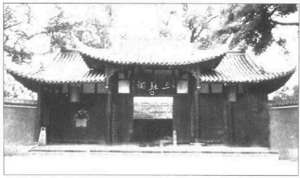

四川眉县三苏祠

不久苏东坡报复的机会来了。太守在官舍内建了一座平台，闲遐时好观赏四野的风光。不知道为什么，陈太守叫苏东坡写了一篇文章，要刻石留记。这个机会太好了，他舍不得推拒，他要开开玩笑。刻石的碑记会留传后世；应该庄重、优美、诗意。他当然不能直接攻击陈太守，但是他可以射一支嘲弄的小箭，不会有什么后果。《凌虚台记》留传至今：

国于南山之下，宜若起居饮食与山接也…而太守之居，未尝知有山焉…太守陈公，杖屦逍遥于其下，见山之出于林木之上者，累累如人之旅行于墙外，而见其髻也。曰是必有异。使工凿其前为方池，以其土筑台高出于屋之檐而止，然后人之至于其上者，然不知台之高，而以为山之踊跃奋迅而出也。公曰，是宜名凌虚。以告其从事苏轼，而求文以为记。轼复于公曰，物之废兴成毁，不可得而知也。昔者荒草野田，霜露之所蒙翳，狐虺之所窜伏，方是时，岂知有凌虚台耶。废兴成毁，相寻于无穷，则台之复为荒草野田，皆不可知也。尝试与公登台而望，其东则秦穆之祈年、橐泉也。其南则汉武之长杨五柞。而其北则隋之仁寿，唐之九成也。计其一时之盛，宏杰诡丽，坚固而不可动者，岂特百倍于台而已哉。然而数世之后，欲其求仿佛，而破瓦颓垣无复存者，既已化为禾黍荆棘丘墟陇亩矣。而况于此台欤？夫台犹不足恃以长久，而况人事之得丧，忽往而忽来者欤？而或者欲以夸世而自足，则过矣。盖世有足恃者，而不在乎台之存亡也。

如果苏东坡年龄大一点，他的语气就会成熟些，箭锋也会隐藏起来。这篇碑记静静思索平台倒塌的状况，暗讽老头子从来没听过城外的山丘，在碑铭作品中确实独树一格。不过老太守心胸也宽，竟然接受了，这次他一字不改就叫人把文章刻在石头上。

陈太守内心其实并不坏。两个人分开后，苏东坡渐渐看出这一点，曾努力破除前嫌。成名作家的一大负担就是受某人儿孙亲戚之托替他写墓志铭。墓志铭总要婉转称颂死者，没有什么文学价值可言，往往接近虚伪。写这种墓志铭古人称为“谄媚死者”。不过这是作家很难拒绝的人情。苏东坡对这一点自定了严格的规定，切实执行；连王爷求他写墓志铭，他都不接受。他一生只写过七篇墓志，每一篇都有特殊的理由，是他内心真有话要说。几年后他也替陈太守写了一篇墓志铭。除了司马光的墓志，这是最长的一篇。最后这两个人彼此产生了极高的敬意。

我们必须提一下陈太守的儿子陈慥，他后来变成苏东坡终生的好友。陈慥喜欢饮酒、骑马、舞剑和射猎，是一个挥金如土的人。有一天陈慥带两个士兵骑马射猎，苏东坡在山里遇见他。一只鹊鸟出现在眼前，马夫没有射中。他暗骂一声，冲出密林，一箭就把小鸟射下来。他脸上的某一种气质吸引了东坡。后来陈慥的父亲在别的地方做官，被控收受贿赂，判处死刑。据说苏东坡遭放逐的时候，陈慥正隐居黄州。苏东坡的敌人想起他和陈慥的父亲一度不和，就把他赶到这个地方，让他落入陈慥的掌握。说不定陈慥想为父亲报仇，苏东坡的敌人就不必真动手啦。事实上苏东坡和陈父处死毫无关连，结果他贬居黄州期间，陈慥变成了他最好的朋友。

苏东坡认识的另一位“朋友”章惇却注定要打击他后半生的事业。章惇日后变成一个邪恶的政敌，当时正在附近地区担任太守。不知道苏太太有没有警告他注意章惇，章氏聪明、热情，正是苏东坡喜欢的典型。传说苏东坡曾预言章惇的未来。有一次到芦关旅行，两个人深入山区，往黑水盆地进发，来到一个深坑上。坑上架着一个小木板桥，百英尺下有激流飞过，四周是直立的峡谷。章惇自己很勇敢，对苏轼一鞠躬，他走过木板桥，在对面峭壁上留几个字。苏东坡拒绝了，章惇独自过桥，泰然自若。他拢拢长袍，抓住一根吊索，沿峭壁到溪流对岸写了六个字：“苏轼章惇来游”。然后若无其事走回来。苏东坡拍拍朋友的背说，“有一天你会杀人。”

“为什么？”章惇问道。

苏东坡答道，“能将自己性命玩弄于股掌之上，也就能杀人。”苏东坡的预言到底对不对，我们以后就知道了。

除了仁宗逝世期间奉命监运皇陵的用材，大忙了一段时间外，苏东坡一直闷闷不乐，他十分想家。嘉祐八年（1063年）秋天他写信给子由说：

始者学书判，近亦知问囚。但知今当为，敢问向所由。士方其未得，唯以不得忧，既得又忧失，此心浩难收。譬如倦行客，中路逢清流。尘埃虽未脱，暂憩得一漱。我欲走南涧，春禽始嘤哟，鞍掌久不决，尔来已徂秋。桥山日月迫，府县烦差抽二王事谁敢诉，民劳吏宜羞。千夫挽一木，十步八九休。对之食不饱，余事更遑求。劬荣幸已过，朽钝不任馊。秋风迫吹帽，西阜可纵游。聊为一日乐，慰此百日愁。

英宗治平元年（1064年）十二月他被免去前职。他太太的哥哥由四川来他家同住，次年一月全家就回到京师。通常三年任满，地方官要通过“磨勘”的考验。基于这次会面，官吏可被推荐其它的官职。现在苏东坡返京，子由可以轻松了，他马上到大名府——当时名叫“北京”。其实在现在的北京以南一百多哩——任职。

新皇帝英宗久闻苏东坡的大名，想破例升他为翰林，替皇帝担任起草诏命的文书工作。宰相韩琦反对，劝皇帝为苏东坡着想，让他慢慢磨练才智，不要突然晋升高位。于是皇帝建议他掌理皇宫公事的记录工作。宰相又反对，说这个职位和“制诏”差不了多少。他推荐文教部门的工作，要苏轼通过正规的考试。皇帝说：“我们不知道一个人的真才实学，才需要考试。何必考苏东坡呢？”但是宰相坚持他的作法，苏东坡应考通过，就在史馆任职。这一部门的官吏轮流在皇家图书馆工作，苏东坡有机会看看皇家收藏的珍本、手稿和名画，心里非常高兴。

那年五月，苏东坡的太太死了，年方二十六岁，留下一个六岁的儿子。他父亲对他说：“你太太跟了你，却无法享受你的成就。你该把她葬在她婆婆身边。”他太太死后十周年，苏东坡曾写过一首短词来表示满腔的哀思，文意凄美，充满荡气回肠的音律，可惜现在无法唱出了。

十年生死两茫茫，不思量，自难忘。千里孤坟，无处话凄凉。纵使相逢应不识，尘满面，鬓如霜。

夜来幽梦忽还乡，小轩窗，正梳妆。相顾无言，惟有泪千行。料得年年断肠处，明月夜，短松岗。

他太太夭亡。第二年即治平三年（1066年）四月他父亲又去世。苏洵已完成《太常因革礼》百卷。两兄弟马上辞官回家。他们带着父亲和苏东坡太太的棺材，要爬山涉水走一千哩路。返葬在眉州故乡。朋友们送了一大堆奠仪和礼物。

带着棺材，他们必须乘船走安徽水路，然后沿长江上行。两兄弟走了很久才到家，也许一路实现他们旅行的愿望吧，直到第二年四月才抵达眉州。他父亲已亲自建好墓穴，只要把棺材放在亡妻身边就行了。不过苏东坡喜欢做大事，他在山坡上种了三万棵松苗，希望有一天能长成松树林。

他们又被迫蛰居了一段时间，直到神宗熙宁元年（1068年）七月，二十七个月的丧期才届满。返回京师前要先做两件事。苏东坡效法他父亲替母亲塑佛像的作风，也为父亲立了一座庙。庙中置放他父亲的画像和名家吴道子笔下的四张珍贵菩萨像，是他在凤翔求得的。建庙花了一千元，苏氏兄弟捐五十元，其它的由和尚负担。

丧期届满，苏东坡的第二件大事就是再婚。新娘是他太太的堂妹，王锡的女儿。十年前他母亲去世，苏东坡曾返乡戴孝，常到青神他太太娘家去玩。闰之当时只有十岁左右，常在家里看见他。大家一起郊游野餐，她对这个殿试中头榜的少年印象很深。现在她长成二十岁的少女了，苏东坡父母双亡，这次由他自己选对象。这次婚姻也许是她弟弟促成的，他对苏东坡十分景仰。她比丈夫小十一岁，又全心崇拜他，似乎一切都随丈夫的意思。直到老死她也没办法叫他省钱。她不象他的前妻那么能干，性情也比较温和，始终柔柔顺顺的。她是东坡最活跃时期的伴侣，抚养她堂姐的遗孤和自己的两个儿子。分享他一生所有的起伏荣辱。男人的心智和精神千变万化，女人只要稳定正常，永远让人觉得美丽、健康、善良就够了。他的心灵冲向四方，注意新的志趣，忙着种种概念，时而兴高采烈，时而深思痛苦，有时候却不免为女人的端庄能促成人生的进展而感慨惊叹。

熙宁元年（1068年）苏氏兄弟带家人走陆路回京，把父母的墓地交给堂兄子女和邻居杨先生看管。两兄弟都没有再回故乡。他们一到京师，就卷入政治风暴中。日后的官职遍历各省，却不曾在自己的家乡任职。

---

### 第七章国家资本主义

只有少数人看穿王安石的个性，认为他是国家的一大危机，苏洵和他的老友张方平就是其中之一。后者曾和他一起监考乡试，把他解雇，从此不和他说一句话。他一定曾告诉苏洵自己早年与王安石共事的经验。因此两个人都讨厌王安石，尤其认为他的衣着和习惯有虚伪的成份。欧阳修把王安石介绍给东坡的父亲，王安石本人也很想结识三苏，但是老苏不愿意见他。王安石的母亲去世，老苏也应邀作客，但是苏洵拒绝参加丧礼，还写了著名的《辨奸论》，至今仍是学校最流行的范文。

---

苏家兄弟熙宁二年（1069年）抵达京师。从那年开始，中国卷入新政的大浪中，政治风暴迭起，遗祸一直延续到宋朝末年。这不是中国第一次试行国家资本主义，却是最后的一次。在中国四千年的历史中，曾四度试行极权主义、国家资本主义、社会主义，以及剧烈的社会革命，每一次都惨败而终。最成功的是法家商鞍的右派极权主义，他的理论由兴建长城的秦始皇（公元前三世纪）有效推行。早期法家理论最重要的两大原则就是教战与重农。两者其实是同一回事，因为商鞍相信农夫是最好的军人，所有中产阶级的商人和贸易家都该尽量受到压制。大家都知道，根据这一教条而建立发展的强大军事系统使秦国统一了全中国；但是此一政治理论刚遍行全国，不到几年就完全崩溃。另外两次剧烈的改革分别由汉武帝和王莽所推动，发生在公元前二世纪和公元后一世纪。前者遵行桑弘羊的国家资本主义财政论，使府库充实，争战处处得手，但是几乎招来叛变而废止；后者在篡位的王莽手中实现，等他被推翻也就自然结束了。因此王安石第四次实验失败，也不足为奇。不过这四次新政的念头都来自创新的思想家，他们想完全破除过去的一切，都以极大的决心来执行自已的信念。说来有趣，王安石很佩服法家商鞍，曾写了一首诗来阐扬他的思想。还有一点要注意，无论古今中外，每一个极权论都以国家、人民利益为口号。历史上多少政治罪恶假“人民”的名义而推行，现代读者不难了解。

王安石是一个怪人，脑袋和性格都很特殊。他是勤奋的学生，也算是好学者（不过他的语言学根本不通），更是一位大诗人。不幸他怀着救世主的使命感，却不够圆滑，无法和任何人相处。同时他也是不切实际的理想主义家。如果理想主义者就是不在乎衣食外表的人，那王安石当之无愧。他污秽的衣裳，不修边幅的外表远近闻名。苏洵在一篇优美的文章中说他“衣臣虏之衣，食犬彘之食”，说他“囚首丧面而谈诗书”。不知道王安石是否喜欢这样的盛名，不过我们不难相信一个专心思想的人自然而然会忽略他的外表。听说他从来不换外袍。有一天几个朋友陪他上庙里的澡堂。他洗澡的时候，朋友们偷偷留下一件干净的袍子，看他会不会发现衣服换过了。王安石穿着新袍走出浴室，完全没有发觉朋友的举动。反正他穿上一件袍子就对了。

还有一天，朋友们对王安石的胖太太说，她丈夫喜欢吃兔肉丝。

“我不相信，”他太太大吃一惊，“他从来不注意饭菜。怎么会突然喜欢吃兔肉丝呢？你怎么会有这种想法？”

“因为饭桌上他没有动过别的菜，把一盘兔肉丝全吃光了。”

“那盘肉放在哪儿？”

“就在他面前。”

他太太明白了，便对朋友说：“我告诉你们。你们明天把别的菜放在他面前，看看有什么结果。”

于是第二天朋友们把菜换了位置，兔肉丝离他远远的，然后看他吃。王安石开始夹面前的菜，根本不知道桌上有兔肉。

还有人记载，王安石担任扬州太守的幕僚，通宵用功。当时韩琦任太守，后来就成宰相。王安石常开夜车，在椅子上打盹到天亮。往往一觉醒来发现太迟了，不梳不洗就冲入衙门。韩琦看到他的样子，以为他纵情女色，还告诫了他一番。

“年轻人，”他说，“我劝你利用少年时光多读书。”

王安石呆呆站着没有解释，临别告诉朋友们韩琦不欣赏他。后来王安石的文名一天天升高，韩琦才对他改变看法，收他做门人，王安石很气愤。王安石在京师得高位那年也正是韩琦罢相的时候。王安石每天勤写日记，记满七十大本，他日记中常说：“韩琦貌美，余一无可道。”

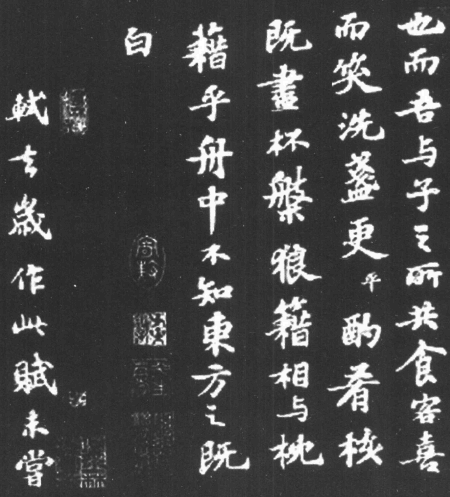

苏东坡书法

不过这位怪人不只是不修边幅而已。他尚未得势以前的二十年间，最为人称道的是他一再拒绝朝廷擢升的派令。很难相信他只是沽名钓誉，因为他二十一岁中进士到四十六岁当权期间——也就是他壮年最活跃的二十五年——他一再拒绝高职，始终只愿意担任外郡的小官。当时是仁宗治下，一切有名的才子都荟集京师。王安石愈拒绝高位，名气愈大。最后京里的大官们没有一个不渴望见他一面。他除了文章出色，也是能干的行政人材。他筑水坝、改革学校、成立农民贷款，而且也实现了他的一部分新政的思想。他政绩不错，人人都很喜欢他。别人催他进京，他置之不理。直到嘉祐五年（1060年）朝廷派他担任三司度支判官，他才有兴趣入京。显然他志在经济与财政，觉得自己在这一方面最能报效国家。后来他母亲去世，他不得不辞官守丧；但是守孝期满，朝廷再召他进京，他又拒绝了，宁愿留在南京（当时叫做金陵，在江宁府）。

这段时期他自甘淡泊颇令人费解，因为他一定相信时机来了他能为国家做一番大事，壮年建立政治生涯应该是最合理的。也许京师大学者的竞争让他受不了，象范仲淹、司马光、欧阳修、曾公亮等年高名重的学者一定不赞成激烈的改革，他们的名望足以教思想新奇的年轻人为之气馁。王安石要静待时机。不过我认为还有一个心理上的原因。象王安石那种脾气不管到哪里都要当上司，在外区任太守，就等于在小水潭里当大青蛙。他在京里任职，短期间内一再和同事争吵，把事情弄糟。他要改变规矩，照自己意思处理一切。吴珪和张方平都曾回忆说，和他共事期间他很难与人合作。

嘉祐五年（1060年）他来到京师，被视为一大奇才。他诗词散文都写得不错。思想创新，口才绝佳。富弼和文彦博等老臣都看重他，连欧阳修也喜欢他。此人奇特的外表下隐藏着大家无法测量的才气和性格。只有少数人看穿王安石的个性，认为他是国家的一大危机，苏洵和他的老友张方平就是其中之一。后者曾和他一起监考乡试，把他解雇，从此不和他说一句话。他一定曾告诉苏洵自己早年与王安石共事的经验。因此两个人都讨厌王安石，尤其认为他的衣着和习惯有虚伪的成份。欧阳修把王安石介绍给东坡的父亲，王安石本人也很想结识三苏，但是老苏不愿意见他。王安石的母亲去世，老苏也应邀作客，但是苏洵拒绝参加丧礼，还写了著名的《辨奸论》，至今仍是学校最流行的范文。

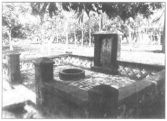

广东合蒲东坡井

在这篇文章里，苏洵首先指出人的性格很难洞察，往往连聪明人也会受骗。只有平静的观察家能看穿一个人的性格，预言他将来的发展。他列举王衍少年时一位古学者对他的预言，以及一位大将军对覆唐的卢杞所做的批评。卢杞是一位大策士，外表丑得吓人。主人若接待他，一定把歌儿舞女屏退，以免女孩子吓倒，或者忍不住哧笑而得罪了他。但是苏洵说，要不是当时的皇帝昏庸无能，这两个人还不足以毁灭一个帝国。然而现在有一个人兼具卢杞的丑貌、才略和王衍的辩才。“今有人，口诵孔老之言，身履夷齐之行，收召好名之士。不得志之人，相与造作言语，私立名字，以为颜渊、孟轲复出。而阴贼险狠，与人异趣。”这种人可以骗过最英明的君主，一旦得势，必是国家一大祸害。“夫面垢不忘洗，衣垢不忘浣，此人之至情也。今也不然，衣臣虏之衣，食犬彘之食，囚首丧面而谈诗书，此岂其情也哉？凡事之不近人情者，鲜不为大奸慝”苏洵但愿自己的预言不准，他会象一个好将军，未打仗就先吓退敌人。但是他说：“使斯人而不用也，则吾言为过，而斯人有不遇之叹，孰知祸之至于此哉。不然，天下将被其祸，而吾获知言之名，悲夫。”

王安石的怪习惯是不是伪装，我们无法断定；不过一个人的行为如果太过份，大家难免怀疑他有自我宣传的意味。我们若相信邵伯温的记载，则仁宗皇帝也曾感到怀疑。有一天皇帝宴请大臣，客人得从水塘里自己钓鱼来吃。开饭前，一粒粒鱼饵用金盘子摆在饭桌上。王安石对钓鱼不感兴趣，就由桌上拿鱼饵来吃，把整盘都吃光了。第二天皇帝对宰相说：“王安石是伪君子，人也许会误吞一粒鱼饵，但是没有人会心不在焉吞下一整盘。”根据这段记载，仁宗不喜欢王安石，就是这个原因。在王安石的私人日记中，他对仁宗也特别挑剔。

看看他后来的发展，苏洵倒不幸而言中了。不知道为什么，世界各国的怪人、狂想家、精神分裂者都相信邋遢是天才的标志，拒绝绅士的衣着便是不朽的最佳保证。有人还有一种怪想法，以为污秽表示不重视物质环境，因此就代表更高的灵性，如此推论下去，天堂岂不充满又脏又臭的天使。

这篇文章写成后，苏东坡说他们兄弟俩都觉得父亲的指责太过份。只有张方平热烈赞成。不过苏东坡时代的人马上就发现这份预言太真实了；这篇文章流传至今，显示出他老父奇特的见解。

王安石一到三司任职，马上想探测自己的政治基础。当时仁宗在位，王安石献上一篇长达万言的政治报表。在这篇文章中，他明确表示自己的财政改革原则，“因天下之力以生天下之财，取天下之财以供天下之费”。他说宋朝以来，政治财源不足，全是缺乏良好的财政和经济政策所致。只因为没有伟人来面对这个问题，才没有人想出此一政策。他说，当时掌权的人都不足以当大任，他认为国内也没有别的才子有资格担当。他明确指出，若要激烈改革，必须把政策和古圣君的作为扯上关系，人民才不会觉得和过去相差太多。不过他又说，遵循过去的传统并不是抄袭古代帝王的措施，而是遵循他们的用意，也就是一切为人民着想，政策相差多少都无所谓。大体说来，这是一篇文笔绝佳、结构完美的政治改革论文，涵盖了政府的每一面，财政、文职机关，甚至教育都包括在内。

如果王安石想探测自己的政治基础，他会发觉自己毫无基础可言。仁宗读完这篇长报表，就撇在一边。下一任皇帝英宗只在位四年，王安石曾奉召一次，但是他又辞官不就。史学家往往解释说，仁宗无子，他曾反对立英宗为继承人，所以内心很不安。

这时候英宗的太子住在京师，后来继位为神宗，王安石就在他手下得到了权位。神宗还是太子时，韩维担任他的秘书，对王安石非常崇拜。韩维常发表某一政治观点，太子若欣赏，他就说：“这不是我自己的意见，是王安石的主张。”因此太子很看重王安石，希望有一天能重用他的政治长才。治平四年（1067年）英宗去世，他年方二十就登上皇位，立刻任命王安石为江宁知府，九月就摧升为翰林。王安石经常和好友连络，相信自己的机会来了。他一反前例，马上接受这个官职。但是他拖了七个月才进京。

“王安石在前朝始终拒绝官职，不愿入京，”神宗说，“有人以为他卤莽，现在他又告病不来。他是真的生病，还是等更好的官位呢？”

这时候两位重臣曾公亮和韩琦彼此互相猜忌。后者曾在三位皇帝手下担任宰相和枢密的官职，权力太大了。曾公亮想动摇韩琦的地位，希望拉王安石做自己得力的盟友。他告诉皇帝，王安石有王佐之才，陛下应该相信他。相反的，另一位高官吴珪曾和王安石密切交往，却警告皇帝说，王安石一旦得势，必定使整个国家陷入混乱中。

熙宁元年（1068年）四月王安石终于确定了皇帝的态度，就来到京师，破例获准“越位”进言，不必遵循礼规的限制。

“政府最重要的工作是什么？”皇帝问他。

“选择适当的政策。”王安石答道。

“你认为唐太宗如何？”皇帝提起唐朝最受爱戴的君主。

“陛下应该以尧舜为表率，不该只学唐太宗。尧舜的主张其实很容易实现。因为后代学者不了解他们，才以为这种标准遥不可及。”（尧舜是孔子笔下的理想圣君，统治公元前二十三到二十二世纪半传奇的中国。）皇帝表示满意，但却廉（谦）虚地说：“你对我期望太高了。我只怕没法达到你过高的期许。”

后来皇帝屏退左右，让王安石单独进言。这是王安石的一大机会。

“坐下”，皇帝说，“我要和你长谈一番。”于是皇帝开始问他唐太宗和刘备为什么要让两位名士拜相治国。其中一位名相就是诸葛亮，他是历史上最出名、最能干的行政人才。王安石又把话题拉到三千年前传说中的圣君身上。王安石说，他宁愿谈谈尧舜的贤臣。“在上等人才眼中，诸葛亮根本不值得一提。”

诸葛亮的政治天才在于一步步走向既定的目标，这位急功自信的财政鬼才觉得很不对胃口。

王安石继续说：“陛下正治理一个人口众多的大帝国。百年太平，国内又有那么多学者，竟没有一位贤臣出来辅佐陛下，岂不怪哉？一定是陛下没有固定的政策，不信任贤才。虽然当代有人才高可比尧舜的贤臣，他们会因政客小人的阻碍而罢官。”

“每一朝代都有奸佞小人，”皇帝说，“尧舜时代也有著名的四凶。”

“不错，”王安石说，“正因为尧舜知道四凶的真面目，处以极刑，所以他们才能达到那么高的成就。如果四凶继续在朝廷阴谋作乱，良臣贤佐早就离开了。”

神宗深受感动。他年方二十，充满青少年的野心，想使国家强大繁荣。他为人善良公正，面孔圆称匀润，和他的祖先十分相像。直到神宗以后，宋朝皇帝才开始显出生理退化的特征。他的热诚被王安石对他的高度期许所煽动，从此以后，年轻的皇帝就准备赴汤蹈火来实现此人的政见，就算要牺牲其他的大臣，也在所不惜。不知怎样，每当老贤臣进言反对王安石的新政，皇帝心中就出现“四凶”的影子。

熙宁二年（1069年），苏氏兄弟到达京城，王安石被任命为参加政事。此后两年内老臣纷纷离京。皇帝的谏官遭到清算，由王安石的手下一一接替。王安石一登相位，马上整肃所有政府官员。抗议连连发生，整个官界一片混乱。所有才高望重的大臣都公开反对他。年轻的皇帝大惑不解，不过，王安石设法让他觉得，一切纷乱喧哗都是皇帝和犯上的恶臣间猛烈的斗争。

“怎么回事？”皇帝问他，“为什么朝廷所有的大臣、御史、学者都联合反对新政？”

“您应该明白，”王安石说，“陛下想遵循古圣君的伟大教训，但是要达到目标，您必须先克服流俗。因此陛下与流俗之间的斗争，在所难免。他们若赢了，政府就落入他们手中，陛下若赢了，政治权利便掌握在陛下手中。这些自私小人想阻止陛下实现古圣君的伟大训示。所以才议论纷纷。”

有了少年皇帝强国富国的野心，又有一个对自己政治、财政理论过度自信的参政，王安石的激烈改革马上就要开始了。这些改革的动机不容置疑。事实上宋朝在五十年的分裂和斗争之后，政府的力量始终不强。西夏、契丹（后来改名辽国）和金人不断侵略中国北面的疆上。中国和他们打仗，事后往往签订辱国的休战条约。条约的项目总是中国皇帝吃亏，这些国家承认皇帝，纳贡的却不是他们，而是我方皇帝献上金银财帛，每年花费十万到二十五万缗。国库为之空虚。内政松弛，政府经常闹赤字。王安石相信他可以玩弄税制和兵制，替府库筹钱。我相信神宗欣赏王安石主要就因为他想在西北征战，拓展国力，增加帝国的声威。王安石一上台，我方就向北部蛮族发动几次战争，有几次胜利，有一次败得奇惨。为了打仗，皇帝需要财源；为了财源，国家的财政制度必须重新调整。我们对改革家的动机毫不怀疑，但是我们将会发现，这些财政和经济的改革产生了性质完全不同的悲惨结果。

王安石刚到京师不久，司马光和他就当着皇帝面前发生争吵，这次的论点似乎总括了双方基本的差异。当时府库空虚，春祭之后，皇帝想免掉大臣的银钱丝帛例费，替皇室省钱。司马光和王安石为此热烈争论。王安石坚称，国库耗竭是大官不懂财政的结果。

“你所谓的财政，”司马光反驳说，“只是增加人民的税金和例费罢了。”

“不”，王安石说，“好官能增加政府的岁收，却不加重税款。”

“一派胡言!国家的财富有限，财富不是在人民手中，就是在政府手中。不管你执行什么策略，运用什么名义，只不过收集民财交给政府罢了。”

皇帝和司马光意见相同，于是他的措施暂缓了一两个月。

一般人不是经济专家，只认定国家财富的两大要素就是生产与分配。要增加国家的财富，就必须增加生产或善加分配。然而在王安石的年代，既没有工业，根本不可能增加生产。于是财政鬼才只能在分配方面动脑筋。王安石志在充实国库，所谓增加国家财富就等于增加政府的岁收。王安石明显看出，自由企业制度下富商和地主非常赚钱，他认为政府可以收取自由企业的利润，自己做生意赚钱。结论十分有力。他用的名辞也很新鲜。他要“钱平”；要平均财富，“抑兼并济贫乏”；他要阻止农人向地主借高利贷。政府可以在春耕时期借钱给农民，等收成再叫他们还钱，这是便民的伟大措施。王安石告诉皇帝，这些措施都是“富其民”；但是史籍记载，他迟疑良久之后终于决定放债，却是因为一个小官说，政府投资五十万元，每年就可赚进二十五万的利息，因为一年收成两次，每年可两度收到百分之二十或三十的利钱。

各项改革由熙宁二年（1069年）开始，八年后王安石和皇帝对新政都很厌烦，彼此也不太满意，变法就惨兮兮结束了，我们不愿多谈改革的细节，只谈谈这些措施的概略。

最重大，最知名的有九项，为了方便起见我把它们归成三类。一共有三项国营企业措施，三项新税，和三项管制人民的登记制度。三项国营企业措施是：均输法，市易法和利息二成实收三成（加上申请和登记费）的青苗贷款。三项新税是免役税，商税和所得税。登记制度是把人民编成十家一组的军训单位（保甲法），重新登记土地和马匹（方田均税法和保马法）。大体说来，这些措施接近现代的集体经济政策。

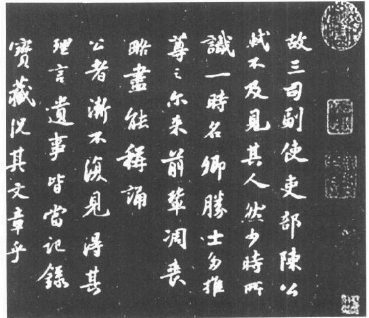

苏轼《跋语》

国营企业由熙宁二年（1069年）七月开始，先设立全国或省际的批发机构。皇帝相信政府可收到极大的利润，就拨出五百万缗现金和三百万石的稻米做本钱，接收省际货物和原料的贸易。这一制度马上发生实际的困难。那一年二月政府先成立制置三司条例司，负责研究计划和条款加以公布。东坡的弟弟子由也是条例司的人员之一。子由上表指出，政府接收全国贸易，自由企业马上就会瘫痪，因为各地批发商无法和政府竞争。政府和商人难免互扯后脚。而且他否认府库有利可图。私人商业有既定的信用系统，政府却没有这些便利，势必要先用高薪聘请人员，建立堂皇的官舍。这种生意将不是依照供求关系来经营，而是看佣金的多少来处理，照私人交情分配利益与合同。子由说，由于官僚制度的缺点，政府无法压低买价，进货成本一定比独立商人更高。因此赔钱是必然的。

因此，所谓的均输法搁置了一年，从长计议；政府后来又用新名辞提出修改的计划。批发和零售的划分并不严格，于是成都、广州、杭州等大都市成立了市易务。为发展这些贸易机构，政府又由国库中拨出一百万缗，由京师当地的货币中拨出八十七万贯。成立这些机构的理由是“富商大贾因时乘公私之急，以擅轻重敛散之权”“宜收轻重敛散之权，归之公上。而制其有无，以便转输，省劳费，去重敛，宽农民。”他们任命了一位能干的首长，他能向政府报出愈多的利润就被视为愈能干的人才。这位吕嘉问变成全国的市易务官，对小商人具有垄断控制的权利。例如京师市易务规定，小贸易商要做该机构的会员；他们可以把货物和该处的资财合并联营，或者由政府出资购买他们店铺所卖的存货；万一商人想结束业务，可以把货品卖给政府；也可以用部分货物做保险，向政府借钱，半年付息一成，或者一年付息两成；和该处无关的商贾也可以把存货卖给该处，价格由政府订定；最后，不管哪一部门的皇家用货都由该机构办理。

政府吸收小企业是这个制度最差的一环，私人商业几乎完全停顿。几年间贸易和商务实际上一天天减少，政府的岁收大受影响，与理论上的高利润大相径庭。皇帝发现自己在人民眼中沦为卖水果、冰、炭、日历、草席的小贩，心里很不高兴。最后京师市易务和商税的丑闻闹进皇室的耳朵里，皇帝才下令终止改革中最不受欢迎的项目。

不过新政中最著名的却是“青苗法”，直到今天大家谈起王安石的新政，还免不了先想到农民贷款。这个措施影响到国内的每一村庄，也促成朝中大臣最剧烈的政治斗争。计划本身完善合理，令人想起农民银行。王安石以前担任地方官，曾在春耕时期贷款给农民，收成时再连本带利收回来。他发现这样对农夫很有帮助，因为他在地方作官，可以确定农民是真正需要才来借款，一切由他亲自调查。陕西的地方当局也曾试行这个办法，绩效不错，就因为陕西试办成功，农民贷款才叫做“青苗”贷款。

丰年政府确定会有好收成，就贷款给农民买耕具、麦种；割麦时再连本带利收回来，给军队当粮饷。照制置三司条例司的说法，“诸路常平广惠仓钱谷，略计贯石可及千五百万贯石以上，敛散未得其宜，故为利未博。今欲以现在斛斗，遇贵量减市价粜，遇贱量增市价粜。可通融转运司苗税及钱斛，就便转易者，亦许兑换，仍以现钱，依陕西青苗钱例，预借者给之。随税输纳斛斗，半为夏料，半为秋料。内有请本色或纳时价贵愿纳钱者，皆从其便。如遇灾伤，许展至次料丰熟日纳。非惟足以待凶荒之患，民既受贷，则兼并之家不得乘新陈不接以邀倍息。又常平广惠之物，收藏积滞，必待年俭物贵，然后出来，所及者不过城市游手之人。今通一路有无，贵发贱敛，以广蓄积，平物价，使农人有以赴时趋事，而兼并不得乘其急。凡此皆为民，而公家无利其人，是亦先王散惠兴利以为耕敛补助之意也。”

这一个美丽天真的计划却摧毁了不少农夫的身家性命，我们以后就明白了。不过，我要解释一下，这个新措施是常平仓古法的延续，后来渐渐取代了常平仓。宋朝初年，政府在各地设立粮仓，以平抑谷价。丰年“谷贱伤农”，政府尽量收购剩余的稻麦。荒年粮价上涨，政府就把存粮抛入市场，压低价格。很多官员不肯贱价收购一切余粮，所以效率不能达到最高峰。不过由治平三年（1066年）常平仓公布的数字看来，他们一年内曾收购五百零一万四千一百八十担谷物，卖出四百七十一万一千五百七十担。现在仓禀的财货都化为青苗贷款的本金，常平仓的正常作业就自然而然终止了。

问题的重点是贷款难免强迫。王安石不容人反对，非成功不可。他必须向皇帝证明，贷款是一大德政，为人民所欢迎。他不希望部下放款松懈。他不懂农民为什么不要贷款。贷款若不达到配额，他就大发脾气。他开始晋升成绩较好的官员，处罚贷款不力的人，每一个官员都重视自己的前途，一心想留下好政绩。人事竞争的诱导很象现在推销政府公债。官吏知道自己卖不够配额会因“阻碍新政”而被撤职降官，王安石所谓的“积进”好官难免要靠势力强摊贷款。每一户人家都得向政府贷款，每隔三个月就要交三成的利息。好官知道这些贷款对人民不利，确定他们付不出本利会下狱坐牢。他们遵守政府的明文规定，宣布贷款完全出于“自愿”，心中打算有一天会因“阻碍新政”而丢官。

免役法也是如此，官厅本意和实际执行完全是两回事。这也许是王安石最好的新政，日后苏东坡的同党得势，决心去除王安石的一切新法，唯有苏东坡据理力争，支持这一道政策。

中国行征兵制已经有很久的时间。新法要人民缴税代替兵役。换句话说，就是用募兵替征兵。但是我们仔细研究免役法的规条，就发现政府主要兴趣在于税收，人民免役的福利完全被保甲法所抵消，保甲法强迫服役，比征兵更糟糕。经过一年多的研究，免役法公布了。不必征兵的人家也要交免役税；例如寡妇，没有孩子或独子的家庭，小孩未长大的家庭、尼姑、和尚都要交另一种税，名叫“助役金”。各区除了免役配额，还要多交百分之二十，以防荒年老百姓交不出来。军人和政府雇员都由这税金来招募。子由曾经指出，农民还不出债会被抓入牢中鞭打。司马光也曾预言，夏秋人民没有现款交税——其它税金也同时来临——只好卖粮食，杀牛砍树来换钱。以前征兵，人民轮流服几年兵役，如今人民每年都要交免役税，不必服役的年头也照交不误。

免役税和新商税、所得税都可以说是收税的新方法，不是真正解除人民的兵役，因为他们在“保甲法”的新名目之下照常要受军训。消费税是由商人的利润中抽税，以帐簿为根据。所得税的意义和现代不同。我叫它所得税因为当局强制登记人民的收入和财产，以作为其它税金的凭依。还有一点很象今天的所得税，人民必须申报收入和财产，辛辛苦苦骗政府。在新法的争议中有人指出“于是民家尺椽寸土，检括无遗，至鸡豚亦遍抄之，”都由政府登记。最后这一道措施在熙宁七年（1074年）订定，寿命奇短，因为王安石不久就失势了，此法尚未废除，苏东坡即拒绝在自己的区域内执行，说它不合法制。

王安石征免役税，要解除人民的兵役负担，保甲法却揭穿了他的谎言。事实很明显，新“保甲法”和免役税都在熙宁三年（1070年）十二月颁布，政府一手取消人民的兵役负担，叫他们交“免役”税，另一手又把兵役放回人民身上。“保甲”是邻居连保制度。十户为一“保”，五十户为一“大保”。万一有人窝藏罪犯盗贼，“保”内的人家要负连带责任；万一有杀人、强奸的重罪发生，他们必须向官府报告。每一“大保”的壮丁必须组队受军训，两丁抽一，超过两个壮丁则按比例多抽。这些人每隔五天要弃田受训一天，古代五日等于一周，刚好把一个月分成六段。征兵制把男丁调到外地，新法却把军队带入村中。不过王安石是大宣传家；他知道新立名目，就产生了新玩意儿，“兵役遂止”。除了集中登记管理人民，还有方田均税法和保马法。王安石的新法正如一切集体制度，绝不肯饶过人民。政府一心要照顾百姓，必须确实知道他们在做些什么，拥有哪些东西。正如一切极权制度，他们没有秘警就无法统治，于是秘警在熙宁五年（1072年）成立，幸亏苏东坡当时已离开京师。政府不控制御史台（相当于今天的报章杂志），换上同一路线的手下人，也无法治事。王安石认为，控制文人的思想更属必要。他和古代的王莽，近代的希特勒一样，具有“一个国家、一个信仰、一个领袖”的信念〔他像希特勒，遭到反对就大发雷霆；现代精神病学家可以把他列为妄想狂。

显出他的“妄想狂性格”，使一切史学家和批评家公认为不可原谅的倒不是他的政治和社会改革作风，而是他把自己当做经书唯一的评注家。以前王莽曾篡改古书，现在王安石写了《三经新义》，把它订为官方的思考指南，取代了过去的一切大经论家。王安石学问不错，但是不足以取代郑玄、马融、陆德明等古代巨儒。这样不仅是滥用权威，也是污蔑学术。试卷通常都引用古文，考生和解释必须统一。他立下这个新标准，国内的读书人都必须研读王安石每一方面的意见，由政治原则，佛家色彩极浓的儒家思想到“鹑”“袅”“雉”等字的语源，不一而足。苏东坡出京之后，有一次监考乡试，曾写诗说，他对考生思想的统一和贫乏非常痛心。

王安石的《三经新义》充满佛教色彩，和他的语言学一样，创意高，学术基础却不稳固。然而他深信自己对古代思想和政治制度的分析完全正确。《三经新义》其差无比，他死后就被人抛到脑后，没有一篇留存下来。但在他当权时期却是应考学者的圣经；稍微不合宰相的解释，就会名落孙山。他只花两年完成《三经新义》，尤其是对学术的一大侮辱；这本书在熙宁六年（1073年）三月开始动笔，由他的儿子和一位小政客帮忙，熙宁八年（1075年）六月就出版了。仓促的作品被定为儒经正统的注释，王安石意见一变，新的版本马上问世，考生都知道他们的一生要看自己能不能跟上修订本而定。

这里不谈王安石的学问，苏东坡对此十分痛心，因为他学问比王安石强多了。不过我要提一下，王安石的《字说》非常滑稽，和所有半吊子的语源学差不多。除了《三经新义》，当时学者最气的就是王安石所创的语源讨论。他的《字说》研究国字的构造和起源，不用比较法，却凭幻想的活用。王安石相信这是他对学术最创新、最持久的贡献，晚年还继续研究，完成了二十五卷。西方学者不难明白，学者若运用想象力，不受科学方法——汉代和清代学者所用的方法就是一例——的约束，要完成二十五卷语源学实在太容易了。“幻想语言学”一天可以编出十几道奇谈来。由中国字的结构找出各种成分组成某一意义的原因，实在很容易也很好玩。王安石有五十多条字说留传下来，大部分成为茶余饭后的趣闻。苏东坡和王安石的许多笑话都和这些《字说》有关。

苏东坡喜欢用归谬法。中文有一个“鸠”字，由“九”和“鸟”两部分所构成，读音如“纠”。王安石一心想由字意找出有趣的理论，竟推翻了字音的成份。有一天苏东坡和王安石闲聊，忽然问他：“对了，‘鸠’字为什么由‘九’和‘鸟’所构成？”王安石答不出来。苏东坡取笑他说：“我告诉你，诗经说：鸬鸠在桑，其子七兮。七只小鸟加上父母两个，不就是九个吗？”

“波”字是由“水”字和象声的“皮”字所构成。王安石想象力丰富，说“波为水之皮”。所以这样写法。有一天苏东坡遇到他，就诙谐地说：“那么‘滑’字一定是‘水之骨’罗。”王安石违犯了中国字组成的基本原则。他残害“字根”，把它分裂为二，再误接另一个部首——“富”字就是一例——真会使任何语言学家大哭一场。

后来。有些中国学者遵循西方集产主义的观念，想洗刷王安石在历史上的罪名，说他的思想“符合现代社会主义”。近代大学者梁启超就为王安石辩护。王安石的社会主义思想有人赞成，有人反对，但是王安石的社会主义政权却要由结果来判断。事实上国家消除了私人垄断，却建立了自己的独占制度；小商人失业了，农民付不出强迫贷款的本金和利息，只好卖妻卖子或全家逃亡，不然就典当财物。监狱常满，每一郡县都有数千件查封的抵押品和没收的财产，官厅诉讼不绝。就算没有异族侵略，暴政也会把国家拖垮。熙宁七年（1074年）圣诏说，商业停顿，人民失业；熙宁九年（1076年）圣诏下令废除青苗法，声言很多人无法还债而坐牢挨打。二十年后，哲宗元祐五年（1090年）六月苏东坡上了一道书表，想解救乡村的经济危机，要求政府归还没收的私产，取消穷人的债务，文中说：

“借纳拘收产业，除已有人承买交业外，并特给还未足者，许贴纳收赎，仍不限年。四方闻之，莫不鼓舞歌咏……以谓‘某等自失业已来，父母妻子离散，转在沟壑，久无所归。’臣即详看元初立法，本为兴置市易以来，凡异时民间生财自养之道，一切收之公上，小民既无他业，不免与官，中首尾胶固，以至供通物产，召保立限，增价出息，赊贷转变，以苟趋目前之急。及至限满，不能填价，又理一重息罚。岁月益久，逋欠愈多。科决监锢，以逮妻孥。”

头几年王安石还瞒住皇上，不让他知道恐怖的情景，自称百姓支持他的土地政策，将极权政府说成“民主”国——名称混淆，倒令人想起近代的情景。无论古今中外，人民爱不爱某一政权唯有等这个专制政府失势才能判断。皇帝想知道民情，就派人出去查访。但是宦官和御史知道皇帝喜欢新政，就告诉皇帝，人民都爱新法，税吏一出，人民“欢呼感德”，由特意安排的接待仪式看来，这些话倒是真的。王安石变法几年后的恐怖情景终于由一位勇敢的皇宫门吏以图画方式，呈现在皇帝眼前。

郑侠终日站在宫门边，看到成群难民由东北逃来，挤满京师的街道。郑侠知道图画比言辞更有力，就把这些可怜的农民画下来，献给皇上。有一张画描写难民饥寒交迫，在大风雨中流浪。另一张描写半裸的男女正在吃草根树皮，还有人拴着铁链搬砖负柴来缴税。皇帝看到这些图画，不禁掉下泪来，精采的献图——我们以后会谈到——加上一颗彗星出现。圣山发生土崩，皇帝终于废除了许多“新法”。

---

### 第八章拗相公

司马光、范镇和苏东坡并肩作战。司马光曾对王安石印象不错，也佩服皇帝的信心。皇帝和他谈起王安石，他说：“大家说他虚伪，也许太过份了些。不过他不切实际，固执己见。”不过他在皇帝的史学课中曾和王安石的亲信吕惠卿大吵一架，最后皇帝不得不开腔制止，要双方安静。因此王安石开始讨厌司马光，说他反对新政。王安石突然告假，皇帝想叫司马光担任枢密副使。司马光拒绝，说他的官位不重要，重要的是陛下肯不肯废除新法。

---

现在起了一场政治风暴，惹起一阵大火，最后北宋也为之覆亡。风暴起于国家资本论者“拗相公”王安石和反对派之间的斗争，反对派都是仁宗学术自由气氛下培养出来的政界领袖。我们必须了解此一政治斗争的本质，因为苏东坡的一生都被党争所笼罩。

民间有一本短篇小说《拗相公》，是中国留存至今最早的白话文学，也是中国小说的先锋。这是最近发现的宋人白话小说集，由内容看来，王安石一死就被冠上这个绰号，在民间传奇中家喻户晓。政争的悲剧起于一个不肯听劝、不愿认错的大人物，朋友愈反对，王安石愈是决心施行他的政策。我们都知道坚毅是优良的美德，但是要看一个人决定做什么事而定。也许王安石牢记小时候听来的家训，认为决心是成功之道，就把顽固当做美德了。王安石一生以“三不足”而闻名上林——“天命不足畏，众言不足从，祖宗之法不足用。”这是苏东坡给他加的标签。

“拗相公”受不了任何一方的反对，朋友或仇敌皆然。他能言善道，皇帝深信他可以建立强国，他便决心实现社会化政策。他必须平息一般的反对，尤其让御史不再说话，而御史的任务便是批评朝政，代表“言路”。好政府“广开言路”，坏政府相反，这是中国政治哲学的基本理论。因此一讨论新政，问题马上转到更基本的论点，就是批评与不同意的自由。这次斗争，王安石赢了第一回合；从此国内官吏就分为两派，党争热烈进行，直到宋朝灭亡为止。几年后新法修订或废除，变法所造成的党争却给国家带来更严重的后果。

这次朝廷的政治斗争重点便是“流俗”和“通变”之战，这两个名辞一再出现于当代文学中，王安石最爱用这几个字。在他眼中，他不喜欢或者意见不合的人都是“流俗”，他和手下则是“通变”。宰相大人指责所有的御史恶意阻挠新政，相反的，反对派说他“援引亲党，盘据要津。排挤异己，以固权宠”。刘挚则注明“今天下有喜于敢为之论，有乐于无事之论。彼以此为流俗，此以彼为乱常”。宰相开始整肃所有反对他的御史，反对派指控他较重的罪名是他“欲钳人口”，也就是压抑政府的一切自由批评。

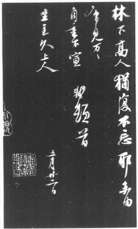

苏轼《尺牍》

中国朝廷向来没有完整的政党政治，严格划分当权派和反对派的权利与责任。没有计票、举手、是非或任何确定多数意见的办法。中国人开会只是讨论问题，然后同意某一决定。原则上和实际上政府也鼓励人们批评朝政。反对党可以推翻内阁，或者申请退休。剧烈的党争发生，照例把反对派遣出京师，派到外郡去任职。即使在仁宗和英宗时代，范仲淹和欧阳修等名臣也曾暂时丢官，后来再回来当权。就这样一党得势，另一党就离京。

由于宋代奇特的官制，朝廷的争吵不和更加严重，宋朝没有明显的宰相一职。内阁很象国会，由皇帝来平衡权力。政府设有复杂、沉重的连锁部门，功能重复，最后的决定权总落在皇帝手中。社交上所谓的“宰相”全名是“同中书门下平章事”。副相可能有两位。一般组织如下：

两府三省六部

枢密院（使与副使）吏部

知院中书省（侍郎）户部

中书禁中门下省（侍郎）礼部

（平章事与参政）尚书省（朴射）兵部

刑部

工部

财政机构完全分开，直接对皇帝负责。除了三省的御史，还有独立的御史台，另外有各种机构供朝廷颁赠虚衔。“宰相”往往身兼中书和门下省的领袖。三省和枢密院的领袖构成知院，名叫“知政”。后来神宗骤然改革，想简化官制，明定功能：门下省研讨命令，中书省颁布，由尚书执行；但是混乱依旧，责任也无法集中。

王安石起先只是参知政事（副相）；但是他有神宗做后台，就越权实行他的计划，擅自在家和吕惠卿、曾布等人决定一切，这是当着神宗和知政们争吵的最好时机。重要问题有二，一是青苗贷款，一是御史的言论自由。一边是元老重臣，人数多得足以代表全体，一边是神宗所支持的王安石，和一群新进小人，野心勃勃却心怀不轨。为了便于参考，也为了不牵涉太多人名，我排出下列党争重要名表，让大家看看力量的排列：

当权派

- 王安石（拗相公）
- 神宗（野心勃勃的皇帝）
- 曾布（活跃的政客）
- 吕惠卿（声名狼藉，日后出卖王安石）
- 李定（母丧不奔，日后弹劾苏东坡）
- 郑绾（两面人，先后服侍惠卿和王安石）
- 舒亶（与郑绾一起弹劾苏东坡）
- 王雱（王安石之子）
- 谢景温（王安石的姻亲）
- 蔡卞（王安石的女婿）
- 章惇（日后变成苏东坡的仇人）
- 吕嘉问（王安石手下的贸易独裁者）

反对派

- 司马光（反对派之首，大史学家）
- 韩琦（元老重臣）
- 富弼（老臣）
- 吕晦（第一个发动攻击的人）
- 曾公亮（脆弱人物）
- 赵抃
- 文彦博（老好人）
- 张方平
- 范镇（元老重臣，苏家“叔伯”辈好友。）
- 欧阳修
- 苏东坡
- 苏子由（东坡之弟）
- 范仲淹（伟人）
- 孙觉（高俊易怒，东坡的密友）
- 李常（矮壮，东坡的密友）
- 刘恕（急性子，东坡的密友）
- 吕公著（美髯公，曾和王安石为友）
- 韩维（出自大户韩家，曾是王安石的好友）
- 王安礼
- 王安国王安石之弟
- 刘挚（独立批评家，日后变成苏东坡的敌人）
- 苏颂
- 宋敏求
- 李大临熙宁三学士
- 其他御史
- 郑侠（担大任的小臣，身为门吏，王安石因他而垮）

悬殊的阵容不仅可悲也很可笑。看看这个名单，我们难免要奇怪王安石怎么会把朋友都得罪一空，神宗又怎么肯花那么大的代价让王安石当权，把反对派都撤职、罢官、议罪。最后神宗不得不罢黜王安石、吕惠卿、邓绾等人。强国的美梦破碎了，他自甘统治庸才政府。如果说知人是神圣的基础，那么“神宗”的谥号真是名不副实。

王安石从来不纵欲，也不贪污，他的作风是迫不得己，这才是真正的悲剧所在。为实现激进的国营计划，他知道自己有必要压服一切反对。他等了那么久，也许就是这个原因。他有一个美梦，他的一切都指向那个遥远的目标，不求国家快乐、安详、繁荣，却希望国家富强有力，疆界向南北扩张。上苍要宋朝扩展版图，像汉唐一样，而王安石就是命定的英雄。但是在未来史学家的眼中，没有一位“大英雄”不显得可悲——他陷入自己野心的牢笼，成为美梦的牺牲品，梦境增长扩大，然后就象泡影般破灭了。

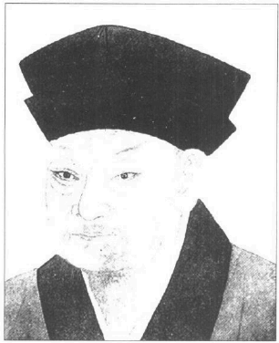

文彦博（1006-1097）字宽夫。汾州介休（今属山西）人。北宋大臣。

他看不起一切的“流俗”，不仅疏远好官良相，也失去了韩维和吕公著两位好友。我们记得，神宗还是太子时，韩维曾经使神宗的意志和希望完全转向王安石。王安石行新法，与这些朋友意见稍有不合，他立刻把他们逐出朝中。他孤独绝望，就提拔不知名、不够格的小人，他们懂得事事顺从，利用他来达到自己的私欲。为了便于认识三位奸佞小人，我把李定、

舒宜和邓绾的名字译成容易拼的英文。李定隐瞒母亲的死讯，不愿辞官，在儒家社会是大胆的冒犯。邓绾曾说出一句名言“笑骂从汝，好官我自为之”而留传千古。不过王安石最大的支持者是两位多谋善辩的人物曾布和吕惠卿，后者尤其重要，他最后出卖了王安石，起而代之。八年新政垮台，可以用当代人的一句话来形容：“吕惠卿出卖王安石，王安石出卖皇帝，皇帝出卖人民。”惠卿卑鄙公布王安石的私人信函，离间他和皇帝的情感，王安石就垮台了，他晚年常一天写“福建子”好几次，以发泄心中的怒气，吕惠卿就是福建人。新政废除，苏东坡在南京遇见王安石，责备他掀起战祸，迫害学者，王安石说一切都是惠卿造成的。这个辩白不合理，因为王安石本人坚持要严惩异端，而且京师监视御史的活动是熙宁四年（1071年）四月到熙宁六年（1073年）七月期间建立的，当时惠卿正辞官服母丧。

除此之外两党领导人王安石和司马光政见不和，信念却都很诚挚，私生活也无懈可击。两个人在金钱方面都清白无瑕，也没有败德的恶名，而欧阳修至少曾和家人有过风流韵事。

有一次王安石的夫人吴氏替丈夫买了一个姨太太。那个女人出现在他面前，王安石诧异地问她，

“怎么回事？”

“夫人要我侍候你。”

“你是谁？”王安石又问。

她说：“我丈夫替军队负责载运米粮。船沉了，船货全毁。我们卖掉一切财产，还赔不出来。所以我丈夫把我卖了，好填补空缺”。

“你身价多少？”王安石说。

“九百缗。”

王安石把她丈夫找来，叫女人跟他回去，身价银子也不必还了。

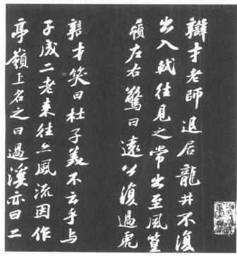

苏轼《次辩才韵诗》

司马光也曾有类似的际遇，别人私自替他找了一个姨太太。他年轻时担任通判，太太没有生儿子。太守夫人赐给他一名侍妾，司马光置之不理。他太太以为自己碍事，就叫侍儿等她出门再盛装夜入他的书斋。司马光发现侍儿在他房里，惊问道：“夫人不在，你胆敢进来？”就把她打发走了。两个人都志在实现政策，不关心私人的利益，王安石对金钱也不在乎。他担任宰相，一拿到薪水就交给兄弟们去花。

司马光学问和品德都冠绝当代，从头到尾为原则而争。他和王安石代表相反的政策立场。套一句当代人的话：“王安石必行新政乃肯为相，司马光必废新政乃肯为枢密副使。”司马光不仅和范仲淹同为宋代德高望重的两大名臣，也是《资治通鉴》的作者。《通鉴》是一部重要的中国史鉴，写到五代，全书两百九十四卷，有三十卷来源和比较资料的附表（考异），此书不仅学识基础丰富，眼光和文笔更属上乘，成为日后中国史书写作必须参照的北斗星。初稿（长编）有成书的数倍。他按时撰写；每天要抄满一丈纸的资料，手稿据说堆满两大房间。这本巨作花了他二十五年的光阴。

最先引起争端的是农民贷款。经过制置三司条例司数月的斟酌，“青苗法”终于在熙宁二年（1069年）九月公布。朝廷派出四十一位使者到各郡推行新计划。不久就证明贷款无法依约由农民自愿申请。于是使者面临两大抉择，一是回朝报告失败，一是强迫贷款，向朝廷报功。政府宁愿借钱给富人，比较有保障，但是富人并不缺钱。有些穷人需要钱用，但是政府必须拥有他们还债的保证。有些使者就设计出一套摊派贷款的制度，根据经济能力由富人到最穷的农民为止。但是穷人太穷借不起，只有富人能借钱，这是现代金融和财政的本质。为了确定债款能收回，政府就叫富邻居替穷人担保。有一位使者报告说，人民得到贷款，“欢呼感德”。另一位使者不愿意逼迫人民，就带回不同的报告。御史弹劾成功的使臣，说他“抑配”贷款，显然违背圣诏。王安石到御史台对众官说：“你们什么意思？你们弹劾笃行新政的使者，却不责备怠忽职守的人。”

韩琦当时在大名府担任河北安抚使，亲眼看见青苗法施行的经过，曾上表给皇帝，描绘贷款发放的情景。他的表章和苏轼激动的书表不同，深思熟虑、措词恰当、实事求是，由一个曾位极人臣的故相写来，分外有力。他说连最下层的贫民也被摊派固定的数额，富人则摊得更多。所谓农民贷款也硬摊给都市人、地主和新政有意排挤、压制的“垄断剥削者”；因此青苗法已失去原有的用意。人民借一块钱，过几个月就要还一块三。不管政府如何否认是为利息而放债，人民绝不会相信。韩琦指出，禁止摊派、全凭自愿根本是一句空话，因为富人不想借钱，穷人要借，却没有财产担保；最后只好叫保人还债。大使者一心要讨好朝中的权贵，低层小官不敢说话，韩琦说，他身为朝中老臣，有义务把事实说给皇帝听，他要求废新法，召回税吏，恢复以往的常平仓。

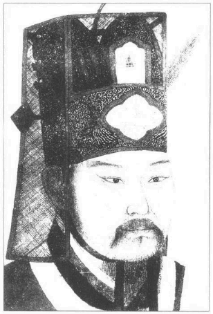

韩琦像

“韩琦是忠臣，”皇帝和王安石讨论他的表状，“他身在外乡，没有忘记皇室。我以为贷款有利于人民，没想到有这么多害处。而且青苗法应限于农区，怎么会在城中贷放呢？”

王安石立刻答道：“有何不可。城市居民如果需要贷款，何不让他们借呢？”

于是韩琦和朝廷一来一回，互通了好几封信，故相特别指出，汉代国营论者压榨人民的血汗，充实皇帝的军库，不能算是“富国”之道。

王安石的地位动摇了，皇帝开始有废“青苗”的念头。王安石听到消息，就托病告假。关于王安石的告假，司马光曾说：“士夫沸腾，黎民骚动。”大臣们讨论此一情景，赵抃当时还拥护王安石，主张大家等王安石销假再说。那天晚上阁员之一的曾公亮派儿子密告王安石，政局有变，劝他销假回来。王安石得到密告，取消病假，再度上朝，终于让皇帝相信反对派有心“阻挠新政圣恩”。

皇帝不明实情，就派两名宦官下乡调查真相。宦官知道哪一边才是靠山，回来说贷款受人民欢迎，“并无抑配”。老臣文彦博反对说：“陛下竟相信两名宦官，不相信三朝良相韩琦？”但是皇帝信任自己的使臣，更决定行新法。少数不负责任、无知的报道家不明白自己说些什么，却往往影响事件的发展，左右国家的政策!如果阉宦有勇气说实话，宋朝的路线也许就有不同的转机。真相大白，那两个阉宦的命运不得而知。他们说了皇帝爱听的话。等时局更改，讨论美妙的“土地改革家”不再时髦，他们就一句话也不敢说了。

司马光、范镇和苏东坡并肩作战。司马光曾对王安石印象不错，也佩服皇帝的信心。皇帝和他谈起王安石，他说：“大家说他虚伪，也许太过份了些。不过他不切实际，固执己见。”不过他在皇帝的史学课中曾和王安石的亲信吕惠卿大吵一架，最后皇帝不得不开腔制止，要双方安静。因此王安石开始讨厌司马光，说他反对新政。王安石突然告假，皇帝想叫司马光担任枢密副使。司马光拒绝，说他的官位不重要，重要的是陛下肯不肯废除新法。司马光九度上表，皇帝说：

“我要你管枢密院，负责军务。你为什么一再推辞，专谈这些与军事无关的问题？”

“我没有接受枢密一职，”司马光回答说，“我在门下省一日，就要提醒陛下这些事情。”

王安石销假回来，地位更形巩固，他把司马光降为制诰。范镇两度拒发新派令，皇帝大怒，亲手把诏令交给司马光。范镇坚辞“制诰”的工作，皇帝批准。王安石复位，韩琦也辞去河北安抚使的官职，留任大名知府。辞呈当然也照准了。

苏轼义愤填膺。他有许多话非说不可。他比别人更直率。当时他只有三十二岁，任职史馆，位卑权小，又限于文学方面。熙宁三年（1070年）二月和熙宁四年（1071年）二月，他分别上书给皇帝。这两封信很长，内容完整有力，直说不讳。正如现代偶尔出现的好社论，立刻轰动全国。“第一封信一开始就攻击青苗法。他告诉皇帝，全国都起反感，劝他不要欺压人民。他引孔子的话说：

“百姓足，君孰与不足？……臣不知陛下所谓富者富民欤，抑富国欤。

是以不论尊卑，不计强弱，理之所在则成，理所不在则不成，可必也。今陛下使农民举息而与商贾争利，岂理也哉，而怪其不成乎？……夫陛下苟诚心乎为民，则虽或谤之而人不信，苟诚心乎为利，则虽自解释而人不服。吏受贿枉法，人必谓之贼。非其有而取之，人必谓之盗。苟有其实不敢辞其名。今青苗有二分之息，而不谓之放债取利可乎？……今天下以为利，陛下以为义。天下以为贪，陛下以为廉，不胜其纷坛也。”

他一步一步提醒皇帝：

“盖世有好走马者，一为坠伤则终身徒行……近者青苗之政，助役之法，均输之策，并军蒐卒之令，卒然轻发；今陛下春秋鼎盛，天锡勇智，此万世一时也。而群臣不能济之以慎重，养之以敦朴。

譬如乘轻车、驭骏马，冒然夜行，而仆夫又从后鞭之，岂不殆哉。臣愿陛下解辔秣马，以须东方之明，而徐行于九轨之道，甚未晚也。”

苏东坡警告说，皇帝若以为专权足以成事，那就大错特错了。许多大臣已被免职，甚至有恢复肉刑的说法。他继续写道：

“令朝廷可谓不和矣。其咎安在，陛下不反求其本，而欲以力胜之。力之不能胜众者久矣。古者刀锯在前，鼎镬在后，而士犹之。今陛下蹈尧舜，未尝诛一无罪。欲弭众言，不过斥逐异议之臣，而更用人尔。必未忍行亡秦偶语之禁，起东汉党锢之狱。多士何畏而不言哉？臣恐逐者不已，而争者益多……陛下将变今之刑，而用其极欤，天下几何其不叛也。

今天下有心者怒，有口者谤。古之君臣相与忧勤，以营一代之业者，似不如此。古语曰‘百人之众，未有不公而说’，况天下乎。今天下非之，而陛下不白，臣不知所说驾矣。诗曰：

譬彼舟流不知所届

心之忧矣不遑假寐

区区之忠，惟陛下察之，臣谨昧死。

苏轼上对”

王安石清除台谏，这是震撼整个官场的大问题。从开始王安石就惊倒全朝，不是因为他剧烈广泛的经济计划和政策；而是因为他擅自罢黜批评他们的御史。批评朝政的权力面临一大挑战。政府组织的基础逐渐遭到破坏。他们触动了团体政治最敏感的部位。群臣沮丧，朋友也开始离他而去。

单单整肃谏官的问题就足以让群臣反感，辞职求去。台谏是中国政府一个古老的组织，功能是代表公议，不断检讨批评当权者。大家公认好政府统治之下，自由批评应该能随时传到皇帝耳中，适当反映公议。台谏的特殊地位造成极大的权威与责任，群起攻之，足以推翻一个政府。这可以算是改变政府人事和策略的非明文办法，有点象现代的报章杂志。不同的是中国古代谏官和反对党的权力并没有法律的保障，只是公认“好”皇帝应该容忍批评；至于他在不在乎好名誉，就看皇帝自己了。如果他不守道德的限制，他可以下令贬降、惩处、折磨，甚至杀害谏官本人和全家。很多皇帝这么做。谏官有责任告诫政府和皇帝，个人自由却没有合法的保障，处境可以说十分艰难。不过现代有些主笔对大众身怀责任感，勇敢冒犯集权政府，不惜坐牢或牺牲生命，古代也有不少谏官甘冒受罚、挨打，甚至死亡的危险来执行他们对百姓的责任。东汉和明朝尤其是如此，有些谏官写了告发奸相的表状，明知必死无疑，往往先上吊，抗议书才送达朝廷。这些御史有如战场上的勇士，前仆后继，死而后已。好皇帝珍惜名声，不会轻易对付这些御史，以便替自己争取美誉和爱戴，但是坏政府一心只想叫谏官闭嘴，正如现代独裁者禁止新闻自由一般。

王安石当政，许多元老重臣对他期望颇高。如今御史中丞吕晦向天安石开了第一炮，说他“执邪见，不通物情。置之宰辅，天下必受其祸”。连司马光都大吃一惊。两个人一起去上皇帝的经史课，途中吕晦告诉司马光他当天要做的事情，并把袖中的报表拿给他看。

“我们有什么办法呢？他颇受欢迎。”司马光说。

“你也这样说!”吕晦大惊，回答道。

吕晦被免职，整肃运动开始了。

现在一个小火花在朝中点起了熊熊烈火。有一个女犯意图杀夫，结果伤未死。她承认有心杀人，而众官对刑罚意见纷纷。于是案子悬搁了一年多。司马光想用一个方式定案，王安石又有另外的想法，坚持要执行。圣旨写明如何处置，但是御史刘恕要求重审，谏官往往如此做。这是第二名违犯土安石意旨的谏官，王安石就透过手下人弹劾他。于是战局公开了。

御史台人心惶惶。问题是他们要自由执行任务，还是一个一个被免职。几位御史联名弹劾王安石，要他下台。王安石大怒，准备把他们打入牢中。司马光和范纯仁坚决反对，结果六名御史被贬到外郡去当酒监。范纯仁大肆攻击。他要求朝廷撤销御史免职的命令——结果自己也被免职。下一个倒霉的是东坡的弟弟子由，他一直反对青苗法和市易法。过了两个月老相富弼辞职，临行警告说，政治斗争总是好人输，奸小一定会爬到高位。因为好人争原则，坏人争权利，最后双方都各得其所，好人去职，坏人留下来。他预言这样下去国家不久就会陷入纷乱。

如今朝廷一片骚动。制置三司条例司于熙宁二年（1069年）二月成立，六月行市易法，九月行青苗法。几个月之内舆论对新政由期望转成怀疑，怀疑造成迷惑，迷惑又带来愤怒与恐惧。

事情迅速发生。熙宁三年（1070年）三、四月全面整肃御史。接着倒楣的是王安石的两个朋友，他们曾经帮他得到权势，他一切全靠他们支持。高俊、暴躁、健谈的孙觉也是东坡终身的好友，王安石列举公元前十二世纪周代曾借钱给人民，利息百分之二十五。他反对此说，王安石还想要他支持，刚好京师附近有人传闻贷款“抑配”给农民，皇帝下令调查。王安石就派他出去。孙觉回来，老实报告有强摊的现象，王安石说他出卖朋友——于是孙觉被免职了。更重要的是“美髯公”吕公著的案件，他是宰相之子，学问渊博，却不爱说话。早年王安石和吕公著同享科名，同被学人所推重。吕公著曾帮助王安石升迁，于是王安石派他担任御史中丞。现在吕公著上书给皇帝，使王安石很不舒服，信中说：“昔日之所谓贤者，今皆以此举为非，岂昔贤而今皆不肖乎？”王安石亲拟解职令，用字措辞正好表现出他多变的性格。王安石和他要好的时候，曾经对皇帝说：“吕公的才华足以担任良相。”如今却把吕公著比为尧舜时代的“四凶”之一。

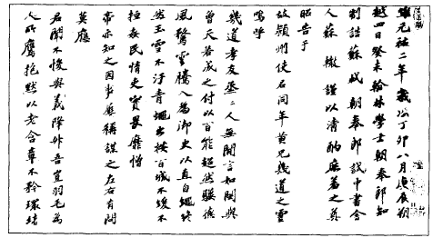

苏轼手迹

那个月王安石任命了两个声名狼藉的人物代替他所罢免的谏官，使以前崇拜他的人更加不齿，他派李定担任全权御史，台谏哗然。李定没有中过科举，没有必要的服务资历，曾隐瞒母亲的死讯，不服母丧。在中国人眼中，他情同野兽。王安石提升他，只因为李定来自乡野，曾说百姓“尽乐”青苗；王安石把他带到皇帝面前，亲自报告。御史们义愤填膺。同时王安石派姻亲谢景温担任御史。为了升迁，谢景温曾把妹妹嫁给王安石的兄弟。三位监察御史拒颁任命状——三个人都被免职。其它御史提出异义。张戬要求朝廷召回去职的御史，罢免李定和支持王安石的惠卿。张戬到中书省递表状，发现王安石态度很奇怪。他听了张戬的话，一言不发，用扇子遮脸大笑。

张戬说，“我知道你笑我愚蠢。不过你该明白，国内笑你的人更多。”

同时倒楣的重要人物是宋代理学名家，“二程”之长程颢。变法初期，程颢曾经和王安石密切合作。现在他也到中书省亲自对王安石抗议此案。王安石刚读完他的状子，怒不可遏。理学家意味深长地说：“朋友，我们争的不是私事或家务；是讨论国家大事。我们能不能平心静气谈一谈？”以儒家的标准看来，王安石很丢脸也很惭愧。

几周内整肃御史的工作完成了。连同去年被免职的御史，去职的人达到十四个，十一位御史台的人，三位是宫中的谏官。司马光用肯定的语气警告皇上。只有王安石、曾布、吕惠卿拥护新法，整个朝廷都反对他们。“陛下要靠这三个人组织政府和国家？”韩琦与张方平二月去职；司马光拒绝担任枢密使，那个月就被贬官；范镇已愤怒离京。九月里原本犹疑不决、曾偏爱新政的赵忭决心辞职。他也指出“青苗使者于体为小，而禁近耳目之臣用舍为大”，几个月之后，认命、沉着、曾把王安石得势归于“天意”的老臣曾公亮也提出辞呈，以老病为借口，其实是被批评者的炮火轰走的。熙宁三年（1070年）十二月王安石正式拜相（同中书门下平章事），位居群臣之首，地位不可动摇。次年七月欧阳修辞去一切官职，闲居归隐。

现在苏东坡写了他那封著名的九千字“上皇帝书”，打算接受免职的命运。他和司马光、范镇曾并肩作战，司马光和范镇都一怒而去了。范镇后来和苏东坡有亲戚关系，曾在前两位皇帝手下任职中书省。他外貌肥胖温和，内心却如钢铁。他临走在辞呈中说：“陛下有纳谏之贤，大臣进拒谏之计。陛下有爱民之性，大臣用残民之术。”皇帝上朝的时候把信拿给王安石看，王安石面孔铁青。站在附近的人说，大家都看到他手握状纸，气得发抖。

熙宁三年（1070年）九月司马光被派往陕西的偏郡去任职。他来不及推拒。他和王安石交换了三封诚挚而严苛的私函，终于完全翻脸。皇帝还希望他留在京师，他一再告诉百官，只要司马光在身边，他就不会犯大错。皇帝一再要他回京师，司马光都拒绝了。他忠言已尽。如果皇帝不听劝，硬要骑一匹倔骡子去找死，他也无能为力。他决心辞官归隐，简直压不住满腔怒气。他上书给皇帝说：“安石以为贤则贤，以为愚则愚。以为是则是，以为非则非。谄附安石者，谓之忠良。攻难安石者，谓之谗慝。臣之才识，固安石之所愚。臣之议论，固安石之所非。今日之所言，陛下之所谓谗慝也。伏望圣恩，裁处其罪。若臣罪与范镇同，则乞依范镇例致仕。或罪重于镇，则或窜或诛，所不敢逃。”

从现在起到神宗的十六年间，司马光一心闭门写作，终于完成他九年前已经动手的史学名著。后来神宗罢黜王安石，想叫司马光回去任高官，他的回答仍是神宗肯不肯改变经济政策？于是两派政治思想屹立不屈，始终无法更改。但是哲宗初年，王安石去世，司马光身为宰相，临死却说：“王安石不是坏人。唯一的缺点就是固执。尽量谥给他一切高贵的荣衔吧。”

苏东坡的九千字“上皇帝书”非常重要，可以代表他的政治哲学，也显出他个人的脾气和文风，充满机智、学问和大无畏的勇气。义愤的争论夹着冷静、简明的推理。有时候沮丧、严苛、挑剔、直爽无比；有时候却徐徐辩论，引经（孔孟）据典，引史例来支持他的理论。内容巧妙、诚挚、有力，对世事满怀激动和悲哀。一月里他面见皇上，皇上称赞他的“议学校贡举状”，要他“拍陈得失，无有所隐”。苏东坡就直接遵守他的旨意。当时高官都已去职，时机对他不利，他最后一次奋不顾身劝皇帝改变意思。他知道自己若不遭大祸，也会被免职。

在近代读者眼中，最重要的两大论点就是孟子所谓君权民授，容纳异见和批评的问题。苏东坡警告皇上，君主不是靠“神权”当道，而是靠人民的支持。要皇帝当心!

“书曰‘予临兆民，凛乎若朽索之驭六马’，言天下莫危于人主也。聚则为君民，散则为仇雠。聚散之间，不容毫厘。故天下归往谓之王，人各有心谓之独夫。由此观之，人主之所恃者，人心而已。人心之于人主也，如木之有根，如灯之有膏，如鱼之有水，如农夫之有田，如商贾之有财。木无根则槁，灯无膏则灭，鱼无水则死，农无田则饥，商贾无财则贫，人主失人心则亡。此理之必然，不可逭之灾也。其为可畏，从古已然。”

但是君主若不许人自由发表意见，他怎能得到民心呢？苏东坡接着提出我认为最重要的一点。就是政治上不同意的原则，台谏制度就是此一原则具体的表现。苏东坡认为，好政府要靠异议的健全作用来维持。民主就根据各党异议的原则而存在。我相信苏东坡若生在现代，一定反对联合国安理会的否决权，认为不民主。他知道盘古开天以来，没有两个人看法完全一样，除了民主就是专制。我从来没有发现一个反对民主的人在家、在国、在世界政局上不是暴君。苏东坡又说：

“孙宝有言‘周公大圣，召公大贤，犹不相悦’。著于经典。晋之王导，可谓元巨。每与客言，举座称善，而王述不悦，以为人非尧舜，安得每事尽善。导亦敛祍谢之。若使言无不同，意无不合，更唱迭和，何者非贤。万一有小人居其间，则人主何缘知觉？

我相信没有人把台谏存在的理由和其中包含的原则说得比苏东坡这封信更清楚。自由、无阻、无畏的台谏议论就代表自由的舆论：

“夫弹劾积威之后，虽庸人亦可奋扬风采；消萎之余，虽豪杰有所不能振起。臣恐自兹以往，习惯成风，尽为执政私人，以致人主孤立。纪纲一废，何事不生……是以知为国者，平居必有亡躯犯颜之士，则临难庶几有徇义守死之臣。若平居尚不能一言，则临难何以责其死节。”

他比较今昔的舆论状况：

“臣自幼小所记，及闻长老之谈，皆谓台谏所言，常随天下公议。公议所舆，台谏亦舆之。公议所击，台谏亦击之……今日物议沸腾，怨仇交至。公议所在，亦可知矣。”

苏东坡研究比较各朝的政府制度，阐明台谏存在的理由。此处他大展策士的鸿才，内容渊博，说理有力，见解深刻：

“古者建国，使内外相制。如周如唐，则外重而内轻。如秦如魏，则外轻内重。内重之末，必有奸臣指鹿之患。外重之弊，必有大国问鼎之忧。圣人方盛而虑衰，常先立法以救弊……以古揆今，（我朝）则似内重。恭惟祖宗所以深计而预虑，固非小臣所能臆度而周知。然观其委任台谏之一端，则是圣人过防之至计……自建隆以来，未尝罪一言者……风采所系，不问尊卑，言及乘舆，则天子改容，事关廊庙，则宰相待罪。故仁宗之世，议者讥宰相但奉行台谏风旨而已。

圣人深意，流俗岂知。台谏固未必皆贤，所言亦未必皆是。然须养其锐气，而惜之重权者，岂徒然哉。将以折奸臣之萌，而救内重之弊也。夫奸臣之始，以台谏折之而有余。及其既成，以干戈取之而不足……陛下得不上念祖宗设此官之意，下为子孙立万一之防。朝廷纲纪，孰大于此。”

苏东坡劝皇帝不要用权势逼人民屈服。他再度提到恢复肉刑的传说。几百年前，政府曾以各种肉刑来惩罚罪犯，包括墨、劓、荆、宫四刑。这些不合人道的刑罚在公元前二世纪就废除了。宫刑则在公元六百年才废止。多亏苏东坡这两封信，宋朝才没有恢复酷刑。谣言一天天增加：

“陛下与二三大臣，亦闻其语矣。然而莫之顾者，徒曰我无其事，又无其意，何恤于人言。夫人言虽未必皆然，而疑似则有以致谤。人必贪财也，而后人疑其盗。人必好色也，而后人疑其淫……”

苏东坡指出，商业痪瘫，价格高升；近自京师四周的省份，远到川蜀，谣言纷纷，民心沸腾。连山区也行酒禁。僧尼被捕，财产没收，军人和官吏的薪傣都减少了：

“夫制置三司条例司，求利之名也。六七少年与使者四十余辈，求利之器也。驱鹰犬而赴林薮，语人曰‘我非猎也”，不如放鹰犬而兽自驯。操网罟而入江湖，语人曰‘我非渔也’，不如捐网罟而人自信。”

他相信皇帝可以明显看出国内的不和与一斗争。他应该能由大臣的辞职看出公议的倾向。他一再提出反对新法的意见，然后回到本题，说皇帝行新政已失去民心，公议都反对他和现在的政府。

这封信没有回音。三月苏东坡又写了第三封信。此时皇帝曾下令禁止强摊贷款，但是不打算废新政。苏东坡引孟子的话说，这就象偷鸡贼有心改过，却打算每个月偷一只鸡。他自熙宁四年（1071年）一月开始担任告院权开封府推官，出了一道乡试。题目是“论独断”（全文是“晋武平吴，以独断而亡。齐小白专任管仲而霸。燕哙专任子之而败。事同而功异，何也”），王安石非常生气，使情况更糟。

苏东坡立刻被免职。不出所料，皇帝有心善意接受他的劝告，奸佞小人却可以找些莫须有的罪名来整他。王安石的亲戚兼随从谢景温把法律的巨轮转向苏东坡。有人谣传他护送父亲灵柩回四川，曾滥用政府的卫兵，买家具、陶瓷，甚至贩卖私盐图利。朝廷派官员到苏家兄弟途经的省份，向船夫、军人和仪官收集资料。苏东坡也许真的了不少家具、陶瓷，但是没有非法的行为。差人回来说：没有发现什么，如果找得到，他们一定会带回来才对。

他写信给当时住在四川的小舅子（王箴）说：“某与二十七娘甚安，小添寄叔并无恙……某为权幸所疾久矣。然捃摭无获，徒劳掀搅，取笑四方耳。不烦远忧。”

司马光回洛阳老家之前，皇帝曾对他说：

“我觉得苏轼人品不好。也许你高估了他。”

“陛下是指苏轼的弹劾案？”司马光答道。“我比较了解他。陛下知道谢景温是安石的亲戚，此案是王安石发动的。苏轼并非十全十美，但是他比隐瞒母丧的禽兽李定可强多了。”

根据作官的考绩苏东坡该任太守，皇帝也有此意。王安石和谢景温不赞成，要他担任偏郡的判官；不过皇帝把他改派到丽都杭州去作通判。对御史的控告苏东坡连答辩书都懒得写。他让调查员去查个痛快，自己则带着家眷到杭州去了。

---

### 第九章人为恶行

每一个革命党未得势之前都能显出最大的力量和团结，一旦得势根除反对派之后，就开始因内哄而分裂。毫无疑问，推翻权贵的心愿带来人性中最美的本能，而统治别人的权力却带来最丑的一面。事情顺顺利利，每个人都有官做，邓绾、惠卿和曾布忙得没有时间吵嘴。王安石垮台，局面恶化，党人立刻一个接一个倒下去。

---

现在朝廷安静了，一片死气沉沉。等苏东坡携眷离开京师，仁宗治下的名臣都已罢官，散居各地。欧阳修在安徽阜阳隐居。苏家好友张方平住在河南的淮阳（陈州）。

子由头一年就被指派为该地的州学教授。子由很奇怪，他不如哥哥固执，总是不放弃操守就能明哲保身，找一个安全而淡泊的职位，陪某一位大学者安居，却也如此。日后张方平退休，搬到商邱（当时叫南京或南都），子由也派到那儿任职，后来几年内苏东坡来往京师，路上总是到张方平家小住，向他求教，情同叔侄。往后几年司马光和吕公著一直在“西京”洛阳闲居，吕晦病重将死，临死前献上一道谜题给皇帝猜：

“臣本无宿疾，遇值医者用术乖方，妄投汤剂，率情任意差之指下，祸延四肢，寝成风痹。非祗惮风痹之苦，又将虞心腹之变。虽一身之微，固不足恤。而九族之托，良以为忧。”

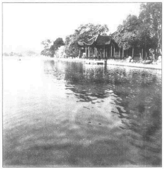

杭州西湖

老元臣富弼还不能平安隐居哩。他曾被贬为毫州太守，发放“青苗”不力。而且他大胆上书给皇帝说：“此法行，则财聚于上，人散于下。”正好王安石的手下邓绾检举富弼阻新政，老元臣就被削去一切荣衔，调往另一个地区任太守。王安石还不满意，他向皇帝说，富弼的罪状有如“四凶”，如果只削去他的官衔，如何阻吓其他叛徒呢？皇帝不听王安石的话，容许富弼继续担任小官。富弼前往新任所，路过南都；顺道拜访张方平。

老臣懊恼地对张方平说：“知人难。”

“你是指王安石？”他的老友说：

“我觉得认识他并不难。我曾和他一起负责乡试，他推翻了一切规矩。我被他免职，晚年常盯着天花板，默默叹息。”

苏东坡正要离京，京里发生暴动。保甲法在头一年冬天施行。兵勇留在村内受军训。京师附近的村民怀疑训练的用心，以为政府马上要派他们到北方打仗，就示威抗议。当局叫农民提供自己的军备——其实只有弓箭——也是暴动的原因。父子相拥而泣，有些村民割腕断指，逃避征召。这次暴动使王安石失去了最后一个朋友韩维，因为他是该区的太守，因暴乱的情形也被免职了。

一次明明白白的天谴，加上一位“安上门”小吏的告发，王安石终于垮台。熙宁六年（1073年）“圣山”华山发生土崩，皇帝惊慌失措，照规矩搬到另一座宫殿，表示尊敬上苍，同时改吃粗陋的餐食。熙宁六年（1073年）夏天到熙宁七年（1074年）春天久旱不雨，皇帝很担心，不知道如何是好。他问王安石，王安石说：

“水旱都是天灾。尧舜时代也有水旱。我们只要继续行善政就成了。”

“我怕的就是这一点，”皇帝说，“怕我们行的不是善政。我听到不少人埋怨商税。朝中每一个人都听到了，连皇后和太后都知道。”

另一位大臣冯京也在场，他说：“我也听到了。”

“我什么都没有听到，”王安石说，“冯君听到怨言，因为不满的人都涌在他身边。”

现在一个担重任的小官出场了。他就是画灾民图的“安上门”小吏郑侠。他献上新政灾民拴着铁链砍树、赚钱还公债的画轴，还附了一张短笺给皇上。

“窃闻南征北伐者，皆以其胜捷之势，山川之形，为图来献。料无一人以天下之民质妻鬻子，斩桑坏舍，流离逃散，皇皇不给之状，图以上闻者。臣谨按安上门逐日所见，绘成一图。百不及一，但经圣览，亦可流涕。况乎千万里之外，有甚于此哉!陛下观臣之图，行臣之言，十日不雨，即乞斩臣宣德门外，以正欺君之罪。

郑侠上对”

皇帝把卷袖带入寝宫。他拿给皇家的人看。太后（仁宗皇后，不是英宗皇后）先开口说：

“听说助役金和青苗款害苦了人民。我想我们不该变更祖先的遗制。”

“新政造福百姓，不是压迫他们。”皇帝说。

“我知道王安石才略不凡，”太后说，“但是他树敌太多。为了他好，我想你还是将他停职吧。”

皇帝说：“我发现大臣中只有王安石肯当大任。

神宗的弟弟岐王正好站在旁边。他说：“我认为你该考虑祖母的训示。”

皇帝发火了：“好，好，我不会治国。你来。

“我不是这个意思，”岐王说。

大家沉默了好一会。太后说：

“王安石惹了大麻烦。你有何打算？”

第二天皇上免去王安石的职位，却把惠卿和邓绾留下来。皇帝决心废除商税、青苗、助役钱、保甲法和方田均税等十八项措施。

雨来了，可见上苍大悦!

但是王安石的一刻尚未终了。依法规郑侠遭到弹劾。他起初循正轨献图，宫中官吏不肯接，说他是小官，没有资格和皇帝通讯。于是郑侠到京师城外的官差站，告诉差人里面有紧急军报，叫他快马送入宫。由于非法利用官差，御史们审问郑侠。

史书没有记载审讯的结果。但是次年一月郑侠又献了一册“正直君子邪曲小人事业图”给皇上。图中画的是唐朝几个有名的忠臣和奸臣，虽未直接提到现在的政府，前朝奸相的故事却和如今当权的人十分相象。就算含意不明显，图中的传奇故事也点明了一切。因为王安石已经罢相，郑侠除了图册，还上了一道奏摺，推荐一位忠臣当宰相。如今惠卿当权，邓绾把他对王安石的满腹忠心转向惠卿。于是两个人把郑侠贬到遥远的广东（汀州）去。

临行一位御史来看他，“所有御史都不敢说话，多亏你还奋战不已，台谏批评政府的责任似乎落在一个宫廷门吏身上”。说着就给他一包（两册）名臣谏疏，“我托你保管这些资料”。但是惠卿由密探得到消息，派舒禀拦截郑侠，搜他的行李。惠卿、邓绾和舒禀得到那两册报告，查知所有批评朝政的人名，就一一加以检举，把他们下狱。惠卿想处死郑侠，但是皇帝阻止说：“郑侠顾国不顾身。我佩服他的勇气和正义，不能重罚。”于是郑侠获准到贬居地去（贬为英州编管）。

苏东坡死后，一位黄姓收藏家取得苏东坡的一份珍稿，里面包含他的名言：“处贫贱易，处富贵难。安劳苦易，安闲散难。忍痛易，忍痒难。人能安闲散，耐富贵，忍痒，真有道之士也。”每一个革命党未得势之前都能显出最大的力量和团结，一旦得势根除反对派之后，就开始因内哄而分裂。毫无疑问，推翻权贵的心愿带来人性中最美的本能，而统治别人的权力却带来最丑的一面。事情顺顺利利，每个人都有官做，邓绾、惠卿和曾布忙得没有时间吵嘴。王安石垮台，局面恶化，党人立刻一个接一个倒下去。

远在事件发生前，他们已种下内部衰亡的种子。王安石的少爷讨厌惠卿，惠卿又讨厌曾布。邓绾一面跟着兔子跑，一面跟着猎狗追，忙得不亦乐乎。王安石只留下这么一个儿子，真是天大的不幸。他儿子精明、乖僻、残忍，新政的许多恶行他都要负责任。如今他长大了，家中财政都操在他手中，他叔叔再也不能自由运用王安石的钱财。他身为全权宰相的儿子，妄自尊大。以为恶劣的举动足以表示不凡。据说新政初期有一次理学家程颢到王家和王安石讨论公事，王少爷披头赤脚出来，手上拿着女人的围巾，直接走到他父亲面前，问他们谈些什么。

“我和程先生讨论众臣批评的新法。”王安石说。

他儿子一屁股落在他们所坐的椅垫上，大笑说：“我们只要砍下韩琦和富弼的脑袋，就没有人敢反对啦。”王安石为儿子所受的痛苦，我们不久就明白了。这一家人并不愉快，两位叔叔都不赞成王安石的作风，尤其警告王安石当心双面人惠卿。孔子曾说，人应该“驱郑声，远佞人”。有一天王安石和惠卿谈话，他弟弟安国在外面吹笛子。宰相对弟弟大叫说，“你能不能驱郑声？”他弟弟回答说，“你能不能远佞人？”

如今这一帮人为前途而担忧。惠卿却没有放弃希望，他看出自己有机会取代王安石。世上有些人眼泪说流就流，惠卿和邓绾“相与环泣于帝前”，哀动感人。他们一想到国事，就非常伤心。他们的辩才终于挽回皇帝的心意，惠卿遂登上相位。

争端正式开始。全国的市易务官吕嘉问遭到弹劾。市易务胡作非为的报道当然传到皇帝耳中，王安石还在京城，皇帝就问起这件事。

“嘉问一向固守国法，所以树敌很多。如今才受到攻击。”王安石回答说。

皇帝说：“不过每年缴入国库的商税确实很少。而且我不喜欢贩水果、卖冰卖炭。有伤皇帝的威仪。”

王安石说：“陛下不该操烦这一些小事。这些事自有小官去办。陛下只要关心政府的大策就行了。”

皇帝回答说：“为什么朝中每一个人都把它当做压迫性的措施呢？”

“请把那些人的名字告诉我。”王安石说道。

我们不必详述这些下流的急端。问题是吕嘉问权力渐大，开始违犯条例司，侮辱一位叫薛向的官员。曾布站在薛向的一边，攻击吕嘉问，吕氏遂被免职。皇帝派惠卿和曾布调查此案。两个人一向不和，与王安石关系都很密切，类似列宁手下的史达林和特罗斯基。调查中惠卿开始攻击曾布，曾布开始攻击惠卿，曾布就垮了。

问题才刚刚开始呢。惠卿变成政府唯一的领袖。他不但利用郑侠案罢免王安石的弟弟王安国，同时在邓绾协助下企图把王安石本人也牵入山东一位亲王所发动的叛变中。王安石被控参与谋变，因为他和叛党的一位人物交情不错。另一位大臣——名义也是宰相——与惠卿不和，想拉王安石回朝阻遏惠卿。他除了要求皇上罢黜惠卿，恢复王安石的相位，还送了一份密报给王安石。谋反的罪名非同小可，王安石七天之内就由南京（金陵）赶到京师。

其实王安石和叛变无关，熙宁八年（1075年）二月他再度担任宰相。邓绾不知所措，决定争取时效，背叛惠卿，投人王安石的阵容。为了得到工安石的欢心，他决定出卖惠卿。他没有告诉王安石，径自和王安石的儿子控告惠卿在华亭向商人强索五百万钱，朝廷罢免惠卿，调任为太守。邓绾和吕嘉问心有不甘，重新提出控告，把惠卿抓入御史台监狱待审。

当权派一个一个遭贬黜。邓绾也不例外。他仍然精神勃勃，看见惠卿垮台，皇帝渐渐对王安石感到不耐，认为他下一任主人该是王安石的儿子和女婿。他上书给皇帝，要求擢升这两个人。但是王安石和皇帝都厌倦邓绾的叛徒伎俩，不但不感激，反而将他免职。现在邓绾对人生失去了信心。

惠卿一面待审，一面对王安石发出最后的攻击，这些年来他保存了王安石好些私函，意图敲诈，如今就把信件交给皇上，说王安石不忠，因为好几封信都有“无令上知此一帖”的字眼。皇帝对这帮人烦透了，如今看了这几封信，才真正对王安石生出不满。王安石大骂儿子背着他贸然攻击吕惠卿。他儿子显然不知道惠卿留着这些信秘密要挟他父亲。他自悔莽撞，又被父亲痛责，不久就病倒了，背上生出一个恶疮。王安石一向笃信佛教。他找和尚，找大夫，都无法挽回儿子的性命。王雱之死对老相国是一大打击。他对政治和人生同感失望，心力交疲，就自请罢相。熙宁九年（1076年）十月皇帝准他退休，却保留了几个最高的头衔。不算贬黜。几年后，有人看见他在南京（金陵）乡下骑着毛驴喃喃自语。

---

### 第十章手足情深

两兄弟政治观点始终相同，立场也一致，但是性格却完全不一样。子由性安稳，实事求是，保守，不爱多说话；东坡性豪放，开朗，多嘴多舌，天真而不计一切后果。朋友同伴都觉得子由很可靠，东坡开朗的天才，他的嘲弄和恶作剧却常常使人害怕。在密友之间，东坡得意洋洋，乱开玩笑，而且大用双关语。他使世上讲现实的人紧张兮兮，怕他随时会说出真相——仿佛只要是真话就能说出口似的！

---

熙宁四年（1071年）七月苏东坡携眷离开京师，到中国东南海岸的丽都杭州去任职。此后八、九年间，他分别在杭州、青岛附近的密州和江苏的徐州服务，政绩很好。这是他写诗最活跃的时期，他写了不少优美的诗词、哀歌、幽默诗和愤怒诗。他天真、自由，几近孩子气，把心中的感慨完全表达出来，最后这些攻击统治权威的哀歌和愤怒诗却给他带来了大祸。

他弟弟子由在陈州（当时也叫淮阳）任教，离京师东南七、八十哩，就在苏东坡的行程范围内。他照例趁机多陪弟弟，在那儿住了七十多天。他的大儿子十二岁了，还有一个一岁的幼儿，不过他弟弟却有一大群子女。沉默的子由不断生育，一共生了三个儿子和七个女儿，苏东坡曾帮他把女儿一一嫁出去。他弟弟要留他小住，苏东坡欣然答应，一直待到中秋过完才走。子由很穷，全家住在一栋低矮的小房子里，苏东坡常拿弟弟的身高开玩笑：“常时低头诵经史，忽然欠伸屋打头。”

他们的老友张方平告老还乡，也住在陈州，大家常一块儿饮酒。张方平酒量奇大，百杯不醉。苏东坡自己说他酒量小多了，但是他觉得没有必要戒酒。欧阳修也是海量——不过张方平常喝赢他。张方平开始喝酒，不对客人说他们要喝多少杯，总是说喝多少天。苏东坡说：“我不羡慕酒量大的人。我一两杯就醉了，但我不是和你们一样痛快吗？”

家人闲居团圆了两个多月，兄弟俩常到柳湖去划船，或者到城郊散步，讨论政治、家务和彼此的将来。有一天两个人在乡村漫步，讨论国家的政局，子由劝告了哥哥一番。苏东坡最大的缺点就是喜欢在宾客面前或者作品中坦白说出他的想法，十分不利。子由十分了解他的哥哥。子由把手放在他的嘴上，叫他从此沉默些，后来东坡出狱，子由也曾做过同样的暗示。

两兄弟脾气和长像都不一样，子由个子较高，面孔圆润些，两颊有不少肥肉，苏东坡比较结实，骨肉均匀。我们由他的画像判断，他大约五尺七或五尺八，面孔很大，颧骨高耸，前额突出，眼睛又长又亮，下额匀称，留着美丽、尖长的中式胡须。最动人的是他敏感、活泼、有力的双唇。这是一张充满人性温暖光辉的面孔，表情由热烈的嬉笑迅速转成心事重重的沉思。

“我知道，”苏东坡对弟弟说，“我常常口没遮拦。我觉得某一件事不对，就象饭菜里找到一只苍蝇，非吐出来不可。”

“不过你先得认识谈话的对象，”他弟弟说，“有些人值得信赖，有些人却不行。”

“这就是我的弱点，”苏东坡同意说，“也许我天生太相信别人。不管和谁说话，我都喜欢倾吐内心的秘密。”

他告诉弟弟说，他上表给皇帝，心里倒真是为自己的性命而担忧。他说有一个朋友也很担心。那就是晁端彦，他曾来看他，彼此都在同一年考中进士，常常互称为“同年，”含义类似现在大学同一年毕业的同学。

“不过我告诉晁同年，我曾通过仁宗皇帝的特考，”苏东坡又说，“我才立刻被大官们当做朋友，仁宗皇帝已接受我的诤言。现在我若不说话，谁来说呢？我告诉晁同年我真怕送命。他没有说话。表情很严肃。然后我又说，‘没关系。如果皇帝要杀我，我死而无悔。不过有一点，坏了我，好了你，我才不干’。两个人都笑起来。”

“你知道吗？”他弟弟说，“你有没有注意到，一天赋闲似乎等于平常的两天？因此，一个人若活了七十年而能够整天悠悠闲闲，他实际上就活了一百四十岁。这是长寿的简便方法。”

两兄弟政治观点始终相同，立场也一致，但是性格却完全不一样。子由性安稳，实事求是，保守，不爱多说话；东坡性豪放，开朗，多嘴多舌，天真而不计一切后果。朋友同伴都觉得子由很可靠，东坡开朗的天才，他的嘲弄和恶作剧却常常使人害怕。在密友之间，东坡得意洋洋，乱开玩笑，而且大用双关语。他使世上讲现实的人紧张兮兮，怕他随时会说出真相——仿佛只要是真话就能说出口似的!

他们的文风也不一样——差别有如亨利詹姆斯和威廉詹姆斯，东坡象威廉，子由象亨利。由各自的天份看来，威廉詹姆斯似乎该写小说，亨利詹姆斯该写心理学和哲学的论文。然而威廉詹姆斯在枯燥的心理学和哲学教本中注入风采和幽默，亨利詹姆斯在小说领域中注入人性思想和观察的结实内容，却给世界带来极大的贡献。子由风采不及哥哥的一半，但是他的作品有内容有深度，使他成为独具一格的大文豪。

东坡知道弟弟的劝道很止确，如果他天性象弟弟一样沉默，他就会照办了。但是这并非他怎么想，而是他感觉如何的问题。谈到苏东坡的个性，很难避开“气”这个名辞，每一位批评家概述苏东坡的性格，都免不了要提到孟子的这一个字。“气”的含意是瓦斯、空气、气氛、精神、力量、冲动、压抑的怒火。孟子所谓的“气”类似柏格森笔下的哲学字眼“蓬勃生气”，是人类品格中生动、逼人的力量。大人物和小人物的差别往往就在于精力、冲劲、冲击力和活泼度的不同。在孟子学说中，该字代表伟大的道德冲力，简单说就是一个人行善求正义的高贵精神，与生俱来，随着生命的进展而加强壮大，或者慢慢削弱。以苏东坡来说，它等于伟大的精神，一个人升上无限级数的灵性，又大又强，来势凶涌，不吐不快。苏东坡的批评家和崇拜者常常提起他这种伟大的灵气，这种强大壮烈的力量。孟子自觉胸中充满这种力量，就形容说，在正义和真理的支持下，人不怕宇宙的任何东西。

“何谓浩然之气”有一次孟子的门生问他。

“很难形容，”孟子说，“这种气节至大至刚。妥善培养而不加戕害，就会充满宇宙之间，不过必须力求正义和真理，没有正义和真理，气节就萎缩了。”（至大至刚，以直养而无害，则塞于天地之间，其为气也，配道与义，无是馁也。是集义所生者，非义袭而取之也；行有不谦于心，则馁矣。”）

苏东坡有了这种典型的浩然气节，便不断遭遇到伦理上的矛盾，一方面想维持自己的本色，保持人类天生的大无畏精神，一方面又想明哲保身。在苏东坡一生的某些时期，这种矛盾特别尖锐，通常他还是保持英雄本色。我想苏东坡心目中也没有太多的冲突吧。他的伟大天份不断要求自由无阻的发挥：

多生绮语磨不尽，

尚有宛转诗人情。

猿吟鹤唳本无意，

不知下有行人行。

于是苏东坡和弟弟一家人共度中秋。这是一个难忘的秋节，他日后常常怀念这个日子，因为以后六年他始终没机会和弟弟共度佳节。离别很难受，子由决定送哥哥到河流下游七十哩的颖州（现在的阜阳），他们又在那儿共度了两星期，有欧阳修为伴。不过，别离终于来了。东坡开航前夕，两兄弟在颖水上划船，通宵讨论政治，彼此赋诗相和。东坡到杭州之后，写了一首诗寄给子由，里面总括了他们政治讨论的结果：

眼看时事力难任，

贪恋君恩退未能。

两兄弟都想起孟子的主张：“责难于君谓之恭，陈善闭邪谓之敬，吾君不能谓之贼”。事实上，他们都明白孟子下面这段话是百分之百的真理：

“徒善不足以为政，徒法不能以自行……为高必因丘陵，为下必因川泽。为政不因先王之道，可谓智乎？是以惟仁者宜在高位；不仁而在高位，是播其恶于众也。上无道揆也，下无法守也；朝不信道，工不信度；君子犯义。小人犯刑。国之所存者，幸也。故曰城郭不完，兵甲不多，非国之灾也；田野不辟，货财不聚，非国之害也；上无礼，下无学，贼民兴，丧无日矣。”

那天晚上苏东坡写了两首诗来表达他的心境：

征帆挂西风，

别泪滴清颖。

留连知无益，

惜此须臾景。

我生三度另，

此别尤酸冷。

念子似元君，

木讷刚且静。

寡词真吉人，

介石乃机警。

至今天下士，

去莫如子猛。

嗟我久病狂，

意行无坎并。

有如醉且坠，

幸未伤辄醒。

第二首诗写道：

近别不改容，

远别涕沾胸。

咫尺不相见，

实与千里同。

人生无离别，

谁知恩爱重。

始我来宛丘，

牵衣舞儿童。

便知有此恨，

留我过秋风。

秋风亦已过，

别恨终无穷。

问我何年归，

我言岁在东。

离合既循环，

忧喜迭相攻。

悟此长太息。

我生如飞蓬。

多忧发早白，

不见六一翁。

“六一翁”是欧阳修的文号。风中飞蓬正是苏东坡一生最好的象征，从此他就成为政治风暴中的海燕，直到老死从未在一个地方住过三年以上。

第二天一早，两兄弟就告别了。苏东坡对子由的亲情实在非比寻常。后来他写了一首诗给好友李常说：“磋余寡兄弟，四海一子由。”杭州三年任满，他请求调到密州，只因为当时子由在济南任职，两地距离很近，都在山东省。

---

### 第十一章诗人、名妓与和尚

苏东坡时代官员习惯在酒宴和祝典中与歌妓厮混。这和苏格拉底时代雅丝帕西亚参加男人的宴席一样，并没有什么不名誉的地方。歌妓替客人倒酒，为大家唱歌。很多人天赋极高，会读、会写，音乐造诣高的艺人常常被文人急相寻访。因为良家妇女不能参加男人的社交活动，男人想和女性为伍，只好去找职业艺人。有时候眉来眼去并不是贩卖色情。类似现在夜总会迷人、暗示的气氛，由名妓唱些轻松、世故、真真假假的抒情小曲，暗中进行两性的韵事。

---

当时的杭州也象今天一样，是一个神奇的都市，有时候被称为“人间天堂”。这里是苏东坡的第二故乡，他一来杭州就写道：.

未成小隐聊中隐，

可得长闲胜暂闲。

我本无家更安往，

故乡无此好湖山。

这里是他的第二故乡，不只因为此地有美丽的山丘、森林、湖泊、大海、热闹的市街和壮观的寺庙，也因为当地人民都很喜欢他，他度过了这一生中最幸福的日子。居民有南方人快乐的天性，有诗歌有美人，他们敬爱这位年轻的名诗人，欣赏他冲动、热情和无忧无虑的个性。美景启发了他的灵感，此外柔婉的魅力更抚慰了他的心灵。杭州赢得他的青睐，他也赢得杭州人民的爱戴。他担任杭州通判（助理官员），没有机会为人民多尽力，但是诗人的身份已经足够了；他被捕的时候，杭州人纷纷在街上设龛拜祭，替他解灾。他走了以后，南国的美景和温情一直令他魂牵梦系。他知道他会回来，十八年后他再度回来当太守，对本城建树极多，在杭州人心目中留下了不朽的回忆，大家都说他是杭州人。在他死后千年的今天。你走上西湖，登上孤山岛或凤山，或者在湖滨的一家饭店喝茶，你会听到杭州本籍的店主一再提到“苏东坡——苏东坡。”你若点明东坡是四川人，他可不高兴。咦，他认为苏东坡生在那儿，除了京师从来没到过别的地方哩!

苏东坡的心情，飘泊的魅力，爱情和欢乐都与西湖百分之百连结在一起。该地的诗情和他的作品互相找到了最好的发挥。一座城市要找到它的代表诗人并不容易，此人必须能发掘当地的生活、变迁、复杂的个性，用四行诗写出地方上的本质、精神和美姿。在公认最好的咏西湖诗中，苏东坡把西湖比做战国时代的美人西施；无论一袭晨袍淡妆，全副浓妆，她都同样美丽。西湖在睛天和雨天各有醉人的风韵：

水光潋滟睛偏好，

山色空蒙雨亦奇。

欲把西湖比西子，

淡妆浓抹总相宜。

这当然只是比喻的说法。无论如何“西子”化妆总比不化妆来得漂亮些。苏东坡美化了湖畔，以完美的艺术手笔使一切显得自然。今天苏堤伸入湖心，迷人的小屿倒影号称“三潭印月”，垂柳夹道的岸边更证明了他修建风景区的技巧。杭州西湖和扬州的“小西湖”是中国庭园设计天才充分发挥的两大地方，人类的艺术和技巧改善了该地，却没有加以破坏。这位艺术家先把握地方的自然格局，建筑力求自然，整体化，他只是零零落落拉紧、疏放或者加强一道轮廓，没有多做什么。

熙宁四年（1071年）十一月二十八日苏东坡带着妻儿抵达杭州。官舍位在凤山顶，南面可望见钱塘江一群群向海的船只，北面是西湖，群山环绕，云雾飘渺，寺庙和富家的别墅点缀其间，东面是惊涛拍岸的海湾。杭州除了太守还有两个副官，因为那是一个大都会。苏家住在宅区的北边，也就是靠湖的一面。城市的高墙、桥梁和沟渠就在凤山下，由西湖南北延伸到钱塘湾畔。苏太太晨间打开窗户，看到下方美丽的平湖映出流云、高山和别墅，不觉心旷神怡，天刚一亮，游人的小船就布满湖心，晚上由山顶住宅可以听见琴声和歌声。城中有些地区灯火通明，每夜都有市集开到凌晨两三点。这儿有太太们喜欢的各色精美小食、丝绸、刺绣、香扇，有小孩喜爱的各色糖果、玩具和走马灯。宋朝的糖果贩想出各种奇怪的花招来吸引顾客，有些人用赌博的方式来销货，有些人打扮成白胡子老头，也有人戴面具表演歌舞。有人卖糖丝，有人把糖果吹成各种动物的形状，有些人做“沙糖”和今日的枫糖差不多。宋朝末年——苏东坡死后一百年左右，马可波罗东来的一百年前——有人写了一本书描写杭州的生活，生动描绘出街道、运河、湖泊、食品和通行娱乐的细节，比马可波罗的描写更详细。马可波罗提到王爷在湖边游猎，王妃在湖边洗浴，大队商船来往于杭州和泉州之间，但是他对甜食、糕点和通行的娱乐并不熟悉。吴自牧这本书《梦粱录》一遍又一遍列出许多精美的小食，简直让读者陶醉万分。

苏东坡几乎相信他前生曾住在这儿。他自己的诗词和同代人的杂记都有记载。有一天他拜访寿星院，一进大门就觉得景物很熟悉。他告诉同伴，他知道有九十二级石阶通向忏堂。结果完全正确。他还向同伴描述后殿的建筑、庭院和木石。我们不必相信这些转生的故事，不过社会若相信神鬼和轮回，总有很多这一类的说法，就象鬼故事，没有人能证明是真是假。苏东坡时代大家都相信前生，这种故事不足为奇，有一个故事提到张方平的前生。一天他参观一座庙宇，告诉大家他记得一前生曾在这里当禅师。他指指楼上说，他记得曾在阁楼里抄一部佛经，还有一半没抄完。他和朋友们上楼，真的发现有一部未抄完的手稿，字迹很象张方平。他拿起毛笔，开始由他前生中断的地方抄起。苏东坡的一位好友也曾发生类似的故事。诗人黄庭坚告诉别人，他前生是女孩子，他的胁窝有狐臭。他在四川省重庆下游的涪州任职期间，有一天一位少女来托梦说：“我是你的前身，我葬在某地。棺材坏了，左边有一个大蚁窝。请替我迁葬。”黄庭坚照办，左胁窝的狐臭从此就消失了。

苏东坡担任通判，除了会审讼案外并没有太多责任。他衷心讨厌这件事情，知道被捕的人大都是违犯新政法律的小民，而他根本就不赞成新法。不过法律已定，他也不能更改。读读苏东坡在除夕夜不得不审问走私盐犯而写的那首诗，也许最容易了解他此时的想法和心境。政府专卖制度接收了贩盐业，但是杭州湾附近的产盐区的商人不肯放弃生意。苏东坡曾写信给一位阁员，说明私卖食盐的一切原委。我们现在不关心客观的情况，只关心他对同胞的态度，因为他觉得自己和那些囚犯没有什么差别：

除日当早归，

官事乃见留。

执笔时之泣，

念此系中囚。

小人营糇粮，

堕网不知羞。

我之恋薄禄，

因循失归休。

不须论贤愚，

均是为食谋。

谁能暂纵遣，

闵默愧前修。

对子由他更写出了真心话：“平生所惭今不耻，坐对疲氓更鞭菙。道逢阳虎呼与言，心知其非口诺唯。居高忘下真何益，气节消缩今无几。”

他在另外一首诗中谈到保甲制度带给人民的痛苦，描写人民挨打时的呼号，连妻子儿女也被抓入牢狱。日后他被捕，就是这些诗句给他惹上破坏政府威信的罪名。

这时候他一有机会就游山玩水。他想逃入大自然的怀抱，脚下便是大自然最美的面目。他的诗灵尽情享受附近的美景。除了市区和西湖，杭州十哩或十五哩外的高山也变成他最喜欢的去处。由西湖出发，游客可以向四方行进，沿北岸到著名的灵隐寺，爬上天竺顶，由南岸可到葛岭，在虎跑寺逗留一会儿，观赏名泉，喝喝茶，然后沿一条蜿蜒美丽的山溪走回来。城内和城郊共有三百六十座庙宇，通常都在山上，他可以陪和尚聊一下午。游这些山往往要一整天，他常在傍晚回来，街灯都亮了。穿过灯火通明、人潮汹涌的小河塘夜市，他往往半醉才回家，想起一些诗句然后又忘掉一些：

睡眼忽惊矍，

繁灯闹河塘。

市人拍手笑，

状如失林莺。

始悟山野姿，

异趣难自强。

人生安为笑，

吾策殊未良。

杭州愉快，西湖迷人。南国的气候使人一年四季都喜欢到户外活动。春秋雨季所有杭州人都在湖上玩耍。就连下雪的冬日也有游人坐船去欣赏雪景。尤其是三月三日、五月五日、中秋、重九、地方神明的寿诞、二月十一日等大节日，湖上充满度假的人，船只在头一天就先订好。游人不必带食物，因为一切食品和茶杯、茶盘、汤匙、筷子都由船家供应。有些船夫还抓鱼卖给游客去放生，这是佛家所谓的“积德”，说不定同一条鱼被抓过三次，放过三次，已三次逃出阎王的掌握哩。

苏东坡完全参与湖上的生活。游人有两类，一种是携家带眷，一种是与歌姬同行，湖上的太太们以恐惧的眼光打量歌姬，歌姬却以羡慕的眼光看着太太们。歌姬们衷心希望白己能“赎身”嫁人，象太太们一样生儿育女。苏东坡有时候带着妻子儿女出去，有时候陪做官的朋友宴饮。他多才多艺。他有一枝生花妙笔，能写出精炼、华美、杰出的诗句，同辈的文人不得不佩服他，他也能写出令人难忘，不加雕琢的简单句子。陪家人他可以唱：

船头斫鲜细缕缕，

船尾炊玉香浮浮。

陪做官的朋友他就写出赏心悦目的诗句：

游舫已妆吴榜稳，

舞衫初试越罗新。

他们一到湖畔，船夫就围扰来拉生意。他们常选一艘小船，可容四、五个人。有时候人多了就乘大船，船上放一张餐桌，由手艺高明的船娘准备酒菜。这些家船都精雕细琢，船头有笕嘴。湖上还有其它船只专卖食品给游客。有人卖栗子、瓜子、莲藕、甜食、炸鸡和海鲜。有人专供茶水。有些船上载着艺人，照例贴近游客的小船，为大家表演歌唱、杂耍，并供应吊索和其他射猎的游戏。他们身边就是澄蓝的湖水，周长十英里左右。远处白云栖在山顶上，山峰若隐若现。云霞使山峰千变万化，多采多姿，山峰给云霞一个栖息的所在。有时候天冷欲雪，雾气盖满山脚。隔着雾气，游人可以看见零零落落的的亭台楼阁，瞥见远山模糊的棱线。睛天湖水清爽极了，水中鱼儿历历可数，苏东坡曾以两行愉快的诗句描写船夫的黄头巾与青山的背景相映照，画面十分动人：

映山黄帽螭头舫，

夹道青烟鹊尾炉。

向山丘驶去，他们可以听见荒林中小鸟互相呼唤的声音。苏东坡性好旅游，常常一个人在山间闲逛，到人迹稀少的高山顶或水源地赋诗。他常常游庙，变成和尚的好朋友。苏东坡死后，有一位老和尚说，他小时候在寿星院当和尚，夏天常看到苏东坡一个人走路上山。他常常借一张和尚的躺椅，搬到附近竹林中；完全卸下官吏的尊严，脱下衣衫，赤身露体睡午觉。小和尚用敬畏的眼光偷看这位大学者，看到了别人无权一窥的场向。他看见——也许是自以为看见——苏东坡背上有七粒黑痣，排列的方位很象北斗七星。老和尚说，可见他是天廷派下来的神灵，暂时在人间作客而已：

苏东坡离开杭州之后，曾经写一首诗给晁端彦，略述自己旅游的习惯。那时晁端彦正要出使杭州，苏东坡给了他一番忠告：

西湖天下泉，

游者无愚贤。

深浅随所得，

谁能识其全。

嗟我本狂直，

早为世所捐。

独专山水乐，

付与宁非天。

三百六十寺，

幽寻遂穷年。

所至得其妙，

心知口难传。

至今清夜梦，

耳目徐芳鲜。

君持使者节，

风采烁云烟。

清流与碧巘，

安背为君妍。

胡不屏骑从，

暂借僧榻眠。

读我壁间诗，

清凉洗烦煎。

策杖无道路，

直造意所便。

应逢古渔父，

苇间自寅缘。

问道若有得，

买渔勿论钱。

根据文学记载，苏东坡在杭州与宗教、女人——或者说和尚、名妓——扯上关系，这两者之间的关连也比我们想象中密切。苏东坡眼中感官的生活和灵性的生活是同一回事，以诗意哲学化的人生观看来并没有什么冲突。有了诗，他热爱今生，不可能变成禁欲的和尚。有了哲学，他十分明智，也不会沉沦在“魔鬼”手中。他不会弃绝青山绿水，也不会弃绝美人、诗歌和酒肉。但是他有深度，不可能披上纨绔子弟肤浅、愤世嫉俗的外衣。

有人传说他曾把严肃的僧人和歌妓拉在一块儿，这个故事最能表现他嬉笑成性的作风。大通禅师是圣洁的老头儿，据说要单独见他必须先行沐浴。女人当然不准进入他的房间。苏东坡有一天带着朋友上山逛庙，其中有歌女同行。大家知道禅师的习惯，就停在庙外。苏东坡和他很熟，突然想带女人进庙，破坏他的清规。他带歌女入寺，向老禅师行礼，大通对他的失礼十分不悦。苏东坡说，禅师若肯把诵经用的木鱼借给歌女妙姬，他愿意写一首道歉诗，叫她唱出来。于是东坡叫歌女唱下列的小词：

师唱谁家曲，宗风嗣阿谁，借君拍板与门槌，我也逢场作戏莫相疑。

溪女方偷眼，山僧莫皱眉，却愁弥勒下生迟，不见阿婆三五少年时。

这完全是单口相声，连大通也笑出来，苏东坡带歌女出庙，对别人说他们学了“奥秘的佛课”。

中国文学中和尚和女人是分不开的。和尚的故事往往扯上女人，女人的故事往往扯进和尚。无沦东方西方，某些独身主义者宣布摒弃性生活，不同于一般人类，使俗家人偷怀恶感，这份恶感便是薄伽丘作品风行的原因。此外，和尚和女人的韵事也比商人有趣些。

苏东坡身为通判，有一次曾裁决一件与和尚有关的案子。灵隐寺有一位和尚名叫了然，常到红灯区走动，爱上一个名叫秀奴的少女。后来他床头金尽，衣衫槛楼，秀奴就不肯见他了。有一天晚上他喝醉酒又去找那个女孩，吃了闭门羹，就强闯进去，将她打死。于是他被控杀人。官吏审问他，发现他臂上刺了两行诗：“但愿生同极乐国，免教今世苦相思。”调查完毕，证物送到苏东坡手中。苏东坡忍不住写下这一首词：

这个秃奴，修行忒煞，云山顶上空持戒。只因迷恋玉楼人，鹑衣百结浑无奈。

毒手伤心，花容粉碎，色空空色今安在，臂间刺道苦相思，这回还了相思债。

和尚被送到刑场处决。上面两首滑稽诗用俚语写成，由民间十口传诵，平添这位怪诗人的许多佳话。

有一本小集子谈到苏东坡与他的花和尚朋友佛印的逸事。这时候苏东坡对佛教并不认真，直到四十岁以后居住广州期间，他才开始勤读佛教哲学。但是杭州有几个和尚变成他最好的朋友，不久他在靖江、南京和台山结交的和尚愈来愈多。其中至少惠勤和参寥（道潜）两个人是值得重视的诗人兼学者。根据文学记载，佛印倒不重要。但是他被刻划为浪漫人物。在通俗作品中比参寥更常被人提起，被视为苏东坡的好朋友。

佛印从来不打算出家，而且是富家子弟。根据一本奇书的记载，他和李定是同母的手足。这个女人生性放荡，曾经嫁了三次，生了三个异父的儿子——当时算是很不平凡的记录了。皇帝对佛教表示好感，愿听佛教徒进言，苏东坡就把他带到朝中，佛印尽量在皇帝面前表现他对佛教的信仰。皇帝看看他，发现他高大俊俏，容貌不凡，就慷慨答应给他一张度牒，让他入寺当和尚。他进退两难，只好接受皇帝的建议，于是被迫出家，他住在杭州期间，传说他一出门就带了不少佣人和驮骡，根本不合乎禁欲的生活原则。

佛印颇有机智。有一个故事叙述两个人下列的言行，深含哲学意味。有一天苏东坡和佛印去参观一座庙宇。他们进入前殿，看到两座凶猛的大神像，是镇邪的守门神。

“这两个菩萨，哪一个重要？”苏东坡问他。

“当然是拳头大的人重要。”佛印说。

他们走入内殿，看到观音菩萨手持念珠。

“观音也是菩萨，她数念珠干什么？”苏东坡问道。

“喔，”佛印说，“她也学别人拜佛呀。”

“拜哪一个菩萨呢？”苏东坡说。

“咦，拜观音菩萨呀。”

“这是怎么回事？她是观音菩萨，为什么要拜自己呢？”

“咦，”佛印说“你知道求人不如求己嘛。”

他们又看到一本佛教祈祷书摊在圣龛上。苏东坡发现一则祷词：

咒咀诸毒药，

所欲害身者。

念彼观音力，

还著于本人。

“这不合情理，”苏东坡说，“我佛慈悲，她怎么能替某人消灾，却转嫁给另一个人呢？如果这样，我佛就不慈悲了。

他请求庙祝让他更改祷词，便拿起毫笔改了一两句：

咒咀诸毒药，

所欲害身者。

念彼观音力，

两家总没事。

很多描写苏东坡与佛印针锋对答的故事都语含双关，无法译成英文。不过下面有一段记载。

中文“鸟”字在理语中含有淫猥的意思，苏东坡想用来笑他的朋友。苏东坡说，“古诗人常用‘僧’来对‘鸟’，譬如‘时问啄木鸟，疑是扣门僧’，还有一句‘鸟宿池中树，僧敲月下门’。我佩服古诗人以僧对鸟的智慧。”

佛印说，“难怪我这个僧人要坐在你的对面。”

故事中这个和尚常压倒诗人，我怀疑这些故事是佛印自己杜撰的。

根据记载，中国的娼妓制度可追溯到公元前七世纪的管仲时代，他设娼妓来鼓舞军人。苏东坡时代也有官妓，继续充任“兵营娱乐者”，还有一些独立的私娼，不过中国有一项特殊的传统，高级娼妓和一般妓女不同，在文学史上占有重要的地位，有些名妓本身就是诗人，有些则和文人的生活有密切的关系。她们独树一帜，与诗歌、音乐史息息相关，因此也影响了诗词的风格。诗风经过文人一段时间的模仿，逐渐变为陈腔滥调，总是歌妓引入新的形式，给诗词一条新生路。她们擅长音乐歌曲，闺中女儿很少弹琴唱歌，歌曲的题材几乎全是恋爱和激情，结果被公认不利于闺女的品格。于是几百年来歌舞的传统几乎全操在歌妓手中。

苏东坡时代官员习惯在酒宴和祝典中与歌妓厮混。这和苏格拉底时代雅丝帕西亚参加男人的宴席一样，并没有什么不名誉的地方。歌妓替客人倒酒，为大家唱歌。很多人天赋极高，会读、会写，音乐造诣高的艺人常常被文人急相寻访。因为良家妇女不能参加男人的社交活动，男人想和女性为伍，只好去找职业艺人。有时候眉来眼去并不是贩卖色情。类似现在夜总会迷人、暗示的气氛，由名妓唱些轻松、世故、真真假假的抒情小曲，暗中进行两性的韵事。高级妓女还有一方面很象现代夜总会的艺人，她们可以自由选择异性朋友，有些还自成惊人的局面哩。徽宗便曾出宫到一位名妓家去追她。不过当时对名妓的态度比现在宽多了。曼哈顿的诗人不会写情诗给歌女，至少不会公诸于世。杭州的诗人却不同了。就是名重一时的文人也常写诗赞美某些名妓。这段时期不但韩琦和欧阳修曾留下咏妓的诗词，连严肃的名宰相范仲淹和司马光都写过这种情诗。民族英雄岳飞也曾在宴会中写一首诗提到歌女。

只有严苛冷峻的理学家守身崇“敬”，不赞成这一套作风。他们的道德规范比较严，对神鬼也比较敬畏。哲宗十二岁那年，苏东坡的政敌程颐曾经劝他当心女色的魔力。小皇帝对他的警告十分厌烦，一到十八岁碰到女人，就相信女人好，程颐不好。有一次程颐的门生用两行诗描写他“灵魂出窍”，梦中去找女人，程颐惊叫说，“魔鬼之论!魔鬼之论!”十二世纪的理学家朱熹也同样畏惧女人魔力。有一次老好人胡铨写了两句诗，庆祝他十年放逐之后获得谅解，“君恩许归此一醉，榜有梨颊生微涡”。朱熹感叹之余就写出下面的感想：

十年江海一身轻，

归对梨涡却有情。

世路无如人欲险，

几人到此误平生。

相反地，苏东坡对两性关系采取比较幽默的看法。后来他在黄州曾写了下面一段笔记：

“昨日太守唐君来，通判张公规邀余出游安国寺。座中论调气养生之事，余云‘皆不足道，难在去欲’。张云‘苏子卿吃雪啖毯，蹈背出血，无一语稍屈，可谓了生死之际矣。不免为胡妇生子。而况洞房绮疏之下乎。乃知此事不易消除。’众客皆大笑。余爱其语有理，故记之。”

苏东坡一生参加无数名妓的宴席，十有九次都得应艺人之请在披肩或香扇上题诗：

停杯且听琵琶语，细捻轻拢，醉脸春融，斜照江天一抹红。

苏东坡写过很多描写女人的抒情诗，但是从来不写黄庭坚那种艳诗。

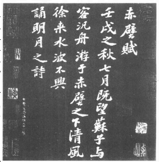

苏轼《前赤壁赋》

宋朝的歌妓推展出一种新诗体——“小词”。苏东坡更把小词由恋爱诗化为描写任何思想或情怀的工具。最好的苏词是描写“赤壁”，以古英雄的逝去为主题。三百年前李白和杜甫才气焕发，一度使唐朝的绝句和律诗成为诗人争相模仿的固定诗格。但是五言或七言律诗中间一定有两个对句，不免渐渐失之呆板。每个诗人都想推陈出新。但是瀑布、鹭鸶或柳影的最后一丝风情已发掘殆尽，唐代诗家的充实感和情绪张力也就随着俏失了。更严重的是，连诗中字汇也一再重复陈旧的比喻。有些很难起笔。苏东坡在一篇咏雪诗的叙言中声明不用“盐”字，“雪”字毕竟美多了。唐诗的主题已经用滥，语法常常重蹈别人的诗句，博学的读者知道这段曲折的思想情感由哪儿学来，不免有一种秘密的喜悦。追溯某语法的暖昧来源，使“评注家”有机会卖弄自己的学问。通常听谓“集注”的作者并不认真说明一首诗的意义，判断它的特色，而以指出某一措辞的出处为满足。

往往要等新诗体诞生，由歌妓推广出来，诗词才解脱呆滞的沉闷感。语法焕然一新，宋词比唐诗更近白话，元曲又比宋词更白话。“词”不过是照某一曲调填的诗歌。大家不是“写”词，而是“填”词。词不象唐代音节统一的“律诗”，长短句可以自己变化，完全配合歌曲的要求。

苏东坡时代，这种新诗体正好大受欢迎。透过苏东坡、秦观、黄庭坚、晏几道和周邦彦等人的才气，词变成宋朝的代表文学。苏东坡在杭州发现了小词，深深喜爱，到杭州第二年就开始写了不少乐府词。但是词本是抒情文体，吟咏的不外是“香汗”、“绣帘”、“乱发”、“春夜”、“暖玉”、“斜肩”、“柳腰”、“纤指”等等。这种情诗怎么样才不失于放荡，完全看诗人处理题材的技巧而定。诗词中的情欲和真爱很难划分，真实的人生又何尝不是如此呢。而且诗人就象现在的酒店艺人一样，宁可描写单恋的痛苦、相思与渴望。他们描写幽居的佳人苦思远别的人儿，默默抚弄腰带或者长伴孤灯。事实上女人的一切魔力都在于她的无依、她的憔悴、她沉默的泪珠、她的倦怠、“断肠”、茶饭不思、厌烦以及各种身心的惨境，这些和贫穷一样，听起来蛮诗意的。“苏慵”一词简直含有色情的意味。苏东坡不但是宋朝几位大词家之一，小词也多亏了他——至少他自己的作品如此——才能脱离无病呻吟的调调。

苏东坡倒没有和任何一位名妓有过风流韵事。他在宴席中尽情玩乐，与女人厮混，十分随和，却没有纳妾。有两个女人和他特别亲近。才女琴操被他说服，终于除妓籍出家。日后嫁给他为妾的朝云，当时只有十二岁，我们以后再谈她。今天有一份苏东坡亲笔写的宋词拓本，内容便有一首名妓的杰作。根据头几个字，命名为“鸟云帖”。词中描述官妓周韶赴宴的情形。她和品茶家兼书法家蔡襄比茶，常常得胜。苏东坡经过该城，太守陈襄请他吃饭。周韶也在座。席间周姑娘要求除籍，客人就叫她写一首绝句。她写了下面一首诗，自比为笼中的鹦鹉（“雪衣女”）：

陇上巢空岁月惊，

忍看回首自梳翎。

开笼若放雪衣女，

长念观音般若经。

其它学者也写诗描述此一情景。苏东坡还声明她穿着白孝服。大家都很感动，她终于得到自由。

这种官场生涯需要官太太极度的信任和了解，不过，好太太的问题主要在于找一个好丈夫，相同地，好丈夫的问题就是找一个好太太。家有贤妻，男儿不遭横祸。苏太太知道她嫁了一个人人欢迎的诗人才子，她当然不想和他竞争文学的荣誉。她决定做贤妻良母。现在她自己生了两个儿子，身为通判夫人她有一个舒适的家，享受着某些社交的尊荣。她还年轻，大约二十三岁到二十五岁。她丈夫才气焕发，心胸开朗，喜欢开玩笑，而且是一个大学者!但是崇拜他的人太多了——男女都有!难道她没看见社区南畔的那些女子，以及望湖楼和有美堂的宴会？新任太守陈襄也是学者，比他们晚一年到，很注意太守的社交关系，官妓随时听候差遣。还有周邠、鲁少卿等人，都不是她丈夫的什么好伴侣。歌妓才艺颇高，会弹会唱，有些还会写诗。她自己不会作诗，不过她了解那些诗词。她丈夫常常吟诵，她渐渐听熟了。要她唱真会羞死人，良家妇女从来不唱的。她丈夫去找惠勤、辩才等赤足和尚，她觉得舒服多了，这些老头都留着可敬的长胡子。

婚后好几年她才认清他的个性，他多面的个性，有时候很随和，有时候却又强烈而固执。现在她知道自己没法影响他，当然也不能跟他争辩。由另一方面来说，他若写诗给妓女，又算什么呢？大家都要他写嘛。他没有爱上任何职业艺妓，听说他还劝一位名妓琴操出家为尼哩。琴操才智过人，由诗词到宗教只是一步之差。他实在不该对琴操吟诵白居易描写妓女末路的诗句。苏太太聪明贤慧，不想用错方法，把丈夫逼到妓女怀中。此外她知道她丈夫是一个妻子或皇帝都无法阻挡的人，她采取明智的作风——充分信任他。

她身为进士的女儿，会读会写，却不是“知识份子”。她只替他煮眉州名菜和姜汤。他生病的时候可真需要人照顾哩!诗人丈夫有时候不同流俗，那是他们的权利。丈夫知道世上有千万本书要读，太太知道她要建立一个家，养育小孩，过一辈子。因此她甘愿忍受他著名的鼾声——尤其喝醉的时候。

除此之外，他实在是一个古怪的床头人。她眼睁睁听着他的鼾声，却不能打扰他。他入睡前就忙着把自己裹好。他翻来覆去，安排身体和四肢，拍打被褥，一定要把自己弄得惬意又舒服。身上若僵硬或发痒，他就缓缓按摩。然后一切就妥当了。他要睡啦，他闭目“听”息，看呼吸是否缓慢平均。“便瞑目听息。”他的秘诀如下：“既均直宜用严整，其天君四体，虽后有苛痒，不可少有蠕动。务在定心胜之。如此食顷则四肢百骸无不和，安然入睡。”

苏东坡说，这和宗教有关。灵魂的自由大抵要靠身体的自由。这是苏东坡日后研究的项目之一。他向两位门生描写他睡觉的方式，又接着说：“二君试用吾法，必识其趣，慎无以语人也。天下之理戒然后能慧，盖慧性圆通，必从戒谨中入。未有天君不严而能圆能觉悟也。”

后来苏太太又发现她丈夫早晚的许多习惯。梳头和洗澡是他一生重大的事情之一。那个时期若有人专门注意身体、内在功能及药草的研究，那便是苏东坡了。

她正常而稳定，诗人倒不见得。她丈夫常常不耐烦、沮丧、郁闷。相反的，苏太太曾在春月夜说：“我喜欢春天的月亮，秋月太悲哀了，春月使大家快乐又满足。”几年后他们迁居密州，生活困苦，苏东坡对新所得税大表不满，有一天小孩拉他的衣服，他不禁光火了。

“孩子们真傻”苏东坡说。

“你才傻哩。”他太太回答说，“整天闷坐呆想有什么用呢？来，我弄酒给你喝。”

他写一首诗记下此一情景，说他真觉得惭愧。太太洗盏为他温酒，他当然大感快慰，说她比不肯让丈夫喝酒的刘伶太太强得多了（“大胜刘伶妇，区区为酒钱”）。

不过苏东坡心灵的一角很少人发觉，苏太太一定知道，那就是他对堂妹的初恋。此人的名字不幸我们无法察知。苏东坡一向没有心机，一定曾对太太说起这件事。他对堂妹的情感埋在两首诗中，研究他作品的人都没有注意到。

苏东坡并不是一年到头住在杭州，他常常到西边和北边走走。熙宁六年（107年）十一月到熙宁七年（1074年）三月他曾到附近的上海、嘉兴、常州和靖江旅行，这些地方宋朝时都属浙江省。他堂妹嫁给柳仲远，住在靖江附近。他在堂妹家住了三个月，虽然他写了不少旅游诗，并且经常和堂妹的翁公柳谨一起写作和旅行，他从来没提到过堂妹的丈夫，也没有写过诗给他。他曾写一首诗描写堂妹家的宴席，堂妹的两个儿子要他亲笔题字，他也写了两首诗给他们。苏东坡很敬重柳瑾的诗篇和书法，也常顾念堂妹的小孩。但是这段时间完全不提堂妹的夫婿就很难解释了。

此行所写的两首诗暗示他和堂妹不寻常的交情。一首是写给刁景纯的，主题是回忆他在宫中所见的一朵花。其中两句如下：

厌从年少追新赏，

闲对宫花识旧香。

他当时并非面对宫花，因为他根本不在宫里。“厌从年少”一定是形容他自己，而“花”本来代表女性，“旧香”也许是一段旧情。

另一则写给杭州太守陈襄的诗含意更明显。问题是他春归太迟，错过了牡丹的花季（这篇诗的前叙很长）。他回到杭州，牡丹花季确实已经过了。不过，他暗喻一个已经为人妻的女孩子则是不容置疑的，而且咏牡丹的诗也没有理由提到两个伤春的典故。为了了解他的暗喻，我必须引述九世纪一位少女（杜秋娘）十五岁时所写的诗：

劝君莫惜金缕衣，

劝君惜取少年时。

花开堪折直须折，

莫待无花空折枝。

因此“空折枝”就变成错过青春恋情的比喻。和她同代的杜牧也写过下列一首诗：

自是寻春去较迟，

不须惆怅怨芳时。

狂风落尽深红色，

绿叶成荫子满枝。

自从杜牧写这首诗之后，“绿叶成荫子满枝”就常用来形容子女众多的母亲，因为中文“子”字代表“果实”和“儿子”。

苏东坡这首诗思绪不太连贯，特别用了“金缕”、“成荫结子”、“空折枝”等字眼：

羞归应为负花期，

已是成荫结子时。

与物寡情怜我老，

遣春无恨赖君诗。

玉台不见朝酣酒，

金缕犹歌空折枝。

从此年年定相见，

欲师老圃问樊迟。

这首诗既不适合陈襄，也不适合牡丹，仔细研究根本文不对题。成荫结子不该用来形容牡丹。他也没有理由叫陈襄“怜”他老。“从此”年年相见是送别的誓语，回来见老同事的人不宜乱用；而且苏东坡也不想设一个农庄，住在陈襄隔壁。若指陈襄，惋叹一个女人成荫结子尤其显得奇怪。不错，唐诗中间的两联必须名词、形容词对仗，有时候中间的两组对句完全是修饰用语，前两句和末两句才代表真正的诗题；不过结构完美的唐诗应该浑成一体。苏东坡的诗很少结构这么差，中间几行完全填空用的。反过来说，若把这首诗当做为堂妹而作，全诗的思绪和主题就统一了。第一句说他错过花期——少女的青春——而羞于回家。第二句说她已有子女了。第三句要她怜惜，并表示自己的寂寞。第四句说他今年春天有她相伴，过得很幸福。五、六句明白惋叹自己没有把握青春。七、八句比较容易了解。这时候苏东坡曾写一首诗说他想住在常州，离柳家不远。后来他确实在常州买了一座房子和农庄，日后他就死在那儿。我知道苏东坡的崇拜者一定会和我争辩，说我暗指他偷恋堂妹。这会不会构成他人格的污点是见仁见智的问题。如果真有其事，理学家一定看不起苏东坡。但是堂兄妹表兄妹相恋，自古皆然。苏东坡不能违背礼俗，娶同姓的堂妹为妻。西方读者对他靖江之行中刻在焦山庙墙上的一首诗特别感兴趣。

苏东坡一定听过灰姑娘被继母和继姐虐待，失落舞鞋的故事，九世纪一位中国作家的作品中就曾提到这些。不过据我所知，一个老人弄胡须上床的故事却由他最先写在作品中。

他以简单的韵脚描写一个长胡子老头。他从来没想过如何处理他的胡须。有一天别人问他睡觉时胡须放在哪儿。那天晚上他睡觉时开始感觉胡须的存在。他先放在棉被外，又放进被子里，然后又拿出来，一夜都没有睡。第二天他坐立不安，觉得最好把胡子剪掉。由诗中的内容看来，这似乎是一个通俗的故事，不是他自己想出来的。

我该提一下，“眇者不识日”的寓言倒出自苏东坡的创造，这篇作品是在密州写成的。爱因斯坦曾引这篇寓言来说明一般人对相对论的概念：

“生而眇者不识日，问之有目者。或告之曰，‘日之状如铜盘’。扣盘而闻其声，他日闻钟以为日也。或告之曰‘日之光如烛’。扪烛而得其形，他日揣龠以为日也。而眇者不知其异，以其未尝见而求与人也。道之难见也甚于日，而人之未达也，无以异于眇。违者告之，虽有巧譬善导，亦无以过于盘与烛也。自盘而之钟，自烛而之龠。转而相之，岂有既乎。故世之言道者，或即其所见而名之，或莫之见而意之，皆求道之过也。”

说也奇怪，这篇寓言竟被仇敌当做审判他的证物。罪名是他嘲笑当代文人盲目追随王安石的《三经新义》。

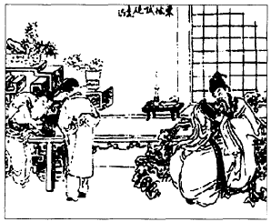

苏轼试砚图

苏东坡个性复杂多变，很难了解。他是大哲学家，不可能变成清教徒，但他又是儒家子弟，不可能变成酒鬼。他了解生命，珍惜生命，不会把时光完全浪费在醇酒美人身上。他是自然诗人，怀有特殊健全的神秘人生观，往往和自然的了解密切融合。我相信任何一个人和自然、四季、雨、雪、山、谷那么接近，接受它的治疗，一定不会心思闭塞，具有封闭的人生观。

熙宁六年（1073年）重九他拒绝参加例行的酒宴。他避开友伴，独自乘船出游。他依照重九的习俗，天亮前就起身，到湖上拜访孤山的两位僧侣。那天晚上他独自坐在小船上，望着山顶有美堂的灯光，同事们正在享受喧哗的酒会呢。他写诗给周邠说：

蔼蔼君诗似岭雪，

从来不许醉红裙。

不知野屐穿山翠，

惟见轻桡破浪纹。

颇忆呼卢表彦道，

难邀骂座灌将军。

晚风落日原无主，

不惜清凉与子分。

---

### 第十二章抗议诗

这是苏东坡最沮丧的时期，说也奇怪，诗人最悲哀的时候却写出了最好的作品。照中国的标准，他在这段期间达到诗词的成熟期。愤怒与尖酸都过去了，只留下满心安详与去意。就连他在自然中的欢乐，以及当日的趣味也更醇美，与杭州时期年轻的情致截然不同。他愈来愈仰慕陶潜——中国田园大诗人。他的“西斋”诗简直和陶潜一模一样。

---

杭州也并非遍地荷花与牡丹。苏东坡不能一天到晚谈笑、唱歌、演单口喜剧，月夜到湖上泛舟，因为狱中有一万七千个欠债和私盐犯人等着宣判，有蝗灾要治，有航道要疏通，有饥荒要调查。他这段时间所写的几百首诗很难找到固定的主调。他写喜剧诗和讽刺诗，充满才情的风景诗、抒情诗、喧笑诗，还有不少含泪的作品。在他酒席上喧哗、愉快、嬉笑的外表中隐藏着不安、沮丧、悲哀、甚至恐惧的精神。没有人比苏东坡更充分表达民间的疾苦，他的才华使他将别的作家想要表达的一切更充实、更完整地化为诗歌和优美的文字。但是苏东坡离开京师来这儿，心里挂着创痛。他对政事的发展倾向暗感恐惧和悲哀，他的伤痛比别人更深。他曾描写如下：

天静伤鸿犹戢意，

月明惊鹊未安枝。

他在密州写给乔太博的一首诗总括了熙宁四年（1071年）到熙宁九年（1076年）间多产时期他在杭州和密州的一般看法：

百年三万日，

老病常居半。

其间忤忧乐，

歌笑杂悲叹。

颠倒不自知，

直为神所玩。

须臾便堪笑，

万事风雨散。

自从识此理，

久谢少年伴。

另一首写给孔文仲的诗表达了他对官厅盛事的轻蔑感：

我本糜鹿性，

谅非伏辕姿。

金鞍冒翠锦，

玉勒垂金丝。

旁观信美矣，

自揣良厌之。

人生各有志，

此论我久持。

他人闻定笑，

聊与吾子期。

随着他欢笑的诗篇我们也听到呼喊与叹息。我们听到鸟雀的鸣声夹着狱囚的呻吟，水车的咕咕声夹着老农妇的哀诉。湖上的喜宴也夹着他稀发渐白的怨叹。

苏东坡是无法预测的。他习惯用最自然、最简单、毫不雕琢的方式来开始他的诗篇，他会引用一两个古代的典故，然后就没有人知道下文，他自己更不知道。有时候他会写出毫不连贯却十分杰出的奇文，写出毫无计划的诗，先记下一时的怪印象，然后就笔带尖酸、讽刺、或者愤世嫉俗的思想。他诗文两绝，“如行云流水，常行于所当行，常止于不可不止”。也可以说他的文风属于不能自已的一行。当时朝中最恨自由的批评，这种文风难怪要害他惹祸上身。

苏东坡不知道下一句要写什么，他也不在乎。他天才横溢，常常一连写四、五首同题同韵的诗篇。有一首诗开头描述行将下雪的气氛。头几句如下：

天欲雪，云满楼，楼台明灭山有无。

接信的朋友以诗相和，他就写了第二首诗，开头如下：

兽在薮，鱼在湖，一入池槛归期无。

朋友再和，他又写第三首，头几句

东望海，西望湖，山平水远细欲无。

第四首开头如下：

君不见，钱塘湖，钱王壮观今已无。

第二首给他惹上了麻烦，因为他写到失去自由的鱼兽，不免继续发挥下去。接着就是描写狱中遭鞭打的犯人，和连累入狱的犯人妻子儿女，这些都是长诗，他必须首尾同韵，绕着此一韵律来思考。其中两个韵脚是“逋”和“摹”。他在一首诗中写道“作诗火急追亡逋”。另一首诗自然而然说“岁荒无术归亡逋”。至于“摹”字，他在一首诗中写道“孤烟落日不可摹”，但是描写犯人的诗中不免说“鹤则易画虎难摹”——显然指苛政而言。

苏东坡不是一个高兴时故作悲哀，悲哀时故作欢笑的人。很多朋友和他通信，彼此写诗相应和。现在刘恕和李常都在九江。孙觉在湖洲，离杭州北面不远。这些都是共同反对王安石新政的人，如今都在东南任职。他们都讨厌政坛的现状，此时王安石仍然当政，不过他们没有那么倔强了，就把意见搁在心里。韩琦和欧阳修已逝。富弼和范镇辞官归隐。司马光潜心著作。张方平沉迷酒杯，东坡的弟弟明哲保身，一句话也不说。东坡不够圆滑。一个人亲眼看到百性受苦，这只是该不该忘掉一切后果表达心中感慨的问题。也许他从来没有考虑过。随着田园美诗，他还不断写乡村不美的一面。他不是疯狂，就是太热心了。他知道自己的诗篇远达京城，但是他不在乎。

这些诗一天天堆成他罔顾政府威信的罪名，我们不妨仔细研究其中部分诗句。分开来看只是应景，凑在一起却成为一册抗议诗。举几个例子就够了。他用最简单的语法描述人民奉召挖盐河的惨状。他身为监工的官吏，看到工人黎明即起，他用很多字句来描写“人如鸭与猪，投泥相溅惊”的情形。

他到杭州西南的富阳，曾写了一首清新、愉快的律诗来描写青天，开头如下：

东风知我欲山行，

吹断檐间积雨声。

岭上睛云披絮帽，

树头初日挂铜钲。

但是他难免看到许多事情，描写“春入深山处处花”，也顺便提到农民的伙食。他们正在吃竹笋，笋味虽甜，却没有盐味，“尔来三月食无盐”，只因为政府专卖戕害了食盐的生意。他放手写去，不知不觉提到农夫的小儿子利用农民贷款，拿到钱就留在城内花个精光，回家只带回来满口城腔，因为政府聪明，贷款处隔壁就设了酒铺和娱乐场所。

他南行到太湖区，见到高大美髯的好朋友孙觉，彼此都是书画行家，他在好友的名帖集上亲笔题了一首诗，不过他诗中也说：“嗟余与子久离群，耳冷心恢百不闻。”他写诗描述水车上涌奔的流水，也写了一首“吴中田妇叹”：

今年粳稻熟苦迟，

庶见霜风来几时。

霜风来时雨如泻，

耙头出菌镰生衣。

眼枯泪尽雨不尽，

忍见黄穗卧青泥。

茆苫一月垅上宿，

天睛收稻随车归。

汗流肩赤载入市，

价贱乞与如糠粞。

卖牛纳税拆屋炊，

肤浅不及明年饥。

官今要钱不要米，

西北万里招羌儿。

龚黄满朝人更苦，

不如却作河伯妇。

杭州潮汜时节他写了几首观潮歌。每年中秋杭州人都老远到钱塘江畔观潮，潮水由海上进入狭湾，不断高涨。潮水未来前，通常都有海上表演。不知道他们怎样弄潮。游泳健将名叫“打浪儿”，好象是乘小船出海，船上有红绿旗帜迎接来潮。苏东坡写了不少通俗的歌曲给弄潮儿唱，道出了白浪吞红旗，浪峰掩越山的奇景。但是他也写出凌晨酒醒后内心的感慨：

众人事纷扰，

志士独悄悄。

何异琵琶弦，

常遭腰鼓闹。

三杯忘万虑，

醒后还皎皎……

忧来不自寐，

起视天汉渺。

阑干玉绳低，

耿耿太白晓。

有一首诗把当权者比为夜枭，日后也害他惹上麻烦。他和周邠同游岭南。根据日后他们审判苏东坡的说词，一位岭南官吏曾起草议状，要求简化免役税，这位官吏带议状北上杭州，如今归来，就把经过告诉苏东坡。

“我被夜枭赶出来了。”官吏说。

“你是指什么？”苏东坡问道，官史说他曾带计划入城，献给税吏，后者派兵送他出城。苏东坡一看他的奏议，发现他提出的税制简单而完美。

“你所谓的夜枭是什么？”东坡问道，官吏就回答说：

“那是通俗的寓言。有一天燕子和蝙蝠吵架。燕子说日出是一天的开始，蝙蝠说日落才是开始。相持不下，就去征求凤凰的意见。路上有一只鸟对他们说，‘最近没看到凤凰，他有时候告假，有时候长睡不起，现在夜枭暂时代替他的职位。你们不必请教他了’。”

他当时写了一首诗给周邠，语中充满去意和沮丧：

年来战纷华，

渐觉夫子胜。

欲求五亩宅，

洒扫乐清净……

独游吾未果，

觅伴谁复听。

吾宗古遗直，

穷达付前定……

奈何效燕蝠，

属欲争前瞑。

后来这些诗都被当权者详细收集与调查，其中并没有叛变的意思，没有公开批评，没有明白反对当局。但是这些诗具有蚊子叮的效果。叮几下叫人着恼；叮太多就叫人整夜睡不着。苏东坡的密友王诜附马出版这些诗尤其教人生气，他是皇帝的姊夫哩。当时流行用诗来沟通思想，两行好诗比声势凌厉的表状更能奏效。苏东坡很受欢迎：他的诗句被文人争相传诵。苏东坡的呼声终于到了不能忽视的地步。

熙宁七年（1074年）他杭州任满。当时他弟弟在山东省济州（现在的济南）任职，东坡自请调到该省。愿望实现，这次被派往青岛附近的密州担任太守。他在密州只干了两年就被调任徐州太守。由熙宁十年（1077年）四月做到元丰二年（1079年）三月。

苏东坡对杭州南北寺庙的僧友告别，就携家北上。他太太买了一个十二岁的丫环，生性聪颖，名叫朝云，后来在苏东坡生命中占了很重要的地位。

密州是非常贫瘠的地区，主产大麻、枣子和桑树，此地的生活与杭州真有天壤之别。这时候官员的薪俸锐减，苏东坡在《杞菊赋》的序言中说：“余仕官十有九年，家日益贫，衣食之奉殆不如昔者。及移守胶西，意且一饱，而斋厨索然，不堪其忧，日与通守刘君延式循古城废圃，求杞菊食之，扪腹而笑。”

王安石罢官，现在惠卿得势，又设了一种新税。该区人民根本负担不起免役税。儿童在路边奄奄一息。苏东坡的一首诗曾说他“洒泪循城拾弃孩”。几年后，他在一封信里提到他曾救了三、四十个即将饿死的孤儿，把他们安顿在各个家庭里。

这是苏东坡最沮丧的时期，说也奇怪，诗人最悲哀的时候却写出了最好的作品。照中国的标准，他在这段期间达到诗词的成熟期。愤怒与尖酸都过去了，只留下满心安详与去意。就连他在自然中的欢乐，以及当日的趣味也更醇美，与杭州时期年轻的情致截然不同。他愈来愈仰慕陶潜——中国田园大诗人。他的“西斋”诗简直和陶潜一模一样。这首诗中不但可以看出真正的安详与满足，而且完全和自然融为一体，对自然的声音色彩也含有平静的喜悦。

西斋深且明，

中有六尺床。

病夫朝睡足，

危坐觉日长。

昏昏既非醉，

禹禹亦非狂。

寒衣竹风下，

穆然中微凉。

起行西园中，

草木含幽香。

榴花开一枝，

桑枣沃也光。

鸣鸠得美阴，

困立忘飞翔。

黄鸟亦自喜，

新音变圆吭。

杖藜观物化，

亦以观我生。

万物各得时，

我生日皇皇。

他与自然达到了完美的和谐，所以才能写出《吏隐亭》诗：

纵横忧患满人间，

颇怪先生日日闲。

昨日清风眠北牗，

朝来爽气在西山。

由于这种神秘的观点，他获得灵性的自由，有如白云，漫无目标地浮在山顶上。“望云楼”诗如下：

阴睛朝暮几回新，

已向虚空付此身。

出本无心归亦好，

白云还似望云人。

说来有趣，子由常常让苏东坡写出最好的作品。东坡由杭州到密州途中，想起了弟弟，就写了一首词，词牌是《沁园春》：

孤馆灯青，野店鸡号，旅枕梦残，渐月华收敛。星霜耿耿，云山离锦，朝露团团。世路无穷，劳生有限，似此区区长鲜欢。微吟罢，凭征鞍无语，往事千端。

当时共客长安，似二陆初来俱少年。有笔头千字，胸中万卷。致君尧舜，此事何难。用舍由时，行藏在我，袖手何妨闲处看。身长健，但悠游卒岁，且封樽前。

他在密州想起未能相见的弟弟，就写出了史上最好的中秋词。批评家说，这首词一出，其它描写满月的作品都不值一顾了：

明月几时有，把酒问青天？不知天上宫阙，今夕是何年？我欲乘风归去，又恐琼楼玉宇，高处不胜寒。起舞弄清影，何似在人间？

转朱阁，低绮户，照无眠。不应有恨，何事长向别时圆？人有悲欢离合，月有阴睛圆缺，此事古难全。但原人长久，千里共婵娟。

《中秋》是熙宁九年（1076年）在密州写的，我已经说过，是乐曲的小词：我不妨分析这首词的格局和结构。中国词和诗一样，都以四声为韵，而不是用轻重音。字音可分两种，一是平声，相当于英文的张口音节或脆音。一是仄声，相当于英文中以气音收尾的音节。差别类似“song”与“sock”，“seen”与“sick!”或者问句结尾与句点结尾之间的差异。（西方人）必须了解中文诗音乐性形成的腔调基础。中文是单音节；而且英文诗中非重音节常用的助动词，中文也经常省略。单字使重音明显，便于发挥音系的感情。因此中文诗的韵律——无论古诗、唐诗、词——都全赖字音微妙多变的对比。例如有一种基本的规定，韵脚若是平声，不押韵的句子就要用仄声收尾，反之亦然。以《中秋》为例。我们敲杯为“平”，拍桌子为“仄”，让每个字代表图中的音符，就很容易看出下表的格局了：

第一节

1.平仄/平平仄/仄仄/仄平平

2.平平/仄仄/平仄/仄仄/仄平平

3.仄仄/平平/仄仄/仄仄/平平/平仄/仄仄/仄平平

4.仄仄/平平仄/平仄/仄平平

第二节

1.仄平仄/平仄仄/仄平平

2.平平/仄仄/平仄/仄仄/仄平平

3.仄仄/平平/仄仄/仄仄/平平/平仄/仄仄/仄平平

4.仄仄/平平仄/平仄/仄平平

押韵的句子都用同一声调（仄仄仄平平），因此便成为主要的律韵字。每一句开头不同，导向主韵句，就成了互相对比。重音和乐谱相反，总落在最后一个音符上；因此每行最后一个音符的变化是必然的，某几行第一个音符倒可以稍微放宽。如此看来，第四长句其实是第一句的重覆。除了第一句之外，第二节的音格和第一节完全相合。第二节的第一句步子加快，缩成三字、三字的小句，但是仔细研究，却现出同样的结尾句来。

---

### 第十三章黄楼

现在苏东坡很受欢迎，不仅因为他对抗洪水成功，也因为他亲身关切狱囚的健康和利益，当时很少太守这么做。他亲自去看犯人，第一次派狱医照顾病患。苏东坡指出，法律虽禁止地方官鞭死囚犯，对囚犯病死或失于照顾而死，却没有明文规定。囚犯也是百姓。他遂赢得囚犯亲友的感激。

---

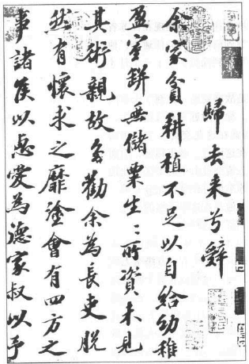

苏轼书《归去来兮辞》

就连苏东坡这样的天才，生命也从四十开始。如今苏东坡进入徐州时期，也就是“黄楼”时期。苏东坡突然找到了自己。他第一次变成行动的人物，忙着做事，建筑，公众活动，从此一生建树颇多。他担任杭州通判无法办大事，在密州虽任太守，但是密州偏远穷困，没有机会一展长才。后来他被迫短期退休，进入政治晦暗期，接着就出现了完美、圆整、成熟、活跃而忠贞的苏东坡，幽默练达，是百姓的朋友和斗士，也是一个伟大的灵魂，不过东坡被捕谪居之前，徐州太守的政绩已证明他是行动的人物，也是能干的办事人才。

熙宁九年（1076年）年底，东坡奉诏离开密州，派往山西西南端的河中府任职，次年一月他由济南进京，他弟弟一家就住在济南。子由不在，风传政事将有大变迁。此时王安石、惠卿、曾布、邓绾已先后垮台，王安石复出又垮，谁也不知道下一步将有什么变化。

子由是一个沈静而果断的人。苏东坡曾一再上表提到税制和征兵的改革，劝皇帝不要征所得税；子由始终沈默，如今却觉得时机已到，可以力倡全面的政治改革。王安石十月已在出京途中，子由不等哥哥，直接带着一份全面革新的重要奏折入京。家人留在济南，苏东坡的三个侄儿在门外雪地上迎接伯父。晚上两家团圆，吃了一顿美餐。济南是大城，与密州不同，苏东坡在那儿住了一个月左右。熙宁十年（1077年）二月十日，两兄弟的眷属到达京城附近的黄河岸边。子由出京，在河岸以北三十哩的地方接他们，两兄弟在雪中畅游了几日。子由带来一则消息，说苏东坡在河中府的新职已被取消，改派为徐州太守。

他们抵达京师，遇到一件十分费解的事情。苏东坡到了陈桥门，门吏告诉他，他不许入京。他弟弟记载说，这件事始终没有合理的说明。我想这不是皇帝的旨意，而是政局不稳，有些官员不希望他见到皇帝；也许皇帝自己都不知道有这么一条诏命呢。两兄弟只好回头，折往东外城好友范镇家中。

这时候苏东坡的长子苏迈已经十八岁，该娶亲了。研究苏学的人始终探不出女方的身份。我猜他娶的是范镇的孙女。苏东坡与范镇父子的通信中，一再提到彼此是姻亲。苏家和范家的婚姻关系有待说明。范镇也是四川人，当时苏东坡又住范家。此后两年苏东坡还替子由的两个女儿择了佳婿。一个是王适——“仙妻”传说主角王回（子高）的弟弟，另一个是画竹名家文同的儿子。

儿子娶亲后，苏东坡携眷往东走，到现在江苏省境的徐州任职。子由也携眷到商邱（南都）任通判；他把家人交给张方平，就陪哥哥到除州，住了三个月才回到眷属身边。

徐州不但是大城，也是战略要地，控制了山东南部的山区。过去几个朝代。徐州附近常有战役发生，现在津浦铁路和陇海铁路就在这儿交会。二十年后“水浒”著名的强盗窝便在这附近。城市临河，南面有两大高山环绕，深邃的急流绕过山下的市区。此地出产花冈细石、铁、煤，苏东坡时代就曾充分开采。结果此地的刀剑也很著名。他喜欢这里天然的风光，各种精美的鱼蟹，说是“暂留”的好所在。

八月二十一日，他刚上任三个月，徐州发生大水。王安石曾想疏通黄河；但是花了五十万缗毫无效果，主工程师畏罪自杀。黄河在徐州以北五十哩处向东泛滥，水患蔓延几百方哩。大水到达徐州，被南面的高山挡住，水位不断高涨，九月达到二十八点九尺。苏东坡舍身救城。好几周没有回家，每天住在城墙顶的小棚内，监督修固外墙的工作。有钱人家纷纷出城。苏东坡在城门挡驾，求他们别走，怕引起惊慌和暴乱。“有我在，你们最好留下来。”说完强迫他们回去。这里不谈苏东坡的建筑和工程才华，只是表明他亲自参加一切工程计划。洪水眼看就要超过东南外墙了，他把墙基加厚，城墙加高，挡水的防御工事长九八四丈，高十丈，宽两丈。他需要几千名工人，他涉泥前进，直奔军营找卒长。这是禁军，直接归皇帝统率。他要求他们合作。卒长马上答应：“太守亲自监督工作，我们也当尽一份力量。”这时候北方工事已做好，准备把洪水引入黄河故道，历史上黄河改道好多回了。洪水围城四十五天，十月十五日黄河回归故首，向东在海州附近入海，洪水开始退去。

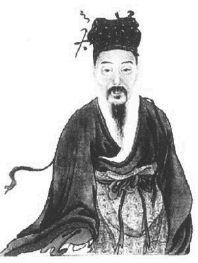

黄庭坚。苏门四学士之一，江西诗派之始祖

城市获得保全，人民都欣喜欲狂，万分感激。苏东坡对暂筑的堤不满意。就上表给朝廷，明列数字，要上面拨款兴建石墙，抵挡未来的天灾。苦等没有回音，他只好修改奏议，要求不建石墙，改建木块工事。皇帝下了一道公文，夸赞他的伟大功劳，次年二月东坡获得三万多贯的拨款，一千八百担米粮，和七千二百个员工，在城市东南建了一道木坝。苏东坡性好建筑，就在这道外城墙上建了一座十丈高的楼台，名叫“黄楼”。后来他在徐州写的诗集就叫做“黄楼”集，而他在密州建的超然台也变成他密州作品集的代称。

“黄楼”命名和古老的中国宇宙论有关。根据此一理论，世上一切都是由金、木、水、火、土构成。每一元素都代表一种原则，例如坚毅、成长、流动、热、重力等等，这些原则世界通行，不但可用在物质界，也可以用于生命机能、人类性格和行为上，例如婚配就用得着。一切生命都由五个元素交织而成，互克互补，每一要素都有代表的颜色。说也奇怪，黄色代表土，黑色代表水，黄土有吸收力，据说可以克水。因此“黄楼”就成变抗水力量的象征。

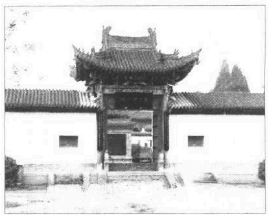

陕西凤翔三苏祠

元丰元年（1078）重九，黄楼举办盛大的开幕仪式。苏东坡非常高兴。百姓没有被洪水吞噬，大家花了半年多来兴建水坝和楼台；黄楼属于全城百姓，是未来对抗水患的明显象征。全城的人都来参观开幕典礼。东门上黄楼耸立，高达十丈，下面是五丈高的旗杆。楼台建成宽塔的形式，大伙儿上楼观赏四野的风光。那天早上浓雾茫茫，他们由窗口眺望，听见下面船只的桨声，恍如置身大海船中。不久天空放睛。远处的渔村和岩峰下的五、六所庙宇历历可见。年老的人叫冷，苏东坡要他们先喝一杯暖酒驱寒。南面前端可以看见隆起的台地，以前是戏马台，如今建了一座佛寺。长长的新堤由庙宇开始，沿东城墙向北延伸，他们听见远处陆洪和百步洪的怒潮，与下面的鸭声、鹅声打成一片，最后大宴宾朋，还有乐队伴奏。

苏东坡写了一篇文章纪念这个场面，叫人刻在石头上。这块石碑经历颇不平凡。后来他遭放逐，他的一切碑铭都奉命拆毁，当时的徐州太守只把它丢入附近壕沟中。十年后，大家都忘记这条禁令，皇家也开始收集他的手稿，另一位太守叫人把石碑由沟渠里挖出来，星夜赶制了几千份拓本。事成之后，突然对同僚说：“咦，我忘啦!苏碑的禁令还没有解除，碑还在这儿。叫人来毁掉吧。”石碑拆毁之后，拓本的价值自然不断高升。太守苗仲先就赚了一大笔钱。

现在苏东坡很受欢迎，不仅因为他对抗洪水成功，也因为他亲身关切狱囚的健康和利益，当时很少太守这么做。他亲自去看犯人，第一次派狱医照顾病患。苏东坡指出，法律虽禁止地方官鞭死囚犯，对囚犯病死或失于照顾而死，却没有明文规定。囚犯也是百姓。他遂赢得囚犯亲友的感激。

有些小事只要有人肯做，就可以轻易办到，可惜只有苏东坡关心，譬如他看见很多士兵离营逃走，变成强盗，只因为军士出远差没有旅费，逼得他们债务满身。他纠正此一规定，每年只花几百缗而已。他严禁军中赌博饮酒，在一封呈给皇帝的书表中，他指出当地军队“练熟技艺等地，为诸郡之冠，陛下遣使按阅所具见也”。

苏东坡的诗名不断增高，如今已是全国公认的第一大学者。欧阳修死后，这个头衔就落在他身上。学者都认他为“师”。苏门四学士中两位他已经见过，他在淮阳结识张耒，在杭州附近结识晁补之。另外两位——秦观和黄庭坚——日后变成宋代的大诗人，如今也想投拜在他门下。短小精干的李常春天来看苏东坡，一直提起秦观，还把秦观的诗拿给他看。透过李常的介绍，那年夏天秦观就来拜望他。这就是传说中娶了苏家小妹的浪漫诗人。他还没有科名，但是年轻浪漫又无忧无虑，自然有不少女友。他死后还有名妓为他殉情哩。这是诗坛的新音，有如春天的云雀。秦观写诗给东坡说：“我独不愿万户侯，惟愿一识苏徐州。”他把东坡比为“天上麒麟”，又说：“不将俗物碍天真，北斗以南能几人？”

黄庭坚日后变成江西诗派诗人的始祖；他和秦观不同，博学而文静。他没有来见东坡，只写了两首谦虚的小诗毛遂自荐，把东坡比为崖顶的孤松，他自己比为谷底的幽草，渴望长到同一高度。苏东坡以前看过黄庭坚的诗，说他有内容，有深度，诗境高超，“以为非今世之人”。他回信给黄庭坚说：“今者辱书，执礼甚恭，如见所畏者，何哉？轼方以此求交于足下，而惧其不可得。”

苏门四学士中，黄庭坚居长，时人把苏黄相提并论。但是黄庭坚始终以苏东坡的门下自居。黄庭坚也是苏东坡的密友介绍的，因为他是李常的外甥，孙觉的女婿。

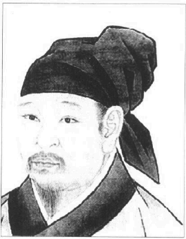

秦观像。苏门四学士之一，宋代大诗人。

九月里，另一位在苏东坡案件中被提起的好友来拜访他。王巩又是另一型。身为宰相之孙，他出门常带一车自酿的上好名酒，店里买的酒他是不屑一碰的。他还带了三个侍妾——英英、盼盼、卿卿——到徐州。苏东坡拿他的侍妾开玩笑，在“百步洪诗”的前叙中还描写王巩带梨涡美女下滩，自己则穿羽衣站在楼顶看他们，有如天仙或李白再世。

这时候一个重要人物来到苏东坡生命中，他就是大诗僧参寥，可能是秦观介绍的。说也奇怪，苏东坡在杭州住了三年，参寥当时住在附近，却不认识他。参寥自己也是大诗人，个性高超，不愿意沽名钓誉。他只远远望着苏东坡，默默敬仰他。此后参寥就变成他终生的密友。

那年中秋我们可以就近看看东坡八月十二日他有了一个孙子，中秋夜他觉得很寂寞，很不舒服。六天后他收到弟弟的一首诗，描写他那夜的情景：

明月未出群山高，

瑞光千丈生白毫。

一杯未尽银阙涌，

乱云脱壤如崩涛。

谁为天公洗眸子，

应费明河千斛水。

遂令冷看世间人，

照我湛然心不起。

西南火星如弹九，

角尾奕奕苍龙蟠。

今宵注眼看不见，

更许萤火争清寒。

何人舣舟临古汴，

千灯夜竹鱼龙变。

曲折无心逐浪花，

低昂赴节随歌板。

青荧灭没转前山，

浪毡风回岂复坚。

明月易低人易散，

归来呼酒更重看。

堂前月色愈清好，

咽咽寒蛩鸣露草。

卷帘推户寂无人，

窗下咿哑惟楚老。

南都从事莫羞贫，

对月题诗有几人。

明朝人事随日出，

忧然一梦瑶台客。

这时候整个学术界都敬爱东坡，推重东坡。那年九月底黄楼的一次大聚会中，苏东坡开朗风趣，毫无心机，赢得士林一致的热爱。正因为他受欢迎，威望高，他被捕受审才引起全国的注意。

---

## 第三卷成熟（1080-1093）

---

### 第十四章逮捕与审讯

于是苏东坡不尊敬政府的罪名就此成立。他把当权者比为蛙蝈，比为蜩蝉，比为夜枭，比为吃腐鼠的乌鸦，比为鸡场的家禽。最气人的是他用“沐猴而冠”的掌故。结论是：苏东坡看不起舒亶和李定等人，舒亶和李定又何必对他有好感呢？

---

套一句苏东坡自己的话，他始终如蝇在食，吐之乃已，到目前为止还平安无事。但是他“吐”一百次，终于被捉了。元丰二年（1079年）三月他奉调湖州，也就是江苏湖泊区。在他到任谢表中，有些话教朝中政客受不了。他一直作诗描写百姓的困苦、税收和征兵制，政客小人还能忍受。现在他直接提到他们——包括王安石门下窜升的李定和舒亶。政权落在见风转舵、毫无原则的三流小人手中。苏东坡一直上表给皇帝，皇帝每次读完，都对朝臣公开赞美他。这些人曾阻止东坡入京。新政的首领都己罢黜或隐退，万一他再得势，情况就危险了。

这篇谢表依照例行的格式，略提他自己平凡的政绩，感谢皇帝慷慨给他此一新职重任。但是苏东坡说，“伏念臣性资顽鄙……知其愚不适时，难以追陪新进。察其老不生事，或能牧养小民”。“新进”在王安石口中是代表那些“突然升迁的无能后辈”。在王安石时代的党争中，这两个字的含意就此固定下来。李定和舒宜岂肯放过他。而且他自称奉调出外是因为年龄大了，不想生事。难道说朝中的人都爱惹事生非？古代学者因为民权没有保障，便发展出一套微妙的赞美辞，语意日爱昧，读者也习惯找弦外之音。朝中告示公开发行，是中国最早的印刷报纸。苏东坡一下笔就引起广泛的注意，这篇谢表不免使“新进”成为了知识分子眼中的笑柄。

元丰二年（1079年）六月，有一个御史摘取苏东坡谢表中的四句话，告他讽刺政府。几天后舒亶——仍在御史台任职——也提出他描写农民贷款的诗句，譬如三月食无盐，燕蝠相争……等等。苏东坡写这种诗，不但莽撞无礼，更对皇帝不忠。舒亶把苏东坡的四本诗集连奏状一起送上去。李定如今升任御史中丞，也送了另一份表状，列举苏东坡无礼该杀的四点理由。状子一共有四份。案件发交御史台查办。母丧不奔，被司马光比为野兽的李定担任法庭检察官。他派了一位能人到湖州，革去苏东坡的官职，押回京师审问。御史们希望苏东坡一路上在牢中过夜，但是皇帝不准。神宗不想杀苏东坡，不过案情既然正式提出，他愿意让御史们详细调查。

东坡的好友王诜附马曾亲自出版苏诗，他一听到消息，连忙派信差到南京找东坡的弟弟子由，子由又派信差通知东坡。这是信差之间的赛跑。官差带着儿子和两个御史台的兵丁快马前进，但是儿子在靖江病倒，耽搁了半天，据说子由的差人先到。

我们来看看东坡闻讯时的心情。他刚到湖州，对新职很满意。他曾带长子、子由的女婿王氏兄弟一起在山间漫游。他有一首诗描写飞英寺之行，说他自己“莫作使君看，外似中已非”。他的好友画竹名家文同二月去世，他哀悼了三天。官差正要来抓他，七月七日他却悠哉游哉拿出画册来欣赏，放在院中晒太阳。一眼看见文同送他的一张偃竹图，忍不住又流下泪来。那天他在杂记中写下一段妙文，描述他和文与可（文同）的友谊：

“与可画竹，初不自贵重。四方之人，持缣素而请者，足相摄于其门，与可厌之，投诸地而骂曰‘吾将以为袜”。及与可自洋州（今陕西洋县）还而余为徐州，与可以书遗余曰‘近语士大夫，吾墨竹一派近在彭城，可往求之。袜材当萃于子矣’。书尾复写一诗，其略曰‘拟将一段鹅溪绢，扫取寒梢万尺长’。予谓‘与可竹长万尺，当用绢二百五十匹，知公倦与笔砚，愿得此绢而已’。与可无以答，则曰吾言妄矣，世岂有万尺竹哉。余答其诗曰‘世间亦有千寻月，竹落庭空影许长’。与可笑曰‘苏子辩则辩矣，然二百五十匹吾将买田而归老焉’。因以所画筼筜谷偃竹遗予曰‘此竹数尺耳，而有万尺之势……。’”

根据孔平仲由逮捕时当地官吏口中得知而记录下来的资料，苏东坡事先曾得到子由差人的警告。不过他不知道罪名有多大，罪责有多重。差人一到他就正式告假，由祖通判（祖无择）代理。

官差来了，身穿正式的官袍官靴，拿着手纷站在庭院中。御史台的两个士兵分列两旁，白衣黑巾，怒目而视。衙门的人一片骚乱，不知道会出什么事。苏东坡不敢出来，和祖通判商量，通判劝他不要逃避官差，还是出迎的好。他们商量出迎的方式，苏东坡相信他是被告，不能穿官袍出面。不过祖通判认为，他还没有正式被控，应该仍以太守身份出迎。于是东坡也穿上官袍官靴，拿着手笏站在庭院中，面对差吏，祖先生和手下人员列队站在他后面，头戴较小的官帽。两个士兵手拿御史诏命，紧握小包，仿佛里面藏有利剑似的。官差一言不发，气氛紧张到极点。苏东坡先开口：

“我知道我冒犯了朝廷。相信难逃一死。我不怕死，不过请容我回家和家人道别。”

官差皇甫遵简短地说：“没有那么严重。”

通判向前跨了一步：“我相信一定有诏命吧。”

“他是谁？”皇甫遵问道，于是通判表明了身份。士兵正式把诏命交给通判。他一打开，发现只是苏东坡革职进京的普通命令。官差要他立刻动身。

苏东坡获准回家见亲人，然后动身。照他白己的杂记中说，全家人都哭了。苏东坡笑着对他们说了一个故事：

真宗时代，皇帝四处探访隐居的大学者，有人推荐杨朴。杨朴不愿入京，却被押到朝中见皇帝。

“听说你会写诗”皇帝说。

“不，我不会。”杨朴想掩饰自己的才华，不愿从政。

“朋友们送你出来，有没有人写诗给你？”皇帝又问。

“没有，”杨朴说，“只有臣妻写了一首。”

“请问诗中写什么？”陛下问他。

于是杨朴把妻子送行的诗念给皇帝听。全诗如下：

更休落魄贪酒杯，

且莫猖狂爱咏诗。

今日捉将官里去，

这回断送老头皮。

苏太太听到这个故事，热泪盈眶，却忍不住笑出来。这个故事出现在东坡的笔记中，不知道是不是他临时杜撰的。

家人决定由长子苏迈陪他进京。王适一直担任东坡子女的教席，他们兄弟将留下来，以后再带全家到京城去。官吏都吓得躲起来，老百姓却出来送太守，根据该地府志的记载，人民都“泪如雨下”。官差与士兵态度专横，后来苏东坡写给继任皇帝的信中曾说，他们逮捕太守却如捕盗贼。只有王氏兄弟和陈师锡设酒宴送他。

传说苏东坡一路曾想办法自杀。他自己给皇帝的表状中说，到扬州他想跳入江里去，不过照孔平仲的记载，那是刚起航不久，船只靠在太湖修桨的时候。那夜月明星稀，湖上有风。苏东坡不知道罪名多重，又怕连累朋友。他想闭眼跳入湖中，一了百了，不过转念一想，这样一定会给子由惹来大祸。他给文彦博的信中提到家人销毁他的信件和文稿的经过。家人抵达安徽宿县，御史台又派差官去搜拿诗篇、信函和其他的文件。很多士兵包围小船，翻箱倒柜，把东西随处乱丢，女人和孩子都吓坏了。他们走后，女人怒骂道：“都是写书惹来的!他得到什么好处呢？把我们吓得半死。”于是大烧文稿，后来东坡发现只剩三分之一没有烧掉。

苏东坡七月二十八日被捕，八月十八日关入御史台监狱。审讯很久，一共经历六、七周。狱卒知道他的身份，对他十分礼遇。每天弄热水给他洗脚，到今天四川人还有这种习惯。

东坡在狱中碰到一件有趣的插曲，结果竟对他有利。儿子每天到牢中探望他，天天为他送饭。苏东坡和他暗中约定平常只送菜和肉，万一听到坏消息就送鱼来。有几天苏迈被迫出京借款，就叫一个朋友代他送饭，却忘了告诉他这一项秘密的约定。他送了几条熏鱼，苏东坡吓坏了。他以为事态转恶，难逃一死。便和狱卒商量，他写了两首告别诗给弟弟，语气含悲，说他一家十口要靠弟弟抚养，他自己的灵魂则躺在荒郊外听风受雨。他愿意生生世世和子由做兄弟。诗中他感谢皇帝以往的恩情，一切怪自己，子由读诗大恸，伏案痛哭，狱卒就把诗拿走了。除非东坡获释，狱卒不把诗交还子由，就说他不肯收。我相信子由知道一切计划，所以故意把诗交还狱卒。这时候狱卒手中的两首诗却派上了用场。他有责任将犯人的作品交给当局检查。据说东坡深信这两首诗会到皇帝手中。果然不错。皇帝大受感动，后来御史虽施高压，东坡仍然获释，这也是原因之一。

多亏陆游编写苏东坡一份文稿的历史，并列明审判的所有文件，我们今天才有“乌台诗案”可查，乌台是御史监狱的代称。书中包括四份状子，审判的记录，东坡的口供、证物，以及最后的宣判。陆游勤于写日记，对东坡留下的文稿和碑铭特别感兴趣，他在东坡死后六、七十年才看到他的作品，曾提起这本书的经历。钦宗靖康元年（1126年）北宋覆亡，政府南迁杭州，尽量带珍稿同行。到了扬州，一个名叫张全真的官吏取得手稿，把它从政府档案中抽出来。后来张全真去世，另一位姓张的宰相受遗族之托替他写墓志铭。宰相要这份文稿为酬，最后决定遗族留一半，宰相拿一半。陆游说，他看到苏东坡亲笔写的文稿，改正的地方都由东坡签名，里面还盖了御史台的戮印。不知道今天留存的版本是不是根据陆游所看到的手稿印成的，不过书中确实列明官报的细节，包括苏东坡对自己诗篇的诊析。

我认为此案的判案完全看我们对苏东坡批评朝政如何解释。张方平和范镇曾力救东坡，张氏划分诚实批评和恶意中伤之间的分野，成为此案最好的总结。今天我们认为这些诗纯粹是正直的批评，御史们却说他恶意中伤政府与皇帝。张方平指出，“诗经”由孔子所删校，内容便充满朝政的讽刺，好政府应该容许坦白的批评。另一方面，御史们却义正严词为亲爱的圣君受辱而愤慨。

舒亶在表状中说：“臣伏见知湖州苏轼近谢上表，有讥切时事之言。流俗翕然，争相传诵，忠义之士无不愤惋。陛下自新美法度以来，异论之人固不为少……然包藏祸心，怨望其上，汕渎谩骂而无人臣之节者，未有如轼也。应口所言无一不以讥谤为主。……陛下躬履道德，立政造士，以幸天下后世，可谓尧舜之用心矣。轼在此时以苟得之虚名，无用之曲学，官为省郎，职在文馆。臣独不知陛下何负于天下与轼辈，而轼敢为悖慢无所畏忌以至如是。且人道所立者，以有义，而无逃于天地之间者，莫如君臣。轼之所为忍出于此，其能知有君臣之义乎。为人臣者苟能充无义之心往之以为利，则其恶无所不至矣……轼万死不足以谢圣时，岂特在不叔不宥而已。伏望陛下付轼有司论如大不恭，以戒天下之为人臣子者。不胜忠愤恳切之至。”

另一位御史的指责简直强辞夺理。苏东坡到湖州上任途中，曾为张氏园写了一篇碑记。文中说：“古之君子不必仕，不必不仕。必仕则忘其身，必不仕则忘其君。”这是孟子对孔子参政态度的结论。但是这位御史忠于国君，意想诬赖苏轼传播危险的教条。他说：“天下之人仕与不仕不敢忘其君，而独苏轼有必不仕则忘其君之意，是废为臣之道尔。”

李定列出苏东坡该杀的四点理由。他报表的叙言说：“苏轼初无学术，滥得时名，偶中异科，遂叨儒馆。”李定又说，苏东坡渴望高位，所以才酸溜溜表达他对当权者的不满。皇帝容忍他，愿他改进，苏东坡却不听警告，这是该杀的理由之一。苏氏作品虽然无聊，对国家倒有极大的影响，这是该杀的理由之二。“臣叨预执法，职在纠奸，罪有不容，岂敢苟止。伏望陛下断自天衷，特行典宪，非特沮乖慝之气，抑亦奋忠良之心，好恶既明，风俗自革。”

审讯由八月二十日开始。被告说，他今年四十四岁（西方算法四十二岁），同时详述他的祖先，他的籍贯，他考中进士的年份，他曾担任的官职。然后是一大串他推荐做官的人名，因为一个官吏提拔好人或坏人当政也是衡量他政绩的要素之一。他说他政治生涯中曾有两次过失。他在凤翔担任判官，与上司不和，曾拒绝参加官厅的秋季仪式，被罚了八斤铜。杭州任内有一个小官盗用公款，他失察未报，也被罚铜八斤。此外，“别无纪疑”。

起先苏东坡只承认他写了杭州山村那几首诗——说农夫无盐可吃啦，攻击农民贷款啦——以及控告中的另外几首。他想不起自己写过其它批评朝政的著作。一连几天他否认写讽刺诗给朋友，一直自称无罪。这是“中伤政府”和“恶意攻击”的定义问题。八月三十日他决定认罪；他承认写讽刺诗批评政府，寄给朋友。不过他说他无意隐瞒，一切全是解说的问题。审讯中他奉命签一道口供，“入馆多年，未甚擢进，兼朝廷用人多是少年，所见与轼不同，以此撰作诗赋文字讥讽。意图众人传看，以轼所言为当”。苏东坡的朋友牵入案情的一共有三十九人，审查的诗篇共达一百多首，每一首都要作者亲自解说。苏东坡所有的诗都用千挑百选的措辞，还引了一大堆文学和历史的掌故，幸亏有这本审判纪录，我们才能读到作者对诗中许多段落的阐析。很多诗含意暖昧，言外之意只有了解那段史例的人才能看出来。我一直避免典故太深的诗篇，因为每一比喻或史都要个别说明；读起来很不容易，会加重读者的负担。这些学问倒不难卖弄，几百年来注解苏诗的人一直忙着挖掘他诗中提到的史书或唐诗原文。

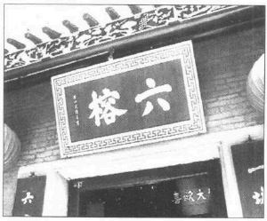

六榕寺。苏东坡被贬后常到此地游玩。

有些控告十分牵强。最有趣的就是一则描写两棵老桧树的律诗。诗中说，桧树“根到九泉无曲处，世间惟有蛰龙知”。他们认为这是侮辱皇帝，因为“龙”象征在位的皇帝，应该只能说在天上，不能说龙藏在地泉里。还有一首牡丹诗，诗中佩服上苍的技巧，竟创造出各种各类的牡丹。判官们说他有意暗示当权者花花巧巧设计出各种新税。《杞菊赋》的前叙说他吃杞菊种子，直接讽刺该地贫困，官员薪金微薄。盲人看日的寓言是指考生无知，对儒家思想一窍不通，只认识王安石的《三经新义》。

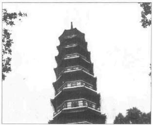

六榕塔

不过，被告大抵承认写诗批评新政，语含愤怒与失望，自己中伤政府是罪有应得。

他寄给王诜附马的诗中，有一句说他坐听“鞭菙环呻呼”。又说“岁荒无术归亡逋”。还提到“虎难摹”，老虎是苛政的象征。他写给李常的诗中说他在密州“酒涕循城拾弃孩”，男尸、女尸、童尸都是饿死在路边的，当时“为郡鲜欢”。至于他写给好友孙觉的诗，有一行说彼此不谈政治，他承认两人一起吃饭，约好谁提政事就罚一杯酒。他曾写诗给官位小、文名大的曾巩，说他对“聒耳如蜩蝉”的政客小人十分厌烦。给张方平的一首诗把朝廷比为“荒林蜩蚻乱”、“废沼蛙蝈滛”，说自己“遂欲掩两耳”。给范镇的诗直接提到“小人”，我们已经知道他写给周邠的诗中把当权派比为夜枭。杭州观潮诗中则说，东海若知君主的意愿，“应教斥卤变桑田”。

好友刘恕罢出京师，东坡曾写两首诗给他，我们仔细研究一下，就不难了解官吏的愤慨，也能看出苏东坡大部分诗句中的弦外之音。我们还可以顺便看出，某些诗篇若不加注脚，对英文读者就毫无意义可言，有一首如下：

敢向清时怨不容，

直磋吾道与君东。

坐谈足使淮南惧，

归去方知冀北空。

独鹤不须惊夜旦，

群鸟未可辨雌雄。

苏东坡承认他很佩服这个朋友，所以把他比为孔子，说他不敢怨不容。第二句提到东汉的大经史家送门徒东行的典故。第二句是说一位勇敢的大官在朝廷上压服淮南王的叛变。第四句引用古籍中的一段文章，说冀（今河北）北产的马区最著名，接着引唐朝韩愈的一首送别诗，说好友走后，冀北就无良驹了。因此也暗示现在朝中没有好人。第五句的“独鹤”牵涉到一段古文，说大人物在升斗小民中有如鹤立鸡群。含意是朝中人物都是平凡的家禽而已；夜啼则是孤鹤的任务。最后一句更气人，因为诗经说，“俱曰予圣，谁识鸟之雌雄？”因此等于说朝廷中只有一群乌鸦，连好人坏人都分不清楚。

他给刘恕的第二首讽刺诗如下：

仁义大捷径，

诗书一旅亭。

相夸绶若若，

犹诵麦青青。

腐鼠何劳吓，

高鸿本自冥。

颠狂不用唤，

酒尽渐须醒。

前二句是指虚伪学者大谈仁义，借此晋升，同时笑他们为官位而沾沽自喜。苏东坡说“麦青青”是引“庄子”的一首诗，说大官生前追觅荣华，死后口含珍珠而葬，不久墓地还是化为麦田。第五句也出自庄子。国君给庄子一个高位，庄子不受，还对官差说了下面的故事：几只专吃腐肉的乌鸦叨到一些腐鼠，正在树上饱餐一顿。一只白鹤（象征纯正隐居的学者）恰好经过，乌鸦大叫，想把它吓走，高贵的白鹤径自飞到云端。含意是苏东坡不屑在政客小人间争权夺利。

我想苏东坡为写诗而被捕受审，一定觉得很奇妙。他当庭教授文学，应该颇有乐趣吧。

于是苏东坡不尊敬政府的罪名就此成立。他把当权者比为蛙蝈，比为蜩蝉，比为夜枭，比为吃腐鼠的乌鸦，比为鸡场的家禽。最气人的是他用“沐猴而冠”的掌故。结论是：苏东坡看不起舒亶和李定等人，舒亶和李定又何必对他有好感呢？

审讯大约在十月初终结，证言交到皇帝手中。牵连的人不少，尤其王诜驸马牵涉最重，审讯中发现他和东坡曾交换许多礼物。皇帝下令，与苏东坡有诗信来往的人都要把手边的诗文交给法庭调查。

这时候一向支持苏东坡的仁宗太后病死了。临死曾对皇帝说：“我记得苏氏兄弟中进士，仁宗先皇曾对家人说，他那天为子孙得到两个相才。现在听说苏轼因写诗而获罪。这全是小人陷害他，他们在他的政绩上挑不出毛病，就想用他的诗来定罪。这些控告不是太琐碎了吗？我是无法复原了，你可不能冤枉无辜。天神会动怒的。”这等于她临终的遗嘱。

十月三十日判官门做了一份案情摘要，呈给皇帝。由于太后殡葬，案件悬搁了很久。苏东坡在牢中等待审判的结果，看自己命运如何，一件神秘的事情发生了。

“审间结束后有一天夜里，”几年后苏东坡对朋友说：“更鼓已敲，我正要睡觉，突然看到一个人进人牢房。”

“他一言不发，丢了一个小盒子在地板上，倒头就睡。我以为是别的囚犯，没有理他，就径自睡着了。四更天（凌晨三点）左右我觉得有人推我，那人对我说‘恭喜’，我问他怎么回事。他说‘好好睡，别担心。’说完就带着小盒子离开牢房。原来舒亶等人一直想办法劝皇帝杀我。陛下不忍杀，就暗地派宫中小黄门到狱中来看我。这位小宫仆刚到来，他便呼呼入睡，鼾声如雷。他立刻奔回去向陛下报告，说我睡得很安详，陛下对朝臣说‘我知道苏轼心中没有亏心事!’于是我获赦，配往黄州。”

通常皇家出殡总要大赦天下，依照法律和习俗苏东坡应该减罪。御史们原满心想把反对派一网打尽，这样一来他们的心血全白费了。李定和舒亶十分担心。这回李定强烈反对特赦。舒亶更要求把司马光、范镇、张方平、李常、孙觉和另外五位苏东坡的朋友都判死刑。

当时的一位副相王珪受到御史威逼，有一天突然对皇帝说：

“苏轼有心反叛陛下。”

“他也许小有冒犯，”皇帝吃惊地说，“但是他无意谋反。你怎么这样说呢？”

王珪提起那首双桧树的诗，说文中提到地底的“蛰龙”，也许是指有人以后会摇身变成皇帝。但是皇帝说：

“诗不能这样读法。他是描写桧树。和我有什么关系？”

王珪这才闭口不响。章惇当时还是苏东坡的朋友，他为东坡辩护说，龙不但是君主的象征，也可以指大臣，还引了几个文学典故来印证他的说法。

等苏东坡友伴交出的证物都调查完毕，皇帝就派自己的人重审。根据这位判官的摘录，诽谤政府应该贬居或处两年的苦役，但是苏东坡情况较严重，该连带取消他的两个官衔。这是法律的观点。不过这么重大的案件该由皇帝亲自决定。

十二月二十九日，宫中官员送出一道命令，把苏东坡贬居到汉口附近的黄州，使李定和舒亶大失所望。他获得团练副使的小官位，条件是“限”住该区；也就是不能随便离开，也无权签署公文。

受牵连的人有三位处罚颇重。王诜驸马对东坡泄漏公务机密，一直与他互换礼物，而且身为皇帝国戚，竟不将手头的诽谤诗向上报告，因此被削除一切官衔爵位。另一位是王巩，他倒没有收到什么诽谤诗，显然是无辜受累，也许御史们为了私怨想修理他吧。往后几年苏东坡一直说王巩为他受过。我们知道王巩性好奢华，他谪居西南边区，一定很难受。

第三位是子由，他上书皇帝，愿以一切官爵来替哥哥赎罪。供状中倒没有告子由接受哥哥哪一首特别严重的诽谤诗，不过因为同胞关系，他被降调高安——离哥哥谪居地一百六十哩——担任筠州监酒。

此外张方平和另一位大官各罚三十斤铜，司马光、范镇和十八位东坡的朋友各罚二十斤铜。

苏东坡除夕出狱，一共在牢中关了四个月零十二天。他走出东城街北面的牢门，站了一会，吸吸空气，觉得微风拂面，非常舒服，四周有人吱吱喳喳说话，街上行人骑马走来走去。

他真是不可救药，那天晚上又写了两首诗，说他“却对酒杯浑似梦”、“试拈诗笔已如神”：

平生文字为吾累，

此去声名不厌低。

塞上纵归他日马，

城东不千少年鸡。

他又开始大做诗文，这两首诗至少有两句御史们还可以告他不尊敬皇上。塞翁失马的比喻还无伤大雅，因为它指的是“塞翁失马，焉知非福。塞翁得马，焉知非祸”的寓言；换句话说，谁也不知道什么是好运，什么是坏运。但是“少年鸡”提到贾昌。贾昌晚年曾对人说，他年轻时以斗鸡赢得皇帝的宠爱，皇帝把他当做弄臣和演员。言外之意是把朝中人比为“倡优”——这是侮辱的名辞。另一句自称“窃禄”也就是说他不够资格却得到官位；但是这两个字是从一位大学者写给曹操的信中摘取出来的，而曹操被人通称为奸臣和暴君。苏东坡写完这首诗，丢下笔杆说，“我真是无可救药”。

---

### 第十五章东坡居士

他筑水坝、造鱼塘，种了邻居送的树苗，朋友送的花木、故乡来的菜蔬，精力全耗在上面。一个男孩跑来告诉他，他们挖的井出水了，或者针状的绿牙伸出地面了，他高兴得跳起来。他看见稻茎随风摇摆，晚上沾了露珠的稻茎有如月夜的珍珠，晶莹可爱，心里充满自豪与满足，他一直靠俸禄过日子，如今才“知此味”。他在高地上种小麦。一位农夫跑来告诉他，不能让苗叶长起来，若要丰收，得让牛羊吃吃草，作物才能长得好些。后来收成不错，他非常感激农夫的忠告。

---

现在苏东坡因需要而务农，又因脾气和天性而变成隐士。社会、文化、经史的研究，外在的工作与责任隐藏了一个人的本性。去掉这些时势和传统的陷阱，真我就出现了。苏东坡回到百姓群中，有如水里的海豹；在陆地上摇鳍摆尾的海豹只是半只海豹而已。苏东坡最可爱的莫过于自食其力的农夫面目。中国人往往歌颂戴斗笠耕田并站在田野山边的诗人，如果他还能写出好诗，敲牛角打拍子。如果他偶尔或常常喝醉，爬到城墙顶偷看月亮，那就更妙了。于是他变成自然的大顽童——也许大自然就要人如此吧。

元丰三年（1080年）一月一日苏东坡带着二十一岁的长子苏迈离开京师，前往谪居地黄州。他直走陆地，把家人交给子由照管，以后再去。可怜的子由要带自己一大家（七个女儿，三个儿子和两个女婿）到九江以南数百里的高安任职，又加上苏东坡的眷属。监酒的官职远不如我们想象中迷人，只是公家酒店的掌柜而已。几个月之后，子由到达九江，要家人在那儿等他，就上溯长江，把东坡的太太、朝云和两个小儿子送到哥哥身边。东坡二月一日到黄州，家人三月二十九日才到。

黄州是汉口下游的河边小镇。东坡等家人，先往在定惠院，该寺离江甚远，位在一座林木茂密的小山边。他和僧侣一起吃饭，午餐晚餐后常在一棵山楂树下散步，写出了最好的名诗。不久身边就有不少朋友。徐太守诚意相待，常约他去喝酒。长江对岸的武昌（不是现在的武昌）太守姓朱，常送酒菜给他。雨天苏东坡很晚才起床，傍晚一个人到东山脚漫游，寻访庙宇、花园和清溪。有时候朋友来看他，大家一起到长江两岸的山区旅行。这是多山的林区，乡村风景很好。南岸有矾山，高耸在湖泊水道交织的平原里。

苏东坡死里逃生，心魂震撼，尽量少说话。他开始思考生命的真谛。六月的一首送别诗中，他说他的生命有如磨石下的小蚂蚁，也象旋风中的羽毛。他开始深思自己的个性，研究如何得到心灵的平安。他信教愈来愈虔诚，“安国寺记”中说，“余二月至黄舍。馆粗定，衣食稍给，闭门却扫，收召魂魄。退伏思念，求所以自新之方。又观从来举意动作，皆不中道。非独今之所以得罪也。欲新其一，恐失其二。触类而求之，有不可胜悔者。于是喟然叹曰：‘道不足以御气，性不足以胜习，不锄其本而耘其末，今虽改之，后必复作。盍归诚佛僧，求一洗之’。得城南精舍，曰安国寺，有茂林修竹，陂池亭榭。间一二日辄往焚香默坐。深自省察，则物我相忘，身心皆空。求罪始所生而不可得。一念清净，染污自落。表里翛然，无所附丽。私窃乐之……”

苏东坡心中一股与宗教冲动相反的儒家趋势却将他拖往另一个方向。不错，人应该在宗教中追求平安，但是佛家若说得不错，人生若只是幻影，人若该完全脱离社会，人类就会绝种，烦恼也不存在了。因此佛家虚空无我，去除一切私念的目标和儒家对同胞踏实的责任观时常发生冲突。解脱的问题毕竟只是达到精神的和谐，让卑下的本能受到高贵情操的控制。人若能自我训练而达到此一境地，就不必脱离社会来求解脱了。

例如人类社会中对抗邪恶的问题。理学家朱熹批评苏东坡出狱的两首诗毫无自我检讨、重新做人的意思。我们觉得这两首诗可看出苏东坡文风依旧。问题是，他真想改过吗？他打算闭嘴不谈国家的错事吗？他对普通朋友是一种说法，对知交密友又是一种说法。

他有两封给朋友的信泄露了内心深处的信念。一封是给李常的。李常写诗安慰他，语气太多情，苏东坡回信说：“何乃耶？仆本以铁石心肠待公。吾侪虽老且穷，而道理贯心肝，忠义填骨髓，直需谈笑死生之际。若见仆困劳便相怜，则与不学道者，大不相远矣，……虽怀坎壈于时，遇事有可尊主泽民者，便忘躯为之，付与造物。非兄仆岂发此。看讫便火之。不知者以为诟病也。”

苏东坡写了好几封信给牵连最重，谪居西南边区的王巩。他先表示连累他很难过，然后又说，收到王巩的信，知道他能从哲学中寻找慰藉：“知公真可人。而不肖他日犹得以衰颜白发，厕宾客之末也……”接着说起道家长生的艺术，他自己正在施行。“某近颇知养生，亦自觉薄有所得。见者皆言道貌与往日殊别。更相阔数年，索我阆风之上矣。兼画得寒林墨竹已入神矣。行草尤工，只是诗笔殊退也，不知何故。昨所寄临江军书，久已收得。二书反复议论及处忧患者甚详，既以解忧，又以洗我昏蒙，所得不少也。然所得非荀知之亦允蹈之著。愿公常诵此语也。杜子美困厄中，一饮一食。未尝忘君。诗人以来，一人而已。”

不过他对老友章惇又是一套说法。章惇如今已拜官参政谏议执事，曾写信劝他自新。他写了一封完全正确的回信，充满忏悔。信写得对极了，简直可以呈给皇上看：“平时惟子厚与子曲极口见戒，反复甚二苦，而某强狠自用，不以为然。及在图圈中，追悔无路，谓必死矣。不意圣主宽大，复遣视息人间。若不改者，某真非人也……某昔年粗亦受知于圣主，使稍循理安份，岂有今日。追思所犯，真无义理。与病狂之人，蹈河入海者无异。方其病作，不自觉知，亦穷命所迫，似有物使。及至狂定之日，但有惭耳。而公乃疑其再犯，岂有此理哉？……”接着描写他的生活：“黄州僻陋多雨，气象昏昏也。鱼稻薪炭颇贱，甚与穷者相宜。然某平生未尝作活计，子厚所知之，俸入所得，随手辄尽。而子由有七女，债负山积。贱累皆在渠处，未知何日到此。见寓僧舍，布衣蔬食，随僧一餐，差为简便。以此畏其到也。穷达得丧粗了其理，但廪禄相绝。恐年载间，遂有饥寒之忧。然俗所谓水到渠成，至时亦必自有处置，安能预为之愁煎乎？初到一见太守。自余杜门不出，闲居未免看书，惟佛经以遣日，不复近笔砚矣。”

家人平安到达，一切似乎固定下来，只是东坡还不知道钱花完后他们要如何过日子。次子苏迨十二岁，幼子苏过十岁。太守礼遇有加，让他们住在临皋亭，此地就因他而家喻户晓。这是政府人员走长江水路休憩的驿站。苏东坡写信给朋友说，“寓居去江无十步，风涛烟雨，晓夕百变。江南诸山在几席，此幸未始有也。”这个地方很美，不过其中的风华却大抵出自东坡的想象。他在这栋面对夏阳的小屋中看出许多韵味，别的观光客实地一看，却大失所望。后来有人为他建了一座书斋，他曾吹嘘他午觉醒来，忘记自己身在何处，拉起窗帘，由躺椅上看见千艘船只沿江下行，远处水天连成一色。

临皋亭不算什么，但是风景美一半靠地利，一半靠欣赏人的眼光。苏东坡身为诗人，不免看到、感觉到别人在天国乐园也无法感受的韵味。东坡在杂文中说：“东坡居士酒醉饭饱，倚于几上，白云左绕，清江右回，重门洞开，林峦岔入。当是时若有思而无所思，以受万物之备。惭愧惭愧。”另一篇给范镇儿子的信则语含幽默：“临皋亭下十数步便是大江，其半是峨眉雪水。吾饮食沐浴皆取焉，何必归乡哉。江水风月本无常主。闲者便是主人。闻范子丰新第园池，与此孰胜。所以不如君者上无两税及助役钱尔。”

不过东坡确实很辛苦。他自立一套特殊的开支预算法。他给秦观的信中有这么一段记载：“公择近过此相聚数日，说太虚不离口。莘老未尝得书，知未暇通问……初到黄，廪入既绝，人口不少，私甚忧之。但痛自节省，日用不得过百五十（等于美金一角五分）。每月朔便取四千五百钱，断为三十块，挂屋梁上。平旦用画叉挑取一块，即藏去。钱仍以大竹筒别贮，用不尽以待宾客。此贾耘老（贾收）法也。度囊中尚可支一岁有余。至时别作经画，水到渠成，不须预虑。以此胸中都无一事。”

由临皋亭可以看到对岸武昌美丽的山峰。有时候他穿草鞋出门，雇一条小舟，陪渔夫和樵夫过一天，常被醉汉推挤谩骂，“自喜渐不为人识。”偶尔去看看对岸的川籍好友王齐愈。遇到暴风雨，就在这儿留几天。有时候他乘小船直到樊口潘丙的酒店。他发现村酒还挺不错的。该地产桔子、柿子和尺来长的山芋。江上运费便宜，一斗米只要二十钱。此地羊肉可比美北方的猪肉和牛肉。兔肉很便宜。鱼蟹更几近免费。歧亭酒监有一个大图书室，喜欢借给人家。太守家有良厨，常邀他作客。

元丰四年（1081年）苏东坡变成道道地地的农夫。他开始在东坡耕田，自号“东坡居士”。他早想归隐田间，却没想到被迫如此当上了农夫。“东坡八首”的前叙中说：

“余至黄二年，日以困匮。故人马正卿哀予乏食，为郡中请故营地数十亩，使得躬耕其中，地既久荒，为茨棘瓦砾之场，而岁又大旱，垦壁之劳，筋力殆尽。释来而叹，乃作是诗。自愍其勤，庶几来岁之人，以忘其劳焉。”

东坡农舍实际上大约占地十英亩，离城东只有三分之一英里，就在小山边。顶上是一间三房的小屋，俯视下面的亭台，亭台下便是著名的雪堂。这座五房的堂舍是次年二月在雪中盖成的。墙上有东坡亲笔画的森林、河流、渔夫的雪景。后来这里变成他待客的地方，宋朝大画家米芾当时只有二十二岁，曾来拜访他，与他论书，陆游在孝宗乾道六年（1170年，东坡死后七十年左右）十月参观东坡，曾记载堂中挂着苏东坡的画像。画中他一身紫袍黑帽，手拿竹杆，倚石而卧。

雪堂的石阶下有一座小桥跨沟而过。除了雨天，平常都干干的。雪堂东面是他亲自种的一棵大柳树，再过去是一个小井，泉水冷冽，倒没有什么特别的优点。东面下方是稻田、麦田、一大排桑树、菜蔬和一个大果园。他还把附近一个朋友送他的茶树也种在农场上。

远景亭在农舍后方，立在一堆土岗顶，四处风光一览无遗。他的西邻姓古，有一大片巨竹，竹茎周长七英寸，长得十分茂密，连天空都遮住了。苏东坡夏天就在这儿乘凉。还摘取干燥平滑的竹箨给太太做鞋衬里。

苏东坡现在是道道地地的农夫，不是地主。有一首答孔平仲的诗如下：

去年东坡抢瓦砾，

自种黄桑三百尺。

今年刈草盖雪堂，

日炙风吹面如墨。

此地久不下雨，甘雨一来，亲自种田的他真是又快活又感激：

沛然例炀三尺雨，

造化无心悦难测，

老夫作罢得甘寝，

卧听墙东人响屐，

腐儒奋粝支百年，

力耕不受众目怜，

会当作塘径千步，

横断西北遮山泉，

四邻相率助举杵，

人人知我囊无钱。

建筑是苏东坡的本能。他决心为自己造一个舒舒服服的家。他筑水坝、造鱼塘，种了邻居送的树苗，朋友送的花木、故乡来的菜蔬，精力全耗在上面。一个男孩跑来告诉他，他们挖的井出水了，或者针状的绿牙伸出地面了，他高兴得跳起来。他看见稻茎随风摇摆，晚上沾了露珠的稻茎有如月夜的珍珠，晶莹可爱，心里充满自豪与满足，他一直靠俸禄过日子，如今才“知此味”。他在高地上种小麦。一位农夫跑来告诉他，不能让苗叶长起来，若要丰收，得让牛羊吃吃草，作物才能长得好些。后来收成不错，他非常感激农夫的忠告。

邻居好友包括潘酒监，郭药师、庞郎中、农夫古先生；还有一个嗓门大、性情跋扈，常和先生吵嘴，晚上“如猪嘶狗嗥”的农妇；黄州太守徐大受、武昌太守朱寿昌，另外还有始终陪他，与他同甘共苦的马梦得（正卿）。东坡说，朋友们若想靠他发财，简直像在龟背上刮羊毛，不知哪天才能织成毛毯。“可怜马生痴，至今夸我贤”。一位眉山来的穷学者巢谷特来教他的小孩读书。他到黄州第一年，太太的弟弟曾经来陪他们住一阵子，后来几年子由的女婿经常轮流来看他。苏东坡又为弟弟找了一个女婿，照子由的诗看来，对方根本没见他就一口答应了。他还引来一堆怪人，其中有两个是道士，过着道家飘泊的日子。一位经子由介绍来找东坡，听说已一百二十七岁，东坡对长生秘诀颇感兴趣，老道士遂成为家中的一员。第三年诗僧参寥来陪他住了一年左右。但是他最好的朋友是陈慥，东坡年轻时曾和他父亲水火不容：陈慥住在歧亭；苏东坡曾去看过他几次，四年内陈慥也来找过他七回。由于文学上的偶然，陈慥惧内的声名竟留传千古。陈慥字季常，至今“季常癖”仍是“惧内”的代称。陈慥是东坡随时可以开玩笑的朋友。在一篇戏谑诗中，苏东坡写道：“龙丘居士亦可怜，谈空说有夜不眠，忽闻河东狮子吼，拄杖落地心茫然。”于是他惧内的典故从此确立。这首诗的含意其实颇成问题。据我们所知，陈慥在家的生活无忧无虑，浪漫又幸福。“狮子吼”一辞在佛教中代表“如来正声”。我猜他太太嗓门很大，苏东坡只是开开朋友的玩笑。但是“河东狮吼”至今仍是悍妇的标准形容词。如果苏东坡指明“母狮吼”，含意就确定多了。

苏东坡有一个美满的家庭，他在诗中曾自称有一位好太太。意思是说他太太不像许多朋友和历史上名士的太太那么专横。他的儿子不算出色，不过苏迈当时也会作诗。大诗人陶潜曾写诗悲叹儿子不成材，说一切都是天意，他只求寄情杯中。苏东坡说：“子还可责同元亮，妻却差贤胜敬通。”敬通是东汉的一位学者。苏东坡在注脚中说：“仆文章虽不逮冯衍，而慷慨大节乃不愧此翁。衍逢世祖英容好士而独不遇，流离摈逐与仆相似。而其妻妒悍甚，仆少此一事，故有胜敬通之句。”

大约在这段期间，他收朝云作妾。我们记得，苏太太在杭州买朝云当丫环的时候，她只有十二岁，照宋朝的说法，她可以算是“苏夫人之妾”，不过这一名辞在英文中毫无意义。中国古人常把太太的丫环升为“妾”。这种小妾是太太各方面的帮手，太太理应照顾丈夫的生活，例如备水洗澡啦，小妾就比丫环方便，不忌讳丈夫在场。现在朝云长大了。她非常聪明，东坡的崇拜者不免把她描写得有声有色，有人甚至说，苏东坡带她回家时，她已是杭州出色的名妓。仔细研究，便知道与事实不符。照东坡的记载，朝云到他家才学读学写，她受到东坡读者的厚爱也是应该的，因为他晚年流放异地，只有她追随在身边。

元丰六年（1083年）朝云生了一个男孩子，名叫遁儿，小孩出生三日举行洗礼，苏东坡写了一首自嘲诗。

人皆养子望聪明，

我被聪明误一生。

惟愿孩儿愚且鲁，

无灾无难到公卿。

丈夫是好厨师，喜欢自己煮饭菜，他太太一定很高兴。他曾遗憾地说，当地猪肉很便宜，可惜“贵者不肯吃，贫者不解煮”。他写了一道炖猪肉的方子，非常简单——加少量水煮开后，用文火炖几小时，酱油当然是不可少的。他煮鱼的方法如今在中国已十分普遍。先选一条鲤鱼，用冷水洗净，抹上盐，里面塞入甘蓝嫩心。然后加菊花煎熟。半熟的时候放几片姜，再洒些酒和腌萝卜酱，最后加几片薄桔皮，乘热上桌。

他还发明了一种菜羹，命名为东坡羹。这是穷人的菜肴，他曾介绍给和尚。用双层锅蒸饭煮菜汤，两样同时煮好，十分简便。下层煮汤，先把甘蓝、萝卜、油菜根和荠菜仔细拧干，加点姜放入锅内。照例加一些生米。等一锅菜煮开，没有辛味了，再将饭甑搁在上面。小心别让滚汤和米接触，蒸气才能均匀透入四方。

在那种乡村环境里，他觉得自己的生活愈来愈像陶潜，他很佩服他。陶潜也因为无法穿官袍、整官带，对税政司派来的小官磕头，而辞官归农，苏东坡写了一首诗，说他的前生一定是陶潜。这话若由小诗人说来未免太自负，苏东坡说来就很自然了。他愈读陶潜的诗，愈觉得诗中反映了他自己的情感和目前的生活。

有些乐趣只有诗人居士才能享受。陶潜辞官归隐，曾写了一首《归去来兮》赋，可惜现在唱不出来。苏东坡每天在田里工作，不禁重组其中的字句，配上民歌。他教农人唱，自己放下犁耙，也跟着一起唱，还有竹枝敲牛角打拍子。

苏东坡很容易接受哲学的安慰。他在雪堂的墙壁和门板上写了三十二个字，日夜观赏。内容是四道警告：

出舆入辇

蹶痿之机

洞房清宫

寒热之媒

皓齿峨眉

伐性之斧

甘脆肥浓

腐肠之药

失去尘间美好享受的人有福了!就是这种幽默感使苏东坡能到处得到快乐与满足。后来他被逐海外，没有药品也没有医生，他对朋友说：“我想到京师每年有多少人死在大夫手中，觉得自己真幸运。”

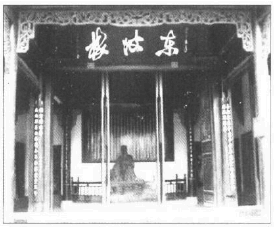

东坡楼

苏东坡自觉辛苦没有白费，心里很快活。他写道：

“某现在东坡种稻，劳苦之中亦自有乐事。有屋五间，果丈十数畦，桑百余本。身耕妻蚕，聊以卒岁也。”

现在苏东坡自食其力，心满意足。我们今天觉得和他很亲切，就因为他有慈悲的信仰。该地溺婴的恶俗使他深受震撼。他写了一封信给武昌太守，一信值千金，不是因为文笔动人，而是因为内容可贵。我不懂史维夫特怎么会说婴儿肉是贵族的佳肴，也是大举杀婴的有利计划，虽然他语含讥讽，我仍觉得意外，史维夫特纯粹是开玩笑，不过这种恶劣的玩笑苏东坡一定不懂。苏东坡听当地文人提到本区杀婴的习惯，立刻写信给朱太守，并派一位朋友去见他：

“上鄂州太守朱康叔（寿昌）

轼启：

昨日武昌寄居王殿直天麟见过。偶说一事，闻之辛酸，为食不下。念非吾康叔之贤，莫足告语，故专遣此人。俗人区区，了眼前事，救过不暇，岂有余力及此度外事乎。

天麟言岳鄂间田野小人，倒只养二男一女，过此辄杀之。尤讳养女，以故民间少女多鳏夫。初生辄以冷水浸杀，其父母亦不忍，率常闭目背向，以手按之水盆中，咿嘤良久乃死。有神山乡百姓名石揆者，连杀两子。去岁夏中，其妻一产四子。楚毒不可堪忍，母子皆毙。报应如此，而愚人不知创艾。天麟每闻其侧近者有此，辄往救之，量与衣服饮食，全活者非一。既旬日，有无子息人欲乞其子者，辄亦不肯。以此知其父子之爱，天性故在，特牵于习俗耳。

闻鄂人有秦光亨者，今已及第，为安州司法。方其在母也，其舅陈遵梦一小儿挽其衣，若有所诉。比两夕辄见之，其状甚急。遵独念其姊有娠将产，而意不乐多子，岂其应是乎。驰往省之，则儿已在水盆中矣，救之辄免。鄂人多知之。

准律故杀子孙，徒二年，此长吏所得按举。愿公明以告诸邑令佐，使召诸保正，告以法律，谕以祸福。约以必行，使归转以相语。仍录条粉壁晓示，且立赏召人告官赏钱，以犯人及邻保家财充。若客户则及其地主。妇人怀孕，经涉岁月，邻保地主无不知者。其后杀之，其势足相举觉，容而不告，使出赏固宜。若依法律行遣数人，此风便革。

公更使令佐各以至意，诱谕地主豪户。若实贫甚不能举子者，薄有以周之。人非木石，亦必乐从但得初生数日不杀，后虽劝之使杀，亦不肯矣，自令以往，缘公而得活者，岂可胜计哉。佛言杀生之罪，以杀胎卵为重。六畜犹尔，而况于人。俗谓小儿病为无辜，此真可谓无辜矣。掉耄杀人犹不死，况无罪而杀之乎。公能生之于万死中，其阴德十倍于雪活壮夫也……

轼向在密州遇饥年，民多弃子。因盘量劝诱米，得到剩数百石别储之，专以收养弃儿。月给六斗。比期年，养者与儿，皆有父母之爱，遂不失守。所活者亦数十人。此等事在公如反手耳。恃深契故不自外，不罪不罪，此外惟为民自重。不宣。轼再拜。”

他自己还成立救儿组织，请附近诚实博爱的古先生担任会长。该会向富人捐得不少钱财，请他们一年各出十缗以上，用来买米、买布、买棉被。古先生管钱，安国寺的一位和尚管账。他们到乡村调查即将生产的妇女，只要她们肯养小孩，就送钱送米送布给他们。苏东坡说，一年若能救下一百个婴儿，也就功德无量了。他自己每年捐十缗钱。他正在推行佛家最好的传统。

我总觉得，只要人道精神长在，宗教就复活了。人道精神一死，宗教也随之衰微。

---

### 第十六章赤壁赋

水位已降，江面石头一一露出来，赤壁高高立在岸边。风景变化太大，苏东坡几乎认不出来。他兴致勃勃叫朋友们陪他登赤壁，朋友拒绝，他就一个人攀登，把衣裳撩起，小心绕过矮树和荆棘，终于爬到崖顶，有两只乌鸦在那儿作窝。他站在岩顶上，对夜空长啸，回声响彻山谷。突然他觉得飘飘欲仙，不知道身在何处，一股悲哀袭来，他觉得不能待太久。便回到船上，任船只随风飘泊。

---

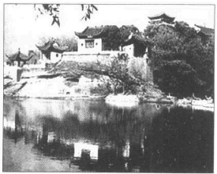

湖北黄冈赤壁

现在苏东坡过着快活的日子。黄州虽是贫瘠的小镇，但是万缕闲情、风光、诗人敏感的想象力、月光美酒却混合成强大的魅力，使东坡活得很诗意。农田垦好，他衣食无忧，开始享受每天的趣味。他有一群朋友，大家都和他一样自由，一样口袋空空却悠闲无比。有一位怪人李岩，若非苏东坡记下他能睡的本事，后代没有人会知道他。午饭后朋友们都在下棋，李岩躺在椅子上呼呼大睡。每隔几盘，他就醒来说：“我睡了一回合。你们下了几盘啦？”苏东坡在文章里说，李岩一个人玩四脚棋盘（床）一黑子（睡仙）的游戏。“著时自有输赢，著了并无一物”。

这是幻梦的生活，苏东坡说欧阳修这一首诗形容得最好：

夜凉吹笛千山月，

路暗迷人百种花。

棋罢不知人换世，

酒阑无奈客思家。

苏东坡兼住农庄雪堂和城内的临皋亭，每天来回跑。不到三分之一哩的路程变成历史上最受歌颂的脏泥路。走过城内的小店，就来到黄泥坂，通向绵延的山麓。除了绿树绿竹，一切似乎都是黄的。他在徐州建了黄楼。如今住在黄州，每天穿过黄泥坂到黄岗的东坡去。他脱下文人的衣帽，换上普通农夫的衣裳，一般人都不认识他。他每天走这段路。种田的空档中，他常回城内小醉一回，躺在草地上睡觉，傍晚等好心的农友叫醒他。有一天他喝醉了。就写下一首浪民狂想曲，名叫“黄泥坂词”，后半部如下：

朝嬉黄泥之白云兮，暮宿雪堂之青烟。喜鱼鸟之莫余惊兮，幸樵叟之我嫚。

初被酒以行歌兮，忽放杖而醉偃。草为茵而块为枕兮，穆华堂之清晏。纷坠露以湿衣兮，升素月之团团。感父老之呼觉兮，恐牛羊之子践。

于是蹶然而起，起而歌曰，月明兮星稀，迎余往兮饯余。归岁既晏兮草木腓。归来归来，黄泥不可以久嬉。

但是他和酒友夜游却产生了几则有趣的谣言，传遍当地与京师，多亏他爱月爱酒，这种生活使苏东坡写出了最好的散文和诗篇，他在“牛肉与酒”中写下一次颇不平凡的夜游：

令日与数客饮酒而纯臣适至。秋热未已而酒白色，此何等酒也，入腹无脏，任见大王。既与纯臣饮，无以侑，西邻耕牛适病足，乃以为肉，饮既醉，遂从东坡之东直出春草亭而归。时已三更矣。

当代有人说，春草堂就在城墙外，由这篇文章可见苏东坡喝了私酒，杀了农夫的水牛，半夜醉醺醺爬过城墙。“难道纯臣为人也不可信任？”

另外一次夜游把太守吓坏了。他在江上小船中喝酒。晚上夜空很美，他灵感大发：

夜饮东坡醒复醉，归来仿佛三更。家童鼻息已雷鸣，敲门都不应，倚杖听江声。长恨此身非我有，何时忘却营营，夜阑风静谷纹平，小舟从此逝，江海寄余生。

第二天谣言纷起，说东坡到江畔写了这首告别词，就乘船逃走了。谣言传到太守那儿，他吓得要命，因为他有责任不让苏东坡离开黄州。他立刻出去找，发现东坡还在睡觉，鼾声如雷，最后这个谣言传到京师，连皇帝都听到了。

第二年又起了一个更严重的谣言。苏东坡手臂有风湿。后来右眼也受影响，他一连闭门数月，谁也没看到他。这时候散文大师曾巩在别的地方去世，传说苏东坡和他同一天被召回天庭。皇帝听到传说，就找一个和东坡有亲戚关系的大官来问话，这位大官说他也听到了，但不知道真相如何。皇帝正在吃午饭，一口也吃不下。他叹口气说了一声“才难”就离餐桌。范镇也听到谣言，痛哭失声，叫家人送奠仪到苏家。他转念一想，还是先派一个朋友到黄州去看看。这时候他才知道传闻不实，原来是苏东坡闭门数月，没有人看见他，才有这个说法。苏东坡回信给范镇说：“平生所得毁誉，皆此类也。”

解放的生活使他的心灵产生蜕变，又反映到作品中。刻薄的讽刺、尖锐的笔锋、一切激情与愤怒都过去了，代之而起的是光辉、温暖、亲切、宽容的幽默感，绝对醇美，完全成熟。哲学的价值就是教人笑自己。就我所知，动物只有猩猩会笑，但是我相信只有人才会笑自己。不知道这能不能称为神祗的笑容。希腊诸神充满人性的错误和缺点，他们一定常常有机会自嘲一番；但是基督教的上帝或天使太完美了，不可能这样做。把这种自嘲的特色称为堕落人类独一的美德，该算是一大恭维吧。

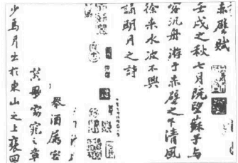

苏轼《赤壁赋》墨迹

苏东坡松弛自在时所写的小笔记最能表现出这种成熟的幽默感。他开始在笔记中写下许多不连贯的短笺，不含道德训示，也没有什么作用，却是他最受欢迎的作品之一。有一篇谈到他贫穷的现状和一位经常追随他的人：“马梦得与仆同岁月生，少仆八日，是岁生者无富贵人，而仆与梦得为穷之冠。即吾二人而观之，当推梦得为首。”

有一篇故事提到两个乞丐：

有二措大相与言志。一云“我平生不足惟饭与睡尔。他日得志，当饱吃饭了便睡，睡了又吃饭”。另一云“我则异于是，当吃了又吃，何暇复睡耶。”

任何情况下，幸福都是一种秘密。但是研究苏东坡的作品，就不难探出他幸福的奥秘了。

这位慷慨的天才对世人的贡献远超过他从世上收取的一切，他到处捕捉诗意的片刻，化为永恒，使我们大家都充实不少。他现在过的浪民生活很难视为一种惩罚或拘禁。他享受这种生活，写出四篇巨作：短词“大江东去”，两篇月夜访“赤壁”的文章，以及“承天夜游”。难怪敌人要妒恨他，把他送入监狱。两篇月夜记游的文章是以“赋”体写成的。苏东坡完全靠音调和气氛写作。这两篇文章流传千古，因为短短几百个字就道出了人在宇宙中的渺小，同时又说明人在此生可以享受大自然无尽的盛宴，没有人写得比他更传神，虽然不押韵，只运用灵活的语言，他却创造出普遍的心境，无论读者读多少遍，还是具有催眠般的效果。此处道出人类在浩瀚宇宙中的渺小，效果可比美国画中的山水画。我们只看到一点点风景的细节，隐在空白的水天内，两个小人影在月夜闪亮的河上泛舟。从此，读者就迷失在那片气氛里。

苏东坡和川籍的道人杨世昌秉烛夜游。那是七月的仲夏夜。清风徐来，水波不兴。东坡与友人喝酒吟唱。不久月亮出来，徘徊在北斗星和天牛星之间。白雾笼罩着江面，水光和月夜的雾气连成一片。他们乘小舟飘过白茫茫的大江，仿佛在空中航行，不知目的地何在。他们开始唱歌，同时敲船舷打拍子：

桂掉兮兰桨，

击空明兮溯流光。

渺渺兮予怀，

望美人兮天一方。

他的朋友擅于吹箫，苏东坡陪着哼唱。曲调很特别，如怨如慕，如泣如诉，徐音袅袅。另一条船上的孀妇感动得哭起来，连水中的鱼儿也为之动容。

苏东坡很难过，问朋友这支曲子为什么那么悲哀。朋友说：“你不记得赤壁下的历史？”一千年前赤壁之战在此发生，决定了三国的命运。苏子难道不能想象曹操战舰如林，由江陵而下的盛景？曹操也是诗人。苏子难道不记得他“月明星稀，乌鹊南飞”的诗篇？“而今安在哉？吾与子驾一叶之扁舟，举匏樽以相属。寄蜉蝣于天地，渺沧海之一粟。哀吾生之须臾，羡长江之无穷。挟飞仙以遨游，抱明月而长终。知不可乎骤得，托遗响于悲风。”

苏东坡开始安慰他的朋友：“客亦知夫水与月乎。逝者如斯，而未尝往也。盈虚者如彼，而卒莫消长也。盖将自其变者而观之，则天地曾不能以一瞬：自其不变者而观之，则物与我皆无尽也。而又何羡乎？且夫天地之间，物各有主。苟非吾之所有，虽一毫而莫取。惟江上之清风，与山间之明月，耳得之而为声，目遇之而成色，取之无禁，用之不竭，是造物者无尽藏也。而吾与子之所共适。”

听到这句话，他的朋友微笑了。他们又洗杯洗碗大吃一顿。吃罢也不清理杯盘，倒头就睡，不知道东边己露出曙光。

过了三个月，苏东坡十月里又写了《后赤壁赋》，仍是满月，苏东坡和两个朋友从雪堂出来，要到临皋亭去。路上经过黄泥坂。地上洒满白霜，树枝光秃秃的，他们看到地上的人影，抬头望见明月，竟被夜色迷住了，开始轮流唱歌。朋友开腔了：“有客无酒，有酒无肴，月白风清，如此良夜何？”“今者薄暮，举网得鱼，巨口细鳞，类似松江之鲈。顾安所得酒乎？”苏东坡决定回家请太太弄些酒菜来，他太太说，家有斗酒，藏了好一段日子了。于是大家带着鱼和酒，又乘船到赤壁之下。水位已降，江面石头一一露出来，赤壁高高立在岸边。风景变化太大，苏东坡几乎认不出来。他兴致勃勃叫朋友们陪他登赤壁，朋友拒绝，他就一个人攀登，把衣裳撩起，小心绕过矮树和荆棘，终于爬到崖顶，有两只乌鸦在那儿作窝。他站在岩顶上，对夜空长啸，回声响彻山谷。突然他觉得飘飘欲仙，不知道身在何处，一股悲哀袭来，他觉得不能待太久。便回到船上，任船只随风飘泊。

正当午夜，四顾寂寥。两只孤鹤由东方飞来，白色的羽毛有如仙人的白衣。鸟儿戛然长叫，由舟顶向西飞，苏东坡不知有什么预兆，不久各自回家，他上床做了一个梦。梦见两个道士身穿羽衣。认出是他，就问他赤壁之游如何，东坡问他们的姓名，他们不肯说。东坡猜想：“呜呼嗯嘻，我知之矣，畴昔之夜，飞鸣而过我者，非子也耶？”道士笑笑，东坡就醒了。他开门看看，眼前只见空空的街道，什么也没有。

由这篇文章看来，苏东坡建立气氛的方法是提出另一个世界——道家仙人的梦境（白鹤便是传统的象征），使读者搞不清楚苏东坡在描写什么境界。依照中国人的信仰，此生只是我们在地球上暂时的存在，我们前生很可能是仙人，来世也会再度成仙，只是我们不知道罢了。

大约这个时候苏东坡又写了一篇月夜漫游的短记。描写他有一天晚上睡不着，起身到临皋亭附近的承天寺漫步赏月。这篇文章已列为经典之作，由于漫不经心的魅力而颇受赞赏：

“记承天夜游

元丰六年十月十二日夜，解衣欲睡，月色入户，欣然起行。念无与乐者。遂至承天寺寻张怀明。亦未寝，相与步于中庭。庭下如积水空明，水中藻荇交横，盖竹柏影也。何夜无月，何处无竹柏，但少闲人如吾两人耳。”

本文奇短，却是瞬间佳境最敏感的记录。我们若相信苏东坡文体天成的理论，认为一个人的文风只是心灵自然的流露，我们就可以看出他先得有那份心境，才能写出完美安详、单纯自足的作品。我们下一章再看看他如何培养心灵的沉着和冷静。

赤壁赋

壬戌之秋，七月既望，苏子与客泛舟游于赤壁之下。清风徐来，水波不兴。举酒属客，诵明月之诗，歌窈窕之章。少焉，月出于东山之上，徘徊于斗牛之间。白露横江，水光接天。纵一苇之所如，凌万顷之茫然。浩浩乎如冯虚御风，而不知其所止；飘飘乎如遗世独立，羽化而登仙。

于是饮酒乐甚，扣舷而歌之。歌曰：“桂棹兮兰桨，击空明兮溯流光。渺渺兮于怀，望美人兮天一方。”客有吹洞萧者，倚歌而和之，其声呜呜然：如怨如慕，如泣如诉；余音袅袅，不绝如缕；舞幽壑之潜蛟，泣孤舟之嫠妇。

苏子愀然，正襟危坐，而问客曰：“何为其然也？”客曰：“月明星稀，乌鹊南飞，此非曹孟德之诗乎？西望夏口，东望武昌。山川相缪，郁乎苍苍；此非孟德之困于周郎者乎？方其破荆州，下江陵，顺流而东也，舳舻千里，旌旗蔽空，酾酒临江，横槊赋诗；固一世之雄也，而今安在哉？况吾与子，渔樵于江渚之上，侣鱼虾而友糜鹿，驾一叶之扁舟，举匏樽以相属；寄蜉蝣与天地，渺沧海之一粟。哀吾生之须臾，羡长江之无穷；挟飞仙以遨游，抱明月而长终；——知不可乎骤得，托遗响于悲风。”

苏子曰：“客亦知夫水与月乎？逝者如斯，而未尝往也；盈虚者如彼，而卒莫消长也。盖将自其变者而观之，而天地曾不能一瞬；自其不变者而观之，则物于我皆无尽也。而又何羡乎？且夫天地之间，物各有主。苟非吾之所有，虽一毫而莫取。惟江上之清风，与山间之明月，耳得之而为声，目遇之而成色。取之无禁，用之不竭。是造物者之无尽藏也，而吾与子之所共适。”

客喜而笑，洗盏更酌，肴核既尽，杯盘狼藉。相与枕藉乎舟中，不知东方之既白。

后赤壁赋

是岁十月之望，步自雪堂，将归于临皋。二客从予过黄泥之坂。霜露既降，木叶尽脱。人影在地，仰见明月，顾而乐之，行歌相答。

已而叹曰：“有客无酒，有酒无肴，月白风清，如此良夜何？”客曰：“今者薄暮，举网得鱼，巨口细鳞，状如松江之鲈。顾安得酒乎？”归而谋诸妇。妇曰：“我有斗酒，藏之久矣，以待子不时之需。”

于是携酒与鱼，复游于赤壁之下。江流有声，断岸千尺；山高月小，水落石出。曾日月之几何，而江山不可复识矣！

予乃摄衣而上，履巉岩，披蒙茸，踞虎豹，登虬龙，攀栖鹘之危巢，俯冯夷之幽宫。盖二客不能从焉。划然长啸，草木震动，山鸣谷应，风起水涌。予亦悄然而悲，肃然而恐，凛乎其不可留也。反而登舟，放乎中流，听其所止而休焉。时夜将半，四顾寂寥。适有孤鹤，横江东来。翅如车轮，玄裳缟衣，戛然长鸣，掠予舟而西也。

须臾客去，予亦就睡。梦一道士，羽衣蹁跹，过临皋之下，揖予而言曰：“赤壁之游乐乎？”问其姓名，俯而不答。“呜呼噫嘻！我知之矣。畴昔之夜，飞鸣而过我者，非子也耶？”道士顾笑，予亦惊悟。开户视之，不见其处。

---

### 第十七章瑜伽与炼丹

苏东坡到老还在寻找方士丹，不过他对不朽的问题始终维持相当的理智。所有道家仙人都去世了；至少他们总留下一个躯壳，虽然理论上他们可以羽化，四周无人的时候，他们可以骑鹤升天，或者化为仙鹤，只留下不相关的尸体。这具肉身有如蝉蛇的干皮，他们奇妙的死法叫做“蝉蜕”。但是苏东坡要看真正不死的人。

---

苏东坡曾说“未有天君不严而能圆通觉悟者”。佛道解脱始于心灵的自律。要得到精神的宁静（佛家认为这就是解脱）必须先克服恐惧、愤怒、忧愁等情绪。东坡住在黄州期间，开始研究佛家和道家思想，使他往后的想法和作品更加添了一番色泽。他潜心于灵魂的奥秘。他自问，人如何达到心灵的平安？印度瑜珈术和道家秘术都提出特定的心灵控制法，可以稳定情绪改善身体的健康，未来甚至有长生不老的可能。苏东坡深信精神的不朽，但是身体的不朽又如何呢？他渐渐对长生之道发生兴趣。身心的不朽无法分割，因为身体无论由哪一方面看来，都只是臭皮囊而已，如果心灵仔细培养，将来自会甩下暂时的躯壳，翱翔到心灵界中。此外身体不朽至少有一个可行的目标，先防止衰老，延长寿命。

所谓长生术包含瑜珈、佛教、道教、中国医药传统中的许多要项、目标和原理。作用分身心两方面。身体上是求健康红润，加强组织与活力、消除慢性病；精神上是建立稳定的心智和情绪，放松精神的力量。简朴的生活加上某些中药的帮助，可返老还童，得享长寿，这和道家不朽的艺术自然而然融成一体。简单地说，这种艺术就叫“养生”和“炼丹”。“丹”分内外两面；“内丹”是道家要炼的丹田之气，“外丹”是中国炼丹家寻找的一种灵药，吃下去就可升天，说不定会骑仙鹤上去。外丹最重要的元素就是汞合金。这一方面长生术和炼金术完全混为一谈。与欧洲炼金术一样。当然啦，对哲学家来说，人若能长生朗健，又有金子可花，升天倒在其次了。人对上苍还有什么要求呢？

苏东坡的弟弟比他先练瑜伽术，照子由的记载，远在熙宁二年（1069年）就开始了。他向黎道士学，黎道士曾经吹“气”入东坡的次子腹中，医好他的疾病。子由到淮阳送哥哥去黄州，东坡发现他红光满面，别有一番新气息。子由童年多病，夏天消化不良，秋天咳嗽，药石都没有效。现在他说，他照瑜珈行深呼吸，集中注意力，身体已经好了。东坡到黄州之后，除了勤读佛经，也在一座道观中闭门养息四十九天，由元丰三年（1080年）冬至开始。我们由他的“安国寺记”看出他学佛家默坐。另一方面，他自闭于天庆观，一定是为了斋戒、深呼吸。说也奇怪，这一套虽然是佛家僧侣由印度传进来的，在道家却比佛家更发达。同时他写信给武昌太守，向他要朱砂的方子，有一首诗中也说他在临皋亭设置别室，专放丹炉。

他给王巩的信最能道出修炼的面面观：

“安道软朱砂膏，某在湖亲服数两，甚觉有益利，可久服。子由昨来陈相别，面色殊清润，目光炯然。夜中行气腹月齐间，隆隆如雷声。其所行持亦吾辈所常论者，但此君有志节能力行耳。粉白黛绿者俱是火宅中狐狸射干之流，愿公以道眼照破。此外又有事须少检啬……

近有人惠大丹砂少许，光彩甚奇。固不敢服，然其人教以养火观其变化，聊以悦神度日，宾（广西宾州，王巩现居该地）去桂不甚远，朱砂差易致。或为置数两，因寄及。稍难即罢，非急用也。穷荒之中恐有一奇事，但以冷眼阴求之。大抵道士非金丹不能羽化，而丹材多在南荒。故葛稚川（葛洪）求峋嵝令，竟化于康州，不可不留意也。陈璨一月前直往筠州见子由，亦粗传要妙。云非久当来此。此人不唯有道术，其与人有情义。道术多方，难得其要，然某观之，难静心闭目，以渐习之，似觉有功。幸信此语。使气流行体中，痒痛安能近人也？”

印度瑜珈术被中国道士所吸收，远比中国佛教徒更甚，道理很简单。虽然佛教有禅宗，专行默想，是印度佛教和中国道教的混合产物。但是道教徒却有吸收瑜珈术的自然背景。道家强调自然的沉思；简化人生需求而达到心灵的平静，尤其追求永生，在道家《庄子》一书中，我们发现有几句话劝人专心、默想，甚至“内省于心”，这些都是印度教的特色。即使我们承认这些段落是后人加上去的，最迟也在三、四世纪左右。

没有一个门派如此密切把宗教和体育训练交织在一起。瑜珈术教人由控制身心而达成宗教神秘的领悟。范畴从控制反射作用和不随意肌到开启深层的精神力，无所不包。益处可分身心两方面，由于采用某些姿势，又由默想控制了呼吸，信徒达到一种精神境界，先是宇宙万事的知觉逐渐消失，最后心灵完全失去主观客观的对立感，进入浑然的真空状态，感受到狂喜的幸福。瑜珈门徒承认，这种幸福的真空状态只是暂时性的。除了死亡也不可能永久得到；然而这种恍惚的幸福感太愉快了。他们都想尽量多重温几次。现在练瑜伽术的印度人和中国人都自认身体比以前健康，心灵更平静，情绪更均衡。中国修行者有时候不知道这就叫瑜珈，却用“打坐”、“内省”、“沉思”等佛道名辞来称呼。“孔雀姿”、“鱼姿”等扭曲身休的怪姿态自然为中国文人所摒弃，认为太辛苦，苏东坡只采用舒服的姿势，这也可以算是中国人对瑜珈的贡献。

我们对一般的瑜珈术不感兴趣，专谈谈苏东坡元丰六年（1083年）所描述的瑜珈训练。他读了不少佛家和道家经典，经常和道士僧侣讨论。他学弟弟的榜样，开始渐渐注重呼吸和心灵的控制。他爱弄长生药，不过就算不实现此一目标，身体健康，心灵平静也就很不错了。我们要记得，中国人的摄生观念和西方虽然原则上没有差别，实行起来却不一样。中国人觉得，我们不该打球、追球、耗费体力。这样违反养生——保持精力——之道。瑜珈提出了中国人最能接受的身心保养法，因为瑜珈的本质就是休息，有计划、有意识地休息。它不但教人按时控制呼吸，采用休息的姿势，甚至想绝灭我们静坐在沙发上难免会有的心灵活动。瑜珈整个的作用以简单、非技术性的名辞来形容，就是努力少想少想，最后终于什么也不想。最后的境界当然最难。首先要专注于一点——这已经够难了，因为脑袋自然而然会由一个思绪转到另一个相关的思绪。不过这只是低层阶段，进一步要由专心一物达到无目标的沉思，最后才达到恍恍惚惚的幸福境界。

瑜珈的特色是让身心完全休息，同时控制呼吸，增加吸氧量，两者相辅相成。这是最理想的办法，有了轻松的胃，完全松弛的姿势，再行深呼吸，身体必能得到多余的氧；却不须浪费精力。运动就不同了。因此，晚上全家静悄悄时来练，心灵可感受到身体内部的功能，这也并非不可思议。因为到最后几个阶段，心灵脱离身体，变成旁观者。在更微妙的阶段中，心灵甚至想观察它自己在思绪与思绪间空白的片刻。最后脑中毫无念头，可以察知精微的原子物质，去除一般个体、自我的观念，这个阶段被各种宗教加上不同的解析。一种说法是个人灵魂和世界灵魂的统一，这是印度教一切修行的目标，不过无论宗教说法如何，瑜珈心态类似睡眠和自我暗示、只是心灵完全意识到自己的存在，能控制反射作用，而且修练的人完全记得此一状态中发生的事情。

苏东坡描述自己修行的经验，泄露了不少瑜珈的特性。他控制呼吸，大约脉搏跳五次算一循环，吸、停、吐的比率是1：2：2。停止呼吸最长的时间是“闭一百二十次而开，盖已闭得二十余息也”，照印度教的标准，大约一百四十四秒。他像瑜珈信徒，计算自己的呼吸圈，说他有一段时间呼吸控制——吸气吐气的比率规则——完全自动化了。在集中注意力方面，他把思绪凝在鼻尖上（观鼻），这一定是瑜珈。他还描写一种瑜珈著名的感觉，心灵完全休息加上内在知觉的锐化，他察觉脊椎骨到大脑的颤动，还有全身毛发在毛囊中的生长。最后他在《养生论》中形容此一运动所带来的幸福状态和心灵平衡的好处。

在心灵方面，他的修行也属瑜珈术。他写一张短笺给弟弟，描述正统瑜珈默坐的目标。他认为真正领悟真理、上帝或世界灵魂是解除感官知觉的结果，不是看见什么，而是什么也看不见的状态：

“任性逍遥，随缘放旷，但凡尽心，别无胜解。以我观之，凡心尽胜解卓然。但此胜解不属有无，不通言语，故祖师教人到此便住。如眼翳尽，眼自有明，医师只有除翳药，何曾有求明药。明若可求，即还是翳……夫世之昧者便将颓然无知认作佛地。若此是佛，猫儿狗儿得饱熟睡，腹摇鼻息与土木同当，恁么时可谓无一毫思念，岂谓猫儿狗儿亦已入佛地……今日闹里捉得些子意何。……元丰六年三月二十五日。”

就我所知，苏东坡给瑜珈术带来纯中国式的特质。他不但去除瑜珈中弯腰、曲腿、弯颈等大动作，还加上定时吞唾液等纯道家的生理心得。他上书给张方平，介绍自己的修行法，内容如下：

“每夜以子后披衣起，面东若南。盘足叩齿三十六通。握固闭息，内观五脏，肺白肝青脾黄心赤肾黑。次想心为赤火，光明洞澈，下入丹田中。待腹满气极，即徐出气，惟出入均调，即以舌接唇齿，内外漱炼精液，未得咽。复前法团息内观。纳心丹田，调息漱律，皆依前法。如此者三。津液满口，即低头咽下，以气送入丹田。须用意精猛，令津与气谷谷然有声。径入丹田，又依前法为之。凡九闭息三咽津而止。然后以左右手热摩两脚心，及月齐下腰脊间，皆令热彻。次以两手摩熨眼面耳项，皆令极热。仍案捉鼻梁左右五七下。梳头百余梳而卧，熟寝至明。”

吞口水是根据下列的生理推论，与道家五行的宇宙论息息相关。我们听来觉得不可思议。此一宇宙论的信徒却认为蛮有道理的。苏东坡在他最难懂的散文“续养生论”中阐析古人“龙从火里出”“虎向水中生”的深奥理论。苏东坡认为，我们随时在消耗精力，方式有二：一是火，包括嗔、爱、愁等一切情绪干扰；二是水，包括汗、泪、屎尿等等。依据道家的宇宙论。“虎”代表火，“龙”代表水。心控制火，肾表现水性。苏东坡说，火代表正气；因此人心控制身体的时候，行为自然正直无欺。反过来说，一个人的机能受肾——中文包括性器官——操纵，就容易做出不道德的行为。肾控制身体，我们就会屈从各种兽性的欲望。于是“龙出水”浩然之气全毁。另一方面我们会屈从心火的情绪波动。我们生气便吵架，悲哀失望就跺脚，快乐就大唱大跳。情绪一激动，体力就被心火烧光，“虎生于火”。照苏东坡的说法，这两种破坏精力的举动都是“死之道也”。我们应该凭精神力量把水火的正常功能倒过来。吞唾液就是努力把心火推往肾的方向。

除了这些，道士还不断追求“外丹，”又叫“方士丹”，也就是长生不老药。中国道士和欧洲炼金家一样，寻找方士丹的目标有二，一是把卑金属化为黄金，一是返老还童。他们和欧洲炼金家一样，也用汞合金来进行。因为水银性质独特——有金属光泽，比重大，与金差不了许多（原子量各为二百和一百九十七），比一般金属流动性大，容易和金、铜等物接触混合，可化为气体、粉粒和液体——此一元素自然而然吸引了东西方炼金者的注意，认为最适合造假金子。可能苏东坡时代的中国炼金术大部分受阿拉伯人影响，欧洲也一样。不过远在汉朝，中国人就有造金成功的记载，我想一定是由黄金的合金提炼出来的。公元四世纪有一个道士名叫葛洪，他曾提到用金、汞属性寻找长生不死公式的艺术。葛洪说：“凡草木烧之即烬，而丹砂烧之成水银。积变又还成丹砂。其去凡草木亦远矣在，故能令人长生。”他认为丹分九品，依照炼丹过程而有不同的效力。最好的一种能使人三日“成仙”，最差的要三年。炼丹的原料是朱砂、白矾、雄黄（三硫化砷）、磁石和曾青。

《春渚纪闻》的作者何薳——他父亲曾由苏东坡推荐官职——在书中用一整章的篇幅来介绍长生药的故事，当时这一套非常流行。何薳提到的名字有些早已尽人皆知，有些是何氏的亲戚，有一两件事他曾亲眼看过。这本书和《苏沈良方》（挂名苏东坡和沈括合著的药书）都介绍了炼丹的方法。看看这些故事和公式，我们可以得到下列的印象。首先要有“丹炉”。然后炼丹家用水银、硫磺、铜、银、砷、合金、硝酸盐或硝石进行。他们可能还搞硫化金。硫化汞（辰砂）和硫化金都可以做红颜料，各种汞合金还被当做药物来服。根据当时不正确的记载，传说很多道士都有化铜为金的良方。一定是有人造出紫红色的金化合物，铸成各种器皿，大赚了一票。也可能有些道士把水银抹在铜上，当做银子流通到无知人民手中。他们融合金汞，这倒十分容易。他们还把硫汞混合，“称为黄金”，又说是“死硫”。

有一则故事说，一位僧侣真的造出纯金，通过京都黄金商人的考验。由何薳的描写看来，我相信这个道士是由金矿炼出纯金。问题是道士说此矿是铜，所以化铜为金的传说才那么引人注目。他还向何薳的亲戚表演炼金的过程。他说这是铜矿，他不带纯铜而带铜矿是怕旅途中被人偷走。此矿在火上加热，却不融化。然后他丢一小粒白粉到锅中，结果纯金就出现了。

道士的经历如下：多年前他和两个朋友决定分道扬镳，十年后约好在某地见面。他们要出去寻找“方士丹”，见面再把秘诀告诉朋友。发现良方，如今正在说故事的人已当了道士，没有变成富商，以下是事情的经过：

“出丰乐桥，三人者次第俱集，相待甚欢。剧饮数日，各出所得方诀参较之。内一节法，差似简易，即试之而铜色不尽。一人曰‘我于成都药市遇一至人，得去晕药’。彼云‘奇甚，而我未试之’。因取同烹而色益黄。谓药少未至，增药再烹，及出坯中则真金也。

更相惊喜袖市肆中云良金也。众复相与谋曰‘常闻京师栾家金肆为天下第一。若往彼市之无疑，则真仙秘术也’。复被而行至都，以十两就市。栾氏取其家金较之则体柔而加紫焰，即得高值以归。时共寓相国寺东客邸中。复相庆曰：‘我辈穷访半生，今幸遇此，可安心养道矣。万一未能免俗，则饮酒食肉可毕此生。今当共作百两分以别。’

即市半边官酝大嚼酣饮而烹铜。不虞铜汁溅发，火延于屋，风势暴烈不可救。扑火马四至，三人者醉甚。而我独微醒，径破烟焰从稠人中脱命而出，惧有捕者，素善泅，即投汴水顺流而下，度过国门下锁始敢登岸，方在水中即悔过祈天，且誓为僧及不复再作。或遇干大缘事不能成就，当启天为之，不敢毫发为己用，况敢传人乎。若首座有未了缘事可与众集福者，我当分药点治。然百两不靳也。其徒三人，一人醉甚不支，一焚死，一人就捕受杖，亦不日而卒。”

苏东坡特别注意各种硫化汞药剂。他实验很小心，因为大家都认为水银有毒。由于秘方的神秘性，谁也不知道水银剂含有什么。当代有人记载说，有一个人好心要在皇帝面前吞服汞合金，结果中毒而死；也许他要服氯化亚汞，却误吞了氯化汞吧。此外道士还实验硝石、硝磺等化学物；甚至由钟乳石提出石灰来吃；有时候“致生溃疡”。苏东坡自己也吃两种仙人的食品，茯苓和胡麻。胡麻油脂丰富，含有定量的蛋白质，稍有营养，不过我相信这两样东西被当做“仙食”，主要是因为道士住在山顶，没有别的东西可吃，植物愈是长在偏远地区，和谷类差别愈大，就愈容易被人当做仙人的食品。

苏东坡写过两则关于炼丹的笔记，一个叫“阳丹”，一个叫“阴丹”。阴丹由头胎生儿子的母亲奶水提炼而成。把奶汁放在温水上用银汞合金的锅子慢慢加热，并且用同一质料的汤匙缓缓搅动，最后结块就可做成丹丸。阳丹由尿蛋白的尿素做成。这种蛋白沉淀物经过一次又一次净化的过程，终于变成白色无味的粉末，然后加枣肉做成丸子，空腹用酒送服。

苏东坡到老还在寻找方士丹，不过他对不朽的问题始终维持相当的理智。所有道家仙人都去世了；至少他们总留下一个躯壳，虽然理论上他们可以羽化，四周无人的时候，他们可以骑鹤升天，或者化为仙鹤，只留下不相关的尸体。这具肉身有如蝉蛇的干皮，他们奇妙的死法叫做“蝉蜕”。但是苏东坡要看真正不死的人：

“自省事以来，闻世所谓道人有延年之术者，如赵抱一、徐登、张元梦皆近百岁，然竟死与常人无异。及来黄州，闻浮光有朱元经尤异。公卿尊师之者甚众。然卒亦死。死时中风搐搦，但实能黄白。有余药金，皆入官。不知世果无异人耶。抑有而人不见。此等举非耶。不知古所记人虚实，无乃与此等不大相远，而好事者缘饰之耶。”

除了白白寻找方士丹之外，我想道士教人的养生法和现代医生的忠告也没有太大的分别。忘掉追求永生的念头，剩下的便是节制、简化生活、工作适度、休息适度、不忧虑、避免各种情绪干扰等原则。换句话说，我们总是回头遵照常识的指导。苏东坡由古书上摘取四道生活规则来表示他简化生活的常识观：一位张先生问他长生的秘方，他写道：

1无事以当贵。

2早寝以当富。

3安步以当车。

4晚食以当肉。

夫已饥而食，蔬食有过于八珍。而既饱之余，虽当豢满前，惟恐其不持弃也。若此可谓善处穷矣。然而与道则未也。安步自佚，晚食为美；安以当车与肉哉。车与肉犹荐于胸中是以有此言也。”

我最喜欢苏东坡写给好友李常的信中对节制和简朴所提出的常识观点：

“仆行年五十，始知作活。大要是悭尔，而文以美名，谓之‘俭素’。然吾侪为之则不类俗人，真可谓淡而有味者。不戢不难，受福不那，何窥之有，每加节俭，亦是惜福延寿之道。此似鄙吝，且出之左右，住京师尤宜用此策。一笑。”

如今李常回到京师，连王巩也获赦回到北方。皇帝深悔自己责罚反对派。说来也是命运的一大讽刺，苏东坡正要定下心来快快乐乐隐居，过“淡而有味”的生活，却突然被调离谪居地，再度卷入政治纠纷中。逆磨而行的蝼蚁还以为大石头现在不动了。谁知大磨又转起来。

---

### 第十八章东飘西荡

苏东坡相信他终于可以定居一生了：“十年归梦寄西风，此去真为田舍翁”。他要在安详优美的环境中欢度余年。他可以乘小舟来来去去，“神游八极万缘虚”。

一切全是命，定居的计划刚刚实现，复官的消息又来了。他到宜兴才十天，就听说他被任命为登州（芝罘附近）的太守。他听到京师的传闻，却不愿意相信，他说京师一向充满谣言，最近四月十七日的官报并没有提起。

---

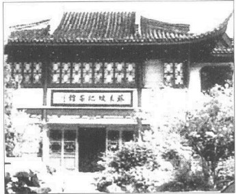

苏东坡纪念馆

苏东坡往后一年零八个月的命运正显示作官没个人行动的自由，能够另外谋生的学者真不该参与政事。从今起他一直东飘西荡，改变计划，违反自己的本意，处境和太后息息相关。皇帝想叫他掌史馆，四周的人极力反对。最后他亲笔下诏，把苏东坡的谪居地由黄州移到汝州（临汝），离京师较近，是居住的好地方。这道消息在元丰七年（1084年）三月传到他耳中。

他逃避这道派令，用他自已的话来说，“殆似小儿迁延避学”。一个人参政不外乎为名为利为权势，或者为国效忠。我们知道苏东坡不是作官发财的人，至于权力，他也不喜欢统治别人。说也奇怪，有些人名利兼得，却爱作官支配人。权力的滋味初尝起来挺不错的，但是除了少数例外，二度竞选的美国总统若非不知道自己的幸福何在，便是身不由主了。他做总统只因为党人要他做。为国效命的热诚简直说不通，因为反对派不是也有很多人想为国尽力吗？

至于名声，苏东坡知道宰相的高位也不可能为他不朽的文名诗名增添光彩。他对政治有何奢求，他又能有什么成就呢？三月三日他还自由自在和朋友们欢聚。大家在定惠院后山的商氏园游玩，小酌之后苏东坡到一座小塔顶睡了一觉。睡罢踱出东门，看到店里有一个大木盆，就买下来打算浇瓜。然后沿小溪到何家圃。何家正在添盖一间厢房，叫地到竹林中喝一杯。有一个朋友做了一种面食，东坡命名为“为甚酥”，大家都喝酒，参寥只喝枣子汤。苏东坡突然想回家。他看到何氏园中有桔子树，便要了一些树苗种在雪堂西边：

两天后，他调职的消息来了。名义上他还是“‘谪居”。可以自由住在一座美丽富足的城市里。他犹豫了好几天，不知道该不该申请留居黄州。后来想到新派令是皇帝的好意，决心服从命令，抛下东坡的农庄。

他多年的辛劳一笔抹煞，也许他又不得不在别的地方另辟一个农场。虽然他在这么窘迫的情况下调职，敌人还是很不安。当时有人说出一段故事：苏东坡上表感谢皇帝。陛下看看四周，对朝臣说：“苏轼真是天才。”

敌人想在苏东坡的谢表中挑毛病。有一个人说：“我觉得他这封信还在发牢骚。”

“何以见得？”皇帝惊问道。

“咦，他说他们兄弟曾通过特考，还用了‘惊魂未定，梦游缧绁之中’等字句。意思是说，他们凭策问通过考试，现在却为批评朝政而受罚。他想怪别人哩。”

“我了解苏轼，”皇帝平静地说：“他心里没有坏意。”

政客小人这才闭嘴不说了。

他花了好几个礼拜准备迁居。他决定先到高安看子由，让尽责的长子苏迈带全家人到九江等他。

接着有几个大官为他饯别，很多朋友请他题字，他一一照办，写了不少。这时候歌妓李琪，也收到一首诗，使她名垂后世。他在朋友和邻居的告别宴中写道：

归去来兮，吾归何处……人生底事，来往如梭，待闲看秋风，洛水清波，好在堂前细柳，应念我莫剪柔柯。仍传语江南父老，时与晒鱼蓑。

一大群仕绅和贫民赶来送他。有十九位邻居好友要坐船送一段路，名字我们都知道。路边站满知交和陌生人，有农夫、有抱小孩的贫家父母，小孩被他救活的人都面露感激。十九个人送他到慈湖，大家又逛了几天，苏东坡才离去。

最后有三个朋友送他到九江。一个是好友陈慥。一个是小他五岁的参寥和尚，他们在徐州认识，他曾到黄州陪他住了一年左右。中国古代最爱旅游的就是道士与和尚，他们不但有时间，有活动的自由，而且到处有客栈网——也就是寺庙——可住。现在参寥决定到九江著名的庐山顶去。

第三位朋友就是百年道士乔同，他现在大约一百三十岁，传说他后来由坟墓里复活。苏东坡到达九江，曾多走一百哩的陆路把老道士交给兴国的一个朋友。乔同爱鸟兽，出门常带宠物同行。据子由的说法，他日后被驴踢死。几年后，一位和尚告诉子由，他在某地遇到一个僧人，自称乔同，在黄州认识苏东坡。子由问起他的形貌，恰和老道士相符。听故事的人有一位是兴国太守的儿子。他回家说给父亲听。太守为证实乔同复活的说法，叫人打开坟墓，发现只有一根竹杖和两根胫骨，尸体不知去向。

苏东坡陪参寥到著名的庐山玩了几天，几百个和尚十分兴奋，纷纷传说“苏子瞻来了”。虽然他只写了三首咏庐山的诗，其中一首却变成描述此山特色的最佳作品。

他去看弟弟，三个侄儿走了八百多哩来接他。两兄弟四年不见，子由稍稍发福了。他看起来不太健康，晚上练瑜伽太累的关系。监酒官的办公室位在一座临河的小破屋中。照子由的说法，“旧以三吏共事，余至，其二人者适皆罢去，事委于一。书则坐市区鬻盐沽酒，税豚鱼，与市人争寻尺以自效。夜归筋力疲废辄昏然就睡，不知夜之既旦。旦则复出营职”。

苏东坡在那儿住了六、七天，就乘船到九江去接家人。带他们下长江，九月抵达南京（金陵）。朝云的儿子只有十个月，不幸病故，父母都很伤心，对小母亲尤其是一大打击。苏东坡在一首悼亡儿的诗中说，小母亲整天僵卧，“我泪犹可拭，母哭不可闻”。朝云从此没有再生孩子。

到了南京，苏东坡去看王安石，后者现在已是疲惫的病老头了。他们一起谈诗论佛。双方都是大诗人，佛家弟子，有不少话可说。传说有一次两人比诗，同韵同题，苏东坡赢了。王安石中途放弃。谈话中苏东坡不免责备王安石招来战祸，迫害学者。

“我有话要告诉你。”苏东坡说。

王安石脸色一变，“你要谈往事？”

“我要谈国事。”

王安石静下来，“请”。

苏东坡说，“大兵大狱是汉唐灭亡的原因。先帝正想改革。如今西北用兵，连年不断。东南数起大狱，你竟不出言阻止？”

安石举二指说，“二事皆由惠卿引起，我在外敢说什么？”

东坡说，“‘在朝言朝，在外则不言’是事君的常礼。皇上以非常礼待你，你岂可以常礼待皇上？”

“是，是，”王安石发火了。过了一会又说：“出在安石口，人在子瞻耳。”意思是谈话不能传出室外，他曾被惠卿出卖，十分小心。

谈话继续下去，王安石文不对题说：“人必须‘行一不义，杀一不辜，得天下弗为’才行。”

东坡说：“现在的君子，争减半年‘磨勘’，就不惜杀人了。”

王安石笑而不语。

照当代许多人的记载，这段期间王安石常一个人骑驴到乡下“喃喃自语，有若狂人”。有时候想到背叛他的朋友，他会突然提笔写信，满面怒容，过了一会又放下毛笔，仿佛感到惭愧，所以信始终没写成。他继续写日记，日记在他死后数年被政府没收，说是里面含有重要的政治资料。王安石晚年失意，曾写了不少指责皇帝的话。幸亏这时候政权握在他自己的党人手中，不过七十巨册日记有很多人看过。几年前王安石听说司马光当政，曾叫侄儿把日记烧毁，但是他侄儿偷藏起来，另外烧了别的东西充数，所以珍稿留存至今。

王安石还开始看到幻影。有一次在超感觉状态中，他看到已故的独生子在地狱中受苦。他知道儿子素行不端。如今被人套上枷锁和铁链。家中的卫士也说他梦见同一情景，王安石吓慌了。为了拯救儿子脱离地狱的折磨，他卖掉上元县的财产，捐给寺庙。王安石曾上表报告捐献的经过，朝廷特为寺庙命名，表状至今还在。他去世前一天，单独在乡下骑马，突然看见一个农妇向他走来，跪倒在地，呈上一张诉冤状。接着就不见人影。他以为状纸已放入口袋中，回到家却不见了。第二天他就惊吓而死。

苏东坡到达富庶的江苏盆地，顿时爱上该区的美景和气氛。他由南京到靖江，一路忙着计划在湖泊区买田庄。他的看法是：皇帝既然肯把他由黄州调到别处，一定也肯让他住在其他地方。他每到一地，就寻找晚年养老的所在。朋友们纷纷提供意见。僧友佛印要他住在扬州，他自己有个农庄在那儿。范镇希望他到许下与他为邻。他看上丹徒区蒜山一座美丽的松林。仪征——长江以北，靠近南京——太守劝他来共住，他虽然不想定居仪征，却乐意在那儿找一个地方，暂时安顿眷属。所以家人住在仪征学府中。东坡就随便到附近逛逛，找一个乡村家园。

最后密友滕元发劝他住在常州区太湖左岸的宜兴。滕元发目前在南岸湖州任太守。两个人私下订出一个计划，由苏东坡在宜兴买田，然后上表请居该地，就说农庄是他唯一的谋生本钱。滕家的一个亲戚在宜兴城外二十哩的深山中找到一处田庄。规模相当大，每年可产八百担米，苏家可以丰衣足食。东坡只剩几百缗钱，他父亲在京师还留下一栋住宅，他叫范镇替他卖了八百缗左右。

九月他一个人去看那间村舍：“吾来阳羡（宜兴），船入荆溪，意思豁然，如惬平生之欲。逝将归老，殆是前缘。吾性好种植，能手自接果木，尤好栽桔。阳羡在洞庭上，柑桔栽至易，得当买一小园种柑桔三百。元丰七年（1084年）十月二日于舟中。”

现在苏东坡完成了一笔交易，旁人看来会觉得他很傻或者很厚道，这完全是看法的问题。他写信给滕元发，说他要在荆溪边找房子，果然找到了。他和朋友邵民瞻出去，找到一栋很好的老宅，花五百缗买下来。现款几乎完全花光，但是苏东坡很高兴，打算回来带眷属搬进新居。有一天他和邵民瞻月夜到村中散步，经过一栋屋子，听到女人的哭声。苏东坡和邵民瞻敲门进去。一个老太太在屋角哭泣。两人问她怎么回事，老太太说：

“我有一栋祖传一百多年的房子。逆子不肖，把它卖给别人。今天我只好搬出一辈子相守的老宅——我哭的就是这件事。”

“你的房子在哪儿？”苏东坡很感动。

出乎意料之外，他发现老太太说的竟是自己花五百缗买来的房子。他拿出卖契，当老太太的面烧掉。第二天把她儿子叫来，要他让老母搬到故屋，没有逼他退钱。她儿子是把钱用来还债，还是有别的原因不能还钱，我们不知道。于是苏东坡两手空空回到城里，房子没买成，钱又少了五百缗。但是他一时起了善心，无法抗拒，也顾不得自己家人了。这是一件好事。一件好事——如此而已。

由常州回来，他十月上表给皇帝，请求住在该区。不过没有批准之前，他得向指定居地进发，汝州在京师西面，要走五百哩左右。他带一大家人向京师走，慢慢行进，希望表状获准，他不必来回花路费。朝廷没有音讯，他只好勉强到京师。照他的诗篇看来，全家人连饭都吃不饱。来到泗州淮河边，他给朋友的诗至少有三首提到饥饿。有一首自比为饥鼠，整夜啃咬东西。太守送东西到船上，孩子们呼声震天。一家人似乎走不动了，他决定再度上表，并且在南都张方平家中小住，等皇帝的回音。

第二封哀诉状是二月在泗州写的，部分内容如下：

“但以禄廪久空，衣食不继。累重道远，不免舟行，自离黄州，风涛惊恐。举家病重，一子丧亡。今虽已至泗州，而货用罄竭，去汝尚远，难于陆行，无屋可居，无田可食，二十余口不知所归，饥寒之忧近在朝夕。与其强颜忍耻，干求于众人，不若归命投诚，控告于君父。臣有薄田在常州宜兴县，粗给饘粥。欲望圣慈许于常州居住……”

旅途中发生了两件有趣——也可以说不幸——的事故。他在泗州曾渡江到南山去玩，事后写了一首词，江上有一座长桥，泗州位于战略要点，天黑之后谁也不准过桥。违犯法令的人要处最重的刑罚。但是泗州太守不惜违规，晚上陪苏东坡过桥。苏东坡曾写词为记：

长桥上灯火闹，

使君还。

太守姓刘，是一个简朴、诚实的山东学者。他第二天读到东坡的诗，心都快跳出来了。他到船上去找东坡：“我刚读到你的诗。不过这很严重，太严重了!你闻名全国，这首诗一定会传到朝中。普通百姓晚上过桥要罚两年的苦役。太守犯法，一定更严重。我求你不要把这首诗拿给别人看。”

苏东坡懊悔不已，笑笑说：“老天爷!我一开口便是罪，岂在苦役二年以下。”

他住在张方平家，遇到另一件教人感慨的事情。主人设宴请他，他认出张方平儿子的侍妾就是以前黄州太守的宠妾。她名叫胜之，太守最爱她。太守是苏东坡的好友，不幸亡故，她就改嫁他人。苏东坡看到这位佳丽在席上谈笑风生，不免感慨万千，想起他的故友，眼睛润湿，喉咙也哽咽了。胜之觉得很有趣，忍不住笑出来，回身对别人说话。苏东坡觉得很不愉快，事后曾劝朋友不要娶妾，还引胜之做例子。

皇帝病了，三月一日他的母亲——英宗太后——开始摄政。三月五日皇帝驾崩，第二天朝廷就降旨批准苏东坡住在湖泊区。这个消息对苏东坡非常重要，如今他如愿以偿，计划也决定了。于是一家人又搬回宜兴。元丰八年（1085年）四月三日离开南都，五月二十二日抵达湖泊区的新家。

苏东坡相信他终于可以定居一生了。“十年归梦寄西风，此去真为田舍翁”。他要在安详优美的环境中欢度余年。他可以乘小舟来来去去，“神游八极万缘虚”。

一切全是命，定居的计划刚刚实现，复官的消息又来了。他到宜兴才十天，就听说他被任命为登州（芝罘附近）的太守。他听到京师的传闻，却不愿意相信，他说京师一向充满谣言，最近四月十七日的官报并没有提起。

苏东坡心乱如麻，衷心讨厌变卦。几天后官方派命来了。全家人欣喜欲狂，孩子们大叫，简直不敢相信。但是苏东坡在一首诗中自比为颠峰已过的良驹，“青云飞步不容攀”。另一首诗说“南迁欲举力田科，三径初成乐事多。岂意残年踏朝市，有如疲马留陵坡”。他给佛印的信又说“如蓬蒿藜藿之径”，给米芾（米元章）的信则说，“某别登卦都，已达青社。哀病之余乃始入闹，忧畏而已”。

然而他还是接受了官职。太后正在改变局势。司马光奉派为门下侍郎，实际等于副相。他上任的情形特别，太后派武装卫士到他家直接“护送”他到公署，怕他接到派令不肯赴职或者拖延时间。

苏东坡六月动身，前往山东海岸的任所。他们由青岛附近乘船绕过山东半岛。十月十五日到达登州，五天后就奉召去京城。一家人又开始上路。元丰八年（1085年）十二月中抵达。

---

### 第十九章太后恩宠

如今苏东坡名气达到最高峰。文人朋友都崇拜他，又享高官厚禄。他为清议而受的苦远超过任何人，因此备受推崇。司马光死后，他成为当代第一学者，他不适合当宰相，大家公认他声望高于百官。有一段时间他的两位朋友吕公著和范纯仁变成政府领袖。他弟弟也回到京师，元祐元年（1086年）正月到达，担任御史中丞，次年升为尚书右丞。流放南方的朋友如今都官居要职，包括王诜附马、王巩、孙觉、范祖禹在内。

---

苏东坡经常得到太后的庇荫。仁宗皇后在审讯中救他一命。如今英宗皇后又提拔他升上高位，晚年若不是另一位太后——神宗皇后——摄政，他也许会在海外流放至死。

新皇帝年方九岁，由祖母摄政。幸亏宋朝代代有贤明的太后，汉唐两代，有的皇后篡位，让宦官和外戚得势，也有皇后造成宗室的衰亡。然而苏东坡时代，他经历的四位太后都很贤明，有些十分可取。也许正因为她们是女人，具有基本的对错观念，对大臣也能分出好人坏人来。她们住在宫中，对学者的政治辩论很少听闻，不会搞混，但却知道舆论的一般倾向。现代普选的民主政客只根据一般百姓的判断，他们往往连纽约时报的社论都看不懂。太后的判断就是一般百姓的判断。神宗后期已开始改变政治作风，但是不可能像他母亲这样做。皇帝一死，太后就让司马光复位，马上扭转政局。王安石的一切措施都暂停或废止。元祐之治开始了。

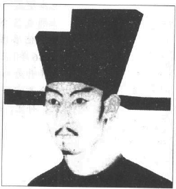

宋哲宗像

现在苏东坡迅速升迁。他到京师八个月，官位升了三回。根据古制，官分九品。短短的几个月他由七品官升上六品，跳升四品，最后成为三品的翰林，负责起草诏书，时年四十九岁。

未升任翰林学士之前，他已于哲宗元祐元年（l086年）三月担任四品中书舍人。这个职位很重要，他得参与各部官员的选派工作。此时他起草了几道和他有关的圣诏。一是罢黜李定，强迫他为亡母补孝三年。二是驱逐惠卿。事情不是他决定的，但是圣诏的措辞却出自苏东坡的手笔。在惠卿一案中，苏东坡说，“始与知己，共为欺君，喜则摩足以相欢，怒则反目以相噬”，“党羽交攻，几半天下”，不过最有趣的却是王安石四月谢世，他得起草追封的诏令。用字措辞必须很微妙，以暖昧的恭维达到贬损的目标。诏命以皇帝的名义颁行，称赞王安石的生活和为人，同时追封“太傅”。苏东坡称赞王安石的创意，却点明他自欺欺人。“网罗六艺之遗文，断以己意。糠秕百家之陈述，作新斯人”，内容微妙进展下去，最后苏东坡又说，“胡不百年，为之一涕。”读者不知道这是一篇夸大的颂文还是反面的抨击。

“翰林学士知制诰”是著名学者最高的职位。下一步往往就拜相了。虽是三品常，苏东坡几乎已位极人臣，因为宰相只是二品，宋朝根本没有一品官，何况起草诏命的工作又使他和小皇帝及太后十分接近。派令由宫中小黄门送到苏东坡家里，圣上还赐给他一套官袍，一条金带，一匹金镀银鞍银辔的白马。中书省在皇宫西侧，翰林院靠近皇宫北门，是皇宫区的一部分。皇帝的文书工作都在晚上进行。翰林办事总是“锁禁宫中”。文书每月单日在宫中起草诏命，双日颁行，这是遵行已久的规矩。傍晚他沿皇宫东墙走到东门，里面有一个专用的书斋，与太后宫殿相通。有时候夜长事少，他只能点上红宫烛，听更漏的声音。有时候天寒地冻，太后会差人送热酒给他。诏命都由太后口授，他必须用最古雅、最庄重的文体写出来，准备第二天发布。

此时有八百多道诏命由他起草，都收在“全集”中。文辞优美、恰当、精确。圣诏的措辞通常都镶满史例和掌故，但是苏东坡却写得很灵活。他死后，一位姓洪的学士接替他。他对自己的文采得意洋洋，问一个曾侍候东坡的老仆，他比苏东坡如何。老仆人说：“苏东坡文采未必超过大人，但是他从来不翻书。”

有一天苏东坡坐在堂中。他对政客小人的嫉妒十分厌烦，曾要求免去此一职务。太后召他入内听令。小皇帝哲宗坐在祖母身边，苏东坡毕恭毕敬站在一旁。太后叫苏东坡起草吕大防拜相的命令，说完突然问道：“你前年任什么官？”

“常州团练副使。”

“现在任什么官？”

“臣今待罪翰林学士。”

“你知道为什么突然升迁？”

“太皇太后的恩典。”苏东坡说。

“不是老身。”太后说。

苏东坡乱猜：“一定是圣上鸿恩。”

“与他无关。”

苏东坡又猜：“是大臣推荐？”

“也不是。”她说。

苏东坡沉默了半晌，才说：“臣虽不肖，也不敢走歪路求官。”

“老身早想告诉你，”太后终于说，“是先帝的遗旨。官仆都知道，先帝吃饭若中途放下筷子，一定是读你的文章。神宗经常夸你是奇才，有心重用，可惜来不及进用就已归天了。”

提到先帝，三个人都流下泪来。接着太后赐坐赐茶说：“你应当奉侍皇上，报答先帝的恩典。”苏东坡鞠躬告退，太后取下御前的金莲烛，让他带回翰林院。

元祐元年（1086年）苏东坡升翰林学士，九月一日司马光就死了。正好神宗灵牌要放入宋室宗祠，那天行斋戒典礼。本来司马光的亲友该来祭拜他，棺材任人凭吊，大家都哀泣一段时间。但是时间不巧，所有大官都必须行斋戒，不能来祭拜。九月六日安放先帝灵牌，场面和乐队都恰如其份。朝廷并大赦天下，百官三日不上朝。所有官员一律参加典礼。这时候发生了一件含意重大的趣事。

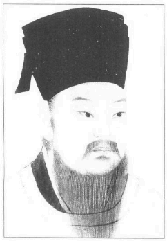

程颐（1033-1107）字正叔，世称伊川先生。河南（今河南洛阳）人，哲学家。

司马光的葬礼由守正不阿的理学家程颐负责。他生性严苛。一副神圣的样子，使苏东坡很不愉快。他照“古礼”办事。死者的亲族站在棺边向客人答礼。几百年来已成风尚。程颐却说这不合古制，不准司马光的儿子站在棺材边接待客人。他认为，孤哀子若真正孝顺，应该悲恸万分，不宜见人。皇家祖祠的典礼结束后，苏东坡身为学士和舍人之长，正要带百官到司马光家吊丧。程颐抗议说，这不合孔子立下的规则。论语说：“子于是日哭，则不歌。”那天早上他们唱了歌，至少也听了管弦乐。同一大怎么能哀泣呢？大家继续走到门口，小程颐想挡驾。彼此热烈争吵。

“你没读过论语吗？”程颐说，“子于是日哭，则不歌。”

苏东坡笑道：“论语又没说，‘子于是日歌，则不哭。’”

他懊恼万分，不顾程颐的反对，径自带大家入门。轮流向棺材鞠躬，又用衣袖擦擦眼角，才转身走开。苏东坡发现司马光的儿子没有来见客，一问才知道程颐不准。说此风不合古制。苏东坡当众用古语骂道：“伊川可谓燠糠鄙俚叔孙通。”大家都笑了，程颐满面通红。用语恰当，一针见血。这句话程颐和对方都忘不了。谁也不喜欢一辈子扛着这个标签。从此种下苏东坡和河南学派——以程颐为首——之间的怨隙。

接着皇帝和太后的座车来了，前者雕龙，后者雕凤，有大红色的车轮。他们来吊唁死者，也依礼向棺材拭泪。司马光备极哀荣。遗体盖着御赐的水银和龙脑。家人获得三千两银子，四千匹绸缎，太后并指派两名内廷官送灵柩返乡安葬。有十位亲族封官。

次年七月，苏东坡兼任侍读。皇帝还小，不过就算皇帝已届中年，每月单日宫中仍有为皇帝特设的课程。一年分为两学期，春季班由二月到端午，冬季班山中秋到冬至。学识渊博的官员轮流讲授经史和治人之道。早期以后，特选的官吏由文德殿沿西廊进入迩英殿。苏东坡时代，讲课的人站着，其它官吏可以坐着旁听。王安石讲课的时候，希望讲师坐着，别人站着，但因众官反对而作罢。这段期间自负的程颐也参加授课，不过他是官位最低的讲师。他也要求坐着讲课，以宣扬孔子尊师重道的精神。程颐经常对哲宗讲述魔鬼的可怕，女人的蛊惑，小皇帝当时对女人毫无兴趣，却因此决定长大要好好享受一番。他后来废掉皇后，二十四岁就夭折了。

对苏家来说，住在京师具有决定性的好处。房子已卖掉，苏东坡如今在白家巷建了一栋官宅。就算房子不卖，离办公处也太远了。新房靠近东华门，百官黎明上朝都走那儿。因此苏宅正位于百官最喜爱的住宅区，也可以说是城中区，区内有不少昂贵的店铺和饭馆。

家中开始享受京师的新生活，与当年的黄州农庄不可同日而语。他们十五年未在京城定居，只有东坡被捕那三个月来过，还有一次他无法进城，大家住在郊外。尽责的苏迈曾到江西担任小官，不知道有没有回来团聚，但是十六岁的苏迨和十四岁的苏过都在家。苏太太和朝云现在都能过好日子了，她们对京师的繁华有些不知所措。四周到处是银楼、绸缎庄、菜铺和两三层的楼房。

中国最好的产品都集中在东华门附近，价格极高，真能把乡村妇女吓一大跳。譬如时令不当的花果，无论多贵还是有人买。此区仆人由雇用局代为聘请，非常便利。区内充满酒馆和小食摊。晚上走入饭店，歌妓在大廊上列队相迎，等着陪酒，年轻人陪父亲进去，眼睛得盯着前方或者低头看地。酒宴中摊贩逐室推销蜜饯、干果、冷肉和腌菜。专供三餐的饭馆据说有四、五十种菜，由堂倌端着，不断在房中穿梭，让顾客挑选。如果少了一道菜，饭店就会失去主顾。

苏东坡喜欢在家请客，饭店也急相包办家宴。银器由店方供给，连比较寒酸的饭馆也会派厨师办酒席。并供应银壶、银杯、银盘、银匙和银尖象牙箸。风尚如此，出脍几次之后，四、五百两一套的银器隔天再收，饭店也不觉得什么。京师被金人攻陷后，有人用留恋的笔调记载说，大家都以京师为荣，对陌生人很诚恳。他们看到陌生人受欺负，就会上前维护他，甚至不惜和警吏冲突。邻居常拜访新来的住户，送茶送酒，劝他们到哪些店铺买东西。有些人无所事事，每天带着茶壶，挨家串门子。

一片繁荣声中，苏东坡仍继续练瑜珈和养生术。他隔夜睡在宫里。无论进宫或居家，他总是黎明即起，梳头一百次，穿上官袍官靴，再躺下来假寐一回。照他的说法，假寐香甜无比。上朝的时间到了。他早已穿戴整齐，出门跨上金镀白马，往东华门走去。

早朝通常在十点以前结束，若没有特殊的事情，他的时间便完全属于自己。他若不应酬，便陪妻子儿女去逛街。相国寺就在附近，庙院充满香扇、刀剪、古董、古物、字画的摊子。有时候全家到东城去逛那四、五十处市集，由理发摊到瓶花店和笼鸟店样样俱全，不知不觉就消磨了一整天。偶尔他们也穿过朱雀门到外城另一个大住宅区。孔庙和太学都在南外城，再往外走就是许多道观。有时候他们回城，在“台上”吃饭，那是城内最好的酒馆。他们也可以沿着南门大街去参观著名的唐家银楼或者选购温州来的漆器，或到报慈寺街的药铺去拣配最好的药草。

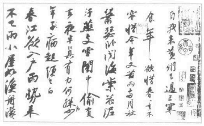

苏轼《黄州寒食诗》

事实上，奢华的日子和简朴的日子在幸福方面倒没有什么差别。只有不配作高官的人才羡慕高官的荣宠。通常不想作官的人为当局一心争取，想作官的人却又不够资格。一旦“官愿”满足了，做大官的乐趣不见得胜过成功的铁匠。苏东坡在笔记《乐与苦》中说：

“乐事可慕，苦事可畏，皆是未至时心尔。及苦乐既至，以身履之。求畏慕者初不可得况，既过之后复有何物。此之寻声捕影系风迩梦尔。此四者犹有仿佛也。如此推究，不免是病，且以此病对治彼病。彼此相磨安得乐处。当以至理语君，今则不可。元祐三年八月五日书”

有些人对京师的生活采取较俗气的看法。他的亲戚蒲宗孟极尽享乐之能事。浦家儿媳整天忙着教丫环挤各种“酥花”，加糖做成甜点。她决不用同一种奶油花招待客人第二遍，于是丫环们只好日夜挤花。蒲宗孟还有一个妙习惯，包括“大洗面”“小洗面”“大濯足”、“小濯足”、“大澡浴”和“小澡浴”。他每天洗脸两次，洗脚两次，隔天正式洗一次澡。“小洗面”只洗脸部，换一次水，由两个佣人侍候。“大洗面”换水三回，由五个佣人侍候，洗到颈部和肩部为止。“小濯足”换水一次，由两个佣人侍候，洗到足踝。“大濯足”换水三次，由四个佣人侍候，洗到膝部为止。“小澡浴”用水二十四加仑，要五、六个佣人侍浴，“大澡浴”也用水二十四加仑，但要八、九个人服侍。“大浴”用药膏洗，还叫人把衣服放在线网上，徐徐用异香薰烤。他写信给苏东坡说：这一大套洗浴法对他颇有好处。东坡回信说：“闻所得甚高，固以为慰。然复有二，尚欲奉劝，一曰俭，二曰慈。”

做官在社交上和物质上都有不少便利。当时的知识分子只有两条路可走，不是做官就是自甘淡泊——淡泊通常代表贫穷。当然人可以以潜心学术，得到永远的声名；但是对许多人来说，不朽的声名就算有把握，也只是空腹的自我安慰罢了。苏东坡时代有一则笑话，讽刺中举得官却自称作官是为国牺牲的文人。故事如下：

从前有一位穷学者没钱买馒头。他饿慌了，便想起一条骗吃的妙计。他到一家饼店外，返身就跑，但是没有人注意他。于是他转到一家满是人潮的饼店，一看到馒头就大叫而逃，摔倒在地。大家围过来，问他怕什么。穷学者大叫说：“那些馒头!”大家没听过这种奇事，纷纷笑出来。饼店老板不相信，想试试他。他把学者引入放馒头的房间，由锁匙孔偷看他。穷学者很高兴妙计得逞，双手大捞馒头，吃了个够。老板动了恻隐之心，冲入房间问他：“你还怕什么？”学者答道：“我真怕一杯上好的热菜。”

有一天韩维——属于出过七位宰相的富贵名家——的两位女婿来看东坡，他问起他们岳父的近况。

“他很好，”其中一个说，“他说现在年事已高，他要在音乐、醇酒和美人中欢度余年；否则不知道如何过日子。”

“真的!”苏东坡说，“正因为他来日不多，我更怕他走错路子。我告诉你们一个故事，你们不妨说给令岳父听，好不好”？

“当然。”那位青年说。

苏东坡说出下列的故事：

顷有一老人未尝参禅。而雅合禅理。死生之际，极为了然。一日置酒大会亲友，酒阑，语众曰‘老人今且去’。因摄衣正坐，将奄奄焉。诸子乃惶遽呼号曰‘大人今日乃与世诀乎，愿留一言为教’。老人曰‘本欲无言，今为汝恳，只且第一五更起’。诸子未谕曰‘何也’。老人曰‘惟五更可以勾当自家事，日出之后，欲勾当则不可矣’。诸子曰‘家中幸丰，何用早起。举家诸事，皆是自家事，岂有分别’。老人曰‘不然，所谓自家事者，是死时将得去者。吾平日治生，今日就化，可将何者去’。诸子颇悟。”

苏东坡接着说：“现在令岳父以为来日不多，要尽情享受。你们两人肯不肯替我带个口信给他？就说我要他注意自己的事，与其在醇酒妇人中浪费余力，还不如想想他死时可带走的东西。”

提到可敬的老友范镇，苏东坡在他死后曾追念说：“范景仁平生不好佛，晚年清慎，减节嗜欲，一物不芥蒂于心。真是学佛作家，然至死常不取佛法。某谓景仁不学佛而达佛理。虽毁骂佛祖，亦不害也。”

如今苏东坡名气达到最高峰。文人朋友都崇拜他，又享高官厚禄。他为清议而受的苦远超过任何人，因此备受推崇。司马光死后，他成为当代第一学者，他不适合当宰相，大家公认他声望高于百官。有一段时间他的两位朋友吕公著和范纯仁变成政府领袖。他弟弟也回到京师，元祐元年（1086年）正月到达，担任御史中丞，次年升为尚书右丞。流放南方的朋友如今都官居要职，包括王诜附马、王巩、孙觉、范祖禹在内。他在黄州的老友陈慥也到京师来了，不是来作官，而是来探望东坡。几年前和他通信的大诗人黄庭坚也来见他，正式拜在他门下。多年来苏东坡在信件中一再称赞四学士，大大提高了他们的名声。这时候大家公认，黄庭坚、秦观、张耒、晁补之是“苏门四学士”。后来又收了李荐和陈师道两人，成为苏门“六学士”。

苏东坡的威望曾经害一对夫妻反目。学者章元弼很崇拜东坡。他相貌平凡，却娶了一个美貌的妻子。婚后太太发现丈夫整夜读苏东坡的诗，不爱理她。最后她实在忍无可忍，就对丈夫说：“原来你爱苏东坡甚于爱我!我要离婚。”她如愿以偿，章元弼告诉朋友，他太太下堂求去，全是苏东坡的缘故。

当时苏东坡大受欢迎，许多文人甚至仿戴他的帽子。他戴的帽子特别高，顶上窄窄向前弯，后来变成著名的“子瞻帽”。有一天他陪皇帝到醴泉看戏，宫中戏班正在演出。一个丑角在台上戴这种帽子吹牛说：“我的作品比你们好多了!”“何以见得？”其他演员说。“你没看见我戴的帽子吗？”丑角说。皇帝听了会心一笑，还特意回头看看苏东坡。

在这一切富贵声中，苏东坡尽情和朋友们戏谑玩耍。他担任礼部尚书兼主考期间，曾和其他考官朋友们被禁好几周。他们忙着改卷子，苏东坡就在各房间穿来穿去，聊天说笑，使他们几乎没法办事。晚上他却开夜车，迅速批改自己的卷子。

关于他随机编的故事，有不少记载留下来。许多故事语涉双关，尤其他和另一位机智大师刘邠巧问巧答更是精巧。有些故事可以译成英文。

有一次苏东坡拜访相国吕大防。吕大防是胖子，苏东坡来时他正在睡午觉。苏东坡等了好久，心里很不高兴。最后吕大防出来了，苏东坡指指客厅中一个土盆，里面养了一只背带青苔的乌龟。

“这不稀奇，”苏东坡对主人说，“六眼龟才真正难求呢。”

“真的？”吕大防睁大眼睛说，“世上有六眼龟？”吕大防自觉受到愚弄；不过又想到苏东坡学识渊博，也许在书上读过此一记载。

“当然，”苏东坡说，“唐中宗时代，一位大臣曾进贡一只六眼龟。皇帝问他六眼龟有什么特性，大臣说六眼龟有三双眼，普通乌龟只有一双，所以六眼龟睡一觉等于别人睡三觉。”

苏东坡曾经对钱勰自称他喜欢以前乡下简朴的生活。他说他们晚餐只有白饭、萝卜和清汤；他却十分快乐，十分满足。有一天钱勰下帖请他吃饭，帖子上说：“将以三白待客。”苏东坡没听过“三白”，不知道是什么玩意儿。他欣然赴宴，发现钱勰只准备了三样东西；一撮盐、一碟生萝卜、一碗饭。苏东坡想起自己的大话，知道他被愚弄了。苏东坡不动声色，过了一段日子才下帖子请钱勰吃“三毛”餐。钱勰赴宴，发现桌上空空如也。苏东坡请他坐下，两人对坐半天。过了很久还没有菜上来，钱勰说他肚子饿了。苏东坡郑重其事请朋友快吃三毛（没），“盐也毛，萝卜也毛，饭也毛，非三毛而何”。苏东坡报复一顿，就原谅了他的朋友，两个人快快乐乐共用了一顿大餐。

苏东坡担任翰林学士期间，晚上常锁禁宫中。有一个人很崇拜他，拼命搜集他的亲笔题字，常用十斤羊肉向苏东坡的秘书换取东坡每一张短笺。苏东坡知道这回事。有一天秘书要求东坡答复一个朋友的口信，苏东坡用口头答复。秘书再来，东坡说：“我不是已经告诉你了？”

“那人坚持要你用笔答复。”秘书说：

“传语本官，今日断屠。”东坡答道。

论语中有一个人名叫司马牛，和司马光同姓。有一天东坡和司马光为国策问题热烈争论，却无法说服司马光。他回家把长袍丢在躺椅上，对朝云大喊：“司马牛!司马牛!”

这些年来苏东坡不断在策论中说，“独立思考”和“公正无私”是好大臣的重要条件。但是独立思考和意见公正却是党人最讨厌的。有一天苏东坡吃完饭在房里踱来踱去，心满意足捧着肚子。他问家中妇女，他肚内藏些什么。中文常说一个人满腹思想、满腹情感、满腹经纶。一个侍儿说：“都是文章。”另一个说：“满腹都是见识。”东坡不以为然。最后聪明的侍妾朝云说：“学士一肚子不合时宜。”“对!”东坡捧腹大笑。

有一次一个藉藉无名的学者来看东坡，带着一册诗，问东坡意见如何。这位穷学者朗诵他自己的作品，音调抑扬顿挫，显得很得意。“大人觉得鄙作如何？”他问道。

“可得十分。”苏东坡说。

对方面有得色。东坡又说：“诗有三分，吟有七分。”

---

### 第二十章绘画艺术

中国艺术史上有一次大盛会，十六位学者齐集在王诜驸马的底邸中。这就是伟大的“西园会”，由李龙眠作画留念，米芾详细描写。在场的有宋朝三大画家苏东坡、米芾、李龙眠，东坡的弟弟和苏门四学士等人。石桌列在高杉巨竹之下。顶上有瀑布流入大河，两岸都长满花卉和修竹。王诜的两位侍妾梳高髻戴发饰，站在桌子后方。苏东坡一身黄袍黑帽，正倚桌写字，王诜驸马则坐在附近看他，另一张桌子上，李龙眠正在题一首陶潜的诗，子由、黄庭坚、张耒、晁补之都围桌而立。米芾仰着头在附近一块岩石上刻字。秦观坐在树根上听人弹琴，其他的人则散列四方，有跪有站，姿态各不相同。那些人包括和尚与学者。

---

苏东坡的天才和灵性蕴育出一处新型的国画，尤其适合表现毛笔的韵味。苏东坡最重要的消遣便是“玩墨”，他伟大创新的艺术冲动借此得到自由的发挥，也给中国艺术带来永恒的影响。苏东坡不但创造出有名的“墨竹”；还发明了新型的国画“士人画”。他和后辈米芾共同探索新画法，后来竟变成中国绘画最独特、最具代表性的风格。南方画派强调用迅速、节奏性的笔触来表现统一的概念，早在八世纪就由吴道子和王维所建立——与北派李思训细描金边、添红着绿的画法形成强烈的对比。不过写意的“士人画”到宋朝才真正确立，这一派注重优美的活力和画家主要的概念，却包含了现代画家注重的某些艺术原理和技巧的奥秘。

我们有幸从苏东坡、米芾、黄庭坚留下来的艺评中看出“士人画”在苏东坡生命里的起源。学者是诗人，是书法家，也是画家。首先我们要知道，中国书法和绘画是同一回事，技巧、方法、精神和批评的原理完全一样。不明瞭中国书法的美学原则，就无法了解南派国画的起源。因为南派的始祖——苏东坡也是其中之一——都饱受中国诗的薰陶，善于用笔，精通书法、构图和韵律等一切原则。书法提供国画的技术和美学原理，诗句构成国画的精神，强调境界与气氛，泛爱大自然的一切气味、色彩和声音。

远在苏东坡未诞生之前，中国已有丰富的艺术传统，书画双绝。苏东坡从小佩服吴道子，他在黄州那几年，曾花不少时间改进画艺。如今他的诗人和画家朋友都聚集京师，此一气氛颇能激发他诗词和艺术的创造力。正如好棋手在同一座城内找到另一位好棋手生活会有改变，现在苏东坡的生活也不同了。他毕竟是学者，不是政客，身为文人他主要的工作便是用笔用墨用纸。他的门生都是大学者，经常到他家拜望。米芾后来变成宋代最杰出的画家，有一次深深爱上石头的韵律，竟拜倒在一座山岩下，连呼“岳父”。人人都叫他“米癫”。米芾、苏东坡和李公麟这三位宋代名家如今常常在一起。

他们在彼此家中聚会、喝酒、说笑、作诗，经常半醉半醒。这时候苏东坡、米芾或李公麟会走到桌边，桌上笔、墨、纸齐备。一个人动手画画、写字或作诗，其它的人就在旁边观望起哄，题诗为序，环境和气氛非常理想。诗、书、画最主要的材料就是两种液体：酒和墨；他们有上好美酒，上好名墨，还有最好的毛笔和最珍贵的纸张。一个好书画家找到特别珍贵的纸张，就象好提琴手面对一具史特拉笛瓦名琴——他简直无法抗拒。苏东坡最喜欢澄心堂的纸，宣城的诸葛笔，或者鼠须笔，还有李廷帮做的墨。一位学者完成一张画，依例要请别人轮流写几句书评，或者记下当时传诵的笑话。有时候苏东坡和李公麟（西方艺术收藏家对李龙眠的称号比较熟悉）共画一张作品，东坡画石头，公麟画柏树，子由和黄庭坚则题诗为叙。

中国艺术史上有一次大盛会，十六位学者齐集在王诜驸马的底邸中。这就是伟大的“西园会”，由李龙眠作画留念，米芾详细描写。在场的有宋朝三大画家苏东坡、米芾、李龙眠，东坡的弟弟和苏门四学士等人。石桌列在高杉巨竹之下。顶上有瀑布流入大河，两岸都长满花卉和修竹。王诜的两位侍妾梳高髻戴发饰，站在桌子后方。苏东坡一身黄袍黑帽，正倚桌写字，王诜驸马则坐在附近看他，另一张桌子上，李龙眠正在题一首陶潜的诗，子由、黄庭坚、张耒、晁补之都围桌而立。米芾仰着头在附近一块岩石上刻字。秦观坐在树根上听人弹琴，其他的人则散列四方，有跪有站，姿态各不相同。那些人包括和尚与学者。

大家公认苏东坡喝了酒有灵感，能作出最美的字画。想想中国书画所需要的明快韵律，便相信此言不虚。元祐三年（1088年）他担任主考期间，他和画家朋友李公麟、黄庭坚和张耒等陪考官都被禁七、八周以上，试卷未改完之前，谁也不准和外界联络。公余之暇李公麟画马自娱，黄庭坚写些阴郁可怕的鬼诗，彼此互述道家和仙人的传闻。提到东坡，黄庭坚曾写道：“东坡居士极不惜书，然不可乞。有乞书者，正色诘责之，或终不与一字。元祐中锁试礼部，每来见过案上纸，不择精粗，书遍乃已。性喜酒，然不过四、五龠已烂醉，不辞谢而就卧。鼻鼾如雷，少焉苏醒，落笔如风雨。虽谑弄皆有意味，真神仙中人。”

苏东坡批评自己的书画说：“吾书虽不甚佳，然出自新意，不践古人，是一快也。”

苏东坡生前曾叫人画了几张像，最著名的是程怀立和名家李公麟所画的两张。李氏的画像中，苏东坡坐在石头上，膝头放一根长拐棍。黄庭坚说此画把握了苏东坡微醺的神情。他以这种姿势轻松斜坐。思考物质世界的消长，而他却享受眼前大自然无尽的韵味。他仿佛随时站起来，拿毛笔沾墨，写出胸中的感慨，不是赋出美丽的诗篇，就是挥出字画美丽的节奏。

有一次杜几先（杜介）拿来一张上好的纸张，叫东坡题字，但是他对字帖的格局提出不少意见。东坡开玩笑说：“你以为我在卖菜吗？”左佑二年（1087年）三月康师孟已经出版了苏家兄弟几本字帖的复印品。他的朋友也热心搜集他的字帖。有一天晚上朋友们在他家大搜他的旧箱子。有人发现一卷破纸上有东坡的字迹。审视之下发觉是他谪居黄州期间半醉写成的“黄泥坂词”。有些地方字迹模糊，连苏东坡都认不出是自己的杰作。张耒临了一份给苏东坡，自己保留原版。过了几天苏东坡收到王诜附马的一封信，信上说：“吾日夕购子书不厌，近又以三缣博两纸字。有近画当稍以遗我，勿多费我绢也。”

苏东坡有一份真迹复印本“西楼书帖”，在他死后被人刻在石头上，制成拓本，留存至今。这些复印品就像隔壁朋友的眼光一样亲切。有一封信顺便替苏夫人谢谢朋友送的梳子，另一篇说他要送上一坛腌肉。

把中国书法当做一种抽象画，也许最能解释其中的特性。中国书法和抽象画的问题其实非常相似。判断中国书法的好坏，批评家完全不管文字的意思，只把它视为抽象的构图。它是抽象画，因为它并不描绘任何可辨的物体，与一般绘画不同。中国字是由线条所构成，线条组合千变万化，书法就是把这些字完美凑出来，而且要和同一行、同一页的其它字体相配合。中国字是由最复杂的成份所构成，不免呈现一切构图的问题，包括轴线、轮廓、组织、对比、平衡、比例等等，尤其注重整体的统一概念。

一切艺术的问题都是节奏的问题，无论绘画、雕刻或音乐都是一样。既然美感就是动感，每一种形式都有隐含的韵律。就连建筑方面亦然，哥德式的教堂仿佛在沉思。美学上甚至可以用“冲”、“扫”、“粗鲁”等人格的形容词，这些都是韵律的观念。中国艺术的基本韵律观是由书法建立的。中国批评家欣赏书法并不注重静态的比例或调和，而是暗中追溯艺术家从第一笔到末一笔的动作，如此看完全篇，仿佛观赏纸上的舞蹈。因此这种抽象画的门径和西方的抽象画不同。其基本的理论是美感即动感，这种基本的韵律观日后变成国画的主要原则。

这种动作的韵律美观念改变了一切技术家对线条、质量、表面、构图和材料的看法。若属于力学而非静态的美，一切全是平衡的直线画，像工程师的蓝图一般，那就不值得考虑了。相反的艺术家必须寻找扭曲不平的树枝线条，只因为弯曲扭转才能显出生命和运动。这种不平均的线条我们很容易看出生命和动作，其中敏感的压力、休止和扫动以及树枝偶然的哗啦声都仔细保存下来。国画和书法可以说有一项基本原则，除非必要——譬如画书桌和茶几——千万别用均衡的线条。构图的概念也变了。中国艺术家绝不以静态的安排、线面的对比为满足，因为这些线面都是死的。画家因此强调活线条，这是国画技巧和其它绘画的一大差别。

为了培养活线条的基础，书法家便回头观察大自然。自然的线条总让人想起动作，变化永无止尽。善跑的灵堤猎犬结实光滑，自有一种美姿；而爱尔兰小诜多毛矮胖，又另是一番风味。我们可以欣赏小鹿的灵巧，同时又爱慕狮掌强大的肌力。小鹿身材优美，不仅因为轮廓匀称，也因为它让人想起跳跃的动作，狮掌优美则因为让人想起飞扑，就是这种飞扑和跳跃的功能使线条具有活生生的协调感。若追求这种韵律美，我们可以欣赏大象庞然的身躯，小蛇扭曲的张力，甚至长颈鹿枯瘦笨拙的动作。所以自然的韵律永远充满机能，只因为线条和轮廓都是生长过程的结果，具有一定的作用。借自然丰富的韵律，才能极度锻炼我们的鉴赏眼光。中国书法家挥笔时想模仿的就是这种自然的律动，也只有最敏感的画笔才能模摹出来。有些笔触稳定而圆熟，令人想起狮掌的威力；有些令人想起马足的肌力，节骨分明。有些想表现明快的清爽感，字体有肩、有腰、有支架，正如完美的女性，或者像中国批评家所说的“如美人鬓带鲜花”。有些想效法枯藤难摹的雅姿，末端形成温文安定的小卷，用几片细叶加以平衡。别忘枯藤的平衡最完美，因为末端弯曲的角度和形状要看藤蔓整个的重量——茎株的支持点和残叶在哪一边而定。

苏东坡说，他的朋友文同久习书法未能成功，有一天在山道上漫步，看到两蛇相斗，才领悟其中的窍门。他由两蛇的韵律得到灵感，将它们蜿蜒的动作并入书法风格中。另一位书法家曾望见樵夫和村姑在狭路相逢，从而领悟韵律的秘诀。两个人都迟疑半晌，想让路，结果两个人都茫茫然不知道谁该停下来等对方过去。这两个人前前后后的动作造成一种张力、冲击和反冲，据说让这位书法家第一次明瞭书法的原理。

说到绘画，这种纷乱却不失协和的线条美产生的广泛公认的印象派国画，画家只想用主韵律来记录心中的某一印象，并不抄袭眼前的东西。画面愈少细节，当然愈容易表现或传达此一韵律。因此苏东坡集中描写几丛修竹，几块巨石，就成为一幅完整的图画。单是此一节奏就逼人去除统一概念中不必要的一切物质和物体。在八大山人的鱼鸟或石涛的兰花中也许更能看出印象派艺术的极端例证。无论画鱼画鸡画鸟，八大山人的画可以说是用最少线条、最少墨汁来表现最多的韵味。大艺术家只花几分钟，迅速泼墨完成一张鱼、马或人像图；不是成功就是失败，万一失败他就把纸条揉成一团，丢入字纸篓中，从头来起。

省笔是国画自然的主因。不过省笔和注重大目标也带来其它的结果。苏东坡那张月光若隐若现的竹叶图效果有二。一是去除不必要的物体，可刺激观者的想象，二是让人觉得这儿簇竹叶无论在月夜中静静休息，或在风雨中剧烈摇撼，其中简单的韵律都永远值得欣赏。画几根修竹、一条曲线、几块粗石的用意和动机正和书法家写成一篇字一样。只要心境表达出来，印象写在纸上，艺术家便心满足了。他可以就此把那份满足和喜悦传达给看字画的人。

所以这种文人画又叫做“写意画”，等于印象派。“意”字很难翻译；代表画家想要表达的一切；我们只好用“意图”、“概念”、“印象”或“心境”来形容。用“概念主义”说明此一画派，也勉强说得通，因为这种思想强调统一的概念，而概念正是艺术家描摹的唯一目标。

古今中外艺术的中心问题是一样的。印象主义可以说是逼真画的革命，以表现画家主观的印象来提出艺术的新目标。苏东坡有两句诗充分表现出这种改革的精神。“论画以形似，见与儿童邻。”苏东坡评一位年轻的写意画家宋子房说“观士人画如阅天下马，取其意气所到。乃若画工往往只取鞭策皮毛，槽枥当秣，无一点俊发，看数尺便倦。汉杰（宋子房）真土人画也”。

在这方面宋朝画家跨进了一大步；他们画画不仅要表达作者的印象或观念，也要表现内在的机理。简单地说，宋朝画家画的是物体的精神而非外形，宋朝哲学家被称为“理学家”。儒家受了佛教玄学的影响，不再注重规则、政治和社会的形式，转而研究心和宇宙的间题。在印象神秘主义和形而上学的帮助下，他们开始谈“理”，也就是自然和人性的道理，“自然的法则”或“物体的内在精神”。中国人不喜欢抽象的玄学，所以宋朝哲学家谈“理”很少深究自然的法则，却完全相信物体形式中蕴含的力量、精神或道理；自然是活生生的精灵，画家应该在作品中把握那种无形的内在精神。艺术家画秋天的丛林，不该描摹树叶绚烂的色彩，应该记录那无形的“秋意”或“秋思”，换句话说，使人想穿上夹衣去吸取沁凉的空气，去感受秋季大自然阴盛阳衰的变化。苏东坡教儿子写诗形容一朵花的个性，要做到写牡丹的句子绝不叫人看成丁香或梅花。牡丹的特质是雍容华贵，梅花是孤高清隐。这种特质必须由画家的双眼和想象力来把握。为了画一条鱼，画家必须了解鱼的“本性”，为了了解鱼性，他必须想象白己在水中游来游去，分享鱼儿对潮水、风雨、光线和食物的反应。画家唯有明瞭鲑鱼跳滩的喜悦，知道它多么兴奋，才能试画鲑鱼。否则他就不该画鱼，任凭鱼鳞、鱼鳍和眼睑画得多精确，那张画还是死的。

当然我们也应该观察细节。苏东坡曾记下一段趣事。有一位四川收藏家手边拥有百余幅名画，他最喜欢戴嵩和一张斗牛图。有一天他在院子里晒画，一位牧童恰好经过；他看了这张画一秒钟，摇头大笑。别人问他笑什么，他说：“激斗中的公牛尾巴应该垂在两腿间。这张画的牛尾却直立在后面!”

苏东坡也看不起画鸟名家黄鉴，因为他对鸟的习性观察不精。但是观察和精确不足以构成真正的艺术。画家必须运用直觉的见解，真正对大自然的鸟兽产生泛爱之情。苏东坡为自己画的一张鹤写了一首诗，也许最能表现他描绘物体内在精神的见解。他说一只鹤在沼泽中看见人来，未展翅就先决定要飞了。但是没人来的时候，它的姿态完全放松下来。苏东坡想画的就是这种内在的精神。

谈到内在精神而非外在形体的描述，苏东坡说：

余尝论画，以为人禽宫室器用皆有常形；至于山石竹木水波烟云，虽无常形，而有常理。常形之失，人皆知之。常理之不当，虽晓画者有不知。故凡可以欺世取名者，必寄于无常形者也。虽然常形之失，止于所失，而不能病其全。若常理之不当，则举废之矣。以其形之无常，是以其理不可不谨也。世之工人，或能曲尽其形。而至于其理，非高人逸士不能辨。与可之于竹石枯木，真可谓得其理者矣。如是而生，如是而死，如是而挛拳瘠蹙，如是而条达遂茂。根茎节叶，牙角脉缕，千变万化，末始相袭。而各当其处，合于天造，厌于人意。益达士之所寓也……必有明于理而深观之者，然后知余言之不妄。

一切绘画都不知不觉反映出一种思想。国画不知不觉表现出天人合一、宇宙生命一统、人类只是渺小过客的观念。由此看来，所谓写意的国画，无论画的是一竿修竹、一组怪石、山中烟雨或河上雪花都是泛神爱的表现。苏东坡在朋友家的墙壁上画了一幅竹石，曾写诗为记，他的诗最能清楚描绘出画家物我合一的态度：

空肠得酒芒角出，

肝肺搓牙生竹石。

森然欲作不可留，

写向君家雪色壁。

---

### 第二十一章自退之道

他赶苍蝇实在赶厌了。不但苏东坡本人，连他的朋友秦观、黄庭坚、王巩、孙觉也经常成为攻击的目标，有时候是正式告状，有时候是造谣中伤。暗中造谣，使人无法自辩，这可不是现代的新玩意儿；只是现在升格为政党攻讦的战术之一而已。苏东坡觉得自己仿佛置身蛇窝中，他决定退出去。

---

《东坡笠屐图》

世上有晋身之道，也有自退之道。苏东坡专门从事于后者。现在苏东坡不追求政事，却为政界所追逐，实在是一个有趣的现象。王安石当权，他在政界失败还不为奇，他自己的党人得势，他仍然“不成功”，可就令人吃惊了。苏东坡向来不是好党人，因为他做人的格调太高。同党当道，他自己又享盛名和高位，连太后都佩服他，他却一直想放弃这个受人羡妒的官职。他没有立刻如愿，不过凡是知道苏东坡脾气的人都可以看出，他不会永留政坛。延年术的第一道法则就是避免一切情绪于扰，而苏东坡对政坛他所谓的“奸小之境”却有不少情绪的纷争。政治游戏对于爱好此道的人颇有魅力；对于不想统治别人的人来说，失去人类尊严以换取权势和浮名实在太不值得了。苏东坡从来不热衷政治游戏。他缺乏跻身公卿的决心，如果他个性稍微改一改，升官并非难事。他身为翰林学士知制诰——其实等于太后的秘书——有机会和皇族亲近，只要他有心玩一手，凭他的智慧一定可以大大成功。但是这不合他的本性。

宋朝的官制特别容易造成党争。大权操在皇帝手里。虽然元丰元年（1078年）朝廷曾改组官制，简化官制，仍然没有专责的宰相一职。内阁的连带责任并无明文规定，好让宰相和阁员成为一体。我前面已说过，在位党和反对党也没有明确的权责。多数党统治的机能并不存在。于是政治游戏便成为个人之间的斗争，比西方更剧烈。但是东西方的政治规则完全一样：爬到顶端的一定是庸才。游戏大部分在幕后进行，有几个固定的规则。第一，好政客要会说一大堆话，却不透露任何消息。好官决不肯定什么，只用否定。只要学会“无可奉告”、“你说得对”等至理名言，好官就可以无往而不利。第二、他应该施惠于朋友。第三、他应该小心不得罪人。一个人如果不随便说话，爱用文雅、细柔、愉快的低语，又很喜欢施小惠给人家，他就算不位极人臣，也不会失势。他到死都有官做。不幸苏东坡并非这种典型。几年内他触犯了每一道作官成功的规则。朝云的儿子出世，他曾写出下列的愿望：

惟愿孩子愚且鲁，

无灾无难到公卿。

小娃娃夭折，没有机会实现父亲的愿望。我们怀疑诗画家能不能做一个成功的官员。太平时期应该可以，不过“太平”是一个相对的名词，政治上没有一段时期没有热门问题可争。诗画家满怀高超的哲学观点，很难专心于政治问题，甘愿玩政治、受折磨。他试了几次之后，往往嘲笑自己不该下海从政。

苏东坡逃避政治，政治却在追逐他。他和司马光政见不合——独立的心灵永远不会完全一致——但是他到京师半年，司马光就去世了。苏东坡陷入显赫遭忌的地位。不久风暴向他袭来，朝廷的争斗立刻以他为中心。到了次年一月，有几十篇表状攻击他。司马光一死，政党就形成了——有理学家为首的“河北派”、“河南派”和苏东坡为首的“四川派”。由记载和苏东坡的退意来判断，他根本不知道“四川派”是什么意思。但是政敌很气他，一心要与他狠斗。说句公道话，斗争是由他弟弟子由引起的。元祐初年子由入京担任右司谏，他自认为有责任清扫政府，去除骑墙派和王安石的余党。后来惠卿终于被逐，蔡确、蔡京和章惇也暂时贬官，然而他们日后却强力反击。不过子由也上了七道奏折弹劾河北派的一位领袖，最后那个人垮台，他还说河北派其他的人都是“饭袋”。

斗争热烈进行。政客吵架一点意思都没有，因为这回不象上回为王安石的新政而辩论，这回根本和政策原则无关。苏东坡曾反对恢复征兵制，但是党人争的不是这个问题，纯粹是借故挑衅。他担任秘阁试论的考官，曾叫考生阐述下面的问题：“今朝廷欲师仁祖之忠厚，惧百官有司不举其职而或至于偷。欲法神宗之励精，恐监师守令不识其意，而入于刻。”汉文帝无为而治，并未造成弊端。宣宗励精图治，也没有过严的现象。他要考生说明中庸之道的奥秘。政客们指摘这个考题，苏东坡一再上表给太后，要她主持公道。他们指控他的罪名是渎蔑仁宗和神宗。

太后照例把议状束诸高阁，官吏们又接着上了几道表状。元祐元年（1086年）十二月中到元祐二年（1087）一月十日朝廷收到四、五篇弹劾苏东坡的状子。一月十二日太后命朝臣不要再进言。一月十三日百官在中书省收到圣诏。那批人抗命，第二天又上表论奏。这时苏东坡不想答辩，却四度上表请求离京。十六日太后对朝臣说，苏东坡的意思是百官失之过宽或过严，并非存心污蔑先帝，显然支持苏东坡的立场。甚至还说要处罚弹劾苏东坡的人。

这时候苏东坡决定不求外放，要为这件事争斗到底。一月十七日他写了一封两千字的长信给皇上，点明立场，责备政客小人。他维护意见不一的原则。信中指出，“若上之所可，不问其是非，下亦可之。上之所否，不问其曲直，下亦否之”，对国家并没有好处。君主和大臣应该互相提供意见，如果百官唯唯诺诺，就变成孔子所谓“足以丧邦”的跟屁虫了。然后他举出他和司马光对征兵问题的异议。他们看法不同，却尊重彼此的意见。现在司马光去世，这批人遵行他的政策，一心只想顺从君主。事实上，他认为司马光并不要求别人永远顺从他的意见，太后也不希望大家唯命是从。他另一道异议是，免役法所收的三千万贯中，除去西北战争的费用还剩下一半，政府应该在城郊买地，安顿退休的老兵，减掉一半的兵员。“此本民力，当复为民用”。他始终维护这些论点，得罪了不少人。十二日左右他写信给好友杨珪（元素），再度指责那批人。颇为自己独立的思想而自豪：

“某近数章请郡未以允。数日来杜门待命，期于必得耳。公必闻其略。盖为台谏所不容也。昔之君子，惟荆（王荆公）是师。今之君子，惟温（司马温公）是随。所随不同，其为随一也。老弟与温相知至深，始终无间。然多不随耳。致此烦言，盖始于此。然进退得丧，齐之久矣，皆不足道。”

最后朝廷在二十三日下令苏东坡留任原职，二十七日决定赦免弹劾他的官吏。

苏东坡进退两难。太后支持他，政敌没有达到目标，反而丢尽面子，他只好留任原职。为了报答太后的鸿恩、他决心更坦白、更直率，向她提出别人不敢说的意见。如今苏东坡全集中有不少策论和上书，都是往后两年写的。这些表状明列日期，我们可以看出他争取的是哪些问题。

首先他争取“广开言路”。若生在现代，他会为言论自由或健全的舆论而战。这是他一再重弹的主调。他指出好政府好皇帝一向肯接见任何人。譬如唐太宗——也许是中国四千年来最好的皇帝——甚至准许没有官阶的百姓上殿进言。人民若求见皇上，御用卫士不准在宫门挡驾。苏东坡提醒太后，宋朝初年低层官吏和没有官阶的学者也可面见君主。如今可以见她的不出十几个人。这十几个人怎么能知道全国发生的事情呢？万一这十几个人都是庸碌之辈，不敢告诉她实情，太后必以为百姓无冤曲。这岂不是一大病态？其它官吏虽然可以上书，但是书表一入禁中，就如石沉大海，杳无音讯。太后不亲自召见，又怎能详细讨论问题呢？何况有许多事，不宜用笔写。有些事情太复杂，连口头都说不清楚，何况是书信!他在另一封书信中又说，马病不能申诉，“人虽能言，上下隔绝，不能自诉，无异于马”。

但是学者若缺乏独立思考和大胆批评的精神，言论自由也没有用处。在这方面他推祟欧阳修，贬抑王安石，因为欧阳修鼓励自由批评，王安石却极力压制。苏东坡很关心当时死气沉沉的气氛，学者都忘记自己思考了。这段期间他曾写信给门生张耒说：“文字之衰，未有如今日者也。其源实出于王氏。王氏之文，未必不善也。而患在好使人同己。自孔子不能使人同。颜渊之仁，子路之勇，不能以相移。而王氏欲以其学同天下。地之美者同于生物，不同于所生。惟荒瘠斥卤之地，弥望皆黄茅白苇。此则王氏之同也。”

元祐元年（1086年）八月，苏东坡终于使朝廷不再行青苗法。同年四月，朝廷曾颁布诏命半废此举。常平仓恢复了，但是农民贷款照样发给人民，只是款额限于仓谷价值的半数。朝廷用意甚佳。不许官吏象往日一样，到村中召集人民，硬摊贷款，更不许官员挨户到民家收债。但是苏东坡认为，这种半改革还不够，还会造成往日的弊端。八月四日他上书给太后，首先要求政府不再行青苗法，又要求政府免掉贫民的债务，本息皆免。他把四月的法令比为偷贼决心改过，却声明每月只偷一鸡。典故来自“孟子”。“臣伏见熙宁以来，行青苗免役二法，至今二十余年。法日益弊，民日益贫，刑日益烦，盗日益炽……又官吏无状，于给散之际，必令酒务设鼓乐娼优，或关扑卖酒牌子。农民至有徒手而归者。但每散青苗，即酒课暴增，此臣所亲见而为流涕者也。二十年间，因欠青苗，至卖田宅，鬻妻女、投水自缢者不可胜数。”苏东坡问道，君主怎么能自卑自贱，借钱给人民来赚利息呢？他建议政府下令欠官债的人分十期还债，半年为一期，甚至希望皇帝体念债务人已付了不少利钱，大发慈悲，免掉四等以下贫民的债务。下个月政府就宣布罢行青苗法。不过贫民免债的建议，却直到六年之后，经过苏东坡再三争取才被朝廷接受。

他独自对抗政府的贪污和无能。他要由基层改革吏政。科举是选官的基础，但是考试制度已经松懈了。他曾三、四度担任主考官，尽力选拔人才，有时候还救下其他考官所遗弃的卷子。有一次考生在内廷卫士监督之下应考，卫士的嚣张使苏东坡吓了一跳。巡捕内廷对应考人高声喝叫有如使唤新兵。有一两位举人挟带，被人扶出殿外，由兵众大声喝叫。一片闹哄哄，再由巡铺内臣恢复秩序，有如平乱一般。他们存心污辱举人，苏东坡立刻写了两封信，将那两位内臣免职。

当时政府最大的间题——中国每一朝代都是如此——就是冗官充斥。文人太多，官位太少，在“学而优则仕”的中国社会成为经常存在的弊端。除非现在能改变此一观念，否则教育普及就能把国家拖垮。我们要如何提供四亿五千万知识分子的官位呢？如果公职制度严格遵行，用人惟才，则考中的人数自然有限，素质也会提高。但是苏东坡时代已盛行亲族主义。各省来的考生有不少凭着亲友的推荐，没有应考就得到官职。中举得官的人若有三、四百位，免考得官的就有八、九百人。礼部能荐用两、三百个特免生，其它的由兵部和皇家亲戚推荐。春祭时节，很多学者蒙皇上“解恩”免考。苏东坡说，结果“一官之阙，率四、五人守之，争夺纷纭，廉耻丧尽。中材小官，阙远食贫，到官之后求取鱼利，靡所不为，而民病矣”。又说：“臣得伏见恩榜得官之人，布在州县，例皆垂老，别无进望，惟务黩货以为归计。贪冒不识，十人而九。朝廷所放恩榜，几千人矣，何曾见一人能自奋励，有闻于时。而残民败官者，不可胜数。所至州县，举罹其害。乃即位之初，有此过举，谓之恩泽，非臣所识也。”苏东坡建议削减免考的人数，严格限制大官的儿子、亲戚和皇族推荐的人当官。

苏东坡自觉有责任把官吏怠惰、无能和欺君的情形告诉太后。他写过不少机密的表状。很多封都加了附笔，求她自己保管书信，不要发交中书省。

例如西北蛮族暴动，中国农民将近万人遇害。军事将领不肯将实话奏报朝廷。甚至消息传到京师，朝廷派特史去调查，他本着“官官相护”的古风，说只有“十数人”遇害。特将灾情化小，要求原谅守军将官，慢慢调查案情。两年过去了，一点动静都没有。于是该受抚恤的村民，被剥夺了不少利益。苏东坡上书给太后，指出这样忽略民情，政府很难赢得百姓的爱戴。

“官官相护”自然造成“官对民”的结果。还有广东守将童政无法平定盗匪，竟杀害数千无辜的百姓。但是其它官吏都奏报他平贼有功，是大英雄。还有温杲诱杀平民十九人，只是降官而已。一位小吏卒为了请赏求功，大白天入民宅杀了一家五、六口人，都是无辜妇女。他把首级割下来，自称杀了不少强盗。案件太多，无法遮掩，朝廷下令调查，官吏竟辩称杀时无法分辨男女。有这些暴政存在，苏东坡实在不能保持沉默。

抱怨最多的就是周邠的大案件。这件事苏东坡实在忍不住了。王安石的余党失势在外，打算卷土反攻。首领惠卿、蔡确等人都已遭罢黜，但是他们仍有许多朋友仍在京师任职。为了试探朝廷的态度，他们叫一个默默无名的州学教授周邠上表，建议朝廷把王安石的灵位放在皇家祖祠神宗牌位下，分享神宗皇帝的祭祀。如果太后恩准，就表示他们可以出来公开行动了。苏东坡看出他们的意思，就猛烈攻击这些投机分子。他列出十六位奸党人物，说他们是“蛆虱”、“蛆蝇”、“邪妄小人”、“国之巨蠹”。他第一次不吞吞吐吐谈王安石，而公开称他为大骗子。他告诉太后，如果富弼、韩琦、司马光还在，“此鼠辈”就不敢露面了。他警告说，这次的阴谋若不加以阻止，则“惠卿、蔡确之流，何忧不用。青苗、市易等法，何忧不复哉”。根据他自己的观察，这些事迟早要发生的。事实上他已决心离开朝廷。他说君子如麟凤难求，小人“易进如蛆蝇，腥膻所聚，瞬息千万”。含意很明显：人若不想与苍蝇合污，就只好自己离开垃圾。

两年之间，苏东坡强烈的个人主义和大胆的言论得罪了不少人，包括河北、河南派在内。他更变成王安石党人的眼中钉!苏东坡一天不走，这些人就一天无法再得势。

有些弹劾状很有意思。最有趣的也许是苏东坡替皇上起草的王安石政敌吕大防任职召命。圣诏称赞吕大防的勇功，说王安石不再当道，“民亦劳止，愿闻休息之期”。这是一句人人可用的古文。出自“诗经”一则讽刺暴君的诗。御史们眼睛一亮，他们说苏东坡毁谤神宗，把他比为周厉王。御史们听到心爱的先帝受谤，气得双脚发抖。

还有一个案件牵涉到苏东坡几年前由南都回京时所写的一首诗，说他听到朝廷准他往常州，欣喜欲狂。他经过扬州，曾在一座庙墙上刻了三首诗。三首一起读，主题决定不会弄错：他一直想安居，却没有结果，如今真高兴能退休欢度余年。他第三首诗说：

此生已觉都无事，

今岁仍逢大有年。

山寺归来闻好语，

野花啼鸟亦欣然。

恰好这首诗在五月一日写成，神宗却在三月五日（五十六天前）去世。他在庆祝国丧哩!他高兴皇帝去世嘛。好一个懦夫——好一个忘恩负义的家伙!这是最近苏东坡所遭遇的最严重的指摘，罪名叮大了。照文章看来，我相信“好语”只是代表那年的好收成。但是子由替哥哥想出了更好的辩白。元祐六年（1091年）子由作证说，苏东坡三月在南都，当然已听到皇帝去世的消息，不可能五十六天后在扬州才听到。他告诉太后，“好语”是指苏东坡下山听到农夫争传小皇帝即位的好消息。这个说法高明多了，子由说完证辞，就退出圣殿，让别的官吏去争到底。

苏东坡觉得，太后收到的弹劾状远比他所知道的多。她不断把状子束诸高阁。他要求公布弹劾他的书表，让他有机会答辩，但是太后不赞成，他知道敌人打算推翻他。连他起草的惠卿谪官诏命都被敌人提出来，说他贬抑先帝。他赶苍蝇实在赶厌了。不但苏东坡本人，连他的朋友秦观、黄庭坚、王巩、孙觉也经常成为攻击的目标，有时候是正式告状，有时候是造谣中伤。暗中造谣，使人无法自辩，这可不是现代的新玩意儿；只是现在升格为政党攻讦的战术之一而已。苏东坡觉得自己仿佛置身蛇窝中，他决定退出去。

元祐元年（1086年）他第一次遭到攻击，曾想辞官不作，第二年又再度请辞。这两封信含有自传的题材，点明他作官的生涯和他倔强的个人主义所招来的灾祸。元祐三年（1088年）十月十七日那封表状说：“君不密则失臣。臣不密则失身。”两年内他“四遭口语”，他推荐的人也遭到无谓的毁谤。他提醒太后，前朝他曾受李定弹劾，他写讽刺诗，本意是希望皇帝听到百姓的疾苦，改变政策。御史把他的忠言当做“毁谤”，指控犹有近似者”，而今他用“民亦劳止”一辞竟有人说他毁谤先帝，连“近似”也谈不上。“臣以此知挺之险毒，甚于李定、舒亶、何正臣……古今有言曰‘为君难，为臣不易。’臣欲依违苟且，雷同众人，则内愧本心，上负明主。若不改其操，知无不言，则怨仇交攻，不死即废。伏望圣慈念为臣之不易，哀臣处此之至难，始终保全，措之不争之地。”信中他加了四道附笔，注明“贴黄”、“又贴黄”、“又贴黄”、“又贴黄”。最后一则说，如果太后觉得他的话不真实，就把这封信交给外府，公开调查。如果相信他的话，请她留在宫中省阅。他会再写正式的表状辞职，对外公布。

他表达退意最好的书表是元祐六年（1091年）五月十九日写成的，当时他杭州任满，要求继续留在外郡。这是苏东坡最好的自传信，列出他过去遭逢的一切恶运，包括他被捕受审在内。党人对他“嫌忌”甚于子由。他列出长长的政治生涯，然后说“陛下知臣危言危行，独立不回，以犯众怒者，所从来远矣”。他反对周邠的信触怒了敌人，更增加他们的恨意，他们拼命攻击他。古语说，“聚蚊成雷，积羽成舟，寡不胜众也”。

他接着写下去：

臣岂敢以衰病之余，复犯其锋。虽自知无罪可言，而今之言者，岂问是非曲直。今余年无几，不免有远祸全身之意。再三辞逊，实非娇饰……臣若贪得患失，随世俛仰，改其常度，则陛下亦安所用臣。若守其初心，始终不变，则群小侧目，心无安理……所以反复计虑，莫若求去。非不怀恋天地父母之恩，而衰老之余，耻复与群小计较短长曲直，为世间高人长者所笑。伏望圣慈……早除一郡。所有今来奏状，乞留中不出，以保全臣子。若朝廷不以若不才，犹欲驱使，或除一重难边郡，臣不敢辞避……惟不愿在禁近，使党人猜疑，别加阴中也。

他一再请求，元祐四年（1089年）三月十一日终于如愿以偿。以龙图阁学士出任杭州太守，领兵浙西。浙西太守可以管辖六区。包括现在的江苏。临走皇帝还赐给他茶叶、银、金镀鞍马、官袍、金带等礼物。这匹马苏东坡用不着，就送给穷门生李荐去卖钱。

临行八十三岁的老臣文彦博特地来送他，劝他不要乱写诗。苏东坡已经跨在马上。他大笑说：“我若写诗，有一大堆人正等着替我注解呢!”

---

### 第二十二章工程与赈灾

请求获准，苏东坡开始招募几千名工人和船夫，动工修湖。四个月就完工了。安置挖出来的野草和泥土又成为一个大问题。苏东坡灵机一动决定用来建长堤。湖岸房舍密集，有不少富家别墅立在岸边。由南岸步行到北岸的人必须绕过两哩的岸边。长堤是直线，无形中缩短了距离，又能变成美丽的漫步场所。上面有六座拱桥，九座亭阁。苏东坡生前人民把其中一座亭阁立做他的生祠，挂上他的画像，经常膜拜，追思他的功劳。奸巨惠卿再度得势，曾下令摧毁这座纪念堂。

---

一个人在地方上工作，似乎比在京师更能报效国家。元祐四年（1089年）七月苏东坡抵达杭州，担任浙西军区钤辖兼杭州太守，时年五十二岁。他弟弟由户部侍郎升任吏部尚书，封翰林学士；那年冬天子由出使契丹，历时四个月。

苏东坡埋头苦干。秦观的弟弟陪他们同往，足足一年半没有看见苏东坡翻开书本。相反地他利用太后的赏识，要求朝廷拨款从事重要的改革。短短的一年半时间，他完成了供水系统、医院等公共健康和卫生措施，疏通盐道，重整西湖，平抑粮价，不顾朝廷和邻近各省官吏的漠视，一个人热心贩灾。

太守官署在杭州市中心。但是苏东坡宁愿在比较诗意的地方执行公务。他常在葛岭寿星院一栋十三房的幽静小屋内办公。不是在寒碧轩就是在雨奇轩看公文，我们记得雨奇轩因他的西湖诗而得名，其中有这么一句：

山色空蒙雨亦奇

在修竹环绕、面对清溪的环境中，他完成了自己的任务。

不过有时候他宁愿到离城十哩或十五哩的高山上去办公。他叫随员带旗帜和雨伞走钱塘门，自己和一两个保镖乘船由涌金门穿过湖泊向西走，到普安寺用餐。然后带几个文书到冷泉亭。一面谈笑一面完成当天的一工作，批决公文“落笔如风雨”。办完事和僚属喝一杯，傍晚再骑马回家，城中百姓排满街道，争睹名士的风采。炎夏他常到祥符寺，在好友维贤方丈的房间小睡一回。他脱下官帽，卸下官吏的尊严，常脱衣躺在长椅上，叫侍从按摩双腿。仆人们看见他头顶绑的是最便宜的系带。

苏东坡身为法官，曾做过不少妙事。

东坡题扇图

有一个商人因债务而受审。被告是一个年轻人，苏东坡要他说明原委。

“我家卖扇为生。”被告说，“去年父亲死了，留下一些债务。今年春天又连连下雨，大家都不需要买扇子。不是我故意不还债。”

苏东坡沉吟半晌。忽然想到一个主意，眼睛不觉一亮。他看看桌上的笔墨，打算一展身手。

“拿一堆扇子来，我替你卖。”他对那人说。

那人回家，拿了二十只白绢团扇。苏东坡用桌上的判笔写草书，画枯木竹石。一个钟头左右二十只全画完了。他拿给那个人说：“出去还债吧。”

那个人没想到自己这么幸运，连忙拜谢大人，抱着扇子走出去。苏东坡画扇的消息已经传开了。他一跨出府门，身边早围满群众，大家争相以一千钱买一把扇子，几分钟就卖光了。买不到的人遗憾不已。

有一个读书人由乡下进京赶考，因为诈欺嫌疑而被捕，押到他面前。这个文人带着两包大行李，注明收件人是京师竹竿巷的苏侍郎（子由），底下署名苏东坡。显然是诈欺无疑。

“卷内是什么？”苏东坡问他。

“真对不起，”那个读书人说，“家乡的人送了我两百匹纱，供我作旅费。我知道这些东西一路要抽税，到京师也许只剩下一半了。我想天下最知名，最慷慨的学者就是你们苏氏兄弟，我决定冒用你们的名字。万一被抓，你们会谅解我，饶过我。求你原谅——我绝不再犯。”

苏东坡笑笑，叫小吏撕掉旧封签，写了一张新的，列明同样的地址和寄件人。还写一张短笺给子由，递给颤抖的文士说：“先辈，这回就是抓到皇帝面前也没有关系。明年考中，别忘了我。”

可怜的老学士感动万分，衷心道谢。他终于考中，回来曾写信向大诗人谢恩。苏东坡很高兴，特地留他在家里款待了好几天。

苏东坡还尽力支援州学学生。这些举动使他赢得百姓的欢迎。杭州有很多地方不对劲。官舍太旧。军营漏雨。军备残破不堪。城门楼的屋顶可以看见天空。这些都是百年以上的建筑，是钱王时代建立的，公元十世纪前叶全国乱纷纷，只有钱王辖区和平安乐，政治公平。他们是好王，曾得到东南百姓永恒的感激，因为宋太祖征服全国，尚未攻下东南区，钱王自动把权力让给皇帝，以求和平与统一，让百姓不必白白流血。前几任太守曾自筑中和堂和有美堂等新居，撇下旧房子。苏东坡时代有一栋房子倒塌，压死两个人，另外一次楼崩压死一家四口。苏东坡特别向太后上书，要求拨款四万贯重修官舍、城门、楼塔、谷仓，一共是二十七处。

杭州人口五十万，连一家公立医院都没有。址地位在钱塘江口，海陆游客荟集，很容易传染瘟疫。有几种药方相当灵验。苏东坡在密州任内曾叫人用大字抄写常用的药方，以布告方式贴在城中广场，让一般百姓知道。有一帖药他颇为信任，据他说一帖只要一文钱。其中包括很多种药材，有的退烧，有的止汗，有的增进胃口，另外还有净肠和滋补的效果。中医相信，身体某一个器官病了，全身也出毛病。因此下药加强整个身体，不专治某一器官。“圣散子”包含二十种药，有高良姜、厚朴、半夏、甘草、草豆寇、木猪苓、柴胡、藿香和石菖蒲等等。还有麻黄，如今已证明是胃液分泌的强力兴奋剂。

苏东坡对于这种零碎、没有组织的救病工作并不满意，他由政府基金拨出两千缗，自己又捐了五十两金子，在城中心众安桥建了一座公立医院。就我所知，这个“安乐坊”是中国最早的公立医院。三年内曾医过一千个病人，主管医院的道士由政府赠以紫袍和金钱。后来医院搬到湖边，改名“安济坊”，苏东坡离开后还继续看病。

但是苏东坡最伤脑筋的是杭州居民的用水问题和穿过市区的运河淤泥。钱王时代曾在岸边筑一道海墙，不让湖水进入运河，以免用水被盐份污染。海墙年久失修。有两条南北向的运河穿过市区，直接在闸口通入钱塘湾。湾水与河水相混，充满淤泥，河床每隔三、五年就要疏通一次。当时没有现代机械，河床挖出来的泥沙就堆在岸边百姓的家门口。运河长四、五哩。挖河不但使居民讨厌，也很费钱。更糟的是交通情况不佳，船舶要好几天才能走出市区。船只由人、牛拉着走，盐桥河常常乱得一塌糊涂。

苏东坡请教专家，视察运河水位，订出一个阻止淤泥、清理整个运河区的计划。这是他在杭州的第一椿工程，十月——他到任三个月后——开始，次年四月完成。

问题是运河需要海水来行船，海水又不免带来淤泥。苏东坡仔细研究，确定盐桥河穿过闹街，不能有泥水，他们可以设计，让海水流进另一条茅山运河，这条河行经东效人口稀少的地区。他在南面钱塘江建立水闸，涨潮时关闭海水，退潮时打开。两条运河在城北相接，湾水通过郊区的运河，走了三、四哩，沉淀物早已落光。盐桥河必须保持干净，水位又比另一条河低四尺，郊区运河水一部分流入城中的运河，河水几乎完全没有泥沙。为了维持城中运河的水位，他在城北余杭门外又挖了一条河，与西湖相通。于是用水源源不断，疏通城内盐桥河的费用和烦差也免除了。

这一套系统发生了作用，运河水深八尺，城中老人说，这是空前未有的现象。

供水问题和运河交通一样重要。他试行不少措施，把西湖的山泉引入城内。本来有六个水库（大井）分布在城中各区，但是净水干管常常损坏。十八年前苏东坡到本区担任通判，曾协修干管，但是现在西湖布满水草，草根夹着淤泥，湖床不断升高。干管损坏，市民都喝带盐的水，不然就要花钱买湖水，每斗要一文钱。苏东坡请教以前曾监修干管的七十岁老和尚。干管由大竹筒接成，不能耐久。苏东坡叫人全部换成陶制韧管，上下以石板保护。这是一个昂贵的计划，要建筑长达三百码的陶管，由一个水库通向另一个水库。他更进一步，把湖水引人北郊的两个新水库，供应军营用水。他身为军事统领，派一千名士兵工作，一切都办得妥妥贴贴。据说他完成这两个水库以后，杭州几乎每一个地区都可以用到西湖的清水。

由六个供水的小水库推展到全城，苏东坡下一步自然而然要着手应付大水库——西湖——的问题。在大众的想象中，苏东坡和西湖今日的面貌仍有很大的关连。西湖使杭州得到“人间天堂”的美誉，西湖本身更是人类设计才华最完美的发挥。人类加以开发建设，却能恰到好处，不侵犯自然。这是经过整修的大自然，却不是扭曲破坏的大自然，没有精心的结构显示人类的虚伪。有一个神奇的小岛，柳丝映入平湖中，似乎本来就在那儿，由水中生起来似的。长堤的拱桥与上面云烟飘渺的山峰，下面的渔船浑成一体。青黄的柳枝扫着半隐半现的低石堤，古老的亭台耸立天边，让人想起过去的诗人与和尚。苏东坡说，西湖之于杭州就象明眸之于美人，我怀疑西湖若只是一汪湖水会是什么样子——就象一个眼睛没有优美的眉毛，象神奇的小鸟没有虹彩般的亮光以加重它的美感。几百年来中国游客涌向春天的杭州，新婚夫妇在湖上划船，在柳荫密布的湖畔大道钓鱼或散步。杭州十景包括东岸的“柳浪闻莺”。还有苏东坡在湖心小岛上开发的“三潭印月”。无论晴雨，西湖没有一个角落不使游客屏息惊叹。两道长堤跨过湖面，一是白堤，二是苏堤，分别由唐朝白居易和宋朝苏东坡这两位大诗人所建立。白堤东西向，靠近北岸，苏堤长一又三分之二哩，在西岸附近呈南北向。两道堤防分别在岸边隔成一个内湖，堤上拱桥林立，船只可以由内湖划到大湖去。这两道长堤在苏东坡的时代有五丈宽，遍植柳树，四周围满荷花，变成杭州游乐者最大的散步场地。

杭州的繁荣一向和供水息息相关。杭州建市起于唐朝，当时一位大臣开发西湖，使城中居民有清水可用。以前这儿只是一个小镇，苏东坡整建西湖之前，西湖不断缩小，到处盖着葑草。十八年前葑草占去十分之二、三的湖面。这次回来，他发现葑草已覆满半个西湖，不仅意外，更觉得悲哀。白居易时代每一亩湖水可以灌溉两百五十英亩（十五顷），每二十四小时湖水可灌溉八百亩（五十顷）。八世纪白居易所做的工事如今又全毁了。

苏东坡完成杭州的运河系统和城内的六个水库，马上开始整建西湖。由工程观点来说，这是一件小事，只要清除野草就行了。这是轻而易举的工作，只是前任太守都没有想到。小水库完成之前，苏东坡曾在元祐五年（（1090年）四月上书给太后，略述开浚西湖的种种理由。五月他又上书给门下、尚书、中书各省。他说，若不想办法，二十年后整个西湖都会堵掉，杭州人就没有清水可用了。苏东坡列出五个不能坐视的理由。说也奇怪，第一点竟是佛家的说法，怕鱼儿遭殃。其它各点分别是清水供应，稻田灌溉，运河流水，最后提到造酒的好水源，这一点和政府岁收有关。他建议清理二万五千方丈也就是十方里（近似一方哩）的野草覆盖区。这项工程需要二十万天的人工，以一天人工清除一方丈左右来计算。每一个人日薪五十五钱（一百钱等于美金一角）加上三升米。整个计划需要三万四千贯，他已经筹得一半，希望太后再给他一万七千贯。

请求获准，苏东坡开始招募几千名工人和船夫，动工修湖。四个月就完工了。安置挖出来的野草和泥土又成为一个大问题。苏东坡灵机一动决定用来建长堤。湖岸房舍密集，有不少富家别墅立在岸边。由南岸步行到北岸的人必须绕过两哩的岸边。长堤是直线，无形中缩短了距离，又能变成美丽的漫步场所。上面有六座拱桥，九座亭阁。苏东坡生前人民把其中一座亭阁立做他的生祠，挂上他的画像，经常膜拜，追思他的功劳。奸臣惠卿再度得势，曾下令摧毁这座纪念堂。

如何使西湖永远不生葑草也是一个大问题。苏东坡想到一条妙计，把岸边的湖面开垦出来，给农夫种菱角，农夫自会定期负责除草工作。他请求中书省把这笔岁收留做长堤和西湖的维持费用。

也许有心，也许无意，苏东坡除了增加西湖的实际利益，还美化了西湖。但是这项工程日后却遭到政敌猛攻，说他“虐使捍江厢卒，为长堤于湖中，以事游观”。

苏东坡又试行几道更大的计划——开发江苏运河系统；在苏州城外施行拖船驳运设计——日后开发阜阳的西湖，与杭州西湖异曲同工。有些计划没有实现，但是详实的计划和地图证明他具有工程方面的脑筋。

我们得说说一件伟大的工程设计，后来他奉召回京，没有机会完成。详实的计划至今还存在。钱塘江通向杭州湾的入口处有一个小岛，每年都造成不少船难，淹死许多旅客。宽阔湍急的钱塘江在湾口遇到流进来的海水，为小岛挡路，所以化成危险的漩涡逆溯。“浮山”岛就囚为四面砂洲时隐时现而得名，行船的人根本不知该走哪一航道。

有些砂丘长一两哩；据说有时候一夜之间又无影无踪。这是旅客航行到杭州最怕的地段。沿着浙江东岸来的人宁愿在龙山横渡海湾，但是由西南区顺钱塘江来的人只好冒险。大家常看到溺水的大人小孩哭喊求救，但是喊声未停，就已被浪涛吞没。然而杭州非常重要。西南贫瘠区的人民仰赖杭州以北湖泊区的米粮，杭州市民也需要西南的燃料。杭州湾产盐，运到西南区。虽然危险，交通流量仍旧很高，由于船行必须支付大量的冒险酬劳，运费就大大提高了。国家无形的损失“一岁凡几千万”。

苏东坡在一位熟悉钱塘江盆地的人士协助下，打算解决这个问题。新计划是让杭州船运通过危险地带上流（石门）的一条路。苏东坡叫人研究出蓝图，需要花钱十五万贯，三千名员工，历时两年完成。计划是把钱塘江引入一条八哩的新道，水深足可航行，再建一个二又四分之三哩（二十二里多）长的石堤，挖一条六十五丈的山洞。不幸计划刚订好，他就要离开杭州了。

同时他还忙着另一个更急迫的问题，也就是饥荒的威胁。他到任那年收成不好。米价七月每斗六十钱，十一月就涨到九十五钱。幸亏常平仓还有存粮，他筹到二十万石。他卖出十八万石米，终于压低米价。元祐五年（1090年）一月米价一斗降至一七十五钱。那年春天多雨，但是看起来颇有希望。农夫借钱整地，一心希望秋天丰收。五月六月暴雨降临杭州和大半个湖泊区。洪水冲入湖州，居民家中水深一尺。农夫的希望破灭了，凡是稍有常识的人都可以看出，一旦存粮耗尽，他们就要面临饥荒的威胁。苏东坡派人调查苏州和常州的情况，得知整个地区一片汪洋。水坝破损，不少稻田被积水淹没。农夫乘船抢救财物。他们抢救的湿米还可以炒干，稻茎用来喂牛。政府得想办法，得赶快行动。

苏东坡未雨绸缪，未来的灾情谁都可以预料。他素来相信常平法，不愿等饥荒再来施救，他不断争取更多常平官米，以便对抗未来的饥荒，大雨连续不断，他更加奋力争取。由七月开始，半年内他送了七道表状给太后和朝廷，举出实际的情况，要求上面采取行动。头两道奏折叫做“浙西灾伤第一状、第二状”，后五篇叫做“相度准备赈济状”，七封信构成激动而不耐性的求救呼声。他不断叫嚣，朝中每一个人都恼火了。他的急性子不合中国作风。不少使臣在该地，他们一句话也不说。苏东坡在嚷些什么？雨量稍微多一点，有什么稀奇？他等于自掘政治坟墓嘛。

但是他相信预防重于治疗。准备存粮——不管由本地收购或外地运来——在米粮即将缺货的时候卖出，压低粮价，就可以预防饥灾。布施食物给病弱灾民向来就是浪费、无效，而且只触到困难的表层；预防才有用。头脑清醒，有先见之明的人总是不耐烦的。熙宁八年（1075年）大家都不想办法，坐视饥荒来临。那时神宗只好拨一百二十五万石米粮入京，设立汤厨来施饭，结果还是死了五十万人。除了人民的不幸，政府赈灾费，减免税款和各项岁收一共损失三百二十万贯。苏东坡指出，相形之下他去年只用了六分之一的米粮就稳住物价，延缓了灾情。现在第二次饥荒眼看要比第一次严重，就象病人旧病复发。人民的存粮一天天减少，政府必须立刻采取行动。

奇怪，除了苏东坡，大家都漠不关心，他气冲冲读着朝廷的官报。浙江和邻近各省的许多税吏都只提到春天看起来颇有丰收的希望——没有人提到最近的暴雨和洪水。苏东坡要求朝廷准他用修筑官舍的钱买米，因为饥荒最重要。六个月之前，他曾请拨五万贯买米，杭州区分到三分之一。政府付出这笔钱，但是邻居是一位名叫叶温叟的税吏把苏东坡该得的配额夺走了，钱一来，大家都想分到，但是现在没有人愿意报告灾情。苏东坡在一道密告太后的附笔中说：“臣近者每观邸报，诸路监司多是于三、四月间，先奏雨水匀调，苗稼丰茂。及至饿殍流亡，然后奏知。此有司之常态，古今之通患也。”他要求朝廷全面调查受灾的地区。如果是他多虑，如果其他官员和他看法不同，请他们签署报告，保证冬天饥荒不来，人民不会挨饿。有一名御史叫马瑊。苏东坡一再写信和他会商，因为计划需要各区合作。但是马瑊回信说他有别的事要忙，要到冬天才能回到杭州。苏东坡又写信给他的好友浙东官史钱勰说：“虽子功旦夕到，然此事得聚议，乃济数舍之劳，譬如来一看潮亦自佳事，试告公以此意劝之，勿云仆言也。”在七月的报表中苏东坡只要求拨米二十万石。计划很简单。杭州是产米区，每年要送一百二十五万到一百五十万石米粮入京。杭州仍很富庶，付得出那个数字。只要获准留下部分米粮，杭州可以改纳同值的丝绢银两。他只希望朝廷准他们留下一部分皇粮，转给各地粮仓就行了。

七月二十一、二十二、二十三日又下了一阵暴雨。二十四日雨水稍停，晚上又下了。苏东坡睡不着，第二天早上就写了“浙西灾伤第二状”。湖泊区的洪水愈来愈严重。太后能不能立刻留意他的第一状？官差邮政系统还不错。由杭州到京城只要二十天。八月四日，太后收到苏东坡的第一份状子，立刻采取行动。奏状照例由中书省传到户部，要求十四天内做一报告。二十天后——八月二十五日——信件到达苏东坡手中。由官方通讯看来，第一状要求立刻行动的呼吁已经被删除了。他立刻回信给户部要求联合调查，又要求自认不会有饥荒的人签署保证文件。

八月中又连续下大雨。情况更危急。九月七日苏东坡将拨米要求由二十万提高到五十万担。他深怕饥荒真正来临，政府要花十倍或二十倍的数目，说不定饥民还不能全部得救哩。太后批准了。但是官僚总有办法阻碍圣诏。苏东坡府库中还有一些现款，但是问题不是找现款，而是找米粮。商人囤积谷物，等着涨价。苏州米价已经涨到一斗九十五钱。苏东坡要买米却买不到多少。他零零落落买三千石，四千石，如此而已。邻区官员不愿买米存仓，因为价格太贵。苏东坡相信政府应该介入市场，付出商人所讨的数目，准备赔本卖出。

时间紧迫，因为收割的米粮几周内就会卖光。四处都很惨，邻近各区也一样。九月中苏东坡又写了一封信，要求政府下令官员由河南、安徽买米，存在扬州，准备灾后发给湖泊区。他的计划是米粮存在途中，万一不需要，可以随时送往京城。杭州可以用等值的钱货代替每年的贡米。他的请求又获批准，太后拨出一百万贯来实现这个计划。他在第三封信的附笔中说：“今年灾伤，实倍去年。但官吏上下，皆不乐检放。只如近日秀州嘉兴县，因有受诉灾伤词状，致踏死四十余人。大率所在官吏，皆同此意。但此一处，以踏死人多，独彰露耳。”如果太后信赖官吏的报告，那她永远不知道实情。他提醒太后，前朝有五十万人饿死，因为有钱无米。“若来年人户原不缺食，不须如此掰划，则臣不合过当张皇之罪，所不敢同。纵被诛谴，终贤于有灾无备，坐视人死而不能救也。”

百万拨款的结果如下。钱是有了，米却没有买进。他还被夺去五十万石拨米。苏东坡和政府算账。苏东坡坚持元祐四年（1089年）得到的二十万担不能算在元祐五年（1090年）份内，何况他上书的时候谷仓本来就有十六万担。召诏答应是一回事，经过重重官僚阻碍实际得到的又是另一回事。他在对抗官僚的长战中曾写信给好友孔平仲说：“谁肯稍助我者一乎。”

苏东坡打算那年冬天开始卖官粮。不出所料，价格飞涨。冬天来了，他动手发卖官仓的存粮。但是元祐六年（1091年）他奉召离开杭州任所，回到京师担任翰林学士。他工作未完成就离开杭州，曾写信给继任林太守，叫他和所有使臣连络，做一决定。他告诉林太守，上个月他曾要求保留朝廷的五十万石贡米，林太守目前应该继续留着。他可以借口等苏东坡最后一封奏折的回音，迟交贡米，不会出问题的。如果米粮用不着，六月再送也不迟。

他在回京的路上乘机参观苏州和邻近灾区，设法和各省大官商议。他看见全区还埋在汪洋中，因为洪水未退。这是春天，农夫希望洪水早退，他们赶得上春耕。低地的农田似乎无望了，但是他看见高地上老弱妇孺日夜排水，拼命和天气对抗。雨下个不停，水一排干，马上又积满了。饥荒已经发生。人民开始吃米糠、麦麸等猪食，加了芹菜和其它蔬菜。由于缺乏干柴，大家都吃冷餐，很多人胃胀而死。“并是臣亲见，即非传闻。春夏之间，流殍疾疫必起”。

苏东坡走了。饥荒来临，不少人饿死。没想到苏东坡回到京师，却被人指为“论浙西灾伤不实”。救民饥溺变成政客推翻他们所怕人物的一个好话题。就朝廷来说，京师并没有饥荒。湖泊区还有一半人没死呢。那年苏东坡回到京师附近的颖州，看见长江以北受灾的结果，灾民因饥饿而弃家，流离五百哩，来到他的辖区。但是元祐六年（1091年）收成不好，结果更严重。第二年遂演变成巨大的灾难。

---

### 第二十三章百姓之友

苏东坡愈是要求离京，政敌们觉得愈严重。程颐的学生贾易在一万五千字的奏折中说，苏东坡上表辞职，是运有压力争取相位。凡是能贬损他的任何事情，贾易都不放过。先帝死后两个月他在扬州一所庙墙上所写的小诗，上朝时也被提出来。西湖的长堤被指为“于公私皆无利益”。他还被控误报杭州灾情。

---

苏东坡独自奋斗，想改革吏政系统而没有成功。他无法叫政府采取预防措施，事先解除未来的饥荒。但是往后两年他不断对抗阴霾，终于使中国人民脱离王安石国营主义的遗祸。依照苏东坡的说法，数百万人民遭到毁灭，欠债下狱，或者离家逃避本金和利息的负担。政府富裕，国家却破产了。中国人民一年四季都是政府的债务人，政府查封了太多太多的抵押品，对于逃债远走的人简直不知道要如何收债。王安石死了，死后曾追封最高的荣衔。现在要靠苏东坡来使政府宣布全面延缓人民的债务，让他们不至于家破人亡。死者已矣，我们可以用超然甚至好奇的眼光来打量深不可测的官僚思想，王安石兴起的旧债丛林中如何狠心、漠然、无情地狙击人民。

苏东坡回到京师，迎接他的是一串猛攻和批评。情况对河北派非常不利。皇后召他回京，似乎要叫他做宰相。他弟弟不断擢升，如今已是尚书右丞，尚书和中书、门下在宋朝政府中同为三省之一。元祐七年（1092年）六月子由又升官了，这次是门下侍郎。照当时比较宽的说法，他也是“宰相”之一。难怪政敌对他恐惧不安。现在太后又将他杰出的哥哥召回朝廷。苏家政敌为了自保，只好断然一战。

两兄弟都位居高官，一直争论该由谁出京，使另一个人免受猜忌。苏东坡决定出京，但是子由说弟弟该让哥哥。苏东坡一回来就遭到御史们猛攻，更想撤退，就献上第五封、第六封辞职信。

苏东坡愈是要求离京，政敌们觉得愈严重。程颐的学生贾易在一万五千字的奏折中说，苏东坡上表辞职，是运有压力争取相位。凡是能贬损他的任何事情，贾易都不放过。先帝死后两个月他在扬州一所庙墙上所写的小诗，上朝时也被提出来。西湖的长堤被指为“于公私皆无利益”。他还被控误报杭州灾情。苏东坡上了一道“乞外补回避贾易劄子”说，“易等但务快其私忿，苟可以倾臣，即不顾一方生灵坠在沟壑”。这又是一次公开的当廷大争吵。苏东坡的敌人有贾易——河南派垮了之后他曾背弃自己的同党——和另一个绰号“三面杨”的杨畏，此人曾先后背叛王安石、司马光、吕大防、范纯仁，不断变更信念。但是苏东坡这边有不少当权的朋友。战斗很公平，结果却只有一种，因为双方目标相同。敌人要他走，苏东坡也想走，不管有没有饥荒，政治斗争得到必然的结论，三个月后苏东坡奉调到颖州（阜阳）。

但是他的任务尚未完成。元祐六年（1091年）收成不好，灾情更加严重。他在颖州八个月，扬州七个月，因此有机会看到长江以北乡村的情况。元祐六年（1091年）他在颖州，有一次出城看见灾民成群结队由西南向淮河北岸进发。他报告说，农民开始撕下榆树皮，和马齿觅、麦麸一起煮粥吃。流寇滋生，苏东坡报道许多抢劫的案件。他预言以后会更严重，到时候将有大批难民离开长江南岸。老弱倒在路边，年轻力壮的就加入盗匪行列。

正是除夕。苏东坡与皇家子孙赵令时走上城楼，看难民在深雪中跋涉。赵令时说第二天还没有天亮他就被苏东坡吵醒。

“我一夜睡不着，”苏东坡告诉他，“我要想办法救这些灾民。也许我们可以拨些官粮，做麦饼给他们吃。内人说我们经过陈州的时候，傅钦之赈济有功。我们忘记问他赈济的方法。所以我来找你。你有没有主意？”

“我想过了，”赵令时说，“灾民需要的就是粮食和柴火。义仓积谷数千石，可以立刻分发。酒务处还有数十万秤煤炭——可以分给穷人。”

“好，”苏东坡说，“我们立刻办。”

于是附近灾民暂时得到救济。但是淮南区的官吏还照样抽谷税和柴税，苏东坡写信叫政府停止这一项愚行，如今柴米需要自由运输。

元祐七年（1092年）二月，苏东坡奉调扬州。他的长子在外地任职。但是他到扬州途中曾带个小儿子参观安徽各地。他遣开侍从，到乡下和人民聊天。他看到难以相信的场面。大地充满青翠的麦田，许多农舍却空空如也。农民最怕丰年，因为当地官吏和士兵会来逼他们还贷款的本金与利息，抓他们下狱。苏东坡到达扬州，在谢表中曾说“丰凶皆病”。中国农民和商人进退不得。他们必须在凶年的饥馑和丰年的牢狱之灾中做一选择。

这是王安石变法的遗祸。苏东坡在杭州期间除了催政府拨钱粮赈灾，还上了一道长表要朝廷放过人民的债务。贸易瘫痪，连富家也垮了。政府要求现金交税，市上都看不见货币。国家的财富完全集中在府库内，用做西北的战费。与二十年前相较，杭州区的人民只剩下四、五成。政府本身也受害，苏东坡指出，酒务收入由每年三十万贯减到二十万贯以下。市易法使小商人不复存在。富人替穷邻居作保的制度使很多富人也连带破产。青苗的诉讼和问题多得难以想象。有些人冒名借款，说不定还得到官吏的默许呢。受害人有的与贷款无关，有的根本就不存在。政府档案一片错综紊乱。手中握有几千件抵押财产，有些已经充公。这些没收品够不够本金，够不够本金加利息？利息怎么算法？很多人因为买下诉讼中的产业而坐牢，谁也弄不清合法的主人是哪一个。大家都互相欠债。法庭忙着处理官债，没有时间判决私债讼案。生意一向靠信用，如今谁的信用都不可靠，商业只好停顿。同时官僚腐化得叫人不敢相信。杭州每年要纳一批丝绢给皇帝。税吏一心想收到全额的贡品，常常丢弃坏丝绢。损失的金钱要设法补回；这全靠太守们由坏绢弄出钱来，于是强迫百姓以好绢的价钱购买。太守上受长官压迫，底下又有靠债务而兴起——象绵羊吃草长大一般——的吏卒作威作福。

中央政府的漠视和拖延令人吃惊。远在元祐五年（1090年）五月，苏东坡曾草拟议状，要朝廷放过一切官债。新人上台，司马光政府开始发还没收的财产。但是朝廷的本意常被官僚所阻挠。此处不能详述苏东坡所气的一切论点。有些官僚坚称，朝廷下令发回没收的财产，只限于三估以后“籍纳”的产业，不包括政府现场“折纳”的案件。两者之间有微妙的差别，官僚认为立刻接受政府“折纳”的人已经承认估价公平，因此不必发还他们的财产。苏东坡对这种划分颇为愤慨，认为不合圣诏的本意。

这只是官僚骗取人民权益的一个例子。苏东坡一件件指出，圣诏被人误解误用，都对百姓不利。他的大论点是人民血汗已尽，政府向无力还债的人收取二十年的老呆账有什么用呢？例如酒务方面欠债的一四三三件案子中，经过政府二十年来的催缴，还有四〇四件使人民逃家，不敢回来，牵涉的钱数只有一万三千四百贯左右。如果事情继续下去，政府永远收不到那一万三千四百贯。政府何不立刻取消债务，赢得人民的感激？

苏东坡等了一百零八天没有音讯，那年九月他又上了一道奏折，问前一封信结果如何。这是写给太后的机密信，十二月八日太后把信交给中书省，叫他们采取行动。十二月十九日户部写信给苏东坡，说表状遗失，叫他再写一份。元祐六年（1091年）一月九日，苏东坡送了一道复本，又加注说二十年来贸易瘫痪，政府只有恢复人民的信用和存款，岁收才能增加。这是最后的陈情。将近两年过去了，政府还是没有行动。

这时候湖泊区和杭州一次又一次歉收，元祐七年（1092年）饥荒十分凄惨。照苏东坡的说法，如今苏州、湖州（吴兴）、秀州（嘉兴）等区居民死掉一半以上。大批灾民越过长江。虽然积水渐退，田界却完全冲垮了。“有田无人，有人无粮，有粮无种，有种无牛。殍死之余，人如鬼腊”。照苏东坡的看法，政府全力帮助，这些地区也要十年才能复原。他指出政府若早些采取他所提的措施，所花的经费必不及今天赈灾的半数。“小人浅见，只为朝廷惜钱，不为君父惜民”。普天下受苦的苍生怎么办呢？

元祐七年（1092年）五月十六口，苏东坡又提起放债的问题。他不像其他官吏，他在自己辖区内遵照圣旨，原谅一切圣诏所提的案件，情况不明的可疑案件则延缓一年起诉，等政府决定。他相信人民的信用若不恢复，情况不可能和缓，贸易也无法复原。重债高利像人民颈上的石枷。人民信用一毁，商业贸易也瘫痪了。这是万恶的起源。他上了一道五千字的奏折，详述呆账的解决办法。有人卖公产欠债，有青苗债，官谷债，春税和秋税债，有人欠了市易机构的债，而市易机构已经废止，政府下令分十期（半年一期）还旧债，有人因还不出来而欠了新债。这些情况连同杭州上表中所说的四种债务，一共十种，政府曾先后个别下令取消。苏东坡回顾整个情况，写下详实的建议。最后他说：

“臣顷知杭州，又知颖州，今知扬州。亲见两浙、京西、淮南三路之民，皆为积欠所压，日就穷蹙。死亡半年，而欠籍不除，以至亏欠两税，走陷课利，农末皆病，公私并困。以此推之，天下率皆然矣。

臣自颖移扬，舟过濠、寿、楚、泗等州，所至麻黄如云。臣每屏去吏卒，亲入村落。访问父老，皆有忧色。云‘丰年不如凶年。天灾流行，民虽乏食，缩衣节口犹可以生。若丰年举债积欠，胥徒在门，枷棒在身，则人户求死不得’。言讫泪下，臣亦不觉流涕。又所至域邑，多有城民……

孔子曰：‘苛政猛如虎’。昔常不信其言：以今观之，殆有甚者。水旱杀人，百倍于虎。而人畏催欠，乃甚于水旱。臣窃度之，每州催欠吏卒，不下五百人。以天下言之，是常有二十万虎狼散在民间，百姓何由安生。朝廷仁政，何由得成乎。”

这道劄子送上去一个月后，他又写了一封私函给太后，建议她立诏如下：“访闻淮浙积欠最多。累岁灾伤。流殍相属。今来淮南始获一麦，浙西未保丰凶。应淮南、东西浙、京西诸般欠负，不问新旧，有旧官本，并特与权住催理一年。使久困之民，稍知一饱之乐。”然后他又劝太后依照他前一封详实的奏折，分别立法放债。

元祐七年（1092年）七月苏东坡的建议正式立诏颁行。他的愿望实现了，奏折中所提的公债全部由朝廷一下令赦免。

---

## 第四卷流放生涯（1094——1101）

---

### 第二十四章二度迫害

苏门四学士当然也全部遭殃。放逐的人不得安宁，他们一再贬官，被人调来调去。朝廷设立特殊的机构来整元祐党人，无一幸免。这个机构负责把元丰八年（1085年）五月到绍圣（1094年）五月元祐年间的官方通讯全部归档分类。谁要是开口反对王安石的财经政策，就算毁谤神宗。他们仔细调查，先后处罚了八百三十位官吏，分类档案共有一百五十二卷。最后以第一章所说的“元祐党碑”达到迫害的高潮。

---

元祐八年（1093年）秋天两个女人先后去世。一个是苏东坡夫人，一个是太后，两个人都可以说是他奥妙的守护神。她们仙逝不久，苏东坡的命运正好全面转变。八月一日苏夫人去世，九月三日太后驾崩。他太太死时，苏东坡的福禄达到最高峰，她死得恰是时候，不必陪他度过一生最悲惨的年华。苏东坡由扬州回京，先后当了两个月的兵部尚书，十个月的礼部尚书；他弟弟官拜门下侍郎。苏夫人曾陪皇后祭拜皇陵，享受贵妇一切的荣宠。孩子都已娶亲，留在她身边。苏迈三十四岁，苏迨二十三岁，苏过二十一岁。次子娶了欧阳修的孙女。苏夫人的葬礼非常隆重。她的棺材放在京城西郊的一座佛寺中，十年后才把他们夫妻合葬在一起。苏东坡为她写的祭文措辞恰当，古雅质朴。文中说她是贤妻良母，待前妻的儿子如己出。他说她分享他一生的起伏荣辱，心满意足。誓言将来要和她葬在同一墓穴。百日之后，苏东坡请名家李公麟画了一张十菩萨像，祭献给她，还叫和尚做法事，保佑她水陆平安，直升西方世界。

太后——神宗的母亲，哲宗的祖母——倒真是苏东坡的守护神。她一死苏东坡马上倒霉，她摄政时的其它大官也一一遭殃。贤明的老太后早就感到政风将变，因为孙子在她身边成长，她太了解他了，他是一个爱好文艺的少年，其它方面处事轻率，脾气暴躁，容易被老奸巨滑的小人所支配。他对祖母怀有恶感，可能是王安石的党徒故意挑拨的。

太后死前十天，范纯仁和苏子由等六位大臣进去看她。

“我大概无法复原了，”太后说，“不能长期看着你们。你们要尽力侍候小皇帝。”

大臣即将告退，太后指名要范纯仁留下来。于是哲宗叫别人退开，只剩范纯仁和吕大防。

朝中传闻太后谋反，要立自己的儿子为帝，太后问道，“皇上年幼，神宗托老身治国。九年里你们可曾看我特别照顾高家？”

“没有，”吕大防说，“太后未曾厚待娘家，一切以邦国为重。”

“正是如此，”太后含泪说，“所以老身临死才见不到自己的儿子和女儿。”她并没有派儿子在京师做官。

“太后必能康复，”吕大防说，“请听医生的劝告。您现在不该说这些事情。”

“不，”太后说，“今天当你们的面，我要对皇上说几句话。我知道我死后很多大臣会愚弄他。孙子，你该当心。”她转向吕大防和范纯仁说：“我觉得老身死后，你们还是辞官归隐吧，小皇帝会用新人。”

她问侍从宫中有没有请大臣吃饭，她对吕大防和范纯仁说：“现在去用餐吧。明年此日，请记得老身。”

太后一死，苏东坡就奉调离京。他自己请调，被派到最麻烦的区域。统领河北西部的军区，担任步兵和骑兵司令，衙门在北平附近的定州（今定县）。根据宋朝体制，军事将领都是文官，由将军担任副首长。苏东坡任期不长，却证明诗画家也可以指挥军队。军政腐败，士兵薪晌低，衣服破，伙食差，军营一塌糊涂。贪风很盛，军纪松弛。官兵酗酒赌博，样样都来。这种军队临战一定逃光。苏东坡着手修营房、整纪律，将贪污的官吏革职议罪，改善军人服装和伙食。

有些卒吏看见苏东坡惩罚贪污的官员，就来打上司的小报告。苏东坡说：“没你们的事，我自会处理。士兵如果可以密告长官，还有什么军纪可言？”告密的人也一并处罚。他对自己的统率尊严非常重视。他穿上军服，举行校阅，要将校副官按阶级排列。将军王光祖是骄悍的老将，在这个地区带兵很久了，觉得自己的权力受到威胁。校阅时不肯参加。苏东坡严令他出席，老将别无选择，只好乖乖听命。

一个王朝的悲剧在于皇后们有必要接连生出善良、聪明、能干的儿子、孙子和曾孙，皇室才能长保权位——这是生物学上人类从来没有听过的不保险假设。天才不生天才，迟早贤明的君主会生出邪恶、昏庸的后代。国家的和平、安乐，甚至历史的路线都完全要看一家人遗传基因偶尔的转变来决定。大自然不容许一个家庭垄断才智，所以路易十六不象路易十四，乔治三世不像乔治二世。多亏这两位神经兮兮的国王，法国大革命和美国独立才能成功。

如今登基的十八岁小皇帝性好女色，常常逃学。元祐学者曾上书给小皇帝和太后，指责他沉迷女色，忽视学业，种下他对元祐学者的不满。皇帝身边有二十个宫女侍候生活起居，这倒合乎宫中体制。后来皇帝告诉章惇，有一天他忽然发现十个宫女被免职，换上新人。过了几天，另外十个又走了，临行向他道别，他看见宫女眼含泪光，似乎曾被太后严辞盘问。

如今小皇帝对两位大臣特别不满，我得解释其中的缘故。刘安世几乎送命，死里逃生，范祖禹流放而死。四、五年前曾发生一件事。有一天刘安世替嫂嫂雇乳娘，发现一个都找不到。刘安世等了一个月没有消息，气冲冲问佣工行的老太太为什么找不到人。“大人，”老妇说，“我已经尽了力。内廷要十个乳娘，我今天才送去哩。”

“胡说!”刘安世大吃一惊，“皇帝未娶，他要乳娘做什么？”

老妇解释说，东门官吏严令她守秘：刘安世不相信：他写了一封短简给内廷的朋友，证实有这回事。于是刘安世上书给太后和皇帝，除了谈别的事情，还说：“乃者民间欢传宫中求乳媼，陛下富于春秋，未纳后而亲女色。臣初闻之，不以为信，数月以来传者益多，言之所起必有其端。”他警告说，消息传开，老百姓一定不高兴。

另一位大臣范祖禹则上书给皇帝：“臣今秋闻外人言陛下于后宫已有所近幸。臣诚至愚，不能不惑。陛下今年十四岁，此岂近女色之时乎，岂可不爱惜圣体哉？”

据说这个谣言是出于误会。有一天早朝后，太后叫吕大防留下来，对他说：“安世上书谈到宫中找乳娘的事。用意虽善，却不明内情。乳娘不是皇帝找的，是要侍候几个还在吃奶的小公主。他始终跟在我身边，睡在内殿。我想这个谣言没有根据。我问过宫女，没察出什么。请你叫安世不要上书谈这件事。”

“刘安世是谏官，”吕大防说，“照规定，宰相不能私下和谏官会面。”

“那我们怎么对安世传达旨意呢？”太后说。

“我常在集英殿见到范祖禹，我正要去看他，叫他把太后的旨意转告安世吧。他们是同乡。”

“范祖禹也上书谈这件事，”太后说，“你也叫他别提了。”

口信传到刘安世耳中，他对范祖禹说，“这件事影响皇上的为人，我怎能闭口不讲呢。你是陛下近臣，你也该说话呀。”

“我说了。”范祖禹答道。

两个人都认为，奶娘的事情也许是出于误会，但是他们应该继续提出政事的诤言。刘安世不但得罪了皇帝。太后摄政期间他反对赦免章惇，也引来这位凶徒满心的恨意。

另一方面，苏东坡以前的好友章惇却利用小皇帝对女人的喜好，后来他被指控为：“以倡优女色败君德，以奇技淫巧荡上心。”他知道皇帝宠爱“刘美人”，不喜欢皇后。我们不可能细谈这位逃过靖康之难的废后一生的经历，那简直可以写成一部好小说了。我只约略提一下，皇后被控行妖术。有人把道家符咒由窗口丢入她房间，适时被调查人发现。宫女在刑求之下，只好供述她们看见皇后把细针插人刘妃像的心脏部位，这是道术中害敌人心痛的方法。三十名宫女几乎活活被鞭死；案件不照一般法庭程序审理，完全在宫中进行。皇后被贬为尼姑。刘妃这才说她的胸痛停止了。她升为皇后，小皇帝很高兴。不过后来刘后却自杀而死。

王朝命运，国家和平所依赖的宋室子孙竟是这么一个人。几个狡诈的大臣操纵着十八岁的少年，造成了无法弥补的国乱。

新政府的大标语是“绍述”（恢复祖先作风），在中国人眼中名正言顺。皇帝决心重拾神宗的经济政策。显然在这个标语之下，太后摄政期间的大臣都会背上破坏先皇政绩的死罪。这表示不忠于先皇。在苏东坡的前科中，这个罪名一再出现。尽管神宗的母亲证实——小皇帝和大臣都在场——神宗后期对自己的错误早有悔意，尽管大臣可以提醒小皇帝太后对他说的话，这个标签却可以用来贬黜反对新政的人。

绍圣元年（1094年）夏初，章惇在“三面杨”的推荐之下当了宰相。要让小皇帝相信元祐臣子都是他的敌人，章惇不能只控告他们推翻先皇的措施。这群人都是精明的政客。他们必须让皇帝怨恨元祐党人。皇帝最切身的创痛莫如有人和祖母谋夺他的皇位。他们捏造死人的谈话，威逼内廷官吏，终于创造出莫须有的判变谣言。

太后摄政期间，章惇和蔡家兄弟失势。蔡确怨极生恨，就传播太后谋立自己儿子的传说。罪行被揭发，蔡确流放而死。现在太后死了，谣言又起，变成重大的政治问题。

现在他们指控司马光和王珪参加密谋。除了两段捏造的对话，找不到其它的证据。死人既不能证实，也不能否认。据说司马光曾和范祖禹讨论这个想法，范祖禹流放在外，如果详加盘诘，他一定会否认。太后想罢黜亲孙，这个印象已经造成。她两位私人秘书有一个叫陈衍，已经流放到南方。他们背着他私自定罪，判他死刑。另一位秘书被带到京师。章惇和他打交道。章惇折磨他一番，问他要死，还是要以太后私人秘书的身份证明她阴谋推翻小皇帝。“老天，我不能指控太后莫须有的罪名!”他不肯屈服，于是调查就此中断。但是章惇和蔡氏兄弟己经在皇帝心中造成他对司马光和元祐党人的猜忌。

“元祐大臣都如此吗？”皇帝问道。

“他们有这个打算，”章惇说，“只是没机会实现罢了。”

推翻皇帝的大“阴谋”揭开了。小皇帝愤怒填胸。他们甚至说要把太后的灵牌赶出皇家祖祠，幸亏小皇帝还有一点理智，没有照准。他对章惇说：“你要我永远不进英宗祖祠吗？”免职、流放和监禁的诏命接二连三发下来。除了苏东坡，还有三十多位元祐大臣遭到贬黜和流放。惩罚之严，史无前例。章惇报仇的机会来了。太后摄政期间他曾被监禁，如今疯狂报复。苏东坡预言会杀人的家伙如今得势了。他在百尺深渊上跨越独木桥面不改色，一向敢做任何事情。他在京师曾和“族叔”的小妾私通，情急跳出窗户，压伤街上的行人，不过此案没有正式侦办。王安石当政期间，正派学者都因抗议而去职，章惇却一步一步往上升。

章惇四月拜相，马上把老党徒扶回高位。这些都是不简单的人物，都以残忍、奸诈而知名。“三面杨”是他的好朋友。蔡确死了，不过其他人还活着。双面人惠卿回来当官，但是过去声誉太差，所以没有多大进展。王安石的另一位亲信曾布也回来了。北宋的奸臣蔡氏兄弟进入政治剧场的中心，以暴政将国家推上灭亡的道路。中国历史上若有一个时期可以称得上残暴与混乱的时代，那就是蔡京手下的政府了。他替皇帝建设精美的乐园，在中国历史中写下最可怕的一页，因为皇家乐园也用不着国人付出那么多悲惨的代价呀。园中每一块异石，每一朵奇花都曾牺牲几条人命。读到徽宗和大臣们赞美这个花园、假山、清溪、异石的诗句，我们不禁脊骨发冷，感受到中国文学史上从未有过的悲剧。悲剧在于作者并不知道这些。

王安石当年罢黜反对派，与这回第二次迫害者相比，简直像小孩子的玩意儿。司马光和吕公著已死，他们在坟墓里也不得安宁。死者两次被削去谥号和官衔。这样还不够。章惇劝皇帝挖司马光的坟墓，打烂棺材，鞭尸示众，以警告所有不忠的臣民。在小皇帝心目中，司马光变成元祐时代奸诈、不忠、邪恶的象征。上朝的时候大家都表示赞成，只有许将不说话。小皇帝打量他，退朝后叫他留下来。

“你为什么不说话？”皇帝问他。

“我觉得是这样没有用，会给政府留下污点。”许将回答说。

命令不通过，章惇没有如愿，但是其它的惩罚却实现了。司马光的家产充公，子女的官衔和俸禄都被取消，政府为他建的墓园奉命拆毁，太后所立的碑铭也捣得稀烂。还有人建议烧毁司马光的《资治通鉴》。有人反对，说先帝曾亲自为这本书写过序文。这个不容答辩的论点似乎突然回到老白痴脑中，于是宋朝以前的标准史书《资治通鉴》才没有遭劫。章惇想对司马光“鞭尸”不成，坚持要严厉对付他的家人。曾布常常劝章惇和蔡氏兄弟不要太过份。他说：“我们不该削夺大臣子孙的官禄，创下恶例。别忘记我们的子孙将来也许会碰到这种情形。而且司马光和韩维的家人享受政府封禄已近十年。突然削夺未免太不人道。”

“不，”章惇说：“韩维辞官才几年而已。”

“也有六、七年了，”曾布说，“何况他当权只有一段很短的时间。如果你坚持要惩罚后人，那就只罚司马光和吕公著两家吧。但是我觉得我们根本就不该惩罚家人。削去死人的爵位谥号就够了。”

“那有什么用呢？”章惇说，“就算鞭尸对他们也没有害处。死后贬官他们能感受什么？我们唯一真实的行动就是严罚他们的后人。”

“你要这样才满意，”曾布说，“但是我们真该好好考虑一番。我只是觉得，我们不该创下先例。”

曾布是经验之谈。章惇后来自食恶果。他无情迫害苏家兄弟，不让他们流放期间有舒适的住宅。子由贬居雷州，被迫迁出官舍，只好向老百姓租房子。章惇乘机告苏家兄弟非法侵占民宅。上面派人调查，幸亏子由拿出合法租屋的证据。后来章惇被贬到同一地区，这回该他租房子了。城中百姓讨厌他，就说：“我们怎么敢租房子给你？我们以前租房子给苏氏兄弟，差一点惹上麻烦。”

章惇没有疯——他只是一心要报复，又怕反对党活着，有机会回来。除了韩维，所有大臣都发配到南方或西南，有的充军，有的当酒监，最轻的担任太守。一向与人无争的四朝元老文彦博九十一岁还遭贬黜，一个月后就死了。吕大防、范祖禹、刘挚和梁焘都在流放期间死去。刘、梁二人在七天之内先后横死，当时章惇曾派两名使者劝许多大臣自杀，大家都认为他们是被人害死的。章惇恨意太浓，竟下令梁焘的遗体不许运回故乡祖莹安葬——这是中国人心目中最残酷的事情。

章惇最恨刘安世，刘安世曾阻挠别人赦免他。政府派出一名使者到南方处决太后的私人秘书陈衍，章惇又叫他去看贬居南方的刘安世，劝他自杀。刘安世是好人，使臣拒绝这么做。章惇目的不达，就和当地一名商人打交道，让他当税吏，叫他去杀刘安世。商人已经上路，急急忙忙去执行谋杀的使命，自认对方没有时间逃走。刘家听到消息，哭做一团，刘安世本人却泰然自若，照常吃喝。午夜时分商人来了，吐血倒毙在门口。刘安世后来全寿而终。在迫害的暗景中，范纯仁的性格有如一盏明灯。苏东坡早年和父亲、弟弟一同进京，途中在江陵小歇，就认识了名臣范仲淹之子范纯仁。他们始终很友善，互相尊敬。但是不像范镇和范祖禹一家那么亲密。范纯仁做官的记录毫无瑕疵，是名父的名子，也是接受太后遗嘱的两个大臣之一。小皇帝知道他的名声，所以他平安无事。四月苏东坡等三十余人遭到放逐，范纯仁自请罢官。皇帝看他意志坚决，准他在京师附近的家中隐居。章惇想把他也一起流放。

“他是奸党之一”章惇说。

“纯仁忠心为国，”皇帝说，“‘他不是元祐党人；他只想退隐。”

“他辞职抗议，可见他是元祐奸党。”章惇说。

范纯仁（1027-1101），字尧夫，仲淹次子。北宋大臣。

范纯仁在家没有住多久。故相吕大防不算好领袖，政绩却不差，如今七十一岁，老病交迫，已放逐一年多。以儒家标准来说，这件事太不人道。没有人敢为他说话，范纯仁就敢。亲友都劝他不要多事，他说：“我年近七十，两眼半瞎，难道我愿意流放千里？不过这件事不说不行。我知道往后的命运，但是我还是要说。”他上书要求赦免老宰相，结果自己也被贬到南方。

这位老先生高高兴兴上路，孝顺的家人也陪他同行。每当他的孩子说章惇的坏话，他就出声阻止。有一次船翻了，他湿淋淋被拖上岸。他转向子女开玩笑说：“你们觉得这也该怪章惇吗？”他双眼几乎看不见，却和家人过得很幸福。后来哲宗去世，徽宗一再施恩示赏。朝廷派御医照顾他，要他回去当宰相，但是他拒绝了。大赦的时候他已有十几位家人贫病而死，他也在北返途中去世。

苏门四学士当然也全部遭殃。放逐的人不得安宁，他们一再贬官，被人调来调去。朝廷设立特殊的机构来整元祐党人，无一幸免。这个机构负责把元丰八年（1085年）五月到绍圣（1094年）五月元祐年间的官方通讯全部归档分类。谁要是开口反对王安石的财经政策，就算毁谤神宗。他们仔细调查，先后处罚了八百三十位官吏，分类档案共有一百五十二卷。最后以第一章所说的“元祐党碑”达到迫害的高潮。

子由三月被免职。他一直反对“绍述”政策，但是他免职的经过却道出小皇帝昏庸的性格。子由引用史例，说继任的皇帝常常修改先皇的措施。其中曾引汉武帝为例，因为汉武帝时期中国的声威远达突厥各地。那时章惇还没有拜相，有一位姓李的官员想取代子由。他告诉小皇帝，把先皇比为汉武帝是一种污辱。小皇帝对历史一无所知，居然相信了他的话，就把子由贬官，调到汝州当太守。过了几个月，子由又奉调转往高安。

---

### 第二十五章岭南谪居

这是中国南方，与他想象中不同，到处充满深绿的菜蔬和亚热带的水果。“岭南万户皆春色”，大家意外看到这位诗人，不知道他犯了什么罪被贬到该区。东坡想起苏武流放漠北，并不知道晚年还能回中国，又想起管宁流放辽东，决定终生在那儿居住。惠州风光优美，人们对他很不错。后来他迁居到对岸的嘉祐僧舍，他说不久连狗和鸡都认识他了。

---

绍圣元年（1094年）四月章惇拜相，他的巨斧首先落在苏东坡身上。苏东坡最先被贬到广东高山南部，通称为“大庾岭外”的地区。他被削去官衔，调任英州（今南雄）太守。他察觉到眼前的变化，却不知道第二次迫害严重到什么程度。先前太后逝世，他即将到定州任职，皇帝不准他上殿辞行，他就感到事态严重了。八年来他曾断断续续教过小皇帝，非常了解他。一年前他曾上书直告皇帝，如果皇上不听大臣劝告，苏东坡在朝中担任侍读，还不如“医卜执技之注，簿书奔走之吏”。

但是他并不明白以后的命运。贬到南雄当太守并不特别辛苦。章惇是他的老朋友。年轻时共游陕西诸山，苏东坡曾开玩笑说章惇会杀人；但他们还是朋友，他对自己贬官毫不意外。罪名是一再重复的老调子，不外乎“诽谤先帝”。证据是元祐年间他所拟的王安石亲党的解职令。“诽谤先帝”如今变成对付元祐大臣的常用措辞。苏东坡是奉太后的口令写圣诏，这一点对方并不考虑。他的免职令如下：

“若讥朕过失亦何所不容。乃代予言诋诬圣考。乖父子之恩，绝君臣之义。在于行路犹不戴天，顾视士民复何面目。汝轼文足以惑众，辩足以饰非。然而自绝于君亲，又将谁怼。”

现在苏东坡由华北动身，要走一千五百哩到岭南，他一生东飘西落，在神明安排的旅程中，这只是另一步路，天生注定，如今才展露在他在前罢了。他年届五十七，已看过太多荣辱起伏，不会轻易被新变局吓倒。命运要他晚年脱离政治，做一个普通人，他一向渴望如此。他一步一步前进，寥无惧意，心境十分安详。过去他曾以真理和诚心勇敢地面对每一个问题与情境；他甘愿一切听上苍安排。

苏东坡最先被贬到岭南高山外，有一种异样的卓越感，就带着家人出发。他弟弟已经在汝州任职，离京师很近，他先去向弟弟争取财政的支援。苏东坡不善理财。太后摄政九年间他官运不错，但是他一直调来调去，老是把薪饷花光。另一方面他弟弟不断升迁，最后当上“宰相”。苏东坡去看他，子由给他七千缗供家人在宜兴定居。他从子由居处回来，发现他的官阶又降了一次，南雄的派令倒没有更改。他上书请愿，希望皇帝准他坐船走，算是对老教师的一项恩惠。他怕走一千五百哩陆地，自己会病死在路边。请愿获准，他把全家——包括三个儿媳妇——送在宜兴湖泊区的苏宅。大家泪眼汪汪，但是苏东坡决定只带朝云和两个小儿子同行。

他们在南京对岸的仪征休息，已经是六月了。迫害元祐学者的举动达到高潮，现在有三十多位大官遭到流放。苏东坡第三次贬官。他不再当太守，而改派到广州东面七十哩的惠州担任建昌军司马。情况完全变了，他决定把次子遣回宜兴田庄，只带二十二岁的苏过、朝云和两名老女佣同行。门生张耒当时在靖江担任太守，派了两名老兵一路侍候他。

这是愉快的旅行，经过美丽的乡村、丘陵、谷地、清溪、崇山峻岭，他一路大饱眼福。路上发生了一件刺激的妙事。他乘官船进发。他在九江以南的鄱阳湖休息，意外听到第四次贬官的诏命。运输使者听到这个命令，就派一队士兵收船。士兵来时正是午夜。苏东坡约定第二天中午交船，军官答应了。距离南昌的湖港还有十二哩。如果他幸运抵达南昌，就安全无虞了，但是风向如果不顺，他们一家会连人带货被赶下船去。他到龙王庙祈祷，龙王专管船夫的安全。他对神明解释自己的处境，如果明天中午到不了目的地，他只好露天过夜。话刚说完，强风就满小帆，官船全速前进，黎明就抵达目的地。日后苏东坡回来，曾经向龙王谢恩。

九月他穿过大庾岭，古代中国人到广东一定要走这条路。这条山隘边筑有三、四百码的石级路，两边绿树成荫，供旅客休息。很多旅客在石头上刻诗寄情。苏东坡站在山峰上，云天近在头顶，仿佛置身梦境中，顿时忘记肉身的存在。他由高处俯视人类的卑鄙行径，清朗的山风把他心里的俗念一扫而空。穿过大庾岭，他乘机参观现在的南雄和南华寺，那是禅宗佛教的圣地。

他在南雄和广东之间某地碰到一位老道士吴复古，在他流放期间与他关系很密切。吴复古是一个怪人。这些年来他曾在不同的地方和苏东坡不期而遇。苏东坡最先在济南认识他，后来在京师重逢。这个人在干什么？他没有职业吗？他靠什么过活？他是不是存心和苏东坡交往，有求于东坡，尤其苏东坡在朝廷得势期间？但是吴复古从来没有求过苏东坡，也没有求过他认识的其他大臣。他突然消失，如今竟在这儿遇到他。吴复古是真正的道士。道家最关心身心的自由，无忧无虑的心境，只要身体强壮，欲望简单，很多人都过着令人羡慕的自由日子，自由的代价是甘愿舍弃名利，能忍受简单的食物、衣着、住所，步行千里。必要时就露宿野地。吴复古一无所求。他时出时没，苏东坡想到自己若不是投身政治，也许会过那种生活。

绍圣元年（1094年）——欧洲第一次十字军东征前两年——十月二日，东坡抵达惠州。很多事情又陌生又亲切。这是亚热带地区，他看到桔子、甘蔗、荔枝、香蕉园和槟榔树。生活在这个地方还挺不错哩。两条河由北面流过来，在城东会合。头两周太守招待他住在官舍里。他站在两河交会口的“合江楼”上，看见大江流过城市，对岸归善县的山城立在陡坡上。大小石头林立岸边，悠闲的百姓正在钓鱼。正北是罗浮和象头山，他知道自己一定会去探险。

这是中国南方，与他想象中不同，到处充满深绿的菜蔬和亚热带的水果。“岭南万户皆春色”，大家意外看到这位诗人，不知道他犯了什么罪被贬到该区。东坡想起苏武流放漠北，并不知道晚年还能回中国，又想起管宁流放辽东，决定终生在那儿居住。惠州风光优美，人们对他很不错。后来他迁居到对岸的嘉祐僧舍，他说不久连狗和鸡都认识他了。

他为对岸松风亭所写的短记最能表达他的人生观。他搬到嘉祐寺之后，常常逗留在山顶的小亭里。有一天他正要回家，看到他家高高出现在树顶，路程颇远，双腿顿感疲倦万分。他转念一想：“此间有什么歇不得处。由是心若挂钩之鱼忽得解脱。若人悟此，当恁么时也不妨熟歇。”

他又恢复了自然的本性。他在广州曾买了一些檀香，现在他常关门静坐，享受奇特的异香，反省自己以往的错误。有时午后小睡一回，凉爽的江风吹进窗口，房顶的鸟鸦打断他的幽梦，他突然觉得自己卸下一切责任。他看到大江的光影射入他房中。真美，他暗自说，美得像清空的明月。他不懂为什么有人喜欢云中的翳月。他觉得晴空是光明磊落的象征。

他写信给朋友说，他来了半年，已经适应该地的气候，心中无忧无虑，因为他向命运妥协，毫无疑惑地接受了。黄州老友陈慥写信说要来看他。由汉口到惠州有一干哩路，苏东坡回函如下：

“到惠将半年，风土食物不恶，吏民相待甚厚。孔子云‘虽蛮貊之邦行矣’，岂欺我哉。自失官后，便觉三山硅步，云汉咫尺，此未易遽言也。所以云云者，欲季常安心家居，勿轻出入。老劣不烦过虑……亦莫遣人来，彼此须髯如戟，莫作儿女态也……长子迈作吏，颇有父风。二子作诗骚殊胜，咄咄皆有跨灶之兴。想季常读此，捧腹绝倒也。今日游白水佛迹，山上布水三十仞。雷辊电散，未易名状，大略如项羽破章邯时也。自山中归来，灯下裁答，信笔而书，纸尽乃已。三月四日（1095年）。”

他外在的生活并不寂寞。不出所料，邻近地区的官员都把握良机来结交这位名诗人。惠州东、西、北面五区的太守不断送酒送菜给他。惠州太守詹范和博罗县令林抃成为他最亲密的好友。其它好友如杭州和尚参寥，常州的钱世雄经常派信差带礼物、药品和信件给他。苏州有一位姓卓的佛教信徒特地步行七百哩，由湖泊区带来苏家子女和亲朋的音讯。苏东坡的两个儿子住在宜兴，没收到父亲的消息，心里很挂念，卓契听到了就说：“咦，简单嘛!惠州又不是天上，你一直走，总会到嘛。”卓契长途跋涉，翻山越岭，抵达惠州的时候面孔晒黑，双足也起茧了。

苏东坡就这样和北方的家人保持联络。怪道士吴复古陪他住了一个月，后来两年内一直在惠州和子由的居地高安之间来来去去。另一位苏东坡故乡的道士陆惟忠跋涉两千哩来看他。苏东坡发现了一种新酒“桂酒”，他说是天神的甘露。他开玩笑写信给陆惟忠说，单单桂酒便值回千里跋涉的辛劳代价，陆惟忠就来了。

有时候太守詹范会派厨师带酒菜到苏东坡家吃一顿。有时候苏东坡邀朋友在城西的大湖喝两盅，大湖位在山脚下，旁边有一个大亭台和两座寺庙。偶尔他也去钓鱼，坐在河边的大圆石上。有一天他抓到一条鳝鱼，带酒带鱼到太守家吃饭。苏东坡常到白水山游玩，有时候和儿子去，有时候陪太守或新来本地的客人。

他写给弟弟的信有些还颇愉快哩。有一封信谈到他临机发明的烤羊脊。

“惠州市肆寥落，然日杀一羊。不敢与在官者争买。特嘱屠者，买其脊骨。骨间亦有微肉，熟煮热酒漉，随意用酒薄点盐炙。微焦食之，终日摘剔牙綮间，如蟹螯逸味。率三五日一哺。吾子由三年堂疱，所饱刍。灭齿而不得骨，岂复知此味乎。此虽戏语，极可施用。但为众狗待哺者不悦耳。”

苏东坡一到本区，发现这里酒类不专卖，每一家都自酿好酒。他喝第一口蜜柑酒，就觉得自己仿佛在遥远的边区找到了真正的友伴。他给朋友的信中一再赞美本地的酒香不凡，微甜而不腻。使人精力充沛，红光满面。他曾写诗大夸这种酒，说人喝多了觉得飘飘欲仙，可以飞天涉水。他学了酿酒的秘方，刻石为记，藏在罗浮铁桥下，只有寻仙的人能找到。

苏东坡至少写了五、六篇酒赋。最有趣的是《东皋子传后记》。东邻太守送他一些酒，他正在读汉朝酒仙东皋子的传记。在谢函中苏东坡加上附注，说明他喝酒的习惯，漫不经心写下两大“至乐”，不高明的作家至少会添到四、五个以上：

“予饮酒终日，不过五合。天下之不能饮，无在予下者。然喜人饮酒。见客举杯徐引，则予胸中为之浩浩焉，落落焉，酣适之示乃过于客。闲居未尝一日无客，客至未尝不置酒。天下之好饮亦无在予上者。常以谓人之至乐，莫若身无病而心无忧，我则无是二者矣。然人之有是者接于予前，则予安得全其乐乎。故所至常蓄善药，有求则与之。而尤善酿酒以饮客。或曰‘子无病而多蓄药，不饮而多酿酒，劳已以为人，何也。’予笑曰：‘病者得药，吾为之体轻。饮者困于酒，吾为之酣适。盖专以自为也。’

东皋子待诏门下省，日给酒三升。其弟静问曰‘待诏乐乎？’曰“待诏何所乐，但美酝三升殊可恋耳’。今岭南法不禁酒，予既得自酿，月用来米一斛得酒六斗。而南雄、广、惠、循、梅五太守间复以酒遗予。略计其所获，殆过于东皋子矣。然东皋子自谓五斗先生，则日给三斗，救口不暇，安能及客乎。若予者乃日有二升五合，入野人道士腹中矣。东皋子与仲长子光游，好养性服食，预刻死日，自为墓志。予盖友其人于千载，或庶几焉。绍圣二年（1095）一月十三日。”

苏东坡写过一篇酒颂。就是不解杯中乐趣的人读到他描写半痴半醉的幸福状态也会为之入迷：

“浊醪有妙理赋

酒勿嫌浊，人当取醇。失忧心于昨梦，信妙理之疑神……仔人之生，以酒为命。常因既醉之适，人识此心之正。稻米无知，岂解穷理。麴栗有毒，安能发性，乃知神物之自然，盖与天工而相并。得时行道，我则师齐相之饮醇。远害全身，我则学徐公之中圣。湛若秋露，穆如春风。疑宿云之解驳，漏朝日之暾红。初体栗之失去，旋眼花之扫空……兀尔坐忘，浩然天纵。如如不动而体无碍，了了常知而心不用。座中客满。惟忧百種之空。身后名轻，但觉一杯之重。今夫明月之珠，不可以襦，夜光之璧，不可以哺。刍肉饱我而不我觉，布帛袄我而不我娱。惟此君独游万物之表，盖天下不可一日而无。在醉常醒，孰是狂人之乐。得意忘味，始知至道之腴。”

苏东坡不但是美酒鉴赏家和试验家，他还自己造酒。他在定州任职数月，曾试做蜜柑酒和松酒，甜中带点苦味。在《松醪赋》中他曾提到松脂的蒸法，制酒的过程倒不清楚。到了惠州，他特酿桂酒，而且第一次尝到南方的特产“酒子”。米酒还没有完全发酵就取出来，酒精含量不多；结果有点像微酸的淡色啤酒。他曾在一首诗的前叙中说，他一面滤酒一面喝，终于酩酊大醉。他给朋友的信里介绍“真一酒”的方子。这种圣酒用白面粉、饭团和纯净的春水做成，颜色如玉。上好的面粉加上酵母菌，揉成面麴，挂起来风干两个月。然后煮一斗米，捞出用水冲净。慢慢晾干。把三两面麴磨成细粉，和熟米拌匀。放入坛中压紧，中间留一个圆锥形的小坑。再留一些面麴粉，等中间洞口流出酒液，就洒在面上。酒液够多了，再挖开罐中熟米，加些新煮的米饭，比例是一斗旧米加上三升新米，再加两碗开水。大约三天到五天后，就酿成六升的好酒来，但是时间要看天气而定。夏天酵母应该减半两。

我们说苏东坡酿酒只是玩票，不是真正的专家，也不算冤枉。造酒只是他的嗜好，他死后经常有人向苏过和苏迈乞讨他们父亲酿酒的方子，尤其是苏东坡信中、诗中常提的蜜柑酒。儿子们大笑，苏过说：“家父喜欢实验，他只试过一两次。蜜柑酒味道就像土酥酒。”苏东坡也许不太有耐心，不肯一心一意试到底。据说大伙儿喝了他在黄州所酿的“蜜酒”，常常闹腹泻。

绍圣二年（1095年）四月十九日，他堂妹去世了。不幸史料中没有留下她的名字；东坡一直叫她“堂妹”或者（苏家）“小二娘”。过了三个月他才由她丈夫的信中得到消息。几年前他曾写信给一位亲戚，说他旅途中无法到常州去看堂妹，感到很遗憾，可见他对堂妹的爱心始终不渝。去年她和丈夫似乎北迁到苏东坡任职的定州去了。她丈夫柳仲远是一个正直的穷学者，科举没有考中，很喜欢收藏名画和书法。苏东坡在京师，他曾登门拜访，苏东坡写了几幅字画给他。后来苏东坡写信给程之才，提到堂妹的死讯，曾告诉姐夫（也是表哥）他“情怀割裂”，又写给堂妹的儿子说他“此心如割”。这种表示哀恸的形容辞在中文里十分普遍，不过仍表现出深刻的悲哀。

他献给她的祭文显然是听到死讯后写的，表现出极深的个人情感。文中说他祖父孙儿辈只剩下四个，也就是东坡、子由、子安（他伯父的儿子，留在家乡替兄弟们照顾祖坟）和他堂妹。她“慈孝温文，事故姑母，敬夫如宾”。然后就谈到切身的感觉。他希望她的两个儿子长大能光耀门楣。“一秀不实，何辜于神，调当百年，观此腾振。云何俯仰，一频再呻。救药靡及，奄为空云。万里海涯，百日计闻。拊棺何在，梦泪濡茵。长号北风，寓此一樽。”

一年后她丈夫去世，他们的棺材双双运到靖江附近的老家。

苏东坡刚到惠州不久，便接到一个令人担忧的消息。自从他姐姐去世，他父亲和姐夫一家绝交，他们兄弟四十二年没有和姐夫程之才说过一句话，写过一封信，不过他们和程家其他的儿子倒有书信来往。章惇得知这个怨隙，就派程之才到南方担任提刑，处理重大的诉讼和上诉的案子。程之才绍圣二年（1095年）一月抵达广州，那时苏东坡刚来三、四个月。苏东坡不知道程之才是不是有心忘却前嫌，将来局面如何。他透过一位朋友送了一封正式的拜函给他，得知程之才三月要到惠州。为了不出错，他派苏过带一封欢迎信去接他，说自己“杜门自屏，省躬念咎”。这时候程之才已年届六十。结果程之才本人也很想弥补过去的争端，和这位出名的亲戚重修旧好。程之才曾要求他为祖先写一篇短传，那人就是苏东坡的外曾祖父。也许血浓于水，也许整个眉州都以大诗人为荣，程之才也分享了这种心境。从此他们的关系日渐真诚，彼此互寄不少书信和诗篇，后来苏东坡还求助于他。程之才在惠州住了十天，就四出察案，不过那年大抵在广州附近。

现在程之才的友谊变成苏东坡替该区百姓谋福利的手段。他虽然无权连署公文，却充分利用他对程之才的影响。他早已告别高级政坛，却不能不管邻居和城中百姓的福利。如果有什么不对劲，苏东坡又有力量纠正，他就不能坐视不管。绍圣三年（1096年）大年初一博罗发生大火，使他激动异常。全城都烧毁了。要放粮救济火户，建立暂时的居所，阻止抢劫。衙门全毁，需要重建。苏东坡怕积习又出现。政府为重建而乘机剥削人民，地方政府强征物力和民力。他叫程之才通令地方政府，维持市场的货源，不准强征民货。他说，否则“害民又甚于火矣”。

他站在惠州街头，看到令人唏嘘的场面。他看到农夫载运一车车米谷到城中交税。因为收成好，米价下跌，官厅不肯收。这是苏东坡最关心的问题。他上前询问，知道粮价太低，政府要现款，农夫只好赔价卖谷来换钱，但是他们缴的税金却根据粮价高的时候来计算。结果他们欠一斗粮税，却要卖两斗才交得出来。他写了一封长信给程之才，就像当年写给太后的长篇上书一样，指明这是百分之百剥削农民。他要求程之才和税吏谈判，建议政府照低粮价来收税。几个月之后，他听说三个税吏决心联合向上请愿，心里很高兴。

现在他开始关心本城的改善工作。他性爱建筑，曾与程之才和太守、县令商量，建了两座桥，一条横越大江，一条横越惠州的湖泊。建桥的时候，子由的太太捐出一大堆朝廷当年送她的金币。从事这项工作期间，他还做了一件百姓感激的事情，就是建一个大家，重新安葬无主的孤骨。骨骸安置好之后，他为这些不知名的死者写了一篇祭文。他相信这些尸体不是百姓就是军人。他遗憾有些骨骸不完整，他只好通通放入大冢内，但是希望英灵能像一家人和平共处。他还在城西湖泊附近建了一个放生池。这是佛家的设施，以轮回观念为基础，认定很多鱼前生也是人类。鱼儿一入放生池，就终生安全了。这个湖泊变成有名的“苏东坡放生池”，直到十九世纪，该区的文人和百姓逢年过节还常买几条鱼放入池中。

他一向注意小东西。有一件新玩意儿在他贬居黄州期间就令他深深着迷，那是农夫的设施，名叫“秧马”，专在稻田插秧的时候用。种稻一向叫人腰背疼，农夫必须在水田里来来去去，整天弯腰工作。秧马就像小浮筒，农夫可以坐着种稻，双足当短桨划来划去，马头就像装稻苗的器具。又省时又省力。他想介绍到南方。他十分热衷，曾在不少信件中提过。他给一位太守送行，曾叫他推广秧马，还劝他说，为官的秘诀就是“使民不畏吏”。

苏东坡失去权位，又是当权者的眼中钉，早已没有年轻时“责君至善”或改变帝国命运的野心。他只是惠州的平民，他的问题就是邻居翟秀才和林太太的问题，林太太是让他赊酒的酿房老妇。他的朋友包括道士吴复古、陆惟忠和罗浮的和尚。文人和官吏间也有不少知交。

他不能做公仆，却可以做一个关心公务的百姓。省城广州离那儿不远，太守王古是他的朋友。他知道广州常发生瘟疫，就写信叫王古设一个基金来建公立医院，学他在杭州的办法。广州人也像杭州人一样，饮水不洁，是该城疫病的主因之一。一位他认识的道人对于引山泉入广州订了完善的计划。城中有一口好井，只供官吏用。但是七哩外就有一汪好泉水，水位比城市高多了。苏东坡向王古推荐邓道士的计划，设立干管把泉水引入广州。这些干管可以用大竹节来做，广东东部产竹甚丰。先在山泉建一个大石槽，用五条竹管由山上运水到城内的另一口大石槽中。苏东坡详细说明管线的作法，他在故乡早已十分熟悉。先用麻线绑接竹节，然后上一层厚漆来防漏。每一节钻一个小洞，用竹钉塞牢，如果有任何部位阻塞，可以随时分段检查。他估计一万根大竹就够了。但是这些竹节必须定期检查和更换，和现代的铁路枕木差不多。当局应该任命官吏经常督看水管，申请东区每年供应换新的巨竹。他怕给朋友惹麻烦，特地叫王古别让人知道是他的主张，因为他已经失势。但是王古日后却为了“妄赐饥民”而丢官。

---

### 第二十六章仙居伴朝云

苏东坡到惠州那年，曾写两首诗词给朝云，恋爱情操与宗教情操交织在一起，十分出色。第一首诗是他抵达两周内写的，称赞她不像白居易的侍妾小蛮离开年迈的主公，倒象通德终生陪伴伶玄。他遗憾朝云的孩子中途夭折没有长大，把朝云比为天女维摩。她撇开旧日的长袖舞衣，如今忙着读经和炼丹。等仙丹炼成，她就要向他告别，到仙山去了，不再像巫阳的仙女，系念俗世的姻缘。

---

苏东坡在惠州的故事总是离不开朝云。他死后，白鹤峰的居所被人辟为“朝云堂”。王朝云是杭州人。东坡第一次谪居返京途中，她的儿子在襁褓中去世，使旅途平添了不少辛酸。后来她一直跟着他。如今又陪他再度流放。秦观曾写诗说她美如春园，眼如晨曦。她还年轻，到惠州那年只有三十一岁。苏东坡已年届五十七，但是白发红颜，情深依旧。她聪明、愉快、活泼、有灵气。苏东坡一生所遭遇的女人中，她似乎最能了解他。她敬仰这位大诗人，精神上尽量和丈夫达到同一境界。苏东坡晚年有朝云相伴谪居，不但写下他满心的感谢，还写诗赞美她，把彼此的热情为共寻不朽的友谊。

苏东坡常把朝云比做“天女维摩”。经文记载，佛陀曾化身林中贤者，住在某一城内，有一天他和门徒讨论佛理。空中出现一个天女，把花瓣洒在他们身上。众菩萨身上的花瓣都滑落地面，只有一个人例外。花瓣附在他衣服上，不管大家怎么拍打，都无法挥去。天女问道：“你们为什么要挥去他身上的花瓣？”有人说：“花瓣不合法性，才会粘在他衣服上。”天女说：“不，不怪这些花瓣，只怪花瓣附身的人。如果信徒还有差别眼光，他们的思想言行就不合法性。要消除一切差别，才能依法性生活。花瓣不附身的菩萨已消除一切别相。正如恐惧，除非人先害怕，恐惧不会侵人心中。如果信徒贪生怕死，那么视觉、嗅觉、味觉、触觉都有机会骗过他们。征服恐惧的人能超越一切感觉。”

苏东坡到惠州那年，曾写两首诗词给朝云，恋爱情操与宗教情操交织在一起，十分出色。第一首诗是他抵达两周内写的，称赞她不像白居易的侍妾小蛮离开年迈的主公，倒象通德终生陪伴伶玄。他遗憾朝云的孩子中途夭折没有长大，把朝云比为天女维摩。她撇开旧日的长袖舞衣，如今忙着读经和炼丹。等仙丹炼成，她就要向他告别，到仙山去了，不再像巫阳的仙女，系念俗世的姻缘。

激情的升华在下一首词中更加明显。情感和宗教混合得十分巧妙：

“白发苍颜，正是维摩境界空，方丈散花何碍。朱唇箸点，更髻鬓生采。这些个千生万生，只在好事心肠，著人情态，闲窗下敛云凝黛。明朝端午，待学纫兰为佩，寻一首好诗，要书裙带。”

朝云对道家长生术也很感兴趣。到了惠州，苏东坡自觉应该再认真炼丹。无论他住在左岸或右岸，他在惠州的书房总是叫做“思无邪斋”。学者选择书斋的名字通常都用一两个字表现他的人生观。如今苏东坡不但信仰简朴的生活和无邪的思想，而且相信“思无邪”是简朴生活的基础。控制心灵以求长生不朽是他结合儒家、道家、佛家训示所得到的结论。不过他为“思无邪斋”所写的碑记含义却不只这些。文中指出，他一心修炼下腹的“内丹”。这是押韵的碑铭，他自己相当得意；不过他用的全是道家秘术用语，翻成英文如果不加长注读者一定看不懂。简单地说，他要吸收饮食的灵气，药草的精华；靠铅汞的帮助，滋养浩然正气。晒朝阳沐月光也很有用。他打算炼的是“思无邪丹”。他相信如今正是时候。他在一篇笔记中说，白居易也曾炼丹却失败了：他在庐山顶造了一间村舍，内置丹炉，他接受新官位的头一大，丹炉和丹锅同时坏掉。可见长生和荣华不可兼得。人必须决定在世上过活跃的生活，还是逃避一切，追求永生。现在苏东坡相信他己告别荣华，希望追求不朽能够成功。

他对于内丹炼成的可能性到底有多少信心，我们无法知道。他是敏锐的观察家，虽然常常服丹汞玩道术，他却看出健康的基础在于遵行几道常识简则。他写给肺痨病人陆道士的一封短简中说，“嵇中散云：守之以一，养之以和，和理日济，同乎大顺”，再加上山居道士和现代疗养院病人所能享受的便利与活动，也就是饮春水，晒朝阳等等。

苏东坡追求永生，朝云在另一方面也和他合作。绍圣二年（1095年）左右苏东坡开始一个人睡觉。他写信给一个朋友说：“养生亦无他术，安寝无念，神气自服。”另一封给张耒的信中，他自承已独睡一年半，觉得好处不少。他说禁欲起先很困难，就像素食者开始断肉一样，还推荐以下的办法：例如断肉的人不应该立志永远不吃，他应该先试三个月，这样比较容易施行。等三个月过去，可以再延三个月，以此类推。

朝云在宗教上进退两难。她已经正式向比丘尼义冲学佛。佛教对性问题有一套特殊的看法。佛理正确表示，我们凭感官所认知的世界都是幻影，只有“佛”是绝对真实的。我们的意识包在知觉习性中，必须努力打破知觉的习惯，逃避感官世界的幻觉，才能得到解脱。不管儒家批评者怎么说法，苏东坡和朝云——如今可以看做他的妻子了——都算佛教徒。他们共同建造放生池。苏东坡说朝云喜欢行善，这是佛家的训示。

苏东坡克已甚严，不止于这些。绍圣二年（1095年）下半年他患了痔疮，失血颇多。他自病自疗。他不但读过一切药书，还常常加注说明各种容易搞混的药草有什么特性。他对痔疮有一套理论，说是一只小虫在体内啃咬，最自然的疗法就是“主人枯槁则客自弃去”。他断绝一切食物，连饭都不吃，只吃不加盐的面饼和胡麻、茯苓。过了几个月，居然暂时痊愈了。

这时候他对自己炼丹的成就愈来愈怀疑。他发现自己太容易激动，不配成仙。他写信给弟弟讨论辰砂保存的方法，说子由性情宁静，成功的可能性较大。他写诗谈到古书《山海经》说“金丹不可成，安期渺云海”。就算金丹炼成又有什么用呢？只要深呼吸控制精液就成了，这一点他早已做到。

对自己的前途他还不敢确定。他一到这儿就说要在惠州安居。另一方面他又不知道自己下一步会被贬到什么地方。若要永远住在惠州，他就先造一栋房子，叫子孙由宜兴搬来。绍圣二年（1095年）九月皇室祭告先祖，照例要大赦天下。那年快到年尾他才知道元祐大臣都不在特赦之列。这道消息至少有安神的效果，使他定下心来。他写信给程之才说：“某睹近事，已绝北归之望。然中心甚安之，未话妙理达观。但譬如原是惠州秀才，累举不第，有何不可。”给好友孙勰（志康）的信中说：“今者北归无日，因遂自谓惠人。”对曹辅司勋则写道：“近报有永不叙复旨挥。正坐稳处，亦且任运也。现今全是一行脚僧，但吃些酒肉尔。”

既然一切都确定了，他决心建一栋房子。那年下半年他写了一封长信给王巩：“某到此八月，独与幼子三庖者来。凡百不失所，某既绝此弃绝世故，身心俱安。小儿亦超然物外。非此父不生此子，呵呵。子由不住得书，极自适，余无足道者。南北去住定有命，此心亦不念归。明年筑室作惠州人矣。”

第二年三月，苏东坡开始在河东一座四丈高的小丘顶建筑房屋，离归善城墙很近。经过长期的战争和灾荒，这栋房子至今仍在，称为“朝云堂”。它在苏东坡的作品中称为“白鹤居”，能看见河流北面转向东北的美丽风光。占地只有半英亩，又受后面小丘和下面陡坡的限制，房子的格局必须适应小量有限的地面，一边宽一边窄。靠城墙的一端已经有两栋小屋，一栋是翟秀才的，一栋是酿酒老妇林太太的，他们都是好邻房好朋友。他挖了一个四丈深的水井。翟先生和林太太也得到不少方便。另一方面苏东坡可以赊酒喝。后来他离开这儿，还继续送礼物给老太太。

房子很精致，一共有二十“室”，在中文里“室”代表一个空间单位。南端的小空地种了桔子、柚子、荔枝、杨梅、枇杷、几棵桧树和桅子。一位太守替他找花果树，苏东坡要他找中等的，因为老了等不及小树长大，大树又很难移植。提到大树，苏东坡曾叫朋友们先划定方位，再把树木挖出来。中国人移植大树往往先割断一条大根和中根，用土掩好，让大树慢慢适应。第二年再割对面的大根，覆上泥土。第三年标明树干的方位，移植到新地点，树干的方位要和原来一模一样。如今苏东坡的“思无邪斋”立在白鹤峰上，另一个厅堂名叫“德有邻堂”。孔子说“德不孤，必有邻”，名字就由此而来。恰巧这两个名称都是四个字，普通书斋名都是三个字居多，苏东坡用四个字给书斋命名，造成当时的新风尚。邻居的房子在他屋后东北面，完全被他的房屋堵住了。北边的前门俯视江水，可以看见几哩外的乡村，景色壮丽，连白水山和远处的罗浮山也尽收眼底。

上梁的时候他写了一篇赋，充分描写四面的风光。上梁和打地基一样，是社区的一件大事。邻居纷纷带鸡肉和猪肉来庆贺。这篇歌赋有六节，都以口语开头，类似“起锚罗”或者莎氏比亚诗中的“嘿嗬”等字眼：

儿郎伟，抛梁东，儿郎伟，抛梁西（等等）

这六节诗分别由东、西、南、北、上、下各方来描写屋前的景致。东面山上有一座佛寺隐在高高的森林里，他春天睡觉听到庙院的钟声。往西看去，可以望见拱桥跨越碧绿的溪水，县令晚上来看他，长堤上的灯光依稀可见。南面有古树映在深处的江水中，他自己的果园则有两棵桔树。风光最好的是北面，江水环抱山脚转向县城。附近的岸边有一个钓鱼的好去处，他可以在水边逛一上午，不觉得时光飞逝。

他要求上苍保佑大家。愿农夫的谷仓常满，海上没有暴风，乡村空气清新，居民永远健康；有了好收成，林太太的美酒可以常常赊给顾客。最后祈求上苍保佑所有的朋友，祝他们长寿好运。

这时候苏东坡遇到一件伤心的惨事。绍圣二年（1095年）七月五日新居正要完成，朝云却患瘟疫去世。这是赤痢流行区，她可能是死于痢疾。苏东坡的儿子苏过外出搬动木材，她直到八月三日才下葬。她是虔诚的佛教徒，临死还念着《金刚经》的一道偈语：

一切有为法，

如梦幻泡影。

如露亦如电，

应作如是观。

根据她的遗嘱，苏东坡将她安葬在城西丰湖边的山脚上，靠近一座亭台和几间佛寺。墓后有山溪瀑布流入湖中。坟墓设在幽静的地点，山坡级级下降，有如衣上的皱纹。正后方是一片大松林，站在墓边可以看见小塔顶立在西面山脊彼端。左右两边都是佛寺，距离只有三分之二哩。访客可听见傍晚的钟声和松林的轻唱。附近各庙的和尚筹钱在墓顶建了一座亭阁来纪念她（六如亭）。

她下葬后三天——八月六日——晚上下了一场大雨，第二天农民看见墓边有大脚记。大家相信是圣者来引朝云进入西方世界。八月九日晚上要做佛事，事前苏东坡父子特地去检查圣徒的足迹。

苏东坡热爱朝云，不但从墓志铭可以看出来，她死后他还写了一诗一词来悼念她。《悼朝云》中遗憾她的孩子夭折，时光无情，往事不再，他只能以小乘禅经来送她。她来世间也许是补偿前债，一眨眼她就去了，说不定来生比现在好得多。圣塔就在附近，每天傍晚她可以出来寻访仙伴。

以前苏东坡曾写过三首诗描写松风亭附近的两棵梅树，充分表现他的才华。那年十月梅花又开了，他再度写咏梅诗（词），以花来象征墓里的朝云。比喻很恰当，因为月光下的白梅向来被视为白衣的仙子，外貌迷茫，很难和世俗生活联想在一块儿。他用字巧妙，可以当做咏梅词，也可以当做歌颂爱人的作品：

玉骨那愁瘴雾，冰肌自有仙风。海仙时遣探花丛，倒挂绿毛么凤。

素面常嫌粉污，洗妆不退唇红。高情已逐晓云空，不与梨花同梦。

丰湖是苏东坡最喜欢的野宴场所。朝云死后他不忍再去。他把她安葬在神圣的地方，下面他们合建的放生池将是她英灵最感安慰的画面。

从此苏东坡就鳏居到老。次年二月新居落成，他垦好果园，挖好水井，苏迈带着苏过和自己的眷属来到惠州。次子苏迨一家留在宜兴，因为苏东坡对他期望颇高，希望他准备赶考。两对儿子媳妇共有三个小孩，两个是苏迈的，一个是苏过的。长孙二十岁，已经娶亲，次孙苏符也到了娶亲的年纪，苏东坡作主让他娶子由的外孙女，也就是他的亡婿王适的女儿。

建屋几乎把他的积蓄全花光了，他靠苏迈微薄的薪金过日子，苏迈在朋友安排下担任南雄附近的小官。

苏东坡自以为晚年可以定居惠州，没想到突然被贬到海外。新居落成两个月，移居海南岛的命令就来了。有人记载说，他写了两行诗描述他在春风中小睡，聆听屋后庙院钟声的情景。章惇读到这段诗，就说：“原来苏东坡那么惬意。”于是颁布了移居的命令。

---

### 第二十七章海外

小屋完成后的两年半期间，苏东坡过着无忧无虑却十分贫穷的生活。他有两位妙友，一个是替他转信的广州道士何德顺，另一位是四处游荡，送他食物、药物、米、泡菜、书本的小学者。热带小岛的夏天湿热难当，苏东坡常坐在槟榔树下数日子，等候秋天来临。秋天多雨，广州和福建的大船因为气候关系都不再南行，食物短缺，岛上连米都买不到。

---

海南岛当时是中国的版图，不过居民大部分是黎人，只有少数汉人住在北海岸。苏东坡流放到那儿，远离中国文明世界的范围。几百个新政受害者只有他被贬到该区。为了阻止元祐大臣回来，两年间政府下令驱逐和处罚所有前朝有关的人物。苏东坡流放不久，司马光的子孙就被削去一切官爵，大批高官——包括子由、范纯仁——都被贬到西部和西南各地。连九十一岁的老臣文彦博也不能幸免，被削去几个官衔。对苏东坡打击最大的是罪臣亲戚不准在附近作官的新令。苏迈在南雄附近任职，当然也丢了差事。

现在那栋房子是苏东坡唯一的财产了。政府一共欠他两百贯当地的货币，照京师币值算起来是一百五十贯，那是他三年来该得的薪金。苏东坡没有领到钱，就写信给好友广州太守，请他利用职权叫税吏付款。王古曾经照苏东坡的建议设医院，赈济贫民，不久就因“妄赈饥民”而遭到免职，苏东坡到底有没有领到钱，史上并无记载。

照西方的算法，他现年六十岁。谁也不知道他要流放多久，他似乎不可能活着回中国了。两个儿子陪他到广州，苏迈在河岸上向他告别，苏过则把妻儿留在惠州，陪他到海南岛去。要到目的地，苏东坡必须上溯西江，走几百哩到现在广西的梧州，然后南行到雷州半岛渡海。他抵达梧州，听说他弟弟刚经过该地，要到雷州半岛的新任所去。据说他们兄弟被贬到这两区，是因为地名和苏家兄弟的名号刚好字尾相同的（子由到雷州，子瞻到儋州），章惇觉得很有趣。子由也带了太太和第三个儿子媳妇同行，他们这几年来一直和他住在高安。

到了梧州附近的藤州，苏东坡和弟弟碰面了。如今他们在这种情况下相逢。那是贫瘠的所在，两兄弟到一家小店吃午餐。子由习惯好饭菜，吃不下店里的粗饼。东坡几口就吃光了，笑着对弟弟说：“你是要慢慢品嚼这些美餐吗？”他们起来走出店门，慢慢带家人向目的地进发，尽可能拖时间，苏东坡知道他们一抵达雷州，他就得立刻出海。

雷州太守很崇拜苏家兄弟。他热烈招待他们，还送来一些酒肉——结果第二年就被弹劾免职了。苏家兄弟死后，子由雷州的寓所变成苏家兄弟的祠堂。

东坡不得不离去，子由陪他到海边。临别前夕兄弟俩和儿子们在船上过夜。苏东坡痔疮复发，痛得厉害，子由劝他戒酒。他们曾相对吟诗，苏东坡试探子由幻子的作诗技巧。这次离别很悲哀，也许一辈子见不到面了，他们整夜没有睡。临别苏东坡曾写信给王古：“某垂老投荒，无复生还之望。昨与长子迈诀，已处置后事矣。今到海南，首当作棺，次便作墓。仍留手疏与诸子，死即葬于海外，生不契棺，死不扶柩，此亦东坡之家风也。”

那天他向先圣祈祷。当地有一座庙宇祠奉两位征服南方的将军。渡海的旅客向来要在庙中请教航行的吉日，预言常常应验，于是苏东坡也遵照一般的习俗去祈祷一番。

绍圣三年（109年）六月十一日清晨，两兄弟挥手告别，苏东坡就带着幼子出发，雷州太守特地派几位兵丁一路侍候。航程很短，那天天气不错，苏东坡可以看见岛上山丘棱线模模糊糊显露在地平线上，他心里很不平静。海洋对他并不像西方诗人那么可爱。事实上他“眩怀丧魄”。但是他们平安抵达了。登陆后苏东坡向西北岸的儋州目的地进发，七月二日抵达。

他刚到那儿，一位好县令张中就来看他们。他不但仰慕苏东坡，而且善于下棋，张中和苏过变成好朋友。他们常常对奕一整天，苏东坡就在旁边观战。张中好意让苏东坡住在张家隔壁的官舍。不过那个地方又小又破，秋雨一来房子就漏水，苏东坡晚上只好把床搬来搬去。这是官舍，张中用公款修了一下，后来却害他惹上了麻烦。

照汉人的眼光看来，这个小岛简直不堪一住。气候潮湿，夏天闷热，冬天有浓雾，秋雨期间什么都发霉。苏东坡曾经在床柱上看见一大堆死白蚁。不健全的气候使人没法想到长生的问题。他曾经写道：

“岭南天气卑湿，地气蒸溽，而海南为甚。夏秋之交，物无不腐坏者。人非金石，其何能久？然儋耳颇有老人年百余岁者，八、九十者不论也。乃知寿夭无定，习而安之，则冰蚕火鼠皆可以生。吾有湛然无思，寓此觉于物表。使折胶之寒无所施其冽，流金之署无所措其毒，百余岁岂足道哉。彼愚老人者初不知此。如蚕鼠生于其中兀然受之而已。一呼之温一吸之凉，相续无有间断，虽长生可也。九月二十七日。”

走出海岸的城镇，岛民大部分是黎人，他们与汉族移民的关系并不友善。土人住在势带山区，后来日军攻击珍珠港之前曾经利用土人从事多年的丛林战争。土人不识字，本性单纯诚实，常常被狡猾的文明汉人所欺骗。他们懒得耕种，靠打猎为生。此地和四川、福建的某些地区一样，由女人作工，男人在家照顾小孩。黎人妇女在丛林中砍柴，运到城市去卖。刀斧等金属器具、谷类、布匹、盐和泡菜都由中国运来，他们用龟壳和沉水香来换这些东西，沉水香是中国普遍采用的名贵薰香。连米都从大陆输入，因为土人一向吃芋头白水。冬天运米船没有来，苏东坡也只好这么吃法。

居民都很迷信，生病只有巫医，没有医生。岛民治病的唯一办法就是到庙中求神，杀牛献祭。结果每年要由大陆运来很多牛只，供人献祭。苏东坡是佛教徒，曾想改变这种风俗，但是风俗当然不可能轻易更改。他写道：

“岭外俗皆恬杀牛，而海南为甚。客自高化载牛渡海，百尾一舟。遇风不顺，渴饥相倚以死者无数，牛登舟皆哀鸣出涕。既至海南，耕者与屠者常相半。病不饮药。但杀牛以祷，富者至杀十数牛。幸而不复云，幸而不死，即归德于巫。以巫为医，以牛为药。间有饮药者，巫辄云神怒，病不可复治。亲戚皆为却药禁医，不得入门，人牛皆死而后已。地产沉水香，香必以牛易之。黎人得牛皆以祭鬼，无脱者，中国人以沉水香供佛燎帝求福，此背烧牛肉也，何福之能得。”

汉人向来无法征服丛林的土著。军队一来，土著就退入丛林，汉人不再前进，因为谁也不想住在山区。双方不和的时候，土人偶尔会袭击城镇。有时候他们被汉族商人欺骗，无法到中国法庭求公道，唯一的办法就是抓住他，勒赎来弥补损失。后来苏过曾写一篇两千字的长文讨论这种情况，认为只有公平交易和公道执法能慑服土人，安抚土人。苏过认为，土著都是诚实的好人，只因为中国法庭不能给他们公道，他们才被迫自己执法。

这次是真正的贬居，老人的身体实在吃不消。东坡说岛上什么都没有：“此间食无肉，病无药，居无室，出无友，冬无炭，夏无寒泉，然亦未易悉数，大率皆无尔。惟有一幸，无甚瘴也。”

但是他不屈的灵魂和人生观不容许他失去生活的乐趣：“尚有此身付与造物者，听其运转流行坎止无不可者。故人知之，免忧热。”他写信给一位朋友说。

章惇和苏东坡其他的敌人对他无可奈何，十分气愤。元符元年（1098年）九月十二日他写一则日记谈到他的困境：

“吾始至南海，环视天水无际，凄然伤之曰‘何时得出此岛也’。已而思之：天地在积水中，九洲在大浪海中，中国在少海中。有生孰不在岛者。譬如注水于地，小草浮其上，一蚁抱草叶求活，已而水干，遇他蚁而泣日‘不意尚能相见尔’。小蚁岂知瞬间竟得全哉？思及此事甚妙。与诸友人小饮后记之。”

苏东坡也许是倔强，也许是真的掌握了自己。至少他从未失去幽默感。参寥派了一个小和尚带信带礼物到海南岛来看他，并说要亲自来访。苏东坡回信说：“某到贬所半年，凡百粗遣，更不能细说。大略似灵隐天竺和尚退院后，却在一个小村院子折足铛中罨糙米饭吃，便过一生也得。其余瘴疠病人，北方何尝不病，是病皆死得人，何必瘴气。但若无医药，京师国医手里，死汉尤多。参寥闻此一笑。当不复忧我也。相知者即以此语之。”

他贬居最后一年所写的一则笔记也许最能表现他对岛上生活的看法：

“已卯（1099年）上元，余在儋耳，有老书生数人来。过曰：‘良月佳夜，先生能一出乎？’予欣然从之，步城西，入僧舍，历小巷。民夷杂揉，屠酤纷然，归舍已三鼓矣。舍中掩关熟寝，已再鼾矣。放杖而笑，孰为得失。过问，‘先生何笑’。‘盖自笑也，然亦笑韩退之（韩愈）钓鱼无得，便欲远去。不知走海者未必得大鱼也。’”

苏东坡曾经对他弟弟说：“我上可以陪玉皇大帝，下可陪卑田院乞儿。在我眼中天下没有一个不是好人。”现在他和默默无闻的穷学者、农夫农妇交往。他和这些纯朴小民谈话不必有戒心，自由自在，最能表现自己。家里一天没有客人他就不自在，别人不来他就出去拜访邻居。和黄州时期一样，他与高官、平民、学者、农夫杂处。聊天总是他发言；他天生爱说话。但是他也希望别人开口。他带着海南种的大犬“乌嘴”到处闲逛。他和村民坐在槟榔树下，想畅谈一番。无知的穷农夫能对他说什么呢？农夫对这位大学者敬畏万分，“我们不知道要谈什么。”苏东坡说：“那就谈鬼吧，说几个鬼故事来听听。”对方会说他们没听过什么好的鬼故事，他说：“没关系，就谈你们听过的好了。”后来苏过告诉朋友，他父亲如果一天没看到客人，就好像有什么不对劲似的。

就是在这么偏远的地方他还不能安静度日呢。元符元年（1095年）迫害元祐学者的行动达到最高峰。绍圣四年（1097年）除夕前几天，两位元祐大臣在一周内先后去世，死因可疑。新春两位已故大臣的子女被捕入狱，太后的私人秘书被人处死。朝廷全面调动贬居的大臣。那年夏天子由、秦观和郑侠也奉命移居，我们记得郑侠就是推翻王安石相位的小宫廷门吏。

三月间怪道士吴复古又在海南岛出现，陪苏东坡住了几个月。他带来一道消息，朝廷派董必来报导放逐大臣的一切，必要时甚至起诉他们。儋州当时属于广西省，起先朝廷派奸臣吕惠卿的兄弟吕升卿在该地，他是元祐大臣的死敌。这么一来苏家兄弟不死也要惨到极点，曾布等人警告皇帝，派升卿只会鼓励私人报复，他不可能公平报导。那就表示政府有意走极端。由于他们干涉，升卿被派到广东，董必派到广西。董必当然找出了毛病；他说子由强占民宅，雷州太守慷慨招待罪臣并加以照顾。太守遭到革职，子由被调到苏东坡原贬居地惠州以东的一个地区。

董必像瘟疫由雷州半岛降临海南。但是他的助手彭子明对他说：“别忘了你自己也有儿女。”董必就不再前进，只派一个官员过海去探查苏东坡的近况。那个官吏发现他住在官舍里，张中对他不错，彼此时相往来，于是张中就被免职了。

苏东坡被逐出旧居，只好用余钱立刻盖一间陋室。新居位在城南的槟榔树丛中。该区人民，尤其几位穷学者的儿子纷纷来帮他盖屋。这是一间五“室”的陋屋，不过可能只有三个房间。他把新居命名为“桄榔庵”。屋后是丛林，晚上苏东坡躺在床上可以听见土人猎鹿的声音。本地产鹿。有时候猎人大清早会来敲门，送他一些鹿肉。五月他写信给一位朋友说：“初至僦官屋数椽，近复遭迫逐。不免买地结茅，仅免露处。而囊为一空。困厄之中，何所不有。置之不足道，聊为一笑而已。”

他很少恨别人，但是他当然不喜欢董必。对这位赶他出门的大官他得开开玩笑。“必”、“鳖”同音，他写了一篇寓言，结尾提到鳖相公。有一次东坡喝醉了，故事由此开始，龙王命鱼头小鬼把他拖入海里。他身穿道袍、草鞋、头戴黄帽，不久就发现自己走在水中。突然雷声大作，海洋翻转，刹那间他已来到龙工的水晶宫内。龙宫照例镶满珍珠、珊瑚、玛瑙和各种宝石。龙王盛装出现，两个女侍陪在一旁，苏东坡问龙王要什么。不久皇后走出帘幕，给他一块十尺的名贵丝绸，要他题诗。题诗对苏东坡是易如反掌。他画了一张水底世界图，水晶宫里还射出异光，题好诗大家都围过来看。虾兵蟹将纷纷称赞不已。鳖相公也在。他上前对龙王说，苏东坡这首诗有一个字用了龙王的名讳。龙王听了他的话，不禁对苏东坡非常气愤，“余退而叹曰，到处被（鳖）相公厮坏”。

苏东坡写了三、四首寓言，但是中国文人写虚构的作品直到十三世纪才真正蔚成风尚。苏东坡的故事就像唐宋其它作家所写的寓言一样，只不过是明显的教条加上一层薄薄的创造力罢了。

小屋完成后的两年半期间，苏东坡过着无忧无虑却十分贫穷的生活。他有两位妙友，一个是替他转信的广州道士何德顺，另一位是四处游荡，送他食物、药物、米、泡菜、书本的小学者。热带小岛的夏天湿热难当，苏东坡常坐在槟榔树下数日子，等候秋天来临。秋天多雨，广州和福建的大船因为气候关系都不再南行，食物短缺，岛上连米都买不到。苏东坡真的一筹莫展。元符元年（1098年）冬天他写信给朋友，说他们父子“相对如两苦行僧尔”。整个冬天补给品不来，他们面临挨饿的危险。他又恢复菜羹的食谱，还开始煮苍耳来吃。

他曾写一篇吃阳光充饥的文章，不知道是正经还是开玩笑。道士决心离开世间，通常都采取饿死的方法，有一段时间他们完全不吃谷物。苏东坡在笔记“辟谷之法”中谈到一个故事，洛阳有一个人跌落深坑，坑里有青蛙和蛇类，他发现这些动物凌晨把头转向洞隙渗进来的朝阳，拼命吞咽阳光。他又饿又好奇。就模仿蛙蛇的动作，发现饥饿已止。后来他获救，据说从此不知道饥饿的滋味。“此法甚易知甚易行。然天下莫能知，知者莫能行者何。则虚一而静者世无有也。无符二年儋耳米贵，吾方有绝粮之忧，欲与过行此法，故书以授。四月十九日记。”

海南东坡书院

事实上苏东坡从来不必挨饿。他的好友邻居也不容许他挨饿。他似乎过着无忧无虑的日子，有一天他头上顶着大西瓜，一面唱歌一面穿过田野。一位七十多岁的老农妇对他说：“内翰昔日的富贵，有如一场春梦。”从此苏东坡就叫她“春梦婆”。有时候他在朋友家中小坐，被雨困住了，他就借一顶笠帽、一袭蓑衣和木鞋，踩着泥路回家。群狗争吠，邻居尖声大笑。有机会他就重温月夜徘徊的习惯，他每到一地都是如此。有时候他和苏过到六哩外的西南海岬，那儿有一个大石头很像面海的和尚。许多船只在该地遇难，当地人觉得那块石头具有神秘的魔力。峭壁底下长满荔枝和桔子。谁都可以采水果吃，不过谁若贪心想多摘一点带回去，马上就会有暴风雨出现。

苏东坡对和尚一向很好，但是他不喜欢儋州附近的和尚，他们都娶妻或者搞女人。他曾写一篇尖刻的文章讽刺他们。题目是《记处子再生事》据说真有其人：

“子在儋耳，闻城西民处子病死两日复生。予与进士何旻往见其父问死生状。云初昏若有人引去至冥府，帘下有言‘此误绾’。庭下一吏云‘此无罪当放还’。见狱在地窟，现隧而出入系者皆儋人，僧居十之六七。有一妪身皆黄毛如驴马，械而坐。处子识之，盖儋僧之室也。曰‘吾坐用檀越钱物，已三易毛矣’。又一僧亦处子都里，死二年矣，其家方大祥，有人持盘飨及数千云付某僧。僧得钱分数百遣门者，乃持饭入门，系者皆争取其饭，僧所食无几。又一僧至，见者皆擎膝作礼。僧曰‘此女可差人送还’。送者以手掌墙壁便过，复见一河，有舟便登之。送者以手推之。舟踏处子惊而寐。是僧岂所谓地藏菩萨者也，书之以为世戒。”

这几年苏过一直陪在父亲身边。照苏东坡的说法，苏过是父亲各方面的良伴。他不但做一切杂事，而且担任他的秘书。在名父教导下，苏过很快成为诗人和画家。苏东坡的三个儿子中，只有苏过成为重要的作家，他的文学作品留传至今。他受过苏东坡少年时所经历的一切训练。他曾抄录整本《唐书》来增进记忆，后来又开始抄《汉书》。苏东坡记忆力惊人，还记得这两本书的一字一句，他躺在长椅上听儿子背书，偶尔会指出某些古人生平中的类似细节，或者提出批判。

他们没有好纸笔，但是苏过用简陋工具学会了竹石和冬景的绘画。大约二十年后，苏过进京游访，歇在一间寺庙内。宫中士兵突然抬着小轿子来，要他去见徽宗。苏过莫名其妙，却又不能抗命。他一入轿，四周就垂下帘子，他看不见行进的方向。轿子没有顶，有人替他撑一把大伞。他似乎走了很远，大约四、五哩才到达一处地方。他走出来，发现白己站在有顶的长廊中，有人领他进入一间华堂。他进屋看见皇帝坐在那儿，身穿黄衣，头戴一顶镶绿玉的帽子。皇帝身边围满宫女，穿着都很华丽。苏过只觉得人数不少，却不敢抬头望。六月时光，屋里还冷得沁人。里面放着大堆冰块，满室薰香。他知道自己身在某一座宫殿内。行礼之后，皇帝对他说：“听说你是苏轼的儿子，善于画石。这里是一个新殿，我要你在墙上作画。所以派人找你来。”苏过深深吸了一口气，徽宗本人也是大画家，有不少作品留存至今。苏过鞠躬两次，开始在墙上作画，皇帝起身在旁边看他，作品完成后，皇帝一再表示赞赏，叫宫女向他敬酒，又送了不少珍贵的礼物。苏过告退，到走廊上轿，一路上帘幕再度垂下。到家一想，真像做了一场怪梦。

岛上找不到好墨，苏东坡就实验制墨。后来苏过曾说，他父亲差一点把房子烧掉。这个故事牵涉到杭州一位制墨名家，他的产品比别人贵两三倍，因为他自称在海南岛曾向苏东坡本人学到秘方。有些学者问苏过他父亲有什么制墨良方，苏过笑着说：“家父没有什么秘方。我们在海南岛无事可做，他就随便试着玩。有一天潘衡（制墨名家）来了，家父和他在一个小房间烧松脂油制墨。半夜房间着火，差一点把房子烧掉。第二天我们由残迹中找到几两油墨。但是我们没有胶，家父用牛皮膏设法和油墨混合。很难固体化，所以只做出十几条手指般大小的黑墨。家父大笑一场。不久潘衡就走了。”时人发现潘衡做的墨确实很好。显然他制墨的秘方是向别人学来的，只不过借苏东坡的盛名来销售罢了。

苏东坡闲来无事，习惯到乡间四处采药，分辨各种药草。有一种药古书曾经提起，只是名称不同，没有人找到过。他写了不少有关药草的笔记，我要特别谈谈荨麻治风湿的办法，荨麻含有荨麻素和黄体素，像毒藤似的，碰到皮肤就会肿痛。照他的说法，把荨麻敷在风湿起始的肿痛关节上，全身各处的酸痛都会停止。他还热烈信仰苍耳。苍耳到处都有，对人无害，不管吃多久怎么吃都可以（含有脂肪，少量树胶、维他命C1和耳醣）。他写下苍耳白粉碾制的办法，把叶灰用温火烧二十四小时就成了。白粉吃下去据说可以美化皮肤，“满肌如玉’。有些笔记谈到蔓菁、芦菔和苦荠，苏东坡称为‘葛天氏之遗民”的美食，价值高，味道又好吃。

除了这些工作，他在儿子协助下还收集各种杂记，编成《志林集》。当年两兄弟分注五经，苏东坡担任两种。谪居黄州期间他已完成《易传》和《论语说》。如今在海南岛他又完成了《书传》。最杰出的成就是一百二十四首《和陶诗》。他在颖州就开始“和”这些诗，但是到惠州后，被迫闲居乡下，他发现自己的生活几乎和陶潜一模一样，他十分景仰陶潜。等他离开惠州，已经完成一百零九首，最后十五首专“和”陶潜尚未被和过的诗篇，都在海南岛完成。他请子由写序，在一封信中说：“然吾于渊明，岂独好其诗也哉。如其为人，实有感焉。”很多崇拜苏东坡的人也会这样说。

---

### 第二十八章终站

苏东坡缓缓低语：“西天也许存在，不过设法到那儿也没有用。”钱世雄站在旁边，就对他说，“尤其这个时候，你一定要试试看。”苏东坡最后一句话是“试就不对了”。那就是他的道家哲学，解脱在于自然而不自觉的善行。

苏迈上前问他有什么吩咐，苏东坡没有说话就离开了人间，享年六十四岁。两周前他曾写信给维琳长老：“岭南万里不能死，而归宿田野遂有不起之忧，岂非命也夫。然生死亦细故尔，无足道者。”

---

元符三年（1100年）哲宗去世，年纪只有二十四岁，留下一堆死气沉沉、沮丧疲倦的学者。他父亲神宗有十四个儿子，他只有一个“刘美人”所生的小孩，幼年就夭亡了。他弟弟徽宗继位。徽宗日后留下三十一个儿子，几幅好画，和一个混乱的邦国。哥哥的暴政，徽宗继续施行。他任用同一批人，遵守同样的政策。王安石的国家资本主义和神宗政府连结在一起，被冠以“祖训”的美名。在充实府库和对付北力蛮族方面，徽宗都效法王安石。也许皇帝很难抗拒一个把财富集中于政府和皇家的政策吧。但是每一个聚敛的皇帝都必须付出代价。徽宗后来失去皇位，京师陷落，他被金人俘掳而死。徽宗虽然画过不少美丽的花鸟鸳鸯，但是忍心欺压人民、自己建立乐园的统治者失去皇位也是活该。

徽宗继位时，国家的命脉已经腐蚀削弱。有个性、有才华、有正义感的君子是文明社会的珍贵产物，需要长时间培养茁壮。司马光、欧阳修、范纯仁、吕公著的时代过去了，那一代的人已经分别下狱、流放、病死、老死或被杀。独立批评，勇敢思考写作的气氛已经僵化，整个政治生命都污染了。苏东坡师徒因言论而受罪，不愿意再入政坛，何况政风又对他们不利。皇帝一声命令，不可能马上有一群正直、博学、大无畏的学者出现朝中。己尝了八年权力滋味的大批政客更不可能放弃权位。

不过苏东坡暂时有好运来临。元符三年（1100年）前六个月，新太后——神宗皇后——摄政。那年四月元祐大臣全部获赦。七月她还政给儿子，却一直庇护元祐党人，直到次年元月她去世为止。她活着的时候，流放的学者都获赦升官，至少也可以随处居住。显然神宗皇后和她婆婆一样，善于感受国家的利益，她们具有单纯的女性本能，会判断好人坏人。批评家和历史家迷恋优美的文辞和抽象的特征，善于研究某一时期深奥的问题和政策，却忘记我们看人最后总逃不过“好”、“坏”这两个形容词。总括一个人的事迹和个性，“好人”就是最高的赞美。苏东坡服侍的太后们似乎从来不管政府领袖的问题和政策。当然章惇是一个坚强果断的人。惠卿是雄辩家。蔡京生气勃勃、精明能干。但太后一概把他们归类成坏人。

五月间自由自在的吴复古又出现了，带讯给苏东坡，说他获赦配往对岸雷州半岛的某一个地方。不久秦观的来信也证实这个消息，秦观目前谪居雷州，刚刚才收到特赦令。

从此苏东坡又东飘西荡。他过海到雷州，刚抵达一个月，就收到移居永州（今湖南零陵）的命令。四个月内他一再换路前往永州，走到半路，终于收到随处定居的许可。如果一开始就获准自由定居，苏氏兄弟就可以轻易在广州会合，一起北上。子由被派到湖南洞庭湖边的一个地区。当时苏东坡奉调到海南岛对岸，离广州很远。子由匆匆带家人北上，他们本来住在东坡惠州的寓所。他走到汉口附近，官位升迁，获准自由移居；于是他回颖昌去，那儿有一处田庄，其它的子女都住在该地。

东坡不像子由，他花了很多时间才离开海南岛。他本来想等福建大船，苦等不来，就随吴复古、苏过和爱犬（乌嘴）渡海，一行人到雷州去找秦观。吴复古又失去踪影。苏东坡和吴复古一生游遍全中国，不同的是苏东坡被别人的命令赶来赶去，吴复古却是自愿飘泊。追忆往事，苏东坡似乎恨不能和他的朋友交换际遇。那样一定快乐得多，也自由得多。

我们不必详述他北归的经过。到处有人招待他，欢迎他，这次可以说是凯旋归来。到处有朋友和崇拜他的人围在身边，陪他看山游庙，要他写字题诗。他收到移居湖南的命令，就随儿子由廉州北上，往梧州进发，叫其他的孩子来接他。到了那儿，发现子孙还没有来，而且贺江水浅，很难直接北上湖南。他决定绕路，先回广州，再穿过北面的水脊，由江西到湖南去。这段路要走半年，幸亏他不必走完全程。

十月他抵达广州，与子孙家人团聚。次子苏迨也由北方赶来看父亲。苏东坡写道，他仿佛大梦初醒。

他在广州受到热诚的招待。他到海南岛第二年，有人传说他死了。有一位朋友在宴席上开玩笑说：

“我以为你死了。”

苏东坡说：“不错，我死了，在地府半路上碰到章惇，我又决定折回来。”

大家庭有不少小孩和年轻的妇女，他们就乘船到南雄。没走多远，吴复古和一群和尚追上他们，陪老苏畅游了几天。然后吴复古突然病倒去世，一切都那么简单。苏东坡问他临终有什么交代。吴复古笑笑合上了眼睛。

正要离开广东，他收到可以自由定居的消息。徽宗建中靖国元年（1101年）正月，苏东坡穿过大庾岭，在山北的赣县停留七十天。他等船来载一大家人，但是好几个小孩生病，有六个仆人得瘟疫死去。他在该地不是忙着题字，就是给城中人民看病施药。有几位朋友经常陪着他。他们计划一起出游。他到各地都有人知道，一路上很多人送丝帛纸张要他题诗。直到天色渐晚，他要赶回家了，他才要求改写几个大字。凡是求字的人都满意而归。

五月一日他抵达南京。他曾写信给好友钱世雄，要他在常州代寻一间房舍。由那半年他所写的信看来，他还没有拿定主张。这时候子由已回到颖昌老农场，写信叫他去同住。苏东坡不知道如何是好。他知道常州位在湖泊区，风景优美，他又有田在乡下，可以维持生活。但他也想和弟弟同住，只是家中人口众多，子由的居处有限，他不知道该不该带“三百食指”——就是三十个家人，子孙和童仆——去打扰弟弟。收到弟弟的信，他终于决定和弟弟为邻。他在南京渡江，叫苏迈和苏迨到常州清理家务，然后到仪征和他会合。事实上他还上书申请四艘官船，让一家人往京师的方向前进。

不过那年一月太后逝世，这时候已经五月，由一切迹象看来，政风会转向原状。苏东坡怕麻烦再起，不愿意居处离京师太近。他写了一封信给子由。恨天意不让他们聚首，“吾其如天何”。事已至此，他自然要定居常州。等家人安顿妥当，他会叫苏迈去任新职，他和两个小儿子则安居在湖泊区的农场。

苏东坡在仪征等儿子来接他，夜宿在船上。夏天突然来临，那年特别热，没想到他由热带回来，却发现中土酷热难当。太阳照在岸边水面上，蒸气由江中升起。他觉得吃不消。六月三日他可能得了阿米巴性痢疾。他认为自己大概“啖冷过度”。说不定他喝了江水也未可知。第二天他又衰弱又疲倦，滴水未沾。他自己也是良医，就叫人买黄芪来吃，觉得好多了。中医相信黄芪是补药，可以补血补内脏。这是衰弱症的好补品，不适于专治某一种病症。现代专家有必要研究这种药草，很多中国人天天喝黄芪汤，效果确实不错。

他的消化系统有毛病，晚上睡不着。大画家米芾来看过他几次，身体好一点的时候，两个人甚至一起去逛东园。他在仪征写给米芾的九封书简可以看出他生病的过程。有一次他写道：“昨夜通旦不交睫，端坐饱蚊子尔。不知今夕云何度。”米芾送来一种药“麦门冬汤”。苏东坡一向把米芾当做后辈，米芾十分敬重他。现在他读到米芾的一首描述诗，预言他将来必会出人头地，遗憾二十年间没有进一步了解他。有时候苏东坡病体稍愈，有时候又累又乏。他的生命不是毁在皇帝或章惇手里，而是毁于阿米巴菌。河岸湿热的气氛实在很难受，于是他叫人把船移到阴凉的地方。

六月十一日他向米芾告别，十二日渡过长江到靖江去。他在该区特别出名。回到那儿就像回家一样。大诗人由海外回来的消息已经传开了。几千人站在靖江河岸，一睹名人的风采。大家都说他会奉召复位。

他堂妹的墓地就在靖江，她的儿子柳闳也在该地。六月十二日他抱病带三个儿子和外甥去祭扫堂妹夫妇的英灵。他再度写了两篇祭文悼念死者。也许一篇给丈夫，一篇给太太，不过内容不太明显，第一篇《祭柳仲远文》先提到妻子，然后才说，“矧我仲远，孝友恭温”。第二篇祭文情感更丰富：

“我厄于南，天降罪疾。方之古人，百死有溢。天不我亡，亡其朋戚。如柳氏妹，夫妇连璧。云何两逝，不慭遗一。我归自南，宿草再易。哭堕其目，众坏咫尺。闳也有立，气贯金石。我穷且老，似舅何益……”

第二天几位访客发现他面壁而卧，泣啜不已，无法起身接见他们。来人是故相苏颂的儿子，他们以为苏东坡是为他们父亲的死讯而哭。苏颂享年八十二岁。两人虽然同姓却不同乡。苏东坡认识他三、四十年，不过我们很难相信他听到老友的死讯会这么伤心。而且头一天苏东坡听到讣闻，并没有亲自到墓前祭拜，只派长子苏迈做代表。我相信悲哀的来源可以由刚才那篇祭文读出来。

该城有不少学者想见苏东坡一面却见不着他，章惇的儿子章援就是其中之一。苏东坡病重，推掉不少访客。章惇一年前被贬到雷州半岛，他的儿子正要去探望他。苏东坡担任主考期间，曾经把章援取为第一名，依照习俗章援也算他的门生。那是九年前的事了。章援知道父亲曾迫害苏家兄弟，又听说他们随时会复位。于是他写了一封七百字的长信给苏东坡。这封信很难写。他列出许多不敢造访的理由，坦白说他因为父亲的缘故而迟疑不决。他微微暗示，苏东坡如果回到皇帝身边，他的一句话就可以决定别人的命运。章援怕苏东坡回报他父亲的迫害。他希望和苏东坡谈谈，或者请他回信表明态度。

章援若以为苏东坡有心报仇，那他真是大错特错。苏东坡北返途中已听到章惇流放的消息。有一位黄实（黄师是）先生和苏家及章家都有亲戚关系。他是章惇的女婿，也是子由第三个儿子的岳父。苏东坡听到章惇贬居的消息，曾写信给黄实说：“子厚（章惇）得雷（州），闻之惊叹弥日。海康地虽远，无甚瘴。舍弟居之一年，甚安稳。望以此开譬太夫人也。”他给章援的回信如下：

“某与丞相定交四十余年，虽中间出处稍异，交情固无所增损也。闻其高年寄迹海隅，此怀可知。但已往者更说何益，惟论其未然者而已，主上至仁至信，草木豚鱼所知。建中靖国之意可恃以安。所云穆卜反覆究绎，必是误听。纷纷见及已多矣，得安此行为幸。见今病状，死生未可必。自半月来食米不半合，见食却饱。今且连归毗陵，聊自憩我里，庶几且少休，不即死。书至此困惫放笔太息而已。建中靖国元年（1101年）六月十四日。”

生在那一世纪的“亚西西圣者法兰西斯”一定同意他的话。苏东坡这封信和他写给朱寿昌对抗杀婴恶俗的信，以及元祐七年（1092年）要求免除穷人债务的书表，可以说是他人道思想的三大文件。

六月十五日他由靖江上溯运河，向常州居地进发。他来的消息轰动各地，一路上人潮涌在运河岸边热烈欢迎他。他体力不好，穿戴一袭衣帽坐在船上。由于天热，两只胳臂都露在外面。他转身向舟中的人说：“他们会看煞我也。”

路程不长，他很快抵达常州，住进东城门附近的一间屋子，是好友钱世雄替他租的。他首先上书给皇帝，要求完全退出政坛。宋朝官员常被封为寺庙的主持人，以半退休状态归隐。苏东坡也受封为故乡某地的庙产管理员。当时有一个迷信，大官病重若辞去官职，就可以医病延寿。在上苍眼中，政治和掠夺人民几乎是同义词，这是十分合理的假设，辞官就等于答应重新做人。苏东坡说他曾听人谈起这个疗法，决心试一试。

抵达常州，病情不见好转。胃口始终很差，一个月左右大部分时间都躺在床上。他预感大限快要来了。除了家人，好友钱世雄几乎每隔一天就来看他。他贬居南方的时候，钱世雄继续写信送药，友情始终不改。苏东坡病情稍微好一点，就会叫苏过写信邀钱世雄来聊天。有一天钱世雄来，发现他躺在床上无法坐起。

“我很高兴由南方活着回来，”苏东坡说，“最难受的是归途没看到子由。白从雷州海岸一别，我就没有再见到他。”

过一了一会他又说，“我在海外完成《论语说》、《书传》及《易传》。我托你保管，收好，不要给别人看。三十年后一定大受赏识。”

他要开箱，却找不到钥匙，钱世雄安慰他说，他会复原，不必忙着交代这些。四周来钱世雄经常来看他。苏东坡最初和最终的乐趣都是写作。他把自己在南方所写的诗文拿给钱世雄看，眼睛闪闪发光，似乎忘记了一切。有时候他还能写短简和题跋，其中包括一篇桂酒颂，他知道好友会仔细珍藏，就把这篇文章送给钱世雄。

七月十五日他的病情极度恶化。那天晚上发高烧，第二天牙床出血，全身软弱无力。他分析自己的症状，相信他的病来自“热毒”，这是一般人对传染病的称呼。他自认无法医疗，只能让病源自行枯死；下药也没有用。他什么都不吃，只服人参、麦门冬和茯苓，煮成浓汤，渴了就喝一点。他写信给钱世雄说：“庄生闻在宥天卜，未闻治天下也。如此而不愈则天也。非吾过矣。”钱世雄给他几种据说有奇效的贵重药品，但是苏东坡不肯吃。

七月十八日苏东坡把三个儿子叫到身边说：“‘我一生没有做过坏事，我不会下地狱。”叫他们放心，还指名要子由写墓志铭，他要和妻子合葬在子由居处附近的高山。几天后他的病情似乎好转，叫两上小儿子扶他起床走了几步，后来却连床上也坐不久了。

七月二十五日复原的希望完全断绝。当年在杭州的老友维琳方丈来访，一直陪在他身边。苏东坡虽然坐不起来，却喜欢维琳长老留在房间内，好随时谈话。二十六日他写了最后一首诗。长老一直和他谈现世和来世的生活，建议他念佛经。苏东坡笑笑。他读过不少佛教和尚的生平，知道他们最后都死了。

“鸠摩罗什呢，他也照死不误，对不对？”鸠摩罗什是印度高僧，公元四世纪来到中国。他一个人把三百册佛经翻译成中文，一般公认他是第一个奠定大乘基础的佛僧，大乘教派在中国和日本都很风行。鸠摩罗什临死前曾叫同来的天竺僧友替他念梵文经。但是鸠摩罗什情况照样恶化，不久就死了。苏东坡由《后秦书》读到他的故事，仍然记得。

七月二十八日他很快衰弱下去，呼吸愈来愈短。家人依照习俗在他鼻尖放一块棉花来探测鼻息。全家都在屋内。长老贴近他耳边说：“现在想想来生吧!”

苏东坡缓缓低语：“西天也许存在，不过设法到那儿也没有用。”钱世雄站在旁边，就对他说：“尤其这个时候，你一定要试试看。”苏东坡最后一句话是“试就不对了”。那就是他的道家哲学，解脱在于自然而不自觉的善行。

苏迈上前问他有什么吩咐，苏东坡没有说话就离开了人间，享年六十四岁。两周前他曾写信给维琳长老：“岭南万里不能死，而归宿田野遂有不起之忧，岂非命也夫。然生死亦细故尔，无足道者。”

由尘世的标准来说，苏东坡的一生相当坎坷不幸。有一次孔子的门生问起两个为信念而饿死的古圣人。门生问孔子，伯夷叔齐死前有没有悔意。孔子说：“他们求仁而得仁，为什么要后悔呢？”

苏东坡今生的“浩然之气”己经用光。人生不过是性灵的生活，而性灵是控制人类事迹和个性的力量，与生俱来，只能靠生命和际遇和环境来表现。正如苏东坡的描写：“浩然之气不依形而立，不恃力而行，不待生而存，不随生而亡矣。故在天为星辰，在地为河岳，幽则为鬼神，而明则复为人。此理之常，无足怪者。”

读到苏东坡的生平，我们等于追察人类心智和性灵暂时显现在地球上的生命。苏东坡死了，他的名字只是一段回忆，但是他却为我们留下了他灵魂的欢欣和心智的乐趣，这些都是不可磨灭的宝藏。

---

## 制作信息

书名：《苏东坡传》

作者：林语堂

译者：宋碧云

类别：人物传记

软件：WPS + Sigil

版本：

V1.11（2015.05.19）

根据Yue Shi网友的校对，修改错误一条。

V1.10（2012.05.02）

根据newvson网友的建议，图片改成灰度显示，大大缩减了文档体积（8.+M -> 2.+M）。

V1.05（2012.05.01）

根据oicqgod的建议，修正/调整了几项：

1、目录页和制作说明页的CSS引用修正，使目录页能够展现层次。

2、每一卷的卷首页略作调整。

3、字体颜色调深，用回我最喜欢的绿色系。

V1.00（2012.04.30）初版完成。

本书采用老牛字体。

感谢 [oicqgod](http://weibo.com/oicqgod)，本书的基本架构采用了oicqgod的css设置。

感谢 [“Hi!PDA”论坛](http://www.hi-pda.com/forum/forumdisplay.php?fid=59) 诸坛友对本书提出的各种评论，使我更有兴趣将宋碧云女士的翻译版本制作出来。

勘误信息请email至 yhwxx1982@gmail.com ，谢谢！

本书仅供电子书制作交流之用，请勿作它用。