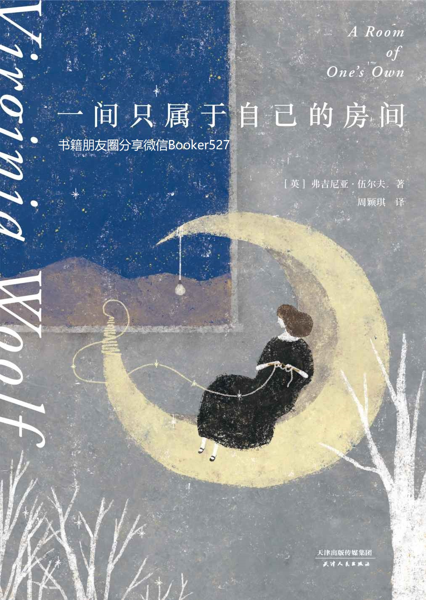

# 一间只属于自己的房间（李银河推荐的女性主义奠基作品，影响世界的百部经典）(果麦经典)

弗吉尼亚·伍尔夫 · 天津人民出版社

---

正文约 6.4 万字 · 3 张配图 · 语言 zh · 上传于 2026-10-22

## 阅读与下载

- [在线阅读](一间只属于自己的房间（李银河推荐的女性主义奠基作品，影响世界的百部经典）(果麦经典).md)

---

[← 返回书库首页](../README.md)
