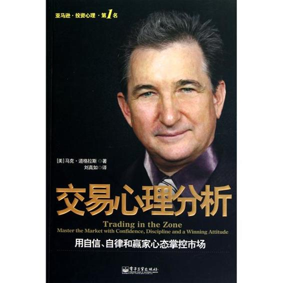

# 交易心理分析

> 作者：马克·道格拉斯　·　出版社：电子工业出版社　·　语言：zh

---

交易心理分析（中英文对照版）

马克•道格拉斯

---

内容简介

马克•道格拉斯是少数几位合格的交易心理辅导师，他的著作《交易心理分析》是许多人推荐的交易心理分析经典。在《交易心理分析》中，作者一语道破赢家的思考方式，并提供了具体的训练方法。不论你是初入股市的新手，或是股票买卖的老手，如果你想在股市中持续一贯地获利，你都应该读一读这本关于股票交易心理学的书，它会让你超脱输家轮回，晋升为市场赢家。。

---

声明

本书内容系书仓用户从网络中收集，利用书仓在线制作、转换服务生成，存放于书仓，仅供个人收藏、学习使用。其制作、收藏者承诺不把此内容用于商业用途。也请借阅者勿公开传播以及应用于商业用途。

书仓网仅止为个人或者机构提供在线内容制作、转换、存储等服务。书仓网上所有非epubsys帐号下的内容均为个人使用行为。

---

书仓（Shucang.com），旨在为阅读者弥合数字时代电子化阅读中的各种障碍，从而让个人获得随时、随地、随意阅读与拥有数字内容的惬意体验。

目前，书仓网提供的功能有：

1、在线的电子书报制作工具；2、在线电子书转换；3、在线电子书、文章存储分享；4、在线阅读；5、手机在线阅读；6、支持各种不同阅读软件、阅读器的电子书下载；

可以处理的格式包括epub、mobi、chm、txt、doc、pdf等。

在线版：http://www.shucang.com

手机版：http://shucang.com/m

目录版：http://www.shucang.com/s/index.php

注：比如iphone/itouch的Stanza，已经把书仓放在默认书库中，如果没有看到，可以手工添加目录版地址。

---

交易心理分析（中英文对照版）

本翻译内容仅供投资者学习用，不可用于任何商业目的，张轶不负任何法律责任。

master the market with confidence, discipline and a winning attitude

用自信、纪律和赢家的态度来掌握市场

mark douglas

马克·道格拉斯

foreword by thorn hartle

索恩·哈特尔作序

new york institute of finance

纽约金融学院

library of congress cataloging-in-publication data

议会图书馆出版物

douglas, mark (mark j.)

马克·道格拉斯

trading in the zone : master the market with confidence, discipline, and a winning attitude / by mark douglas, p. cm.

《交易心理分析》用自信、纪律和赢家的态度来掌握市场/作者：马克·道格拉斯

isbn 0-7352-0144-7 (cloth)

·1. stocks. 2. speculation. i. title.

本书类别：股票，投机

hg6041 .d59 2001

332.64 - dc21 00 045251

© 2000 by prentice hall

普林蒂斯霍尔出版公司2000年版权

all rights reserved. no part of this book may be reproduced in any form or by any means, without permission in writing from the publisher.

如果没有出版社的书面许可，本书任何部分都不可以用任何形式复制。

printed in the united states of america

印刷地：美国

10 9876 5 4321

this publication is designed to provide accurate and authoritative information in regard to the subject matter covered. it is sold with the understanding that the publisher is not engaged in rendering legal, accounting, or other professional service. if legal advice or other expert assistance is required, the services of a competent professional person should be sought.

本出版物的设计完全按照作者的主题展开。本书的销售不代表任何法律、财务或其它专业服务。如果你需要法律建议或专家服务，请联系有实力的专业人士。

… from the declaration of principles jointly adopted by a committee of the american bar association and a committee of publishers and associations.

以上来自美国条形码委员会和美国出版社联合委员会的联合宣言。

isbn d-73se-dmm-7

attention: corporations and schools

注意：公司和学校

prentice hall books are available at quantity discounts with bulk purchase for educational, business, or sales promotional use. for information, please write to: prentice hall, special sales, 240 frisch court, paramus, nj 07652. please supply: title of book, isbn, quantity, how the book will be used, date needed.

如果是教育机构，公司或促销时大量采购，可以得到普林蒂斯霍尔出版公司的打折价。需要信息，请写到：邮编07652，新泽西州，帕拉莫斯，弗里希院240号，促销部，普林蒂斯霍尔出版公司。请提供：书名，isbn号，书的作用，需要的日期。

new york institute of finance

纽约金融学院

an imprint of prentice hall press

普林蒂斯霍尔出版公司印刷

paramus, nj 07652

http://www.phdirect.com

nyif and new york institute of finance are trademarks of executive tax reports, inc. used under license by prentice hall direct, inc.

纽约金融学院是普林蒂斯霍尔出版公司注册的纳税公司的注册商标。

dedication

献词

this book is dedicated to all of the traders i have had the pleasure of working with over the last 18 years as a trading coach. each of you in your own unique way is a part of the insight and guidance this book will provide to those who choose to trade from a confident, disciplined, and consistent state of mind.

本书献给过去18年来我所认识的所有交易者，作为交易教练，我和他们在一起很快乐。你们中的每一个人用自己独特的方式，为本书提供见解和指导，引导那些用自信、纪律和持续一致思想交易的人们。

table of contents

目录

[foreword.. 3](http://www.ruccp.com/jyxlfx.shtml#_toc210189841#_toc210189841)

[序言... 3](http://www.ruccp.com/jyxlfx.shtml#_toc210189842#_toc210189842)

[preface.. 5](http://www.ruccp.com/jyxlfx.shtml#_toc210189843#_toc210189843)

[引子... 5](http://www.ruccp.com/jyxlfx.shtml#_toc210189844#_toc210189844)

[attitude survey.. 9](http://www.ruccp.com/jyxlfx.shtml#_toc210189845#_toc210189845)

[态度调查表... 9](http://www.ruccp.com/jyxlfx.shtml#_toc210189846#_toc210189846)

[chapter 1 the road to success: fundamental, technical, or mental analysis? 14](http://www.ruccp.com/jyxlfx.shtml#_toc210189847#_toc210189847)

[第01 章成功之路：基本面，技术面或思想分析面？... 14](http://www.ruccp.com/jyxlfx.shtml#_toc210189848#_toc210189848)

[in the beginning: fundamental analysis.. 14](http://www.ruccp.com/jyxlfx.shtml#_toc210189849#_toc210189849)

[开始：基本面分析... 14](http://www.ruccp.com/jyxlfx.shtml#_toc210189850#_toc210189850)

[the shift to technical analysis.. 16](http://www.ruccp.com/jyxlfx.shtml#_toc210189851#_toc210189851)

[转到技术分析... 16](http://www.ruccp.com/jyxlfx.shtml#_toc210189852#_toc210189852)

[the shift to mental analysis.. 18](http://www.ruccp.com/jyxlfx.shtml#_toc210189853#_toc210189853)

[转到思想分析... 18](http://www.ruccp.com/jyxlfx.shtml#_toc210189854#_toc210189854)

[chapter 2 the lure (and the dangers) of trading.. 32](http://www.ruccp.com/jyxlfx.shtml#_toc210189855#_toc210189855)

[第02章交易的诱惑（和危险）... 32](http://www.ruccp.com/jyxlfx.shtml#_toc210189856#_toc210189856)

[the attraction.. 32](http://www.ruccp.com/jyxlfx.shtml#_toc210189857#_toc210189857)

[吸引... 32](http://www.ruccp.com/jyxlfx.shtml#_toc210189858#_toc210189858)

[the dangers.. 36](http://www.ruccp.com/jyxlfx.shtml#_toc210189859#_toc210189859)

[危险... 36](http://www.ruccp.com/jyxlfx.shtml#_toc210189860#_toc210189860)

[the safeguards.. 41](http://www.ruccp.com/jyxlfx.shtml#_toc210189861#_toc210189861)

[安全措施... 41](http://www.ruccp.com/jyxlfx.shtml#_toc210189862#_toc210189862)

[problem: the unwillingness to create rules. 44](http://www.ruccp.com/jyxlfx.shtml#_toc210189863#_toc210189863)

[问题：不愿意制定原则... 44](http://www.ruccp.com/jyxlfx.shtml#_toc210189864#_toc210189864)

[problem: failure to take responsibility. 46](http://www.ruccp.com/jyxlfx.shtml#_toc210189865#_toc210189865)

[问题：不负责任... 46](http://www.ruccp.com/jyxlfx.shtml#_toc210189866#_toc210189866)

[problem: addiction to random rewards. 48](http://www.ruccp.com/jyxlfx.shtml#_toc210189867#_toc210189867)

[问题：对随机的回报上瘾... 48](http://www.ruccp.com/jyxlfx.shtml#_toc210189868#_toc210189868)

[problem: external versus internal control 49](http://www.ruccp.com/jyxlfx.shtml#_toc210189869#_toc210189869)

[问题：外部控制对抗内部控制... 49](http://www.ruccp.com/jyxlfx.shtml#_toc210189870#_toc210189870)

[chapter 3 taking responsibility.. 51](http://www.ruccp.com/jyxlfx.shtml#_toc210189871#_toc210189871)

[第03章自己承担责任... 51](http://www.ruccp.com/jyxlfx.shtml#_toc210189872#_toc210189872)

[shaping your mental environment. 52](http://www.ruccp.com/jyxlfx.shtml#_toc210189873#_toc210189873)

[塑造你的思想环境... 52](http://www.ruccp.com/jyxlfx.shtml#_toc210189874#_toc210189874)

[reacting to loss.. 57](http://www.ruccp.com/jyxlfx.shtml#_toc210189875#_toc210189875)

[对亏损的反应... 57](http://www.ruccp.com/jyxlfx.shtml#_toc210189876#_toc210189876)

[winners, losers, boomers, and busters.. 71](http://www.ruccp.com/jyxlfx.shtml#_toc210189877#_toc210189877)

[赢家，输家，暴发户和亏损者... 71](http://www.ruccp.com/jyxlfx.shtml#_toc210189878#_toc210189878)

[chapter 4 consistency: a state of mind.. 79](http://www.ruccp.com/jyxlfx.shtml#_toc210189879#_toc210189879)

[第04章持续一致性：一种思想状态... 79](http://www.ruccp.com/jyxlfx.shtml#_toc210189880#_toc210189880)

[thinking about trading.. 80](http://www.ruccp.com/jyxlfx.shtml#_toc210189881#_toc210189881)

[考虑交易... 80](http://www.ruccp.com/jyxlfx.shtml#_toc210189882#_toc210189882)

[really understanding risk.. 83](http://www.ruccp.com/jyxlfx.shtml#_toc210189883#_toc210189883)

[完全明白风险... 83](http://www.ruccp.com/jyxlfx.shtml#_toc210189884#_toc210189884)

[aligning your mental environment. 87](http://www.ruccp.com/jyxlfx.shtml#_toc210189885#_toc210189885)

[让你的思想持续一致... 87](http://www.ruccp.com/jyxlfx.shtml#_toc210189886#_toc210189886)

[chapter 5 the dynamics of perception.. 87](http://www.ruccp.com/jyxlfx.shtml#_toc210189887#_toc210189887)

[第05章认知的动力... 87](http://www.ruccp.com/jyxlfx.shtml#_toc210189888#_toc210189888)

[debugging your mental software.. 87](http://www.ruccp.com/jyxlfx.shtml#_toc210189889#_toc210189889)

[为你的思想软件找茬... 87](http://www.ruccp.com/jyxlfx.shtml#_toc210189890#_toc210189890)

[perception and learning.. 87](http://www.ruccp.com/jyxlfx.shtml#_toc210189891#_toc210189891)

[认知和学习... 87](http://www.ruccp.com/jyxlfx.shtml#_toc210189892#_toc210189892)

[perception and risk.. 87](http://www.ruccp.com/jyxlfx.shtml#_toc210189893#_toc210189893)

[认知和风险... 87](http://www.ruccp.com/jyxlfx.shtml#_toc210189894#_toc210189894)

[the power of association.. 87](http://www.ruccp.com/jyxlfx.shtml#_toc210189895#_toc210189895)

[联想的力量... 87](http://www.ruccp.com/jyxlfx.shtml#_toc210189896#_toc210189896)

[chapter 6 the market's perspective.. 87](http://www.ruccp.com/jyxlfx.shtml#_toc210189897#_toc210189897)

[第06章市场的角度... 87](http://www.ruccp.com/jyxlfx.shtml#_toc210189898#_toc210189898)

[the "uncertainty" principle.. 87](http://www.ruccp.com/jyxlfx.shtml#_toc210189899#_toc210189899)

["不确定"原则... 87](http://www.ruccp.com/jyxlfx.shtml#_toc210189900#_toc210189900)

[markets most fundamental characteristic (it can express itself in an almost infinite combination of ways ) 87](http://www.ruccp.com/jyxlfx.shtml#_toc210189901#_toc210189901)

[市场最基本的特征（它几乎可以用任何组合方式来表达自己）... 87](http://www.ruccp.com/jyxlfx.shtml#_toc210189902#_toc210189902)

[chapter 7 the trader's edge: thinking in probabilities.. 87](http://www.ruccp.com/jyxlfx.shtml#_toc210189903#_toc210189903)

[第07章交易者的优势：考虑概率... 87](http://www.ruccp.com/jyxlfx.shtml#_toc210189904#_toc210189904)

[probabilities paradox: random outcome, consistent results 87](http://www.ruccp.com/jyxlfx.shtml#_toc210189905#_toc210189905)

---

[概率的似非而是：随机的结果，持续一致的收入... 87](http://www.ruccp.com/jyxlfx.shtml#_toc210189906#_toc210189906)

[trading in the moment. 87](http://www.ruccp.com/jyxlfx.shtml#_toc210189907#_toc210189907)

[有机会就交易... 87](http://www.ruccp.com/jyxlfx.shtml#_toc210189908#_toc210189908)

[managing expectations.. 87](http://www.ruccp.com/jyxlfx.shtml#_toc210189909#_toc210189909)

[管理期望... 87](http://www.ruccp.com/jyxlfx.shtml#_toc210189910#_toc210189910)

[eliminating the emotional risk.. 87](http://www.ruccp.com/jyxlfx.shtml#_toc210189911#_toc210189911)

[消灭情绪风险... 87](http://www.ruccp.com/jyxlfx.shtml#_toc210189912#_toc210189912)

[chapter 8 working with your beliefs.. 87](http://www.ruccp.com/jyxlfx.shtml#_toc210189913#_toc210189913)

[第08章和信念一起工作... 87](http://www.ruccp.com/jyxlfx.shtml#_toc210189914#_toc210189914)

[defining the problem.. 87](http://www.ruccp.com/jyxlfx.shtml#_toc210189915#_toc210189915)

[给问题下定义... 87](http://www.ruccp.com/jyxlfx.shtml#_toc210189916#_toc210189916)

[defining the terms.. 87](http://www.ruccp.com/jyxlfx.shtml#_toc210189917#_toc210189917)

[对几个说法下定义... 87](http://www.ruccp.com/jyxlfx.shtml#_toc210189918#_toc210189918)

[how the fundamental truths relate to the skills.. 87](http://www.ruccp.com/jyxlfx.shtml#_toc210189919#_toc210189919)

[这些基本事实和技术如何联系起来... 87](http://www.ruccp.com/jyxlfx.shtml#_toc210189920#_toc210189920)

[moving toward "the zone" 87](http://www.ruccp.com/jyxlfx.shtml#_toc210189921#_toc210189921)

[进入这个"状态" 87](http://www.ruccp.com/jyxlfx.shtml#_toc210189922#_toc210189922)

[chapter 9 the nature of beliefs.. 87](http://www.ruccp.com/jyxlfx.shtml#_toc210189923#_toc210189923)

[第09章信念的天性... 87](http://www.ruccp.com/jyxlfx.shtml#_toc210189924#_toc210189924)

[the origins of a belief.. 87](http://www.ruccp.com/jyxlfx.shtml#_toc210189925#_toc210189925)

[信念的来源... 87](http://www.ruccp.com/jyxlfx.shtml#_toc210189926#_toc210189926)

[beliefs and their impact on our lives.. 87](http://www.ruccp.com/jyxlfx.shtml#_toc210189927#_toc210189927)

[信念和信念对我们生活的影响... 87](http://www.ruccp.com/jyxlfx.shtml#_toc210189928#_toc210189928)

[beliefs vs. the truth.. 87](http://www.ruccp.com/jyxlfx.shtml#_toc210189929#_toc210189929)

[信念对抗事实... 87](http://www.ruccp.com/jyxlfx.shtml#_toc210189930#_toc210189930)

[chapter 10 the impact of beliefs on trading.. 87](http://www.ruccp.com/jyxlfx.shtml#_toc210189931#_toc210189931)

[第10章信念对交易的影响... 87](http://www.ruccp.com/jyxlfx.shtml#_toc210189932#_toc210189932)

[the primary characteristics of a belief.. 87](http://www.ruccp.com/jyxlfx.shtml#_toc210189933#_toc210189933)

[信念的基本特点... 87](http://www.ruccp.com/jyxlfx.shtml#_toc210189934#_toc210189934)

[self evaluation and trading.. 87](http://www.ruccp.com/jyxlfx.shtml#_toc210189935#_toc210189935)

[自我评估和交易... 87](http://www.ruccp.com/jyxlfx.shtml#_toc210189936#_toc210189936)

[chapter 11 thinking like a trader.. 87](http://www.ruccp.com/jyxlfx.shtml#_toc210189937#_toc210189937)

[第11章像交易者一样思考... 87](http://www.ruccp.com/jyxlfx.shtml#_toc210189938#_toc210189938)

[the mechanical stage.. 87](http://www.ruccp.com/jyxlfx.shtml#_toc210189939#_toc210189939)

[机械阶段... 87](http://www.ruccp.com/jyxlfx.shtml#_toc210189940#_toc210189940)

[the role of self-discipline.. 87](http://www.ruccp.com/jyxlfx.shtml#_toc210189941#_toc210189941)

[自律的作用... 87](http://www.ruccp.com/jyxlfx.shtml#_toc210189942#_toc210189942)

[creating a belief in consistency.. 87](http://www.ruccp.com/jyxlfx.shtml#_toc210189943#_toc210189943)

[创造一个相信持续一致性的信念... 87](http://www.ruccp.com/jyxlfx.shtml#_toc210189944#_toc210189944)

[exercise: learning to trade an edge like a casino.. 87](http://www.ruccp.com/jyxlfx.shtml#_toc210189945#_toc210189945)

[练习：向赌场学习利用优势交易... 87](http://www.ruccp.com/jyxlfx.shtml#_toc210189946#_toc210189946)

[a final note.. 87](http://www.ruccp.com/jyxlfx.shtml#_toc210189947#_toc210189947)

[最后的提醒... 87](http://www.ruccp.com/jyxlfx.shtml#_toc210189948#_toc210189948)

[attitude survey.. 87](http://www.ruccp.com/jyxlfx.shtml#_toc210189949#_toc210189949)

[态度调查... 87](http://www.ruccp.com/jyxlfx.shtml#_toc210189950#_toc210189950)

[index.. 87](http://www.ruccp.com/jyxlfx.shtml#_toc210189951#_toc210189951)

[英语索引（张轶略去）... 87](http://www.ruccp.com/jyxlfx.shtml#_toc210189952#_toc210189952)

foreword

序言

the great bull market in stocks has led to an equally great bull market in the number of books published on the subject of how to make money trading the markets. many ideas abound, some good, some not, some original, some just a repackaging of earlier works. occasionally, though, a writer comes forward with something that really sets him or her apart from the pack, something special. one such writer is mark douglas.

大牛市导致出版社出了很多书，这些书都是谈如何通过交易赚钱。有很多思想，有些很好，有些则不行，有些是原创的，有些只是把以前的作品再重新包装一下而已。偶尔，一些作者会脱颖而出，写出特殊的作品。其中一个作者就是马克·道格拉斯。

mark douglas, in trading in the zone, has written a book that is the accumulation of years of thought and research - the work of a lifetime - and for those of us who view trading as a profession, he has produced a gem.

在马克·道格拉斯的书《交易心理分析》中，展示了他多年的思想和研究--一生的心血--对于我们把交易当作职业的人来说，他给我们的是一块宝石。

trading in the zone is an in-depth look at the challenges that we face when we take up the challenge of trading. to the novice, the only challenge appears to be to find a way to make money. once the novice learns that tips, brokers' advice, and other ways to justify buying or selling do not work consistently, he discovers that he either needs to develop a reliable trading strategy or purchase one. after that, trading should be easy, right? all you have to do is follow the rules, and the money will fall into your lap.

我们在交易时会遇到挑战，《交易心理分析》则对这些挑战提供了深刻的见解。对于新手来说，唯一的挑战似乎就是找到赚钱的方法。当新手明白消息，经纪公司的建议和其它买卖方法都不能持续一致赢利时，他发现要么自己设计一个可靠的交易系统，要么去买一个。完成了这个任务，交易就简单了，对不？你要做的就是遵守原则，这样钱就来了。

at this point, if not before, novices discover that trading can turn into one of the most frustrating experiences they will ever face. this experience leads to the oft-started statistic that 95 percent of futures traders lose all of their money within the first year of trading. stock traders generally experience the same results, which is why pundits always point to the fact that most stock traders fail to outperform a simple buy and hold investment scenario.

这时，如果新手以前没有体验过的话，现在就会发现交易进入了前所未有的艰难阶段。统计的结果表明，95%的期货交易者会在第一年把钱亏光，而新手就要体验这样的事。股票交易者通常也会体验同样的结果，这就是为什么权威人士说大部分股票交易者的表现还不如买入并持有的投资策略。

so, why do people, the majority of whom are extremely successful in other occupations, fail so miserably as traders? are successful traders born and not made? mark douglas says no. what's necessary, he says, is that the individual acquire the trader's mindset. it sounds easy, but the fact is, this mindset is very foreign when compared with the way our life experiences teach us to think about the world.

那么，为什么大部分人在做其它职业时超级成功，做交易时就输的这么惨呢？成功的交易者是天生的吗？马克·道格拉斯说不是的。他说需要有交易者的思想。这听起来很简单，但事实上，交易者的思想和生活中我们看待世界的方法完全不同。

that 95-percent failure rate makes sense when you consider how most of us experience life, using skills learned as we grow. when it comes to trading, however, it turns out that the skills we learn to earn high marks in school, advance our careers, and create relationships with other people, the skills we are taught that should carry us through life, turn out to be inappropriate for trading. traders, we find out, must learn to think in terms of probabilities and to surrender all of the skills we have acquired to achieve in virtually every other aspect of our lives. in trading in the zone, mark douglas teaches us how. he has put together a very valuable book. his sources are his own personal experiences as a trader, a traders coach in chicago, author, and lecturer in his field of trading psychology.

当你想想大部分人在生活中是如何思考的，如何在成长中学习技术的，你就明白95%的失败率是合理的。我们在学校努力得高分，在职业生涯中往上爬，和别人建立友好关系，这些都是我们在成长中学习的技术技巧，然而对于交易来说，这些技术技巧都是不合适的。交易者必须学习概率，并放弃我们生活中学到的方方面面的技术技巧。马克·道格拉斯会在《交易心理分析》中告诉我们如何做到。这本书很有价值。他自己是交易者、芝加哥的交易教练、作家、交易心理分析演讲家，这些经验是本书的源泉。

my recommendation? enjoy douglas's trading in the zone and, in doing so, develop a trader's mindset.

我有什么推荐？我建议你阅读马克·道格拉斯的《交易心理分析》并形成交易者的思想。

thorn hartle

索恩·哈特尔

preface

引子

the goal of any trader is to turn profits on a regular basis, yet so few people ever really make consistent money as traders. what accounts for the small percentage of traders who are consistently successful? to me, the determining factor is psychological - the consistent winners think differently from everyone else.

每个交易者的目标都是稳定赚钱，但是只有极少数的交易者实现了持续一致地赚钱。他们是如何实现持续一致赚钱的？对我来说，决定因素是心理--持续一致的赢家和别人想的不一样。

i started trading in 1978. at the time, i was managing a commercial casualty insurance agency in the suburbs of detroit, michigan. i had a very successful career and thought i could easily transfer that success into trading. unfortunately, i found that was not the case. by 1981, i was thoroughly disgusted with my inability to trade effectively while holding another job, so i moved to chicago and got a job as a broker with merrill lynch at the chicago board of trade. how did i do? well, within nine months of moving to chicago, i had lost nearly everything i owned. my losses were the result of both my trading activities and my exorbitant life style, which demanded that i make a lot of money as a trader.

我1978年开始交易。当时，我在密歇根州底特律城郊管理一个商业的伤残保险分公司。我的职业生涯非常成功，我想我可以把我的成功移植到交易中。很不幸，我失败了。到了1981年，我对自己一方面要工作，一方又交易不顺而彻底苦恼。于是我搬到芝加哥，在芝加哥交易所美林证券经纪公司找了一份工作，做经纪人。我是怎么做的？嗯，搬到芝加哥9个月后，我几乎失去了一切。我本想做交易赚很多钱，但是我的交易行为和昂贵的交易风格让我几乎失去了一切。

from these early experiences as a trader, i learned an enormous amount about myself, and about the role of psychology in trading. as a result, in 1982, i started working on my first book, the disciplined trader: developing winning attitudes. when i began this project i had no concept of how difficult it was to write a book or explain something that i understood for myself in a manner and form that would be useful to other people. i thought it was going to take me between six and nine months to get the job done. it took seven and a half years and was finally published by prentice hall in 1990.

通过早期的交易，我对自己和交易心理扮演的角色有了很多了解。结果，我在1982年开始写我的第一本书《有纪律的交易者--形成赢家态度》。当我开始写书时，我才知道把自己的思想写成对别人有用的东西是多么难。我以为6--9个月可以完成此书。结果写了7年半，于1990年由普林蒂斯霍尔出版公司出版。

in 1983, i left merrill lynch to start a consulting firm, trading behavior dynamics, where i presently develop and conduct seminars on trading psychology and act in the capacity of what is commonly referred to as a trading coach. i've done countless presentations for trading companies, clearing firms, brokerage houses, banks, and investment conferences all over the world. i've worked at a personal level, one on one, with virtually every type of trader in the business, including some of the biggest floor traders, hedgers, option specialists, and ctas, as well as neophytes.

1983年我离开了美林，办了一个顾问公司叫"交易行为动力"，我设计了一个研讨会，我自己做交易教练，教别人交易心理。我为全世界无数的交易公司、清算公司、经纪公司、银行、投资会议做演讲。我采用一对一的方式，几乎和每种类型的交易者都接触过，包括最大的场内交易者、对冲者、期权专家、商品交易顾问和新手。

as of this writing, i have spent the last seventeen years dissecting the psychological dynamics behind trading so that i could develop effective methods for teaching the proper principles of success. what i've discovered is that, at the most fundamental level, there is a problem with the way we think. there is something inherent in the way our minds work that doesn't fit very well with the characteristics shown by the markets.

当我写到这里时，我应经用了17年时间剖析交易心理，所以我可以形成有效的方法教别人成功的原则。我发现，从最基本的方面说，我们的思想方式有问题。我们天生的思想模式和市场特点是不搭配的。

those traders who have confidence in their own trades, who trust themselves to do what needs to be done without hesitation, are the ones who become successful. they no longer fear the erratic behavior of the market. they learn to focus on the information that helps them spot opportunities to make a profit, rather than focusing on the information that reinforces their fears.

---

对自己的交易有自信，知道怎么做，不犹豫的交易者会成功。他们不害怕市场飘忽不定的行为。他们关注能赚钱的信息，而不是关注会增加他们害怕感的信息。

while this may sound complicated, it all boils down to learning to believe that: (1) you don't need to know what's going to happen next to make money; (2) anything can happen; and (3) every moment is unique, meaning every edge and outcome is truly a unique experience. the trade either works or it doesn't. in any case, you wait for the next edge to appear and go through the process again and again. with this approach you will learn in a methodical, non-random fashion what works and what doesn't. and, just as important, you will build a sense of self-trust so that you won't damage yourself in an environment that has the unlimited qualities the markets have.

这听起来也许复杂，总结下来就是你要学习并相信：（1）你不必知道下一步会如何也能赚钱；（2）任何事都会发生；（3）任何时刻都是独特的，这意味着每个优势，每个结果都是独特的体验。交易不是成功就是失败。在每笔交易中，你等待优势的到来，然后一次又一次地重复这个过程。用这种方法，你就会知道什么有用，什么没用。还有重要的一点，你要自己建立自信，以防止市场无数的特点毁了你。

most traders don't believe that their trading problems are the result of the way they think about trading or, more specifically, how they are thinking while they are trading. in my first book, the disciplined trader, i identified the problems confronting the trader from a mental perspective and then built a philosophical framework for understanding the nature of these problems and why they exist. i had five major objectives in mind in writing trading in the zone:

大部分交易者不相信他们的交易问题来自他们的思想，更具体地说，是他们的交易思想。在我的第一本书《有纪律的交易者》中，我用精神的角度来确定交易者的问题，用哲学的框架来解释这些问题的自然性，以及原因。我在写《交易心理分析》时有5个重要的目标：

to prove to the trader that more or better market analysis is not the solution to his trading difficulties or lack of consistent results.

向交易者证明更多更好的市场分析不能解决交易问题，不能实现持续一致赢利。

to convince the trader that it's his attitude and "state of mind" that determine his results.

让交易者相信他的态度和思想状态决定他的结果。

to provide the trader with the specific beliefs and attitudes that are necessary to build a winner's mindset, which means learning how to think in probabilities.

向交易者提供明确的信念和态度，也就是赢家思想必须的，这意味着如何用概率思考。

to address the many conflicts, contradictions, and paradoxes in thinking that cause the typical trader to assume that he already does think in probabilities, when he really doesn't.

说明很多冲突的、矛盾的、似是而非的想法，这些想法让交易者以为他在思考概率，其实他没有。

to take the trader through a process that integrates this thinking strategy into his mental system at a functional level.

带领交易者走过这个过程，把他的思考策略和思想系统结合起来，且具有可操作性。

(note: until recently, most traders were men, but i recognize that more and more women are joining the ranks. in an effort to avoid confusion and awkward phrasing, i have consistently used the pronoun "he" throughout this book in describing traders. this certainly does not reflect any bias on my part.)

（注意：目前，大部分交易者是男性，但我注意到越来越多的女性开始交易。为了避免混乱和表达的不方便，我在本书中一直用"他"来描述交易者。这肯定不代表我有偏见。）

trading in the zone presents a serious psychological approach to becoming a consistent winner in your trading. i do not offer a trading system; i am more interested in showing you how to think in the way necessary to become a profitable trader. i assume that you already have your own system, your own edge. you must learn to trust your edge. the edge means there is a higher probability of one outcome than another. the greater your confidence, the easier it will be to execute your trades. this book is designed to give you the insight and understanding you need about yourself and the nature of trading, so that actually doing it becomes as easy, simple, and stressfree as when you're just watching the market and thinking about doing it.

《交易心理分析》提供了认真的心理方法，让你成为持续一致的赢家。我没有提供交易系统，我更大的兴趣是告诉你如何思考，以成为赢利的交易者。我相信你已经有了自己的系统，有了自己的优势。你必须努力地去相信你的优势。优势意味着比较高的概率。你越自信，你越容易进行交易。本书帮助你深刻认识你自己和交易的本性，这样当你实际操作时，你看着市场，思考交易时，行动就容易了，简单了，压力也小了。

in order to determine how well you "think like a trader," take the following attitude survey. there are no right or wrong answers. your answers are an indication of how consistent your current mental framework is with the way you need to think in order to get the most out of your trading.

为了确定你是否"像交易者一样思考，"请进行下面的态度调查。这里没有正确答案或错误答案。你的答案表明了你的思想框架和尽量多赚钱的想法之间的持续一致性。

mark douglas

马克·道格拉斯

attitude survey

态度调查表

1. to make money as a trader you have to know what the market is going to do next.

agree disagree

作为交易者，如果想赚钱，你必须知道市场下一步怎么走。

同意不同意

2. sometimes i find myself thinking that there must be a way to trade without having to take a loss.

agree disagree

有时候我在想，一定有不亏钱的交易方法。

同意不同意

3. making money as a trader is primarily a function of analysis.

agree disagree

作为交易者，赚钱主要是分析的功能。

同意不同意

4. losses are an unavoidable component of trading.

agree disagree

亏损是交易不可避免的组成部分。

同意不同意

5. my risk is always defined before i enter a trade.

agree disagree

我总是在进场前衡量风险。

同意不同意

6. in my mind there is always a cost associated with finding out what the market may do next.

agree disagree

我认为，搞清楚市场下一步怎么走总是需要成本的。

同意不同意

7. i wouldn't even bother putting on the next trade if i wasn't sure that it was going to be a winner.

agree disagree

如果我不能肯定自己会赢，我根本不会交易。

同意不同意

8. the more a trader learns about the markets and how they behave, the easier it will be for him to execute his trades.

agree disagree

交易者对市场和市场行为的了解越多，他就越轻松地执行交易。

同意不同意

9. my methodology tells me exactly under what market conditions to either enter or exit a trade.

agree disagree

我的方法很明确地告诉我在什么情况下进场或出场。

同意不同意

10. even when i have a clear signal to reverse my position, i find it extremely difficult to do.

agree disagree

即使我有明确的信号，这个信号叫我平仓，并反向交易，我很难去执行。

同意不同意

11. i have sustained periods of consistent success usually followed by some fairly drastic draw-downs in my equity.

agree disagree

我的资金曲线总是有一段时间能保持持续上涨，然后就会灾难性下跌。

12. when i first started trading i would describe my trading methodology as haphazard, meaning some success in between a lot of pain.

agree disagree

当我第一次开始交易时，我觉得我的交易方法有偶然性，也就是说有时能赚点，更多的则是痛苦。

同意不同意

13. i often find myself feeling that the markets are against me personally.

agree disagree

我总是感觉市场在和我作对。

同意不同意

14. as much as i might try to "let go," i find it very difficult to put past emotional wounds behind me.

agree disagree

我努力想"放手"时，发现很难忘记过去的情绪创伤。

同意不同意

15. i have a money management philosophy that is founded in the principle of always taking some money out of the market when the market makes it available.

agree disagree

我有一个资金管理哲学，当市场对我有利时，我兑现部分利润。

同意不同意

16. a trader's job is to identify patterns in the markets' behavior that represent an opportunity and then to determine the risk of finding out if these patterns will play themselves out as they have in the past.

agree disagree

交易者的工作就是确认市场的行为模式，发现提供机会，然后衡量风险，看看这些模式在过去是否有效。

同意不同意

17. sometimes i just can't help feeling that i am a victim of the market.

agree disagree

有时我情不自禁地觉得我是市场的受害者。

同意不同意

18. when i trade i usually try to stay focused in one time frame.

agree disagree

当我交易时，我通常只关注一个时间周期。

同意不同意

19. trading successfully requires a degree of mental flexibility far beyond the scope of most people.

agree disagree

成功交易需要比大部分人复杂的大脑。

同意不同意

20. there are times when i can definitely feel the flow of the market; however, i often have difficulty acting on these feelings.

agree disagree

有时我绝对能感觉到市场的方向，然而我总是很难根据这个感觉行动。

同意不同意

21. there are many times when i am in a profitable trade and i know the move is basically over, but i still won't take my profits.

agree disagree

很多时候，我的仓位赚钱了，我也知道行情基本结束了，但我总是不愿意兑现利润。

同意不同意

22. no matter how much money i make in a trade, i am rarely ever satisfied and feel that i could have made more.

agree disagree

不管一笔交易我赚了多少，我总是不满足，总以为自己可以赚的更多。

同意不同意

23. when i put on a trade, i feel i have a positive attitude. i anticipate all of the money i could make from the trade in a positive way.

agree disagree

我当建仓时，我觉得我有积极态度。我希望能赚到所有的钱。

同意不同意

24. the most important component in a trader's ability to accumulate money over time is having a belief in his own consistency.

agree disagree

交易者持续一致赚钱的重要因素就是他有持续一致的信念。

同意不同意

25. if you were granted a wish to be able to instantaneously acquire one trading skill, what skill would you choose?

如果你许愿要得到一个交易技术，这个技术能被立刻实现，你会选择什么技术？

26. i often spend sleepless nights worrying about the market.

agree disagree

我经常担心市场，晚上失眠。

同意不同意

27. do you ever feel compelled to make a trade because you are afraid that you might miss out?

yes no

你是否会因为担心错过交易而逼自己去交易？

是否

28. although it doesn't happen very often, i really like my trades to be perfect. when i make a perfect call it feels so good that it makes up for all of the times that i don't.

agree disagree

虽然这事不会经常发生，我非常喜欢完美的交易。当我做了一笔完美的交易，我非常高兴，过去的痛苦都可以被弥补。

29. do you ever find yourself planning trades you never execute, and executing trades you never planned?

yes no

你是否做了计划不交易，交易的却是没有计划的？

---

是否

30. in a few sentences explain why most traders either don't make money or aren't able to keep what they make.

用几句话解释为什么大部分交易者要么不能赚钱，要么不能守住利润。

set aside your answers as you read through this book. after you've finished the last chapter ("thinking like a trader"), take the attitude survey again - it s reprinted at the back of the book. you may be surprised to see how much your answers differ from the first time.

当你阅读本书的时候，把你的答案放在旁边。当你完成了最有一章（"像交易者一样思考"），再次做这个态度调查--在本书后面又印了一次。你会吃惊地发现你的答案和第一次有多么不同。

acknowledgments

感谢词

i would especially like to thank all of the traders who bought the signed limited edition manuscript of the first seven chapters of this book. your feedback gave me the inspiration to add the additional four chapters.

我特别感谢购买了有本人签字，只有前7章底稿限量版的交易者。你们的回复给了我灵感，我又多写了4章。

next, i would like to thank fellow traders robert st. john, greg bieber, larry pesavento, and ted hearne for their friendship and the special ways in which each of them contributed to the development of this book.

其次，我要感谢我的伙伴，他们也是交易者，他们是罗伯特·圣·约翰，格雷格·比伯，拉里·斐萨文托和泰德·赫恩。感谢他们的友谊，感谢他们用特殊的方式为本书做的贡献。

i would also like to acknowledge my friend, eileen bruno, for editing the original manuscript; and, at prentice hall, ellen schneid coleman, associate publisher, for her professionalism and help in smoothing the path to publication, and barry richardson, development editor, for his help in shaping the introduction. his time and talent are greatly appreciated.

我还要感谢我的朋友，艾琳·布鲁诺，感谢她编辑底稿，还有普林蒂斯霍尔出版公司的艾伦·施耐德·科勒曼，她是副社长，感谢她的专业精神以帮助本书顺利出版。还有巴里·理查森，他是编辑，感谢他帮忙形成的介绍，衷心感激他付出的时间和他的才华。

chapter 1 the road to success: fundamental, technical, or mental analysis?

第 01 章成功之路：基本面，技术面或思想分析面？

in the beginning: fundamental analysis

开始：基本面分析

who remembers when fundamental analysis was considered the only real or proper way to make trading decisions? when i started trading in 1978, technical analysis was used by only a handful of traders, who were considered by the rest of the market community to be, at the very least, crazy. as difficult as it is to believe now, it wasn't very long ago when wall street and most of the major funds and financial institutions thought that technical analysis was some form of mystical hocus-pocus.

谁还记得基本面分析曾经是唯一真实的或合理的交易决定方法？当我1978年开始交易时，只有少数人用技术分析，当时市场大众认为他们疯了。现在让人无法相信的是，不久前华尔街，大部分主要基金和金融机构都认为技术分析是胡编乱造。

now, of course, just the opposite is true. almost all experienced traders use some form of technical analysis to help them formulate their trading strategies. except for some small, isolated pockets in the academic community, the "purely" fundamental analyst is virtually extinct. what caused this dramatic shift in perspective?

当然现在已经反过来了。几乎所有有经验的交易者都会使用某种技术分析帮助他们形成交易策略。除了少数，与世隔绝的学院派，"纯粹"用基本面分析的人几乎绝种了。是什么导致了观念的巨大变化？

i'm sure it's no surprise to anyone that the answer to this question is very simple: money! the problem with making trading decisions from a strictly fundamental perspective is the inherent difficulty of making money consistently using this approach.

我想答案应该很简单，那就是钱！用纯粹的基本面分析做交易决定，天生的困难就是无法长期持续一致地赚钱。

for those of you who may not be familiar with fundamental analysis, let me explain. fundamental analysis attempts to take into consideration all the variables that could affect the relative balance or imbalance between the supply of and the possible demand for any particular stock, commodity, or financial instrument. using primarily mathematical models that weigh the significance of a variety of factors (interest rates, balance sheets, weather patterns, and numerous others), the analyst projects what the price should be at some point in the future.

如果你不了解基本面分析，请让我来解释。对于股票、商品或金融产品，基本面分析综合考虑影响供需平衡或不平衡的所有变数。利用原始的数学模型来衡量不同因素（利率、资产负债表、天气模式以及无数的其它），以预测未来价格应该到哪里。

the problem with these models is that they rarely, if ever, factor in other traders as variables. people, expressing their beliefs and expectations about the future, make prices move - not models. the fact that a model makes a logical and reasonable projection based on all the relevant variables is not of much value if the traders who are responsible for most of the trading volume are not aware of the model or don't believe in it.

这个模型的问题是它从来不把其它交易者当变数。是大众通过推动价格来表达他们的信念和期望--不是模型推动的。交易量是交易者制造的，如果交易者不知道这个模型或者不相信这个模型，那么这个模型所根据的变量是没有价值的，它的逻辑和分析预测也没有价值。

as a matter of fact, many traders, especially those on the floors of the futures exchanges who have the ability to move prices very dramatically in one direction or the other, usually don't have the slightest concept of the fundamental supply and demand factors that are supposed to affect prices. furthermore, at any given moment, much of their trading activity is prompted by a response to emotional factors that are completely outside the parameters of the fundamental model. in other words, the people who trade (and consequently move prices) don't always act in a rational manner.

事实上，很多交易者，尤其是期货交易所的场内交易者，他们通常对基本面的供需没有任何概念，本来供需是影响价格的因素，但他们自己可以剧烈地推动价格。另外，不管在什么时候，情绪因素快速地推动交易行为，而基本面的模型根本没考虑情绪因素。换句话说，参与交易的大众（最终会推动价格）并不总是理性操作。

ultimately, the fundamental analyst could find that a prediction about where prices should be at some point in the future is correct. but in the meantime, price movement could be so volatile that it would be very difficult, if not impossible, to stay in a trade in order to realize the objective.

最终结果是，搞基本面分析的人可以发现对价格在未来达到某点的预测是正确的。但同时，价格波动太厉害，很难继续持有仓位以实现目标。

the shift to technical analysis

转到技术分析

technical analysis has been around for as long as there have been organized markets in the form of exchanges. but the trading community didn't accept technical analysis as a viable tool for making money until the late 1970s or early 1980s. here's what the technical analyst knew that it took the mainstream market community generations to catch on to.

当有组织的交易所出现时，技术分析就存在了。但是在70年代晚期或80年代早期之前，大众不认为技术分析是赚钱的有效工具。运用技术分析的人很清楚，市场大众用了几代人的时间才掌握技术分析。

a finite number of traders participate in the markets on any given day, week, or month. many of these traders do the same lands of things over and over in their attempt to make money. in other words, individuals develop behavior patterns, and a group of individuals, interacting with one another on a consistent basis, form collective behavior patterns. these behavior patterns are observable and quantifiable, and they repeat themselves with statistical reliability.

每天、每周、每月都有一定数量的交易者进入市场。很多交易者日复一日地做一样的事，以希望赚钱。换句话说，个人形成行为模式，一群人不停地互相交易，形成集体行为模式。这些行为模式是可以观察到的，是可以量化的，在统计可靠的基础上它们会重复出现。

technical analysis is a method that organizes this collective behavior into identifiable patterns that can give a clear indication of when there is a greater probability of one thing happening over another. in a sense, technical analysis allows you to get into the mind of the market to anticipate what's likely to happen next, based on the kind of patterns the market generated at some previous moment.

技术分析是一种方法，把集体行为模式组成可以确认的模式，这样它就能当一件事很有可能发生时给出明显的确认。也就是说，根据以前市场发生的模式，技术分析让你进入市场的思想，以期待可能发生的事。

as a method for projecting future price movement, technical analysis has turned out to be far superior to a purely fundamental approach. it keeps the trader focused on what the market is doing now in relation to what it has done in the past, instead of focusing on what the market should be doing based solely on what is logical and reasonable as determined by a mathematical model. on the other hand, fundamental analysis creates what i call a "reality gap" between "what should be" and "what is." the reality gap makes it extremely difficult to make anything but very long-term predictions that can be difficult to exploit, even if they are correct.

作为预测未来价格波动的一种方法，技术分析变得比纯粹的基本面分析要高级很多。基本面分析根据数学模型逻辑分析决定市场应该做什么，而技术分析让交易者把市场的现在和过去联系起来。另一方面，用我的话说，运用基本面分析的人在"应该"和"现实"之间制造了"现实差距"。现实差距即使是正确的，他们也无能为力，只是长期的预测，很难实现。

in contrast, technical analysis not only closes this reality gap, but also makes available to the trader a virtually unlimited number of possibilities to take advantage of. the technical approach opens up many more possibilities because it identifies how the same repeatable behavior patterns occur in every time frame - moment-to-moment, daily, weekly, yearly, and every time span in between. in other words, technical analysis turns the market into an endless stream of opportunities to enrich oneself.

相反，技术分析不但弥补了现实差距，还给交易者提供了一定的概率，交易者可以利用这个概率。技术的方法确认了每天、每周、每年任何时间内重复的行为模式，这样就打开了很多概率。换句话说，技术分析把市场变成了无穷的机会，可以丰富一个人的机会。

the shift to mental analysis

转到思想分析

if technical analysis works so well, why would more and more of the trading community shift their focus from technical analysis of the market to mental analysis of themselves, meaning their own individual trading psychology? to answer this question, you probably don't have to do anything more than ask yourself why you bought this book. the most likely reason is that you're dissatisfied with the difference between what you perceive as the unlimited potential to make money and what you end up with on the bottom line.

如果技术分析很好，为什么越来越多的交易会则把焦点从技术分析转到自己的思想分析，也就是他们自己的交易心理？要回答这个问题，你不必做其它事，还不如问你为什么买这本书？最有可能的原因是，你感觉有无限的赚钱可能，但实际上你赚不到，理想和现实有差距。

that's the problem with technical analysis, if you want to call it a problem. once you learn to identify patterns and read the market, you find there are limitless opportunities to make money. but, as i'm sure you already know, there can also be a huge gap between what you understand about the markets, and your ability to transform that knowledge into consistent profits or a steadily rising equity curve.

如果你承认这是问题的话，这是技术分析的问题。一旦你学习确认了模式，并观察了市场，你发现有无限的赚钱机会。但是，我想你也知道，认识市场和有能力把这个知识转化成持续一致的利润或稳定增长的资金曲线之间有巨大的差距。

think about the number of times you've looked at a price chart and said to yourself, "hmmm, it looks like the market is going up (or down, as the case may be)," and what you thought was going to happen actually happened. but you did nothing except watch the market move while you anguished over all the money you could have made.

想想有多少次你对着价格图自言自语："嗯，看起来市场要涨（或者是跌）。"而且你想象的事真的发生了。但你只是看，并没有做什么，为此你极度后悔失去的钱。

there's a big difference between predicting that something will happen in the market (and thinking about all the money you could have made) and the reality of actually getting into and out of trades. i call this difference, and others like it, a "psychological gap" that can make trading one of the most difficult endeavors you could choose to undertake and certainly one of the most mysterious to master.

预测市场要发生什么事（以为自己可以赚到所有的钱）和实际交易结果有很大的差距。我说这是差距，很多人喜欢叫做"心理落差"，让交易成为最难的行为，也是最神秘，最不容易掌握的。

the big question is: can trading be mastered? is it possible to experience trading with the same ease and simplicity implied when you are only watching the market and thinking about success, as opposed to actually having to put on and take off trades? not only is the answer an unequivocal "yes," but that's also exactly what this book is designed to give you - the insight and understanding you need about yourself and about the nature of trading. so the result is that actually doing it becomes as easy, simple, and stress-free as when you are just watching the market and thinking about doing it.

最大的问题是："交易是可以掌握的吗？"是否可以用简单的观察市场想象成功的方法实际交易？不仅答案是绝对的"是"，而且本书就是为了告诉你这个--对自己和对交易本质的深刻认识。结果就像你观察市场思考交易一样，做起来很容易、简单、没有压力。

this may seem like a tall order, and to some of you it may even seem impossible. but it's not. there are people who have mastered the art of trading, who have closed the gap between the possibilities available and their bottom-line performance. but as you might expect, these winners are relatively few in number compared with the number of traders who experience varying degrees of frustration, all the way to extreme exasperation, wondering why they can't create the consistent success they so desperately desire.

这看起来像最高指示，有些人会觉得这不可能。但有可能。有些人掌握了交易的艺术，把概率和自己的糟糕成绩之间的差距填补了。大部分交易者总是渴望实现持续一致的成功，但总是体验不同的挫折，最后他们极度愤怒。这中间只有极少数人成为赢家。

in fact, the differences between these two groups of traders (the consistent winners and everyone else) are analogous to the differences between the earth and the moon. the earth and moon are both celestial bodies that exist in the same solar system, so they do have something in common. but they are as different in nature and characteristics as night and day. by the same token, anyone who puts on a trade can claim to be a trader, but when you compare the characteristics of the handful of consistent winners with the characteristics of most other traders, you'll find they're also as different as night and day.

实际上，这两种交易者（持续一致的赢家和其他人）之间的差别类似于地球和月亮的差别。地球和月亮都是太阳系的天体，所以它们有共同点。但是白天和黑夜之间它们的本性和特点都不同。同样的道理，只要做交易的人都可以号称自己是交易者，但是当你把少数持续一致的赢家和大部分交易者做对比，你就发现了白天和黑夜的差别。

if going to the moon represents consistent success as a trader, we can say that getting to the moon is possible. the journey is extremely difficult and only a handful of people have made it. from our perspective here on earth, the moon is usually visible every night and it seems so close that we could just reach out and touch it. trading successfully feels the same way. on any given day, week, or month, the markets make available vast amounts of money to anyone who has the capacity to put on a trade. since the markets are in constant motion, this money is also constantly flowing, which makes the possibilities for success greatly magnified and seemingly within your grasp.

如果登月代表了持续一致成功的交易者，我们可以说登月是可能的。这个过程极度困难，只有少数人才能成功。我们从地球的角度来看，月亮每天都在那里，似乎触手可及。成功的交易感觉也是如此。不管是哪天、哪周、哪月，只要有人交易，都有可能赚到很多钱。因为市场在持续波动，钱也在持续流动，这样就把成功的概率极力放大了，成功似乎触手可及。

i use the word "seemingly" to make an important distinction between the two groups of traders. for those who have learned how to be consistent, or have broken through what i call the "threshold of consistency," the money is not only within their grasp; they can virtually take it at will. i'm sure that some will find this statement shocking or difficult to believe, but it is true. there are some limitations, but for the most part, money flows into the accounts of these traders with such ease and effortlessness that it literally boggles most people's minds.

我用"似乎"这个词来郑重区分两种交易者。对于已经掌握了持续一致赚钱的方法，或者说"跨过了持续一致性这道门槛"的交易者来说，钱不仅仅在掌握之中，他们还可以想要就要。我肯定有人觉得这句话太令人吃惊了，或不敢相信，但这是真的。有一定的限制，但大部分钱会流进轻轻松松的交易者的账户，这让大部分人吃惊。

however, for the traders who have not evolved into this select group, the word "seemingly" means exactly what it implies. it seems as if the consistency or ultimate success they desire is "at hand," or "within their grasp," just before it slips away or evaporates before their eyes, time and time again. the only thing about trading that is consistent with this group is emotional pain. yes, they certainly have moments of elation, but it is not an exaggeration to say that most of the time they are in a state of fear, anger, frustration, anxiety, disappointment, betrayal, and regret.

然而，对于还没有进入这个行列的交易者来说，单词"似乎"确实就是这个意思。他们渴望的持续一致性或最终的成功"就在眼前"或"触手可及"，但一次又一次地在眼前跑走或消失。对于这些人来说，持续一致性是一种痛苦。是的，他们有时是很高兴的，但不夸张地说，大部分时间他们的感觉是害怕、愤怒、灰心丧气、焦急、失望、背叛和后悔。

so what separates these two groups of traders? is it intelligence? are the consistent winners just plain smarter than everyone else? do they work harder? are they better analysts, or do they have access to better trading systems? do they possess inherent personality characteristics that make it easier for them to deal with the intense pressures of trading?

那么如何区分这两种交易者？是智力吗？是不是持续一致的赢家比其他人聪明？是不是他们更努力？是不是他们的分析能力强？是不是他们有更好的交易系统？是不是他们有天生的特点在交易压力下更显得轻松？

all of these possibilities sound quite plausible, except when you consider that most of the trading industry's failures are also some of society's brightest and most accomplished people. the largest group of consistent losers is composed primarily of doctors, lawyers, engineers, scientists, ceos, wealthy retirees, and entrepreneurs. furthermore, most of the industry's best market analysts are the worst traders imaginable. intelligence and good market analysis can certainly contribute to success, but they are not the defining factors that separate the consistent winners from everyone else.

当你想到由社会上最聪明和最有成就的人组成的大部分交易机构也会失败时，你就知道这些理由都是似是而非的。最大的持续一致的输家基本由这些人组成：医生、律师、工程师、科学家、首席执行官、富有的退休人员和企业家。还有，这个行业大部分最好的分析师是想象到的最差的交易者。聪明和优秀的分析肯定能有助于成功，但是它们没有为区分持续一致的赢家和其他人的因素做定义。

well, if it isn't intelligence or better analysis, then what could it be?

嗯，如果不是智力或更好的分析，那么会是什么？

---

having worked with some of the best and some of the worst traders in the business, and having helped some of the worst become some of the best, i can state without a doubt that there are specific reasons why the best traders consistently out-perform everyone else. if i had to distill all of the reasons down to one, i would simply say that the best traders think differently from the rest.

我和这个行业一些最优秀的交易者沟通过，也和一些最差的交易者沟通过，我还把一些最差的变成了最好的，我可以毫无疑问地给出最优秀的交易者比其他人优秀的具体理由。如果我必须把这些理由浓缩成一个理由，简单说就是最优秀的交易者和其他人思想不同。

i know that doesn't sound very profound, but it does have profound implications if you consider what it means to think differently. to one degree or another, all of us think differently from everyone else. we may not always be mindful of this fact; it seems natural to assume that other people share our perceptions and interpretations of events. in fact, this assumption continues to seem valid until we find ourselves in a basic, fundamental disagreement with someone about something we both experienced. other than our physical features, the way we think is what makes us unique, probably even more unique than our physical features do.

我知道这听起来不深刻，但是如果你知道什么是不同的思想你就知道它很深刻了。从某种程度上说，每个人的思想都和别人不同。也许不是经常这样，我们似乎很自然地以为别人和我们对事物的看法和理解是一样的。实际上，这种判断会持续存在，直到我们体验的事让我们对基本的看法有了分歧。除了身体特征，我们的思想让我们独特，甚至比身体特征还独特。

let's get back to traders. what is different about die way the best traders think as opposed to how those who are still struggling think? while the markets can be described as an arena of endless opportunities, they simultaneously confront the individual with some of the most sustained, adverse psychological conditions you can expose yourself to. at some point, everyone who trades learns something about the markets that will indicate when opportunities exist. but learning how to identify an opportunity to buy or sell does not mean that you have learned to think like a trader.

让我们回到交易者。最好交易者的思想和那些还在苦苦思索的交易者有什么区别？虽然市场在不停地提供机会，它们几乎同时给个人造成持续的，相反的心理状态。有时候，交易者学到了一些东西，他知道有机会。但学习如何确认买卖机会不代表学习像交易者一样思考。

the defining characteristic that separates the consistent winners from everyone else is this: the winners have attained a mind-set - a unique set of attitudes - that allows them to remain disciplined, focused, and, above all, confident in spite of the adverse conditions. as a result, they are no longer susceptible to the common fears and trading errors that plague everyone else. everyone who trades ends up learning something about the markets; very few people who trade ever learn the attitudes that are absolutely essential to becoming a consistent winner. just as people can learn to perfect the proper technique for swinging a golf club or tennis racket, their consistency, or lack of it, will without a doubt come from their attitude.

区别持续一致赢家和其他人的决定特征是：赢家有一种思想--独特的态度--让他们保持有纪律、专注、还有首要的是在不利状态下的自信。结果是，通常的恐惧和交易错误会传染给其他人，但他们不受影响。每个人交易最后都会学到一些东西，极少数人学到了成为持续一致赢家的态度。人们可以学会完美地打高尔夫或网球，这和是否有持续一致的态度有关。

traders who make it beyond "the threshold of consistency" usually experience a great deal of pain (both emotional and financial) before they acquire the land of attitude that allows them to function effectively in the market environment. the rare exceptions are usually those who were born into successful trading families or who started their trading careers under the guidance of someone who understood the true nature of trading, and, just as important, knew how to teach it.

"跨过持续一致性门槛"的交易者通常体验了很多痛苦（既是感情上的，也是金钱上的），然后他们才会拥有让他们在市场中工作有效的态度。特例就是有些人的家人本来就会交易，他一出生就在学，或者是有一个懂交易的人，会教的人一直在教他。

why are emotional pain and financial disaster common among traders? the simple answer is that most of us weren't fortunate enough to start our trading careers with the proper guidance. however, the reasons go much deeper than this. i have spent the last seventeen years dissecting the psychological dynamics behind trading so that i could develop effective methods for teaching the principles of success. what i've discovered is that trading is chock full of paradoxes and contradictions in thinking that make it extremely difficult to learn how to be successful. in fact, if i had to choose one word that encapsulates the nature of trading, it would be "paradox." (according to the dictionary, a paradox is something that seems to have contradictory qualities or that is contrary to common belief or what generally makes sense to people.)

为什么交易者都会体验感情上的痛苦和金钱上的灾难？简单的答案是，大部分人都不幸运，开始交易生涯时没有人给予合理的指导。然而，原因是可以深入的。过去17年我都在剖析交易心理分析变化，所以我形成了有效的方法以传授成功原则。我发现交易充满了似是而非和矛盾的思想，这样就很难学习如何成功。实际上，如果让我用一个单词来概括交易，那就是"似是而非"（根据词典的解释，似是而非就是一些看起来有矛盾特点的东西，或者是，和通常信念或一般人认可的东西相反）。

financial and emotional disaster are common among traders because many of the perspectives, attitudes, and principles that would otherwise make perfect sense and work quite well in our daily lives have the opposite effect in the trading environment. they just don't work. not knowing this, most traders start their careers with a fundamental lack of understanding of what it means to be a trader, the skills that are involved, and the depth to which those skills need to be developed.

因为我们在日常生活中很多完美的看法、态度和原则，它们和交易是相反的，所以交易者的金钱和情感灾难是很常见的。这些完美的看法、态度和原则不起作用。大部分交易者不明白这个道理就开始了交易生涯。他们缺少对交易的认知，没有技术，也不知道要发展什么技术。

here is a prime example of what i am talking about: trading is inherently risky. to my knowledge, no trade has a guaranteed outcome; therefore, the possibility of being wrong and losing money is always present. so when you put on a trade, can you consider yourself a risk-taker? even though this may sound like a trick question, it is not.

我的基本总结就是：交易天生就是有风险的。根据我的经验，没有任何一笔交易是肯定赚钱的。因此判断错误和亏钱的概率永远存在。所以，当你交易时，你是否把自己当作一个冒险的人？虽然这听起来像有陷阱的问题，但不是。

the logical answer to the question is, unequivocally, yes. if i engage in an activity that is inherently risky, then i must be a risktaker. this is a perfectly reasonable assumption for any trader to make. in fact, not only do virtually all traders make this assumption, but most traders take pride in thinking of themselves as risk-takers.

针对这个问题，合理的答案--毫不含糊地说，是。如果我参与的活动天生就有风险，那么我一定是冒险的人。这是交易者完美合理的假定。实际上，不但几乎所有的交易者认同这个假定，而且大部分交易者会很骄傲地把自己当作冒险的人。

the problem is that this assumption couldn't be further from the truth. of course, any trader is taking a risk when you put on a trade, but that doesn't mean that you are correspondingly accepting that risk. in other words, all trades are risky because the outcomes are probable - not guaranteed. but do most traders really believe they are taking a risk when they put on a trade? have they really accepted that the trade has a non-guaranteed, probable outcome? furthermore, have they fully accepted the possible consequences?

问题是这个假定无法用事实深入解释。当然了，每个交易者在交易时都承担了风险，但这不代表你相应地接受了风险。换句话说，所有的交易都有风险，因为结果只是可能--没有保证。但是否大部分交易者在交易时都接受了风险？他们是否真的接受了交易是没有保障的，只是可能的结果？更严重的是，他们是否完全接受了可能的后果？

the answer is, unequivocally, no! most traders have absolutely no concept of what it means to be a risk-taker in the way a successful trader thinks about risk. the best traders not only take the risk, they have also learned to accept and embrace that risk. there is a huge psychological gap between assuming you are a risk-taker because you put on trades and fully accepting the risks inherent in each trade. when you fully accept the risks, it will have profound implications on your bottom-line performance.

答案--毫不含糊地说，否！大部分交易者不是像成功的交易者那样思考风险，他们根本不知道冒险意味着什么。最优秀的交易者不但接受风险，他们还学习承受和拥抱风险。在假定你是冒险的人和承认你是冒险的人之间有一个巨大的心理落差，因为你要交易，需要完全接受每笔交易天生的风险。一旦你完全接受了风险，对你的最差表现会有深刻的含义。

the best traders can put on a trade without the slightest bit of hesitation or conflict, and just as freely and without hesitation or conflict, admit it isn't working. they can get out of the trade - even with a loss - and doing so doesn't resonate the slightest bit of emotional discomfort. in other words, the risks inherent in trading do not cause the best traders to lose their discipline, focus, or sense of confidence. if you are unable to trade without the slightest bit of emotional discomfort (specifically, fear), then you have not learned how to accept the risks inherent in trading. this is a big problem, because to whatever degree you haven't accepted the risk, is the same degree to which you will avoid the risk. trying to avoid something that is unavoidable will have disastrous effects on your ability to trade successfully.

最优秀的交易者交易时没有一丝一毫的犹豫或冲突，很自由地承认也许这笔交易不行。即使有亏损，他们在退出交易时不会有一点点不舒服。换句话说，交易天生的风险不会让最优秀的交易者失去纪律、专注或自信。如果你不能做到不带情绪（特别是害怕）地交易，那么你就没有学会接受交易天生的风险。这是大问题，因为不管你是什么程度的不接受风险，都等同于你会避免风险。总是想避免无法避免的风险对你的交易能力会产生灾难性的影响。

learning to truly accept the risks in any endeavor can be difficult, but it is extremely difficult for traders, especially considering what's at stake. what are we generally most afraid of (besides dying or public speaking)? certainly, losing money and being wrong both rank close to the top of the list. admitting we are wrong and losing money to boot can be extremely painful, and certainly something to avoid. yet as traders, we are confronted with these two possibilities virtually every moment we are in a trade.

在任何行业学习完全接受风险都是困难的，对交易者则是超级困难，尤其是想到承受风险的是什么时。我们最害怕什么（除了死亡和公开演讲）？亏钱和犯错肯定会成为比较靠前的答案。承认我们错了，承认我们亏钱了，是极度痛苦的，肯定也是我们想避免的。然而作为交易者，我们时时刻刻都要面对这两个可能。

now, you might be saying to yourself, "apart from the fact that it hurts so much, it's natural to not want to be wrong and lose something; therefore, it's appropriate for me to do whatever i can to avoid it." i agree with you. but it is also this natural tendency that makes trading (which looks like it should be easy) extremely difficult.

此时，你可能对自己说："除了特别大的伤害，避免犯错和亏损是很自然的，因此我尽力避免它们是合理的。"我同意你的观点。但是就是这个自然倾向导致交易（看起来很简单）极度困难。

trading presents us with a fundamental paradox: how do we remain disciplined, focused, and confident in the face of constant uncertainty? when you have learned how to "think" like a trader, that's exactly what you'll be able to do. learning how to redefine your trading activities in a way that allows you to completely accept the risk is the key to thinking like a successful trader. learning to accept the risk is a trading skill - the most important skill you can learn. yet it's rare that developing traders focus any attention or expend any effort to learn it.

交易给了我们一个基本的似是而非：如何在持续的不确定性面前保持纪律、专注和自信？一旦你学会了如何像交易者一样"思考"，你就真的会这么做。像成功的交易者一样思考的关键是学习如何重新定义你的交易行为以让你完全接受风险。学习接受风险是一种交易技术--你能学的最重要的技术。然而用心或努力学习它的交易者很少。

when you learn the trading skill of risk acceptance, the market will not be able to generate information that you define or interpret as painful. if the information the market generates doesn't have the potential to cause you emotional pain, there's nothing to avoid. it is just information, telling you what the possibilities are. this is called an objective perspective - one that is not skewed or distorted by what you are afraid is going to happen or not happen.

一旦你学好了接受风险这个技术，不管市场怎么搞，你都不会感到痛苦。如果市场没有能力让你痛苦，你就不用避免什么了。你眼里只有概率。这叫客观--没有因为你害怕什么会发生或什么不会发生而倾斜，或扭曲。

i'm sure there isn't one trader reading this book who hasn't gotten into trades too soon - before the market has actually generated a signal, or too late - long after the market has generated a signal. what trader hasn't convinced himself not to take a loss and, as a result, had it turn into a bigger one; or got out of winning trades too soon; or found himself in winning trades but didn't take any profits at all, and then let the trades turn into losers; or moved stoplosses closer to his entry point, only to get stopped out and have the market go back in his direction? these are but a few of the many errors traders perpetuate upon themselves time and time again.

我确定没有任何一个阅读本书的交易者没有在不当的时机交易过--要么在市场发出信号之前很早就提前进场了，要么是在市场发出信号以后很久才慢吞吞地进场。以下这些现象是怎么发生的？交易者告诉自己不要亏损，结果亏的更多。过早平掉了赚钱的仓位。自己的仓位明明是赚钱的，因为没有兑现利润，然后又变成了亏钱的仓位。把止损设置在进场点附近，止损以后市场又向有利自己的方向前进了。错误有很多，这里列举的很少，交易者一次又一次地犯这些错误。

these are not market-generated errors. that is, these errors do not come from the market. the market is neutral, in the sense that it moves and generates information about itself. movement and information provide each of us with the opportunity to do something, but that's all! the markets don't have any power over the unique way in which each of us perceives and interprets this information, or control of the decisions and actions we take as a result. the errors i already mentioned and many more are strictly the result of what i call "faulty trading attitudes and perspectives." faulty attitudes that foster fear instead of trust and confidence.

这些错误不是市场制造的。也就是说这些错误并非来自市场。市场是中立的，它只是波动和制造信息。波动和信息提供给每个人做点什么的机会，但仅仅如此！市场不会控制我们解读理解信息，市场也不会控制我们的决定和行动。我之前提到的错误和更多错误是"对交易的错误态度和认知"造成的。错误的态度滋养害怕，而不是信任和自信。

i don't think i could put the difference between the consistent winners and everyone else more simply than this: the best traders aren't afraid. they aren't afraid because they have developed attitudes that give them the greatest degree of mental flexibility to flow in and out of trades based on what the market is telling them about the possibilities from its perspective. at the same time, the best traders have developed attitudes that prevent them from getting reckless. everyone else is afraid, to some degree or another. when they're not afraid, they have the tendency to become reckless and to create the kind of experience for themselves that will cause them to be afraid from that point on.

我想再也找不到这么简单的话来区分持续一致的赢家和其他人了：最优秀的交易者不害怕。他们不害怕是因为他们根据市场提供的机会进出交易，他们已经形成了最大的思想灵活性，可以自由进出交易。同时，最优秀的交易者形成了不轻率的态度。从某种程度上说，每个人都害怕。当他们不再害怕时，他们倾向于轻率，轻率的结果就是他们又开始害怕了。

ninety-five percent of the trading errors you are likely to make - causing the money to just evaporate before your eyes - will stem from your attitudes about being wrong, losing money, missing out, and leaving money on the table. what i call the four primary trading fears.

95%的交易错误你都可能会犯--导致钱在眼前蒸发--导致你有几种态度：错了、亏钱了、错过了、失算了。我称为四种基本的交易恐惧。

now, you may be saying to yourself, "i don't know about this: i've always thought traders should have a healthy fear of the markets." again, this is a perfectly logical and reasonable assumption. but when it comes to trading, your fears will act against you in such a way that you will cause the very thing you are afraid of to actually happen. if you're afraid of being wrong, your fear will act upon your perception of market information in a way that will cause you to do something that ends up making you wrong.

此时，你也许会对自己说："我不明白：我一直以为交易者应该对市场有健康的敬畏。"再次说明，这又是一个完美合乎逻辑合理的假设。但是当交易时，你的恐惧又会和你作对，导致你害怕的事真的发生了。如果你害怕犯错，你的恐惧会让你对市场的理解产生错误，导致你犯错。

when you are fearful, no other possibilities exist. you can't perceive other possibilities or act on them properly, even if you did manage to perceive them, because fear is immobilizing. physically, it causes us to freeze or run. mentally, it causes us to narrow our focus of attention to the object of our fear. this means that thoughts about other possibilities, as well as other available information from the market, get blocked. you won't think about all the rational things you've learned about the market until you are no longer afraid and the event is over. then you will think to yourself, "i knew that. why didn't i think of it then?" or, "why couldn't i act on it then?"

当你害怕时，就没有其它可能了。因为害怕让你丧失了机动性，即使你想努力看见其它可能，你也无法看见或不能妥善处理它们。从物理角度来说，恐惧让我们冻住了，无法跑动。从思想上说，恐惧让我们把注意力焦点缩小在害怕上面。这说明其它可能的想法，市场的其它信息都被阻挡了。如果你担心的事还没完，你就不会想到理性的事。然后你会自己心里说："我就知道这样。为什么我当时就不知道？"或者是"我当时为何无动于衷？"

it's extremely difficult to perceive that the source of these problems is our own inappropriate attitudes. that's what makes fear so insidious. many of the thinking patterns that adversely affect our trading are a function of the natural ways in which we were brought up to think and see the world. these thinking patterns are so deeply ingrained that it rarely occurs to us that the source of our trading difficulties is internal, derived from our state of mind. indeed, it seems much more natural to see the source of a problem as external, in the market, because it feels like the market is causing our pain, frustration, and dissatisfaction.

很难理解这些错误的根源是我们不恰当的态度。这说明恐惧是隐藏祸害的。我们成长时所形成的很多看待世界的思想模式对交易是不利的。这些思想模式已经根深蒂固了，我们很少想到交易的困难来自内部，来自我们的思想。实际上，以为问题的根源来自外部，来自市场是很自然的，因为感觉就是市场导致我们痛苦、受挫、不满。

obviously these are abstract concepts and certainly not something most traders are going to concern themselves with. yet understanding the relationship between beliefs, attitudes, and perception is as fundamental to trading as learning how to serve is to tennis, or as learning how to swing a club is to golf. put another way, understanding and controlling your perception of market information is important only to the extent that you want to achieve consistent results.

很明显，这些是抽象概念，大部分交易者当然不关心。但是，理解信念、态度和认知的关系是交易的基础，就像打网球，打高尔夫球一样。换个方式说，如果你想实现持续一致的结果，那么理解和控制你对市场的认知是重要的。

i say this because there is something else about trading that is as true as the statement i just made: you don't have to know anything about yourself or the markets to put on a winning trade, just as you don't have to know the proper way to swing a tennis racket or golf club in order to hit a good shot from time to time. the first time i played golf, i hit several good shots throughout the game even though i hadn't learned any particular technique; but my score was still over 120 for 18 holes. obviously, to improve my overall score, i needed to learn technique.

我说这些是因为还有另外一个关于交易的事，和我刚才说的一样真实：你不必为了交易成功而对自己或市场做全面了解，就像你不必为了打好网球或高尔夫球而次次关注最好的方法。我第一次打高尔夫球时，我根本没有学任何特殊技术，也打出了多个好球，但我的分数还是18洞120分。很明显，要想提高我的总体成绩，我需要学习技术。

of course, the same is true for trading. we need technique to achieve consistency. but what technique? this is truly one of the most perplexing aspects of learning how to trade effectively. if we aren't aware of, or don't understand, how our beliefs and attitudes affect our perception of market information, it will seem as if it is the market's behavior that is causing the lack of consistency. as a result, it would stand to reason that the best way to avoid losses and become consistent would be to learn more about the markets.

当然，交易也是同理。我们需要用技术实现持续一致性。但要什么技术呢？这是在学习如何有效地交易过程中最混乱的地方。如果我们自己都没有意识，或不知道，我们的信念和态度如何能影响我们对市场的认知呢，那看起来是市场行为导致了没有持续一致性。结果就是，要想避免亏损，实现持续一致性，更多地学习市场就很合理了。

this bit of logic is a trap that almost all traders fall into at some point, and it seems to make perfect sense. but this approach doesn't work. the market simply offers too many - often conflicting - variables to consider. furthermore, there are no limits to the market's behavior. it can do anything at any moment. as a matter of fact, because every person who trades is a market variable, it can be said that any single trader can cause virtually anything to happen.

这个逻辑有陷阱，几乎所有的交易者都这么以为，虽然看起来很合理。但这个方法没有效果。市场仅仅是提供了很多--经常是冲突的--变数让你思考。再说了，市场的行为是无限的。它可以在任何时候做任何事。实际上，因为每个人都是交易市场变数，那么可以说任何交易者都可以导致任何事的发生。

this means that no matter how much you learn about the market's behavior, no matter how brilliant an analyst you become, you will never learn enough to anticipate every possible way that the market can make you wrong or cause you to lose money. so if you are afraid of being wrong or losing money, it means you will never learn enough to compensate for the negative effects these fears will have on your ability to be objective and your ability to act without hesitation. in other words, you won't be confident in the face of constant uncertainty. the hard, cold reality of trading is that every trade has an uncertain outcome. unless you learn to completely accept the possibility of an uncertain outcome, you will try either consciously or unconsciously to avoid any possibility you define as painful. in the process, you will subject yourself to any number of self-generated, costly errors.

这意味着，不管你学了多少市场行为，不管你的分析多么优秀，你永远不能学到足够多的知识避免市场让你犯错或亏钱。所以，如果你害怕犯错或亏钱，这意味着你无法学到足够的知识以弥补恐惧造成的消极影响，你就不会客观，不会毫不犹豫地行动。换句话说，在持续的不确定性面前你没有自信。残酷冰冷的交易就是指每笔交易都会产生不确定的结果。除非你学会了完全接受不确定结果的可能，否则你就要有意识地或无意识地避免你所定义的痛苦可能。在这个过程中，你要为自己制造的，昂贵的错误买单。

now, i am not suggesting that we don't need some form of market analysis or methodology to define opportunities and allow us to recognize them; we certainly do. however, market analysis is not the path to consistent results. it will not solve the trading problems created by lack of confidence, lack of discipline, or improper focus.

我并不是建议我们不需要市场分析，或是不需要定义和认识市场的方法，我们肯定是需要的。然而，市场分析不能通向持续一致性的结果。它不能解决没有自信、没有纪律或不当的聚焦造成的交易问题。

when you operate from the assumption that more or better analysis will create consistency, you will be driven to gather as many market variables as possible into your arsenal of trading tools. but what happens then? you are still disappointed and betrayed by the markets, time and again, because of something you didn't see or give enough consideration to. it will feel like you can't trust the markets; but the reality is, you can't trust yourself.

如果你认为更多或更好的分析会产生持续一致性并据此交易的话，你就被逼去收集尽量多的市场变数，放入你的交易工具。但会发生什么呢？因为你错过了一些东西或者是没有重视这些东西，你会一次又一次地对市场感到失望和被背叛。感觉是不能相信市场，但事实是，你不能相信自己。

confidence and fear are contradictory states of mind that both stem from our beliefs and attitudes. to be confident, functioning in an environment where you can easily lose more than you intend to risk, requires absolute trust in yourself. however, you won't be able to achieve that trust until you have trained your mind to override your natural inclination to think in ways that are counterproductive to being a consistently successful trader. learning how to analyze the market's behavior is simply not the appropriate training.

自信和恐惧都来自于我们的信念和态度，但又是互相矛盾的思想。自信要求绝对相信自己，即使在亏损会比自己想象的还要多的情况下也要如此。然而，如果你没有训练你的思想以驾驭不是持续一致性的想法时，你就不能有这种自信。学习如何分析市场行为并不是合适的训练。

you have two choices: you can try to eliminate risk by learning about as many market variables as possible. (i call this the black hole of analysis because it is the path of ultimate frustration.) or you can learn how to redefine your trading activities in such a way that you truly accept the risk, and you're no longer afraid.

你有两个选择：你可以通过学习尽量多的市场变数来消除风险（我称之为分析的黑洞，因为它通向最终的挫折）。或者是你学习如何重新定义你的交易活动，这样你就能接受风险，不再怕风险。

when you've achieved a state of mind where you truly accept the risk, you won't have the potential to define and interpret market information in painful ways. when you eliminate the potential to define market information in painful ways, you also eliminate the tendency to rationalize, hesitate, jump the gun, hope that the market will give you money, or hope that the market will save you from your inability to cut your losses.

一旦你达到了一定的思想境界，你完全接受风险，那么你就不会痛苦地定义和解读市场信息了。当你不再痛苦地定义和解读市场信息时，你同时也消除了这些倾向：找理由、犹豫、过早行动、希望市场给你钱、自己不会止损而希望市场能解救你。

as long as you are susceptible to the lands of errors that are the result of rationalizing, justifying, hesitating, hoping, and jumping the gun, you will not be able to trust yourself. if you can't trust yourself to be objective and to always act in your own best interests, achieving consistent results will be next to impossible. trying to do something that looks so simple may well be the most exasperating thing you will ever attempt to do. the irony is that, when you have the appropriate attitude, when you have acquired a "trader's mind-set" and can remain confident in the face of constant uncertainty, trading will be as easy and simple as you probably thought it was when you first started out.

只要你还因为找理由，找借口，犹豫，希望，过早行动等原因而犯错时，你就无法做到相信自己。如果你不能相信自己，以至不客观，随心所欲，那么实现持续一致性的结果也是不可能的。尽力去学习看起来简单的事也许会让你非常恼怒。讽刺的是，当你有了合适的态度，当你掌握了"交易者的思想状态"，当你在持续的不确定性面前能保持自信时，交易就会变得像你一开始时想的一样轻松简单。

---

so, what is the solution? you will need to learn how to adjust your attitudes and beliefs about trading in such a way that you can trade without the slightest bit of fear, but at the same time keep a framework in place that does not allow you to become reckless. that's exactly what this book is designed to teach you.

那么，解决方案是什么？你将学习如何调整你的态度和信念，这样你交易时就没有一丁点的害怕，但同时你要把大的框架放在手边，以防止你变得轻率。本书就是要教你这些东西。

as you move ahead, i would like you to keep something in mind. the successful trader that you want to become is a future projection of yourself that you have to grow into. growth implies expansion, learning, and creating a new way of expressing yourself. this is true even if you're already a successful trader and are reading this book to become more successful. many of the new ways in which you will learn to express yourself will be in direct conflict with ideas and beliefs you presently hold about the nature of trading. you may or may not already be aware of some of these beliefs. in any case, what you currently hold to be true about the nature of trading will argue to keep things just the way they are, in spite of your frustrations and unsatisfying results.

当你往下读时，我希望你记住一些东西。你想成为的成功的交易者是你对将来的自我投射。成长意味着扩大视野，学习，制造新的自我表达方式。如果你已经是成功的交易者了，阅读本书会成为更成功的交易者，这是真的。你学习的很多方法将和你生活中现在持有的思想信念发生直接冲突。你也许有，或许没有了解这些信念。即使你遇到了挫折和不满的结果，你现在持有的信念和正确的交易信念会发生争吵。

these internal arguments are natural. my challenge in this book is to help you resolve these arguments as efficiently as possible. your willingness to consider that other possibilities exist - possibilities that you may not be aware of or may not have given enough consideration to - will obviously make the learning process faster and easier.

这些内部的争吵是自然的。我的任务就是帮助你尽量有效地解决这些争吵。你愿意认为其它可能存在的意愿--指你不知道的或是你没有足够重视的--会明显地让你的学习过程越来越快。

chapter 2 the lure (and the dangers) of trading

第 02 章交易的诱惑（和危险）

in january 1994, i was asked to speak at a trading conference in chicago, sponsored by futures magazine. at one of the luncheons i happened to be sitting next to an editor for one of the major publishers of books about trading. we were having a lively conversation about why so few people become successful at trading, even people who are otherwise very accomplished. at one point, the editor asked me if a possible explanation for this phenomenon might be that people were getting into trading for the wrong reasons.

1994年1月，有人邀请我到《期货》杂志在芝加哥举办的交易会议上演讲。其中一次午餐时，我碰巧坐在一个大型的出版交易书的出版社的编辑旁边。我们当时在随便谈话，话题是即使人们在其它行业很有成就，为何很少有人能交易成功。当时编辑问我，人们因为错误的原因进行交易算不算可能的答案。

the attraction

吸引

i had to pause for a moment to think about this. i agree that many of the typical reasons people are motivated to trade - the action, euphoria, desire to be a hero, the attention one can draw to himself by winning, or the self-pity that comes from losing - create problems that will ultimately detract from a trader's performance and overall success. but the true underlying attraction to trading is far more fundamental and universal. trading is an activity that offers the individual unlimited freedom of creative expression, a freedom of expression that has been denied most of us for most of our lives.

我得停下来想想。我同意很多人们交易的典型原因--操作、兴奋、渴望成为英雄、通过赚钱引起别人的关注或是因为亏钱而自怜--这样会产生问题，最终会破坏交易者的成绩和总体成功。但是交易下面的吸引力是非常根本，非常宽广的。交易是一种活动，它给个人提供了无限的自由以自我展示，这种自我展示的自由是和我们大部分的生活是矛盾的。

of course, the editor asked me what i meant by this. i explained that in the trading environment, we make almost all of the rules. this means there are very few restrictions or boundaries on how we can choose to express ourselves. of course there are some formalities such as having to become a member of an exchange to be a floor trader, or meeting the minimum financial requirements to open a brokerage account if you're an off-the-floor trader. but otherwise, once you are in a position to start trading, the possibilities that exist for how you go about doing it are virtually limitless.

当然了，这个编辑问我是什么意思。我解释说，在交易的环境里，我们制定了所有的原则。这意味着我们表达自己的限制和局限是很少的。当然了，还是有些手续要办的，比如如果想成为交易所的场内交易者是要办手续的，如果想成为场外交易者，需要满足基本的金融条件才能到经纪公司开户。但是，一旦你开始交易了，几乎没有什么能限制你。

i went on to give him an example from a seminar i attended several years ago. someone had calculated that, if you combined bond futures, bond options, and the cash bond markets, there would be over eight billion possible spread combinations. now add the timing considerations based on how you read the prevailing market conditions, and the various ways to trade become virtually limitless.

我继续告诉他几年前我参加的一个研讨会上的例子。有人计算过，如果你综合考虑债券期货、债券期权和债券现货，那么会有80多亿种价差组合。这时在加上你在观察市场时做的决定，那么交易的方法真的可以说是无限的。

the editor paused for a moment and asked, "but why would having access to such an unrestricted environment result in fairly consistent failure?" i answered, "because unlimited possibilities coupled with the unlimited freedom to take advantage of those possibilities present the individual with unique and specialized psychological challenges, challenges that very few people are properly equipped to deal with, or have any awareness of for that matter, and people can't exactly work on overcoming something if they don't even know its a problem."

编辑停下来想了一会儿，然后问："为何在这个没有限制的环境里结果却是持续的失败呢？"我回答："因为无限的可能和无限的自由在一起给个人造成了独特和特殊的心理挑战，只有少数人能够应付这种心理挑战。如果人们根本不知道这个问题，他们是无法克服这个问题的。"

the freedom is great. all of us seem to naturally want it, strive for it, even crave it. but that doesn't mean that we have the appropriate psychological resources to operate effectively in an environment that has few, if any, boundaries and where the potential to do enormous damage to ourselves exists. almost everyone needs to make some mental adjustments, regardless of their educational background, intelligence or how successful they've been in other endeavors.

自由非常好。我们都希望能自由，为自由奋斗，甚至渴望自由。但这并不意味着我们可以用不合适的心理在只有一点点限制，却有可能严重伤害我们的市场中操作。不管每个人的交易背景多么好，不管多么聪明，不管在其它行业干的多么成功，都要做思想调整。

the kind of adjustments i'm talking about have to do with creating an internal mental structure that provides the trader with the greatest degree of balance between the freedom to do anything and the potential that exists to experience both the financial and psychological damage that can be a direct result of that freedom.

我说的调整是指发展内部的心理结构，让交易者创造可以自由做任何事和这种自由带来的对金钱和心理的破坏之间的平衡。

creating a mental structure can be difficult enough, especially if what you want to instill is in conflict with what you already believe. but for those of us who want to be traders, the difficulty of creating the appropriate structure is invariably compounded by a backlog of mental resistance that starts developing at the very earliest stages of our lives.

发展心理结构是很困难的，尤其是你要形成的思想和你早就相信的思想有冲突的时候。但是对于想成为交易者的我们来说，我们早年生活中形成的思想会严重阻碍我们发展合适的思想结构。

all of us are born into some sort of social environment. a social environment (or society), whether it's a family, city, state, or country, implies the existence of structure. social structures consist of rules, restrictions, boundaries, and a set of beliefs that become a code of behavior that limits the ways in which individuals within that social structure can or cannot express themselves. furthermore, most of the limitations of social structure were established before we are born. in other words, by the time any of us get here, most of the social structure governing our individual expression is in place and well entrenched.

我们都出生在一定的社会环境中。社会环境（或社会），不管是家庭、城市、州或县都包含了结构。社会结构包括原则、限制、范围，还有一些列信念，这些信念成为行为规范，要求个人可以或不可以展现自己。再说了，大部分的社会结构限制在我们出生之前就有了。换句话说，在我们出生以前，大部分的管理个人表达的社会结构就已经存在并层层包围了我们。

it's easy to see why a society's need for structure and the individual's need for self-expression can conflict. every person who wants to master the art of trading faces just such a fundamental conflict.

很轻松地就可以看出为何社会结构的要求和个人自我表达的要求会冲突。任何想抓住交易艺术的人都会面对这个基本冲突。

i'd like you to ask yourself what one characteristic (a form of personal expression) is common to every child born on this planet, regardless of the location, culture, or social situation the child is born into. the answer is curiosity. every child is curious. every child is eager to learn. they can be described as little learning machines.

我想让你问问自己，即使地点、文化或社会环境不一样，人的什么特点（个人表达的一种）对于所有新生的小孩都是共同的。答案是好奇心。每个小孩都会好奇。每个小孩都渴望认知。他们可以被描述为学习机器。

consider the nature of curiosity. at its most fundamental level, it is a force. more specifically, it is an inner-directed force, which means there's no necessity to motivate a child to learn something. left on their own, children will naturally explore their surroundings. what is more, this inner-directed force also seems to have its own agenda; in other words, even though all children are curious, not all children are naturally curious about the same things.

想想好奇这种自然现象。它是最基本的层次，是一种力量。更具体地说，它是内部直接力量，这意味着小孩并不需要动力就会去学习。如果没有人管，小孩会自己去了解周围环境。而且，他们的内部直接力量似乎有自己的计划表，换句话说，即使所有的小孩都有好奇心，但不是所有的小孩自然地对同样的事情好奇。

there's something inside each of us that directs our awareness. even infants seem to know what they want and don't want. when adults encounter this unique display of individuality expressed by an infant, they're usually surprised. they assume that infants have nothing inside of them that makes them uniquely who they are. how else would infants express their individuality than by what in their environment attracts or repels them? i call this inner-directed guidance the force of natural attractions.

我们内部都有一些东西在指引我们的认知。即使是婴儿也知道要什么，不要什么。当大人们看见婴儿用自己独特的方式表达自己，他们通常会吃惊。他们以为婴儿不会有内在的东西来表达自己的独特。那么婴儿如何通过选择他喜欢的或讨厌的东西来表达自己的独特性呢？我把这种内部的直接指引叫做自然吸引的力量。

natural attractions are simply those things about which we feel a natural or passionate interest. ours is a big and diverse world, and it offers each of us a great deal to learn about and experience. but that doesn't mean each of us has a natural or passionate interest in learning about or experiencing all there is. there's some internal mechanism that makes us "naturally selective."

自然吸引力就是指我们很自然或特别感兴趣的东西。我们的好奇心是巨大多样的世界，它让我们学习并体验很多东西。但这并不意味着我们每个人都对所有东西自然或特别地感兴趣。我们有内部的机械系统让我们"自然地选择"。

if you think about it, i'm sure you could list many things to do or be that you have absolutely no interest in. i know i could. you could also make another list of the things you are only marginally interested in. finally, you could list everything you have a passionate interest in. of course, the lists get smaller as the interest levels rise.

如果你能思考一下，我肯定你可以列出很多要做的事或你根本没兴趣的事。我知道我可以。你还可以列出你或多或少有点兴趣的事。最后，你可以列出你特别感兴趣的事。当然了，兴趣的层次越高，列出来的就越少。

where does passionate interest come from? my personal view is that it comes from the deepest level of our being - at the level of our true identity. it comes from the part of us that exists beyond the characteristics and personality traits we acquire as a result of our social upbringing.

特别的兴趣来自哪里？我个人觉得来自我们的内心深处--真我的水平。它不是来自我们的社会教养教会我们形成的特征和个性，而是更深处。

the dangers

危险

it is at the deepest level of our being that the potential for conflict exists. the social structure that we're born into may or may not be sensitive to these inner-directed needs and interests. for example, you may have been born into a family of extremely competitive athletes, but feel a passionate interest in classical music or art. you may even have natural athletic ability, but no real interest in participating in athletic events. is there any potential for conflict here?

在我们内心深处有潜在冲突的可能。我们出生时的社会结构也许或未必对我们内部直接的需求和兴趣产生敏感。比如，也许你出生在极度竞争性的运动员家庭，但你对古典音乐或艺术特别有兴趣。也许你天生有运动员的能力，但你对运动没兴趣。这是不是潜在的冲突？

in a typical family, most members would put a great deal of pressure on you to follow in the footsteps of your brothers, sisters, or parents. they do everything possible to teach you their ways and how to get the most out of your athletic ability. they discourage you from seriously pursuing any other interests. you go along with what they want, because you don't want to be ostracized, but at the same time, doing what they want you to do just doesn't feel right, although everything you've learned and been taught argues in favor of becoming an athlete. the problem is, it doesn't feel like who you are.

在典型的家庭里，大部分成员都会给你施加压力，让你跟随兄弟姐妹或父母的脚步。他们会力所能及地把自己的东西教给你，告诉你如何发挥最大潜能搞体育。他们反对你追求自己的兴趣。你不想被他们抵制，你按照他们的意思做，但同时，虽然你接受并学习了成为运动员的所有东西，但你觉得按照他们的意思做感觉不对。问题是，你感觉你不是你自己。

the conflicts that result from what we're taught about who we're supposed to be and the feeling that resonates at the deepest levels of our being is not at all uncommon. i would say that many, if not most people, grow up in a family and cultural environment that gives little, if any, objective, nonjudgmental support to the unique ways in which we feel compelled to express ourselves.

别人教我们要成为什么人和我们内心深处的感觉根本不接近导致冲突。我可以说很多人成长的家庭和文化环境给了他们很少独特的客观，不带偏见的支持，所以他们不会表达自己。

this lack of support is not simply an absence of encouragement. it can be as deep as the outright denial of some particular way in which we want to express ourselves. for example, let's look at a common situation: a toddler, who for the first time in his life, notices "this thing," which we call a vase, on the coffee table. he is curious, which means there's an inner force that's compelling him to experience this object. in a sense, it's as if this force creates a vacuum in his mind that has to be filled with the object of his interest. so, he focuses on the vase, and, with deliberate intent, crawls across the vast expanse of the living room floor to the coffee table. when he gets there, he reaches up to the edge of the table to pull himself to his feet. with one hand firmly on the table to maintain his balance, his other hand reaches out to touch this thing he has never experienced. just at that moment, he hears a scream from across the room, "no! don't touch that!"

缺少这种支持并不是简单的缺少鼓励。它彻底地拒绝了我们用特殊方式表达自己。比如，让我们看看普通现象：一个幼儿平生第一次注意到咖啡桌上我们叫做花瓶的"东西"。他很好奇，这意味着他的内部力量驱使他去体验这个主题。从某种意义上说，就是这种力量在他的思想里制造了一个真空，他必须用自己的兴趣完成这个主题。所以，他特意地聚焦于这个花瓶，他从卧室爬到咖啡桌。当他到了那里，他抓着桌边想努力站起来。一只手抓着桌子维持平衡，另一只手伸出去体验从未体验过的东西。就在此时，他听见屋内一声尖叫："不准碰那个东西！"

startled, the child falls back on his butt, and begins to cry. obviously, this is a very common occurrence and one that is completely unavoidable. children have absolutely no concept of how they can injure themselves or how valuable something like a vase can be. in fact, learning what is safe and what isn't and the value of things are important lessons the child must learn. however, there are some extremely important psychological dynamics at work here that have a direct effect on our ability to create the kind of discipline and focus necessary to trade effectively later in life.

小孩被吓到了，跌坐在地上开始哭。很明显，这是很普通的体验，也是完全无法避免的。小孩绝对没有概念是如何伤害自己的或花瓶这样的东西有多贵。实际上，小孩必须学习什么是安全、什么是不安全和事物的价值，这是重要的课程。然而，有一些极度重要的心理波动起作用了，它影响了我们发展纪律和必要的专注的能力，所以我们以后就不能有效地交易。

what happens when we're denied the opportunity to express ourselves in the way we want to, or we're forced to express ourselves in a way that doesn't correspond with the natural selection process? the experience creates an upset. being "up-set" implies an imbalance. but what exactly is out of balance? for something to be out of balance, there has to be something that's in balance or in equal proportion in the first place. that something is the relative degree of correspondence that exists between our inner, mental environment and the exterior environment where we experience our lives.

如果我们表达自己的机会被拒绝了，或者我们被迫用自己非天生的选择去表达自己，会怎么样？这种体验会产生难过。难过暗示着不平衡。但究竟什么是不平衡？如果要说不平衡，那么就要先说什么是平衡或是合适的。平衡就是在生活中我们内在的思想环境和外在的环境相对协调。

in other words, our needs and desires are generated in our mental environment, and they are fulfilled in the exterior environment. if these two environments are in correspondence with one another, we're in a state of inner balance and we feel a sense of satisfaction or happiness. if these environments are not in correspondence, we experience dissatisfaction, anger, and frustration, or what is commonly referred to as emotional pain.

换句话说，我们思想环境制造的需求和欲望都被外部环境满足了。如果这两种环境互相协调持续一致，我们内心就是平衡的，我们就感到满足或快乐。如果这两种不协调持续一致，我们就感觉不满、愤怒、受挫或者通常叫做精神痛苦。

now, why would not getting what we want or being denied the freedom to express ourselves in some particular way cause us to experience emotional pain? my personal theory is that needs and desires create mental vacuums. the universe in which we live has a natural tendency to not tolerate a vacuum and moves to fill it, whenever one exists. (the philosopher spinoza observed centuries ago that, "nature abhors a vacuum.")

那么，为什么得不到我们想要的，或我们特殊的表达自己的自由被拒绝了就会体验精神痛苦呢？我个人的理论是，需求和欲望制造了思想真空。我们这个宇宙的自然倾向就是尽力填补任何空间（几百年前的哲学家斯宾诺莎说："自然厌恶真空"）。

suck the air out of a bottle and your tongue and lips will stick to the mouth of the bottle, because you have created an imbalance (a vacuum), which now must be filled. what are the dynamics behind the expression "necessity is the mother of all invention"? the recognition that a need creates a mental vacuum that the universe will fill with inspiring thoughts (if your mind is receptive). the thoughts, in turn, can inspire movement and expression that result in the fulfillment of that need.

如果你用嘴吸出瓶子里面的空气，那么你的舌头和嘴唇就紧紧粘在瓶子上，因为我们制造了不平衡（真空），所以要填补这种不平衡。"需求是一切发明的母亲"，这句话后面有什么力量？这句话认同了产生思想真空是必然的，而宇宙就要填补这种感兴趣的思想（前提是你的思想愿意接受）。思想通过行动和表达满足了这种需求。

in this respect, i think our mental environment works like the universe at large. once we recognize a need or desire, we move to fill the vacuum with an experience in the exterior environment. if we are denied the opportunity to pursue the object of this need or desire, it literally feels as if we are not whole, or that something is missing, which puts us into a state of imbalance or emotional pain. (do our minds also abhor a vacuum, once one has been created?)

从这个角度说，在广义上我们的思想环境像宇宙一样工作。一旦我们有了需求或欲望，我们通过外部环境的体验以填补真空。如果我们追求这个寻求和欲望的机会被拒绝了，就会让我们觉得我们不完整，或缺少了什么，这样就导致我们感觉不平衡或精神痛苦（是不是在出生以后我们的思想就厌恶真空？）。

take a toy away from a child who is not finished playing with it (regardless of how good your reasons may be for doing so) and the universal response will be emotional pain.

当小孩还在玩玩具的时候把玩具拿走（不管你拿走的理由是多么的好），普遍的反应就是精神痛苦。

by the time we're 18 years old, we've been on earth approximately 6,570 days. on average, how many times per day does the typical child hear statements like:

当我们18岁时，我们已经在地球上生活了大概6570天。平均一天小孩要听到多少次这样的说话：

"no, no, you can't do that."

"不，不，不行。"

"you can't do it that way. you have to do it this way."

"你不能那样做，你必须这样做。"

"not now; let me think about it."

"现在不行，让我想想。"

"i'll let you know."

"我会让你知道的。"

"it can't be done."

"那不行。"

"what makes you think you can do it?"

"你凭什么以为你行？"

"you have to do it. you have no choice."

"你必须做，你没有选择。"

these are just a few of the relatively nice ways in which all of us are denied individual expression as we grow up. even if we only heard such statements once or twice a day, that still adds up to several thousand denials by the time we reach adulthood.

这是我们在成长过程中我们的自我表达被拒绝的少数漂亮方法。即使一天就听到1，2次这样的话，那么当我们成人时，我们已经被拒绝了几千次。

i call these lands of experiences "denied impulses" to learn - impulses that are based on an inner need, originating from the deeper part of our identity, from the natural selection process.

我把这些体验叫做"被拒绝的学习动力"--动力来自我们的内部需求，是我们最深处的自我，是自然选择的过程。

---

what happens to all of these impulses that have been denied and left unfulfilled? do they just go away? they can, if they are reconciled in some way: if we do something, or someone else does something, to put our mental environment back into balance. what can put our mental environment back into balance? there are a number of techniques. the most natural one, especially for a child, is simply to cry.

如果所有的动力被拒绝了，无法满足，会如何？它们会消失吗？如果用一定的方法协调，它们可以消失，方法有：我们做些什么，或别人做些什么以让我们的思想环境恢复平衡。什么会让我们的思想环境恢复平衡？有一些技术技巧。对小孩来说，最自然的就是简简单单地哭。

crying is a natural mechanism (nature's way) for reconciling these denied, unfulfilled impulses. scientific researchers have found tears to be composed of negatively charged ions. if allowed to take its natural course, crying will expel the negatively charged energy in our minds and bring us back to a state of balance, even though the original impulse was never fulfilled.

哭就是自然机械系统（自然方式），以协调被拒绝，没有被满足的动力。科学研究者发现眼泪含有负离子。即使最原始的动力从没有被实现过，如果让自然选择，哭会把我们思想里的消极能量带出来，让我们恢复平衡。

the problem is that, most of the time, events are not allowed to take their natural course and the denied impulses are never reconciled (at least, not while we're still children). there are many reasons why adults don't like it when their children (especially boys) cry, and do everything they can to discourage this behavior. there are just as many reasons why adults will not bother to explain to children why they are being forced to do something they don't want to do. even if adults do try, there are no assurances that they will be effective enough to reconcile the imbalance. what happens if these impulses aren't reconciled?

问题是在大部分时间，事情的发生都不会是自然的，而是被拒绝的动力永远不会被实现（至少是我们小时候不会实现）。这就是为什么大人不喜欢看见小孩哭（尤其是男孩），要尽力去阻止他哭。这就是为什么大人不愿意向小孩解释为什么他们要被迫去做自己不想做的事。即使大人愿意尝试，也不能保证他们能有效地协调不平衡。如果这些动力没有被协调，会如何？

they accumulate and usually end up manifesting themselves in any number of addictive and compulsive behavior patterns. a very loose rule of thumb is: whatever we believe we were deprived of as children can easily become addictions in adulthood. for example, many people are addicted to attention. i am referring to people who will do most anything to draw attention to themselves. the most common reason for this is that they believe they either didn't get enough attention when they were young or didn't get it when it was important to them. in any case, the deprivation becomes unresolved emotional energy that compels them to behave in ways that will satisfy the addiction. what's important for us to understand about these unreconciled, denied impulses (that exist in all of us) is how they affect our ability to stay focused and take a disciplined, consistent approach to our trading.

他们积累的结果是让自己形成一系列上瘾和强迫性的行为模式。简单的原则是：我们成年后会对在小孩时被剥夺的东西上瘾。比如，很多人喜欢被别人关注。我是说很多人会尽力吸引别人的注意力。原因要么是他们小时候没有得到足够的关注，要么是他们觉得重要，但没人关注他们。不管是哪个原因，这种剥夺成为未解的情绪能量，逼迫他们想办法以满足这种沉溺上瘾。我们搞明白这些不协调的，没有实现的动力（我们每个人都有）是很重要的，因为它会影响我们在交易时保持专注、遵守纪律和实现持续一致性。

the safeguards

安全措施

to operate effectively in the trading environment, we need rules and boundaries to guide our behavior. it is a simple fact of trading that the potential exists to do enormous damage to ourselves - damage that can be way out of proportion to what we may think is possible. there are many kinds of trades in which the risk of loss is unlimited. to prevent the possibility of exposing ourselves to damage, we need to create an internal structure in the form of specialized mental discipline and a perspective that guides our behavior so that we always act in our own best interests. this structure has to exist within each of us, because unlike society, the market doesn't provide it.

要想有效地交易，我们需要原则和限制以指导我们的行为。简单的事实就是有可能对我们造成巨大伤害--也许是我们以为可能的事情造成了伤害。有很多交易的风险是无穷大。为了防止被伤害的可能，我们要通过建立特殊的思想纪律和认知的内部结构，以指导我们永远按照自己的兴趣做事。我们每个人必须有这种结构，因为和社会不同，市场是不同提供给我们的。

the markets provide structure in the form of behavior patterns that indicate when an opportunity to buy or sell exists. but that's where the structure ends - with a simple indication. otherwise, from each individual's perspective, there are no formalized rules to guide your behavior. there aren't even any beginnings, middles, or endings as there are in virtually every other activity we participate in.

当有买卖机会存在时，市场提供的结构就是行为模式。但这是结构的终点--用简单的提示来表达。然而，从个人的角度来说，并没有规定的原则来指导你的行为。在我们参与的任何活动中都没有开始点，中间过程或结束点。

this is an extremely important distinction with profound psychological implications. the market is like a stream that is in constant motion. it doesn't start, stop, or wait. even when the markets are closed, prices are still in motion. there is no rule that the opening price on any day must be the same as the closing price the day before. nothing we do in society properly prepares us to function effectively in such a "boundary-less" environment.

这和深奥的心理暗示有重大区别。市场像河流一样不断地波动。它不会开始，停止或等待。即使市场收盘了，价格还在波动。没有规定说哪天的开盘价必须等于前一天的收盘价。我们在社会中是无法学到这样的本事，可以在"没有限制"的环境里有效操作。

even gambling games have built-in structures that make them much different from trading, and a lot less dangerous. for example, if we decide to play blackjack, the first thing we have to do is decide how much we are going to wager or risk. this is a choice we are forced to make by the rules of the game. if we don't make the choice, we don't get to play.

即使是赌博的内部结构也和交易完全不同，赌博的危险小了很多。比如，如果我们想玩21点，首先我们会决定用多少赌注或风险。根据这个游戏的规则，我们要做这个选择。如果我们不做选择，我们就不玩。

in trading, no one (except yourself) is going to force you to decide in advance what your risk is. in fact, what we have is a limitless environment, where virtually anything can happen at any moment and only the consistent winners define their risk in advance of putting on a trade. for everyone else, defining the risk in advance would force you to confront the reality that each trade has a probable outcome, meaning that it could be a loser. consistent losers do almost anything to avoid accepting the reality that, no matter how good a trade looks, it could lose. without the presence of an external structure forcing the typical trader to think otherwise, he is susceptible to any number of justifications, rationalizations, and the kind of distorted logic that will allow him to get into a trade believing that it can't lose, which makes determining the risk in advance irrelevant.

在交易中，没有人（除了你自己）会迫使你提前衡量风险是多少。实际上，我们的环境是没有任何限制的，所以在任何时刻任何事都有可能发生。只有持续一致的赢家才会在交易前衡量好风险。对于其他人来说，提前衡量风险迫使你面对每笔交易的可能结果这个现实，这意味着你可能是输家。不管一笔交易看起来多么好，持续的输家会尽力避免这笔交易可能会亏损的现实。如果没有外部结构迫使一般交易者改变思考模式，他就会受很多分析、解释和歪曲逻辑的影响，去做肯定不会亏的交易，并以为提前衡量风险是没有必要的。

all gambling games have specified beginnings, middles, and endings, based on a sequence of events that determine the outcome of the game. once you decide you are going to participate, you can't change your mind - you're in for the duration. that's not true of trading. in trading, prices are in constant motion, nothing begins until you decide it should, it lasts as long as you want, and it doesn't end until you want it to be over. regardless of what you may have planned or wanted to do, any number of psychological factors can come into play, causing you to become distracted, change your mind, become scared or overconfident: in other words, causing you to behave in ways that are erratic and unintended.

根据游戏的过程及结果，所有的赌博都有具体的开始点、中间点和结束点。一旦你决定参与，你就不能改变主意--在这个过程中你在局内。交易则不一样。在交易中，价格持续波动，根本没有你想象的开始点，你想持续多长时间就能持续多长时间，如果你不想结束，它也不会结束。不管你是如何计划的或怎么想的，任何心里因素都会成为交易因素，导致你分心，改变想法，变得害怕或过分自信：换句话说，导致你变得没有原则，没有意识。

because gambling games have a formal ending, they force the participant to be an active loser. if you're on a losing streak, you can't keep on losing without making a conscious decision to do so. the end of each game causes the beginning of a new game, and you have to actively subject more of your assets to further risk by reaching into your wallet or pushing some chips to the center of the table.

因为赌博有正规的结束时间，它们迫使参与者成为活跃的输家。如果你持续输钱，你只要决定不赌了，你就不会输钱了。每个赌局的结束就是一个新赌局的开始，你必须把手伸进口袋用更多的资产来冒险，或者把更多的筹码推到桌子中间。

trading has no formal ending. the market will not take you out of a trade. unless you have the appropriate mental structure to end a trade in a manner that is always in your best interest, you can become a passive loser. this means that, once you're in a losing trade, you don't have to do anything to keep on losing. you don't even have to watch. you can just ignore the situation, and the market will take everything you own - and more.

交易没有正式的结束点。市场不会让你退出交易。除非你有合适的思想结构能让你体面地退出交易，那么你就是积极的输家。这意味着，一旦你的交易不利，你自动终止亏损。你甚至不用再观察了。你仅仅是忽略了环境，市场你帮你拿到属于你的东西--甚至更多。

one of the many contradictions of trading is that it offers a gift and a curse at the same time. the gift is that, perhaps for the first time in our lives, we're in complete control of everything we do. the curse is that there are no external rules or boundaries to guide or structure our behavior. the unlimited characteristics of the trading environment require that we act with some degree of restraint and self-control, at least if we want to create some measure of consistent success. the structure we need to guide our behavior has to originate in your mind, as a conscious act of free will. this is where the many problems begin.

交易有很多矛盾的地方，其中一个是它同时提供了礼物和诅咒。礼物是，也许这是有生以来我们第一次能完全控制所有的事。诅咒是，没有外部的原则或限制以指导我们的行为。如果我们想发展一些衡量持续一致性成功的东西，交易环境的无限制的特点要求我们用一定程度的克制和自控来面对。指导我们行为的结构来自我们的思想，是下意识的自由意识。这样就产生了很多问题。

problem: the unwillingness to create rules

问题：不愿意制定原则

i have not yet encountered a person interested in trading who didn't resist the notion of creating a set of rules. the resistance isn't always overt. quite the contrary, it's usually very subtle. we agree on the one hand that rules make sense, but we really have no intention of doing whatever is being suggested. this resistance can be intense, and it has a logical source.

我从没见过不拒绝制定原则的对交易感兴趣的人。这种拒绝不是那么明显。相反，通常很微妙。我们同意原则很有用，但我们都没有意愿按照建议去做。拒绝很强烈，他有逻辑原因。

most of the structure in our minds was given to us as a result of our social upbringing and based on choices made by other people. in other words, it was instilled in our minds, but did not originate in our minds. this is a very important distinction. in the process of instilling structure, many of our natural impulses to move, express, and learn about the nature of our existence through our own direct experience were denied. many of these denied impulses were never reconciled and still exist inside of us as frustration, anger, disappointment, guilt, or even hatred. the accumulation of these negative feelings acts as a force inside our mental environment causing us to resist anything that denies us the freedom to do and be whatever we want, when we want.

大部分人根据自己的选择，通过社会教育的方式给了我们大部分的思想结构。换句话说，它是灌输给我们的，不是我们的思想自己产生的。这是很重要的区别。在给我们灌输结构的过程中，很多我们天生的动力、表达和通过直接体验学习自然都被拒绝了。很多被拒绝的动力永远不会被实现，但在我们体内存在，成为受挫、愤怒、失望、罪过甚至是憎恶。这些消极感情的积累会迫使我们内部精神环境变化，导致的结果是，我们不能自由自在地做自己想做的事。

in other words, the very reason we are attracted to trading in the first place - the unlimited freedom of creative expression - is the same reason we feel a natural resistance to creating the kinds of rules and boundaries that can appropriately guide our behavior. it's as if we have found a utopia in which there is complete freedom, and then someone taps us on the shoulder and says, "hey, you have to create rules, and not only that, you also have to have the discipline to abide by them."

换句话说，我们刚开始被吸引来交易的原因--无限自我表达的自由--和我们自然地拒绝制定合适地指导我们行为的原则和限制是同样的原因。就好像是我们发现了一个乌托邦，在里面有绝对的自由，然后有人拍着你的肩膀说："嘿，你要制定原则，不仅如此，你还要有纪律去遵守它们。"

the need for rules may make perfect sense, but it can be difficult to generate the motivation to create these rules when we've been trying to break free of them most of our lives. it usually takes a great deal of pain and suffering to break down the source of our resistance to establishing and abiding by a trading regime that is organized, consistent, and reflects prudent money-management guidelines.

需要原则的需求很合理，但是当我们大部分时间都在尽力脱离原则的时候，确实没有动力去制定原则。一般需要承受很多痛苦和折磨才能从我们自身的拒绝中突破，然后去建立交易王国所需要的条理性、持续一致性、还要反映审慎的资金管理原则。

now, i'm not implying that you have to reconcile all of your past frustrations and disappointments to become a successful trader, because that's not the case. and you certainly don't have to suffer. i've worked with many traders who have achieved their objectives of consistency and haven't done anything to reconcile their backlog of denied impulses. however, i am implying that you can't take for granted how much effort and focus you may have to put into building the kind of mental structure that compensates for the negative effect denied impulses can have on your ability to establish the skills that will assure your success as a trader.

我并不是暗示你为了成为成功的交易者而妥协于过去的受挫和失望，因为不是这个原因。你肯定不需要忍受什么。我和很多交易者沟通过，他们都实现了持续一致性的目标，也没有向积累的被拒绝的动力妥协。我是说你并不能想当然地决定多少努力或关注可以让你形成思想结构，这样就可以补偿被拒绝的动力的消极影响，以防止你没有能力学习能保证你能成为成功的交易者的技术。

problem: failure to take responsibility

问题：不负责任

trading can be characterized as a pure, unencumbered personal choice with an immediate outcome. remember, nothing happens until we decide to start; it lasts as long as we want; and it doesn't end until we decide to stop. all of these beginnings, middles, and endings are the result of our interpretation of the information available and how we choose to act on our interpretation. now, we may want the freedom to make choices, but that doesn't mean we are ready and willing to accept the responsibility for the outcomes. traders who are not ready to accept responsibility for the outcomes of their interpretations and actions will find themselves in a dilemma: how does one participate in an activity that allows complete freedom of choice, and at the same time avoid taking responsibility if the outcome of one's choices are unexpected and not to one's liking?

交易的特征可以理解为纯粹的，没有负担的个人选择，很快就能出结果。记住，如果我们不开始，什么都不会发生；我们想多久就有多久；如果我们不想停止，它就不会停。所有的开始点，中间过程和结束点都是我们对手头信息的解读并按照自己的解读行动。现在，也许我们想自由地做选择，但这并不意味着我们已经准备好了，愿意对结果负责。对自己的解读和行动结果还没有负责态度的交易者会进入两难境地：一个人如何进行完全自由的选择，同时如果所做的选择导致的结果是自己不想要的，该如何推卸责任？

the hard reality of trading is that, if you want to create consistency, you have to start from the premise that no matter what the outcome, you are completely responsible. this is a level of responsibility few people have aspired to before they decide to become traders. the way to avoid responsibility is to adopt a trading style that is, to all intents and purposes, random. i define random trading as poorly-planned trades or trades that are not planned at all. it is an unorganized approach that takes into consideration an unlimited set of market variables, which do not allow you to find out what works on a consistent basis and what does not.

交易的现实就是这么难，如果你想产生持续一致性，你必须从这个基础开始，无论结果是什么，你完全负责。在决定成为交易者之前，只有少数人追求这种责任。避免负责任的交易风格就是一心追求任意性。我把任意交易定义为计划糟糕的交易或根本没有计划的交易。考虑到市场有无限的变数，这种方法就是没有条理性，这样你就无法知道什么是持续一致性的基础，什么不是持续一致性的基础。

randomness is unstructured freedom without responsibility. when we trade without well-defined plans and with an unlimited set of variables, it's very easy to take credit for the trades that turn out to our liking (because there was "some" method present). at the same time, it's very easy to avoid taking responsibility for the trades that didn't turn out the way we wanted (because there's always some variable we didn't know about and therefore couldn't take into consideration beforehand).

任意就是不负责任的无结构自由。当我们没有做好计划就交易时，会面对无限的变数，很容易就把交易变成了我们的喜好（因为有一些现成的方法）。同时，如果交易结果不是我们想象的那样，可以很轻松地逃避责任（因为总是有我们不知道变数，我们无法提前考量）。

if the markets behavior were truly random, then it would be difficult if not impossible to create consistency. if it's impossible to be consistent, then we really don't have to take responsibility. the problem with this logic is that our direct experience of the markets tells us something different. the same behavior patterns present themselves over and over again. even though the outcome of each individual pattern is random, the outcome of a series of patterns is consistent (statistically reliable). this is a paradox, but one that is easily resolved with a disciplined, organized, and consistent approach.

如果市场的行为真的是随即的，那么产生持续一致性真的困难。如果不可能实现持续一致性，那么我们就不必负责任。这个逻辑的问题是我们在市场的亲身体验告诉我们有不同的地方。同样的行为模式一次又一次地发生。即使每个模式的结果是随即的，一系列模式的结果是持续一致的（有可靠的统计数据）。这是似是而非的，但交易者可以通过纪律、条理和持续一致的方法来实现持续一致性。

i've worked with countless traders who would spend hours doing market analysis and planning trades for the next day. then, instead of putting on the trades they planned, they did something else. the trades they did put on were usually ideas from friends or tips from brokers. i probably don't have to tell you that the trades they originally planned, but didn't act on, were usually the big winners of the day. this is a classic example of how we become susceptible to unstructured, random trading - because we want to avoid responsibility.

我和无数交易者沟通，他们愿意花几个小时分析市场，为第二天做交易计划。然而他们却没有交易，而是做了其它交易。他们做的其它交易通常是朋友或经纪人的消息。我可以说，他们原先计划的，但没有实行的交易通常是当天的大赢家。这是典型的例子，说明为什么我们容易受没有结构的，随机的交易影响--因为我们不想负责任。

when we act on our own ideas, we put our creative abilities on the line and we get instant feedback on how well our ideas worked. it's very difficult to rationalize away any unsatisfactory results. on the other hand, when we enter an unplanned, random trade, it's much easier to shift the responsibility by blaming the friend or the broker for their bad ideas.

当我们自己交易时，我们有创造性的能力在傍边伺候着，我们自己很快就知道我们的想法好不好。对于不满意的结果，为其辩护是困难的。另外一面，当我们进行了没有计划，任意的交易，可以简单地通过责怪朋友或经纪人的坏主意来推卸责任。

there's something else about the nature of trading that makes it easy to escape the responsibility that comes with creating structure in favor of trading randomly: it is the fact that any trade has the potential to be a winner, even a big winner. that big winning trade can come your way whether you are a great analyst or a lousy one; whether you do or don't take responsibility. it takes effort to create the kind of disciplined approach that is necessary to become a consistent winner. but, as you can see, it's very easy to avoid this kind of mental work in favor of trading with an undisciplined, random approach.

还有一些其它东西让你轻松地逃避责任，那就是任意交易的结构性：事实上任何一笔交易都有可能成为赚钱的，甚至是大赚。不管你是伟大的分析师，还是懒惰的人，不管你是否愿意负责任，赚大钱的交易会发生在你身上。要想成为持续一致的赢家，努力形成有纪律的方法是必须的。但是，你也能看见，没有纪律，任意交易的方法更容易避免思想工作。

problem: addiction to random rewards

问题：对随机的回报上瘾

several studies have been done on the psychological effects of random rewards on monkeys. for example, if you teach a monkey to do a task and consistently reward it every time the task is done, the monkey quickly learns to associate a specific outcome with the efforts. if you stop rewarding it for doing the task, within a very short period of time the monkey will simply stop doing the task. it won't waste its energy doing something that it has now learned it won't be rewarded for.

有人用猴子做了研究，以观察随机回报对心理的影响。比如，如果你教猴子完成任务，只要任务完成了就给它好处，猴子很快就把努力和特定的结果联系起来。如果猴子完成了任务，你不给它回报，只要很短的时间猴子就不会去完成任务了。它已经知道是没有回报的，它就不会再浪费精力了。

however, the monkey's response to being cut off from the reward is very different if you start out on a purely random schedule, instead of a consistent one. when you stop offering the reward, there's no way the monkey can know that it will never be rewarded again for doing that task. every time it was rewarded in the past, the reward came as a surprise. as a result, from the monkey's perspective, there's no reason to quit doing the task. the monkey keeps on doing the task, even without being rewarded for doing it. some will continue indefinitely.

然而，如果你采用随机的方式回报猴子，猴子的反应是不同的。当你停止回报猴子，猴子也不知道是否下次完成了任务有回报。每次回报都成了惊喜。结果，从猴子的角度来看，没有理由不完成任务。即使没有回报，猴子也要继续完成任务。有些猴子会永远做下去。

i'm not sure why we're susceptible to becoming addicted to random rewards. if i had to guess, i would say that it probably has something to do with the euphoria - inducing chemicals that are released in our brains when we experience an unexpected, pleasant surprise. if a reward is random, we never know for sure if and when we might receive it, so expending energy and resources in the hope of experiencing that wonderful feeling of surprise again isn't difficult. in fact, for many people it can be very addicting. on the other hand, when we expect a particular outcome and it doesn't come about, we're disappointed and feel bad. if we do it again and get the same disappointing outcome, it isn't likely that we will keep doing something we know will cause us emotional pain.

我不明白为何我们会受随即回报的影响。如果必须猜一下，我想可能和过度兴奋有关系--当我们体验了意外的惊喜时大脑释放的化学物质。如果回报是随机的，我们永远不知道何时得到回报，很自然就极力等待体验下一次惊喜的美好感觉。另外一面，当我们等待不会来的结果时，我们感到失望和糟糕。如果我们再做一次，得到了同样的失望结果，我们不太可能继续做让我们感情痛苦的事。

the problem with any addiction is that it leaves us in a state of "choicelessness." to whatever degree the addiction dominates our state of mind, to that same degree our focus and efforts will be geared toward fulfilling the object of that addiction. other possibilities that exist in any given moment to fulfill other needs (like the need to trust ourselves and not to subject too many of our assets to risk) are either ignored or dismissed. we feel powerless to act in any other way than to satisfy the addiction. an addiction to random rewards is particularly troublesome for traders, because it is another source of resistance to creating the kind of mental structure that produces consistency.

上瘾的问题会导致我们处于"没有选择"的混乱状态。到了一定程度上瘾控制了我们的思想，我们的焦点和努力都是为了上瘾这个目标。其它时间可以满足其它需求（比如要相信自己，不要用太多的资金去冒险）的可能被忽略被放弃了。我们没有任何能力，只好满足上瘾。对随机的回报上瘾是交易者特别麻烦的事，因为它阻碍了形成思想结构，实现持续一致性。

problem: external versus internal control

问题：外部控制对抗内部控制

our upbringing has programmed us to function in a social environment, which means we've acquired certain thinking strategies for fulfilling our needs, wants and desires that are geared toward social interaction. not only have we learned to depend on each other to fulfill the needs, wants and desires we cannot fulfill completely on our own, but in the process we've acquired many socially-based controlling and manipulating techniques for assuring that other people behave in a manner that is consistent with what we want.

我们的教育被设计成在社会环境中起作用，这意味着我们得到的思想策略，想法和欲望都和社会挂钩。我们不但学会了互相依靠满足了我们自己无法实现的需求、需要和欲望，而且在这个过程中我们学到了社会上的控制和管理技术，所以以为别人和我们一样。

the markets may seem like a social endeavor because there are so many people involved, but they're not. if, in today's modern society, we have learned to depend on each other to fulfill basic needs, then the market environment (even though it exists in the midst of modern society) can be characterized as a psychological wilderness, where it's truly every man or woman for himself or herself.

市场看起来像社会，因为里面有很多人，但实际不是的。如果在现代社会，我们学习互相依靠以满足基本需求，那么市场环境（即使它存在于现代社会）的特点就是心理杂乱，每个人都是为了自己。

not only can we not depend on the market to do anything for us, but it is extremely difficult, if not impossible, to manipulate or control anything that the market does. now, if we've become effective at fulfilling our needs, wants and desires by learning how to control and manipulate our environment, but suddenly find ourselves, as traders, in an environment that does not know, care, or respond to anything that is important to us, where does that leave us? you're right if you said up the proverbial creek without a paddle.

我们不但不能指望市场为我们做什么，而且还特别难控制市场。如果我们通过学习如何控制和应付我们的环境实现了有效地满足我们的需求、愿望和欲望，但突然发现我们处于一个环境，这个环境对于我们认为重要的东西采取不知、不管或不理的态度，我们该怎么办？

one of the principal reasons so many successful people have failed miserably at trading is that their success is partly attributable to their superior ability to manipulate and control the social environment, to respond to what they want. to some degree, all of us have learned or developed techniques to make the external environment conform to our mental (interior) environment. the problem is that none of these techniques work with the market. the market doesn't respond to control and manipulation (unless you're a very large trader).

很多成功人士在交易时惨败的一个主要原因是他们为了得到自己想要的可以用自己的超级能力成功地应付并控制社会环境。从某种程度上说，我们都学到了或形成了一些技术，让外部环境和我们的思想（内部）环境协调持续一致。问题是这些技术和市场都不搭配。市场不理会你的控制和应付（除非你是很大的大户）。

however, we can control our perception and interpretation of market information, as well as our own behavior. instead of controlling our surroundings so they conform to our idea of the way things should be, we can learn to control ourselves. then we can perceive information from the most objective perspective possible, and structure our mental environment so that we always behave in a manner that is in our own best interest.

---

然而，对于市场信息，我们可以像控制我们的行为一样控制我们的认知和理解。我们不要控制周围环境让它们适应我们的想法，我们可以学习如何控制自己。这样我们就可以用最客观的方法认知信息并组织我们的思想环境，这样我们就能用最有利的方式操作。

chapter 3 taking responsibility

第 03 章自己承担责任

although the words "taking responsibility" sound simple, the concept is neither easy to grasp nor easy to put into practice in your trading. we have all heard the words and been confronted with the need to take responsibility so many times in our lives that it is easy to take for granted that we know exactly what the phrase means.

虽然"自己承担责任"听起来简单，在交易时，这个概念既难掌握，又难执行。这种说法，我们在生活中听到了很多次，也面对了要自己承担责任的时候，所以我们以为我们理解这句话的含义。

taking responsibility in your trading and learning the appropriate principles of success are inextricably connected. you have to understand, with every fiber of your being, the ways in which you are and are not responsible for your success as a trader. only then can you take on the characteristics that will allow you to join the select group of traders who are consistently successful in the markets.

在交易时自己承担责任和采用合适的成功原则是紧密联系的。你必须明白，你的一丝一毫，一举一动都需要你自己承担责任，以成为成功的交易者。只有你做到了在很多特点上自己承担责任，你才能在市场中成为持续一致的赢家，和持续一致的赢家站在一起。

at the end of chapter 1, i introduced the idea of stepping into a future projection of yourself. in other words, the consistently successful trader that you want to become doesn't exist yet. you must create a new version of yourself, just as a sculptor creates a likeness of a model.

在第01章的末尾，我提到了走入自己未来的投影。换句话说，你想成为持续一致的赢家，但现在还不是。就像雕塑家雕塑一样，你必须塑造一个新版本的你。

shaping your mental environment

塑造你的思想环境

the tools you will use to create this new version of yourself are your willingness and desire to learn, fueled by your passion to be successful. if the willingness and desire to learn are your primary tools, then what is your medium? an artist creating a sculpture can choose to work in a number of mediums - clay, marble, or metal, for example - but if you want to create a new version of your personality that expresses itself as a consistently successful trader, you have only your beliefs and attitudes. the medium for your artistic endeavor will be your mental environment, where with your desire to learn, you can restructure and install the beliefs and attitudes that are necessary to achieve your ultimate goal.

要塑造一个新版本的你，工具就是你想成功的愿望、欲望和激情。如果愿望和欲望是基本的工具，那么什么是中等的工具？

i am assuming your ultimate goal is consistency. if you're like most traders, you don't realize the fullest potential of the opportunities available to you. to realize more and more of that potential, to make it more and more of a reality in your life, your primary goal has to be to learn how to think like a consistently successful trader.

我估计你的终极目标是持续一致性。如果你和大部分交易者一样，那么你不知道最有可能的机会。要想了解越来越多的可能机会，要想把潜在机会变得越来越真，你的基本目标就是学习如何像持续一致性的成功交易者一样思考。

remember, the best traders think in a number of unique ways. they have acquired a mental structure that allows them to trade without fear and, at the same time, keeps them from becoming reckless and committing fear-based errors. this mind-set has a number of components, but the bottom line is that successful traders have virtually eliminated the effects of fear and recklessness from their trading. these two fundamental characteristics allow them to achieve consistent results.

记住，最优秀的交易者用很多独特的方式思考。他们已经形成的思想结构可以让他们在交易时没有害怕，同时防止你变得轻率，因害怕而犯错。这种思想有很多特点，但最关键的是成功的交易者消除了害怕和轻率的影响。这两个基本的特点能帮助他们实现持续一致性的结果。

when you acquire this mind-set, you, too, will be able to trade without fear. you will no longer be susceptible to the multitude of fear-based errors that come from rationalizing, subconsciously distorting information, hesitating, jumping the gun, or hoping. once the fear is gone, there just won't be a reason to make these errors and, as a result, they will virtually disappear from your trading.

一旦你有了这样的思想，你在交易时也不会害怕。你不再因为找理由、下意识地扭曲信息、犹豫、行动过早或期望等恐惧而犯错。一旦恐惧消失了，再也没有理由犯错了，结果就是它们从你的交易中真正消失。

however, eliminating fear is only half the equation. the other half is the need to develop restraint. excellent traders have learned that it is essential to have internal discipline or a mental mechanism to counteract the negative effects of euphoria or the overconfidence that comes from a string of winning trades. for a trader, winning is extremely dangerous if you haven't learned how to monitor and control yourself.

然而，消除恐惧只是走了一半的路。另外一半路就是形成克制。优秀的交易者已经明白用内部纪律或思想机械系统对付因一连串赢利引起的过度兴奋或过度自信等消极影响。对于交易者来说，如果你不知道如何监视和控制自己，赢利是超级危险的。

if we start from the premise that to create consistency traders must focus their efforts on developing a trader's mind-set, then it is easy to see why so many traders don't succeed. instead of learning to think like traders, they think about how they can make more money by learning about the markets. it's almost impossible not to fall into this trap. there are a number of psychological factors that make it very easy to assume that it's what you don't know about the markets that causes your losses and lack of consistent results.

如果我们在一开始就知道持续一致性的交易者必须关注于形成交易者的思想，那么就容易知道为什么很多交易者失败了。他们不是学习如何像交易者一样思考，他们在想如何通过学习市场赚更多钱。很容易跌进这个陷阱。有一些心理因素让你很容易地相信你不了解市场导致你亏损，无法得到持续一致性的结果。

however, that's just not the case. the consistency you seek is in your mind, not in the markets. it's attitudes and beliefs about being wrong, losing money, and the tendency to become reckless, when you're feeling good, that cause most losses - not technique or market knowledge.

然而并非如此。你寻求的持续一致性在你的思想里，不是在市场里。是因为态度和信念错了，所以亏钱；当你感觉很好时，持续一致性变成了轻率，导致更多的亏损--不是因为技术或市场信息的问题。

for example, if you could choose one of the following two traders to manage your money, which one would you pick? the first trader uses a simple, possibly even mediocre trading technique, but possesses a mind-set that is not susceptible to subconsciously distorting market information, hesitating, rationalizing, hoping, or jumping the gun. the second trader is a phenomenal analyst, but is still operating out of the typical fears that make him susceptible to all of the psychological maladies that the other trader is free of. the right choice should be obvious. the first trader is going to achieve far better results with your money.

比如，如果从下面两个交易者里面选一个帮你管理资金，你选择哪个？第一个交易者采用简单的，甚至是普通的交易技术，但是他拥有的思想让你不会受下意识地扭曲市场信息，犹豫，找理由或过早行动的影响。第二个交易者是著名的分析师，但是受所有第一个交易者没有的交易弊端的影响。正确的选择很明显。第一个交易者将会取得比较好的结果。

attitude produces better overall results than analysis or technique. of course, the ideal situation is to have both, but you really don't need both, because if you have the right attitude - the right mind-set - then everything else about trading will be relatively easy, even simple, and certainly a lot more fun. i know for some of you this may be difficult to believe, or even distressing especially if you've been struggling for years to learn everything you can about the market.

总体而言，态度比分析或技术更能产生比较好的结果。当然，理想状态是都拥有，但也没有必要都拥有，因为如果你有正确的态度--正确的思想--那么交易的所有方面都会变得相对轻松，简单，肯定更有趣。我知道对于一些人来说，他们很难相信，特别是如果你花了很多年的时间研究市场的方方面面，你会觉得这个说法让你痛苦，难以接受。

interestingly, most traders are closer to the way they need to think when they first begin trading than at any other time in their careers. many people begin trading with a very unrealistic concept of the inherent dangers involved. this is particularly true if their first trade is a winner. then they go into the second trade with little or no fear. if that trade is a winner, they go into the next trade with even less concern for what would otherwise be the unacceptable possibility of a loss. each subsequent win convinces them that there is nothing to fear and that trading is the easiest possible way to make money.

有趣的是，和其它事业相比，大部分交易者都知道在开始交易之前要多思考。很多人用天生危险的不实际的概念开始交易。如果他们第一次赚钱了，这些概念就更真实。然后他们第二次交易时就不怎么害怕了。如果第二次还是赚钱的，那么第三次交易时他们不再关心可能的无法接受的亏损。每次赚钱都让他们确信没有什么好怕的，交易赚钱太轻松了。

this lack of fear translates into a carefree state of mind, similar to the state of mind many great athletes describe as a "zone." if you've ever had the occasion to experience the zone in some sport, then you know it is a state of mind in which there is absolutely no fear and you act and react instinctively. you don't weigh alternatives or consider consequences or second-guess yourself. you are in the moment and "just doing it." whatever you do turns out to be exactly what needed to be done.

不害怕变成了思想上的无忧无虑，和很多优秀运动员说的"状态"很相似。如果你在体育方面偶尔体验了这种状态，那么在思想上就是绝对不害怕，你自发地行动或反应。你不衡量其它可能或不考虑结果或猜疑自己。你的思想就是"尽管去做"。不管你做什么，那正是你要做的。

most athletes never reach this level of play, because they never get past the fear of making a mistake. athletes who reach the point where there is absolutely no fear of the consequences of screwing up will usually, and quite spontaneously, enter into "the zone." by the way, a psychological zone is not a condition you can will yourself into, the way you can will yourself into a feat of endurance. it is a state of mind you find yourself in that is inherently creative, and usually if you start thinking about your actions at a rational or conscious level, you pop right out of it.

大部分运动员永远不会达到这个水平，因为他们无法逾越害怕犯错这个心理。绝对不害怕或不担心犯错的运动员通常会到达这个"状态"。顺便说一下，心理状态不会像你把自己想象成有能力那么简单。这种思想状态是天生的创造力，如果你为你的行动下意识地找理由，你就不算。

even though you cannot force or will yourself into a zone, you can set up the kind of mental conditions that are most conducive to experiencing "the zone," by developing a positive winning attitude. i define a positive winning attitude as expecting a positive result from your efforts, with an acceptance that whatever results you get are a perfect reflection of your level of development and what you need to learn to do better.

即使你不能迫使或把自己想象到这个状态，你可以通过形成赢家的态度来建立一种思想状态以体验这种"状态"。赢家的态度就是指通过努力期待积极的结果，同时接受不管是什么结果，都是你自己发展水平和学习的完美反映。

that's what the great athletes have: a winning attitude that allows them to easily move beyond their mistakes and keep going. others get bogged down in negative self-criticism, regret, and self-pity. not many people ever develop a positive winning attitude. the curious anomaly of trading is that, if you start with a winning trade, you will automatically experience the kind of carefree mind-set that is a by-product of a winning attitude, without having developed the attitude itself. i know this may sound a bit confusing, but it has some profound implications.

优秀的运动员拥有赢家的态度，让他们踩着错误轻松前进。其他人因为自责、后悔和自怜的消极心理而陷入困境。大多数人无法形成赢家的态度。交易的反常现象是，如果你一开始就有赢家的态度，你会自动地变成了无忧无虑的思想状态，这是赢家态度的副产品。我知道这听起来有点头昏，但有深刻的含义。

if a few winning trades can cause you to enter into the kind of carefree state of mind that is an essential component to your success, but is not founded on the appropriate attitudes, then what you have is a prescription for extreme misunderstanding about the nature of trading that inevitably results in both emotional and financial disaster.

如果几次赚钱的交易让你变得无忧无虑并对你的交易很关键，但这不是合适的态度，你的问题是对交易的本质有误解。交易最终会导致情绪和金钱灾难。

putting on a few (or more) winning trades does not mean you have become a trader, but that's the way it feels, because it taps us into a state of mind that only the most accomplished people experience on a consistent basis. the fact is, you don't need the slightest bit of skill to put on a winning trade, and if it's possible to put on one winning trade without the slightest bit of skill, it is certainly possible to put on another and another. i know of several people who started their trading careers with fairly substantial strings of winning trades.

几次或更多的交易赚钱不代表你就是交易者了，但感觉确实如此，因为它让我们进入到只有持续一致的最有成就的人才能体会的思想状态。事实上，你不需要任何技术都能交易赚钱，如果你不需要任何技术都能交易赚钱，那么你肯定可以不停地交易。我知道一些人，他们一开始的交易都在赚钱。

when you're feeling confident and unencumbered by fears and worries, it isn't difficult to put on a string of winning trades because it's easy to get into a flow, a kind of natural rhythm, where what you need to do seems obvious or self-evident. it's almost as if the market screams at you when to buy and when to sell, and you need very little in the way of analytical sophistication. and, of course, because you have no fear, you can execute your trades with no internal argument or conflict.

当你感觉自信，不受害怕和担忧困扰时，你可以连续交易赚钱，因为你很轻松地进入到一种节奏，你的行动显得明显或自信。当你买卖时，似乎市场在提示你，你不需要什么分析。当然了，因为你不害怕，你在交易时没有争论或冲突。

the point i am making is that winning in any endeavor is mostly a function of attitude. many people are certainly aware of this, but at the same time, most people don't understand the significant part attitude plays in their results. in most sports or other competitive activities, participants must develop physical skills as well as mental skills in the form of strategies. if opponents are not evenly matched in the skills department, the one with superior skills usually (but not always) wins. when an underdog beats a superior opponent, what's the determining factor? when two opponents are evenly matched, what's the factor that tips the balance one way or the other? in both cases, the answer is attitude.

我想说的是，任何事业都需要态度取胜。很多人都明白，但同时，很多人不明白态度对结果的重要性。在大部分体育比赛或有竞争的活动中，参赛者必须首先同步发展身体技术和思想技术。如果对手在技术上没有优势，那么有更好技术的人通常（但不是永远）会赢。如果输家打败了超级对手，那是什么因素决定的呢？如果两个对手旗鼓相当，那么什么因素会打破这种平衡呢？在两种情况下，答案都是态度。

what makes trading so fascinating and, at the same time, difficult to learn is that you really don't need lots of skills; you just need a genuine winning attitude. experiencing a few or more winning trades can make you feel like a winner, and that feeling is what sustains the winning streak. this is why it is possible for a novice trader to put on a string of winning trades, when many of the industry's best market analysts would give their right arms for a string of winning trades. the analysts have the skills, but they don't have the winning attitude. they're operating out of fear. the novice trader experiences the feeling of a winning attitude because he's not afraid. but that doesn't mean he has a winning attitude; it only means he hasn't experienced any pain from his trading activities to make him afraid.

交易既有趣又有困难的原因是你并不需要很多技术，你需要天才式的赢家态度。几次或更多的赚钱交易会让你感觉像交易者，这种感觉能维持赚钱的特征。这就是为什么新手要连续多次交易赚钱，市场中的优秀分析师希望连续多次交易赚钱。分析师有技术，但他们没有赢家的态度。他们操作时有恐惧。新手因为不害怕，所以体会了赢家的态度。但这不代表他有赢家的态度，这仅仅意味着他还没有体验让他害怕的任何痛苦。

reacting to loss

对亏损的反应

eventually, our novice trader will experience a loss and being wrong, regardless of how positive he's feeling. losing and being wrong are inevitable realities of trading. the most positive attitude imaginable coupled with the best analytical skills can't prevent a trader from eventually experiencing a losing trade. the markets are just too erratic and there are too many variables to consider for any trader to be right every time.

不管我们的新手如何有积极的感觉，最终他要犯错亏损。交易中的犯错和亏损是无法避免的现实。最积极的态度和最好的分析技术用在一起都不能阻止交易者最终会体验亏损。市场反复无常，变数太多，交易者无法做到在任何时刻面面俱到。

what happens when the novice trader finally does lose? what effect will it have on his carefree state of mind? the answers will depend on his expectations going into the trade and how he interprets the experience. and how he interprets the experience is a function of his beliefs and attitudes.

当新手最终亏损了，会怎么样？对他的无忧无虑的思想有什么影响？答案取决于他的期望和他如何理解他的体验。他如何理解他的体验就是信念和态度的功能了。

what if he is operating out of a belief that there's no possible way to avoid a loss, because losing is a natural consequence of trading - no different from, let's say, a restaurant owner incurring the expense of having to buy food? furthermore, suppose that he has completely accepted the risk, meaning that he has considered and accounted for all of what would otherwise be the unacceptable possibilities in the market's behavior, both financially and emotionally. with these beliefs and expectations, it is unlikely that he would experience a deterioration of his attitude, and would simply go on to the next trade. by the way, this is an example of an ideal set of trading beliefs and attitudes.

如果他在交易时相信无法避免亏损，因为亏损是交易的自然结果--就像餐馆的老板也要花钱吃饭一样，那会如何？另外，假如他完全接受风险，意味着他完全考虑了市场行为的可能，既是金钱上的，也是情绪上的。有了这些信念和期望，这样他的态度就不会变差，他就可以简单地进行下一笔交易。顺便说一下，这是理想的交易信念和态度的案例。

now suppose that he hasn't completely accepted the risk. what if his expectations didn't take into account any market behavior other than what he wanted? from this mental perspective, if the market doesn't do what he wants, he is going to feel pain - emotional pain. expectations are our mental representations of how some future moment in the environment is going to look, sound, feel, smell, or taste. depending upon how much energy is behind the expectation, it can hurt a lot when it isn't fulfilled.

假如他没有完全接受风险。如果他没有完全考虑市场行为，只是满怀期望，会如何？从思想的角度来说，如果市场和他想的不同，他会感到痛苦--精神痛苦。期望代表了我们对未来的看法、听觉、感觉、嗅觉或味觉的思想状态。根据他期望背后的能量大小，如果能量很大，当期望没有实现时就会严重受伤。

of the two different perspectives i just described, which one is likely to be held by our novice trader? the latter, of course. only the very best traders have acquired the perspective described in the first scenario. and, as i indicated in chapter 1, unless these very best traders grew up in successful trading families or had super traders for mentors (where appropriate attitudes about risk and loss were instilled in them from the very beginning of their careers), virtually every one of them had the common experience of losing one or more fortunes before they realized how they needed to think in order to be consistently successful.

关于前面两种不同的观点，新手一般会采用哪种？当然是后者。只有最优秀的交易者才会实现第一种认知。我在第01章讲过，除非最优秀的交易者成长在成功的交易家庭或有一个超级导师（这样就会在交易生涯的初期就灌输给他们正确的风险和亏损态度），在每个人认识到如何形成持续一致性成功的思想之前，他们都会体验一次或多次财富损失。

it's a fundamental shift in attitude that accounts for their success, not some brilliant realization about the market, as most people erroneously assume. this erroneous assumption is prevalent among traders simply because very few of them really understand, at the deepest levels, just how critical a component attitude is in determining one's success.

大部分人错误地以为对市场的重大认知改变是成功的关键，实际是态度的基本转变才是成功的关键。大部分交易者都理解错了是因为只有少数人才能更深地体会到态度对成功是多么的关键。

we can safely assume that after a loss, our novice trader will be in a state of emotional pain. as a result, his trading will take on a whole new quality. he'll definitely lose that carefree state of mind, but more important, he will feel that the market did this to him: the market caused him to feel the pain he is experiencing; the market took away his winning feeling by subjecting him to a loss.

我们可以想象，天真的交易者在亏损后精神痛苦。结果就是他的交易质量提高到新的水平。他绝对会失去无忧无虑的思想，但重要的是，他会以为是市场在害他：市场导致了他的痛苦，市场通过制造亏损剥夺了他赢家的感觉。

notice how our trader is blaming the markets for losing or what he didn't get. notice, too, how natural it is to feel the way he does. think about how many times in our lives, especially as children, we were doing something we really enjoyed, like playing with a toy or with our friends, and someone with more power and authority forced us to stop what we were doing and do something we didn't want to do. all of us have lost things, had things taken away from us, been denied things we wanted or believed we deserved, been prevented from continuing an activity we were in the middle of, or been blocked from pursuing an idea we were passionate about.

请注意交易者是如何责怪市场的。同时请注意有这种感觉是多么自然。想想我们在小时候，当我们在尽情地玩玩具时，或和朋友玩耍时，一些大人迫使我们停止，去做我们不喜欢的事，这样的事发生了多少次。我们都曾经失去过一些东西，有些东西被别人拿了，我们想要或以为自己能得到的东西被拒绝了，活动被中止，激情追逐的思想被禁止了。

the point is that in many of these situations, we did not need to take personal responsibility for what happened to us or for the pain we experienced, because we were powerless to do anything about it. we didn't choose to be forced out of a state of joy and happiness, into a state of emotional pain. the decision was out of our hands, against our will, and usually quite abrupt. even though we may have been told we were responsible for what was happening to us, we may not have believed it or understood what it meant.

在这些情况下，重要的是我们不必为发生在我们身上的事或体验的痛苦自己承担责任，因为我们没有能力做任何事。我们自己不能把快乐和幸福转化成精神痛苦。这些违背我们意愿的决定都不是我们能决定的，通常都来的突然。即使有人告诉我们要对发生的事自己承担责任，我们也不知道到底什么意思。

what's tangible, and what we can most easily relate to, is that we were having fun, and someone or something took us out of that fun and into pain. it wasn't our choice. the cause of our pain came to us from the outside; therefore, whatever force acted upon us in that moment was to blame. we learned not only that feeling good can instantly be replaced with feeling bad through no fault of our own; we also learned about betrayal. we felt betrayed because many of these situations were completely unexpected or unanticipated, meaning, we were unprepared for how some people in our lives had the potential to behave. if their behavior caused us to flip into a state of emotional pain, then we quite naturally would have felt betrayed.

更真实的体会就是，当我们玩的开心时，有人或事把我们从开心变成了痛苦。这不是我们的决定。我们痛苦的原因来自外部，因此，不管当时迫使我们的是什么力量，都应该收到谴责。我们知道了不但在自己不犯错的前提下快乐的感觉能瞬间被糟糕的感觉替代，而且我们还知道了背叛。我们感受到背叛是因为很多时候都发生在毫无准备的情况下，这意味着我们不知道我们生活中的哪些人会有可能这么做。如果他们的行为导致我们精神痛苦，我们就自然地感受到背叛。

as a side note, i feel it is important to say that many of our past, emotionally painful experiences were the result of well-meaning parents, teachers and friends, many of whom were only doing what they believed at the time was best for us. the best example is a child playing with a toy that is inherently dangerous. take the toy away, and the child will cry to express the emotional pain he is experiencing, and, if we are dealing with a very young or immature child, in all likelihood he will not listen to anything reasonable that we say about why he cannot play with that toy.

特别重要说明一下，我们很多人在小时候，很多好心的父母、老师和朋友他们当时用以为对我们最好的方式给我们造成了精神上的痛苦。最好的例子就是小孩玩危险的玩具。如果把玩具拿走，小孩通过哭来表达精神上的痛苦，如果我们面对的小孩很小或不成熟，那么他们是不理解我们拿走他玩具的具体原因的。

but, at the same time, many people are born to immature and unreasonable parents, or encounter emotionally disturbed teachers, coaches, and employees who subconsciously or intentionally inflict their personal problems on anyone they perceive as having less power. what's even worse is many of the people who have a tendency toward victimizing others are also clever enough to do it in a way that makes their victims believe they caused their own pain. in any case, whether our painful experiences are the result of an act of love or intentionally inflicted is something each of us will have to determine for ourselves.

但是，很多小孩出生时父母就不成熟不讲道理，或者遇到了情绪不稳定的老师、教练和员工，他们下意识地或有意地把自己的问题强加给看起来薄弱的人。更严重的是，一些人很聪明，又爱欺负别人，还让受害者以为是自己的原因。不管是哪种情况，不管我们的痛苦来自爱或来自有意强加的，我们都要为自己做决定。

the bottom line is that, as adults when we get into a trading mode, we don't realize how natural it is to associate the instantaneous shift from joy to pain that we experienced so often as children with the same instantaneous shift from joy to pain that occurs when we trade. the implications are that if we haven't learned to accept the inherent risks of trading and don't know how to guard against making these natural connections between our past and the present, we will end up blaming the market for our results instead of taking responsibility for them.

总结一下，作为成人，当我们交易时，我们不知道自然地把瞬间从欢乐到痛苦和小时候的体验联系起来。含义就是说如果我们不知道接受交易中天生的风险，也不知道驾驭我们的过去和现在的自然联系，我们就只会责怪市场，而不是自己承担责任。

even though most people who trade consider themselves responsible adults, only the very best traders have reached a point where they can and do accept complete responsibility for the outcome of any particular trade. everyone else to one degree or another assumes they are taking responsibility; but the reality is that they want the market to do it for them. the typical trader wants the market to fulfill his expectations, his hopes, and dreams.

---

即使很多交易者认为自己是负责任的成人，但只有最优秀的交易者才能完全为每笔交易结果承担责任。其他人在某种程度上认为他们负责任，但是实际上他们希望市场负责任。典型的交易者希望市场满足他的期望、希望和梦想。

society may work this way but the markets certainly don't. in society, we can expect other people to behave in reasonable and responsible ways. when they don't, and if we suffer as a result, society makes remedies available to rectify the imbalance and make us whole again. the market, on the other hand, has no responsibility to give us anything or do anything that would benefit us. this may not be the way markets are advertised and certainly not the impression they want to project, but the reality is, every trader who participates in the markets does so for his own benefit. the only way one trader can benefit is if some other trader loses, whether the loss is in actual dollars as in a futures trade, or lost opportunity as in a stock trade.

社会可以帮助你，但市场肯定不会。在社会中，我们可以期望别人行为规矩有理。如果他们不这么做，我们受害了，社会会拯救我们，打破不平衡，让我们恢复正常。然而市场没有任何责任，也不会做任何事来为我们着想。这好像和宣传的不一样啊，这当然不是他们宣传的重点，但现实是，每个交易者都是为自己着想的。交易者赚钱的唯一办法就是其他人亏钱，不管是期货还是股票。

when you put on a trade, it is in anticipation of making money. every other trader in the world who puts on a trade does so for the same reason. when you look at your relationship with the market from this perspective, you could say that your purpose is to extract money from the markets, but, by the same token, the market's sole purpose is to extract money or opportunity from you.

当你交易时，你期待赚钱。这个世界上其它的交易者也这么想。当你从你和市场的关系来思考，你会说你的目标就是从市场赚钱，但同理，市场的唯一目标就是赚你的钱。

if the market is a group of people interacting to extract money from one another, then what is the market's responsibility to the individual trader? it has no responsibility other than to follow the rules it has established to facilitate this activity. the point is, if you have ever found yourself blaming the market or feeling betrayed, then you have not given enough consideration to the implications of what it means to play a zero-sum game. any degree of blaming means you have not accepted the reality that the market owes you nothing, regardless of what you want or think or how much effort you put into your trading.

如果市场就是一群人互相赚对方的钱，那么市场对个人交易者的责任是什么？市场没有责任，它只是按照当初建立时的原则办事。重点是，如果你发现自己在责怪市场，或感受到背叛，那么你对零和游戏的思考还不够认真。任何责怪都说明你没有接受市场不欠你的现实，不管你怎么想，怎么努力，市场都不欠你的。

in the market, typical social values of exchange do not come into play. if you don't understand this and find a way to reconcile the differences between the social norms you grew up with and the way the market works, you will continue to project your hopes, dreams, and desires onto the market believing it's going to do something for you. when it doesn't, you'll feel angry, frustrated, emotionally distraught, and betrayed.

在市场中，典型的价值认同者不会进来玩。如果你不理解，想协调社会正常人和市场的区别，你会继续希望、梦想、期待市场帮你做点什么。如果市场没帮你，你感到愤怒、受挫、情绪错乱、背叛。

taking responsibility means acknowledging and accepting, at the deepest part of your identity, that you - not the market - are completely responsible for your success or failure as a trader. granted, the market's purpose is to separate you from your money; but in the process of doing so, it also provides you with an endless stream of opportunities for you to take money from it. when prices move, that movement represents the collective actions of everyone participating at that moment. the market also generates information about itself, and makes it extremely easy to enter and exit trades (depending, of course, on the number of people participating).

自己承担责任意味着从内心深处确认并接受是你--不是市场--完全对你的成功或失败负责。显然，市场的目的是把你和你的钱分开，但是在这个过程中，市场也提供了无限的让你赚钱的机会。当价格波动时，波动代表了此时所有参与者的行动总和。市场自己会产生信息，导致可以很容易地进场或出场交易（当然要取决于参与的人数）。

from the individuals perspective, price movement, information, and the ability to enter and exit trades represent opportunities to see something and to act on what you perceive. during each moment the markets are open, you have an opportunity to enter a position, lighten up a position, add to a position, or exit a position. these are all opportunities to enrich yourself by taking profits or, at least, cutting your losses.

从个人的角度来看，价格的波动、信息、进出交易代表了可以看到一些机会并利用自己的认知去行动。在市场的任何开盘时间，你有机会建仓、调整仓位、加仓或平仓。通过兑现利润或止损，这些都是你致富的机会。

let me pose a question. do you feel responsible for fulfilling some other traders expectations, hopes, dreams, and desires? of course you don't. it sounds absurd to even ask. however, if you ever find yourself blaming the market and feeling betrayed, that is essentially what you are doing. you are expecting the collective actions of everyone participating in the market to make the market act in a way that gives you what you want. you have to learn for yourself how to get what you want out of the markets. the first major step in this learning process is taking complete and absolute responsibility.

让我提个问题。你觉得要为其它交易者的期望、希望、梦想和欲望负责吗？肯定你不会。这么问有点荒唐。然而，如果你发现自己责怪市场，感觉到背叛，那说明你以为别人要对你负责。你期望市场参与者综合行为的结果能给你你想要的东西。你必须自己学习如何从市场中得到你想要的。在这个学习过程中完全绝对地自己承担责任是第一个关键的步骤。

taking responsibility means believing that all of your outcomes are self-generated; that your results are based on your interpretations of market information, the decisions you make and the actions you take as a result. taking anything less than complete responsibility sets up two major psychological obstacles that will block your success. first, you will establish an adversarial relationship with the market that takes you out of the constant flow of opportunities. second, you will mislead yourself into believing that your trading problems and lack of success can be rectified through market analysis.

承担责任意味着确信所有的结果都是自己造成的，你的结果取决于你对市场的认知，你要接受你做的决定和行动结果。如果不完全地承担责任，会导致两个主要心理障碍而不能成功。第一，你和市场建立了敌对关系，错失持续一致性的机会。第二，你错误地以为市场分析可以解决交易问题和失败。

let's consider the first obstacle. when you project any degree of responsibility onto the market for giving you money or cutting your losses, the market can all too easily take on the quality of an adversary or enemy. losing (when you expected the market to do something different from what it did) will tap you into the same childlike feelings of pain, anger, resentment, and powerlessness that all of us felt when someone took something away from us, didn't give us what we wanted, or wouldn't let us do what we wanted.

让我们想想第一个障碍。当你期待市场为你赚钱或帮你止损时，市场可以轻松地利用你的对手或敌人的优势。就像我们小时候，别人拿走了我们的东西，不理会我们的需求或不让我们做我们想做的事一样，亏损（你本希望市场做点其它事）会让你再次品尝童年时的痛苦、愤怒、憎恨和无能无力。

no one likes to feel denied, especially if we believe that getting what we want will make us happy. in each of these situations, something or someone outside of us prevented us from expressing ourselves in some particular way. in other words, some outside force was acting against the inner force of our desires and expectations.

没有人喜欢被拒绝，尤其当我们认为得到我们想要的东西会让我们感到快乐时。在这些情况下，一些外部的人和事阻止我们用特殊的方式表达自己。换句话说，一些外部力量和我们内部的欲望和期望力量是针锋相对的。

as a result, it feels natural to assign the market the power of an outside force that either gives or takes away. but consider the fact that the market presents its information from a neutral perspective. that means the market doesn't know what you want or expect, nor does it care, unless, of course, you trade the kind of position that can have a major impact on prices. otherwise, each moment, each bid, and each offer gives you the opportunity to do something. you can put on a trade, take profits, or take off a loser. this is also true for those of you who are floor traders and are personally known to other floor traders, who may also know your position and, to your detriment, purposely take advantage of that knowledge. it just means that you have to be faster and more focused, or take whatever limitations you have in these areas into consideration and trade accordingly.

结果就是，赋予市场外部力量是很自然的，这个力量要么给，要么拿。但记住事实是，市场给出的信息是中性的。这意味着市场不知道你的需要和期望，它也不关心你，除非你的仓位正好要有大行情。另外，在每个时刻，每个买入报价和卖出报价都给了你一些机会。你可以交易，兑现利润或亏损。对于场内交易者来说，他们能知道你的仓位，会就此采取对你不利的行动。这意味着在交易时，你必须考虑这些因素，动作快、关注或限制自己，以做到对应的交易。

from the market's perspective, each moment is neutral; to you, the observer, every moment and price change can have meaning. but where do these meaning exist? the meanings are based on what you've learned, and exist inside your mind, not in the market. the market doesn't attach meanings or interpret the information it generates about itself (although there are always individuals who will offer an interpretation if you're willing to listen). furthermore, the market doesn't know how you define an opportunity or a loss. the market doesn't know whether you perceive it as an endless stream of opportunities to enter and exit trades for both profits and losses at each and every moment, or whether you perceive it as a greedy monster ready and willing in any given moment to devour your money.

从市场的角度来说，每个时刻都是中性的。你作为观察者，每个时刻，每个价格波动都有意义。但到底有什么意义？这些意义取决于你的认知，在你的思想中，不在市场中。市场自己没有意义，也不解释自己产生的信息（如果你愿意相信，总是有人给你一个解释的）。另外，市场也不知道你是如何定义机会或亏损的。不管你是把市场看作时刻有赚钱或亏损机会的无限的河流，还是把市场看作随时会吞掉你的资金的贪婪的怪兽，市场自己并不知道。

if you perceive the endless stream of opportunities to enter and exit trades without self-criticism and regret, then you will be in the best frame of mind to act in your own best interest and learn from your experiences. on the other hand, if what you perceive in market information is painful in some way, then you will naturally try to avoid that pain by either consciously or subconsciously blocking that information from your awareness. in the process of blocking that information, you'll systematically cut yourself off from any number of opportunities to enrich yourself. in other words, you cut yourself off from the opportunity flow.

如果你把市场看作有无限交易机会的河流，你自己也不会自责后悔，那么你的思想状态最适合自己行动，自己体验学习。另一方面，如果你对市场信息的解读是痛苦的，你可以通过有意识或下意识地阻止信息以避免痛苦。在阻止信息的过程中，你会机械地丧失了一些致富的机会。换句话说，你自己离开了这条机会河流。

furthermore, it will feel like the market is against you but only if you expect it to do something for you, or if you believe that it owes you something. if someone or something is against you and causes you pain, how are you likely to respond? you'll feel compelled to fight, but what exactly are you fighting? the market is certainly not fighting you. yes, the market wants your money, but it also provides you with the opportunity to take as much as you can. although it may feel as if you are fighting the market, or it is fighting you, the reality is you are simply fighting the negative consequences of not fully accepting that the market owes you nothing; and that you need to take advantage of the opportunities it presents by yourself, 100 percent and not one degree less.

另外，如果你仅仅希望市场为你做点什么或者你相信市场是欠你的，那么市场感觉是在和你作对。如果一些人或事和你作对，导致你痛苦，你会如何回应？你想和它斗，但你具体是在和谁斗？市场肯定没和你斗。没错，市场想要你的钱，但它同样给你提供了无限赚钱的机会。虽然感觉上你在和市场斗，或者市场和你斗，但事实是你在和不承认市场根本不欠你的消极效果斗。你必须100%充分利用市场提供给你的机会。

the way to take maximum advantage of a situation where you are being offered unlimited opportunities to do something for yourself is to get into the flow. the market does have a flow. it is often erratic, especially in the shorter time frames, but it does display symmetrical patterns that repeat themselves over and over again. obviously, it's a contradiction to flow with something you are against. if you want to start sensing the flow of the market, your mind has to be relatively free of fear, anger, regret, betrayal, despair, and disappointment. you won't have a reason to experience these negative emotions when you assume absolute responsibility.

当市场给你提供了无限的机会时，你要跳进去抓住最大的优势。市场确实有流动。它经常反复无常，尤其是短期时间内更明显，但它也会一次又一次地出现对称模式。很明显，跟踪和你作对的东西是矛盾的。如果你开始感觉市场的流动，你的思想就不再害怕、愤怒、后悔、背叛、绝望和失望。如果你是绝对地自己承担责任，你不必体验这些消极的情绪。

earlier, i said that when you don't take responsibility, one of the major psychological obstacles that can block your success is that you will mislead yourself into believing that your trading problems and lack of consistency can be rectified through market analysis. to illustrate this point, let's go back to our novice trader who started out with a carefree state of mind until he experienced his first loss.

我在前面说了，当你不负责任时，一个主要的阻碍成功的心理障碍是，你以为通过市场分析可以改变交易问题或没有持续一致性。为了说明这个观点，我们可以看看新手，他开始交易时无忧无虑，直到他第一次体验了亏损。

after winning with such ease and effortlessness, the abrupt shift to emotional pain can be quite shocking - not shocking enough, however, to quit trading. besides, in his mind the situation wasn't his fault anyway; the market did it to him. instead of quitting, the great feeling that he experienced when he was winning will be fresh in his mind, and will inspire him with a sense of determination to continue trading.

当无忧无虑地赚钱时，突然产生的精神痛苦是让人吃惊的--如果还不算令人吃惊的话，甚至会让人不再交易。在他的思想中他没有犯错，市场害了他。如果不退出交易，那么他在赚钱时的体验感觉太好了在他思想里还是鲜活的，会鼓励他继续交易。

only now he's going to be smarter about it. he's going to put some effort into it and learn everything he can about the markets. it's perfectly logical to think that if he can win not knowing anything, he'll be able to clean up when he does know something. but there's a big problem here that very few, if any, traders will have any awareness of until long after the damage is done. learning about the markets is fine and doesn't cause a problem in itself. it's the underlying reason for learning about the market that will ultimately prove to be his undoing.

现在他变得聪明了。他准备努力学习市场。如果他在什么都不知道的情况下都能赚钱，那么他学习以后就能扫清障碍了，这个想法在逻辑上是完美的。但大问题是，少数交易者在亏损以后才意识到这些。学习市场是好事，本身并没有问题。学习市场后面的原因最终会向他证明还是别学。

as i said a moment ago, the sudden shift from joy to pain usually creates quite a psychological shock. very few people ever learn how to reconcile these kinds of experiences in a healthy way. techniques are available, but they aren't widely known. the typical response in most people, especially in the type of person attracted to trading, is revenge. for traders, the only way to extract that revenge is to conquer the market, and the only way to conquer the market is through market knowledge, or so they think. in other words, the underlying reason for why the novice trader is learning about the market is to overcome the market, to prove something to it and himself, and most important, to prevent the market from hurting him again. he is not learning the market simply as a means to give himself a systematic way of winning, but rather as a way to either avoid pain or prove something that has absolutely nothing to do with looking at the market from an objective perspective. he doesn't realize it, but as soon as he made the assumption that knowing something about the market can prevent him from experiencing pain or can help satisfy his desire for revenge or to prove something, he sealed his fate to become a loser.

正如我前面所讲的，突然从欢乐变成痛苦会导致心理震惊。只有少数人知道如何健康地处理这个体验。有解决问题的技术，但他们不知道。大多数人，尤其是喜欢交易的人，他们的典型反应是报仇。对交易者来说，唯一的报仇办法就是征服市场，唯一征服市场的办法就是通过研究市场知识，至少他们是这么想的。换句话说，新手学习市场的原因是为了征服市场，以证明自己，更重要的是不再受伤害。他并不是用系统的取胜方法学习市场，不是从客观的角度看待市场，而是从避免痛苦或证明自己的角度采取方法的。

in effect what he has done is set up an irreconcilable dilemma. he is learning how to recognize and understand the market's collective behavior patterns, and that's good. it even feels good. he's inspired because he assumes he's learning about the market in order to become a winner. as a result, he will typically go on a knowledge quest, learning about trend lines, chart patterns, support and resistance, candlesticks, market profiles, point and line charts, elliott waves, fibonacci retracements, oscillators, relative strength, stochastics, and many more technical tools too numerous to mention. curiously, even though his knowledge has increased, he now finds that he's developed problems executing his trades. he hesitates, second guesses himself, or doesn't put on a trade at all, in spite of any number of clear signals to do so. it's all frustrating, even maddening, because what's happened doesn't make sense. he did what he was supposed to do - he learned - only to find that the more he learned, the less he took advantage of. he would never believe that he did anything wrong by devoting himself to learning; he simply did it for the wrong reasons.

最后他进入了一个两难境地。他已经学习和明白了市场整体行为模式，这是好事。甚至感觉很好。他很受鼓舞，因为他觉得自己了解了市场，可以成为赢家。结果就是他努力追求知识，学习趋势线、图表模式、支撑点、压力点、k线、市场轮廓、点线图、艾略特波浪理论、黄金分割线、振荡指标、相对强度指标、随即指标以及其它无数的技术工具。有趣的是，即使他的知识增加了，他发现执行交易时有问题。虽然有一些明确的信号叫他行动，但他变得犹豫、猜测或根本不交易。令人沮丧，甚至疯狂的是，过去发生的事不能说明什么。他按照计划做了--学了--结果是发现学的越多，越没有优势。当他学习以后，他觉得他没有做错任何事，只是他的理由错了。

he won't be able to trade effectively if he is trying to prove something or anything for that matter. if you have to win, if you have to be right, if you can't lose or can't be wrong, you will cause yourself to define and perceive categories of market information as painful. in other words, you will view as painful any information the market generates that is in opposition to what will make you happy.

如果他为了证明他没错，他就再也不能有效地交易了。如果你必须赢，必须正确，如果你不能亏或不能错，你就会发现定义和解读市场信息是痛苦的。换句话说，你会把市场产生的信息看成阻碍你高兴的东西。

the dilemma is that our minds are wired to avoid both physical and emotional pain, and learning about the markets will not compensate for the negative effects our pain-avoidance mechanisms have on our trading. everybody understands the nature of avoiding physical pain. accidentally set your hand on a hot burner, and your hand moves away from the heat automatically; it's an instinctive reaction. however, when it comes to avoiding emotional pain and the negative consequences it creates, especially for traders, very few people understand the dynamics. its absolutely essential to your development that you understand these negative effects and learn how to take conscious control in a way that helps you fulfill your goals.

两难境地就是我们的思想同时要避免身体和精神受伤，学习市场并不能弥补痛苦回避系统对我们造成的消极影响。无意中把手放在烫炉子上，你的手会自动快速移开，这是本能反应。然而，对于避免精神痛苦和它的消极效果，尤其是交易者，少数人能明白这个动力。你明白这些消极效果并学习如何让意识控制它们以帮助自己实现目标绝对是重要的。

our minds have a number of ways to shield us from information that we have learned to perceive as painful. for example, at a conscious level, we can rationalize, justify, or make a case for staying in a losing trade. some of the more typical ways we do this are to call our trading buddies, talk to our broker, or look at indicators we never use, all for the express purpose of gathering nonpainful information in order to deny the validity of the painful information. at a subconscious level, our minds will automatically alter, distort, or specifically exclude information from our conscious awareness. in other words, we don't know at a conscious level that our pain-avoidance mechanisms are either excluding or altering the information being offered by the market.

我们的大脑有一些方法保护我们不再受痛苦信息的影响。比如，在清醒状态，我们可以为亏损的交易找理由、找借口或提出论点。一些典型的方法就是打电话给朋友，和经纪人商量或观察从来不用的指标，所有这些努力的目的都是收集不痛苦的信息以对抗痛苦的信息。在下意识里，我们的思想会自动地过滤、扭曲或特意排除一些信息。换句话说，在清醒时，我们不知道我们的痛苦回避系统是否在有意地排除或过滤市场信息。

consider the experience of being in a losing trade when the market is making consistently higher highs and higher lows or lower highs and lower lows against your position, while you refuse to acknowledge you are in a losing trade because you have focused all your attention on the tics that go in your favor. on the average, you are only getting one out of four or five tics in your direction; but it doesn't matter because every time you get one, you are convinced the market has reversed and is coming back. instead the market keeps going against you. at some point, the dollar value of the loss becomes so great that it cannot be denied and you finally exit the trade.

想象一下，当市场在不断创造新高或新低时，你却持有不利的仓位，同时你拒绝承认你的仓位是亏损的因为你正在全神贯注地盯着对你有利的小跳动。平均说，只有4，5个基点是对你有利的，但这不要紧，因为每次对你有利时，你就确信市场反转了，回来了。实际上市场继续对你不利。到了某种程度，你亏损的金额太大了，你不得不承认亏损，只好出场。

the first reaction that traders universally have when looking back at such a trade is, "why didn't i just take my loss and reverse?" the opportunity to put on a trade in the opposite direction was easily recognized once there was nothing at stake. but we were blinded to this opportunity while we were in the trade, because at that time the information indicating it was an opportunity was defined as painful, so we blocked it from our awareness.

当交易者回头再看交易时，通常的反应是："为什么我不知道止损并反向交易呢？"如果没有亏损的仓位，反向交易的机会是很容易辨识的。但是当我们持有仓位时，我们被蒙蔽了双眼，因为此时是机会的消息被定义为痛苦的，所以我们的意识就把它阻止了。

when our hypothetical trader first started trading, he was having fun; he was in a carefree state of mind; he had no personal agendas and nothing to prove. as long as he was winning, he put his trades on from a "let's see what will happen" perspective. the more he won, the less he considered the possibility of ever losing. when he finally did lose, he was probably in a state of mind where he least expected it. instead of assuming that the cause of his pain was his erroneous expectation about what the market was supposed to do or not do, he blamed the market, and resolved that by gaining market knowledge, he could prevent such experiences from recurring. in other words, he made a dramatic shift in his perspective from carefree to preventing pain by avoiding losses.

假定交易者第一次开始交易，他觉得有趣，他处于无忧无虑的状态，他没有计划，也不用证明什么。当他保持赚钱的时候，他交易时采用"让我们看看结果如何"的观点。当他赚的越多，他越不会考虑亏损的可能。当他最终亏了，他还在期望。他不认为他的痛苦是不当的期望造成的，他反而责怪市场，他觉得通过获得市场知识，他就可以避免这样的事再发生了。换句话说，他通过把自己的观点从无忧无虑改变为避免亏损以防止痛苦。

the problem is that preventing pain by avoiding losses can't be done. the market generates behavior patterns and the patterns repeat themselves, but not every time. so again, there is no possible way to avoid losing or being wrong. our trader won't sense these trading realities, because he is being driven forward by two compelling forces: (1) he desperately wants that winning feeling back, and (2) he is extremely enthusiastic about all of the market knowledge he is acquiring. what he doesn't realize is that, in spite of his enthusiasm, when he went from a carefree state of mind to a prevent-and-avoid mode of thinking, he shifted from a positive to a negative attitude.

问题是通过避免亏损来防止痛苦是办不到的。市场会产生行为模式，模式也会重复出现，但不是每次都出现。所以再次证明，没有避免亏损或犯错的可能方法。我们的交易者无法体会这个交易现实，因为他被两种力量驱使：（1）他强烈要求再次获得赢家的感觉，（2）他超级痴迷于研究所有的市场知识。他不知道的是，不说他的激情，他从无忧无虑转换到防止并避免的思想，等于态度上从积极思考转到了消极思考。

he's no longer focused on just winning, but rather on how he can avoid pain by preventing the market from hurting him again. this kind of negative perspective isn't any different from the tennis player or golfer who is focused on trying not to make a mistake, the more he tries not to make a mistake, the more mistakes he makes. however, this mode of thinking is much easier to recognize in sports because there's a more discernable connection between one's focus and one's results. with trading, the connection can be obscured and more difficult to recognize as a result of the positive feelings being generated from discovering new relationships in market data and behavior.

他不再关注于赚钱，而是关注于如何防止市场再次伤害他以避免痛苦。这种消极的观点和打网球或打高尔夫的人一样，他们关注于尽量不犯错，他们越是努力，越是犯错越多。然而，这种思想模式在体育中很容易辨识，因为一个人的关注和结果之间的联系很容易认出。在交易中，当新发现了市场数据和行为之间的关系时，这种积极的感觉是模糊的，不容易辨识的。

since he is feeling good, there's no reason to suspect that anything is wrong, except that the degree to which his focus is weighted toward pain-avoidance is the same degree by which he will create the very experiences he is trying to avoid. in other words, the more he has to win and not lose, the less tolerance he will have for any information that might indicate he is not getting what he wants. the more information that he has the potential to block, the less he will be able to perceive an opportunity to act in his own best interests.

因为他感觉很好，没有理由怀疑什么是错的，除非用避免痛苦来衡量的关注程度和他尽量避免的体验是一样的程度。换句话说，他越是想赢，不想亏，他们对可能对他有利的信息的忍受能力越差。他有能力阻止的信息越多，他能看见的对他有利的机会越少。

learning more and more about the markets only to avoid pain will compound his problems because the more he learns, the more he will naturally expect from the markets, making it all the more painful when the markets don't do their part. he has unwittingly created a vicious cycle where the more he learns, the more debilitated he becomes; the more debilitated he becomes, the more he feel compelled to learn. the cycle will continue until he either quits trading in disgust or recognizes that the root cause of his trading problems is his perspective, not his lack of market knowledge.

为了避免痛苦而学习越来越多的市场会形成复杂的问题，因为他学的越多，他对市场的期望越多，如果市场不这么做，他就更痛苦。他不知不觉地制造了一个危险的循环，他学的越多，他变得越疲惫不堪；他越是疲惫不堪，越感觉要学。当他因为厌恶而退出交易时，或者是他认识到他交易问题的根源是他的观点，不是缺少市场知识时，这个循环才会停止。

winners, losers, boomers, and busters

赢家，输家，暴发户和亏损者

it takes some time before most traders either throw in the towel or find out the true source of their success. in the meantime, some traders manage to get enough right about trading to enter into what is commonly referred to as the "boom and bust cycle."

大部分交易者需要花很多时间才认输或找到成功的真正方法。同时，一些交易者尽力得到更多的时间以加入所谓的"暴发与亏损的循环"。

contrary to what some of you may have inferred from the example of the novice trader, not everyone has an inherently negative attitude and is therefore doomed to lose consistently. yes, it is true that some traders do consistently lose, often until they lose everything or quit trading because they can't tolerate any more emotional pain. however, there are also many traders who are tenacious students of the market and have a sufficiently winning attitude going into trading so that, in spite of the many difficulties, they eventually learn how to make money. but, and i want to emphasize this, they learn how to make money only on a limited basis; they haven't yet learned how to counteract the negative effects of euphoria or how to compensate for the potential for self-sabotage.

和举例子的新手相反，并不是每个人都有天生的消极态度而注定无法实现持续一致性。没错，这是事实，一些交易者会持续亏损，他们经常亏光了或退出交易，因为他们无法忍受精神上的痛苦。然而，也有很多交易者是市场坚强的学生，他们有有效的赢家态度，所以不管有多少苦难，他们最终都能学会赚钱。但是，我想强调，他们在有限的基础上学习如何赚钱，他们还没有学会如何应对过度兴奋的消极影响或如何弥补自毁倾向。

euphoria and self-sabotage are two powerful psychological forces that will have an extremely negative effect on your bottom line. but, they are not forces you have to concern yourself with until you start winning, or start winning on a consistent basis, and that's a big problem. when you're winning, you are least likely to concern yourself with anything that might be a potential problem, especially something that feels as good as euphoria. one of the primary characteristics of euphoria is that it creates a sense of supreme confidence where the possibility of anything going wrong is virtually inconceivable. conversely, errors that result from self-sabotage have their root in any number of conflicts that traders have about deserving the money or deserving to win.

---

过度兴奋和自毁是两种有力的心理力量，对你有极大的消极影响。但是，只有你开始赚钱或持续一致性地赚钱时，这两种力量才出现，这是大问题。当你赚钱的时候，你很少去想可能的问题，尤其是过度兴奋这样的事还感觉不错。过度兴奋的一个原始特点就是它制造了超级自信，任何犯错的可能都变得不可思议。相反，自毁来自于交易者认为应该赚钱或应该赢的很多冲突中。

it's when you're winning that you are most susceptible to making a mistake, overtrading, putting on too large a position, violating your rules, or generally operating as if no prudent boundaries on your behavior are necessary. you may even go to the extreme of thinking you are the market. however, the market rarely agrees, and when it disagrees, you'll get hurt. the loss and the emotional pain are usually significant. you will experience a boom, followed by the inevitable bust.

当你赚钱的时候，你更容易受犯错、过度交易、仓位过大、违反原则或像没有任何谨慎的限制必要那样交易的影响。你甚至会极端地以为自己就是市场。然而，市场很少会同意，当它不同意时，你就受伤了。亏损和精神痛苦一般都是严重的。你体验了辉煌，然后就是无法避免的破坏。

if i were to classify traders based on the kind of results they achieve, i would put them into three broad categories. the smallest group, probably fewer than 10 percent of the active traders, are the consistent winners. they have a steadily rising equity curve with relatively minor drawdowns. the drawdowns they do experience are the type of normal losses that any trading methodology or system incurs. not only have they learned how to make money, but they are no longer susceptible to the psychological forces that cause the boom-and-bust cycle.

如果根据交易者的结果来区分他们，我愿意把他们分为三组。最小的一组，恐怕还不到交易者的10%，是持续一致的赢家。他们的资金曲线稳步上涨，而亏损则相对很小。他们体验的亏损是正常的亏损，任何交易方法或系统都会产生的。他们不但知道如何赚钱，他们永远不受导致"暴发和亏损"循环的心理力量的影响。

the next group, which consists of between 30 and 40 percent of the active traders, are consistent losers. their equity curves are mirror images of the consistent winners' curves, but in the opposite direction - many losing trades with an occasional winner. regardless of how long they have been trading, there's much about it that they haven't learned. they either have illusions about the nature of trading or are addicted to it in ways that make it virtually impossible for them to be winners.

第二组人占活跃交易者的30%--40%，他们是持续的输家。他们的资金曲线就是持续一致性赢家资金曲线的对照，不过是反的--很多亏损的交易，偶尔会有赚钱的交易。不管他们交易生涯有多久，他们要学的东西太多了。他们要么是对交易的本性有幻想，要么是对一种不可能赚钱的方法上瘾了。

the largest group, the remaining 40 to 50 percent of the active traders, are the "boom and busters." they have learned how to make money, but they haven't learned there s a whole body of trading skills that have to be mastered in order to keep the money they make. as a result, their equity curves typically look like roller-coaster rides, with a nice, steady assent into a steep dropoff, then another nice, steady assent into another steep dropoff. the roller-coaster cycle continues on and on.

最大的一组，剩下来的40%--50%的活跃交易者，他们是"先暴发后亏损者"。他们学会了如何赚钱，但他们不知道整体交易还包括如何保住利润。结果他们的资金曲线看起来像典型的过山车，漂亮稳步的上涨突然变成了陡峭的下跌，然后又是一个漂亮稳步的上涨突然变成了又一个陡峭的下跌。这样的过山车一直在循环。

i have worked with many experienced traders who have put together incredible winning streaks, sometimes going months without a losing day; having fifteen or twenty winning trades in a row is not unusual for them. but for the boom and busters, these streaks always end the same way - in huge losses that are the result of either euphoria or self-sabotage.

我和很多有经验的交易者沟通过，他们有惊人的连续交易，有时候一个月都没有一天亏损，对他们来说连续15或20笔赚钱的交易很正常。但是对于先暴发后亏损者来说，这些连续赚钱的结果也是一样--因为过度兴奋或自毁而导致巨大亏损。

if the losses are the result of euphoria, it really doesn't matter what form the streak takes - a number of wins in a row, a steadily rising equity curve, or even one winning trade. everyone seems to have a different threshold for when overconfidence or euphoria starts to take hold of the thinking process. however, the moment euphoria takes hold, the trader is in deep trouble.

如果是过分兴奋导致了亏损，那么一连串赚钱的形式真的不重要--一连串赚钱，稳定上涨的资金曲线，或即使是一次赚钱的交易。似乎每个人都不能跨过过度自信或过度兴奋这道门槛。一旦过度兴奋占上风，交易者的麻烦就大了。

in a state of overconfidence or euphoria, you can't perceive any risk because euphoria makes you believe that absolutely nothing can go wrong. if nothing can go wrong, there's no need for rules or boundaries to govern your behavior. so putting on a larger than usual position is not only appealing, it's compelling.

在过度自信或过度兴奋状态下，因为过度兴奋让你相信绝对不会出错，所以你不能看见风险。如果不会出错，那么就没有必要用原则或限制来规范你的行为。所以建立一个超大仓位不但有吸引力，而且还有趣。

however, as soon as you put on the larger-than-usual position, you're in danger. the larger the position, the greater the financial impact small fluctuations in price will have on your equity. combine the larger-than-normal impact of a move against your position with a resolute belief that the market will do exactly as you expect, and you have a situation in which one tic in the opposition direction of your trade can cause you to go into a state of "mind-freeze" and become immobilized.

然而，一旦你建立了超大仓位，你就有危险了。仓位越大，价格的波动对资金的冲击也就越大。如果你坚信市场如你所愿，同时又建立了超大仓位，那么当市场往不利的方向跳动一个基点，就会让你"惊呆"，不知所措。

when you finally do pull yourself out of it, you'll be dazed, disillusioned, and betrayed, and you'll wonder how something like that could have happened. in fact, you were betrayed by your own emotions. however, if you're not aware of or don't understand the underlying dynamics i just described, you'll have no other choice but to blame the market. if you believe the market did this to you, then you'll feel compelled to learn more about the market in order to protect yourself. the more you learn, the more confident you will naturally become in your ability to win. as your confidence grows, the more likely that at some point you will cross the threshold into euphoria and start the cycle all over again.

当你最终逃了出来，你会茫然、醒悟、感觉背叛，你会奇怪怎么会发生这样的事。实际上，你被自己的情绪背叛了。然而，如果你没意识到或不明白我刚才说的潜在动力，你有其它选择，但不要责怪市场。如果你认为是市场在陷害你，那么你就会迫使自己去学习市场以保护自己。你学的越多，你越有赢的信心。当你的信心增长时，你有时又会跨过过度兴奋的门槛，这个循环又开始了。

losses that result from self-sabotage can be just as damaging, but they're usually more subtle in nature. making errors like putting in a sell for a buy or vice versa, or indulging yourself in some distracting activity at the most inopportune time are typical examples of how traders make sure they don't win.

自毁导致的亏损是有伤害的，但很微妙。犯错就像是卖是为了买，买是为了卖，或在不恰当的时间沉迷于玩乐，这是典型的交易者知道自己不会赢。

why wouldn't someone want to win? it's really not a question of what someone wants, because i believe that all traders want to win. yet, there are often conflicts about winning. sometimes these conflicts are so powerful that we find our behavior is in direct conflict with what we want. these conflicts could stem from religious upbringing, work ethic or certain types of childhood trauma.

为什么有人不想赢？这不是想要什么的问题，因为我相信所有的交易者都想赢。然而，赢经常是有冲突的。有时候这些冲突太厉害了，我们发现我们的行为和我们想要的直接冲突。这些冲突来自宗教信仰、工作伦理或童年时的特定创伤。

if these conflicts exist, it means that your mental environment is not completely aligned with your goals. in other words, not all parts of you would argue for the same outcome. therefore, you can't assume that you have the capacity to give yourself an unlimited amount of money just because you have learned how to trade and the money is there for the taking.

如果这些冲突存在，这意味着你的精神状态和你的目标不一致。换句话说，并不是所有的你在追求同样的结果。因此，你不能因为你学习了如何交易，你就以为所有的钱在那里等你，你就能得到无限的钱。

a futures broker at one of the major brokerage firms once commented that when it comes to his customers, he lives by the motto that all commodity traders are terminal, and it is his job to keep them happy until they're gone. he said this facetiously, but there is a lot of truth to his statement. obviously, if you lose more money than you make, you can't survive. what's less obvious, and one of the mysteries of being successful, is that if you win, you may still be terminal; that is, if you win and you haven't learned how to create a healthy balance between confidence and restraint, or you haven't learned how to recognize and compensate for any potential you have to self-destruct, you will sooner or later lose.

在一个大经纪公司一个期货经纪人说，谈到顾客，他以"所有的商品交易者都快完蛋了"为座右铭，他的工作就是在他们完蛋前让他们快乐。他是开玩笑说的，但他的话里面有很多真理。显然，如果你亏的钱比你赚的钱多，你无法生存。不太明显的是，如果你赢了，你还有可能完蛋，也就是说，如果你赢了，你没有学到如何在自信和自控之间找到健康的平衡，或你还不知道你有自毁的可能，也不知道如何面对这个可能，那么你迟早要输。

if you are among those in the boom-and-bust cycle, consider this: if you could redo every losing trade that was the result of an error or recklessness, how much money would you have now? based on these recalculated results, what would your equity curve look like? i'm sure many of you would fall into the category of consistent winners. now think about how you responded to your losses when they occurred. did you assume complete responsibility for them? did you try to identify how you might change your perspective, attitude, or behavior? or did you look to the market and wonder what you might learn about it to prevent such a thing from happening again? obviously, the market has nothing to do with your potential for recklessness, nor does it have anything to do with the errors you make as a result of some internal conflict about deserving the money.

如果你在暴发和亏损的循环中，记住：如果你因为犯错或轻率而亏损的交易，现在重新交易，你会有多少钱？根据这个结果重新计算你的资金曲线，现在资金曲线会是什么样子？我相信很多人都能成为持续一致的赢家。现在再想想，如果亏损，你会怎么反应。你会承担所有责任吗？你会尽量去改变自己的观点、态度或行为吗？你会观察市场并思考如何防止同样的事再次发生吗？显然，市场和你的轻率无关，和你内部冲突而犯错也无关。

probably one of the hardest concepts for traders to effectively assimilate is that the market doesn't create your attitude or state of mind; it simply acts as a mirror reflecting what's inside back to you. if you are confident, it's not because the market is making you feel that way; it is because your beliefs and attitudes are aligned in a way that allows you to step forward into an experience, take responsibility for the outcome, and extract the insight that's been made available. you maintain your confident state of mind simply because you are constantly learning. conversely, if you're angry and afraid, it's because you believe to some degree that the market creates your outcomes, not the other way around.

恐怕交易者最难有效理解消化的概念是，你的态度和思想不是市场创造的，市场只是反射你的内心。如果你自信，不是市场让你自信的，是因为你的信念和态度合拍，让你去体验，为结果负责，深入理解。你能保持自信状态是因为你一直在学习。相反，如果你愤怒，害怕，因为你相信是市场制造的结果，不是其它原因。

ultimately, the worst consequence of not taking responsibility is that it keeps you in a cycle of pain and dissatisfaction. think about it for a moment. if you're not responsible for your results, then you can assume there's nothing for you to learn, and you can stay exactly as you are. you won't grow and you won't change. as a result, you will perceive events in exactly the same way, and therefore respond to them in the same way, and get the same dissatisfying results.

最终，不承担责任的最坏结果就是你在痛苦和不满中循环。想想吧。如果你不为自己的结果负责，那么你可以认为没有什么好学的，你可以保持原样。你不会成长，不会改变。结果就是你看待事物的观点没变，因此反应也没变，不满的结果也没变。

or, you might also assume the solution to your problems is to gain more market knowledge. it is always virtuous to learn, but in this case if you don't take responsibility for your attitudes and perspective, then you're learning something valuable for wrong … that will cause you to use what you've learned in inappropriate ways. without realizing it, you'll be using your knowledge to avoid the responsibility of taking risks. in the process, you end up creating the very things you are trying to avoid, keeping you in a cycle of pain and dissatisfaction.

或者，你以为解决问题的方式就是获取更多的市场信息。学习总是好事，但是在本例中，如果你不为自己的态度和观点负责，那么你是在为错误的原因而学习（张轶注：因英文影印件模糊不清，此处意译），会让你不当地使用你学到的东西。如果你没意识到这点，你会用知识去避免承担风险的责任。在这个过程中，你会制造你一直避免的东西，让你在痛苦和不满中循环。

however, there is one tangible benefit to be gained from blaming the market for what you wanted and didn't get. you can temporarily shield yourself from your own harsh self-criticism. i say "temporarily" because, when you shift responsibility, you cut yourself off from whatever you needed to learn from the experience. remember our definition of a winning attitude: a positive expectation of your efforts with an acceptance that whatever results you get are a perfect reflection of your level of development and what you need to learn to do better.

然而，责怪市场没有给你你想要的东西，也有实在的好处。你可以暂时避免严厉的自责。我说"暂时"是因为当你推卸责任时，你拒绝了从经验中学习的机会。记住我们对赢家态度的定义：对自己的努力有积极的期望，同时接受不管结果是什么，那都是自己水平的完美反映，也是为了自己学的更好。

if you shift the blame in order to block the painful feelings that result from beating yourself up, all you've done is put an infected band-aid on the wound. you may think you have solved the problem, but the problem is only going to resurface later, worse than before. it has to, simply because you haven't learned anything that would cause you to make the land of interpretations that would result in a more satisfying experience.

如果你为了避免惩罚自己的痛苦感觉，你就责怪其它事物，你的做法相当于用感染过的邦迪去贴伤口。你也许以为自己解决了问题，但问题只是推迟出现，会变得更坏。结果必须是这样，因为你学的东西不够多，你不知道如何解读才能得到更满意的结果。

did you ever wonder why leaving money on the table is often more painful than taking a loss? when we lose, there are any number of ways in which we can shift the blame to the market and not accept responsibility. but when we leave money on the table, we can't blame the market. the market didn't do anything but give us exactly what we wanted, but for whatever reason, we weren't capable of acting on the opportunity appropriately. in other words, there's no way to rationalize the pain away.

你是否奇怪为什么预期没实现比亏损还痛苦？当我们亏损时，我们有很多方法来责怪市场，不承担责任。但是当我们进行不占优势的交易时，我们无法责怪市场。市场没有给予我们想要的东西，但不管原因是什么，我们不能合适地利用机会。换句话说，没有办法为痛苦找理由。

you are not responsible for what the market does or doesn't do, but you are responsible for everything else that results from your trading activities. you are responsible for what you have learned, as well as for everything you haven't learned yet that's waiting to be discovered by you. the most efficient path to discovering what you need to be successful is to develop a winning attitude, because it's an inherently creative perspective. not only does a winning attitude open you up to what you need to learn; it also produces the land of mind-set that is most conducive to discovering something no one else has experienced.

你无法为市场做的或没做的事负责，但你要为自己交易行为的任何结果负责。你要为自己学到的东西负责，还要为你没有学到，但即将学到的任何东西负责。发现成功最有效的方法是形成赢家的态度，因为这是天生的创造性观点。不但赢家态度为了展开了你要学的东西，而且它会产生一种思想，这种思想可以发现别人没有体验的东西。

developing a winning attitude is the key to your success. the problem for many traders is that either they think they already have one, when they don't, or they expect the market to develop the attitude for them by giving them winning trades. you are responsible for developing your own winning attitude. the market is not going to do it for you, and, i want to be as emphatic as i can, no amount of market analysis will compensate for developing a winning attitude if you lack one. understanding the markets will give you the edge you need to create some winning trades, but your edge won't make you a consistent winner if you don't have a winning attitude.

形成赢家态度是成功的关键。很多交易者的问题是，他们要么不知道，却以为自己有了赢家态度，要么希望市场帮他们形成赢家态度。市场是不会为你做的，我想尽量强调，如果你没有赢家态度，那么没有任何市场分析会弥补你没有赢家态度。市场可以给你一些赢利的交易优势，但如果你没有赢家态度，优势不会让你成为持续一致的赢家。

certainly one could argue that some traders lose because they don't understand enough about the markets and therefore they usually pick the wrong trades. as reasonable as this may sound, it has been my experience that traders with losing attitudes pick the wrong trades regardless of how much they know about the markets. in any case, the result is the same - they lose. on the other hand, traders with winning attitudes who know virtually nothing about the markets can pick winners; and if they know a lot about the markets, they can pick even more winners.

当然有人可以这样争论说，一些交易者亏损是因为他们不了解市场，因此他们选择了错误的交易。这听起来很有道理，但根据我的经验是，无论他们多么了解市场，亏损的态度会选择错误的交易。无论在哪个场合，结果都是一样--他们会亏损。另一方面，有赢家态度的交易者，即使不了解市场，也会选到赚钱的交易，如果他们对市场的了解更多，他们选到的赚钱的交易也更多。

if you want to change your experience of the markets from fearful to confident, if you want to change your results from an erratic equity curve to a steadily rising one, the first step is to embrace the responsibility and stop expecting the market to give you anything or do anything for you. if you resolve from this point forward to do it all yourself, the market can no longer be your opponent. if you stop fighting the market, which in effect means you stop fighting yourself, you'll be amazed at how quickly you will recognize exactly what you need to learn, and how quickly you will learn it. taking responsibility is the cornerstone of a winning attitude.

如果你想把你的市场体验从痛苦变成自信，如果你想把你的资金曲线从反复无常变成稳步上涨，第一步就是承担责任，不要期待市场会给你什么或做什么。如果你从这点开始努力，市场再也不会是你的敌人。如果你停止和市场斗，这意味着不再和市场斗，你会吃惊地发现你很快就知道自己要学什么，你学的是多么快。承担责任是赢家态度的基石。

chapter 4 consistency: a state of mind

第 04 章持续一致性：一种思想状态

i hope that after reading the first three chapters you are getting the idea that just because you are acting in the capacity of a trader, doesn't mean that you've learned the appropriate ways to think about what you do. as i have already stressed several times, what separates the best traders from everyone else is not what they do or when they do it, but rather how they think about what they do and how they're thinking when they do it.

我希望当你读了前面三章以后，你已经有了这个思想，你在做交易并不意味着你已经学会了适当的思考方法。我已经说了几次，把最优秀的交易者和其他人分开的不是他们的行为或时机，而是他们如何思考行为，如何思考行动时机。

if your goal is to trade like a professional and be a consistent winner, then you must start from the premise that the solutions are in your mind and not in the market. consistency is a state of mind that has at its core certain fundamental thinking strategies that are unique to trading.

如果你的目标是像专业人士一样交易，并成为持续一致性的赢家，那么你必须从这个前提出发，解决方案在思想里，不在市场里。持续一致性是一种思想，它最核心基础的思考策略是交易中独特的。

experiencing a few or more winning trades can convince almost anyone that trading is easy. recall your own experiences; think back to those trades that brought a stream of money flowing into your account when all you had done was make a simple decision to buy or sell. now, combine the extremely positive feeling you get from winning and getting money with no effort, and it's almost impossible not to conclude that making money as a trader is easy.

几次或多次的赢利交易会让任何人觉得交易是简单的。回想一下你的体验，想想过去你仅仅是做了几个简单的买卖决定，就有很多钱流进你的账户。此时结合赢利带来的超级积极的感觉和轻松赚钱的感觉，那么几乎是自然地认为交易赚钱是轻松的。

but if that's the case, if trading is so easy, then why is it so difficult to master? why are so many traders at their wits' end, grappling with the obvious contradiction? if it is true that trading is easy - and traders know it is because they've had the direct experience of how easy and effortless it is - then how can it also be possible that they can't make what they've learned about the markets work for them over and over again? in other words, how do we account for the contradiction between what we believe about trading and our actual trading results over time?

但是如果交易如此轻松，为什么如此难掌握？为什么很多交易者绞尽脑汁地和明显的矛盾斗争？如果交易真的简单--交易者知道是因为他们确实有轻松赚钱的体验--那为何他们学到的让市场为他们工作的方法总是不能实现？换句话说，他们如何面对他们相信的东西和他们的结果之间的矛盾？

thinking about trading

思考交易

the answers are all in the way you think about it. the irony is that trading can be as much fun and as effortless as your experience of it has been on occasion; but experiencing these qualities consistently is a function of your perspective, your beliefs, your attitudes, or your mindset. choose the term you are most comfortable with; they all refer to the same thing: winning and consistency are states of mind in the same way that happiness, having fun, and satisfaction are states of mind.

答案取决于你如何思考。讽刺的是，交易可以像你体验的那样轻松有趣，但持续一致性是你的观点、你的信念、你的态度或你的思想的功能。选择你感觉最舒服的单词，它们都是一个意思：赢家思想和持续一致性是思想状态，和幸福、有趣和满足都是一样的思想状态。

your state of mind is a by-product of your beliefs and attitudes. you can try to create consistency without having the appropriate beliefs and attitudes, but your results won't be any different than if you try to be happy when you're not having fun. when you're not having fun, it can be very difficult to change your perspective to one where you, all of a sudden, start enjoying yourself.

你的思想状态是你的信念和态度的副产品。你可以不需要合适的信念和态度，尽力制造持续一致性，但是你的结果和你玩乐时一样。当你没有玩乐时，很难把你的观点突然变成开始享受的样子。

of course, the circumstances of your situation could suddenly shift in a way that causes you to experience joy. but then your state of mind would be the result of an external shift in conditions, not a result of an internal shift in your attitude. if you depend on outside conditions and circumstances to make you happy (so that you always are enjoying yourself), then it is extremely unlikely that you will experience happiness on a consistent basis.

当然，你的环境会突然改变，让你去体验欢乐。那么你的思想状况是外部环境变化的结果，不是内部态度改变的结果。如果你依靠外部状况和环境以让你快乐（这样你就能永远享受自己），那么你几乎没可能持续地体验快乐。

however, you can greatly increase the possibility of your being happy by developing fun-type attitudes and, more specifically, by working on neutralizing the beliefs and attitudes that prevent you from having fun or enjoying yourself. creating consistent success as a trader works the same way. you can't rely on the market to make you consistently successful, any more than you can rely on the outside world to make you consistently happy. people who are truly happy don't have to do anything in order to be happy. they are happy people who do things.

然而，你可以通过改变信念和态度的方法来增加让你更快乐的可能。制造持续一致的成功是一个道理。你不能指望市场让你持续一致性地成功，就像你不能指望外部世界让你持续地快乐一样。快乐的人不需要为了做什么才快乐。他们就是快乐做事的人。

traders who are consistently successful are consistent as a natural expression of who they are. they don't have to try to be consistent; they are consistent. this may seem like an abstract distinction, but it is vitally important that you understand the difference. being consistent is not something you can try to be, because the very act of trying will negate your intent by mentally taking you out of the opportunity flow, making it less likely that you will win and more likely you will lose.

持续一致性成功的交易者是在持续一致地，自然地表达他们。他们不需要尽力做到持续一致性，他们就是持续一致性。也许这个差别看起来很深奥，但明白这个差别是非常重要的。你无法努力实现持续一致性，因为你的努力会通过错失机会而打消你的意愿，导致你很可能要亏，而不是要赢。

your very best trades were easy and effortless. you didn't have to try to make them easy; they were easy. there was no struggle. you saw exactly what you needed to see, and you acted on what you saw. you were in the moment, a part of the opportunity flow. when you're in the flow, you don't have to try, because everything you know about the market is available to you. nothing is being blocked or hidden from your awareness, and your actions seem effortless because there's no struggle or resistance.

你的一些非常非常好的交易必定是简单轻松的。你不必让它们变得轻松，它们本来就轻松。没有争斗。你看见的就是你想看见的，你根据看见的行动。机会在，你就在。当你在的时候，你不必努力，因为你了解市场，它们就在你眼前。没有什么能蒙蔽你，躲过你的意识，因为没有争斗和阻力，你的行动很轻松。

on the other hand, having to try indicates that there is some degree of resistance or struggle. otherwise, you would just be doing it and not have to try to be doing it. it also indicates that you're trying to get what you want from the market. while it seems natural to think this way, it's a perspective fraught with difficulties. the best traders stay in the flow because they don't try to get anything from the market; they simply make themselves available so they can take advantage of whatever the market is offering at any given moment. there's a huge difference between the two perspectives.

另一方面，如果要努力，那就意味着有某种程度的阻力或争斗。要不然，你仅仅去做就行了，不必努力。它还意味着你想尽力从市场得到你想要的。当你很自然地这么想时，你的观点充满了不快和困难。最优秀的交易者利用机会因为他们不从市场得到什么，他们只是在市场提供机会的任何时候显身以占到优势。这两个观点有巨大的区别。

in chapter 3, i briefly illustrated how our minds are wired to avoid both physical and emotional pain. if you trade from the perspective of trying to get what you want or what you expect from the markets, what happens when the market doesn't behave in a way that will fulfill your expectations? your mental defense mechanisms kick in to compensate for the difference between what you want and what you're not getting, so that you don't experience any emotional pain. our minds are designed to automatically block threatening information or find a way to obscure that information, in order to shield us from the emotional discomfort we naturally feel when we don't get what we want. you won't realize it in the moment, but you will pick and choose information that is consistent with what you expect, so that you can maintain a pain-free state of mind.

---

在第03章，我简单地说明了我们的思想如何同时避免身体痛苦和精神痛苦。如果你交易的目的是尽力得到你想要的，或者希望市场给你想要的，那么如果市场并没有如你所愿，会如何？你精神上的自卫系统会起作用，以补偿你想要的和你没得到的之间的落差，这样你就不会感到精神痛苦。当我们没有得到我们想要的，我们的精神就会感觉不舒服，我的思想天生可以自动阻挡对我们不利的信息或掩饰信息，目的是为了避免我们感觉不舒服。

however, in the process of trying to maintain a pain-free state of mind, you also take yourself out of the opportunity flow and enter the realm of the "could have," the "should have," the "would have," and the "if only." everything that you could have, should have, or would have recognized in the moment appeared invisible, then all becomes painfully evident after the fact, after the opportunity is long gone.

然而，在尽量维持没有痛苦的思想状态的过程中，你自己错过了机会流，进入了应该、本该、要是那样、如果那样的心理状态。所有你当时看起来应该、本该、要是那样、如果那样的事物都是不可见的，那么当事实和机会过去以后，都变成了痛苦事件。

to be consistent, you have to learn to think about trading in such a way that you're no longer susceptible to conscious or subconscious mental processes that cause you to obscure, block, or pick and choose information on the basis of what will make you happy, give you what you want, or avoid pain.

你的意识或潜意识为了让你快乐，给你想要的或避免痛苦，在思想过程中会导致你看不清、阻止或选择信息。要想实现持续一致性，你的交易思想过程必须不能受这种意识或潜意识的影响。

the threat of pain generates fear, and fear is the source of 95 percent of the errors you are likely to make. certainly, you can't be consistent or experience the flow if you're consistently making errors, and you will make errors, as long as you're afraid that what you want or what you expect won't happen. furthermore, everything you attempt to do as a trader will be a struggle, and it will seem as if you are struggling against the market or that the market is against you personally. but, the reality is that it's all taking place inside your mind. the market doesn't perceive the information it makes available; you do. if there's a struggle, it is you who are struggling against your own internal resistance, conflicts and fears.

痛苦的威胁产生恐惧，恐惧是你95%的错误的根源。当然，如果你总是在犯错，你不能实现持续一致性或利用机会，只要你害怕或担心你希望的事不会发生，你就会犯错。而且，你为交易所做的事都是在争斗，看起来你在和市场斗，或市场也在和你斗。但实际上是你的内心在斗。市场并不知道它产生的信息，你明白这个道理。如果有争斗，那是你在和自己内心的阻力、冲突和恐惧争斗。

now, you may be asking yourself, how can i think about trading in such a way that i'm no longer afraid and, therefore, no longer susceptible to the mental processes that cause me to block, obscure, or pick and choose information? the answer is: learn to accept the risk.

也许你会问自己，我如何才能做到交易时不害怕，因此，我再也不受精神影响，导致我阻止、看不清或选择信息？答案是：学习接受风险。

really understanding risk

完全明白风险

other than the many issues surrounding responsibility that we discussed in chapter 3, there isn't anything about trading that is more central to your success and also more misunderstood than the concept of accepting the risk. as i mentioned in the first chapter, most traders erroneously assume that because they are engaged in the inherently risky activity of putting on and taking off trades, they are also accepting that risk. i will repeat that this assumption couldn't be further from the truth.

我们在第03章谈了责任的相关因素，对你成功最重要的就是不要误解接受风险的意思。在前面一章我说了，大部分交易者错误地认为他们的交易有风险，所以他们也接受了风险。我要重复说一遍，这个想法和真实的一面不同。

accepting the risk means accepting the consequences of your trades without emotional discomfort or fear. this means that you must learn how to think about trading and your relationship with the markets in such a way that the possibility of being wrong, losing, missing out, or leaving money on the table doesn't cause your mental defense mechanisms to kick in and take you out of the opportunity flow. it doesn't do you any good to take the risk of putting on a trade if you are afraid of the consequences, because your fears will act on your perception of information and your behavior in a way that will cause you to create the very experience you fear the most, the one you are trying to avoid.

接受风险意味着接受交易的结果，不能带有精神上的不安或害怕。这意味着你必须思考你和市场的关系，让可能产生的错误、亏损、错失良机或不利的交易不会引起你精神自卫系统起作用，导致你失去了机会。如果你害怕结果，接受风险不起任何作用，因为害怕会影响你对信息的看法，也会影响你的行为，导致你产生了最大的害怕，而这正是你要避免的。

i am offering you a specific thinking strategy composed of a set of beliefs that will keep you focused, in the moment, and in the flow. with this perspective, you will not be trying to get anything from the market or to avoid anything. rather, you will let the market unfold and you will make yourself available to take advantage of whatever situations you define as opportunities.

我会告诉你一个特定的思考策略，它包括一套信念，会让你在交易时保持关注。有了这个认知，你不必再努力从市场得到什么或避免什么。而且，市场在你面前展开，你可以利用自己定义的任何优势。

when you make yourself available to take advantage of an opportunity, you don't impose any limitations or expectations on the market's behaviour. you are satisfied to let the market do whatever it's going to do. however, in the process of doing something, the market will create certain conditions you define and perceive as opportunities. you act on those opportunities to the best of your ability, but your state of mind is not dependent upon or affected by the market's behavior.

当你开始利用机会优势时，你不要对市场行为有任何限制或期望。市场要怎么样就怎么样，你感到很满意。然而，在市场的行进过程中，市场会制造一些你定义或认为的机会。你抓住这些机会，尽量努力，但你的思想还是独立的，不会受市场行为的影响。

if you can learn to create a state of mind that is not affected by the market's behavior, the struggle will cease to exist. when the internal struggle ends, everything becomes easy. at that point, you can take full advantage of all your skills, analytical or otherwise, to eventually realize your potential as a trader.

如果你能形成一种思想，不受市场行为的影响，内心的争斗就没有了。当内心的争斗结束了，所有事都变的轻松。此时你可以利用所有的优势、技术、分析或其它，以最终实现做一个交易者。

here's the challenge! how do you accept the risks of trading without emotional discomfort and fear, when at the moment you perceive the risk, you simultaneously feel discomfort and fear? in other words, how do you remain confident and pain-free when you are absolutely certain you can be proved wrong, lose money, miss out, or leave money on the table? as you can see, your fear and feeling of discomfort are completely justified and rational. each of those possibilities becomes real the moment you contemplate interacting with the market.

这里有挑战！因为当你看见风险时，你立刻的反应是感觉不安和害怕。你如何做到接受风险时没有不安和害怕？

however, as true as all of these possibilities are for every trader, what isn't true or the same for every trader is what it means to be wrong, lose, miss out, or leave money on the table. not everyone shares the same beliefs and attitudes about these possibilities and, therefore, we don't share the same emotional sensitivities. in other words, not everyone is afraid of the same things. this may seem obvious, but i assure you it is not. when we're afraid, the emotional discomfort we feel in the moment is so real that it's beyond question, and it's natural to assume that everyone shares our reality.

然而，对每个交易者来说概率都是真实的，不真实的是犯错、亏损、错过机会或不利的交易。不是每个人对概率的信念和态度都一样的，因此情绪上的感觉也不一样。换句话说，并不是每个人都害怕同样的事。这也许看起来明显，但我想不是这么明显。当我们害怕时，情绪上的不安太真实了，因此会觉得每个人都有这样的不安。

i will give you a perfect example of what i am talking about. i recently worked with a trader, who was deathly afraid of snakes. as far as he was concerned, he had always been afraid of snakes because he couldn't recall a time when he wasn't. now he is married and has a three-year-old daughter. one evening, while his wife was out of town, his daughter and he were invited to a friend's house for dinner. unbeknownst to my client, his friends child had a pet snake.

我将告诉你一个具体的例子。我最近和一个交易者沟通，他超级怕蛇。他已经不记得他为什么怕蛇了，只知道他一直怕蛇。现在他已结婚，有一个3岁的女儿。一天晚上，她的妻子去其它城市了，他的朋友邀请他和他女儿一起去吃晚饭。我的客户不知道他朋友的小孩有一条宠物蛇。

when the friends child brought out the snake for everyone to see, my client freaked and practically leapt to the other side of the room to get as far away from the snake as possible. his daughter, on the other hand, was completely enthralled with the snake, and wouldn't leave it alone.

当朋友的小孩把蛇拿出来给所有人看时，我的朋友吓坏了，差不多跳到房间的另一边去了。他的女儿相反，对蛇着迷，不愿意离开。

when he related this story to me, he said that he was not only shocked by the unexpected confrontation with the snake, but that he was just as shocked by his daughter's reaction. she wasn't afraid and he assumed that she would be. i explained to him that his fear was so intense and his attachment to his daughter was so great that it was inconceivable to him that his daughter would not automatically share his reality about snakes. but then i pointed out, there really wasn't any way she could have shared his experience, unless he specifically taught her to be afraid of snakes or she had had her own painful frightening experience. otherwise, without anything to the contrary in her mental system, the most likely reaction to her first encounter with a living snake would be pure, unadulterated fascination.

当他告诉我这个故事时，他说他不但被突然出现的蛇吓坏了，而且他被他女儿的举动吓坏了。他以为她会害怕，但她不害怕。我对他解释说，因为他太怕蛇了，而他和女儿的关系又很亲，所以当他女儿不怕蛇时，他就会觉得不可思议。但是我指出，她实在没有必要也怕蛇，除非有人叫她注意蛇或者她自己被蛇吓过。因此，既然她的思想里没有不好的印象，那么她第一次见到蛇的反应就是纯粹的着迷。

just as my client assumed that his daughter would be afraid of snakes, most traders assume the best traders, like themselves, are also afraid of being wrong, losing, missing out, and leaving money on the table. they assume that the best traders somehow neutralize their fears with an inordinate amount of courage, nerves of steel, and self-control.

就像这个客户以为他的女儿会怕蛇，大部分交易者以为最优秀的交易者像他们一样害怕犯错、亏损、错过机会、进行不利的交易。他们以为最优秀的交易者用过大的勇气、钢铁意志和自控中和了他们的恐惧。

like many other things about trading, what seems to make sense, just isn't the case. certainly, any one or all of these characteristics may be present in any top trader. but what is not true is that these characteristics play any role in their superior performance. needing courage, nerves of steel, or self-control would imply an internal conflict where one force is being used to counteract the effects of another. any degree of struggle, trying, or fear associated with trading will take you out of the moment and flow and, therefore, diminish your results.

就像交易中的其它事，看起来有道理，但没道理。当然，最优秀的交易者也会体现这些特点。但这些特点对他们的超级表达有帮助则是错误的。需要勇气、钢铁般的意志和自控会在内心发生冲突。任何程度的争斗，努力或恐惧在任何时候都会让你失控，失去结果。

this is where professional traders really separate themselves from the crowd. when you accept the risk the way the pros do, you won't perceive anything that the market can do as threatening. if nothing is threatening, there's nothing to fear. if you're not afraid, you don't need courage. if you're not stressed, why would you need nerves of steel? and if you're not afraid of your potential to get reckless, because you have the appropriate monitoring mechanisms in place, then you have no need for self-control. as you contemplate the implications of what i am saying, i want you to keep something in mind: very few people who go into trading start out with the appropriate beliefs and attitudes about responsibility and risk. there are some who do but it's rare. everyone else goes through the same cycle i described in the example of the novice trader: we start out carefree, then become scared, and our fears continually diminish our potential.

这就是专业交易者和大众不同的地方。一旦你像专业交易者一样接受风险，你不会觉得市场在威胁你。如果没有什么东西能威胁你，也就没有什么可怕的了。如果你害怕，那么你没有勇气。如果你没有压力，为什么你需要钢铁般的意志？如果你不怕变得轻率，是因为你有合适的监控系统，那么你不需要自控。如果你仔细考虑了我说的话，我希望你记住：极少数的人在开始交易时有合适的关于责任和风险的信念和态度。有这样的人，但很少。其他人都要体验我所说的新手的情况：我们开始交易时无忧无虑，然后变得害怕，害怕让我们的潜能消失了。

the traders who break through the cycle and ultimately make it are the ones who eventually learn to stop avoiding and start embracing the responsibility and the risk. most of those who successfully break the cycle don't make the shift in thinking until they have experienced so much pain from large losses that it has the positive effect of stripping away their illusions about the nature of trading.

那些学习避免并拥抱责任和风险的交易者能打破循环并最终成功。大部分打破循环的人在思想方面还没有改变，直到他们体验的痛苦和重大损失让他们放弃交易时的幻想。

with respect to your development, the how of their transformation is not that important, because in most cases it happened inadvertently. in other words, they weren't completely aware of the shifts that were taking place inside their mental environment until they experienced the positive effects their new perspective had on the ways in which they interacted with the market. this is why very few top traders can really explain what accounts for their success, except to speak in axioms like "cut your losses" and "go with the flow." what is important is that you understand it is completely possible to think the way the professionals do and to trade without fear, even though your direct experience as a trader would argue otherwise.

关于你的发展，它是如何变化的并不重要，因为大多时都是不经意间发生的。换句话说，当他们用新的观点研究市场体验到积极效果时，他们精神环境的变化已经发生了，他们很难感觉到这点。这就是为什么极少的高级交易者能解释成功的原因是什么，而不是仅仅说："截断损失"和"顺势交易"。

aligning your mental environment

让你的思想持续一致

now we're going to start zeroing in on exactly how you can align your mental environment in order to accept the risk and function like a professional trader. most of what i've discussed up to this point was designed to get you ready to do the real work. i'm going to teach you a thinking strategy that has, at its core, a firm belief in probabilities and edges. with this new thinking strategy, you'll learn how to create a new relationship with the market, one that disassociates your trading from what it typically means to be wrong or to lose, and that precludes you from perceiving anything about the market as threatening. when the threat of pain is gone, the fear will correspondingly disappear, as will the fear-based errors you are susceptible to. you will be left with a mind that is free to see what is available and to act on what you see.

现在让我们认真看看究竟你要如何调整你的思想以接受风险并像专业交易者那么运作。之前我就谈了这些内容，是为了让你做好实战的准备。我准备教你一个思考策略，它的核心就是让你在概率方面有坚定的信念。有了这种思想策略，你会学习如何和市场建立新的关系，让你的交易和典型的犯错或亏损分离，防止你以为市场都是有威胁的。当痛苦的威胁消失了，害怕也会相应地消失，你也不会再因为害怕而犯错。剩下来的就是根据你看到的去做交易。

getting to this carefree, fearless state of mind, in spite of being burned over and over again, will take some work, but it's not going to be so difficult as you may think. in fact, by the time you've finished reading this book, most of you will be amazed at how simple the solutions to your problems really are.

实现这种无忧无虑，不害怕的思想，还不在乎一次又一次地被烧伤，是需要一些努力的，但也没有你想的那么困难。实际上，当你读完本书时，你会吃惊地发现解决你的问题是多么的简单。

in many respects, a state of mind or perspective is like software code. you could have several thousand lines of perfectly written code, with only one flawed line, and in that one flawed line there might be only one character out of place. depending on the purpose of the software and where that flaw is in relation to everything else, that one misplaced character could ruin the performance of an otherwise perfectly written system. you see, the solution was simple: fix the misplaced character, and everything runs smoothly. however, finding the error or even knowing it exists in the first place can take considerable expertise.

在很多方面，思想或认知就像软件代码。你写了几千行程序，只有一行有错误，而错的这行只是一个字母错位了。根据软件的目的和错误的性质，这个错位的字母会毁了整个完美的软件系统。你看，解决方案是简单：把错误的字母改好，其它就正常了。然而，要想知道这个错误在哪里或找到这个错误是需要很多经验的。

when it comes to the ideal trading mentality, everybody is a certain psychological distance away. in other words, virtually everyone starts out with flawed software code. i use terms like clicks or degrees to indicate psychological distance but these terms don't imply a specific distance. so, for example, many of you will find that you are only, let's say, one click away in perspective from the ideal mind-set. that one click could represent one or two erroneous or misplaced assumptions you have about the nature of trading. as you reflect upon some of the ideas presented in this book, your perspective may shift. to use the analogy of software code, that shift would be equivalent to finding the flawed line in your mental system and replacing it with something that works properly.

如果要说理想的交易思想，每个人在心理上都有差距。换句话说，几乎每个人一开始的软件都有错误代码。我用基点或程度来表达心理差距，但不是指真实的距离。所以举个例子，很多人发现自己离理想的思想只有一个基点。也许这一个基点代表了你对交易本质的1，2错误或不当的认知。也许本书提到的一些思想会让你做了反应，你的认知有所改变。用软件代码做比喻，这个改变就相当于找到精神系统的错误代码行并用正确的东西代替它。

people normally describe this kind of internal mental shift as an "ah, ha" experience, or the moment when the light goes on. everyone has had these kinds of experiences, and there are some common qualities associated with them. first, we usually feel different. the world even seems different, as if it had suddenly changed. typically, we might say at the moment of the breakthrough something like, "why didn't you tell me this before?" or, "it was right in front of me the whole time, but i just didn't see it" or, "it's so simple; why couldn't i see it?" another interesting phenomenon of the "ah, ha" experience, is that sometimes within moments, although the amount of time can vary, we feel as if this new part of our identity has always been a part of who we are. it then becomes difficult to believe that we were ever the way we were before we had the experience.

对于这种思想转变，或突然的感悟，人们通常用"啊，哈"来表达。每个人都有这样的经验，同时有一些共同的特征。首先，我们通常感觉不同了。甚至这个世界看起来都不同了，好像突然改变了。典型情况下，我们会在顿悟的这一瞬间说："为什么你不早点告诉我？"或"它一直就在我面前，我竟然没看见。"或"太简单了，我怎么就不知道呢？"这种"啊，哈"的体验还伴随着一个有趣的现象，在极少数情况下，我们在瞬间发现我们早就知道这个结论。在这个体验发生前是很难相信我们以前就是这么认为的。

in short, you may already have some awareness of much of what you need to know to be a consistently successful trader. but being aware of something doesn't automatically make it a functional part of who you are. awareness is not necessarily a belief. you can't assume that learning about something new and agreeing with it is the same as believing it at a level where you can act on it.

简单说，也许关于持续一致交易的认知，你早就有了。但是有这个认知并不能自动地变成你一部分的功能。认知不是信念。你不能认为学习并接受新东西和相信它并以此作为行动依据是不同的。

take the example of my client who is afraid of snakes. he is certainly aware that not all snakes are dangerous, and that learning how to make a distinction between the ones that are dangerous and the ones that aren't would not be difficult. will learning how to make these distinctions suddenly cause him not to be afraid of "non-dangerous snakes"? can we assume that his awareness will drop down to a level in his mental environment where he can now interact with snakes without fear or immobility? no, we cannot make this assumption. his awareness that some snakes aren't dangerous and his fear of snakes can exist side by side in his mental environment, as a contradiction to each other. you could confront him with a snake and he might readily acknowledge that he knows the snake is not dangerous and wouldn't hurt him; but, at the same time, he would still find it extremely difficult to touch the snake, even if he wanted to.

我拿那个怕蛇的客户举例子。他当然知道不是所有的蛇都有危险，让他学习区别哪种蛇是危险的，哪种是不危险的，这是没有困难的。学习了如何区别蛇能让他突然变得"不怕蛇"吗？我们会认为他的思想意识会降低到一个水平，让他不再害怕或平静地和蛇玩吗？不，我们不能这么想。在他的思想里，有些蛇是不危险的，这个想法和他的恐惧互相矛盾。你可以拿一条蛇接近他，也许他知道这条蛇没有危险，不会伤害他，同时，即使他想去摸摸蛇，他会发现要做到这点是困难的。

does this mean that he is doomed to be afraid of snakes for the rest of his life? only if he wants to be. it's really a matter of willingness. it's certainly possible to neutralize his fear, but he will have to work at it, and working at anything requires sufficient motivation. many of us have what we know to be irrational fears and simply choose to live with the contradiction because we don't want to go through the emotional work that is necessary to overcome the fear.

这是不是意味着他一辈子注定怕蛇了？如果他想这样，那么就是这样了。这完全是意愿的事。当然有可能中和他的恐惧，但是他必须努力，用一切可能的动机去努力。我们很多人都有不合理的恐惧，因为我们不想通过努力克服这样的恐惧，我们就简单地生活在矛盾中。

in this example, the contradiction is obvious. however, in my many years of working with traders, i have uncovered several typical contradictions and conflicts surrounding the issues of risk and responsibility, where holding two or more conflicting beliefs can easily cancel out your positive intentions, no matter how motivated you are to be successful. the problem is that none of these contradictions are really obvious, at least not at first glance.

在这个例子中，矛盾是明显的。然而，对于有多年经验的交易者来说，我发现了关于风险和责任的几个典型的矛盾和冲突的心理，持有2个或更多的互相冲突的信念会很容易地打消你积极的观念，就算你有动力也不行。问题就是，这些矛盾不明显，至少不是一眼就能看出的。

contradictory beliefs, however, aren't the only problems. what about assertions like "i'm a risk taker," that traders typically assume have dropped down to the functional level of a belief when, in fact, the underlying dynamics of the way they perceive the market indicates they are doing everything possible to avoid risk.

然而，矛盾的信念不是唯一的问题。就像有人说："我是可以接受风险的人"，这个交易者以为自己的信念是有效的，实际上，他对市场内在的认识表明他在努力避免风险。

contradictory beliefs and nonfunctional awareness represent flawed mental software code; code that destroys your ability to stay focused and accomplish your goals; code that makes it seem as if you simultaneously have one foot on the accelerator and the other on the brake; code that gives learning how to trade a mysterious quality that will be challenging in a fun way at first, but usually turns into pure, unadulterated exasperation.

矛盾的信念和不起作用的意识代表了有错误的软件代码，这样的代码破坏了你聚焦的能力，让你无法实现目标，这样的代码看起来就像你一只脚踩着油门，另一只脚踩着刹车，这样的代码让学习一个难以理解的东西在一开始觉得有趣，但是很快就变成了纯粹的，未成年人的恼怒。

when i was in college in the late 1960s, one of my favorite movies was cool hand luke, starring paul newman. it was a very popular movie back then, so i'm sure some of you have seen it on late-night tv. luke was in a georgia chain gang. after he escaped and was caught for the second time, the warden and guards were determined not to let luke make fools of them a third time. so while forcing him to do an inordinate amount of work with no rest and giving him intermittent beatings, they kept asking, "have you got your mind right yet, luke?" eventually, after considerable suffering, luke finally told the prison bosses that he had his mind right. they said that if he didn't, and tried to escape again, they'd kill him for sure. of course, luke attempted another escape, and true to their word, the guards killed him.

60年代末我在读大学，我最喜欢的电影中有一部叫《铁窗喋血》，是保罗·纽曼主演的。这部电影在当时很流行，所以我相信有些人后来会在电视上面看见。卢克在乔治亚州服刑。他第二次越狱，被抓住以后，监狱长和守卫都觉得再也不能被卢克愚弄了。所以他们逼他做很多事，还会时不时地打他，他们一直在说："卢克，你想清楚了没有？"卢克受了不少苦，最后告诉监狱长他想清楚了。他们说，如果他还没想清楚，如果还越狱，他们肯定会杀了他。当然了，卢克再次企图越狱，守卫们真的杀了他。

like luke, many traders, whether they realize it or not, are trying to have it their way by beating the market; as a result, they get financially and emotionally killed. there are easier, infinitely more satisfying ways of getting what you want from the market, but first you have to be willing to "get your mind right."

就像卢克一样，不管是不是真的明白，很多交易者都想战胜市场，结果他们在金钱上和精神上都被杀了。其实有更轻松的，很多更好的方法从市场中得到你想要的东西，但首先你要"想清楚"。

chapter 5 the dynamics of perception

第 05 章认知的动力

one of the primary objectives of this book is to teach you how to take the threat of pain out of market information. the market doesn't generate happy or painful information. from the markets perspective, it's all simply information. it may seem as if the market is causing you to feel the way you do at any given moment, but that's not the case. it's your own mental framework that determines how you perceive the information, how you feel, and, as a result, whether or not you are in the most conducive state of mind to spontaneously enter the flow and take advantage of whatever the market is offering.

---

本书的一个最初目的就是教你如何从市场信息中去除痛苦的威胁。市场不会制造快乐的信息，也不会制造痛苦的信息。从市场的角度来说，它们仅仅是信息。看起来好像是市场让你做什么事，但不是的。不管你的感觉如何，不管你的思想是否有助于你进场抢优势以得到你想要的，其实是你的思想在解读信息。

professionals don't perceive anything about the markets as painful; therefore, no threat exists for them. if there's no threat, there's nothing to defend against. as a result, there isn't any reason for their conscious or subconscious defense mechanisms to kick in. that's why professionals can see and do things that mystify everyone else. they're in the flow, because they're perceiving an endless stream of opportunities, and when they're not in the flow, the very best of the best can recognize that fact and then compensate by either scaling back or not trading at all.

专业交易者不会把市场的任何信息看成痛苦的，因此，就没有什么能威胁他们。如果没有威胁，就没有什么要防范的。结果就是他们的意识或潜意识方面的防范系统就不会自动起作用。这就是为什么专业交易者看见的事和做的事都让别人迷惑不解。他们顺势交易，因为他们看见了无限的机会；如果他们没有顺势交易，最优秀的人会发现这个事实，他们会通过剥头皮或观望的方式来弥补。

if your goal is to be able to trade like the professionals, you must be able to see the market from an objective perspective, without distortion. you must be able to act without resistance or hesitation, but with the appropriate amount of positive restraint to counteract the negative effects of overconfidence or euphoria. in essence, your objective is to be able to create a unique state of mind, a traders mentality. when you've accomplished this, everything else about your success as a trader will fall into place.

如果你的目标是像专业交易者那样交易，你必须用客观的态度来看待市场，不能对市场有曲解。你在交易时必须没有压力或不会犹豫，还必须用积极的态度克服过分自信或过分兴奋的消极效果。核心思想就是，你的目标就是形成交易者的思想。当你完成了这些，关于交易的任何方面都会各就各位。

to help you achieve that objective, i'm going to give you a way to redefine your relationship to market information so that there will be little or no potential to perceive any of it as threatening. by "redefine," i mean to change your perspective and operate out of a mental framework that keeps you focused on the opportunities available instead of tapping you into emotional pain.

为了帮助你实现这个目标，我将告诉你重新定义你和市场信息的关系，这样就你不会或很少会把市场看成威胁。我说"重新定义"，意思是说改变你的认知和思想框架，让你专注于机会，而不涉及精神痛苦。

debugging your mental software

为你的思想软件找茬

in other words, we want to get the bugs out of our mental software code and get our minds right. doing this effectively will require an understanding of the nature of mental energy and how you can use that energy to change a perspective that is generating an unwanted, negative, emotional response to market information. there's much to learn, but i think you will be amazed at how some simple changes can make a huge difference in your trading results.

换句话说，我们想把思想软件里面的错误找出来，让自己的思想是正确的。要想有效地做到这点，需要知道思想能量，还要知道如何改变这个能量，如何改变你从市场得到的不喜欢的、消极的、情绪的反应。要学的东西很多，但你会吃惊地发现简单的改变就能产生巨大的不同的交易结果。

the process of trading starts with perceiving an opportunity. without the perception of an opportunity, we wouldn't have a reason to trade. so i think it is only fitting that we start our examination of mental energy by breaking down the process of perception. what are the underlying dynamics of perception? what factors determine how we perceive information or what we perceive in relationship to what is available? how is perception connected with what we experience at any given moment?

交易是从看到机会开始的。如果没有看到机会，我们没有理由去交易。所以我想通过解剖认知的过程，我们就可以检查思想能量，让一开始就是对的。认知下面的动力是什么？是什么因素决定我们对信息的认知，或我们是如何认知事物的？我们在任何时刻的认知是如何联系起来的？

probably the easiest way to understand the dynamics of perception and answer these questions is to think of everything (and i do… tion of forces - forces that generate information about the properties, characteristics, and traits that make them uniquely what they are.

可能最简单的理解认知的动力的答案是把任何事想（张轶注：英语影印件在这里有缺失，无法翻译完整）--力量产生了信息，是关于性质、特点和特色的信息，这些信息用独特的方式表明它们是什么。

everything that exists outside of our bodies - all plants and all categories of life; all planetary phenomena in the form of weather conditions, earthquakes, and volcanic eruptions; all active and inert physical matter; and all non-corporeal phenomena such as light, sound waves, microwaves, and radiation - generates information about the nature of its existence. that information has the potential to act as a force on one of our five physical senses.

我们身体之外的任何东西--所有的星球和所有的生命；所有的天气现象、地震和火山爆发；活跃的和不活跃的物体；所有的非肉体现象，比如光、声波、微波和辐射--产生了自然存在的信息。这些信息有可能对我们的某个物理感官产生作用力。

before we go any further, notice that i use the verb "generate" in an all-inclusive way implying that everything is in an active state of expression, including inanimate objects. to illustrate why i do that, let's look at something as simple as a rock. it's an inanimate object, composed of unique atoms and molecules expressing themselves as a rock. i can use the active verb "expressing" because the atoms and molecules that make up the rock are in constant motion. so, even though the rock doesn't appear active except in the most abstract sense, it has characteristics and properties that will act as forces on our senses, causing us to experience and make distinctions about the nature of its existence. for example, a rock has texture, and that texture acts as a force on our sense of touch if we run our fingers across the rock's surface. a rock has shape and color, which act as a force on our vision; the rock takes up space that no other object can occupy, so that we see it instead of an empty space or some other object. a rock can also have an odor that acts as a force on our sense of smell, or taste like something, although i haven't licked any rocks lately to find out.

在更深入的讲解之前，请注意我用了"产生"这个动词，这表明任何事物都在表达自己，包括非生物。为了说明我为什么这么做，让我们看看简单的石头。它是非生物，独特的原子和分子表明它们是石头。我可以用动词"表达"，因为组成石头的原子和分子在不停地运动。所以，即使石头看起来没有动，它们的特点和性质对我们的感觉有作用力，让我们的经验可以区别它们，并知道他们的存在。比如，石头有纹路，如果我们用手指摸石头，我们能感觉到纹路。石头有形状和颜色，对我们的视觉有作用力。石头占据的位置，其它东西就不能占据了，所以我们能在空间上感觉到石头的存在，而不是空的或是其它东西。石头还有味道，对我们的嗅觉和味觉有作用力，虽然我自己并没有舔过石头。

when we encounter anything in the environment that expresses its properties and characteristics, an exchange of energy takes place. energy from the outside, in the form of whatever is expressing itself, gets transformed by our nervous system into electrical impulses and then gets stored in our inner, mental environment. to be more specific, whatever we are seeing, hearing, tasting, smelling, or feeling through our senses gets transformed into electrical impulses of energy and stored in our mental environment as a memory and/or dis-

不管在什么环境下遇到了什么，如果它在表达自己的性质和特点，那么就有能量交换。外部的能量，不管它在表达什么，通过我们的神经系统变成电脉冲，然后储存在思想环境里。更具体地说，不管是什么，我们看见的、听见的、尝到的、闻到的或感觉到的，都变成了电脉冲的能量，存储在思想环境里，作为记忆和……（张轶注：英语影印件在这里有缺失，无法翻译完整）

i think all of this is fairly self-evident to most people, but there are some profound implications here that aren't self-evident, and we typically take them completely for granted. first of all, there's a cause-and-effect relationship that exists between ourselves and everything else that exists in the external environment. as a result, our encounters with external forces create what i am going to call "energy structures" inside our minds. the memories, distinctions, and, ultimately, the beliefs we acquire throughout our lives exist in our mental environment in the form of structured energy. structured energy is an abstract concept. you might be asking yourself, "how does energy take shape or form?" before i answer this question, an even more fundamental question needs to be addressed. how do we know that memories, distinctions, and beliefs exist in the form of energy in the first place?

我相信对大部分人来说，这些都是不言而喻的，但是有一些深刻的含义就没有这么明显，我们则想当然地接受了。首先，在外部环境中，我们和任何事物之间都有一个因果关系。

i don't know if it's been scientifically proven or completely accepted by the scientific community, but ask yourself in what other form could these mental components exist? here's what we know for sure: anything composed of atoms and molecules takes up space and, therefore, can be observed. if memories, distinctions, and beliefs existed in some physical form, then we should be able to observe them. to my knowledge, no such observations have been made. the scientific community has dissected brain tissue (both living and dead) examined it at the level of the individual atom, mapped various regions of the brain in terms of their functions, but nobody, as yet, has observed a memory, distinction, or belief in its natural form. by "in its natural form" i mean that although a scientist can observe the individual brain cells that contain certain memories, he can't experience those memories first hand. he can only experience them if the person to whom the memories belong is alive and chooses to express them in some way.

我不知道这个观点是不是被科学地证明了，也不知道是不是被科学界接受了，但是你可以问自己，这些精神因素会以什么形式存在？我们可以确定这些：任何由原子和分子组成的东西都有空间，因此能被看见。如果记忆、辨别和信念有物理形态，那么我们就能看见它们。就我所知，目前没有这样的观察方法。科学上已经可以对脑组织进行解剖（无论是死体还是活体），可以在原子层次分析它，并画出不同功能的脑结构。但是至今无人能观察到记忆、辨别和信念的自然状态。我说的"自然状态"是指，即使科学家可以观察脑细胞，但是他不能体验脑细胞的记忆。如果一个人愿意分享他的记忆，科学家才能体会到他的记忆。

if memories, distinctions, and beliefs don't exist as physical matter, then there really isn't any alternative way for them to exist except as some form of energy. if this is in fact the case, can this energy take on a specific shape? can it be structured in a way that reflects the external forces that caused it to come into existence? most definitely! is there anything in the environment that is analogous to energy having shape

如果记忆、辨别和信念没有物理形态，那么它们就没有存在的方式，除非以能量的形式存在。如果事实就是如此，那么这个能量有具体的形状吗？外部的力量会改变它们的结构吗？更重要的！自然界有什么东西和能量的形态相似（张轶注：英语影印件在这里有缺失，无法翻译完整）

thoughts are energy. because you think in a language, your thoughts are structured by the limitations and rules that govern the particular language in which you think. when you express those thoughts aloud, you create sound waves, which are a form of energy. the sound waves created by the interaction of your vocal cords and tongue are structured by the content of your message. microwaves are energy. many phone calls are relayed by microwaves, which means that the microwave energy has to be structured in a way that reflects the message it is carrying. laser light is energy, and if you've ever witnessed a demonstration of a laser light show, or laser art, what you've seen is pure energy taking a shape that reflects the creative desires of the artists.

思想就是能量。因为当你用一个语言去思考时，这个语言的限制和原则就会对你的思想形成一定的架构。当你大声表达这些思想时，你就制造了声波，声波就是一种能量。根据你要传达信息的不同，你的声带和舌头产生的声波也不同。微波是能量。很多电话需要微波传送，这意味着微波的能量必须有一定的结构，这样才能传送信息。激光是能量，如果你见过激光表达或激光艺术，它们的表达形式就是艺术家创造的。

all of these are good examples of how energy can take shape, form, and structure. of course, there are many more, but there is one more example that illustrates the point in the most graphic way. at the most fundamental level, what are dreams? i am not asking you what dreams mean or what you think their purpose is, but rather, what are they? what are their properties? if we assume that dreams take place within the confines of our skulls, then they can't be composed of atoms and molecules, because there wouldn't be enough space for all of the things that exist and take place in our dreams. dream experiences seem to have the same proportions and dimensions as the things we perceive when we are awake and experiencing life through our five senses. the only way this could be possible is if dreams were a form of structured energy, because energy can take on any size or dimension, but, in doing so, doesn't actually take up any space.

这些都说明了能量是如何形成、组成和构成形状的。当然了，还有很多例子，但是还有一个例子用最形象的方式说明了要点。从最基本的角度来说，什么是梦？我不是问你梦的寓意或预示什么，我是问你梦的定义是什么？性质是什么？如果我们认为梦产生在头骨以内，那么它们不是由原子和分子组成的，因为不可能有这么多的空间让梦中的事一一发生。梦中的体验和我们在现实中体验的空间大小是一样的。梦能产生的唯一原因是梦是一种能量结构，因为能量可以以任何大小或空间形式存在，这样也不占空间。

now, if it hasn't already occurred to you, there's something here that's really profound. if the memories, distinctions, and beliefs we've acquired as a result of our encounters with the external environment represent what we've learned about that environment and how it works; and if these memories, distinctions, and beliefs exist in our mental environment as energy; and if energy doesn't take up any space; then it also could be said that we have an unlimited capacity for learning. well, not only do i think it could be said, i'm saying it.

如果你不明白，那么还有其它有深刻含义的事来说明。如果记忆、特征和信念代表了我们对外部环境的认知，并在我们的思想环境中以能量的形式存在；如果能量不占有空间，那么可以说我们的学习能力是无穷的。嗯，我这么想，也这么说。

consider the development of human consciousness and what to know to function effectively compared to just 100 years ago. there is absolutely nothing to indicate that we don't have an unlimited capacity to learn. the difference between what we are aware of now and what we can do as a result of this expanded awareness would boggle the mind of anyone living 100 years ago.

和100年前相比，考虑一下人类意识的发展和学习效率的发展。事实说明我们的学习能力是无穷的。我们现在的认知和能力会让100年前的人吃惊的。

perception and learning

认知和学习

however, we must be careful not to equate storage capacity with learning capacity. learning, and becoming aware of what is available to be learned, is not just a function of storage capacity. if it were, then what would stop us from knowing everything? and if we knew everything, then what would stop us from perceiving every possible characteristic, property, or trait of everything that is expressing itself in any given moment? what stops us now?

然而，不能把储存能力和学习能力等同起来。学习，并知道要学什么不仅仅是储存能力的一部分。如果是的，那么是什么在阻止我们学习所有的知识？如果我们知道所有的知识，那么是什么阻止我们认知到所有可能的特点、性质或特色？是什么在阻止我们？

these questions get to the very heart of why you have to understand that mental components like memories, distinctions, and beliefs exist as energy. anything that is energy has the potential to act as a force expressing its form, and that is exactly what our memories, distinctions and beliefs do. they act as a force on our senses from the inside, expressing their form and content, and, in the process of doing so, they have a profoundly limiting effect on the information we perceive in any given moment, making much of the information that is available from the environment's perspective, and the possibilities inherent within that information, literally invisible.

这些问题很深入地说明了为什么你要把记忆、辨别和信念等思想构成开成是能量的存在。任何是能量的东西都有可能通过力量的形式表达自己，就像记忆、特征和信念一样。我们在内部思考，通过行动来表达，在任何时刻，它们会对我们的认知产生影响，让很多信息和概率变得渺茫。

i am saying here that, in any given moment the environment is generating an enormous amount of information about its properties, characteristics, and traits. some of that information is beyond the physiological range of our senses. for example, our eyes can't see every wavelength of light nor can our ears hear every frequency of sound the environment produces, so there's definitely a range of information that is beyond the physiological capabilities of our senses.

我是说，不管什么时候，环境都会产生大量关于性质、特征和特点的信息。有些信息是我们无法感觉到的。比如，我们的眼睛不能看见所有波段的光线，我们的二段不能听见所有频率的声音，所以有些信息是我们肯定无法感觉到的。

what about the rest of the information the environment is generating about itself? do we see, hear, taste, smell, or feel through our senses every possible distinction, trait, and characteristic being senses? absolutely not! the energy that's inside of us will categorically limit and block our awareness of much of this information by working through the same sensory mechanisms the external environment works through.

那么对于环境产生的其它信息呢？对于每个特征、特点和特性，是否我们都能通过看、听、尝、闻等方式感觉到呢？绝对不是！和外部环境的其它感应设备一样，我们的内部能量会对极限分类，并阻止这些信息。

now, if you take a moment and think about it, some of what i just said should be self-evident. for example, there are many ways in which the external environment can express itself that we don't perceive simply because we haven't learned about them yet. this is easy to illustrate. think back to the first time you ever looked at a price chart. what did you see? exactly what did you perceive? with no previous exposure, i'm sure, like everyone else, you saw a bunch of lines that had no meaning. now if you're like most traders, when you look at a price chart you see characteristics, traits, and behavior patterns that represent the collective actions of all the traders who participated in those particular trades.

现在，如果你花点时间想想，我说的有些话是不言而喻的。比如，很多时候，外部环境在表达它们，但是因为我们没有学习，我们并不能简单地明白它们。这个讲起来很简单。想想当你第一次看见价格图表时，你看见了什么？你具体是怎么理解的？我相信，如果你和其他人一样，以前没有见过，那么你看见的就是一些线，没有任何含义。如果你现在像大部分交易者一样，当你看价格图表时，你看见了特征、特点和行为模式，它们反应了市场中所有交易者的集体行为。

initially, the chart represented undifferentiated information. undifferentiated information usually creates a state of confusion, and that's probably what you experienced when you first encountered a chart. gradually, however, you learned to make distinctions about that information, such as trends and trend lines, consolidations, support and resistance, retracements or significant relationships between volume, and open interest and price action, just to name a few. you learned that each of these distinctions in the market's behavior represented an opportunity to fulfill some personal need, goal, or desire. each distinction now had a meaning and some relative degree of significance or importance attached to it.

最初，图表反应的信息没有什么不同。差不多的信息就会让人混淆，当你第一次看图表时就会这样。慢慢地，你会解读图表的信息特征，比如趋势、趋势线、突破、支撑、压力、回调或者是它们和成交量之间的关系、持仓量和价格波动，我只说了一部分。你明白了市场行为的任何特征都反应了一次机会，这个机会会满足某个人的需求、目标或欲望。每个特征都有一定的意义，有一定程度的含义或重要性。

now, i want you to use your imagination and pretend that i just set before you the very first price chart you ever saw. would there be a difference between what you see now and what you saw then? absolutely. instead of a bunch of undifferentiated lines, you would see everything you've learned about those lines between then and now. in other words, you would see all the distinctions you've learned to make, as well as all the opportunities those distinctions represent.

现在请运用你的想象力，想象我第一次给你看价格图表。现在和过去比，会有什么不同吗？绝对有。你所看见的线不再是相同的，而是你不断学到的东西。换句话说，你看见的是你学到的各种特征，这些特征反应了所有的机会。

yet, everything you can see as you look at that chart now existed then, and, furthermore, was available to be perceived. what's the difference? the structured energy that's inside of you now - the knowledge you have gained - acts as a force on your eyes, causing you to recognize the various distinctions that you've learned about. since that energy wasn't there the first time you looked at the chart, all the opportunities that you now see were there, but at the same time invisible to you. furthermore, unless you've learned to make every possible distinction based on every possible relationship between the variables in that chart, what you haven't learned yet is still invisible.

你现在看见的信息，其实过去一直存在，是可以被认知的。有什么不同？你现在拥有的能量--你学到的知识--通过你的眼光用力量的形式表达出来，让你认出你所学过的特征。因为你第一次看图表时并没有能量，所有的机会都在那里，但是当时你却看不见。进一步说，如果你没有把所有的图表特征搞清楚，你还是看不见它们。

most of us have no concept of the extent to which we are continually surrounded by the invisible opportunities inherent in the information we're exposed to. more often than not, we never learn about these opportunities and, as a result, they remain invisible. the problem, of course, is that unless we're in a completely new or unique situation or we're operating out of an attitude of genuine openness, we won't perceive something that we haven't learned about yet. to learn about something, we have to be able to experience it in some way. so what we have here is a closed loop that prevents us from learning. perceptual closed loops exist in all of us, because they are natural functions of the way mental energy expresses itself on our senses.

大部分人对信息所包含的看不见的机会没有任何概念。大部分情况下我们都不知道去学习这些机会，所以也看不见机会。问题是，如果我们不学习，我们无法看见机会；除非我们在新情况，或特殊情况下，或我们是天才，我们才能看到机会。如果想学习，我们就要去体验。所以我们在死循环中，没法学到东西。我们都有感觉上的死循环，因为这是感觉方面的思想能量表达自己的部分功能。

everyone has heard the expression, "people see what they want to see." i would put it a little differently: people see what they've learned to see, and everything else is invisible until they learn how to counteract the energy that blocks their awareness of whatever is unlearned and waiting to be discovered.

每个人都听说过这句话："人们只会看见他想看见的东西。"我的说法有点不同：人们能看见他学过的东西，如果他不学习，他就不能看见其它东西。

to illustrate this concept and make it even clearer, i am going to give you another example, one that demonstrates how mental energy can affect how we perceive and experience the environment in a way that it actually reverses the cause-and-effect relationship. let's look at a very young child's first encounter with a dog.

为了说明这个概念，为了更清楚地说明，我再举个例子，这个例子说明了思想能量是如何影响认知和体验，并完全逆转了因果关系。我们来看看小孩第一次遇到狗的情况。

because it's a first-time experience, the child's mental environment is a clean slate, so to speak, with respect to dogs. he won't have any memories and certainly no distinctions about a dog's nature. therefore, up to the moment of his first encounter, from the child's perspective, dogs don't exist. of course, from the environment's perspective, dogs do exist and they have the potential to act as a force on the child's senses to create an experience. in other words, dogs expressing their nature can act as a cause to produce an effect inside the child's mental environment.

因为是第一次遇到狗，小孩的思想环境是空白的，关于狗这方面。他对狗没有记忆，也不知道有什么特征。因此，第一次遇到狗时，从小孩的角度来说，狗并不存在。当然了，从环境的角度来说，狗是存在的，它有可能给小孩的感觉产生作用，并形成体验。换句话说，狗的表达会给小孩的思想环境产生影响。

what kind of effect are dogs capable of producing? well, dogs have a range of expression. by range of expression i mean dogs can behave in a number of ways toward humans. they can be friendly, loving, protective, and fun to play with; or they can be hostile, mean, and dangerous - just to name a few of the many behaviors they're capable of. all of these traits can be observed, experienced, and learned about. when the child sees the dog for the first time, there is absolutely nothing in his mental environment to tell him what he is dealing with. unfamiliar, unknown, and unclassified environmental information can generate a sense of curiosity - when we want to find out more about what we're experiencing - or it can generate a state of confusion, which can easily turn to fear if we can't place the information into an understandable or meaningful organizational framework or context.

狗可能会产生什么样的影响？嗯，狗有很多种表达。我是说狗对人的表达有很多种。它们可以友好、可爱、保护和玩耍；或者是凶狠、恶意和危险--我只是说了狗的众多表达中的几个方面。我们可以看到、体验到并学习到这些特点。当小孩第一次看见狗，他的思想环境中没有任何东西让他了解现状。不熟悉、不了解和不明的环境信息会产生好奇的感觉--我们想对我们体验的东西有更多的了解--或者是产生了混乱，如果我们不能理解或有效地组织这些信息，这些信息会让我们产生恐惧心理。

in our example, the child's sense of curiosity kicks in and he rushes to the dog to get more sensory experience. notice how children are literally compelled to thrust themselves into a situation they know nothing about. however, in this example, the environmental forces at hand do not react favorably to the child's advances. the dog the child is interested in is either inherently mean or having a bad day. in any case, as soon as the child gets close enough, the dog bites him. the attack is so severe that the dog has to be pulled off the child.

在例子中，小孩产生了好奇感，他向狗冲去，想要更多的体验。请注意，小孩是如何把自己扔进未知的世界的。然而，在这个例子中，环境的力量和小孩的想法不同。小孩对狗感兴趣，但狗可能很凶恶或心情不好。很多时候，当小孩走进狗时，狗就咬他。狗的攻击太厉害了，人们要把它和小孩扯开。

this kind of unfortunate experience is certainly not typical, but it's not that uncommon either. i chose it for two reasons: first, most people can relate to it in some way either from their own direct experience or through the experience of someone they know. second, as we analyze the underlying dynamics of this experience from an energy perspective, we're going to learn about 1) how our minds are designed to think, 2) process information, 3) how these processes affect what we experience and 4) our ability to recognize new possibilities. i know this may seem like a lot of insight from just one example, but the principles involved apply to the dynamics beneath virtually all learning.

这种不幸的体验肯定不算典型，但也不少见。我选择这个例子有两个原因：首先，大部分人都可以把自身或别人的体验和这个例子联系起来。第二，当我们从能量的角度来分析这个潜在的动力时，我们会了解到1）我们的思想是如何思考的，2）如何处理信息，3）这些过程对我们的体验有什么影响，4）我们看出新机会的能力。我知道，从一个例子里面总结出这么多的结论，似乎多了点，但是这些原则在所有的学习过程中都会存在。

as a result of being physically and emotionally traumatized, the little boy in our example now has a memory and one distinction about the way dogs can express themselves. if the boy's ability to remember his experiences is normal, he can store this incident in a way that represents all of the senses the experience had an impact on: for example the attack can be stored as mental images based on what he saw, as well as mental sounds representing what he heard, and so on. memories representing the other three senses will work the same way.

---

这个例子中的小孩身心受到了创伤，他已经记住了狗表达自己的方式特征。如果小孩的记忆能力是正常的，他会把这次体验储存起来，以记录他所有的感觉：比如这次被攻击会以他看见的图像方式被记录起来，会以听见的方式被记录，等等。其它方面的感觉也是同理。

however, the kind of sensory data in his memory is not as important as the kind of energy the sensory data represents. we basically have two kinds of mental energy: positively charged energy, which we call love, confidence, happiness, joy, satisfaction, excitement, and enthusiasm, to name a few of the pleasant ways we can feel; and negatively charged energy, representing fear, terror, dissatisfaction, betrayal, regret, anger, confusion, anxiety, stress, and frustration, all representing what is commonly referred to as emotional pain.

然而，他记忆中的感官数据没有它们所反应的能量重要。我们有两种基本的思想能量：积极能力，我们叫做爱、自信、幸福、欢乐、满足、激动和激情，我只说了几个我们感觉快乐的；还有消极的能量，有害怕、恐惧、不满、背叛、后悔、愤怒、混论、焦急、压力和挫折，这些通常叫做精神痛苦。

because the boy's first experience with a dog was intensely painful, we can assume that regardless of what senses were affected, all of his memories of this experience will be in painful, unpleasant feeling, negative energy. now, what effect will this negatively charged mental energy have on his perception and behavior if and when he encounters another dog? the answer is so obvious that it may seem ridiculous even to ask, but the underlying implications are not obvious, so bear with me. clearly, the moment he comes into contact with another dog, he will experience fear.

因为小孩和狗的第一次体验很痛苦，我们认为不管是哪个感官的感受被影响了，他所有的记忆都是痛苦的、不快乐的、消极的能量。当他再次遇到狗时，这样的消极能量会如何影响他的认知和行为呢？答案很明显，似乎这个问题都是荒谬的，但是我认为潜在的含义并不明显。很明显，当他遇到另一只狗时，他会害怕。

notice that i used the word "another" to describe the next dog he has any contact with. what i want to point out is that any dog can cause the boy to feel fear, not just the one that actually attacked him. it won't make a bit of difference if the next dog he comes into contact with is the friendliest dog in the world, one whose nature is only to express playfulness and love. the child will still be afraid, and furthermore, his fear could quickly turn to unrestrained terror especially if the second dog (seeing a child and wanting to play) attempts to approach him.

请注意我用了"另一只"以描述下一只他会遇到的狗。我想指出，任何一只狗都会让这个孩子感到害怕，并不一定是攻击他的那只狗。就算他下次遇到的狗是全世界最温顺的、适合玩耍的、可爱的狗也没用。这个小孩还会害怕，更严重的是，当第二只狗（看见小孩，想和他玩）准备接近他时，他的害怕变成了特别恐惧。

each of us has at one time or another witnessed a situation in which someone was experiencing fear, when from our perspective there wasn't the least bit of danger or threat. although we may not have said it, we probably thought to ourselves that this person was being irrational. if we tried to point out why there was no need to be afraid, we probably found that our words had little, if any, impact.

我们都见过这样的事，虽然根本没有什么危险，但是别人却感到害怕。虽然我们自己没说出来，但我们内心觉得这个人不够理性。如果我们指出来为什么不必害怕，我们可能会发现我们的话语没有任何效果。

we could easily think the same thing about the boy in our example, that he is just being irrational, because it's clear from our perspective that other possibilities exist than the one his mind has focused on. but is his fear any less rational than, let's say, your fear (or hesitation) about putting on the next trade, when your last trade was a loser? using the same logic, a top trader would say that your fear is irrational because this "now moment" opportunity has absolutely nothing to do with your last trade. each trade is simply an edge with a probable outcome, and statistically independent of every other trade. if you believe otherwise, then i can see why you're afraid; but i can assure you that your fears are completely unfounded.

对于本例中的小孩，我们也可以这么想，他不够理性，因为从我们的角度来看，有很多概率，而不仅仅是小孩想的那样。但是，当你交易失败，你再次交易时的恐惧比小孩少吗？从这个角度来说，优秀的交易者会说你的恐惧也不够理性，因为这次交易和你上次失败的交易并没有任何关系。

perception and risk

认知和风险

as you can see, one person's perception of risk can easily be perceived as irrational thinking by another. risk is relative, but to the person who perceives it in the moment, it seems absolute and beyond question. when the child encountered his first dog, he was bubbling with excitement and curiosity. what is it about the way our minds think and process information that could automatically flip the boy into a state of fear the next time he encounters a dog, even if it's months or years later? if we look at fear as a natural mechanism warning us of threatening conditions, then what is it about the way our minds function that would automatically tell the boy that the next encounter with a dog is something to be afraid of? what happened to the boy's natural sense of curiosity? there is surely more to learn about the nature of dogs than this one experience has taught him, especially in light of the fact that our minds seem to have an unlimited capacity for learning. and why would it be virtually impossible to talk the boy out of his fear?

正如你所见，一个人认为有风险，另一个人会觉得不够理性。风险是相对的，但对于认为有风险的人来说，风险是绝对存在的。当小孩第一次遇到狗时，他感到激动和好奇。是什么东西让几个月或几年后，当这个小孩第二次遇到狗时，他变得害怕了？如果我们把害怕作为对危险环境的自动反应，那么是什么让小孩第二次遇到狗时会自动害怕？小孩天生的好奇心有什么变化？相比之下，研究狗的反应比研究小孩的空间要大，尤其是考虑到我们有无限的学习潜能。为什么让小孩不再害怕是不可能的？

the power of association

联想的力量

as complex as these questions may seem at first glance, most of them can be answered quite easily. i'm sure many of you already know the answer: our minds have an inherent design characteristic that causes us to associate and link anything that exists in the external environment that is similar in quality, characteristics, properties, or traits to anything that already exists in our mental environment as a memory or distinction. in other words, in the example of the child being afraid of dogs, the second dog or any other dog he encounters thereafter, doesn't have to be the dog that attacked in order for him to experience emotional pain. there just has to be enough of a likeness or similarity for his mind to make a connection between the two.

这些问题第一眼看上去复杂，大部分都能简单地回答。我肯定大部分人都知道答案：对于我们思想中已经存在的特质、特点、性质和特点，我们的思想天生就会把它们和外部环境联系起来。换句话说，关于这个怕狗的小孩，他碰到的第二只狗或其它狗不一定会让它痛苦。只是他思想里面的相似性会让他觉得害怕。

this natural tendency for our minds to associate is an unconscious mental function that occurs automatically. it's not something we have to think about or make a decision about. an unconscious mental function would be analogous to an involuntary physical function such as a heartbeat. just as we don't have to consciously think about the process of making our hearts beat, we don't have to think about linking experiences and our feelings about them. its simply a natural function of the way our minds process information, and, like a heartbeat, it's a function that has a profound effect on the way we experience our lives.

这种联想的方式是我们大脑的自动的潜意识行为。不是我们思考或做决定的。潜意识功能和心跳类似，不是我们决定的。就像我们不用决定自己的心跳一样，我们自然地把体验和感觉联系起来。这是思想处理信息的自然方式，就像心跳一样，这个功能对我们的生活有重大的影响。

i'd like you to try and visualize the two-way flow of energy that reverses the cause-and-effect relationship that will make it difficult (if not impossible) for the boy to perceive any other possibilities than the one that's in his mind. to help you, i'm going to break this process down into its smallest parts, and go through what happens step by step, all of this may seem a bit abstract, but understanding this process plays a big part in unlocking your potential to achieve consistent success as a big trader.

我想让你明白，能量的两种方式逆转了因果关系，所以让小孩看到其它概率是很困难的。为了帮助你，我想把这个过程分解为更小的过程，一步一步地分析，所有这些看起来很深奥，但是要成为持续一致优秀的交易者，就必须理解这个过程。

first, let's get right down to the basics. there's structured energy on the outside of the boy and structured energy on the inside of the boy. the outside energy is positively charged in the form of a friendly dog that wants to express itself by playing. the inside energy is a negatively charged memory in the form of mental images and sounds that represent the boy's first experience with a dog.

首先，我们谈基础知识。在小孩的外部和内部都有能量。外部的能量是积极的，是关于一只友好的想玩耍的狗的能量。内部能量是消极的，是关于小孩第一次和狗相遇的体验记忆。

both the inside and the outside energy have the potential to make themselves felt on the boy's senses and, as a result, create two different kinds of situations for him to experience. the outside energy has the potential to act as a force on the boy in a way that he could find very enjoyable. this particular dog expresses behavior characteristics like playfulness, friendliness, and even love. but keep in mind that these are characteristics that the child still has not experienced in a dog, so from his perspective they don't exist. just as in the price chart example i presented earlier, the child won't be able to perceive what he hasn't yet learned about, unless he is in a state of mind that is conducive to learning.

小孩有可能感受到这两种能量，结果就是有两种可以体验的环境。外部能量有可能让小孩觉得快乐。这只特别的狗可以表达出好玩、友好、甚至是爱。但是请记住，小孩还没有体验到这样的特点，所以从他的角度来说，这种感觉并不存在。就像我之前说的价格图表，对于没有学过的东西，小孩是没有认知的，除非他的思想善于学习。

the inside energy also has potential and is just waiting, so to speak, to express itself. but it will act on the boy's eyes and ears in a way that causes him to feel threatened. this in turn will create an experience of emotional pain, fear, and possibly even terror.

内在的能量也有可能表达自己。但是要让小孩看见，听见才会让他感到害怕。这样就会导致痛苦、害怕、甚至是恐惧。

from the way i've set this up, it may seem as if the boy has a choice between experiencing fun or experiencing fear, but that's really not the case, at least not in the moment. of the two possibilities that exist in this situation, he will undoubtedly experience the pain and fear, instead of the fun. this is true for several reasons.

从我解说的角度来看，似乎小孩有两个选择，去体验快乐或者恐惧，但不是这个意思，至少目前不是。在目前状况下存在的两种概率，他肯定会去体验痛苦和恐惧，而不是快乐。有几个原因。

first, as i've already indicated, our minds are wired to automatically and instantaneously associate and link information that has similar characteristics, properties, and traits. what's outside of the child in the form of a dog, looks and sounds similar to the one that's in his mind. however, the degree of similarity that is necessary for his mind to link the two is an unknown variable, meaning i don't know the mental mechanism that determines how much or how little similarity is required for our minds to associate and link two or more sets of information. since everyone's mind functions in a similar way, but, at the same time is unique, i would assume there is a range of tolerance for similarity or dissimilarity and each of us has a unique capacity somewhere within the range.

首先，我已经说了，对于相似的特征、特质和特点，我们的思想自动地把它们联系起来。对小孩来说，狗和他思想里的一样，无论是长相还是叫声。然而，到底有多像，我不知道，也就是说，我并不知道我们的思想联系两个或更多信息的程度是多强，它对相似性有多高的要求。每个人的思想功能差不多，虽然都是独特的，我相信每个人对相似性的定义不同，应该有一个范围。

here's what we do know: as this next dog comes into contact with the boy's eyes or ears, if there is enough similarity between the way it looks or sounds and the dog that's embedded in his memory, then his mind will automatically connect the two. this connection, in turn, will cause the negatively charged energy in his memory to be released throughout his body, causing him to be overcome with a very uncomfortable sense of foreboding or terror. the degree of discomfort or emotional pain that he experiences will be equivalent to the degree of trauma that he suffered as a result of his first encounter with a dog.

这是我知道的：当下一只狗和小孩接触时，如果狗的长相和叫声和小孩记忆里的足够相似，那么小孩的思想就会自动联系起来。这种联系会让他的消极能量彻底释放，让他和感觉中的灾祸或恐惧做斗争。根据他第一次和狗相遇时所遭受的创伤程度，他们不安和精神痛苦的程度也不同。

what happens next is what psychologists call a projection. i'm going to refer to it simply as another instantaneous association that makes the reality of the situation from the boy's perspective seem like the absolute, unquestionable truth. the boy's body is now filled with negatively charged energy. at the same time, he is in sensory contact with the dog. next, his mind associates whatever sensory information his eyes or ears perceive with the painful energy he's experiencing inside himself, which makes it seem as if the source of his pain and fear is the dog he is seeing or hearing in that moment.

后面要发生的事被心理医生称为预想。我称为自发的联想，小孩会立刻认为现实是绝对的，毋庸置疑的。此时，小孩的身体充满了消极的能量。同时，他感觉到了狗。然后，他的思想把他看见的或听见的和内心的恐惧能量联系在一起，让他以为就是他看见的或听见的狗让他感觉痛苦和害怕。

psychologists call the dynamics of what i just described a projection because, in a sense, the boy is projecting the pain he is experiencing in the moment onto the dog. that painful energy then gets reflected back to him, so that he perceives a dog that is threatening, painful, and dangerous. this process makes the second dog identical in character, properties, and traits to the one that is in the boy's memory bank, even though the information the second dog is generating about its behavior is not identical, or even similar, to the behavior of the dog that actually attacked the boy.

心理医生把我描述的称为预想，因为，从某种角度来说，这个小孩因为狗而假想出自己的痛苦体验。他身上的痛苦能量再次出现，这样他就认为狗是有威胁的、令人痛苦的、危险的。这样，即使第二只狗和之前攻击小孩的狗没有什么相似之处，这个小孩的记忆也会认为是相同的。

since the two dogs, the one in the boy's mind and the one outside of the boy's mind, feel exactly the same, it's extremely unlikely the boy will be able to make any type of distinctions in the second dog's behavior that would suggest to him that it is any different than the one in his mind. so, instead of perceiving this next encounter with a dog as an opportunity to experience something new about the nature of dogs, he perceives a threatening and dangerous dog.

因为小孩思想中的狗和外部的狗感觉是一样的，这个小孩就不会认为它们有什么不同。所以，小孩不会认为第二只狗会有什么新的表达，他会认为第二只狗有威胁，是危险的。

now, if you think about it for a moment, what is it about this process that would indicate to the boy that his experience of the situation was not the absolute, unquestionable truth? certainly the pain and fear that he experienced in his body was the absolute truth.

现在，如果你想想，如果小孩感觉到的状况并不是绝对真实的，那会如何？他内心的痛苦和恐惧肯定是真实的。

but what about the possibilities that he perceived? were they true? from our perspective, they weren't. however, from the boy's perspective, how could they be anything but the true reality of the situation? what alternatives did he have? first, he can't perceive possibilities that he hasn't learned about yet. and it is extremely difficult to learn anything new if you're afraid, because, as you already well know, fear is a very debilitating form of energy. it causes us to withdraw, to get ready to protect ourselves, to run, and to narrow our focus of attention - all of which makes it very difficult, if not impossible, to open ourselves in a way that allows us to learn something new.

但是他认为的概率如何？是真的吗？从我们的角度来说，不是真的。然而，从小孩的角度来说，为何它们可以是任何东西，就不能是真实的呢？他的选择是什么？首先，他不能认知到他还没有学到的东西，因为你知道，恐惧是一种很虚弱的能量。它让我们退缩，保护我们自己，逃跑，聚焦--所有的这些都让我们很难对新事物敞开胸怀。

second, as i have already indicated, as far as die boy is concerned, the dog is the source of his pain, and in a sense this is true. the second dog did cause him to tap into the pain that was already in his mind, but it was not the true source of that pain. this was a positively charged dog that got connected to the boy's negatively charged energy by an automatic, involuntary mental process, functioning at speeds faster than it takes to blink an eye (a process that the boy has absolutely no awareness of). so as far as he's concerned, why would he be afraid if what he perceived about the dog wasn't the absolute truth?

第二，正如我所说，只要这个小孩担心，狗就是痛苦的原因，而且是事实。第二只狗会让他感到痛苦，但这不是痛苦的真正原因。积极的狗和消极的小孩是自动相遇的，思想的变化过程非常快，比眨眼还快（小孩自己都不知道）。如果他认知的狗不是真实的，那么为什么他要怕呢？

as you can see, it wouldn't make any difference how the dog was acting, or what someone might say to the contrary about why the boy shouldn't be afraid, because he will perceive whatever information the dog is generating about itself (regardless of how positive) from a negative perspective. he will not have the slightest notion that his experience of pain, fear, and terror was completely self-generated.

正如你所见，不管狗如何表达，或不管别人如何说这只狗不可怕，这都没有作用，因为这个小孩智慧从消极的角度来解读任何信息（不管这只狗多么积极）。他根本不知道自己的痛苦、害怕和恐惧都是自己产生的。

now, if it's possible for the boy to self-generate his own pain and terror and, at the same time, be firmly convinced that his negative experience was coming from the environment, is it also possible for traders to self-generate their own experiences of fear and emotional pain as they interact with market information and be thoroughly convinced that their pain and fear was completely justified by the circumstances? the underlining psychological dynamics work in exactly the same way.

如果小孩可以自己产生痛苦和恐惧，同时坚信他的消极体验来自外部环境，那么是不是有可能交易者的痛苦和恐惧也是来自外部环境呢？他们心理动力的原理是完全一样的。

one of your basic objectives as a trader is to perceive the opportunities available, not the threat of pain. to learn how to stay focused on the opportunities, you need to know and understand in no uncertain terms the source of the threat. it's not the market. the market generates information about its potential to move from a neutral perspective. at the same time, it provides you (the observer) with an unending stream of opportunities to do something on your own behalf. if what you perceive at any given moment causes you to feel fear, ask yourself this question: is the information inherently threatening, or are you simply experiencing the effect of your own state of mind reflected back to you (as in the above illustration)?

作为交易者，你的一个基本目标是认知到机会，不是痛苦的威胁。为了学习如何关注于机会，你需要知道并了解威胁的根源。它不是市场。市场发出的信息是中性的，表明它可能要如何变化。同时，它给你（观察着）提供了大量的机会，让你自己做决定。如果你总是觉得害怕，问问你自己：这个信息真的有威胁吗，你是不是因为过去的体验而觉得有危险（正如上文所说）？

i know this is a difficult concept to accept, so i'll give you another example to illustrate the point. let's set up a scenario, where your last two or three trades were losers. you are watching the market, and the variables you use to indicate that an opportunity exists are now present. instead of immediately executing the trade, you hesitate. the trade feels very risky, so risky, in fact, that you start questioning whether this is "really" a signal. as a result, you start gathering information to support why this trade probably won't work. this is information you normally wouldn't consider or pay attention to, and it's certainly not information that is part of your trading methodology.

我知道这个概念很难理解，所以我想用另一个例子来说明。我们设置一个场景，假如你最后2，3次的交易失败。你看着市场，你认为的机会出现了。你不会立刻交易，你会犹豫。这笔交易感觉有风险，风险很大，实际上，你开始怀疑这是不是"真"的信号。结果是，你开始收集信息，以说明这笔交易不会有结果。平时，你不会关心和注意这样的信息，这样的信息也不属于你的交易系统。

in the meantime, the market is moving. unfortunately, it is moving away from your original entry point, the point at which you would have gotten into the trade if you hadn't hesitated. now you are conflicted, because you still want to get in; the thought of missing a winning trade is painful. at the same time, as the market moves away from your entry point, the dollar value of the risk to participate increases. the tug of war inside your mind intensifies. you don't want to miss out, but you don't want to get whipsawed either. in the end, you do nothing, because you are paralyzed by the conflict. you justify your state of immobility by telling yourself that it's just too risky to chase the market, while you agonize over every tic the market moves in the direction of what would have been a nice winning trade.

同时，市场在波动。不幸地，市场离你的进场点远去，如果你不犹豫，你是应该交易的。现在你很矛盾，因为你还想进场，错过交易也是痛苦的。同时，当市场离你的进场点越来越远时，此时交易的风险也增大了。你思想的斗争加剧了。你不想错过交易，但你也不想被洗。最终你什么也没做，因为你被矛盾的思想折磨透了。你安慰自己说，追高太危险了，同时，当市场离你远去时，你每一秒都很痛苦。

if this scenario sounds familiar, i want you to ask yourself whether, at the moment you hesitated, were you perceiving what the market was making available, or perceiving what was in your mind reflected back to you? the market gave you a signal. but you didn't perceive the signal from an objective or positive perspective. you didn't see it as an opportunity to experience the positive feeling you would get from winning or making money, but that's exactly what the market was making available to you.

如果这个情景听起来很熟悉，我想然你问问自己，在你犹豫的时候，你在想象市场的可能的情况吗？你的思想是如何反应的？市场给了你信号。但你没有从客观或积极的角度来解读信号。市场给了你机会，你没有抓住机会，以从赚钱中找到积极的感觉。

think about this for a moment: if i change the scenario so that your last two or three trades were winners instead of losers, would you have perceived the signal any differently? would you have perceived it more as an opportunity to win than you did in the first scenario? if you were coming off three winners in a row, would you have hesitated to put that trade on? very unlikely! in fact, if you're like most traders, you probably would have been giving very strong consideration to loading up (putting on a position much larger than your normal size).

想想吧：如果我改变这个设想，让你最有2，3次的交易是赚钱的，你会从另外一个角度来解读这个信号吗？你是不是觉得更有机会赢？如果你连续3次赚钱，你这次会不会犹豫？很不同！实际上，你和大多数交易者一样，你有强烈的愿望去交易（比平时的仓位还要大很多）。

in each situation, the market generated the same signal. but your state of mind was negative and fear-based in the first scenario, and that caused you to focus on the possibility of failure, which in turn caused you to hesitate. in the second scenario, you hardly perceived any risk at all. you may even have thought the market was making a dream come true. that, in turn, would make it easy, if not compelling, to financially overcommit yourself.

每次，市场都产生了一样的信号。在第一个场景中，你思想消极，害怕，导致你担心失败，从而犹豫不决。在第二个场景中，你根本看不见风险。你甚至以为市场可以让你美梦成真。因此你觉得简单，就会建立过大的仓位。

if you can accept the fact that the market doesn't generate positively or negatively charged information as an inherent characteristic of the way it expresses itself, then the only other way information can take on a positive or negative charge is in your mind, and that is a function of the way the information is processed. in other words, the market doesn't cause you to focus on failure and pain, or on winning and pleasure. what causes the information to take on a positive or negative quality is the same unconscious mental process that caused the boy to perceive the second dog as threatening and dangerous, when all the dog was offering was playfulness and friendship.

如果你能接受这样的事实，那就是市场既不会产生积极的信息，也不会产生消极的信息，它只是自然地表达自己，那么只有你的思想能决定信息是积极的，还是消极的，这是处理信息的过程。换句话说，市场没有叫你担心失败和痛苦，也没有叫你关注赢和快乐。是同样的下意识给信息添加了积极或消极的性质，从而导致小孩以为第二只狗是可怕和危险的，而其它狗是可爱的，友好的。

our minds constantly associate what's outside of us (information) with something that's already in our mind (what we know), making it seem as if the outside circumstances and the memory, distinction, or belief these circumstances are associated with are exactly the same. as a result, in the first scenario, if you were coming off two or three losing trades, the next signal the market gives you that an opportunity was present will feel overly risky. your mind is automatically and unconsciously linking the "now moment" with your most recent trading experiences. the link taps you into the pain of losing, creating a fearful state of mind and causing you to perceive the information you're exposed to in that moment from a negative perspective. it seems as if the market is expressing threatening information, so, of course, your hesitation is justified.

我们的思想总是把外界（信息）和我们内在（我们知道的）联系在一起，从而让我们以为外部环境和记忆、特征或信念都是一样，互相联系的。结果就是，在第一种情况下，如果你连续亏损了2，3次，市场提供的下一次信号会被你看做非常有风险。你的思想自动地，下意识地把"现在"和过去的交易联系起来。这种联系让你害怕亏损，产生了害怕的思想，导致你把信息看成是消极的。看起来市场的信息是有威胁的，当然，你的犹豫就是合理的了。

in the second scenario, the same process causes you to perceive the situation from an overly positive perspective, because you are coming off three winners in a row. the association between the "now moment" and the elation of the last three trades creates an overly positive or euphoric state of mind, making it seem as if the market is offering you a riskless opportunity. of course, this justifies overcommitting yourself.

在第二种情况下，同样的过程却让你过分积极，因为你连续赚了3次。把"现在"和前面3次赚钱的交易联系起来，就会过分积极，情绪高涨，好像市场提供了没有风险的机会。当然了，仓位过大也是合理的。

in chapter 1, i said that many of the mental patterns that cause traders to lose and make errors are so self-evident and deeply ingrained that it would never occur to us that the reason we aren't consistently successful is because of the way we think. understanding, becoming consciously aware of, and then learning how to circumvent the mind's natural propensity to associate is a big part of achieving that consistency. developing and maintaining a state of mind that perceives the opportunity flow of the market, without the threat of pain or the problems caused by overconfidence, will require that you take conscious control of the association process.

在第01章，我说过分自信会让交易者产生很多亏损和犯错的思想方式，我们自己都没想到我们不能持续一致成功的原因是我们的想法。要想实现持续一致地赚钱，就要明白，意识到如何刻意改变思想中的自然倾向。为了形成和发展解读市场机会的思想，不受痛苦的危险，不受过度自信的影响，这需要你控制好联想这个过程。

chapter 6 the market's perspective

第 06 章市场的角度

---

for the most part, a typical traders perception of the risk in any given trading situation is a function of the outcome of his most recent two or three trades (depending on the individual). the best traders, on the other hand, are not impacted (either negatively or too positively) by the outcomes of their last or even their last several trades. so their perception of the risk of any given trading situation is not affected by this personal, psychological variable. there's a huge psychological gap here that might lead you to believe that the best traders have inherent design qualities in their minds that account for this gap, but i can assure you this is not the case.

大部分情况下，典型的交易者对风险的解读取决与他前面2，3次的交易（不同的人，情况不同）。然而，最优秀的交易者不会受他最有一次或几次交易结果的影响（不管是积极的，还是消极的）。所以，不管情况如何，他们不会因为人不同，心理不同，而影响他们如何解读风险。

every trader i've worked with over the last 18 years has had to learn how to train his mind to stay properly focused in the "now moment opportunity flow." this is a universal problem, and has to do both with the way our minds are wired and our common social upbringing (meaning, this particular trading problem is not person-specific). there are other factors relating to self-esteem that may also act as obstacles to your consistent success, but what we are going to discuss now is the most important and fundamental building block to your success as a trader.

过去18年来，我所培训的交易者必须学习如何训练自己的思想，合理地关注"目前的机会"。这是一个普遍的问题，和我们的思维模式，成长环境（也就是说这个交易问题并不是个人所有的）都有关系。其它和自尊相关的因素也是持续一致成功的障碍，但我们目前要谈的是有助你成功的最重要的，最基础的东西。

the "uncertainty" principle

" 不确定 " 原则

if there is such a thing as a secret to the nature of trading, this is it: at the very core of one's ability 1) to trade without fear or overconfidence, 2) perceive what the market is offering from its perspective, 3) stay completely focused in the "now moment opportunity flow," and 4) spontaneously enter the "zone," it is a strong virtually unshakeable belief in an uncertain outcome with an edge in your favor.

如果有交易的秘诀，那就是在努力的前提下：1）交易时不害怕，也不过度自信，2）从市场的角度来解读市场信息，3）完全关注于"现在的机会"，4）自然地交易，这是在不确定的环境下对自己的坚定信念。

the best traders have evolved to the point where they believe, without a shred of doubt or internal conflict, that "anything can happen." they don't just suspect that anything can happen or give lip service to the idea. their belief in uncertainty is so powerful that it actually prevents their minds from associating the "now moment" situation and circumstance with the outcomes of their most recent trades.

最优秀的交易者已经很成熟了，他们没有怀疑或冲突，他们相信"任何事都有可能发生"。他们不仅仅相信任何事都有可能发生，他们不说空话。他们非常相信不确定性，所以他们不会把"目前的情况"和他们以前的交易联系起来。

by preventing this association, they are able to keep their minds free of unrealistic and rigid expectations about how the market will express itself. instead of generating the kind of unrealistic expectations that more often than not result in both emotional and financial pain, they have learned to "make themselves available" to take advantage of whatever opportunities the market may offer in any given moment.

为了防止这种联想，他们不想知道关于市场不现实和死板的预期。这种不现实的预期一般都会导致情绪和财务上的痛苦，他们不愿意这样，他们学会了"把握自己"，当市场有机会了，他们会抓住机会。

"making yourself available" is a perspective from which you understand that the framework from which you are perceiving information is limited relative to what's being offered. our minds don't automatically perceive every opportunity that presents itself in any given moment. (the "boy and the dog" illustration from chapter 5 is a perfect example of how our own personal versions of the truth are reflected back to us.)

"把握自己"是一种认知，让你明白到，你所认知的信息仅仅来自被提供的信息。我们的思想不会自动地在任何时刻把任何机会看做是机会（第05章小孩和狗的描述就完美地说明了一个人对事实的看法如何反映了自己）。

this same land of perceptual blindness happens all the time in trading. we can't perceive the potential for the market to continue to move in a direction that is already against our position if, for example, we are operating out of a fear of being wrong. the fear of admitting we are wrong causes us to place an inordinate amount of significance on information that tells us that we're right. this happens even if there's ample information to indicate that the market has in fact established a trend in the opposite direction of our position. a trending market is a distinction about the market's behavior we can ordinarily perceive, but this distinction can easily become invisible if we are operating out of fear. the trend and the opportunity to trade in the direction of that trend don't become visible until we are out of the trade.

在交易时，这种感知盲点一直存在。比如，如果我们因为害怕而操作错误，我们不认为市场有可能要向相反的方向波动。我们害怕犯错，所以为了不犯错，对正确的信息倾注了大量精力。这种事情尤其会发生在我们仓位错误，同时大量信息说明市场的趋势和我们的仓位相反时。我们可以轻松地看出有趋势的市场特征，如果我们操作时害怕，可能会看不见这个特征。当我们没有进行交易时，这个趋势和机会都是明显的。

in addition, there are opportunities that are invisible to us because we haven't learned to make the distinctions that would allow us to perceive them. recall our discussion in chapter 5 of the first price chart you ever looked at. what we haven't learned yet is invisible to us, and remains invisible until our minds are open to an exchange of energy.

另外，还有其它机会，因为还有一些特征，我们没学，所以不知道。请回想一下在第05章，我们第一次看的价格图表。我们没有学习，所以暂时看不见，当我们的思想交换了能量，我们就能看见了。

a perspective from which you make yourself available takes into consideration both the known and the unknown: for example, you've built a mental framework that allows you to recognize a set of variables in the markets behavior that indicates when an opportunity to buy or sell is present. this is your edge and something you know. however, what you don't know is exactly how the pattern your variables identify will unfold.

要想看到几乎，你需要同时考虑已知的和未知的：比如，你已经建立了一套思想结构，这样当市场变化时，你就知道买入的机会和卖出的机会。这是你知道的，也是你的优势。然而，对于你不知道的，还需要知道变化如何。

with the perspective of making yourself available, you know that your edge places the odds of success in your favor, but, at the same time, you completely accept the fact that you don't know the outcome of any particular trade. by making yourself available, you consciously open yourself up to find out what will happen next; instead of giving way to an automatic mental process that causes you to think you already know. adopting this perspective leaves your mind free of internal resistance that can prevent you from perceiving whatever opportunity the market is making available from its perspective (its truth). your mind is open for an exchange of energy. not only can you learn something about the market that you previously didn't know, but you also set up the mental condition most conducive to entering "the zone."

当你自己准备好了，你就知道了你的优势，但同时，你完全接受这个现实，你无法知道交易的结果。你准备好了，你下意识地去发现会发生什么；而不是自然地以为你知道。采用这种解读方式，可以让你的思想避免被从内部阻止，以免你看不见市场的机会（真正的）。你的思想是开放的，可以接受能量的转换。你不但可以学习你之前不知道的东西，而且你的思想环境更容易进入"区域"。

the essence of what it means to be in "the zone" is that your mind and the market are in sync. as a result, you sense what the market is about to do as if there is no separation between yourself and the collective consciousness of everyone else participating in the market. the zone is a mental space where you are doing more than just reading the collective mind, you are also in complete harmony with it.

"区域"的准确含义是你的思想和市场同步。结果是，你能感觉到市场，就好像你和市场大众之间没有阻隔。这个区域是思想空间，你不但要解读市场的思想，你还要和它步调一致。

if this sounds a bit strange to you, ask yourself how it is that a flock of birds or a school of fish can change direction simultaneously. there must be a way in which they are linked to one another. if it is possible for people to become linked in the same way, then there will be times when information from those with whom we are linked can and will bleed through to our consciousness. traders who have experienced being tapped into the collective consciousness of the market can anticipate a change in direction just as a bird in the middle of a flock or a fish in the middle of a school will turn at the precise moment that all of the others turn.

如果你觉得奇怪，你问问自己，一群鸟或鱼是如何同时改变方向的。它们一定有某种联系。如果人类也可以这样，那么别人的信息也会和我们的意识融合。有经验的交易者加入到市场大众中，以期待市场转向，这和一群鸟或鱼在特定时刻一起转向是一样的。

however, setting up the kind of mental conditions most conducive to experiencing this seemingly magical synchronicity between you and the market is no easy task. there are two mental hurdles to overcome. the first is the focus of this chapter: learning how to keep your mind focused in the "now moment opportunity flow." in order to experience synchronicity, your mind has to be open to the market's truth, from its perspective.

然而，形成这种思想环境，并让自己和市场神奇地同步起来是困难的。需要克服两个思想障碍。第一个是本章的焦点：学习如何让自己的思想聚焦在"现在的机会流。"为了实现同步，你的思想必须对市场开放。

the second hurdle has to do with the division of labor between the two halves of our brain. the left side of our brain specializes in rational thought, based on what we already know. the right side specializes in creative thought. it is capable of tapping into an inspiration, an intuition, a hunch, or a sense of knowing that usually can't be explained at a rational level. it can't be explained because if the information is really creative in nature, then it is something that we wouldn't know at a rational level. by definition, true creativity brings forth something that didn't previously exist. there's an inherent conflict between these two modes of thought, that the rational, logical part will almost always win, unless we take specific steps to train our minds to accept and trust creative information. without that training, we will usually find it very difficult to act on our hunches, intuitive impulses, inspirations, or sense of knowing.

第二个障碍是两个脑半球的分工不同。左半球根据已知事物做理性思考。右半球专门做创造性的思考。它会进入一种灵感、直觉、预感或无法理性思考的状态。因为信息确实有创造性，无法解释，不能用理性去解释。根据定义，真正的创造是指产生以前没有的东西。这两种思想天生有冲突，理性，逻辑部分总是赢，除非我们训练自己的思想接受并相信创造性的信息。如果没有这种训练，我们很难根据自己的预感、直觉、灵感或知觉去行动。

acting appropriately on anything requires belief and clarity of intent, which keeps our minds and senses focused on the purpose at hand. if the source of our actions is creative in nature, and our rational mind hasn't been properly trained to trust this source, then at some point in the process of acting on this information, our rational brain will flood our consciousness with conflicting and competing thoughts. of course, all of these thoughts will be sound and reasonable in nature, because they will be coming from what we already know at a rational level, but they will have the effect of flipping us out of "the zone" or any other creative state of mind. there are few things in life more frustrating than recognizing the possibilities evident from a hunch, intuition, or an inspired idea, and not taking advantage of that potential because we talked ourselves out of it.

要想对任何事采取有效的行动，需要信念和明确的目标，我们的思想和感觉要聚焦在目标上。如果我们行动的原因是很有创造性的，但是我们的思想没有接受过培训，不相信这种创造性，那么在我们行动的过程中，思想会给我们的潜意识制造冲突和矛盾的思想。当然，这些思想听起来都很有理，因为它们来自我们的理性，但是它们会让我们没有进入"状态"，或者是没有创造性的思想。在生活中，不考虑潜在的优势，而通过自己的直觉、感觉或激动的情绪来判断概率是很折磨人的。

i realize that what i've just said is still much too abstract to implement on a practical basis. so, i'm going to take you step-by-step through what it means to be completely focused in the "now moment opportunity flow." my objective is that by the time you've read this chapter and chapter 7, you will understand without a shred of doubt why your ultimate success as a trader cannot be realized until you develop a resolute, unshakeable belief in uncertainty.

我知道我说的东西太深奥了，没有操作性。所以，我准备带你一步一步地聚焦于"现在的机会流"。我的目标是，当你阅读了本章和第07章，你就会明白，只有你绝对地，不动摇地相信了不确定性，你才能最终成为一个成功的交易者。

the first step on the road toward getting your mind and the market in sync is to understand and completely accept the psychological realities of trading. this step is where most of the frustrations, disappointments, and mysteriousness associated with trading begin. very few people who decide to trade ever take the time or expend the effort to think about what it means to be a trader. most people who go into trading think that being a trader is synonymous with being a good market analyst.

要想让思想和市场同步，第一步要理解并完全接受交易的心理现实。大部分的挫折、失望、和交易的神秘联系都从此开始。极少有人花时间或用心去想成为交易者的含义是什么。大部分人认为成为交易者就是成为一个好的市场分析师。

as i have mentioned, this couldn't be further from the truth. good market analysis can certainly contribute to and play a supporting role in one's success, but it doesn't deserve the attention and importance most traders mistakenly attach to it. beneath the market behavior patterns that are so easy to become fixated on are some very unique psychological characteristics. it's the nature of these psychological characteristics that determines how one needs "to be" in order to operate effectively in the market environment.

正如我所说，这和事实有差距。好的分析肯定对一个人的成功有帮助，有支持作用，但和交易者错误地理解的关注和重要性没有关系。在市场行为模式下面还有更容易关注的心理特点。是这些心理特点的性质决定了一个人如何做，以在市场环境中有效地操作。

operating effectively in an environment that has qualities, traits, or characteristics that are different from what we're used to requires making some adjustments or changes in the way we normally think about things. for example, if you were to travel to an exotic place with certain objectives or goals to accomplish, the first thing you would do is familiarize yourself with the local traditions and customs. by doing so, you would learn about the various ways in which you would have to adapt in order to function successfully in that environment.

在有特点、特质或特征的市场有效地操作和我们通常的想法是不同的。比如，如果你要去外地做事，首先你要了解外地的风俗习惯。只有这样，你才能通过学习不同的方法以适应环境。

traders frequently ignore the fact that they may have to adapt in order to become consistently successful traders. there are two reasons for this. the first is that you need absolutely no skill of any kind to put on a winning trade. for most traders it usually takes years of pain and suffering before they figure out or finally admit to themselves that there's more to being consistent than the ability to pick an occasional winner.

在成为持续一致成功交易者的路上，交易者经常忽视了一个事实，那就是要适应。有两个原因。第一个原因是，赚钱的交易不需要任何技术。大部分交易者通常需要经过几年的痛苦才明白或最终承认，实现持续一致比找到赚钱的交易更重要。

the second reason is that you don't have to travel anywhere to trade. all you need is access to a phone. you don't even have to roll out of bed in the morning. even traders who normally trade from an office don't have to be in the office to put on or take off their trades. because we can access and interact with the market from personal environments that we are intimately familiar with, it seems as if trading won't require any special adaptations in the way we think.

第二个原因是你不必为了交易而千方百计。只要能打电话就行了。你甚至没有必要在早上起床。即使是在办公室交易的交易者也没有必要一定在办公室交易。因为我们可以在自己熟悉的环境里和接触市场，看起来似乎交易并不需要特意改变我们的想法。

to some degree, you are probably already aware of many of the fundamental truths (psychological characteristics) about the nature of trading. but having an awareness or an understanding of some principle, insight, or concept doesn't necessarily equate to acceptance and belief. when something has been truly accepted, it isn't in conflict with any other component of our mental environment. when we believe in something, we operate out of that belief as a natural function of who we are, without struggle or extra effort. to whatever degree there is a conflict with any other component of our mental environment, to the same degree there is a lack of acceptance.

在某种程度上，你可能早就知道了很多关于交易的基本事实（心理特点）。但是知道或了解一些原则、知识或概念并不等于接受和相信。只有完全接受了，才不会和我们的思想产生冲突。当我们相信时，我们不需要挣扎或努力，就能自然地去操作。只要有一定程度的冲突，就有一定程度的不接受。

it isn't difficult, therefore, to understand why so few people make it as traders. they simply don't do the mental work necessary to reconcile the many conflicts that exist between what they've already learned and believe, and how that learning contradicts and acts as a source of resistance to implementing the various principles of successful trading. getting into and taking advantage of the kind of free-flowing states of mind that are ideal for trading requires that those conflicts be thoroughly resolved.

因此，不难理解为何只有少数人成为交易者。对于他们已经学到的东西和成功交易原则之间的冲突，他们不会去做协调。要想掌握并利用理想交易的优势思想，需要彻底解决那些冲突。

markets most fundamental characteristic (it can express itself in an almost infinite combination of ways )

市场最基本的特征（它几乎可以用任何组合方式来表达自己）

the market can do virtually anything at any time. this seems obvious enough, especially for anybody who has experienced a market that has displayed erratic and volatile price swings. the problem is that all of us have the tendency to take this characteristic for granted, in ways that cause us to make the most fundamental trading errors over and over again. the fact is that if traders really believed that anything could happen at any time, there would be considerably fewer losers and more consistent winners.

市场可以在任何时刻做任何事。对于曾经体验过疯狂的价格波动的人来说，这就足够了。问题是，我们都倾向于认为这是自然的，导致我们一次又一次地犯基本的错误。事实是，如果交易者真的相信什么事都有可能随时发生，那么输家将很少，持续一致的赢家将会有很多。

how do we know that virtually anything can happen? this fact is easy to establish. all we have to do is dissect the market into its component parts and look at how the parts operate. the most fundamental component of any market is its traders. individual traders act as a force on prices, making them move by either bidding a price up or offering it lower.

我们如何知道任何事都会发生？很容易知道这个事实。我们可以把市场分解成几个部分，看看每个部分的工作情况。任何市场最基本的部分是交易者。交易者是价格波动的力量，不是涨就是跌。

why do traders bid a price up or offer it lower? to answer this question we have to establish the reasons why people trade. there are many reasons and purposes behind a person s motivation to trade in any given market. however, for the purposes of this illustration, we don't have to know all the underlying reasons that compel any individual trader to act because ultimately they all boil down to one reason and one purpose: to make money. we know this because there are only two things a trader can do (buy and sell) and there are only two possible outcomes for every trade (profit or loss).

交易者在报价时，为何会报高价或低价？为了回答这个问题，我们要找到人们交易的原因。交易者交易的原因有很多，也有很多目的。然而，谈到目的，我们不必知道所有的原因，因为最终的原因和目的是：赚钱。我们知道，是因为交易者只能做两件事（买和卖），每笔交易也只有两个结果（利润或亏损）。

therefore, i think we can safely assume that regardless of one's reasons for trading, the bottom line is that everyone is looking for the same outcome: profits. and there are only two ways to create those profits: either buy low and sell high, or sell high and buy low. if we assume that everyone wants to make money, then there's only one reason why any trader would bid a price up to the next highest level: because he believes he can sell whatever he's buying at a higher price at some point in the future. the same is true for the trader who's willing to sell something at a price that is less than the last posted price (offer a market lower). he does it because he believes he can buy back whatever he's selling at a lower price at some point in the future.

因此，我可以这么认为，不管每个人交易的原因是什么，其实每个人的追求是一样的：利润。赚取利润的方法只有两个：低买高卖，或高卖低买。如果我们知道每个人都是为了赚钱，那么交易者报高价的原因只有一个：因为他可以在将来以更高的价格卖出。对于报低价的人，道理是一样的。他做空是因为他认为在将来可以以更低的价格回补。

if we look at the market's behavior as a function of price movement, and if price movement is a function of traders who are willing to bid prices up or offer them lower, then we can say that all price movement (market behavior) is a function of what traders believe about the future. to be more specific, all price movement is a function of what individual traders believe about what is high and what is low.

如果我们把市场行为看成是价格的波动，如果价格的波动是因为交易者愿意报高价或报低价，那么我们可以说，所有的价格波动（市场行为）是交易者对未来的预期功能。再具体点，所有的价格波动是每个交易者对价格的认知功能。

the underlying dynamics of market behavior are quite simple. only three primary forces exist in any market: traders who believe the price is low, traders who believe the price is high, and traders who are watching and waiting to make up their minds about whether the price is low or high. technically, the third group constitutes a potential force. the reasons that support any given traders belief that something is high or low are usually irrelevant, because most people who trade act in an undisciplined, unorganized, haphazard, and random manner. so, their reasons wouldn't necessarily help anyone gain a better understanding of what is going on.

市场行为下的动力很简单。在任何市场，只有三种最基本的力量：交易者认为价格低，交易者认为价格高，交易者在观望，根据价格高低再做决定。这三组构成了一个潜在的力量。对于交易者的信念，价格是高是低，这些原因通常都是不相关的，因为大部分交易者交易时没有纪律、没有阻止、没有计划、随意。因此，他们的原因也不起认知上的帮助作用。

but, understanding what's going on isn't that difficult, if you remember that all price movement or lack of movement is a function of the relative balance or imbalance between two primary forces: traders who believe the price is going up, and traders who believe the price is going down. if there's balance between the two groups, prices will stagnate, because each side will absorb the force of the other side's actions. if there is an imbalance, prices will move in the direction of the greater force, or the traders who have the stronger convictions in their beliefs about in what direction the price is going.

但是，知道发生了什么也不难，如果你知道价格波动或不波动是两组基本力量的平衡或不平衡：相信价格要涨的交易者，和相信价格要跌的交易者。如果两组平衡，价格就会停滞，因为每一方都会吸收对方的力量。如果平衡被打破，价格会向力量大的一方波动，或者是向有更强信念的一方波动。

now, i want you to ask yourself, what's going to stop virtually anything from happening at any time, other than exchange-imposed limits on price movement. there's nothing to stop the price of an issue from going as high or low as whatever some trader in the world believes is possible - if, of course, the trader is willing to act on that belief. so the range of the market's behavior in its collective form is limited only by the most extreme beliefs about what is high and what is low held by any given individual participating in that market. i think the implications are self-evident: there can be an extreme diversity of beliefs present in any given market in any given moment, making virtually anything possible.

现在，请问问你自己，什么会阻止随时会发生的事，涨停和跌停的限制不算。如果交易者只是认为价格会涨或跌，并没有行动，那么是没有什么东西能阻止价格的涨跌的。所以，市场波动的范围是市场参与者信念的表达，他们认为什么是高，什么是低。我认为结果不言而喻的：在任何市场，任何时刻，市场里的信念都是不同的，导致任何事都有可能发生。

when we look at the market from this perspective, it's easy to see that every potential trader who is willing to express his belief about the future becomes a market variable. on a more personal level, this means that it only takes one other trader, anywhere in the world, to negate the positive potential of your trade. put another way, it takes only one other trader to negate what you believe about what is high or what is low. that's all, only one!

当我们用这个观点来看市场，我们很容易地发现，任何交易者表达自己的方式都会成为市场的变数。从个人的角度来说，只有另外一个交易者来中和这笔交易。换句话说，只要另外一个交易者就可以中和你对市场的看法，无论是高，还是低。没错，只要一个交易者就行了！

here's an example to illustrate this point. several years ago, a trader came to me for help. he was an excellent market analyst; in fact, he was one of the best i've ever met. but after years of frustration during which he lost all his money and a lot of other people's money, he was finally ready to admit that, as a trader, he left a lot to be desired. after talking to him for a while, i determined that a number of serious psychological obstacles were preventing him from being successful. one of the most troublesome obstacles was that he was a know-it-all and extremely arrogant, making it impossible for him to achieve the degree of mental flexibility required to trade effectively. it didn't matter how good an analyst he was. when he came to me, he was so desperate for money and help that he was willing to consider anything.

---

还有一个例子可以说明这点。几年前，一个交易者找我帮忙。他是优秀的市场分析师；实际上，他是我遇到的最优秀的分析师之一。多年的挫折，他不但把自己的钱亏光了，还亏光了别人的很多钱，最终他开始承认，作为交易者，他失去的太多了。和他谈了一会儿，我发现他有一些心理障碍，导致他不能成功。其中一个最大的障碍是他什么都知道，很自大，所以他的思想就不够灵活，无法实现交易的有效性。不管他是多么优秀的分析师。当他找我时，他对钱和帮助充满了渴望。

the first suggestion i made was that instead of looking for another investor to back what ultimately would be another failed attempt at trading, he would be better off taking a job, doing something he was truly good at. he could be paid a steady income while working through his problems, and at the same time provide someone with a worthwhile service. he took my advice and quickly found a position as a technical analyst with a fairly substantial brokerage house and clearing firm in chicago.

我的第一个建议不是再找一个投资者来投资，这样可能最终又是失败的，他应该找个工作，做他最擅长的事。他可以一边领工资，一边解决问题，同时为别人提供有价值的服务。他接受了我的建议，很快在芝加哥的一个大经纪清算公司找到了一个技术分析师的职位。

the semiretired chairman of the board of the brokerage firm was a longtime trader with nearly 40 years of experience in the grain pits at the chicago board of trade. he didn't know much about technical analysis, because he never needed it to make money on the floor. but he no longer traded on the floor and found the transition to trading from a screen difficult and somewhat mysterious. so he asked the firm's newly acquired star technical analyst to sit with him during the trading day and teach him technical trading. the new hire jumped at the opportunity to show off his abilities to such an experienced and successful trader.

这家经纪公司的主席快退休了，他在芝加哥交易所交易了接近40年的谷物。因为他在场内交易，不需要技术分析，所以他不懂技术分析。但是他现在不在场内交易了，他发现看着屏幕交易真难，有点神奇。所以他让公司新招的明星技术分析师坐在他旁边，教他用技术进行交易。这位新来的抓住机会，向有丰富经验的成功交易者展示自己的能力。

the analyst was using a method called "point and line," developed by charlie drummond. (among other things, point and line can accurately define support and resistance.) one day, as the two of them were watching the soybean market together, the analyst had projected major support and resistance points and the market happened to be trading between these two points. as the technical analyst was explaining to the chairman the significance of these two points, he stated in very emphatic, almost absolute terms that if the market goes up to resistance, it will stop and reverse; and if the market goes down to support, it will also stop and reverse. then he explained that if the market went down to the price level he calculated as support, his calculations indicated that would also be the low of the day.

这位分析师用的方法叫"点线"，是查理·德拉蒙德发明的（在所有的方法中，点线可以准确地定义支撑和阻力）。一天，两个人正在一起看大豆市场，这个分析师预测了支撑点和阻力点，市场正好在这两点振荡。当时，分析师向主席解释了这两点的重要性，他说的很明确，几乎用了绝对的口气，如果市场涨到阻力点，它就会停止并反转；如果市场跌到支撑点，它也会停止并反转。他还解释了，如果市场跌到了他计算出的支撑点，那么他的计算表明这就是当天的最低点。

as they sat there, the bean market was slowly trending down to the price the analyst said would be the support, or low, of the day. when it finally got there, the chairman looked over to the analyst and said, "this is where the market is supposed to stop and go higher, right?" the analyst responded, "absolutely! this is the low of the day." "that's bullshit!" the chairman retorted. "watch this." he picked up the phone, called one of the clerks handling orders for the soybean pit, and said, "sell two million beans (bushels) at the market." within thirty seconds after he placed the order, the soybean market dropped ten cents a bushel. the chairman turned to look at the horrified expression on the analysts face. calmly, he asked, "now, where did you say the market was going to stop? if i can do that, anyone can."

当他们坐在那里时，大豆市场慢慢地跌到所谓的支撑点或之下。当价格最终到了支撑点时，主席看着分析师说："市场将在这里打住，并上涨，对吗？"分析师回应："绝对是的！这就是今天的最低点。""你在胡扯！"主席反驳道："看这个"。他拿起电话，打给场内帮他下单的职员，并说："卖出200万（蒲式耳）大豆。"他下单后的30秒后，大豆下跌了10分/蒲式耳。主席转身看着分析师恐怖的脸色。他冷静地问："现在你说市场会在哪里打住？如果我可以这么做，任何人都可以这么做。"

the point is that from our own individual perspective as observers of the market, anything can happen, and it takes only one trader to do it. this is the hard, cold reality of trading that only the very best traders have embraced and accepted with no internal conflict. how do i know this? because only the best traders consistently predefine their risks before entering a trade. only the best traders cut their losses without reservation or hesitation when the market tells them the trade isn't working. and only the best traders have an organized, systematic, money-management regimen for taking profits when the market goes in the direction of their trade.

要点是，从个人观察着的角度来说，任何事都有可能发生，只要一个交易者就可以实现。这是一个艰难，冷酷的交易现实，最优秀的交易者已经拥抱并在内心接受了这个现实，不会有内部冲突。我怎么会知道？因为只有最优秀的交易者总是在交易前定义风险。当市场告诉他们交易有问题时，只有最优秀的交易者止损，不会有保留或犹豫。当市场对他们有利时，只有最优秀的交易者有组织、有系统、有资金管理，严格地兑现利润。

not predefining your risk, not cutting your losses, or not systematically taking profits are three of the most common - and usually the most costly - trading errors you can make. only the best traders have eliminated these errors from their trading. at some point in their careers, they learned to believe without a shred of doubt that anything can happen, and to always account for what they don't know, for the unexpected.

不提前定义风险，不止损或没有兑现利润的系统，这是三个最普遍的--通常也是成本最高的--错误。只有最优秀的交易者会消灭这些错误。在他们的职业生涯中，他们有时会毫不怀疑地相信任何事都有可能发生，意想不到的事总是会发生。

remember that there are only two forces that cause prices to move: traders who believe the markets are going up, and traders who believe the markets are going down. at any given moment, we can see who has the stronger conviction by observing where the market is now relative to where it was at some previous moment. if a recognizable pattern is present, that pattern may repeat itself, giving us an indication of where the market is headed. this is our edge, something we know.

记住，只有两个力量导致价格波动：相信价格会上涨的交易者，和相信价格会下跌的交易者。在任何时刻，和之前比，我们就能看出市场中哪一方更有信心。如果有明显的模式，这个模式会重复出现，它会指示市场像哪个方向走。这就是我们的优势，这是我们知道的。

but there's also much that we don't know, and will never know unless we learn how to read minds. for instance, do we know how many traders may be sitting on the sidelines and about to enter the market? do we know how many of them want to buy and how many want to sell, or how many shares they are willing to buy or sell? what about the traders whose participation is already reflected in the current price? at any given moment, how many of them are about to change their minds and exit their positions? if they do, how long will they stay out of the market? and if and when they do come back into the market, in what direction will they cast their votes?

如果我们不学习如何解读思想，那么还有很多东西我们不知道，可能永远不知道。比如，我们是否知道有多少交易者正在等待，随时会进场？我们是否知道有多少人要买入，有多少人要卖出，或者是他们买卖多少股？是否交易者的行为已经被价格反应了？在任何时刻，有多少人要改变思想并平仓？如果他们要这么做，他们会空仓多久？他们何时回到市场，他们进场方向如何？

these are the constant, never-ending, unknown, hidden variables that are always operating in every market - always! the best traders don't try to hide from these unknown variables by pretending they don't exist, nor do they try to intellectualize or rationalize them away through market analysis. quite the contrary, the best traders take these variables into account, factoring them into every component of their trading regimes.

在任何市场，这些持续的、永无止境的、未知的、隐藏的变数总是存在！最优秀的交易者不会通过假装不知道来隐藏这些未知的变数，他们也不会通过市场分析把这些变数合理化。相反，最优秀的交易者在他们的交易计划中提前考虑了这些变数，把变数作为一个因素来考虑。

for the typical trader, just the opposite is true. he trades from the perspective that what he can't see, hear, or feel must not exist. what other explanation could account for his behavior? if he really believed in the existence of all the hidden variables that have the potential to act on prices in any given moment, then he would also have to believe that every trade has an uncertain outcome. and if every trade truly has an uncertain outcome, then how could he ever justify or talk himself into not predefining his risk, cutting his losses, or having some systematic way to take profits? given the circumstances, not adhering to these three fundamental principles is the equivalent of committing financial and emotional suicide.

对于典型的交易者来说，只有反面才是真实的。他通过自己无法看到的、无法听到的、无法感觉到的东西做交易。对于他的行为，还有什么借口吗？如果他真的相信一些隐藏的变数随时会影响价格的波动，那么他就应该相信每笔交易都会有不确定的结果。如果每笔交易都会有不确定的结果，那么他是如何叫自己不衡量风险，不止损，不系统地兑现利润？不坚守这三个原则就等于是金钱上和情绪上的自杀。

since most traders don't adhere to these principles, are we to assume that their true underlying motivation for trading is to destroy themselves? it's certainly possible, but i think the percentage of traders who either consciously or subconsciously want to rid themselves of their money or hurt themselves in some way is extremely small. so, if financial suicide is not the predominant reason, then what could keep someone from doing something that would otherwise make absolute, perfect sense? the answer is quite simple: the typical trader doesn't predefine his risk, cut his losses, or systematically take profits because the typical trader doesn't believe it's necessary. the only reason why he would believe it isn't necessary is that he believes he already knows what's going to happen next, based on what he perceives is happening in any given "now moment." if he already knows, then there's really no reason to adhere to these principles. believing, assuming, or thinking that "he knows" will be the cause of virtually every trading error he has the potential to make (with the exception of those errors that are the result of not believing that he deserves the money).

因为大部分交易者不遵守这三个原则，那么我们是不是可以认定他们交易的动机就是为了自毁？有这个可能，但我觉得大部分交易者有意识或无意识地散钱或自残的概率很小。那么，如果金钱方面的自杀不是主要原因，那么如何才能让一个人保持清绝对醒呢？答案很简单：典型的交易者不提前衡量风险，不止损，不系统地兑现利润的原因是他们认为没有必要。他认为没有必要的原因是他认为他知道结果是什么，他根据"现在"就能知道结果。如果他已经知道了，那么实在没有理由去遵守原则。他相信、认为、心想"他知道"是他在交易时可能犯错的原因（包括他不相信他会赚钱而犯的错）。

our beliefs about what is true and real are very powerful inner forces. they control every aspect of how we interact with the markets, from our perceptions, interpretations, decisions, actions, and expectations, to our feelings about the results. it's extremely difficult to act in a way that contradicts what we believe to be true. in some cases, depending on the strength of the belief, it can be next to impossible to do anything that violates the integrity of a belief.

我们对真实的信念是一个很有力的内部力量。它控制着我们在交易时的方方面面，包括认知、理解、决定、行动和预期，这些感觉都和结果有关。和我们相信的东西对着干是很难的。有时候，因为信念有力量，我们就很难去违背自己的信念。

what the typical trader doesn't realize is that he needs an inner mechanism, in the form of some powerful beliefs, that virtually compels him to perceive the market from a perspective that is always expanding with greater and greater degrees of clarity, and also compels him always act appropriately, given the psychological conditions and the nature of price movement. the most effective and functional trading belief that he can acquire is "anything can happen." aside from the fact that it is the truth, it will act as a solid foundation for building every other belief and attitude that he needs to be a successful trader.

典型的交易者不知道他需要一个内部机制，这个内部机制就是强有力的信念，这个信念让他越来越清楚地认识市场，并根据心理状况和价格波动让他总是合理地行动。对他来说，最有效，最基本的交易信念就是"任何事都会发生"。除了这个事实，要想成为成功的交易者，这个信念还要成为其它信念和态度的坚定基础。

without that belief, his mind will automatically, and usually without his conscious awareness, cause him to avoid, block, or rationalize away any information that indicates the market may do something he hasn't accepted as possible. if he believes that anything is possible, then there's nothing for his mind to avoid. because anything includes everything, this belief will act as an expansive force on his perception of the market that will allow him to perceive information that might otherwise have been invisible to him. in essence, he will be making himself available (opening his mind) to perceive more of the possibilities that exist from the markets perspective.

没有这个信念，他的思想会自动地，通常是无意识地，让他避免、阻挡或合理化那些市场可能有什么行动的信息，他不认为这样的信息有可能是真的。如果他相信任何事都有可能发生，那么他就没有理由去回避。因为任何事包括所有的事，这个信念成为一个力量，让他看见过去看不见的信息。总之，他会看见市场中更多的概率（思想开放）。

most important, by establishing a belief that anything can happen, he will be training his mind to think in probabilities. this is by far the most essential as well as the most difficult principle for people to grasp and to effectively integrate into their mental systems.

更重要的是，一旦有了任何事都会发生的信念，他就会训练自己的思想去考虑概率。对于交易者来说，这是最精华的，也是最难掌握的原则，这个原则需要有效地融入他们的思想系统。

chapter 7 the trader's edge: thinking in probabilities

第 07 章交易者的优势：考虑概率

exactly what does it mean to think in probabilities, and why is it so essential to one's consistent success as a trader? if you take a moment and analyze the last sentence, you will notice that i made consistency a function of probabilities. it sounds like a contradiction: how can someone produce consistent results from an event that has an uncertain probabilistic outcome? to answer this question, all we have to do is look to the gambling industry.

究竟什么是考虑概率，为什么对成为持续一致成功交易者很关键？如果你花点时间分析最后一句，你会注意到我把持续一致说成是概率的功能。这听起来很矛盾：一个人如何从不确定的概率里面得到持续一致的结果？要想回答这个问题，我们要看看赌博行业。

corporations spend vast amounts of money, in the hundreds of millions, if not billions, of dollars, on elaborate hotels to attract people to their casinos. if you've been to las vegas you know exactly what i am talking about. gaming corporations are just like other corporations, in that they have to justify how they allocate their assets to a board of directors and ultimately to their stockholders. how do you suppose they justify spending vast sums of money on elaborate hotels and casinos, whose primary function is to generate revenue from an event that has a purely random outcome?

赌场公司会花很多钱，上亿的钱去装修宾馆，以吸引客人到赌场。如果你去过拉斯维加斯，你就会明白我在说什么。赌场公司和其它公司一样，这么做就可以合理地向董事会和股东说明他们是如何分配资产的。他们花了大量钱装修宾馆和赌场，如果它们产生的收入是随机的，你会怎么想？

probabilities paradox: random outcome, consistent results

概率的似非而是：随机的结果，持续一致的收入

here's an interesting paradox. casinos make consistent profits day after day and year after year, facilitating an event that has a purely random outcome. at the same time, most traders believe that the outcome of the market's behavior is not random, yet can't seem to produce consistent profits. shouldn't a consistent, nonrandom outcome produce consistent results, and a random outcome produce random, inconsistent results?

这是一个有趣的似非而是。利用一件随机的事件，赌场可以日复一日，年复一年地赚到持续一致的利润。同时，大部分交易者相信市场行为的结果不是随机的，不能产生持续一致的利润。是不是持续一致的，不随机的结果能产生持续一致的收入，随机的结果产生随机的，不持续一致的收入？

what casino owners, experienced gamblers, and the best traders understand that the typical trader finds difficult to grasp is: even that have probable outcomes can produce consistent results, if you can get the odds in your favor and there is a large enough sample size. the best traders treat trading like a numbers game, similar to the way in which casinos and professional gamblers approach gambling.

赌场拥有者，有经验的赌徒和最优秀的交易者明白的道理，而典型的交易者很难理解的是：如果你的概率很大，且你交易的次数够多，那么你有机会产生持续一致的收入。最优秀的交易者把交易当作赌博，与赌场和专业赌徒的方式一样。

to illustrate, let's look at the game of blackjack. in blackjack, the casinos have approximately a 4.5-percent edge over the player, based on the rules they require players to adhere to. this means that, over a large enough sample size (number of hands played), the casino will generate net profits of four and a half cents on every dollar wagered on the game. this average of four and a half cents takes into account all the players who walked away big winners (including all winning streaks), all the players who walked away big losers, and everybody in between. at the end of the day, week, month, or year, the casino always ends up with approximately 4.5 percent of the total amount wagered.

为了说明这点，请看看扑克牌的21点。在21点中，赌场的优势比玩家多4.5%，这是游戏规则决定的。这意味着，如果次数够多（玩牌的数量），每个牌局赌博下来赌场的净利润是4.5%。这个平均4.5%的利润已经考虑过了所有赚大钱并离开的赢家（也考虑了所有的小赢家），所有亏钱离开的输家，以及所有人。每天、每周、每月、每年，赌场都赚了所有赌资的4.5%左右。

that 4.5 percent might not sound like a lot, but let's put it in perspective. suppose a total of $100 million dollars is wagered collectively at all of a casino's blackjack tables over the course of a year. the casino will net $4.5 million.

4.5%听起来不多，但是让我们算算。假如一年下来，玩21点的总赌资是1个亿。赌场的净利润是450万。

what casino owners and professional gamblers understand about the nature of probabilities is that each individual hand played is statistically independent of every other hand. this means that each individual hand is a unique event, where the outcome is random relative to the last hand played or the next hand played. if you focus on each hand individually, there will be a random, unpredictable distribution between winning and losing hands. but on a collective basis, just the opposite is true. if a large enough number of hands is played, patterns will emerge that produce a consistent, predictable, and statistically reliable outcome.

赌场拥有者和专业赌徒都知道每个牌局概率都不一样。这意味着每个牌局都是独特的，结果是随机的，和前后每个牌局都不一样。如果你聚焦于每个牌局，结果是随机的，无法预测的，不是赢就是输。但是总体而言，事实相反。如果赌了很多局，模式就出现了，会产生持续一致、可预测的、统计可靠的结果。

here's what makes thinking in probabilities so difficult. it requires two layers of beliefs that on the surface seem to contradict each other. we'll call the first layer the micro level. at this level, you have to believe in the uncertainty and unpredictability of each individual hand. you know the truth of this uncertainty, because there are always a number of unknown variables affecting the consistency of the deck that each new hand is drawn from. for example, you can't know in advance how any of the other participants will decide to play their hands, since they can either take or decline additional cards. any variables acting on the consistency of the deck that can't be controlled or known in advance will make the outcome of any particular hand both uncertain and random (statistically independent) in relationship to any other hand.

这显得概率思考很难。这需要两层矛盾的信念。第一层是微观的。在这个层次，你要相信每个牌局是不确定的，是无法预测的。你知道不确定这个事实，因为不同的牌局总是有大量未知的变数在影响持续一致性。比如，你无法知道你的对手怎么打，因为他们可以拿牌或不拿牌。所有影响持续一致性的变数是无法控制的，也不能提前知道，这样就导致每个牌局的结果是不确定的，随机的（统计结果就是相互独立的）。

the second layer is the macro level. at this level, you have to believe that the outcome over a series of hands played is relatively certain and predictable. the degree of certainty is based on the fixed or constant variables that are known in advance and specifically designed to give an advantage (edge) to one side or the other. the constant variables i am referring to are the rules of the game. so, even though you don't or couldn't know in advance (unless you are psychic) the sequence of wins to losses, you can be relatively certain that if enough hands are played, whoever has the edge will end up with more wins than losses. the degree of certainty is a function of how good the edge is.

第二层是宏观的。在这个层次，你要相信很多牌局打下来，结果是确定的，可以预测的。这个确定的程度取决于提前知道其中一方所占优势形成的固定系数。这个固定系数就是游戏规则。所以，即使你不能提前知道输赢情况，你也能知道打了一定牌局之后的相对确定的东西，有优势的人会赢的多，亏的少。确定的程度取决于优势的大小。

it's the ability to believe in the unpredictability of the game at the micro level and simultaneously believe in the predictability of the game at the macro level that makes the casino and the professional gambler effective and successful at what they do. their belief in the uniqueness of each hand prevents them from engaging in the pointless endeavor of trying to predict the outcome of each individual hand. they have learned and completely accepted the fact that they don't know what's going to happen next. more important, they don't need to know in order to make money consistently.

在微观层次相信牌局是无法预测的，同时在宏观的层次相信牌局是可以预测的，赌场和专业赌徒正是这样才实现了有效的成功。他们相信每个牌局是独特的，所以他们不会无谓地猜测每个牌局的结果。他们已经明白，并完全接受了这个事实，他们不知道下一步会如何。更重要的是，他们不需要知道这些，也能实现持续一致地赚钱。

because they don't have to know what's going to happen next, they don't place any special significance, emotional or otherwise, on each individual hand, spin of the wheel, or roll of the dice. in other words, they're not encumbered by unrealistic expectations about what is going to happen, nor are their egos involved in a way that makes them have to be right. as a result, it's easier to stay focused on keeping the odds in their favor and executing flawlessly, which in turn makes them less susceptible to making costly mistakes. they stay relaxed because they are committed and willing to let the probabilities (their edges) play themselves out, all the while knowing that if their edges are good enough and the sample sizes are big enough, they will come out net winners.

因为他们没有必要知道下一步会如何，他们不会对每一次机会或掷色子有特定的感情。换句话说，他们不会有不切实际的想法，也不会为了自尊而证明自己必须正确。结果是，聚焦于保持概率，认真地执行，这样他们就不会犯大错误。他们轻松是因为他们知道概率（他们的优势）会自己工作，他们知道只要自己的优势还在，只要牌局够多，他们最终一定是赢家。

the best traders use the same thinking strategy as the casino and professional gambler. not only does it work to their benefit, but the underlying dynamics supporting the need for such a strategy are exactly the same in trading as they are in gambling. a simple comparison between the two will demonstrate this quite clearly.

最优秀的交易者使用同样的思想策略。和赌博一样，不但有好处，内在的策略都是一样。简单比较一下，就能清楚地说明这点。

first, the trader, the gambler, and the casino are all dealing with both known and unknown variables that affect the outcome of each trade or gambling event. in gambling, the known variables are the rules of the game. in trading, the known variables (from each individual trader's perspective) are the results of their market analysis.

首先，交易者、赌徒和赌场都是在处理已知和未知的变数，这些变数会影响交易或赌博的结果。赌博时，他们知道变数就是游戏规则。交易时，已知的变数（每个交易者观点不同）是市场分析的结果。

market analysis finds behavior patterns in the collective actions of everyone participating in a market. we know that individuals will act the same way under similar situations and circumstances, over and over again, producing observable patterns of behavior. by the same token, groups of individuals interacting with one another, day after day, week after week, also produce behavior patterns that repeat themselves.

市场分析寻找市场大众的集体行为模式。我们知道，在同样的状况下，同样的交易者会一次又一次地进行同样的操作，结果是显而易见的。同理，每天，每周，同样的群体会反复交涉，导致的行为模式也会不断重复。

these collective behavior patterns can be discovered and subsequently identified by using analytical tools such as trend lines, moving averages, oscillators, or retracements, just to name a few of the thousands that are available to any trader. each analytical tool uses a set of criteria to define the boundaries of each behavior pattern identified. the set of criteria and the boundaries identified are the trader's known market variables. they are to the individual trader what the rules of the game are to the casino and gambler. by this i mean, the trader's analytical tools are the known variables that put the odds of success (the edge) for any given trade in the trader's favor, in the same way that the rules of the game put the odds of success in favor of the casino.

有几千种工具，比如趋势线、均线、振荡指标或反弹线，它们都可以发现并确认这些集体的行为模式。每个分析工具的参数不一样，定义的范围也不同。这些参数和定义的范围就是交易者已知的市场变数。就像赌场的规则一样，它们就是交易者个人的规则。对于交易者来说，这些分析工具就是已知的变数，帮交易者增加成功的概率（优势），同理，赌场用自己的概率成功。

---

second, we know that in gambling a number of unknown variables act on the outcome of each game. in blackjack, the unknowns are the shuffling of the deck and how the players choose to play their hands. in craps, it's how the dice are thrown. and in roulette, it's the amount of force applied to spin the wheel. all these unknown variables act as forces on the outcome of each individual event, in a way that causes each event to be statistically independent of any other individual event, thereby creating a random distribution between wins and losses.

第二，我们知道每个牌局都有一些未知的变数。在21点中，未知的是洗牌的方式和玩家如何拿牌。简单说就是如何掷色子。在轮盘赌中，未知的变数是转动轮盘的力量。所有这些未知的变数影响每个赌局的结果，这样从统计的角度来说，每个赌局的结果互不相干，这样输赢就是随机的。

trading also involves a number of unknown variables that act on the outcome of any particular behavior pattern a trader may identify and use as his edge. in trading, the unknown variables are all other traders who have the potential to come into the market to put on or take off a trade. each trade contributes to the market's position at any given moment, which means that each trader, acting on a belief about what is high and what is low, contributes to the collective behavior pattern that is displayed at that moment.

交易者会把一些未知的变数看成是他们的优势。交易时，未知变数可能会导致其它交易者进场或出场。每个交易者都对市场的点位做了贡献，这意味着，不同的人对高低看法不同，导致了现在市场的集体行为模式。

if there is a recognizable pattern, and if the variables used to define that pattern conform to a particular trader's definition of an edge, then we can say that the market is offering the trader an opportunity to buy low or sell high, based on the trader's definition. suppose the trader seizes the opportunity to take advantage of his edge and puts on a trade. what factors will determine whether the market unfolds in the direction of his edge or against it? the answer is: the behavior of other traders!

如果模式是明显的，如果变数定义的模式和某个交易者认为的优势一致，那么可以说市场给这位交易者提供了一个买卖机会，具体是买还是卖，要看这个交易者的定义如何。假如这个交易者抓住了机会并建仓了。什么因素会决定市场对他有利或不利？答案是：其他交易者的行为！

at the moment he puts a trade on, and for as long as he chooses to stay in that trade, other traders will be participating in that market. they will be acting on their beliefs about what is high and what is low. at any given moment, some percentage of other traders will contribute to an outcome favorable to our traders edge, and the participation of some percentage of traders will negate his edge. there's no way to know in advance how everyone else is going to behave and how their behavior will affect his trade, so the outcome of the trade is uncertain. the fact is, the outcome of every (legal) trade that anyone decides to make is affected in some way by the subsequent behavior of other traders participating in that market, making the outcome of all trades uncertain.

当他建仓，并持有仓位时，其他交易者也在市场中。他们会根据自己对高低的认识做交易。任何时刻，都有一些交易者给这位交易者制造优势，还有一些交易者会给他制造劣势。无法提前知道每个人的行为，也不知道他们的行为对交易有什么影响，所以每笔交易的结果是不确定的。事实是，每笔交易都会收到别人交易的影响，导致所有交易的结果都是不确定的。

since all trades have an uncertain outcome, then like gambling, each trade has to be statistically independent of the next trade, the last trade, or any trades in the future, even though the trader may use the same set of known variables to identify his edge for each trade. furthermore, if the outcome of each individual trade is statistically independent of every other trade, there must also be a random distribution between wins and losses in any given string or set of trades, even though the odds of success for each individual trade may be in the traders favor.

因为所有的交易都没有确定的结果，那么就和赌博类似，每笔交易都是相对独立的，即使用同样的已知变数来确定每笔的优势，结果也是不确定的。还有，如果每笔交易的结果都是相对独立的，即使每笔交易对交易者来说是占优势的，每笔交易的输赢一定有一个随机的分布。

third, casino owners don't try to predict or know in advance the outcome of each individual event. aside from the fact that it would be extremely difficult, given all the unknown variables operating in each game, it isn't necessary to create consistent results. casino operators have learned that all they have to do is keep the odds in their favor and have a large enough sample size of events so that their edges have ample opportunity to work.

第三，赌场拥有者不必去预测或提前知道每个赌局的结果。不谈这么做的超级难度，即使考虑了每个赌局的所有未知变数，也不一定能产生持续一致的结果。赌场拥有者已经明白了，只要对他们有利的概率不变，只要赌局的次数够多，他们就有优势。

trading in the moment

有机会就交易

traders who have learned to think in probabilities approach the markets from virtually the same perspective. at the micro level, they believe that each trade or edge is unique. what they understand about the nature of trading is that at any given moment, the market may look exactly the same on a chart as it did at some previous moment; and the geometric measurements and mathematical calculations used to determine each edge can be exactly the same from one edge to the next; but the actual consistency of the market itself from one moment to the next is never the same.

交易者学习了这种概率的思考方法，就会用这种方法认知市场。在微观层次，他们相信每笔交易或优势都是独特的。他们明白，在任何时刻，市场看起来就和以前图标上的一样，每次计算优势的几何和数学方法也是一样的，但实际的结果却永远不一样。

for any particular pattern to be exactly the same now as it was in some previous moment would require that every trader who participated in that previous moment be present. what's more, each of them would also have to interact with one another in exactly the same way over some period of time to produce the exact same outcome to whatever pattern was being observed. the odds of that happening are nonexistent.

现在出现的任何模式和过去的模式一模一样，这需要过去参与的交易者再次参与。而且，不管是什么模式，在一段时间内，每个交易者互相交涉，方法和过去一样，结果也一样。这样的概率不存在。

it is extremely important that you understand this phenomenon because the psychological implications for your trading couldn't be more important. we can use all the various tools to analyze the market's behavior and find the patterns that represent the best edges, and from an analytical perspective, these patterns can appear to be precisely the same in every respect, both mathematically and visually. but, if the consistency of the group of traders who are creating the pattern "now" is different by even one person from the group that created the pattern in the past, then the outcome of the current pattern has the potential to be different from the past pattern. (the example of the analyst and chairman illustrates this point quite well.) it takes only one trader, somewhere in the world, with a different belief about the future to change the outcome of any particular market pattern and negate the edge that pattern represents.

理解这个现象很重要，因为交易心理暗示很重要。我们可以用各种工具分析市场行为，且发现了优势，从分析的角度来看，这个优势和过去的优势是一样的，无论是用数字计算，还是眼观，优势都是一样的。但是，如果每个交易者这次的行为和以前不一样，那么结果也有可能不一样（分析师和主席的案例能很好地说明这点）。只要有一个交易者，不管他在哪里，只要他对未来的信念发生了变化，他就会改变市场模式的结果，让优势不复存在。

the most fundamental characteristic of the market's behavior is that each "now moment" market situation, each "now moment" behavior pattern, and each "now moment" edge is always a unique occurrence with its own outcome, independent of all others. uniqueness implies that anything can happen, either what we know (expect or anticipate), or what we don't know (or can't know, unless we had extraordinary perceptual abilities). a constant flow of both known and unknown variables creates a probabilistic environment where we don't know for certain what will happen next.

市场行为的最基本特点是，每个"现在的"状况，每个"现在的"行为模式，每个"现在的"优势都是相对独立的，结果都会不同。独立意味着任何事都有可能发生，不管是我们知道的（期待或期望的），或我们不知道的（或是无法知道的，除非我们有超级灵感）。持续出现的已知和未知变数制造了概率的环境，我们不知道下一步会如何。

this last statement may seem quite logical, even self-evident, but there's a huge problem here that is anything but logical or self-evident. being aware of uncertainty and understanding the nature of probabilities does not equate with an ability to actually function effectively from a probabilistic perspective. thinking in probabilities can be difficult to master, because our minds don't naturally process information in this manner. quite the contrary, our minds cause us to perceive what we know, and what we know is part of our past, whereas, in the market, every moment is new and unique, even though there may be similarities to something that occurred in the past.

最后的结论是合理的，甚至是不言而喻的，但是有个大问题，并不是任何事都是合理的或不言而喻的。承认不确定性和知道概率的含义，并不等于能有效地行动。概率非常难理解，因为我们的思想一般不会处理这些信息。相反，我们的思想只认识所知道的东西，包括过去知道的，即使是和过去相似的东西也会记住。

this means that unless we train our minds to perceive the uniqueness of each moment, that uniqueness will automatically be filtered out of our perception. we will perceive only what we know, minus any information that is blocked by our fears; everything else will remain invisible. the bottom line is that there is some degree of sophistication to thinking in probabilities, which can take some people a considerable amount of effort to integrate into their mental systems as a functional thinking strategy. most traders don't fully understand this; as a result, they mistakenly assume they are thinking in probabilities, because they have some degree of understanding of the concepts.

这意味着，如果我们不训练我们的思想认识独特性，那么独特性就会被自动地从我们的认知中过滤掉。我们只会看见我们知道的东西，还要减去被恐惧所阻挡的信息，其它东西我们都看不见。简单地说，概率很难理解，如果要把概率融于一个人的思想策略，确实要花很多精力。大部分交易者都不是很理解。结果是，他们以为他们懂概率，但其实不懂，因为他们只是懂一些概念。

i've worked with hundreds of traders who mistakenly assumed they thought in probabilities, but didn't. here is an example of a trader i worked with whom i'll call bob. bob is a certified trading advisor (cta) who manages approximately $50 million in investments. he's been in the business for almost 30 years. he came to one of my workshops because he was never able to produce more than a 12- to 18-percent annual return on the accounts he managed. this was an adequate return, but bob was extremely dissatisfied because his analytical abilities suggested that he should be achieving an annual return of 150 to 200 percent.

我和几百个交易者沟通过，他们错误地以为他们用概率思考，但其实没有。我有个案例，他叫鲍伯。鲍伯是注册交易顾问，他管理的投资有5000万。他已经做了快30年了。他去我的工作室找我，因为他无法实现12--18%的年收益。这个收益不错，但鲍伯不满意，因为他的分析能力说明他的年收益应该是150--200%。

i would describe bob as being well-versed in the nature of probabilities. in other words, he understood the concepts, but he didn't function from a probabilistic perspective. shortly after attending the workshop, he called to ask me for some advice. here is the entry from my journal written immediately after that phone conversation.

应该说鲍伯非常精通概率。换句话说，他知道这个概念，但是他的操作和概率无关。他去了我的工作室之后不久，他打电话给我，叫我给点建议。通完电话以后，我立刻做了这些记录。

9-28-95: bob called with a problem. he put on a belly trade and put his stop in the market. the market traded about a third of the way to his stop and then went back to his entry point, where he decided to bail out of the trade. almost immediately after he got out, the bellies went 500 points in the direction of this trade, but of course he was out of the market. he didn't understand what was going on.

95年9月28日，鲍伯打电话来，他有问题。他建了一个很大的仓位，设置了止损。市场向他的止损点前进了三分之一，然后又回到了进场点，此时他觉得要保住自己的资金。当他平仓时，市场涨了500点，当然了，他没有跟上去。他不明白为什么。

first, i asked him what was at risk. he didn't understand the question. he assumed that he had accepted the risk because he put in a stop. i responded that just because he put in a stop it didn't mean that he had truly accepted the risk of the trade. there are many things that can be at risk: losing money, being wrong, not being perfect, etc., depending on one's underlying motivation for trading. i pointed out that a person's beliefs are always revealed by their actions. we can assume that he was operating out of a belief that to be a disciplined trader one has to define the risk and put a stop in. and so he did. but a person can put in a stop and at the same time not believe that he is going to be stopped out or that the trade will ever work against him, for that matter.

首先，我问他什么是风险。他不明白我在问什么。他认为他接受了风险，因为下了止损单。我回应说，虽然他下了止损单，但他并没有真正接受风险。可能有很多风险：亏钱、犯错、不够完美等等，根据每个人交易的动机不同而不同。我指出，一个人的行为总是在反应他的信念。我们可以想象他认为自己是一个有纪律的交易者，他衡量了风险，下了止损单。他确实是这么做的。但是，不能下了止损单又同时怀疑自己要被洗出去是不对的，或者怀疑市场和自己作对也是不对的。

by the way he described the situation, it sounded to me as if this is exactly what happened to him. when he put on the trade, he didn't believe he would be stopped out. nor did he believe the market would trade against him. in fact, he was so adamant about this, that when the market came back to his entry point, he got out of the trade to punish the market with an "i'll show you" attitude for even going against him by one tic.

当他描述他的状况时，情况就是这样。当他建仓时，他不相信自己会被洗出去。也不相信市场在和他作对。实际上，他很固执，当市场回到他的进场点时，他平仓了，想惩罚市场，因为市场和他作对了。

after i pointed this out to him, he said this was exactly the attitude he had when he took off the trade. he said that he had been waiting for this particular trade for weeks and when the market finally got to this point, he thought it would immediately reverse. i responded by reminding him to look at the experience as simply pointing the way to something that he needs to learn. a prerequisite for thinking in probabilities is that you accept the risk, because if you don't, you will not want to face the possibilities that you haven't accepted, if and when they do present themselves.

当我指出来之后，他说他平仓时确实是这么想的。他说他等这个机会等了几周，当机会到来时，他以为市场会立刻反转。我提醒他要学习这方面的体验。概率思考的前提是接受风险，因为如果你不接受风险，当风险发生时，你就不愿意面对风险。

when you've trained your mind to think in probabilities, it means you have fully accepted all the possibilities (with no internal resistance or conflict) and you always do something to take the unknown forces into account. thinking this way is virtually impossible unless you've done the mental work necessary to "let go" of the need to know what is going to happen next or the need to be right on each trade. in fact, the degree by which you think you know, assume you know, or in any way need to know what is going to happen next, is equal to the degree to which you will fail as a trader.

一旦你训练你的思想思考概率，你就完全接受了概率（不会有内在的阻力或冲突），你就会综合考虑未知因素。做到这点不容易，你不能老是想下一步会如何，你不能总是想自己要如何做到正确。实际上，下一步会如何，不管你以为你知道多少，都等于你会失败。

traders who have learned to think in probabilities are confident of their overall success, because they commit themselves to taking every trade that conforms to their definition of an edge. they don't attempt to pick and choose the edges they think, assume, or believe are going to work and act on those; nor do they avoid the edges that for whatever reason they think, assume, or believe aren't going to work. if they did either of those things, they would be contradicting their belief that the "now" moment situation is always unique, creating a random distribution between wins and losses on any given string of edges. they have learned, usually quite painfully, that they don't know in advance which edges are going to work and which ones aren't. they have stopped trying to predict outcomes. they have found that by taking every edge, they correspondingly increase their sample size of trades, which in turn gives whatever edge they use ample opportunity to play itself out in their favor, just like the casinos.

学习概率思想的交易者对成功是有信心的，因为他们愿意去抓住自己定义的优势。他们不会去挑选他们以为有用的机会，也不会避免他们以为没用的机会。如果他们这么做了，他们就违反了这个信念，"现在"是独特的，对于任何机会，它产生的输赢结果都是随机的。他们痛苦地学习并明白了，任何优势都无法提前知道有用还是没用。他们不再预测结果。他们发现只要抓住每个优势，多次交易，最终都会赚钱，和赌场一样。

on the other hand, why do you think unsuccessful traders are obsessed with market analysis. they crave the sense of certainty that analysis appears to give them. although few would admit it, the truth is that the typical trader wants to be right on every single trade. he is desperately trying to create certainty where it just doesn't exist. the irony is that if he completely accepted the fact that certainty doesn't exist, he would create the certainty he craves: he would be absolutely certain that certainty doesn't exist.

相反，为何你认为不成功的交易者总是在分析市场。他们渴望分析的确定性。虽然只有少数人会承认，典型的交易者希望自己每笔交易都对。他极度希望制造并不存在的确定性。讽刺的是，如果他完全相信确定性不存在，他就制造他自己渴望的确定性：他必须绝对地确定确定性不存在。

when you achieve complete acceptance of the uncertainty of each edge and the uniqueness of each moment, your frustration with trading will end. furthermore, you will no longer be susceptible to making all the typical trading errors that detract from your potential to be consistent and destroy your sense of self-confidence. for example not defining the risk before getting into a trade is by far the most common of all trading errors, and starts the whole process of trading from an inappropriate perspective. in light of the fact that anything can happen, wouldn't it make perfect sense to decide before executing a trade what the market has to look, sound, or feel like to tell you your edge isn't working? so why doesn't the typical trader decide to do it or do it every single time?

一旦你接受了不确定性，你交易时的挫折感就消失了。而且，你不再犯错，也不会失去信心。比如，在交易前不衡量风险是最普遍的错误，交易思想就错了。既然任何事都会发生，那么在交易前决定什么是你的优势是不是很完美呢？那么，为什么典型的交易者总是犯错？

i have already given you the answer in the last chapter, but there's more to it and there's also some tricky logic involved, but the answer is simple. the typical trader won't predefine the risk of getting into a trade because he doesn't believe it's necessary. the only way he could believe "it isn't necessary" is if he believes he knows what's going to happen next. the reason he believes he knows what's going to happen next is because he won't get into a trade until he is convinced that he's right. at the point where he's convinced the trade will be a winner, it's no longer necessary to define the risk (because if he's right, there is no risk).

上一章已经给出了答案，但是还有更多的东西要讲，但是答案是简单的。典型的交易者不提前衡量风险是因为他觉得没有必要。既然他知道结果是什么，他就认为衡量风险是没有必要的。因为如果他不确信他是对的，他是不会交易的。他确信他是赢家，所以没有必要衡量风险（因为如果他是对的，那么就没有风险）。

typical traders go through the exercise of convincing themselves that they're right before they get into a trade, because the alternative (being wrong) is simply unacceptable. remember that our minds are wired to associate. as a result, being wrong on any given trade has the potential to be associated with any (or every) other experience in a trader's life where he's been wrong. the implication is that any trade can easily tap him into the accumulated pain of every time he has been wrong in his life. given the huge backlog of unresolved, negative energy surrounding what it means to be wrong that exists in most people, it's easy to see why each and every trade can literally take on the significance of a life or death situation.

典型的交易者在交易前确认他是对的，因为犯错是不能接受的。记住我们的思想是有联想能力的。在交易时犯错会和其它生活中的错误联系在一起的。这就是说，任何交易者都会触及到自己的痛苦。考虑到大量的未解的，消极的能量存在于大部分人身上，就不难理解为何每笔交易都会如此重要或置人于死地。

so, for the typical trader, determining what the market would have to look, sound, or feel like to tell him that a trade isn't working would create an irreconcilable dilemma. on one hand, he desperately wants to win and the only way he can do that is to participate, but the only way he will participate is if he's sure the trade will win.

所以，对于典型的交易者来说，决定什么市场适合交易是一个无法协调的两难处境。另一方面，但极度希望赢，唯一的办法就是期待，但他期待的方法就是这笔交易是否会赢。

on the other hand, if he defines his risk, he is willfully gathering evidence that would negate something he has already convinced himself of. he will be contradicting the decision-making process he went through to convince himself that the trade will work. if he exposed himself to conflicting information, it would surely create some degree of doubt about the viability of the trade. if he allows himself to experience doubt, it's very unlikely he will participate. if he doesn't put the trade on and it turns out to be a winner, he will be in extreme agony. for some people, nothing hurts more than an opportunity recognized but missed because of self-doubt. for the typical trader, the only way out of this psychological dilemma is to ignore the risk and remain convinced that the trade is right.

另一方面，如果他衡量了风险，他会找证据证明没有风险。他会体验痛苦的心理过程，以证明交易可行。如果他又碰到了一些有冲突的信息，他又会对交易的可行性产生怀疑。如果他产生了怀疑，他就不会交易。如果他不交易，而交易又是赚钱的，他会超级痛苦。对有些人来说，看见了机会，但因为自我怀疑而错过的话，那是最痛苦的。对于典型的交易者，唯一脱离两难的方法就是忽视风险，认为自己的交易是对的。

if any of this sounds familiar, consider this: when you're convincing yourself that you're right, what you're saying to yourself is, "i know who's in this market and who's about to come into this market. i know what they believe about what is high or what is low. furthermore, i know each individual's capacity to act on those beliefs (the degree of clarity or relative lack of inner conflict), and with this knowledge, i am able to determine how the actions of each of these individuals will affect price movement in its collective form a second, a minute, an hour, a day, or a week from now." looking at the process of convincing yourself that you're right from this perspective, it seems a bit absurd, doesn't it?

如果这听起来熟悉，想想：当你确信自己是对的，你就会对自己说："我知道谁在市场里面，我知道谁会进场。我知道他们认为的高低各是多少。而且，我知道每个人的信念（清醒程度或内部冲突的程度），根据这些知识，我就能知道每秒、每分、每小时、每天或每周价格的波动情况。"看看这个过程，是不是有点荒谬？

for the traders who have learned to think in probabilities, there is no dilemma. predefining the risk doesn't pose a problem for these traders because they don't trade from a right or wrong perspective. they have learned that trading doesn't have anything to do with being right or wrong on any individual trade. as a result, they don't perceive the risks of trading in the same way the typical trader does.

对于已经学习了概率的交易者，没有两难的情况。提前衡量风险不是问题，因为他们的交易不是为了对或错。他们明白了交易和单笔的对错无关。结果就是，他们和典型的交易者对风险的看法不同。

any of the best traders (the probability thinkers) could have just as much negative energy surrounding what it means to be wrong as the typical trader. but as long as they legitimately define trading as a probability game, their emotional responses to the outcome of any particular trade are equivalent to how the typical trader would feel about flipping a coin, calling heads, and seeing the coin come up tails. a wrong call, but for most people being wrong about predicting the flip of a coin would not tap them into the accumulated pain of every other time in their lives they had been wrong.

最优秀的交易者和典型的交易者想法不同。一旦他们认为交易是概率的游戏，他们交易时的情绪反应就和猜硬币的正反面时猜错了一样。对于大部分人来说，猜错了硬币不会发展成生活中的痛苦。

why? most people know that the outcome of a coin toss is random. if you believe the outcome is random, then you naturally expect a random outcome. randomness implies at least some degree of uncertainty. so when we believe in a random outcome, there is an implied acceptance that we don't know what that outcome will be. when we accept in advance of an event that we don't know how it will turn out, that acceptance has the effect of keeping our expectations neutral and open-ended.

为什么？大部分人都知道掷硬币的结果是随机的。如果你相信是随机的，那么你就知道结果是随机的。随机意味着一定程度的不确定性。所以，当我们相信是随机的，那就说明我们不知道结果是什么。一旦我们接受了我们不知道一件事的结果，这种接受让我们保持中性和开放的期望。

now we're getting down to the very core of what ails the typical trader. any expectation about the markets behavior that is specific, well-defined, or rigid - instead of being neutral and open-ended - is unrealistic and potentially damaging. i define an unrealistic expectation as one that does not correspond with the possibilities available from the market's perspective. if each moment in the market is unique, and anything is possible, then any expectation that does not reflect these boundary-less characteristics is unrealistic.

现在我们谈到了重点，让典型的交易者头痛的是什么。任何对市场的预期，如果是确切的、明确的或不变的--不是中性和开放的--都是不现实的，有可能是毁坏性的。不现实的期望就是不符合市场的概率。如果每个时刻都是独特的，任何事都有可能，那么不反应这些特点的期望就是不现实的。

managing expectations

管理期望

the potential damage caused by holding unrealistic expectations comes from how it affects the way we perceive information. expectations are mental representations of what some future moment will look, sound, taste, smell, or feel like. expectations come from what we know. this makes sense, because we can't expect something that we have no knowledge or awareness of. what we know is synonymous with what we have learned to believe about the ways in which the external environment can express itself. what we believe is our own personal version of the truth. when we expect something, we are projecting out into the future what we believe to be true. we are expecting the outside environment a minute, an hour, a day, a week, or a month from now to be the way we have represented it in our minds.

持有不现实的期望会影响我们认知信息的方法，造成损害。期望就是对未来的感觉，包括看到的、听到的、感觉到的、闻到的或感受到的。期望来自我们的已知事物。这是有意义的，因为我们不可能根据我们不知道的东西来期待什么结果。我们知道的东西就是我们从外面学到的东西。我们相信的东西就是我们个人对事实的看法。当我们期待什么东西时，我们预期的是未来的事实。我们因为从现在开始每分钟、每小时、每天、每周、每月都是我们想的那样。

we have to be careful about what we project out into the future, because nothing else has the potential to create more unhappiness and emotional misery than an unfulfilled expectation. when things happen exactly as you expect them to, how do you feel? the response is generally wonderful (including feelings like happiness, joy, satisfaction, and a greater sense of well-being), unless, of course, you were expecting something dreadful and it manifested itself. conversely, how do you feel when your expectations are not fulfilled? the universal response is emotional pain. everyone experiences some degree of anger, resentment, despair, regret, disappointment, dissatisfaction, or betrayal when the environment doesn't turn out to be exactly as we expected it to be (unless, of course, we are completely surprised by something much better than we imagined).

---

对自己的期望要小心，因为当期望落空时，是很痛苦的。当你的期望实现了，你有什么感觉？你的反应将是非常好的（包括幸福、快乐、满足、舒适），除非你期待的是可怕的事。相反，如果你的期望落空，你有什么感觉？普遍的反应就是情绪上的痛苦。当环境产生的结果不是我们想的那样时，每个人都体会过一定程度的愤怒、怨恨、绝望、后悔、失望、不满或背叛（除非事实比想象的还要好，让我们感到吃惊）。

here's where we run into problems. because our expectations come from what we know, when we decide or believe that we know something, we naturally expect to be right. at that point, we're no longer in a neutral or open state of mind, and it's not difficult to understand why. if we're going to feel great if the market does what we expect it to do, or feel horrible if it doesn't, then we're not exactly neutral or open-minded. quite the contrary, the force of the belief behind the expectation will cause us to perceive market information in a way that confirms what we expect (we naturally like feeling good); and our pain-avoidance mechanisms will shield us from information that doesn't confirm what we expect (to keep us from feeling bad).

我们是这样遇到问题的。因为我们的期望来自我们知道的事物，当我们决定或相信我们知道一些事的时候，我们自然希望自己是对的。此时，我们的思想状态不再是中性的或开放的，很难明白为什么。如果市场如我所愿，我们感到不错；或者是市场没有如我所愿，则感觉不好，那么我们就不是中性的或开放的。相反，期望后面信念的力量会让我们确信我们期待的东西（我们总是感觉很好），我们的痛苦自动防护系统会屏蔽我们不喜欢的信息（以免我们心情不好）。

as i've already indicated, our minds are designed to help us avoid pain, both physical and emotional. these pain-avoidance mechanisms exist at both conscious and subconscious levels. for example, if an object is coming toward your head, you react instinctively to get out of the way. ducking does not require a conscious decision-making process. on the other hand, if you clearly see the object and have time to consider the alternatives, you may decide to catch the object, bat it away with your hand, or duck. these are examples of how we protect ourselves from physical pain.

正如我之前所说，我们的思想天生就喜欢回避痛苦，在肉体上和情绪上都是这样。无论是有意识的，还是无意识的，这种避免痛苦的自动系统都存在。比如，如果有东西向你的头部飞来，你会本能地让开。躲避并不需要有意识的思考过程。另一方面，如果你能明显地看见物体，而且你有时间思考变通的方法，你也许会决定抓住这个物体，用有挡开它或躲避它。这就是我们避免身体受苦的案例。

protecting ourselves from emotional or mental pain works in the same way, except that we are now protecting ourselves from information. for example, the market expresses information about itself and its potential to move in a particular direction. if there's a difference between what we want or expect and what the market is offering or making available, then our pain-avoidance mechanisms kick in to compensate for the differences. as with physical pain, these mechanisms operate at both the conscious and subconscious levels.

我们避免自己遭受精神和精神痛苦的道理是一样的，除非我们在回避一些信息。比如，市场用自己的方式表达信息，以说明它可能波动的方向。如果市场提供的东西和我们想要的或期待的不一样，那么我们的痛苦自动防范系统就会起作用以弥补这种差别。和身体上的痛苦一样，无论是有意识，还是无意识，这个系统都会起作用。

to protect ourselves from painful information at the conscious level, we rationalize, justify, make excuses, willfully gather information that will neutralize the significance of the conflicting information, get angry (to ward off the conflicting information), or just plain lie to ourselves.

为了避免痛苦的信息，对于信息，我们就会把它合理化、正常化、找借口，还自己收集信息以中和冲突的信息，甚至发怒（这样可以回避冲突的信息），或对自己撒谎。

at the subconscious level, the pain-avoidance process is much more subtle and mysterious. at this level, our minds may block our ability to see other alternatives, even though in other circumstances we would be able to perceive them. now, because they are in conflict with what we want or expect, our pain-avoidance mechanisms can make them disappear (as if they didn't exist). to illustrate this phenomenon, the best example is one i have already given you: we are in a trade where the market is moving against us. in fact, the market has established a trend in the opposite direction to what we want or expect. ordinarily, we would have no problem identifying or perceiving this pattern if it weren't for the fact that the market was moving against our position. but the pattern loses its significance (becomes invisible) because we find it too painful to acknowledge.

下意识状态下，回避痛苦的过程比较微妙和神奇。在下意识状态，我们的思想会阻止我们看见其它可能的选择，如果在其它情况下，我们是可以看见的。因为它们和我们想要或期待的有冲突，我们的痛苦回避系统会让它们消失（好像它们并不存在）。为了说明这个现象，最好的案例是我告诉你的：我们交易时，市场在和我们作对。实际上，市场的趋势和我们想要的或期待的相反。最初，我们确认和看出模式是没有问题的，也就是市场和我们想要的或期待的相反。但是，因为我们很难接受这点，我们就不会看出这个模式（消失了）。

to avoid the pain, we narrow our focus of attention and concentrate on information that keeps us out of pain, regardless of how insignificant or minute. in the meantime, the information that clearly indicates the presence of a trend and the opportunity to trade in the direction of that trend becomes invisible. the trend doesn't disappear from physical reality, but our ability to perceive it does. our pain-avoidance mechanisms block our ability to define and interpret what the market is doing as a trend.

为了避免痛苦，我们把焦点缩小，聚焦于没有痛苦的信息，也不管这些信息有没有多少价值。同时，清楚地指出有趋势，有机会的信息则消失了。趋势实际上并没有消失，但是我们的认知能力消失了。我们的痛苦回避系统让我们没有能力定义和解读趋势。

the trend will then stay invisible until the market either reverses in our favor or we are forced out of the trade because the pressure of losing too much money becomes unbearable. it's not until we are either out of the trade or out of danger that the trend becomes apparent, as well as all the opportunities to make money by trading in the

如果不是因为交易者害怕亏损太多，被迫平仓，或者是趋势反转了，他是看不见已经存在的趋势的。只有当我们平仓时，或没有危险时，我们才能看清趋势，就像交易时的赚钱机会……（张轶注：英文原文在此处缺失）

all the distinctions that would otherwise be perceivable become perfectly clear, after the fact, when there is no longer anything for our minds to protect us from.

当没有任何东西来让思想保护我们时，我们就能清晰地看见所有的特征。

we all have the potential to engage in self-protective pain-avoidance mechanisms, because they're natural functions of the way our minds operate. there may be times when we are protecting ourselves from information that has the potential to bring up deep-seated emotional wounds or trauma that we're just not ready to face, or don't have the appropriate skills or resources to deal with. in these cases, our natural mechanisms are serving us well. but more often, our pain-avoidance mechanisms are just protecting us from information that would indicate that our expectations do not correspond with what is available from the environments perspective. this is where our pain-avoidance mechanisms do us a disservice, especially as traders.

我们都很容易陷入自我保护，回避痛苦的状态，因为我们的思想天生就是这样运作的。很多时候，对于伤害我们的信息，对于我们不能处理的信息，我们就会采取回避的态度。这些时候，我们天生的系统能很好地保护我们。但很多时候，我们的痛苦回避系统只是让我们远离不利于我们的信息，这样的信息表明我们的期望和市场不一致。这是痛苦回避系统对我们的伤害，对交易者更是如此。

to understand this concept, ask yourself what exactly about market information is threatening. is it threatening because the market actually expresses negatively charged information as an inherent characteristic of the way it exists? it may seem that way, but at the most fundamental level, what the market gives us to perceive are up-tics and down-tics or up-bars and down-bars. these up and down tics form patterns that represent edges. now, are any of these tics or the patterns they form negatively charged? again, it may certainly seem that way, but from the market's perspective the information is neutral. each up-tic, down-tic, or pattern is just information, telling us the market's position. if any of this information had a negative charge as an inherent characteristic of the way it exists, then wouldn't everyone exposed to it experience emotional pain?

要想明白这个概念，要问问你自己，市场信息的威胁是什么。是不是说市场天生就充满了消极的信心？看起来好像是这样的，但基本上，市场提供的就是上涨几个基点，下跌几个基点或者是上涨的k线，下跌的k线。这些上涨和下跌的模式代表了优势。是不是所有的涨跌和模式都是消极的呢？同样，看起来好像是这样的，但从市场的角度来看，信息是中性的。每上涨一个基点，下跌一个基点，或者模式，它们只是信息，这些信息告诉我们市场的点位。如果有任何信息是消极的，那么是不是每个人都要承受情绪上的痛苦？

for example, if both you and i get hit on the head with a solid object, there probably wouldn't be much difference in how we would feel. we'd both be in pain. any part of our bodies coming into contact with a solid object with some degree of force will cause anyone with a normal nervous system to experience pain. we share the experience because our bodies are constructed in basically the same way. the pain is an automatic physiological response to the impact with a tangible object. information in the form of words or gestures expressed by the environment, or up and down tics expressed by the market, can be just as painful as being hit with a solid object; but there's an important difference between information and objects. information is not tangible. information doesn't consist of atoms and molecules. to experience the potential effects of information, whether negative or positive, requires an interpretation.

比如，如果你我都被硬物击中了头部，那么感觉应该差不多。我们都很痛。任何人，只要身体的任何部分碰到了有力的硬物，我们的神经系统都会感受到痛觉。我们都有痛觉，是因为我们的身体结构都是差不多的。当被实物碰撞时，痛觉是自动的心理反应。信息就是环境的词语或手势表达，或者是市场用涨跌来表达，就像被硬物击中一样，会有痛觉的。但是信息和物体有重大的区别。信息不是实物。信息不是由原子和分子组成。要想体会信息的作用，不管是积极的，还是消极的，都需要对它有解读能力。

the interpretations we make are functions of our unique mental frameworks. everyone's mental framework is unique for two fundamental reasons. first, all of us were born with different genetically encoded behavior and personality characteristics that cause us to have different needs from one another. how positively or negatively and to what degree the environment responds to these needs creates experiences unique to each individual. second, everyone is exposed to a variety of environmental forces. some of these forces are similar from one individual to the next, but none are exactly the same.

我们的解读来自我们独特的思想结构。每个人的思想结构都是独特的，有两个基本的原因。首先，我们出生时的基因不同，行为和个性也不同，导致我们的需求不同。对于这些需求，环境的反应是积极的或消极的，它们的影响程度对每个人都不同。第二，每个人面对的环境力量不同。有些力量差不多，但有些不完全一样。

if you consider the number of possible combinations of genetically encoded personality characteristics we can be born with, in relation to the almost infinite variety of environmental forces we can encounter throughout our lives, all of which contribute to the construction of our mental framework, then it's not difficult to see why there is no universal mental framework common to everyone. unlike our bodies, which have a common molecular structure that experiences physical pain, there is no universal mind-set to assure us that we will share the potential negative or positive effects of information in the same way.

如果你考虑到每个人基因组合的不同，个性的不同，以及我们此生体验的无穷环境力量，这些都对我们的细想结构有影响，那么我们就不难发现为什么每个人的思想结构都不一样。它和我们的身体也不同，身体由普通的分子组成，能体会到痛觉，我们的思想则无法同样体会积极的或消极的信息影响。

for example, someone could be projecting insults at you, intending to cause you to feel emotional pain. from the environment's perspective, this is negatively charged information. will you experience the intended negative effects? not necessarily! you have to be able to interpret the information as negative to experience it as negative. what if this person is insulting you in a language you don't understand, or is using words you don't know the meaning of? would you feel the intended pain? not until you built a framework to define and understand the words in a derogatory way. even then, we can't assume that what you'd feel would correspond to the intent behind the insult. you could have a framework to perceive the negative intent, but instead of feeling pain, you might experience a perverse type of pleasure. i've encountered many people who, simply for their own amusement, like to get people riled up with negative emotions. if they happen to be insulted in the process, it creates a sense of joy because then they know how successful they've been.

比如，有人想侮辱你，让你觉得痛苦。从环境的角度来说，这是消极的信息。你会感受到这个消极的影响吗？不一定！你必须有能力解读这个信息，并认为是消极的。如果侮辱你的人用你不懂的语言，或者是你不明白的词汇，结果会如何？你能感受到痛苦吗？如果你不理解这个词汇的含义，你是不会感到痛苦的。即使如此，我们也不能说你的感受和侮辱你的意图是对应的。你也许会觉得那是不好的企图，但你并不痛苦，你也许还有点高兴。我见过很多人，为了自己的快乐而让别人充满了消极的情绪。如果他们此时被侮辱了，他们会觉得很高兴，因为他们知道自己成功了。

a person expressing genuine love is projecting positively charged information into the environment. let's say the intent behind the expression of these positive feelings is to convey affection, endearment, and friendship. are there any assurances that the person or persons this positively charged information is being projected toward will interpret and experience it as such? no, there aren't. a person with a very low sense of self-esteem, or someone who experienced a great deal of hurt and disappointment in relationships, will often misinterpret an expression of genuine love as something else. in the case of a person with low self-esteem, if he doesn't believe he deserves to be loved in such a way, he will find it difficult, if not impossible, to interpret what he is being offered as genuine or real. in the second case, where one has a significant backlog of hurt and disappointment in relationships, a person could easily come to believe that a genuine expression of love is extremely rare, if not non-existent, and would probably interpret the situation either as someone wanting something or trying to take advantage of him in some way.

一个表达真诚爱意的人是在向环境传递积极的信息。我们可以说这些表达是为了传递爱心、钟爱和友谊。能不能保证这些信息能被人们正确地传达和感受到？不能。一个不太自信的人，或者在感情上受过伤害的人，通常会错误地理解别人的爱意。对于不太自信的人来说，如果他觉得自己不值得别人的爱，那么他就会很难去相信别人爱意的真假。第二种情况，对于感情受伤的，或对友谊失望的人，他会觉得真正的爱太少了，对于别人的爱意，他会觉得是对方想要什么，或者是想占他的便宜。

i'm sure that i don't have to go on and on, sighting examples of all the possible ways there are to misinterpret what someone is trying to communicate to us or how what we express to someone can be misconstrued and experienced in ways completely unintended by us. the point that i am making is that each individual will define, interpret, and consequently experience whatever information he is exposed to in his own unique way. there's no standardized way to experience what the environment may be offering - whether it's positive, neutral, or negative information - simply because there is no standardized mental framework in which to perceive information.

我相信没有必要再举例子说明了，这些沟通的误解，完全违背原来意思的感受。我想说的要点是，每个人用自己独特的方式定义、解读和体验所有的信息。没有标准的方式去体验环境提供的信息--积极的、中性的、或消极的信息--因为我们的思想结构不是标准的，所以对信息的解读不同。

consider that, as traders, the market offers us something to perceive at each moment. in a sense, you could say that the market is communicating with us. if we start out with the premise that the market does not generate negatively charged information as an inherent characteristic of the way it exists, we can then ask, and answer, the question, "what causes information to take on a negative quality?" in other words, where exactly does the threat of pain come from?

作为交易者，市场也随时在提供类似的东西。可以这么说，市场在和我们沟通。如果一开始就认为市场天生不会产生消极的信息，我们可以自问自答地问："是什么让信息变成了消极的？"换句话说，痛苦的威胁来自哪里？

if it's not coming from the market, then it has to be coming from the way we define and interpret the available information. defining and interpreting information is a function of what we assume we know or what we believe to be true. if what we know or believe is in fact true - and we wouldn't believe it if it weren't - then when we project our beliefs out into some future moment as an expectation, we naturally expect to be right.

如果不是来自市场，那么就来自我们定义和解读信息的方式。我们以为我们定义和解读信息的方式是对的。如果我们知道或相信事实如此--否则就不会信--那么当我们对未来有期望时，我们自然希望自己是对的。

when we expect to be right, any information that doesn't confirm our version of the truth automatically becomes threatening. any information that has the potential to be threatening also has the potential to be blocked, distorted, or diminished in significance by our pain-avoidance mechanisms. it's this particular characteristic of the way our minds function that can really do us a disservice. as traders, we can't afford to let our pain-avoidance mechanisms cut us off from what the market is communicating to us about what is available in the way of the next opportunity to get in, get out, add to, or subtract from a position, just because it's doing something that we don't want or expect.

当我们期待正确时，任何不符的信息自动变成了威胁。我们的痛苦回避系统有可能会阻止、曲解或消灭不符的信息。这是我们思想的特点，这个功能会害了我们。作为交易者，我们不能让痛苦回避系统把我们和市场分开，不能因为我们不想要或不希望市场的信息，就掐断了和市场的沟通。市场也许会告诉我们进场、出场、加仓、平仓等机会的。

for example, when you're watching a market (one you rarely, if ever, trade in) with no intention of doing anything, do any of the up or down tics cause you to feel angry, disappointed, frustrated, disillusioned, or betrayed in any way? no! the reason is that there's nothing at stake. you're simply observing information that tells you where the market is at that moment. if the up and down tics that you're watching form into some sort of behavior pattern you've learned to identify, don't you readily recognize and acknowledge the pattern? yes, for the same reason: there's nothing at stake.

比如，当你看着市场，没有任何想法时，市场的涨跌会不会让你感到愤怒、失望、受挫、大失所望或背叛？不会！原因是没有任何风险。你只是在观察市场此刻的信息。如果市场的涨跌，形成的模式是你认识的，你会认出这个模式吗？是的，因为没有风险。

there is nothing at stake because there's no expectation. you haven't projected what you believe, assume, or think you know about that market into some future moment. as a result, there's nothing to be either right about or wrong about, so the information has no potential to take on a threatening or negatively charged quality. with no particular expectation, you haven't placed any boundaries on how the market can express itself. without any mental boundaries, you will be making yourself available to perceive everything you've learned about the nature of the ways in which the market moves. there's nothing for your pain-avoidance mechanisms to exclude, distort, or diminish from your awareness in order to protect you.

没有风险是因为你没有期望。你对市场的信念、假设和想法并没有投射到未来。结果是，没有什么对错，所以信息也没有潜在的威胁或消极性质。没有特别的期望，你对市场的表达行为没有任何限制。没有思想限制，你可以通过市场的波动看见自己曾经学过的任何东西。没有必要让痛苦回避系统来去除、曲解或消灭你的意识。

in my workshops, i always ask participants to resolve the following primary trading paradox: in what way does a trader have to learn how to be rigid and flexible at the same time? the answer is: we have to be rigid in our rules and flexible in our expectations. we need to be rigid in our rules so that we gain a sense of self-trust that can, and will always, protect us in an environment that has few, if any, boundaries. we need to be flexible in our expectations so we can perceive, with the greatest degree of clarity and objectivity, what the market is communicating to us from its perspective. at this point, it probably goes without saying that the typical trader does just the opposite: he is flexible in his rules and rigid in his expectations. interestingly enough, the more rigid the expectation, the more he has to either bend, violate, or break his rules in order to accommodate his unwillingness to give up what he wants in favor of what the market is offering.

在我的工作室，我总是要求参与者解决这个基本的矛盾：交易者如何能同时做到既死板又灵活？答案是：对原则死板，对期望灵活。我们对原则死板，这样我们就能得到自信，这样可以免受没有限制的环境影响。我们对期望灵活，我们可以清晰地，客观地看见市场在和我们沟通什么。从这个角度来说，典型的交易者正好相反：对原则灵活，对期望死板。有趣的是，对期望越死板，越需要歪曲、违反或打破自己的原则，因为为了满足自己的愿望，就要放弃市场提供的东西。

eliminating the emotional risk

消灭情绪风险

to eliminate the emotional risk of trading, you have to neutralize your expectations about what the market will or will not do at any given moment or in any given situation. you can do this by being willing to think from the markets perspective. remember, the market is always communicating in probabilities. at the collective level, your edge may look perfect in every respect; but at the individual level, every trader who has the potential to act as a force on price movement can negate the positive outcome of that edge.

为了消灭交易时的情绪风险，你必须在任何状况下，任何时刻让你对市场的期望中性化。你可以从市场的角度来思考。记住，市场总是对概率进行交易。总体来说，你的优势也许看起来很完美；但是从个人的角度来说，每个交易者的行为都有可能影响价格，他们的行为会改变优势的结果。

to think in probabilities, you have to create a mental framework or mind-set that is consistent with the underlying principles of a probabilistic environment. a probabilistic mind-set pertaining to trading consists of five fundamental truths.

为了思考概率，你必须创造一种思想结构或思维，它和市场概率的环境是一致的。概率的思维和以下5个事实一致。

1. anything can happen.

2. you don't need to know what is going to happen next in order to make money.

3. there is a random distribution between wins and losses for any given set of variables that define an edge.

4. an edge is nothing more than an indication of a higher probability of one thing happening over another.

5. every moment in the market is unique.

·1.任何事都会发生。

·2.为了赚钱，你不必知道下一步会如何。

·3.对于任何被定义为优势的变数，在赢和亏之间的分布都是随机的。

·4.优势和比较高的概率是一个意思。

·5.任何时刻，市场都是独特的。

keep in mind that your potential to experience emotional pain comes from the way you define and interpret the information you're exposed to. when you adopt these five truths, your expectations will always be in line with the psychological realities of the market environment. with the appropriate expectations, you will eliminate your potential to define and interpret market information as either painful or threatening, and you thereby effectively neutralize the emotional risk of trading.

请记住，你可能要体验精神痛苦，是因为你定义和解读信息的方式。如果你接受了这5个事实，你的期望总是会和心理实际对应的。有了合适的期望，你就不会把市场定义解读为痛苦的或威胁的，你也会有效地中和交易的情绪风险。

the idea is to create a carefree state of mind that completely accepts the fact that there are always unknown forces operating in the market. when you make these truths a fully functional part of your belief system, the rational part of your mind will defend these truths in the same way it defends any other belief you hold about the nature of trading. this means that, at least at the rational level, your mind will automatically defend against the idea or assumption that you can know for sure what will happen next. it's a contradiction to believe that each trade is a unique event with an uncertain outcome and random in relationship to any other trade made in the past; and at the same time to believe you know for sure what will happen next and to expect to be right.

建立完全开放的思想，需要完全接受市场的力量总是未知的。如果你把这些事实当作你信念系统的一部分，你的理性思想就会想你守卫其它信念一样守卫这些事实。这意味着，至少在理性的时候，你的思想会自动地阻止一些思想或假设，这些思想和假设让你以为你知道下一步是什么。相信每笔交易都是独特的，结果是不确定的，是随机的，同时又要相信你知道下一步是什么，你希望自己是正确的，这是很矛盾的。

if you really believe in an uncertain outcome, then you also have to expect that virtually anything can happen. otherwise, the moment you let your mind hold onto the notion that you know, you stop taking all of the unknown variables into consideration. your mind won't let you have it both ways. if you believe you know something, the moment is no longer unique. if the moment isn't unique, then everything is known or knowable; that is, there's nothing not to know. however, the moment you stop factoring in what you don't or can't know about the situation instead of being available to perceive what the market is offering, you make yourself susceptible to all of the typical trading errors.

如果你真的相信不确定的结果，那么你就应该期待任何事都会发生。否则，如果你的思想以为你知道，你就不会考虑所有的未知变数。你的思想无法做到同时拥有两者。如果你相信你知道什么，这个过程不再是独特的。如果这个过程不是独特的，那么任何事都能被知道，也就是说，没有什么不能知道的。然而，如果你认为你知道，你就可能犯所有典型的交易错误。

for example, if you really believed in an uncertain outcome, would you ever consider putting on a trade without defining your risk in advance? would you ever hesitate to cut a loss, if you really believed you didn't know? what about trading errors like jumping the gun? how could you anticipate a signal that hasn't yet manifested itself in the market, if you weren't convinced that you were going to miss out?

比如，如果你真的相信不确定的结果，你会在交易前不衡量风险吗？如果你真的相信你不知道，你在止损时会犹豫吗？提前进场或出场了怎么办？如果你不确定会不会错过机会，你如何知道一个信号反映了市场？

why would you ever let a winning trade turn into a loser, or not have a systematic way of taking profits, if you weren't convinced the market was going your way indefinitely? why would you hesitate to take a trade or not put it on at all, unless you were convinced that it was a loser when the market was at your original entry point? why would you break your money management rules by trading too large a position relative to your equity or emotional tolerance to sustain a loss, if you weren't positive that you had a sure thing?

---

如果你不确信市场永远对你有利，为何你把赢利变成了亏损，为何不兑现利润？当市场再次回到你的进场点，你知道没赚钱时，为何你犹豫了？如果你不能肯定，为何你要违反资金管理原则，仓位过大，造成情绪上不能忍受的亏损？

finally, if you really believed in a random distribution between wins and losses, could you ever feel betrayed by the market? if you flipped a coin and guessed right, you wouldn't necessarily expect to be right on the next flip simply because you were right on the last. nor would you expect to be wrong on the next flip if you were wrong on the last. because you believe in a random distribution between the sequence of heads and tails, your expectations would be perfectly aligned with the reality of the situation. you would certainly like to be right, and if you were that would be great, but if you were wrong then you would not feel betrayed by the flip, because you know and accept that there are unknown variables at work that affect the outcome. unknown means "not something your rational thinking process can take into consideration in advance of the flip" except to fully accept that you don't know. as a result, there is little, if any, potential to experience the kind of emotional pain that wells up when you feel betrayed.

最有，如果你相信赢和亏的分布是随机的，你是否会觉得市场背叛了你？如果你掷硬币并猜对了，你不必希望自己下次还能才对，因为你上次猜对了。如果你上次错了，你希望下次还错吗。因为你知道硬币的正反面是随机分布的，你的期望和现实结果是一致的。你当然希望自己是对的，如果你对了，当然最好；但是如果你错了，你就感觉被骗了，因为你知道并接受未知的变数在影响结果。未知意味着："你的理想思考无法提前考虑到"，除非你完全承认你不知道。结果是，当你感觉到背叛是，你不太会感受到精神痛苦。

as a trader, when you're expecting a random outcome, you will always be at least a little surprised at whatever the market does - even if it conforms exactly to your definition of an edge and you end up with a winning trade. however expecting a random outcome doesn't mean that you can't use your full reasoning and analytical abilities to project an outcome, or that you can't guess what's going to happen next, or have a hunch or feeling about it, because you can. furthermore, you can be right in each instance. you just can't expect to be right. and if you are right, you can't expect that whatever you did that worked the last time will work again the next time, even though the situation may look, sound, or feel exactly the same.

作为交易者，你期待的是随机的结果，市场行为总是让你吃惊--即使你对优势的定义是对的，你的仓位是赚钱的。然而，期待随机的结果并不代表你不能利用你的分析能力去预测结果，要么你猜测下一步是什么，要么你能感觉到下一步是什么，因为你能。另外，你可以每次都正确。你不能期待每次都正确。如果你是对的，你不能期待这次对了，下次还对，即使状况看起来、听起来或感觉起来都是一样的。

anything that you are perceiving "now" in the market will never be exactly the same as some previous experience that exists in your mental environment. but that doesn't mean that your mind (as a natural characteristic of the way it functions) won't try to make the two identical. there will be similarities between the "now moment" and something that you know from the past, but those similarities only give you something to work with by putting the odds of success in your favor. if you approach trading from the perspective that you don't know what will happen next, you will circumvent your mind's natural inclination to make the "now moment" identical to some earlier experience. as unnatural as it seems to do so, you can't let some previous experience (either negative or extremely positive) dictate your state of mind. if you do, it will be very difficult, if not impossible, to perceive what the market is communicating from its perspective.

在你的思想环境中，任何"现在"的市场都和以前的体验不同。但这不是说你的思想不会把它们等同起来（这是自然特征）。"现在"和过去总有点相似之处，但这些相似之处只是增加你成功的概率。如果你交易时明白自己并不知道下一步是什么，你就要避免自己的思想把"现在"和过去的体验等同起来。这样看起来不自然，你不能让以前的体验指挥你的思想状况（不管是积极的，还是消极的）。如果你这么做，就很那解读市场要和你沟通的内容。

when i put on a trade, all i expect is that something will happen. regardless of how good i think my edge is, i expect nothing more than for the market to move or to express itself in some way. however, there are some things that i do know for sure. i know that based on the markets past behavior, the odds of it moving in the direction of my trade are good or acceptable, at least in relationship to how much i am willing to spend to find out if it does.

当我交易时，我期待会有什么结果。不管我的优势多么大，我都期望市场做点什么。然而，有些事我不能肯定。我知道，根据市场过去的行为，对我有利的波动概率大，至少我愿意承担这个成本。

i also know before getting into a trade how much i am willing to let the market move against my position. there is always a point at which the odds of success are greatly diminished in relation to the profit potential. at that point, it's not worth spending any more money to find out if the trade is going to work. if the market reaches that point, i know without any doubt, hesitation, or internal conflict that i will exit the trade. the loss doesn't create any emotional damage, because i don't interpret the experience negatively. to me, losses are simply the cost of doing business or the amount of money i need to spend to make myself available for the winning trades. if, on the other hand, the trade turns out to be a winner, in most cases i know for sure at what point i am going to take my profits. (if i don't know for sure, i certainly have a very good idea.)

我同样知道，在建仓前，我可以接受多少的亏损。总是有一个点位，在这个点位，利润减少，成功的概率降低。在这个点位，没有必要再花钱去确认交易结果。如果市场到达这个点位，我将不再怀疑、犹豫、或内心冲突，我将会平仓。亏损不会让我情绪受伤，因为我不把这个看作是消极的。对我来说，亏损就是做生意的成本，或者是交易成功前花出去的钱。如果相反，交易赢利了，我知道在哪里兑现利润（如果我不肯定，那么我肯定有更好的主意）。

the best traders are in the "now moment" because there's no stress. there's no stress because there's nothing at risk other than the amount of money they are willing to spend on a trade. they are not trying to be right or trying to avoid being wrong; neither are they trying to prove anything. if and when the market tells them that their edges aren't working or that it's time to take profits, their minds do nothing to block this information. they completely accept what the market is offering them, and they wait for the next edge.

最优秀的交易者把握"现在"，因为没有压力。没有压力是因为他们知道自己要亏多少。他们不会为了正确或避免犯错，他们也不会为了证明什么。如果市场告诉他们优势不在了或应该兑现利润了，他们的思想不会阻止这样的信息。他们完全接受这就是市场给他们的，他们等待下一个优势。

chapter 8 working with your beliefs

第 08 章和信念一起工作

now the task before you is to properly integrate the five fundamental truths presented in chapter 7 in your mental environment at a functional level. to help you do that, we will take an in-depth look at beliefs - their nature, properties, and characteristics. however, before we do that i will review and organize the major concepts presented thus far into a much clearer and more practical framework. what you learn from this and the next two chapters will form the foundation for understanding everything you need to do to achieve your goals as a trader.

现在你的任务就是把第07章的5个事实融于你的思想环境。为了帮助你做到这点，我们可以深入看看你的信念--它们的自然属性、性质、特点。然而，在这之前，我想把这些主要的概念用清晰实用的结构组织起来。本章和以后两章为你成为交易者打好基础。

defining the problem

给问题下定义

at the most fundamental level, the market is simply a series of up and down tics that form patterns. technical analysis defines these patterns as edges. any particular pattern defined as an edge is simply an indication that there is a higher probability that the market will move in one direction over the other. however, there is a major mental paradox here because a pattern implies consistency, or, at least, a consistent outcome. but the reality is each pattern is a unique occurrence. they may look (or measure) exactly the same from one occurrence to the next, but the similarities are only on the surface. the underlying force behind each pattern is traders, and the traders who contribute to the formation of one pattern are always different from the traders who contribute to the next; so the outcome of each pattern is random relative to one another. our minds have an inherent design characteristic (the association mechanism) that can make this paradox difficult to deal with.

从最基本的角度来看，市场的涨涨跌跌形成模式。技术分析把这些模式定义为优势。特定的模式说明了市场很可能往某个方向走。然而，矛盾的是，模式认为结果是持续一致的。也许它们看起来是一样的，但这种相似只是表面的。每个模式下面都有交易者，每个模式下面的交易者都不同，所以每个模式的结果也不同。我们思想天生的特征（联想机制）让我们无法面对这个矛盾。

now these edges, or the patterns they represent, flow by in every time frame, making the market a never-ending stream of opportunities to get in, get out (scratch a trade), take profits, cut losses, or add to or detract from a position. in other words, from the market's perspective, each moment presents each one of us traders with the opportunity to do something on our own behalf.

现在这些模式的优势，每个时段都是变，让市场变得像没有止境的河流，里面有很多机会，包括进场、出场、兑现利润，止损或加仓，减仓。换句话说，从市场的角度来说，每一刻都有交易者认为是个机会，该做点什么。

what prevents us from perceiving each "now moment" as an opportunity to do something for ourselves or to act appropriately even when we do? our fears! what is the source of our fears? we know its not the market, because from the market's perspective, the up and down tics and the patterns they create are neither positively or negatively charged. as a result, the up and down tics themselves have no capacity to cause us to enter into any particular state of mind (negative or positive), lose our objectivity, make errors, or take us out of the opportunity flow.

当我们看见"现在"的机会，是什么在阻止我们行动呢？我们的恐惧！什么是恐惧的根源？我们知道不是市场，因为从市场的角度来说，上下波动，以及波动造成的模式要么是积极的，要么是消极的。结果是，上下波动不会导致我们进入一种思想状态（积极的或消极的）、失去客观、犯错，或错失机会。

if it's not the market that causes us to experience a negatively charged state of mind, then what does cause it? the way we define and interpret the information we perceive. if that's the case, then what determines what we perceive and how we define and interpret that information? what we believe or what we assume to be true. our beliefs working in conjunction with the association and pain-avoidance mechanisms act as a force on our five senses, causing us to perceive, define, and interpret market information in a way that is consistent with what we expect. what we expect is synonymous with what we believe or assume to be true. expectations are beliefs projected into some future moment.

如果不是市场让我们体验到消极的思想，那么是什么呢？是我们定义和解读信息的方式。如果是这样，那么是什么决定我们认知的东西呢，我们是如何定义和解读信息的呢？我们相信的或假设的是真的。我们的信念同时和联想，痛苦避免系统一起工作，成为影响我们五官的力量，导致我们认知、定义和解读市场信息时是一致的。我们期待的是我们相信或认为是真的东西。期待就是对未来的预期信念。

each moment from the market's perspective is unique; but if the information being generated by the market is similar in quality, properties, or characteristic to something that is already in our minds, the two sets of information (outside and inside) automatically become linked. when this connection is made, it triggers a state of mind (confidence, euphoria, fear, terror, disappointment, regret, betrayal, etc.) that corresponds to whatever belief, assumption, or memory the outside information was linked. this makes it seem as if what is outside is exactly the same as whatever is already inside of us.

从市场的角度来说，每个时刻都是独特的，但是，如果市场产生的信息在特质上、属性上或特征上都和我们思想中的相似，那么这两套信息（外部的和内部的）就联系起来了。当联系上以后，它触动了我们的思想（自信、过度兴奋、恐惧、害怕、失望、后悔、背叛等等），这些思想和信念、想象或记忆等外部信息相联系。这看起来似乎外部的和我们思想内部的东西都是一样的。

it's our state of mind that makes the truth of whatever we're perceiving outside of us (in the market) seem indisputable and beyond question. our state of mind is always the absolute truth. if i feel confident, then i am confident. if i feel afraid, then i am afraid. we can't dispute the quality of energy flowing through our mind and body at any given moment. and because i know as an indisputable fact how i feel, you could say that i also know the truth of what i'm perceiving outside of me in the same moment. the problem is that how we feel is always the absolute truth, but the beliefs that triggered our state of mind or feeling may or may not be true relative to the possibilities that exist in the market at any given moment.

是我们的思想状态让我们认识的事实变得不容置疑。我们的思想状态总是对的。如果我觉得自信，那么我就自信。如果我觉得害怕，那么我就害怕。我们无法和流过我们思想和身体的能量的性质做任何争论。因为我知道我是如何感觉的，这是不容置疑的事实，同时你可以说我也知道我对外部的认知事实。问题是，我们的感觉总是绝对的事实，但是触动我们思想状态或感觉的信念也许和市场的概率是一致的，也许不一致。

recall the example of the boy and the dog. the boy "knew" for an absolute fact that each dog he encountered after the first was threatening, because of the way he felt when one came into his field of awareness. these other dogs did not cause his fear; his negatively charged memory working in conjunction with the association and his pain-avoidance mechanism caused his fear. he experienced his own version of the truth, although that did not correspond with the possibilities that existed from the environment's perspective. his belief about the nature of dogs was limited relative to the possible characteristics and traits expressed by dogs. yet the state of mind he experienced every time he encountered a dog caused him to believe thats he "knew" exactly what to expect from them.

再回忆一下小孩和狗的例子。小孩"知道"自从第一只狗以后，每只狗都是有威胁的，这是绝对的事实，因为这是他的意识感觉。其它狗并没有引起他的害怕，他的消极的记忆和痛苦回避系统一起工作，让他害怕。他体验的真实是他自己的版本，他并没有从环境的角度来思考概率。他对狗的信念局限于狗的特点和特征。每次他和狗的体验都会让他的思想相信他"了解"狗。

this same process causes us to believe that we "know" exactly what to expect from die market, when the reality is there are always unknown forces operating at every moment. the trouble is, the instant we think we "know" what to expect, we simultaneously stop taking all the unknown forces and die various possibilities created by those forces into consideration. the unknown forces are other traders waiting to enter or exit trades, based on their beliefs about the future. in other words, we really can't know exactly what to expect from the market, until we can read the minds of all the traders who have the potential to act as a force on price movement. not a very likely possibility.

同样的过程让我们相信我们"了解"市场，事实是市场里面总是有未知力量在运作。问题是，当我们以为我们"知道"期待的结果是什么时，我们同时就停止了思考，思考未知力量和它们造成的各种概率。其他交易者根据自己对未来的信念，准备进场，出场，他们就是未知的力量。换句话说，我们真的不知道对市场有什么期待，除非我们能解读所有交易者的思想。这是不太可能的。

as traders, we can't afford to indulge ourselves in any form of "i know what to expect from the market." we can "know" exactly what an edge looks, sounds, or feels like, and we can "know" exactly how much we need to risk to find out if that edge is going to work. we can "know" that we have a specific plan as to how we are going to take profits if a trade works. but that's it! if what we think we know starts expanding to what the market is going to do, we're in trouble. and all that's required to put us into a negatively charged, "i know what to expect from the market" state of mind is for any belief, memory, or attitude to cause us to interpret the up and down tics or any market information as anything but an opportunity to do something on our own behalf.

作为交易者，我们不能沉迷于"我知道市场会如何。"我们可以"知道"优势看起来如何，听起来如何，感觉如何，我们可以"知道"我们可以承受的风险，以确认优势是否有效。我们可以"知道"在赢利时如何兑现利润，我们有具体的计划。但仅仅如此而已！如果我们想的东西放到市场里面，我们就有麻烦了。市场会把我们变成消极的，"我知道对市场的期待是什么"，这样的思想状态只是让我们的信念、记忆或态度去解读市场的涨跌的信息，但机会需要我们自己去行动。

defining the terms

对几个说法下定义

what are the objectives?

什么是目标？

ultimately, of course, making money is everyone's objective. but if trading were only a matter of making money, reading this book wouldn't be necessary. putting on a winning trade or even a series of winning trades requires absolutely no skill. on the other hand, creating consistent results and being able to keep what we've created does require skill. making money consistently is a by-product of acquiring and mastering certain mental skills. the degree to which you understand this is the same degree to which you will stop focusing on the money and focus instead on how you can use your trading as a tool to master these skills.

当然了，赚钱是每个人的最终目标。但是，如果交易仅仅是赚钱的事，那么就没有必要看这本书。进行一系列赚钱的交易根本不需要任何技术。另一方面，实现持续一致的结果，并保住胜利果实确实需要技术。学习和掌握这些思想技术的副产品就是持续一致地赚钱。你只有明白了如何专注于掌握这些技术，你才能明白不要专注于赚钱。

what are the skills?

什么是技术？

consistency is the result of a carefree, objective state of mind, where we are making ourselves available to perceive and act upon whatever the market is offering us (from its perspective) in any given "now moment."

在"任何时刻"，都能根据市场的信息做决定，并行动，用开放，客观的思想实现持续一致性。

what is a carefree state of mind?

什么是开放的思想？

carefree means confident, but not euphoric. when you are in a carefree state of mind, you won't feel any fear, hesitation, or compulsion to do anything, because you've effectively eliminated the potential to define and interpret market information as threatening. to remove the sense of threat, you have to accept the risk completely. when you have accepted the risk, you will be at peace with any outcome. to be at peace with any outcome, you must reconcile anything in your mental environment that conflicts with the five fundamental truths about the market. what's more, you also have to integrate these truths into your mental system as core beliefs.

开放意味着自信，但不过分兴奋。当你的思想是开放的，你不再害怕、犹豫、或冲动，因为你不再把市场信息解读为有威胁的。要想去除威胁的感觉，你必须完全接受风险。当你接受了风险，你对结果就比较坦然。要想对结果坦然，你必须把思想环境中的任何东西和5个基本事实协调一致。另外，你还要把这些事实放进你的思想系统，成为你的核心信念。

what is objectivity?

什么是客观？

objectivity is a state of mind where you have conscious access to everything you have learned about the nature of market movement. in other words, nothing is being blocked or altered by your pain-avoidance mechanisms.

客观就是通过学习后，你对市场的本性有清醒认识的思想状态。换句话说，痛苦回避系统不会阻止或改变任何东西。

what does it mean to make yourself available?

什么叫该做就做？

making yourself available means trading from the perspective that you have nothing to prove. you aren't trying to win or to avoid losing. you aren't trying get your money back or to take revenge on the market. in other words, you come to the market with no agenda other than to let it unfold in any way that it chooses and to be in the best state of mind to recognize and take advantage of the opportunities it makes available to you.

该做就做就是该交易就交易，不要去证明什么。你不是为了赢或避免亏损。你不是为了把钱赚回来或报复市场。换句话说，你进入市场时没有计划，你让市场自己展现机会，然后你利用机会。

what is the "now moment"?

什么是"现在"？

trading in the "now moment" means that there is no potential to associate an opportunity to get into, get out of, add too, or detract from a trade with a past experience that already exists in your mental environment.

"现在"就交易的意思是，不要把进场、出场、加仓、建仓等机会和思想中过去的体验联系上。

how the fundamental truths relate to the skills

这些基本事实和技术如何联系起来

1. anything can happen. why? because there are always unknown forces operating in every market at every moment, it takes only one trader somewhere in the world to negate the positive outcome of your edge. that's all: only one. regardless of how much time, effort, or money you've invested in your analysis, from the market's perspective there are no exceptions to this truth. any exceptions that may exist in your mind will be a source of conflict and potentially cause you to perceive market information as threatening.

任何事都会发生。为什么？因为在任何时刻，市场里都有未知的力量，这个世界上只要有一个交易者方向操作，就有可能让你的优势消失。没错：一个就行了。不管你花了多少时间、精力或金钱做分析，从市场的角度来说，这个事实还是事实。你思想中的期望有可能和市场信息起冲突，让你感受到威胁。

2. you don't need to know what is going to happen next in order to make money. why? because there is a random distribution between wins and losses for any given set of variables that define an edge. (see number 3.) in other words, based on the past performance of your edge, you may know that out of the next 20 trades, 12 will be winners and 8 will be losers. what you don't know is the sequence of wins and losses or how much money the market is going to make available on the winning trades. this truth makes trading a probability or numbers game. when you really believe that trading is simply a probability game, concepts like right and wrong or win and lose no longer have the same significance. as a result, your expectations will be in harmony with the possibilities.

为了赚钱，你不必知道市场下一步将如何。为什么？因为对于任何变数，即使你认为是优势，赢亏间的分布是随机的（请看第3点）。换句话说，根据过去的优势，对于后面的20笔交易，12笔赚，8笔亏。你不知道赢和亏的出现顺序，你也不知道具体赚多少钱。这个事实说明交易是概率或数字游戏。一旦你相信了交易就是概率游戏，那么对错，赢亏等概念就不再重要。结果是，你的期望和概率相互照应。

keep in mind that nothing has more potential to cause emotional discord than our unfulfilled expectations. emotional pain is the universal response when the outside world expresses itself in a way that doesn't reflect what we expect or believe to be true. as a result, any market information that does not confirm our expectations is automatically defined and interpreted as threatening. that interpretation causes us to adopt a negatively charged, defensive state of mind, where we end up creating the very experience we are trying to avoid.

请记住，没有实现的期望是最容易导致情绪不安的。外部世界的表达方式如果和我们的期望或信仰冲突时，精神痛苦就成了普遍的反应。结果是，如果市场信息和我们的期望不一致，我们就会自动把信息定义解读成有威胁的。这种解读让我们的思想变成了消极的，防守的，这正是我们极力避免的结果。

---

market information is only threatening if you are expecting the market to do something for you. otherwise, if you don't expect the market to make you right, you have no reason to be afraid of being wrong. if you don't expect the market to make you a winner, you have no reason to be afraid of losing. if you don't expect the market to keep going in your direction indefinitely, there is no reason to leave money on the table. finally, if you don't expect to be able to take advantage of every opportunity just because you perceived it and it presented itself, you have no reason to be afraid of missing out.

如果你期望市场帮你做什么，市场信息就仅仅是有威胁的。否则，如果你不期望市场证明你是对的，你没有理由害怕犯错。如果你不期望市场让你成为赢家，你没有理由害怕亏损。如果你不是期望永远市场向对你有利的方向走，没有理由一战就败。最终，如果你看见了机会，却不期望抓住机会，你没有理由害怕错过机会。

on the other hand, if you believe that all you need to know is:

另一方面，如果你相信你所有要知道的是：

1. the odds are in your favor before you put on a trade;

2. how much it's going to cost to find out if the trade is going to work;

3. you don't need to know what's going to happen next to make money on that trade; and

4. anything can happen;

·1.在你交易前，概率对你有利；

·2.亏损多少之后才能确认一笔交易是无效的；

·3.你不必知道下一步会如何都能赚钱；

·4.任何事都会发生；

then how can the market make you wrong? what information could the market generate about itself that would cause your pain-avoidance mechanisms to kick in so that you exclude that information from your awareness? none that i can think of. if you believe that anything can happen and that you don't need to know what is going to happen next to make money, then you will always be right. your expectations will always be in harmony with the conditions as they exist from the market's perspective, effectively neutralizing your potential to experience emotional pain.

那么，市场是如何让你犯错的？是什么信息让你的痛苦回避系统起了作用？如果你相信任何事都会发生，你不必知道下一步如何都能赚钱，那么你就会永远正确。你的期望和市场状况一致，有效地中和了精神痛苦的概率。

by the same token, how can a losing trade or even a series of losers have the typical negative effect, if you really believe that trading is a probability or numbers game? if your edge puts the odds in your favor, then every loss puts you that much closer to a win. when you really believe this, your response to a losing trade will no longer take on a negative emotional quality.

同样的道理，如果你真的相信交易就是概率或数字游戏，那么一系列亏损的是如何形成消极的影响的？如果你的优势概率很大，那么一连串的亏损后，你赢的概率就大了。一旦你相信了，你对于亏损的交易就不再会有消极的情绪。

3. there is a random distribution between wins and losses for any given set of variables that define an edge. if every loss puts you that much closer to a win, you will be looking forward to the next occurrence of your edge, ready and waiting to jump in without the slightest reservation or hesitation. on the other hand, if you still believe that trading is about analysis or about being right, then after a loss you will anticipate the occurrence of your next edge with trepidation, wondering if it's going to work. this, in turn, will cause you to start gathering evidence for or against the trade. you will gather evidence for the trade if your fear of missing out is greater than your fear of losing. and you will gather information against the trade if your fear of losing is greater than your fear of missing out. in either case, you will not be in the most conducive state of mind to produce consistent results.

不管是什么变数定义的优势，赢亏间的分布是随机的。如果每一次亏损让你离赢利更加接近，你就寻找下一个优势，准备好不保留，毫不犹豫地跳进去。另一方面，如果你还相信交易就是靠分析或靠正确，那么当你亏损后，你就会提心吊胆地去寻找下次机会，心里还在想会不会成功。如果你害怕错过机会，不怎么害怕亏损，那么你就要自己找信心。如果你害怕亏损，不怎么害怕错过机会，那么你就要收集反面的信息。不管是哪种情况，你的思想状态都无法实现持续一致的收益。

4. an edge is nothing more than an indication of a higher probability of one thing happening over another. creating consistency requires that you completely accept that trading isn't about hoping, wondering, or gathering evidence one way or the other to determine if the next trade is going to work. the only evidence you need to gather is whether the variables you use to define an edge are present at any given moment. when you use "other" information, outside the parameters of your edge to decide whether you will take the trade, you are adding random variables to your trading regime. adding random variables makes it extremely difficult, if not impossible, to determine what works and what doesn't. if you're never certain about the viability of your edge, you won't feel too confident about it. to whatever degree you lack confidence, you will experience fear. the irony is, you will be afraid of random, inconsistent results, without realizing that your random, inconsistent approach is creating exactly what you are afraid of.

优势就是一件事发生的概率比另一件事发生的概率大。要想实现持续一致性，就要完全接受这个观点，交易不是希望、憧憬、收集信息以决定交易是否有效。你唯一要收集的证据就是一个定义优势的变数，它在任何时刻都有用。当你使用"其它"信息时，你就给你的交易系统添加了一个随机变数。变数多了，就很难决定哪个有效，哪个没效果。如果你的优势让你感到不确定，你就没有太多自信。不管是什么程度，只要没有自信，你就会体验到恐惧。讽刺的是，你会害怕随机的，不持续的结果，却没有想到你就是害怕随机的，不持续的方法。

on the other hand, if you believe that an edge is simply a higher probability of one thing happening over another, and there's a random distribution between wins and losses for any given set of variables that define an edge, why would you gather "other" evidence for or against a trade? to a trader operating out of these two beliefs, gathering "other" evidence wouldn't make any sense. or let me put it this way: gathering "other" evidence makes about as much sense as trying to determine whether the next flip of a coin will be heads, after the last ten flips came up tails. regardless of what evidence you find to support heads coming up, there is still a 50-percent chance that the next flip will come up tails. by the same token, regardless of how much evidence you gather to support acting or not acting on a trade, it still only takes one trader somewhere in the world to negate the validity of any, if not all, of your evidence. the point is why bother! if the market is offering you a legitimate edge, determine the risk and take the trade.

另一方面，如果你相信优势就是比较高的概率，对于任何优势，赢亏都是随机分布的，那你为什么要收集"其它"证据来反对这笔交易呢？对于有这两个信念的交易者来说，收集"其它"证据没有实际含义。或者让我这么说：收集"其它"证据和10次掷硬币的结果是反面，现在决定下一次是积极，还是反面，是一个道理。不管你的证据如何说明下次是积极，还是有50%的机会为反面。同理，不管你交易的证据是多么充分，这个世界上只要有一个交易者反着做，你的证据就失效了。重点是，没有必要这么做！如果市场给你提供了优势，衡量风险，然后交易。

5. every moment in the market is unique. take a moment and think about the concept of uniqueness. "unique" means not like anything else that exists or has ever existed. as much as we may understand the concept of uniqueness, our minds don't deal with it very well on a practical level. as we have already discussed, our minds are hardwired to automatically associate (without conscious awareness) anything in the exterior environment that is similar to anything that is already inside of us in the form of a memory, belief, or attitude. this creates an inherent contradiction between the way we naturally think about the world and the way the world exists. no two moments in the external environment will ever exactly duplicate themselves. to do so, every atom or every molecule would have to be in the exact same position they were in some previous moment. not a very likely possibility. yet, based on the way our minds are designed to process information, we will experience the "now moment" in the environment as being exactly the same as some previous moment as it exists inside our minds.

任何时候市场都是独特的。花点时间想想独特的概念。"独特"意味着和任何东西都不一样。不管我们如何理解独特的概念，我们的思想处理不好它。我们已经讨论过了，我们的思想天生自动地把外部环境和我们内部的记忆、信念或态度联系起来。这样就导致我们天生的想法和现实有矛盾。这个世界上没有两个相同的东西。要想实现这点，每个原子和分子必须在和之前一样的空间存在。这不太可能实现。然而，根据我们思想处理信息的方法，我们会同时体验环境中的"现在"和思想中的过去。

if each moment is like no other, then there's nothing at the level of your rational experience that can tell you for sure that you "know" what will happen next. so i will say again, why bother trying to know?! when you try to know, you are, in essence, trying to be right. i am not implying here that you can't predict what the market will do next and be right, because you most certainly can. it's in the trying that you run into all of the problems. if you believe that you correctly predicted the market once, you will naturally try to do it again. as a result, your mind will automatically start scanning the market for the same pattern, circumstance, or situation that existed the last time you correctly predicted its movement. when you find it, your state of mind will make it seem as if everything is exactly as it was the last time. the problem is that, from the market's perspective, it is not the same. as a result, you are setting yourself up for disappointment.

如果每个时刻都不相同，那么就没有什么理性的经验让你"知道"下一步会如何。所以我要说，尽量正确。我并不是说你不能预测市场的下一步，因为很多时候你是能做到的。我是说要尽量解决这些问题。如果你认为你曾经有一次正确地预测了市场，你自然还想去尝试。结果是，你的思想会自动地扫描市场，寻找一样的模式、环境、或状况，它们上次证明预测是正确的。当你找到了，你的思想会觉得一切都和上次一样。问题是，从市场的角度来说，并不一样。结果是，你自己让自己失望了。

what separates the best traders from all the rest is that they have trained their minds to believe in the uniqueness of each moment (although this training usually takes the form of losing several fortunes before they "really" believe in the concept of uniqueness). this belief acts as a counteracting force, neutralizing the automatic association mechanism. when you truly believe that each moment is unique, then by definition there isn't anything in your mind for the association mechanism to link that moment to. this belief acts as an internal force causing you to disassociate the "now" moment in the market from any previous moment filed away in your mental environment. the stronger your belief in the uniqueness of each moment, the lower your potential to associate. the lower your potential to associate, the more open your mind will be to perceive what the market is offering you from its perspective.

最优秀的交易者和其他人的区别是，最优秀的交易者训练自己的思想相信市场在任何时刻都是独特的（虽然大多情况下是亏损了很多财富之后才"真的"相信独特的概念）。对于自动联想系统来说，这个信念就是反作用力，能中和一下。一旦你真的相信每个时刻都是独特的，那么根据定义来说，没有什么东西可以联想了。这个信念就是内部的力量，让你把市场的"现在"和思想环境的过去分开。你的信念越强，你就越不会去联想。你越不联想，你的思想越开放，你就会看到市场提供给你的东西。

moving toward "the zone"

进入这个 " 状态 "

when you completely accept the psychological realities of the market, you will correspondingly accept the risks of trading. when you accept the risks of trading, you eliminate the potential to define market information in painful ways. when you stop defining and interpreting market information in painful ways, there is nothing for your mind to avoid, nothing to protect against. when there's nothing to protect against, you will have access to all that you know about the nature of market movement. nothing will get blocked, which means you will perceive all the possibilities you have learned about (objectively), and since your mind is open to a true exchange of energy, you will quite naturally start discovering other possibilities (edges) that you formerly couldn't perceive.

当你接受了市场的心理现实，你就会相应地接受交易的风险。当你接受了风险，你就不会痛苦地定义市场信息了。当你不再痛苦地定义或解读市场信息，你的思想就不会回避什么了，也没有什么好怕的。但没有什么好怕的时候，你就会努力接触市场的真实属性。没有任何阻拦，意味着你会看见所有的概率（客观），因为你的思想是开放的，可以接受真实的能量交换，你就会自然地发现以前没有发现的概率（优势）。

for your mind to be open to a true exchange of energy, you can't be in a state of knowing or believing that you already know what's going to happen next. when you are at peace with not knowing what's going to happen next, you can interact with the market from a perspective where you will be making yourself available to let the market tell you, from its perspective, what is likely to happen next. at that point, you will be in the best state of mind to spontaneously enter "the zone," where you are tapped into the "now moment opportunity flow."

为了实现开放的思想，你不能说自己知道或相信下一步会如何。当你不再知道下一步会如何，你就会和市场沟通，让市场告诉你下一步会如何。此时，你的思想状态就是进入"状态"了，你可以利用"现在的机会流"。

chapter 9 the nature of beliefs

第 09 章信念的天性

at this point, if you can sense the benefits of adopting the five fundamental truths about trading, then the task is to learn how to properly integrate these truths into your mental system as core beliefs that are not in conflict with any other beliefs you may hold.

此时，如果你能体会到采用5个交易基本事实的好处，那么现在的任务是如何把这些事实融于你的思想系统，作为核心的信念，这些信念不会引起任何冲突。

at first glance, this may seem like a daunting task and under other circumstances i would agree with you, but it won't be, because in chapter 11 i'll give you a simple trading exercise specifically designed to properly install these truths as beliefs at a functional level. a functional level is, one where you find yourself just naturally operating out of a carefree state of mind, perceiving exactly what you need to do and doing it without hesitation or internal conflict.

第一眼看去，这个任务有点可怕，如果是其它情况，我会同意你的。但是我不会，因为在第11章我会用特意设计的练习给你安装这些事实的信念，具有可操作性。具有可操作性指你在交易时很自然地放开思想，该做就做，没有犹豫，也没有内心冲突。

however, i do have a word of caution for those of you who have already looked at the exercise. on the surface, the trading exercise looks so simple that you may be tempted to do it now, before you thoroughly understand the implications of what you are doing. i strongly suggest that you reconsider. there are some subtle yet profound dynamics involved in the process of learning how to install new beliefs and change any existing beliefs that are in conflict with the new ones. understanding the trading exercise itself is easy. understanding how to use the exercise to change your beliefs is another matter entirely. if you do the exercise without understanding the concepts presented in this chapter and the next, you will not achieve the desired results.

然而，我要警告已经看过这个练习的人。表面上看，这个交易练习很简单，你恨不得现在就去做，但是你没有完全理解它的含义。我强烈建议你慎重考虑。学习新的信念，并替换旧的，有冲突的信念，这个过程中会有细微的，但深奥的动力。了解这个交易练习是很简单的。但是了解如何把这个练习用来改变你的信念则是另外一回事了。如果你没有理解本章和下一章的概念，就去做这个练习，你就没有达到既定的目的。

it is also important that you not take for granted the amount of mental effort you may have to expend to train your mind to fully accept these principles of success, regardless of how well you understand them. remember bob, the cta who believed he thoroughly understood the concept of probabilities, but didn't have the ability to function from a probabilistic perspective.

不管你的理解多深，完全接受这些成功的原则也是不容易的，不要想当然，这点也很重要。记住鲍伯，这个注册交易顾问以为他完全懂了概率的概念，但是他无法从概率的角度来操作。

many people make the mistake of assuming that once they understand something, the insight inherent in their new understanding automatically becomes a functional part of their identity. most of the time, understanding a concept is only a first step in the process of integrating that concept at a functional level. this is especially true of concepts that deal with thinking in probabilities. our minds are not naturally wired to be "objective" or to stay in the "now moment." this means we have to actively train our minds to think from these perspectives.

很多人都犯了一个错误，他们以为只要自己了解了什么，他们天生的认知就能自动地去确认。大部分时间，了解一个概念只是把这个概念融于操作性的第一步。在概率思想方面，这个概念是真实的。我们的思想并不是天生就是"客观的"，或专注于"现在"。这意味着我们要积极地训练我们的思想从这些角度思考。

in addition to the training involved, there may be any number of conflicting beliefs to work through. conflicting beliefs will have the effect of sabotaging your best intentions to operate from an objective state of mind or to experience the "now moment opportunity flow." for example, let's say you've spent years learning how to read the markets, or spent large sums of money developing or buying technical systems, just so you could find out what was going to happen next. now you have come to understand that you don't have to know what's going to happen next, and that even trying to know will detract from your ability to be objective or to stay in the moment. what we have is a direct conflict between your old belief that you need to know what will happen next to be successful and your new understanding that you don't need to know.

除了要训练，还要处理一些有冲突的信念。冲突的信念会摧毁你客观的行动意图，或让你错失"现在的机会流"。比如，假如说我们花了几年时间学习如何解读市场，或者是花了很多钱形成或购买交易系统，这样你就能知道下一步会如何。现在你明白了，你不必知道下一步会如何，而且这种努力会让你失去客观或不在状态。直接的冲突就是老信念想知道下一步会如何，而新的信念则不需要知道下一步会如何。

now, will your new understanding suddenly neutralize all the time, money, and energy expended on reinforcing the belief that you "need to know"? i wish it were that easy. and for some lucky few, it may be. if you will recall in chapter 4 when i talked about psychological distance in relationship to software code, i said that some traders may already be so close to these new perspectives that all they need is to put together a few of the missing pieces to create a mind-altering, "ah, ha" experience.

你花了很多时间、金钱和精力，以加强"必须知道"这个信念，现在是不是突然把这个信念中和了？我希望有这么简单。对于少数幸运的人，也许如此。如果你还记得第04章，当我谈到软件代码错误代表的心理距离时，有些交易者离这个认知已经很近了，再就几步，就会惊呼"啊哈，我明白了"。

however, based on my experience of working with well over a thousand traders, i can say that most are not close to these perspectives at all. for those of you who are not, it may take a considerable amount of mental work (over a considerable amount of time) to properly integrate your new understandings about trading into your mental environment. the good news is that, ultimately, the exercise i present in chapter 11 will install the five fundamental truths and resolve many of the potential conflicts, but only if you know exactly what you are doing and why you are doing it. that is the subject of this and the next chapter.

然而，根据我和上千个交易者沟通的经验，我可以说大部分人还没有接近那个认知呢。对于还没有做到的人，也许需要很多思想工作（花很多时间）才能把新只是融于你的思想环境。好消息是，在第11章，我的练习会把5个基本的事实给你安装上，并解决你的潜在冲突，但是你要知道你在做什么，以及为什么你要这么做。这就是本章和下一章的主题。

the origins of a belief

信念的来源

what can we learn about the nature of beliefs, and how can we use that knowledge to create a mind-set that fosters our desire to be a consistently successful trader? these are the two questions i am going to focus on answering in this chapter.

信念的天性是什么，如何才能把它转化成持续一致成功交易者的思维？这是本章关注的两个问题。

first, let's look at the origin of our beliefs. as you may recall, memories, distinctions, and beliefs exist in the form of energy - specifically, structured energy. earlier, i lumped these three mental components together to illustrate:

首先，让我们看看信念的来源。你可以用能量的方式，尤其是有组织的能量来回忆、记忆、辨别和相信。之前，我把三个思想组成到一起，以说明：

1. that memories, distinctions, and beliefs do not exist as physical matter;

2. that the cause-and-effect relationship that exists between ourselves and the external environment brings these components into existence; and

3. how the cause-and-effect relationship reverses so that we can perceive in the external environment what we have learned about.

·1.记忆、辨别和信念不是以物理状态存在；

·2.外部环境和我们之间的因果关系导致了记忆、辨别和信念的存在；

·3.因果关系如何逆转，这样我们就能认知外部环境。

---

to get at the origins of our beliefs, we're going to have to unbundle these components to illustrate the difference between a memory and a belief. the best way to do this is to imagine ourselves in the mind of an infant. i would think that at the very beginning of a child's life, the memories of his experiences would exist in their purest form. by that i mean that the memories of what he has seen, heard, smelled, touched, or tasted exist in his mind as pure sensory information that is not organized or attached to any specific words or concepts. therefore, i am going to define a pure memory as sensory information stored in its original form.

要想知道信念的来源，我们要解释记忆和信念的区别。最好的方法就是想象我们的思想和婴儿一样。我想一个人小的时候，他体验的记忆是以最纯的方式存在的。他看到的、听到的、闻到的、摸到的、尝到的，在他的思想中以纯粹的感官信息存在，没有经过任何具体的词汇或概念的组织。因此，我将定义一个纯粹的感官信息的记忆，以它原始的方式做定义。

a belief, on the other hand, is a concept about the nature of the way the external environment expresses itself. a concept combines pure sensory information with a symbol system we call language. for example, most infants have a pure memory of how it feels to be lovingly nurtured by a parent, but it isn't until the infant is taught to link or associate certain words with the pure sensory information stored in his memory that he will form a concept about how it feels to be lovingly nurtured.

另一方面，信念是外部环境表达自己的自然概念。概念是纯粹的感官信息和语言的合体。比如，大部分婴儿对父母的爱心养育都有一个纯粹的记忆，但是在婴儿时期，他不知道把词汇和纯粹的感官信息联系起来，所以他对爱心养育是没有概念的。

the phrase "life is wonderful" is a concept. by themselves, the words make up a meaningless collection of abstract symbols. but if a child is either taught or decides to connect these words to his positively charged feelings of being nurtured, then the letters are no longer a collection of abstract symbols and the words are no longer an abstract phrase. "life is wonderful" becomes a definitive distinction about the nature of existence or the way the world works. by the same token, if the child didn't get enough nurturing, relative to his needs, he could just as easily link his feelings of emotional pain to a concept like "life isn't fair" or "the world is an awful place."

"生活是美好的"，这句话是概念。词汇把抽象的符号连接在一起。但是，如果小孩没有接受教育，或者是无法把这些词汇联系起来，那么这些单词就没有把抽象的符号联系起来，单词也没有抽象的表达。"生活是美好的"是自然存在的特征，或是世界规律的特征。同理，如果小孩没有得到足够的养育，他就可以轻松地把他的精神痛苦以"生活是不公平的"或"这个世界是个可怕的地方"的概念来表达。

in any case, when the positive or negative energy from our memories or experiences become linked to a set of words we call a concept, the concept becomes energized and, as a result, is transformed into a belief about the nature of reality. if you consider that concepts are structured by the framework of a language and energized by our experiences, it becomes clear why i refer to beliefs as "structured energy."

不管是哪种情况，我们记忆或体验中的积极或消极能量和单词联系起来就是概念，概念被组织后，形成信念，信念是现实的属性。如果你考虑到概念被语言组织，被体验激发，就很清楚为什么我说信念是"被组织的能量"。

when a belief comes into existence, what does it do? what is its function? in some ways it seems ludicrous to ask those questions. after all, we all have beliefs. we are constantly expressing our beliefs both verbally and through our actions. furthermore, we are constantly interacting with other peoples beliefs as they express them. yet, if i ask, "what exactly does a belief do?" chances are your mind will go blank.

当信念存在时，它会干什么？它的功能是什么？有时候觉得问这样的问题很荒唐。然而，我们都有信念。我们总是通过语言和行动来表达自己的信念。另外，我们总是在和别人的信念交涉。如果我问："信念到底在做什么？"你的思想就空白了。

on the other hand, if i were to ask about the functions of your eyes, ears, nose, or teeth, you would have no problem answering. since beliefs are such important component parts of our make-up (in terms of their impact on the quality of our lives), it certainly has to be one of life's great ironies that they are also the least thought about and understood.

另一方面，如果我问眼、耳、鼻、牙齿的功能，你肯定能回答。考虑到信念是我们的重要组成部分（它影响我们生活质量的冲击），我们却没想到它，这是一个很大的讽刺。

what i mean by "least thought about" is, if we have a problem with one of our body parts, we naturally focus our attention on that part and think about what we need to do to fix the problem. however, it doesn't necessarily occur to us that the problems we may be having with the quality of our lives (for example, lack of happiness, a sense of dissatisfaction, or lack of success in some area) are rooted in our beliefs.

"没想到它"的意思是，如果我们的某个身体部分有问题，我们自然会关注，并思考如何解决这个问题。然而，我们没想到是我们的信念出了问题，影响了我们的生活质量（比如，不幸福，不满，某方面的不成功）。

this lack of consideration is a universal phenomenon. one of the prominent characteristics of beliefs is that they make what we experience seem self evident and beyond question. in fact, if it weren't for your intense desire to experience consistent success as a trader, it's unlikely you would be delving into this topic at all. usually, it takes years of extreme frustration before people begin examining their beliefs as the source of their difficulties.

没有想到这点是很平常的。信念的一个显著特点是，它让我们的体验看起来是不言而喻的。实际上，如果你不是渴望成为一个持续一致的交易者，你都不会讨论这个话题。通常，只有体验了极度的挫折，人们才会停下来检查自己的信念。

however, even though beliefs are an intricate part of our identity, you don't have to take this process of self analysis so personally. consider the fact that none of us was born with any of our beliefs. they were all acquired in a combination of ways. many of the beliefs that have the most profound impact on our lives were not even acquired by us as an act of free will. they were instilled by other people. and it probably won't come as a surprise to anyone that usually the beliefs that cause us the most difficulty are those that were acquired from others without our conscious consent. by that i mean beliefs that we acquired when we were too young and uninformed to realize the negative implications of what we were being taught.

然而，即使信念是我们整体的错综复杂的一部分，你并不需要自己去分析。考虑到我们在出生时都没有任何信念。他们都是通过多种方法得到的。很多对我们生活有重大影响的信念并不是我们自己得到的。是其他人灌输给我们的。而且，让我们感到难受的信念都是无意中从别人那里得到的。我们在年轻时，不懂事时得到的很多信念是消极的。

regardless of the source of our beliefs, once they are born into existence they all basically function in the same way. beliefs have certain characteristic ways in which they do their jobs, not unlike the various parts of our bodies. for example, if you compare my eyes and your eyes, or my hands and your hands, or my red blood cells and your red blood cells, we can see that they are not exactly the same, but they have characteristics in common that cause them to function in similar ways. by the same token, a belief that "life is wonderful" will perform its function in the same way as a belief that "life is awful." the beliefs themselves are different and the effect that each has on the quality of the holder's life will be vastly different, but both beliefs will function in exactly the same manner.

不说信念的来源，只要它们存在，它们的功能就是一样的。和我们的身体不同部分不一样，信念有特定的做事方法。比如，如果你比较我的眼睛和你的眼睛，或者比较我的手和你的手，或者比较我的血液红细胞和你的血液红细胞，它们都不一样，但是它们的功能都一样。同理，"生活是美好的"和"生活是糟糕的"，这两个信念的功能是一样的。信念不同，它们对有不同信念的人的影响也不同，但信念的工作原理一样。

beliefs and their impact on our lives

信念和信念对我们生活的影响

in the broadest sense, our beliefs shape the way we experience our lives. as i have already said, we're not born with any of our beliefs. they're acquired, and as they accumulate, we live our lives in a way that reflects what we have learned to believe. consider how different your life would be if you had been born into a culture, religion, or political system that has very little, if anything, in common with the one you were born into. it might be hard to imagine, but what you would have learned to believe about the nature of life and how the world works may not be remotely similar to what you currently believe. yet you would hold these other beliefs with the same degree of certainty as your current beliefs.

总体而言，信念决定了我们对生活的体验。我说过，我们出生时没有任何信念。我们是在我们相信的生活中慢慢得到这些信念的。如果你出生时的文化、宗教或政治完全不同，可以想象你的生活也是有很大的不同。这有点难想象，但是你对生活的认识，对世界的认识应该差不多。你会把类似的信念当作你的信念。

how beliefs shape our lives

信念是如何形成我们的生活的

1. they manage our perception and interpretation of environmental information in a way that is consistent with what we believe.

2. they create our expectations. keep in mind that an expectation is a belief projected into some future moment. since we can't expect something we don't know about, we could also say that an expectation is what we know projected into some future moment.

3. anything we decide to do or any outward expression of behavior will be consistent with what we believe.

4. finally, our beliefs shape how we feel about the results of our actions.

·1.它们管理我们对环境信息的认知和解读，让我们一直相信。

·2.它们制造期望。记住，期望是信念投射到未来的东西。因为我们不能期望我们不知道的东西，我们也可以说期望就是我们知道的东西投射到未来。

·3.我们决定做的任何事或行为的外部表达都会和我们相信的保持一致。

·4.最后，我们的信念形成我们对行动结果的感觉。

there isn't much about the way we function that beliefs don't play a major role in. so what i am going to do now is give you an example i used in my first book, the disciplined trader, to illustrate the various functions of a belief.

我们做的事，大多都是因为信念起大作用。所以我讲给你一个案例，是我在第一本书《有纪律的交易者》提到的，以说明信念的不同功能。

in the spring of 1987, i was watching a locally produced television program called "gotcha chicago." it was about some local celebrities who played practical jokes on one another. in one segment of the program, the tv station hired a man to stand on the sidewalk along michigan avenue holding a sign that read "free money. today only." (for those of you who are not familiar with chicago, michigan avenue is home to many fashionable, exclusive department stores and boutiques.) the tv station gave the man a considerable amount of cash, with instructions to give money to anyone who asked for it.

1987年春天，我正在看当地的电视节目《哈哈芝加哥》。内容是一些当地的社会名流互相开玩笑。在其中一集，电视台请了一个人站在密歇根大道旁边，手上拿着一个牌子，上面写着："免费送钱，仅限今天（如果你不了解芝加哥，我解释一下，密歇根大道有很多大型百货公司和时装店）"。电视台给了这个人很多现金，告诉他，只要有人要，就给他钱。

now, when you consider that michigan avenue is one of the busiest areas of the city, and if we assume that most of the people who passed the man on the street could read the sign, how many people would you think took him up on his offer and asked for some money? of all the people who walked by and read the sign, only one person stopped, and said, "great! may i have a quarter to buy a bus transfer?" otherwise, no one would even go near the man.

现在想象一下，密歇根大道是其中一个最繁忙的大道，很多人经过这个拿着牌子的人，会有多少人找他要钱呢？所有经过的人中间，只有一个人停下来问："不错！我可以拿25分钱坐公交车吗？"剩下来的人都没有走近这个人。

eventually, the man grew frustrated because people weren't reacting the way he expected them to. he started crying out, "do you want any money? please take my money; i can't give it away fast enough." everyone just kept walking around him as if he didn't exist. in fact, i noticed that several people went out of their way to avoid him. as a man wearing a suit and carrying a briefcase approached, he went right up to him and said, "would you like some money?" the man responded, "not today." really frustrated now, he shot back, "how many days does this happen? would you please take this?" as he tried to hand the man some cash. the man responded with a terse "no" and walked on.

因为没有人找他要钱，这个最终深受挫折。他开始大喊："你们要钱吗？请来这里拿，我发不完啊。"每个人都是从他旁边匆匆而过，似乎他并不存在。实际上，我注意到有几个人还刻意回避他，从旁边走过去。当有一个穿着西装，拿着手提箱的人走近时，他走上去问："你想要钱吗？"这个人回答说："今天不需要"。他真的深感挫折，大声喊道："你要等多久？请收下这钱吧？"他努力给这个人钱，这个人简单地回答："不"，就走了。

what was going on here? why wouldn't anyone (except for the person who needed a bus transfer) ask for the money? if we assume that most or all of the passersby could read the sign, but still didn't make any effort to get the money, then one possible explanation for their behavior is that they just didn't care about money. this is extremely unlikely, though, considering how much of our lives is devoted to the pursuit of money.

发生了什么事？为什么没有人要钱（除了坐公交车的）？如果说大部分人都看见了这个牌子，却不愿意尝试去拿钱，那么只有一个解释，他们不关心钱。这太不合理了，我们在生活中都是努力追求钱的。

if we agree that people could read the sign and that money is very important to most of us, then what could have stopped these people from helping themselves? the environment was making available an experience that most people would love to have: someone giving them money with no strings attached. yet everyone walked by, oblivious to what was awaiting them. they must not have been able to perceive what was available. that's hard to imagine, because the sign clearly stated "free money. today only." however, it's not hard to imagine if you consider that most people have a belief (an energized concept about how the world works) that "free money doesn't exist."

如果我们都同意，人们看见了那么牌子，也同意钱对大多数人都很重要，那么这些人为何不愿意接受帮助呢？大部分人都希望：别人无条件给他钱。然而每个经过的人都看见了这个牌子，盼望的事等到了。他们心里明白什么意思。牌子上写着"免费给钱，仅限今天"，真不敢相信。然而，不难想象，大部分人心里还有一个信念："天下没有免费的午餐"（一个对世界运作的能量概念）。

if free money really doesn't exist, then how does someone reconcile the obvious contradiction between that belief and the sign saying that it does? that's easy, just decide the man with the sign is crazy; what else could account for such bizarre behavior if, in fact, free money doesn't exist? the reasoning process that could compensate for the contradiction might go something like this: "everyone knows getting money with no strings attached rarely happens. certainly not from a stranger on one of the busiest streets in the city. in fact, if the man were really giving away money, he would already be mobbed. he might even be endangering his life. he must be crazy. i had better take a wide path around him; who knows what he might do?"

如果天下没有免费的午餐，那么人们如何解决这个信念和牌子的矛盾？这很简单，就认为拿牌子的人是疯子。如果天下没有免费的午餐，那么这个古怪的人不是疯子是什么？这个解释的过程可以补偿我们的矛盾心理。就像："每个人都知道无偿地得到一笔钱的概率很低。当然在最繁忙的大道更不可能。实际上，如果这个人真的送钱，他早就被围个水泄不通了。也许他的生活出了问题。他肯定疯了。我最好远离他，谁知道他会干什么？"

notice that every component of the thought process described is consistent with the belief that free money doesn't exist.

请注意，每个思想过程都说明了这个信念：天下没有免费的午餐。

1. the words "free money" were neither perceived nor interpreted as they were intended from the environment s perspective.

2. deciding the person with the sign must be crazy created an expectation of danger, or at least a perception that caution was warranted.

3. purposefully altering one's path to avoid the person with the sign is an action that is consistent with the expectation of danger.

4. how did each person feel about the outcome? that's difficult to say without knowing each person individually, but a good generalization would be that they felt relieved that they successfully avoided an encounter with a crazy person.

从市场的角度来看，"免费午餐"这个词组不是认知的，也不是解读的。

认为这个人是疯子，产生了危险的预期，至少意识到要保持警惕。

每个人对结果的感觉如何？因为不知道每个人的个性，所以很难说。但是总体而言，他们会为成功地回避了这个疯子而感到轻松。

the feeling of relief that resulted from avoiding a confrontation is a state of mind. remember that how we feel (the relative degree of positively or negatively charged energy flowing through our bodies and minds) is always the absolute truth. but the beliefs that prompt any particular state of mind may not be the truth with respect to the possibilities available from the environment's perspective.

避免疑惑以后的轻松也是一种思想状态。记住，我们的感受都是绝对真实的（只是流过我们身体和思想的能量分为积极的和消极的）。但是从环境的角度来看，我们的信念导致的思想不一定就是真实的。

relief from confrontation was not the only possible outcome in this situation. imagine how different the experience would be if they believed that "free money exists." the process described above would be the same, except it would make the belief that "free money exists," seem self-evident and beyond question, just as it made the belief that "free money doesn't exist," seem self-evident and beyond question.

记住，接触疑惑后的信念并非是这个环境的唯一结果。想象一下，如果他们相信"天下有免费的午餐"，体验会有多大的不同。过程和上面一样，他们就像毫无疑问地相信"天下没有免费的午餐"一样毫无疑问地相信"天下有免费的午餐"。

a perfect example would be the one person who said "great, may i have a quarter for a bus transfer." when i saw this, i had the anybody for a quarter. a panhandler is someone who definitely believes in the existence of free money. therefore, his perception and interpretation of the sign were exactly what was intended by the tv station. his expectation and behavior were consistent with his belief that free money exists. and how would he feel about the results? he got his quarter, so i would assume he felt a sense of satisfaction. of course, what he didn't know is that he could have gotten a lot more.

最完美的案例就是上面那个说："不错，我要25分钱坐公交车"的人。当我看到这里时，我想任何人都可以要25分钱。乞丐就是绝对相信天下有免费的午餐的人。因此，对这个牌子的认知和解读都是电视台搞出来的。他的期望和行为都和他的信念一致，就是天下有免费午餐。他对结果的感受如何？他拿到了25分钱，所以我想他感觉是满意的。当然了，他不知道他可以得到更多的钱。

there's another possible outcome for our scenario. let's look at a hypothetical example of someone who believes that "free money doesn't exist," but who takes a "what if approach to the situation". in other words, some people can be so intrigued and curious about the possibilities that they decide to temporarily suspend their belief that "free money doesn't exist." this temporary suspension allows them to act outside the boundaries created by a belief, in order to see what happens. so instead of ignoring the man with the sign, which would be our hypothetical person's first inclination, he walks up to him and says, "give me ten dollars." the man promptly pulls a ten-dollar bill out of his pocket and gives it to him. what happens now? how does he feel, having experienced something unexpected that completely contradicted his belief?

这种情况还有另外一个结果。让我们看看假想的例子，一个人相信"天下没有免费的午餐"，但是他想"如果遇到这种情况，会如何呢。"换句话说，有些人只是暂时地相信"天下没有免费的午餐"，心中还是对免费午餐有点兴趣的。这种暂时的怀疑会让他们打破信念的障碍，并看看会有什么事发生。所以他们不会对拿牌子的人感到讨厌，他走上去说："给我10元。"对方立刻抽出10元钱给他了。现在会如何？他感觉如何，为何现实和他的信念完全矛盾呢？

---

for most people, the belief that free money doesn't exist is acquired through unpleasant circumstances, to put it mildly. the most common way is being told that we can't have something because it's too expensive. how many times does the typical child hear, "who do you think you are anyway? money doesn't grow on trees, you know." in other words, it is probably a negatively charged belief. so the experience of having money handed to him with no strings attached and without any negative comments would likely create a state of mind of pure elation.

对于大部分人，天下没有免费的午餐这个信念是通过不愉快的方式得到的。通常的说法是我们不能拥有一些昂贵的东西。小孩一般会听到多少次"你以为你是谁？钱不会从树上掉下来。"换句话说，这是消极的信念。所以，无偿得到钱，还没有人责骂，会让他产生得意洋洋的思想状态。

in fact, most people would be so happy that they'd feel compelled to share that happiness and this new discovery with everyone they knew. i can imagine him going back to his office or going home, and the moment he encounters someone he knows, the first words out of his mouth will be "you won't believe what happened to me today," and even though he desperately wants those he meets to believe his story, they probably won't. why? because their belief that free money doesn't exist will cause them to interpret his story in a way that negates its validity.

世界上，大部分人喜欢和别人分享自己的快乐和新发现。我可以想象他回到办公室或回家后，遇到了熟人，脱口而出的是："你不相信今天发生了什么事"，事实上他希望对方相信他的故事，他们一般都不相信，为什么。因为如果相信了这个故事，那就说明天下没有免费的午餐这个信念是错的。

to take this example a little further, imagine what would happen to this person's state of mind if it occurred to him that he could have asked for more money. he is in a state of pure elation. however, the moment the thought either pops into his mind or someone he relates his story to offers the idea that he could have asked for a lot more money, his state of mind will immediately shift to a negatively charged state of regret or despair. why? he tapped into a negatively charged belief about what it means to miss out on something or not get enough. as a result, instead of being happy over what he got, he will lament what he could have had but didn't get.

更深入地研究，如果他知道自己可以要更多的钱，他心里会怎么想。他是单纯的得意洋洋。然而，如果他突然想到可以做要点钱，或者是一个熟人告诉他是可以多要点钱的，他的思想立刻会变成消极的后悔和绝望。为什么？他碰到了消极的信念，那就是错过了机会，没有多要点钱。结果是，他不但为此快乐，他还会为没有多要点而悲伤。

beliefs vs. the truth

信念对抗事实

in all three of these examples (including the hypothetical one), everybody experienced their own unique version of the situation. if asked, each person would describe what he or she experienced from their perspective, as if it were the only true and valid version of the reality of the situation. the contradiction between these three versions of the truth suggests to me a larger philosophical issue that needs to be resolved. if beliefs limit our awareness of the information being generated by the physical environment, so that what we perceive is consistent with whatever we believe, then how do we know what the truth is?

在这三个例子中（包括假想的那个），每个人的体验都是自己的独特版本。如果问他们，每个人都会说自己的期望是什么，似乎那就是真实情况唯一的有效版本。这三个真实的版本的矛盾建议我要解决一个很大的哲学问题。如果信念限制了我们了解物理环境的信息，造成我们认知的就是我们相信的，那么我们如何知道事实是什么？

to answer this question, we have to consider four ideas:

回答这个问题之前，我们必须考虑4个思想：

1. the environment can express itself in an infinite combination of ways. when you combine all the forces of nature interacting with everything created by humans, then add to that the forces generated by all the possible ways people can express themselves, the result is a number of possible versions of reality that would surely overwhelm even the most open-minded person.

2. until we have acquired the ability to perceive every possible way in which the environment can express itself, our beliefs will always represent a limited version of what is possible from the environment's perspective, making our beliefs a statement about reality, but not necessarily a definitive statement of reality.

3. if you find yourself taking exception to the second statement, then consider that if our beliefs were a true, 100-percent accurate reflection of physical reality, then our expectations would always be fulfilled. if our expectations were always fulfilled, we would be in a perpetual state of satisfaction. how could we feel other than happy, joyful, elated, and with a complete sense of well-being if physical reality was consistently showing up exactly as we expected it to?

4. if you can accept the third statement as being valid, then the corollary is also true. if we are not experiencing satisfaction, then we must be operating out of a belief or beliefs that don't work very well relative to the environmental conditions.

·1.环境表达自己的方式有很多种组合。如果你综合考虑人类和自然力量的情况，再加上所有人类表达自己的力量，结果就有有很多事实的版本，思想最开放的人也会由此而头昏。

·2.除非我们有能力认知环境，否则我们的信念对环境的反应总是有局限的，我们的信念能反应现实，但不能定义现实。

·3.如果你发现第2点有例外情况，那么请考虑是否我们的信念100%地反应了物理现实，如果这样，那么我们的期望都能被实现。如果我们的期望总是被实现，我们应该很满意。如果事实和我们期望的总是一样，为何我们感受不到幸福、快乐、兴高采烈？

·4.如果你接受第3点，那么推论也是真实的。如果我们不满意，那么我们就没有信念，或者是信念和环境状态不协调。

taking these four ideas into consideration, i can now answer the question, "what is the truth?" the answer is, whatever works. if beliefs impose limitations on what we perceive as possible, and the environment can express itself in an infinite combination of ways, then beliefs can only be true relative to what we are attempting to accomplish at any given moment. in other words, the relative degree of truth inherent in our beliefs can be measured by how useful they are.

想想这4个思想，我能回答这个问题："什么是真实？"答案是，任何有效的东西。如果信念对可能的事加了限制，而环境表达自己的方式又是无限的，那么信念只是反应现实。换句话说，信念可以用多大的作用性来衡量。

each of us has internally generated forces (curiosity, needs, wants, desires, goals, and aspirations) that compel or motivate us to interact with the physical environment. the particular set of steps we take to fulfill the object of our curiosity, needs, wants, desires, goals, or aspirations is a function of what we believe to be true in any given circumstance or situation. that truth, whatever it is, will determine:

每个人都有天生的力量（好奇、需要、想要、渴望、目标、期望）推动或刺激我们和物理环境交涉。要想实现这些好奇、需要、想要、渴望、目标、期望，关键是要我们相信它的真实性。不管事实是什么，它会决定：

1. the possibilities we perceive in relation to what is available from the environment's perspective,

2. how we interpret what we perceive,

3. the decisions we make,

4. our expectations of the outcome,

5. the action we take, and

6. how we feel about the results of our efforts.

·1.我们认知的概率，

·2.我们如何解读认知，

·3.我们做的决定，

·4.我们对结果的期望，

·5.我们的行动，

·6.我们对努力后结果的感受如何

at any given moment, if we find ourselves in a state of satisfaction, happiness, or well-being in relation to whatever we are attempting to accomplish, we can say that our truth (meaning whatever beliefs we are operating from) are useful because the process, as stated above, worked. what we perceived was not only consistent with our objective, it was also consistent with what was available from the environment's perspective. our interpretation of the information we perceived resulted in a decision, expectation, and action that were in harmony with the environmental situation and circumstance. there was no resistance or counteracting force offered by the environment (or in our own mind) that would diminish the outcome we were trying to achieve. as a result, we find ourselves in a state of satisfaction, happiness, and well-being.

在任何时刻，如果我们是满意的、幸福的、或者是感觉很好的，那么我们可以说事实（不管是使用了什么信念）是有用的，因为这个过程是有用的。我们的认知不但和目标一致，也和环境一致。我们对信息的解读形成决定、期望和行动，它们和环境是一致的。环境（或我们的思想）没有反抗或反击，这样就不会摧毁我们努力想要的结果。结果是，我们就很满意、幸福、感觉很好。

on the other hand, if we find ourselves in a state of dissatisfaction, disappointment, frustration, confusion, despair, regret, or hopelessness, we can say that relative to the environmental situation and circumstances, the beliefs we are operating from don't work well or at all, and therefore are not useful. simply put, the truth is a function of whatever works in relation to what we are trying to accomplish at any given moment.

另一方面，如果我们不满意、失望、挫折、迷惑、绝望、后悔或没有希望，我们可以说，我们的信念不起作用，因此没用。简单地说，事实就是我们实现任何事的功能。

chapter 10 the impact of beliefs on trading

第 10 章信念对交易的影响

if the external environment can express itself in an infinite combination of ways, then there's really no limit to the number and types of beliefs available to be acquired about the nature of our existence. that is an elaborate way of saying that there's a lot out there to be learned about. yet, to make a general observation about the nature of humanity, i would say that we certainly don't live our lives in a manner that is consistent with that statement. if it's true that it's possible to believe almost anything, then why are we always arguing and fighting with each other? why isn't it all right for all of us to express our lives in a way that reflects what we have learned to believe?

如果外部环境有很多种方法表达自己，那么就有无数个信念来说明我们的本性。其实就是说我们要学的东西太多了。然而，看看我们的人性，我可以说我们的生活并非如此。如果相信任何事都是真实的，那么为什么会有那么多争吵和斗争呢？我们为什么不可以真实地表达自己的想法呢？

there has to be something behind our relentless attempt to convince others of the validity of our beliefs and to deny the validity of theirs. consider that every conflict, from the smallest to the largest, from the least to the most significant, whether between individuals, cultures, societies, or nations, is always the result of conflicting beliefs. what characteristics of our beliefs make us intolerant of divergent beliefs? in some cases, we are so intolerant that we are willing to kill each other to get our point across.

我们叫别人相信信念，并拒绝别人的信念，这背后有无情的企图。想想冲突，不管是小的还是大的，不管是不重要的还是最重要的，不管是不是个人间的、文化间的、社会间的或国家间的，总是由冲突的信念造成的。是什么导致了我们的信念无法接受有分歧的信念？有时候，为了证明我们是对的，我们愿意杀了对方。

my personal theory is that beliefs are not only structured energy, but also energy that seems to be conscious, at least to the extent of having some degree of awareness. otherwise, how can we account for our ability to recognize on the outside what is on the inside? how would we know our expectations are being fulfilled? how would we know when they are not? how would we know we are being confronted with information or circumstances that contradict what we believe? the only explanation i have is that each individual belief has to have some quality of either awareness or self-awareness that causes it to function as it does.

我个人是这么认为的，信念不但是有组织的能量，而且是有意识的，至少是有一定程度的意识。否则，我们如何有能力根据外面而知道内部情况？我们如何知道期望会被实现？我们如何知道期望不会被实现？我们如何知道信息或环境和我们相信的东西是矛盾的？我唯一的解释是，每个人的信念都有一定程度的意识或自我意识。

the idea of energy that has some degree of awareness may be difficult for many of you to accept. but there are several observations we can make about our individual and collective natures that support die possibility. first, everyone wants to be believed. it doesn't matter what the belief is; the experience of being believed feels good. i think these positive feelings are universal, meaning that they apply to everyone. conversely, no one likes to be disbelieved; it doesn't feel good. if i said, "i don't believe you," the negative feeling that would resonate throughout your body and mind is also universal. by the same token, none of us likes to have our beliefs challenged. the challenge feels like an attack. everyone, regardless of the belief, seems to respond in the same way: the typical response is to argue, defend ourselves (our beliefs), and, depending on the situation, attack back.

很多人无法接受这个，思想的能量有一定程度的意识。但是有一些个人和集体的行为可以支持这个观点。首先，每个人都愿意被别人相信。不敢是什么信念，被别人相信的感觉很好。我想这种积极的感觉是普遍的，也就是说对任何人都是如此。相反，没有人愿意别人不相信他，那种感觉不好。如果我说："我不相信你"，你身体和思想的消极感觉对别人也是一样的。同理，我们不喜欢别人挑战我们的信念。这种挑战就像是攻击。每个人，不管信念是什么，反应都是一样的：典型的反应是吵架，为自己辩护（我们的信念），根据情况不同，还会还击。

when expressing ourselves, we seem to like being listened to. if we sense our audience isn't paying attention, how does it feel? not good! again, i think this response is universal. conversely, why is it so difficult to be a good listener? because to be a good listener, we actually have to listen, without thinking about how we are going to express ourselves the moment we can either politely or rudely interrupt the person who's speaking. what's the compelling force behind our inability to listen without waiting to interrupt?

当我们表达自己时，我们喜欢别人倾听。如果我们发现听众没有在用心听，我们感觉如何？感觉不好！我再次相信这个反应是普遍的。相反，为什么成为一个好的听众那么难？因为要成为好的听众，我们就必须听，不能打断别人。为什么我们在倾听的时候喜欢打断别人呢？

don't we like being with people with similar beliefs, because it feels comfortable and secure? don't we avoid people with dissimilar or conflicting beliefs, because it feels uncomfortable or even threatening? the bottom line implication is, the moment we acquire a belief, it seems to take on a life of its own, causing us to recognize and be attracted to its likeness and repelled by anything that is opposite or contradictory. considering the vast number of divergent beliefs that exist, if these feelings of attraction or comfort and being repelled or threatened are universal, then each belief must somehow be conscious of its existence, and this conscious, structured energy must behave in characteristic ways that are common to all of us.

我们喜欢和有相同信念的人在一起，因为这样舒服安全，是不是？我们不喜欢和不同信念的人在一起，因为感觉不舒服，甚至有威胁，是不是？也就是说，一旦我们有了一个信念，我们就希望终生拥有，吸引相同信念，排挤不同信念。考虑到有大量的不同信念存在，如果这种吸引相同的，排挤不同的也是普遍的现象，那么信念一定是有意识的，这种意识以能量的形式组织起来，用我们熟知的方式运作。

the primary characteristics of a belief

信念的基本特点

there are three basic characteristics you need to understand in order to effectively install the five fundamental truths about trading at a functional level in your mental environment:

为了给你的思想环境安装5个基本的交易事实，你要了解3个基本的特点：

1. beliefs seem to take on a life of their own and, therefore, resist any force that would alter their present form.

2. all active beliefs demand expression.

3. beliefs keep on working regardless of whether or not we are consciously aware of their existence in our mental environment.

·1.信念似乎有生命，因此，它会拒绝对它不利的力量。

·2.所有活跃的信念都需要表达出来。

·3.无论我们是否意识到我们思想环境里的信念，信念会一直在工作。

1. beliefs resist any force that would alter their present form. we may not understand the underlying dynamics of how beliefs maintain their structural integrity, but we can observe that they do so, even in the face of extreme pressure or force. throughout human history, there are many examples of people whose belief in some issue or cause was so powerful that they chose to endure indignities, torture, and death rather than express themselves in a way that violated their beliefs. this is certainly a demonstration of just how powerful beliefs can be and the degree to which they can resist any attempt to be altered or violated in the slightest way.

信念会决绝对它不利的力量。我们也许不知道信念维护自己整体性的力量，但是我们看见。在人类历史上，有很多例子，人们的信念太强烈，他可以忍受屈辱、折磨和死亡，也不愿意违反自己的信念。这就是一个案例，说明信念多么有力量，它们可以拒绝对它们不利的任何企图。

beliefs seem to be composed of a type of energy or force that naturally resists any other force that would cause them to exist in any form other than their present form. does this mean that they can't be altered? absolutely not! it just means that we have to understand how to work with them. beliefs can be altered, but not in the way that most people may think. i believe that once a belief has been formed, it cannot be destroyed. in other words, there is nothing we can do that would cause one or more of our beliefs to cease to exist or to evaporate as if they never existed at all. this assertion is founded in a basic law of physics. according to albert einstein and others in the scientific community, energy can neither be created nor destroyed; it can only be transformed. if beliefs are energy - structured, conscious energy that is aware of its existence - then this same principle of physics can be applied to beliefs, meaning, if we try to eradicate them, it's not going to work.

信念似乎是由一种力量组成，这种力量会反抗任何对它们不利的力量。是不是说信念就无法改变了？绝对不是！这只是说我们要知道如何利用它们。我相信一旦信念被建立了，就无法毁灭它。换句话说，我们无法让我们的信念消失。这个断言是根据物理定律来的。阿尔伯特·爱因斯坦和其他科学家说，能量既不能被创造，也不能被毁灭，它只能被改变。如果信念是能量--有组织的，有意识的，知道自己存在的能量--那么这个同样的物理定律也可以用到信念上，也就是说，我们无法彻底根除它。

if you knew someone or something was trying to destroy you, how would you respond? you would defend yourself, fight back, and possibly become even stronger than you were before you knew of the threat. each individual belief is a component of what we consider to be our identity. isn't it reasonable to expect that, if threatened, each individual belief would respond in a way that was consistent with how all the parts respond collectively?

如果你知道什么人或什么事要毁了你，你会如何反应？你会自卫，还击，有可能为此变得更加强壮。每个信念都是我们的一部分。如果受到了威胁，我们的信念会不会像所有身体结构一样去反应？

the same principle holds true if we try to act as if a particularly troublesome belief doesn't exist. if you woke up one morning and everyone you knew ignored you and acted as if you didn't exist, how would you respond? it probably wouldn't be long before you grabbed someone and got right in their face to try to force them to acknowledge you. again, if purposely ignored, each individual belief will act in the very same way. it will find a way to force its presence into our conscious thought process or behavior.

---

如果我们假装一个讨厌的信念不存在，我们的反应也是一样。如果你早上醒来，发现所有人都当你不存在一样，你有什么反应？你可能很快抓住一个人，贴着他的脸让他认识你。同样，如果他们有意要忽视你，他们的信念也是一样。它会找到一个方法进入我们的思维过程或行为。

the easiest and most effective way to work with our beliefs is to gently render them inactive or nonfunctional by drawing the energy out of them. i call this process de-activation. after de-activation, the original structure of the belief remains intact, so technically it hasn't changed. the difference is that the belief no longer has any energy. without energy, it doesn't have the potential to act as a force on our perception of information or on our behavior.

最简单，最有效的和我们的信念一起工作的方法是让它们不再活跃，或去除它们的能量，让它们不起作用。我称作去除活跃性。去除活跃性以后，信念的原始结构没变，所以技术上说，它没有改变。区别是，信念不再是能量了。没有能量，它就不会影响我们的认知和行为。

here is a personal illustration: as a young child, i was taught to believe in both santa claus and the tooth fairy. in my mental system, both of these are perfect examples of what are now inactive, nonfunctional beliefs. however, even though they are inactive, they still exist inside my mental system, only now they exist as concepts with no energy. if you recall from the last chapter, i defined beliefs as a combination of sensory experience and words that form an energized concept. the energy can be drawn out of the concept, but the concept itself remains intact, in its original form. however, without energy, it no longer has the potential to act on my perception of information or on my behavior.

这是一个个人说明：小时候，我既要相信圣诞老人，又要相信牙仙。在我的思想系统中，这两个都是不活跃的，不起作用的信念。然而，即使它们是不活跃的，它们还存在于我的思想系统中，只是现在没有能量。如果你再回忆上一章，我对信念是这样定义的，信念是有感受的体验和词汇以能量的形式组合的概念。能量可以从概念中拿出来，但是概念本身没有变化，还是原来的形式。然而，没有了能量，它就再也不会影响我的认识和我的行为。

so, as i'm sitting here typing into my computer, if someone came up to me and said that santa claus was at the door, how do you think i would define and interpret this information? i would treat it as being irrelevant or a joke, of course. however, if i were five years old and my mother told me that santa claus was at the front door, her words would have instantly tapped me into a huge reservoir of positively charged energy that would have compelled me to jump up and run to the front door as fast as i could. nothing would have been able to stop me. i would have overcome any obstacle in my path.

现在，我对着电脑打字，如果有人来告诉我，说圣诞老人在门口，你认为我会如何定义和解读这个信息？我会觉得没有意思，或者是开玩笑。然而，如果我只有5岁，我妈告诉我圣诞老人在门口，她的话会激活我巨大的积极能量，我会尽快冲去开门。没有什么能拦住我。我可以消除一切阻挡我的东西。

at some point, my parents told me santa claus didn't exist. of course, my first reaction was disbelief. i didn't believe them, nor did i want to believe them. eventually, they convinced me. however, the process of convincing me did not destroy my belief in santa claus or cause it not to exist any longer; it just took all the energy out of the belief. the belief was transformed into a nonfunctional, inactive concept about how the world works. i'm not sure where all that energy went, but i know that some of it was transferred to a belief that santa claus doesn't exist. now i have two contradictory distinctions about the nature of the world that exist in my mental system: one, santa exists; two, santa doesn't exist. the difference between them is in the amount of energy they contain. the first has virtually no energy; the second has energy. so from a functional perspective, there is no contradiction or conflict.

有时候，父母告诉我圣诞老人并不存在。当然了，第一次我不相信。我不相信他们，也不愿意相信他们。最终，我相信了。然而，虽然我相信他们了，但是我对圣诞老人的信念还在，只是把信念中的能量拿走了。这个信念变成了一个没有功能，不活跃的概念，这个概念说明世界是如何运作的。我不知道能量去了哪里，但我知道部分能量转到了圣诞老人不存在的信念。此时，我的思想系统里面有了两个矛盾的对这个世界辨别：其一，圣诞老人存在；其二，圣诞老人不存在。它们的区别在于能量的不同。第一个机会没有能量，第二个有能量。所以，从功能的角度来看，就没有矛盾，没有冲突。

i propose that, if it's possible to render one belief inactive, then it's possible to de-activate any belief, despite the fact that all beliefs seem to resist any force that would alter their present form. the secret to effectively changing our beliefs is in understanding and, consequently, believing that we really aren't changing our beliefs; we are simply transferring energy from one concept to another concept, one that we find more useful in helping us to fulfill our desires or achieve our goals.

我想，虽然所有的信念都会反抗对它不利的力量，如果可以让一个信念变得不活跃，那么就有可能让任何信念不活跃。有效改变信念的秘诀是要相信我们并不是真的改变了我们的信念，我们只是转移了能量，从一个概念转移到另一个概念。这样可以帮助我们实现愿望或目标。

2. all active beliefs demand expression. beliefs fall into two basic categories: active and inactive. the distinction between the two is simple. active beliefs are energized; they have enough energy to act as a force on our perception of information and on our behavior. an inactive belief is just the opposite. it is a belief, that for any number of reasons, no longer has energy, or has so little energy that it's no longer able to act as a force on how we perceive information or how we express ourselves.

所有活跃的信念需要表达。信念分为两组：活跃的和不活跃的。两者的区别很简单。活跃的信念有能量，它可以影响我们的认知和行为。不活跃的信念正好相反。它是信念，但由于多种原因，不再有能量，或者是只有一点点能量，它不会影响我们的认知，也不会影响我们如何表达自己。

when i say that all active beliefs demand expression, i don't mean to imply that every belief in our mental environment is demanding to express itself simultaneously. for example, if i ask you to think about what's wrong with the world today, the word "wrong" would bring to your mind ideas about the nature of the world that reflect what you believe to be troubling or disturbing. unless, of course, there is nothing about the state of the world you find troubling. the point is, if there is something you do believe is wrong, you weren't necessarily thinking about those ideas before i asked the question; but the moment i did, your beliefs about these issues instantly moved to the forefront of your conscious thinking process. in effect, they demanded to be heard.

当我说所有的活跃的信念都需要表达时，我不是说我们思想环境里的信念都要同时表达自己。比如，如果我问你，今天世界有什么不对，"不对"这个词就会进入你的思想，以想想这个世界有什么麻烦或不对的地方。除非你找不到任何问题。重点是，如果你知道有什么是错的，在我问你之前，你还没有想到过。但是当我问时，你的信念立刻想到了。因此，信念要求被听见。

i say that beliefs "demand" to be expressed because once something causes us to tap into our beliefs, it seems as if we can't stop the flood of energy that's released. this is especially true of emotionally sensitive issues or beliefs we feel particularly passionate about. you might ask, "why would i want to hold back expressing my beliefs?" there could be several reasons. consider a scenario in which you're this person is saying something that you completely disagree with, or even find utterly absurd. will you express your truth or hold back? that will depend on the beliefs you have about what is proper in such a situation. if your beliefs dictate that speaking up would be inappropriate, and those beliefs have more energy than the ones that are being contradicted, then you'll probably hold back and not argue openly.

我说信念"要求"表达自己，因为一旦有什么东西触动了我们的信念，我们是没有办法阻止能量的释放的。对于敏感的问题或我们容易激动信念，这种情况更明显。你可能问："为什么我要压抑自己的信念？"可能有几个原因。想象有人说了一些你根本不同意的话，甚至是荒谬的话。你是要真实地表达自己，还是控制着不说？这取决与你的信念是否认为合适。如果你的信念认为说出来不合适，信念的能量比较大，你就会控制着自己不去争吵。

you might be looking at this person (the boss) and nodding your head in agreement. but is your mind in agreement? more to the point, is your mind silent? absolutely not! your position on the issues being presented are effectively countering each point the boss is making. in other words, your beliefs are still demanding expression, but they aren't being expressed externally (in the environment) because other beliefs are acting as a counteracting force. however they will soon find a way to get out, won't they? as soon as you are out of the situation, you will probably find a way to "unload," or even spew out your side of the argument. you will probably describe what you had to endure to anyone you think will lend a sympathetic ear. this is an example of how our beliefs demand to be expressed when they are in conflict with the external environment.

你也许会看着这个人（老板），点头同意。但是你的思想同意吗？更重要的是，你的思想平静吗？绝对不！你的观点完全和老板相反。换句话说，你的信念要需要表达，但（在这种情况下）它们不能被表达，因为其它的信念在起反面作用。然而，它们很快就能找到出路，是不是？一旦离开了这个环境，你可能会知道方法"释放"，或者直接把反面观点说出来。你甚至会向别人诉苦，让别人同情你。这就是信念需要表达，却被外部冲突环境压抑的例子。

but what happens when one or more of our beliefs are in conflict with our intents, goals, dreams, wants, or desires? the implications of such a conflict can have a profound effect on our trading. as we have already learned, beliefs create distinctions in how the external environment can express itself. distinctions, by definition, are boundaries. human consciousness, on the other hand, seems to be larger than the sum total of everything we have learned to believe. this "larger than" quality of human consciousness gives us the ability to think in any direction we choose, either inside or outside of the boundaries imposed by our beliefs. thinking outside of the boundaries of our beliefs is commonly referred to as creative thinking. when we purposely choose to question a belief (question what we know), and sincerely desire an answer, we make our minds available to receive a "brilliant idea," "inspiration," or "solution" to the issue at hand.

但是，如果多个信念和我们的目标、梦想、需求或欲望冲突怎么办？这种冲突对我们的交易有很严重的影响。我们已经知道了，信念限制外部环境表达自己的方式。限制就是范围。看起来，人类的意识是最大的东西。这种最大的东西让我们在任意方向思考，不管是信念规定的内部，还是外部。思考信念规定的外部的东西就是创造性思考。当我们怀疑一个信念（怀疑已知的），并渴望答案时，我们的思想就会准备接收到"美好的想法""启发"或"解决方案"。

creativity, by definition, brings forth something that didn't we will (by definition, automatically) receive ideas or thoughts that are outside of anything that already exists in our rational mind as a belief or memory. as far as i know, there is no consensus among artists, inventors, or the religious or scientific communities as to exactly where creatively generated information comes from. however, what i do know is that creativity seems to be limitless and without boundaries.

根据定义，创造性就是带来一些我们没有（张轶注：此处英文缺失）……我们会（根据定义，自动地）接受我们的信念或记忆中不同的思想或想法。据我所知，艺术家、发明者、宗教人士或科学界都无法一致地解释创造性的信息来自哪里。然而，我知道创造性看起来是没有限制，没有范围的。

if there are any limits on the ways we can think, we certainly haven't found them yet. consider the staggering pace at which technology has developed in the last 50 years alone. every invention or development in the evolution of humanity was born in the minds of people who were willing to think outside the boundaries dictated by what they had learned to believe.

如果我们的思考方式有任何限制，我们肯定没有找到它们。想想过去50年来科技发展的步履蹒跚。任何发明或发展都是人类思想打破限制的结果。

if all of us have the inherent ability to think creatively (and i believe that we do), then we also have the potential to encounter what i call a "creative experience." i define a creative experience as the experience of anything new or outside the boundaries imposed by our beliefs. it could be a new sight - something we've never seen before, but from the environment's perspective was always there. or we could experience a new sound, smell, taste, or touch. creative experiences, like creative thoughts, inspirations, hunches, and brilliant ideas, can occur as a surprise or can be the result of our conscious direction. in either case, when we experience them we can be confronted with a major psychological dilemma. a creative occurrence, whether in the form of a thought or an experience, can cause us to be attracted to or desire something that is in direct conflict with one or more of our beliefs.

如果我们天生都能创造性地思考（我相信我们有这个能力），那么我们也会遇到所谓的"创造性的体验"。我把任何新的体验或冲破我们信念的体验定义为创造性的体验。它可以是一个新的地点--我们没见过的，但是从环境的角度来说，它一直在那里。或者是我们体验的新的声音、闻到、味觉或触觉。创造性体验，就像创造性的思想、期望、直觉和伟大的思想，可以是突然出现的，或者是意识指导的结果。不管是哪种情况，当我们面对时，我们就遇到了一个心理两难。当创造性发生时，不管是思想的还是体验的，会导致我们渴望和我们信念冲突的东西。

to illustrate the point, let's return to the example of the boy and dog. recall that the boy has had several painful experiences with dogs. the first experience was real from the environment's perspective. the others, however, were the result of how his mind processed information (based on the operation of the association and pain-avoidance mechanisms). the end result is that he experiences fear every time he encounters a dog. let's suppose that the boy was a toddler when he had his first negatively charged experience. as he grows up and begins associating specific words and concepts with his memories, he will form a belief about the nature of dogs. it would be reasonable to assume that he adopted a belief something like, "all dogs are dangerous."

为了说明这点，让我们回到小孩和狗的例子。小孩和狗有几次可怕的遭遇。第一体验，从市场的角度来看是真实的。然而，其它的体验取决与他的思想如何处理信息（根据联想能力和痛苦回避系统的不同）。结果是，他每次遇到狗都害怕。让我们假设他第一次的消极体验发生在他蹒跚学步时。当他长大时，他开始把特定的单词和概念联系记忆起来，他会对狗的本性形成一个信念。不难想象，他对狗的信念是："所有狗都是危险的"。

with the use of the word "all," the boy's belief is structured in a way that assures that he will avoid all dogs. he has no reason to question this belief, because every experience has confirmed and reinforced its validity. however, he (and everyone else on the planet) is susceptible to a creative experience. under normal circumstances, the boy will do everything possible to make sure he does not encounter a dog. but what if something unexpected and unintended occurs?

用了单词"所有的"，这个小孩的信念就决定了他要回避所有的狗。他没有理由怀疑自己的信念，因为他每次的体验都确认并加强了它的有效性。然而，他（和地球上的任何人）有可能受创造性体验的影响。通常情况下，这个小孩会尽力回避狗。但是，如果意料之外的事发生了，会如何？

suppose the boy is walking with his parents and, as a result, feels safe and protected. now, suppose he and his parents come to a blind corner and cannot see what is on the other side. they encounter a scene in which several children of about the same age as the boy are playing with some dogs and, furthermore, they are obviously having a great deal of fun. this is a creative experience. the boy is confronted with indisputable information that what he believes about the nature of dogs isn't true. what happens now?

假如说这个小孩和父母走在一起，这样就感到安全，有人保护。假如他们此时走到一个拐角，看不见另一边是什么。然后他们看到有一群和这个小孩一样大的孩子在和一些狗一起玩耍，而且玩得很开心。这就是创造性的体验。这个小孩遇到了无法争辩的信息，那就是他对狗的信念不是真的。那会如何？

first, the experience was not at the boy's conscious direction. he didn't make a decision to willingly expose himself to information that contradicted what he believed to be true. we might call this an inadvertent creative experience, because the external environment forced him to confront other possibilities that he didn't believe existed. second, the experience of seeing other children playing with dogs and not getting hurt will throw his mind into a state of confusion. after the confusion wears off, meaning as he begins to accept the possibility that not all dogs are dangerous, several scenarios are possible.

首先，这个体验不是这个小孩的意识决定的。他并没有想到要去接触和他的信念矛盾的信息。我们可以说这不是故意的创造性体验，因为是外部环境逼他面对他不相信的概率。第二，看见其他小孩和狗一起玩，且没受伤，这个体验让他进入迷惑的状态。当他不再迷惑时，他就开始接受这个概率，那就是不是所有狗都是危险的。

seeing other children his own age (with whom he could strongly identify) having such a great time playing with dogs could cause the boy to decide that he wants to be like the other children and have fun with dogs, too. if that's the case, this inadvertent creative encounter has caused him to become attracted to express himself in a way that he formerly didn't believe was possible (interacting with dogs). in fact, the notion was so impossible that it wouldn't have even occurred to him to consider it. now, he not only considers it, he desires it.

看见和自己一样大的小孩（他会严重关注是谁）和狗玩的那么开心，他自己也想和狗玩。如果是这样，那么这次非故意的创造性相遇导致他想用以前不相信的方式（和狗玩）来表达自己。实际上，这个想法太不可能了，他以前是不会这么想的。现在，他不但想，还非常想。

will he be able to express himself in a way that is consistent with his desire? the answer to this question is a matter of energy dynamics. there are two forces within the boy that are in direct conflict with each other, competing for expression: his belief that "all dogs are dangerous" and his desire to have fun and be like the other children. what he will do the next time he encounters a dog will be determined by which has more energy: his belief or his desire.

他会实现自己的欲望并表达自己吗？答案和能量有关。小孩的内部有两种互相冲突的力量，都挣着要表达自己："所有狗都是危险的"的信念和像其他小孩一样和狗玩耍的欲望。当他下次遇到狗时会怎么办，这取决于哪个能量更大：他的信念和他的欲望。

given the intensity of the energy in his belief that "all dogs are dangerous," we can reasonably assume that his belief will have far more energy than his desire. if that's the case, then he will find his next encounter with a dog very frustrating. even though he may want to touch or pet the dog, he'll find that he can't interact with it in any way. the word "all" in his belief will act as a paralyzing force, preventing him from fulfilling his desire. he might be well aware of the fact that the dog he wants to pet is not dangerous and won't hurt him; but he won't be able to pet it until the balance of energy tips in favor of his desire.

根据"所有狗都是危险的"信念中能量的密度不同，我们可以说他信念的能量比欲望多。如果是这样，他会发现下次遇到狗时很受挫折。即使他想摸摸狗或拍拍狗，但是他还是无法和狗沟通。他信念中的"所有"麻痹了他，不准他实现自己的欲望。也许他知道这只狗没有危险，不会伤害他，但是如果能量没有转移到欲望的话，他还是不敢拍狗。

if the boy genuinely wants to interact with dogs, he will have to overcome his fear. this means that he will have to de-activate his belief that all dogs are dangerous so he can properly install a belief about dogs that is more consistent with his desire. we know that dogs can express themselves in a wide range of ways, from loving and gentle to mean and nasty. however, very few dogs on a percentage basis fall into the mean and nasty category. a good belief for the boy to adopt, then, would be something like, "most dogs are friendly, but some can be mean and nasty." this belief would allow him to learn to recognize characteristics and behavior patterns that will tell him which dogs he can play with and which ones to avoid.

如果这个小孩非常想和狗沟通，他必须克服自己的恐惧。他必须解除"所有狗都是危险的"这个信念的活跃性，然后安装一个新的信念，这个信念和他的欲望一致。我们知道狗表达自己的方式有很多种，有可爱的、可亲的、凶狠的和恶毒的。然而，很少有狗是凶狠的和恶毒的。这个小孩要采用的信念应该是："大部分狗都是友好的，但是有写是凶狠的，恶毒的。"这个信念让他去区分不同的特点和行为模式，这样就知道和哪只狗玩耍，并回避哪只狗。

however, the larger issue is, how can the boy de-activate the "all" in the belief that "all dogs are dangerous" so he can overcome his fear? remember that all beliefs naturally resist any force that would alter their present form, but, as i indicated above, the appropriate approach is not to try to alter the belief, but rather to draw the energy out of it and channel that energy into another belief that is better suited to our purposes. to de-activate the concept the word "all" represents, the boy will have to create a positively charged experience with a dog; at some point, he will have to step through his fear and touch one.

然而，有一个大问题，如何去除"所有狗都是危险的"信念里面的"所有"？这样才能克服恐惧。记住，所有信念天生就会对抗对它们不利的力量。但是，正如我上面所说，合适的方法不是改变信念，而是把能量转移到其它对实现目标有好处的信念中。为了去除"所有"代表的概念的活跃性，小孩必须创造一个积极的和狗的体验，有时候，他必须忍受恐惧，去摸一只狗。

doing this might require a great deal of effort on the boy's part over a considerable amount of time. early in the process, his new realization about dogs might be strong enough only to allow him to be in the presence of a dog, at a distance, and not run away. however, each encounter with a dog, even at a distance, that doesn't result in a negative outcome will draw more and more of the negative energy out of his belief that "all dogs are dangerous." eventually, each new positive experience will allow him to close the gap between himself and a dog, little by little, to the point that he can actually touch one. from an energy dynamics perspective, he will be able to touch a dog when his desire to do so is at least one degree greater in intensity than his belief that all dogs are dangerous. the moment he actually does touch a dog, it will have the effect of drawing most of the remaining negative energy out of the "all" concept and transfer it to a belief that reflects his new experience.

这个小孩要做到这点，需要很多努力和时间。一开始，他对狗的认识只能让他面对狗，不跑开。然而，每次遇到狗，即使是在远处，结果也是积极的，会慢慢地把"所有狗都是危险的"这个信念的消极能量转移走。最终，每一次的体验都会让他和狗的距离拉近，一点一点地，最终他就可以摸狗了。从能量的角度来看，只要他的这个欲望比所有狗都是危险的信念的能量要多的话，他就会摸狗了。当他摸到狗时，就把"所有"概念里面的剩余的消极能量全部转移到他的新体验信念里面了。

although it's probably not that common, there are people who, for various reasons, are motivated enough to purposely put themselves through the above described process. however, they may not be consciously aware of the dynamics involved. people who work through a childhood fear of this magnitude usually do so somewhat haphazardly over a period of years, without knowing for sure exactly how they did it (unless they seek and get competent professional help). later on, as adults, if they are asked or if they happen to encounter a situation that reminds them of their past (for instance, observing a child who is terrified of dogs), they typically characterize the process they went through as "i remember when i was afraid of dogs, but i grew out of it."

虽然这个例子不是很普遍，但是有些人因为各种原因，确实有动力体验了以上的过程。然而，也许他们并不知道其中的力量。人们在小时候体验这么大的恐惧，很多时候不知道是怎么形成的（除非寻求了专业的帮助），通常是慢慢恢复的。后来，当他们长大后，如果有人问他遇到了什么事（比如，看见一个小孩怕狗），正好想起了过去，他们就会说"过去我怕狗，但现在不怕了"。

the end result of the first scenario was that the boy worked through his fear by de-activating his limiting belief about the nature of dogs. this allowed him to express himself in a way that he finds pleasing and that otherwise would have been impossible.

第一种情况的结尾是，小孩通过去除对狗的信念的活跃性而不再害怕。这样，他就可以快乐地表达自己了，否则，就没有这个可能。

the second scenario that could result from the child's inadvertent creative experience with dogs is that he isn't attracted to the possibility of playing with a dog. in other words, he could not care less about being like the other children or interacting with dogs. in this case, his belief that all dogs are dangerous and his new realization that all dogs are not dangerous will exist in his mental environment as contradictory concepts. this is an example of what i call an active contradiction, when two active beliefs are in direct conflict with each other, both demanding expression. in this example, the first belief exists at a core level in the boy's mental environment, with a great deal of negatively charged energy. the second belief is at a more superficial level, and has very little positively charged energy.

第二种情况是，小孩无意中的创造性体验并没有让小孩对狗产生兴趣。换句话说，他不希望像其他小孩那样和狗玩耍。在这种情况下，所有狗都是危险的信念和不是所有狗都是危险的新认识会在他的思想环境里形成互相矛盾的概念，这两个信念互相冲突，都想表达自己。本例中，第一个信念在小孩的思想环境里是核心的，有大量的消极能量。第二个信念是浅薄的，有少量的积极能量。

the dynamics of this situation are interesting, and extremely important. we have stated that beliefs control our perception of information. under normal circumstances, the boy would have been perceptually blinded to the possibility of interacting with dogs, but the experience of seeing other children playing with them created a positively charged concept in his mental environment that dogs are not all dangerous; some can be friendly. however, he hasn't done anything to de-activate the "all" in his belief that "all dogs are dangerous," and, as far as i know, beliefs have no capacity to de-activate themselves. as a result, beliefs exist in our mental environment from the moment they are born to the moment we die, unless we consciously take steps to deactivate them. however, in this scenario, the boy has no desire and consequently no motivation to step through his fear.

这个过程有趣，也非常重要。我们说过，信念控制我们对信息的解读。通常，这个小孩没意识到要和狗沟通，但是看见其他小孩和狗玩耍在他的思想环境里产生了积极的概念，那就是不是所有的狗都是危险的，有些狗是友好的。然而，他并没有去除"所有狗都是危险的"信念中的"所有"的活跃性，据我所知，信念无法自己接触活跃性。结果是，从出生到死亡，信念都在我们的思想环境里面，除非我们采取错失去除它们的活跃性。然而，在本例中，小孩没有欲望，因此没有动机去体验恐惧。

---

therefore, the boy is left with an active contradiction where his minimally charged belief that not all dogs are dangerous gives him the ability to perceive the possibility of playing with a dog, but his powerfully charged belief that all dogs are dangerous still causes him to experience some level of fear every time he encounters a dog (maybe not enough fear to cause him to run in terror, because some of that fear will be offset by the other belief, but there will certainly be enough fear to cause a great deal of discomfort).

因此，小孩只有微小的信念，知道和狗玩耍是可能的，但是他强大的信念总是让他每次遇到狗就害怕（也许不会由害怕变成恐惧，因为有些害怕被其它信念抵消了，但是还是有足够的害怕让他感到大量不安）。

the ability to "see" and consequently know that a situation is not dangerous, but at the same time find ourselves immobilized with fear, can be quite baffling if we don't understand that what we discover as the result of thinking creatively or realize from an inadvertent creative experience doesn't necessarily have enough energy to become a dominant force in our mental environment. in other words, our new awareness or discovery could very well have enough energy to act as a credible force on our perception of information, thereby causing us to perceive possibilities that would otherwise be invisible; but it might not have enough energy to act as a credible force on our behavior. in making this statement, i am operating out of the assumption that it takes more energy to act or express ourselves than the amount of energy it takes to observe something.

有能力"看见"并知道自己不危险，但同时发现自己吓呆了，这确实令人困惑。一次创造性的思想或无意中的创造性体验并不能产生足够的能量于我们的思想环境。换句话说，我们新的意识或发现可以有足够的能量以影响我们对信息的认知，因此可以看见以前看不见的概率，但是这个能量也许不足以成为改变我们行为的力量。在这个结论中，我假定改变行动的能量要比改变认知的能量多。

on the other hand, new awareness and discoveries instantly and effortlessly become dominant forces if there's nothing inside us that's in conflict with them. but if there are conflicting beliefs and we aren't willing to de-activate the conflicting forces (expending some effort), especially if they're negatively charged, then acting on what we've discovered will be a struggle at the very least, and perhaps down right impossible.

另一方面，如果没有内部冲突，新的意识和发现会慢慢地变成主导力量。但是，如果有冲突的信念存在，且我们不想去除冲突信念的活跃性（需要一些努力），尤其是它们为消极的，那么我们为新发现的东西而做的努力是很少的，甚至是不可能的。

what i have just described is the psychological dilemma that virtually every trader has to resolve. let's say you have a firm grasp of the nature of probabilities and, as a result, you "know" that the next trade is simply another trade in a series of trades that has a probable outcome. yet you find you're still afraid to put that next trade on, or you're still susceptible to several of the fear-based trading errors we've discussed in previous chapters. remember that the underlying cause of fear is the potential to define and interpret market information as threatening. what is the source of our potential to interpret market information as threatening? our expectations! when the market generates information that doesn't conform to what we expect, the up and down tics seem to take on a threatening quality (become negatively charged). consequently, we experience fear, stress, and anxiety. what is the underlying source of our expectations? our beliefs.

我说的是心理两难，没有交易者都必须解决它。比如，你完全了解了概率，结果是，你"知道"下一步交易也是一系列概率交易中的一笔。然而，你发现你还是害怕进行交易，或者是犯我们之前说的交易错误。记住，害怕的原因是把市场信息定义解读为有威胁的。我们定义解读市场信息的根源是什么？我们的期望！如果市场产生的信息和我们的期望不一致，那么涨跌看起来就有威胁（消极的）。结果是，我们体验了害怕、压力和焦急。我们期望的根源是什么？我们的信念。

in light of what you now understand about the nature of beliefs, if you are still experiencing negative states of mind when you trade, you can assume there's a conflict between what you "know" about probable outcomes and any number of other beliefs in your mental environment that are arguing (demanding expression) for something else. keep in mind that all active beliefs demand expression, even if we don't want them to. to think in probabilities, you have to believe that every moment in the market is unique, or more specifically, that every edge has a unique outcome.

现在你已经明白了信念的本性，如果你在交易时还受消极思想的影响，你可以想象你"知道"可能的结果和其它信念在你的思想环境中争吵不休（表达什么）。记住所有活跃的信念都需要表达，即使我们不希望它们这么做。要想用概率思考，你必须相信市场中的每个时刻都是独特的，更具体地说，每个优势都会有独特的结果。

when you believe at a functional level that every edge has a unique outcome (meaning that it's a dominant belief without any other beliefs arguing for something different), you will experience a state of mind that is free of fear, stress, and anxiety when you trade. it really can't work any other way. a unique outcome is not something we have already experienced, therefore it is not something we can already know. if it were known, it could not be defined as unique. when you believe that you don't know what is going to happen next, what exactly are you expecting from the market? if you said "i don't know," you are absolutely right. if you believe that something will happen and that you don't need to know exactly what that something is to make money, then where's the potential to define and interpret market information as threatening and painful? if you said "there is none," you are absolutely right again.

当你相信每个优势都有独特的结果（有一个主要信念，不再有其它信念吵来吵去），你在交易时，你的思想状态就不再害怕，不再有压力，不再焦急。不会再做其它事。独特的结果不是我们已经体验的，因此也不是我们知道的。如果是我们知道的，那么就不是独特的。当你不知道下一步会如何时，你究竟还在期待市场做什么？如果你说："我不知道"，你绝对是对的。如果你知道有些事会发生，你不必知道那是什么都能赚钱，那么是什么要把市场信息定义解读为有威胁的和痛苦？如果你说"根本没什么"，那么你再次绝对是对的。

here is one more example of how beliefs demand expression. let's look at a situation where a child's first encounter with a dog was a very positive experience. as a result, he has absolutely no problem interacting with dogs (any dog for that matter), because he has not encountered one that's unfriendly. therefore, he has no concept (an energized belief) that it is possible for a dog to inflict any damage or cause him to experience pain.

还有一个例子说明信念如何要求表达。让我们看看一个小孩和狗的第一次积极的相遇。结果是，他和狗的沟通完全没有问题（任何狗），因为他没有遇到过恶犬。因此，他没有概念（有能量的信念），不知道狗可能会伤害他或让他痛苦。

as he learns to associate words with his memories, he will probably acquire a belief along the lines of "all dogs are friendly and fun." therefore, every time a dog comes into his field of awareness, this belief will demand expression. from the perspective of someone who … fi with a dog, it will seem as if this child has an attitude of reckless abandon. if you tried to convince the child that he'll get bitten someday if he doesn't exercise caution, his belief will cause him to either discount or completely disregard your advice. his response would be something like "no way!" or "it can't happen to me."

当他开始把单词和记忆联系起来时，他可能会得到一个信念："所有的狗都是友好的，有趣的"。因此，每次遇到一只狗，这个信念就要求表达。从别人的角度（张轶注：此处英文缺失）……和狗，看起来似乎这个小孩的态度是奋不顾身。如果你尽量告诉小孩，如果他不注意，迟早要被狗咬的。他的反应应该是："不可能！"或"这事不会发生在我身上"。

let's say at some point in his life he approaches an unfamiliar dog that wants to be left alone. the dog growls. the warning will go unheeded and the dog attacks the boy. from the perspective of the boy's belief system, he's just had a creative experience. what effect will this experience have on his belief that "all dogs are friendly"? will he now be afraid of all dogs as the child in the first example was?

有时候他会遇到恶犬。这只狗咆哮着。小孩没注意到警告，这只狗就攻击了他。从小孩的信念系统来看，他正好有了创造性体验。这个体验对他"所有狗都是友好的"信念有什么影响？他现在会不会像第一个例子的小孩那样害怕？

unfortunately, the answers to these questions are not cut and dried, because there may be other beliefs, also demanding expression, that don't have anything specifically to do with dogs that come into play in a situation like this. for example, what if this child has a highly developed belief in betrayal (he believes he's been betrayed by some very significant people in some very significant situations that have caused him to experience intense emotional pain). if he associates the attack by this one dog as a "betrayal" by dogs in general (in essence a betrayal of his belief in dogs), then he could easily find himself afraid of all dogs. all of the positive energy contained in his original belief could instantly be transformed into negatively charged energy. the boy could justify this shift with a rationalization like "if one dog can betray me, then any dog can."

不幸地，问题的答案也不是事前准备好的，因为也许有其它信念，也要表达，但和狗没有什么特别关系。比如，如果小孩形成的信念是背叛（在重要场合，他被一些重要人物背叛过，导致他体验了精神痛苦），结果如何？如果他认为狗的攻击就是"背叛"（对狗的信念的背叛），那么他很容易发现自己怕狗。他原来信念中的所有积极能量很快转移到消极能量中。这个小孩可以很合理地解释说："如果一只狗背叛了我，那么任何狗都能背叛我"。

however, i do think this is an extreme and very unlikely occurrence. what is more likely is the word "all" in his original belief will instantly be de-activated and that energy will get transferred to a new belief that better reflects the true nature of dogs. this new experience caused an energy shift that forced him to learn something about the nature of dogs that he otherwise refused to consider possible. his belief in the friendliness of dogs remains intact. he will still play with dogs, but he will now exercise some discretion by consciously looking for signs of friendliness or unfriendliness.

然而，我相信这是极端情况，一般不会发生。可能发生的是原来信念中的单词"所有"会很快被去除活跃性，能量会被转移到真实反应狗的信念中。这个新体验让他的能量转移，逼他去了解狗的本性，过去他拒绝了解。他认为狗是友好的信念没有变。他仍然和狗玩耍，但他现在会很注意，看看这只狗是友好的，还是不友好的。

i think that a fundamental truth about the nature of our existence is every moment in the market, as well as in everyday life, has elements of what we know (similarities) and elements that we don't or can't know because we haven't experienced it yet. until we actively train our minds to expect a unique outcome, we will continue experiencing only what we know; everything else (other information and possibilities that are not consistent with what we know and expect) will pass us by, unperceived, discounted, distorted, outright denied, or attacked. when you truly believe that you don't need to know, you will be thinking in probabilities (the market perspective) and will have no reason to block, discount, distort, deny, or attack anything the market is offering about its potential to move in any particular direction.

我想我们存在的基本原因是，在市场中的任何时刻，就像生活一样，有些因素我们知道，有些因素我们不知道，因为我们还没有体验过。除非我们积极地训练自己的思想接受独特的结果，否则我们只会看见自己想看见的东西，其它东西（其它信息和概率和我们想要的不一致）则被我们忽略了、忽视了、歪曲了、拒绝了或攻击了。一旦你真的相信了你不必知道，你就会考虑概率（市场的角度），也不会阻止、忽略、歪曲、拒绝或攻击市场提供的信息，他们有可能决定市场的方向。

if you are not experiencing the quality of mental freedom implied in that statement, and it is your desire to do so, then you must take an active role in training your mind to believe in the uniqueness of each moment, and you must de-activate any other belief that argues for something different. this process isn't any different from the one the boy in the first scenario went through, nor is it going to happen by itself. he wanted to interact with dogs without fear, but to do so he had to create a new belief and de-activate the conflicting ones. this is the secret to achieving consistent success as a trader.

如果你没有体验过这样的思想自由状态，那么你要努力去做，你必须积极训练自己的思想相信每个时刻的独特性，你必须去除其它的信念的活跃性。这个过程和第一种情况里小孩的体验没什么不同，也不会自己发生。他想和狗沟通，不害怕，但是要做到这点，他必须制造一个新信念，并去除有冲突的信念的活跃性。这是成为持续一致的成功交易者的秘诀。

3. beliefs keep on working regardless of whether we are consciously aware of their existence in our mental environment. in other words, we don't have to actively remember or have conscious access to any particular belief for that belief to act as a force on our perception of information or on our behavior. i know it s hard to "believe" that something we can't even remember can still have an impact on our lives. but when you think about it, much of what we learn throughout our lives is stored at an unconscious or subconscious level.

不管我们是否知道信念存在于我们的思想环境，信念都会持续工作。换句话说，我们并不需要知道或意识到有什么信念是影响我们认识信息或行为的力量。我知道很难"相信"有什么我们不记得的东西在影响我们的生活。但是，当你思考时，会发现我们毕生所学到的东西都被有意识地，无意识地储存起来。

if i asked you to remember each specific skill you had to learn so that you could drive a car with confidence, chances are you wouldn't remember all the things you needed to concentrate and focus on while you were in the process of learning. the first time i had the opportunity to teach a teenager how to drive, i was absolutely amazed at how much there was to learn, how much of the process i took for granted and no longer thought about at a conscious level.

如果我叫你记住所有技巧，这样你就能自信地开车，但是在学习时，你并不能记住所有的技巧。我第一次教一个十几岁的年轻人开车，我很吃惊地发现要学的东西太多了，很多程序都要学，但我自己已经无意识地掌握了。

possibly the best example that illustrates this characteristic is people who drive under the influence of alcohol. on any given day or night, there are probably thousands of people who have had so much to drink that they have no idea that they have no conscious awareness of how they drove from point a to point b. it is difficult to imagine how this is possible, unless you consider that driving skills and one's belief in his ability to drive operate automatically on a much deeper level than waking consciousness.

最能说明这个特点的是醉酒驾车的人。不管是哪一天，哪一个晚上，总是有几千人喝醉了酒，他们也不知道自己是如何把车从a地开到b地的。很难想象这个概率，开车技巧和相信自己能开车的信念同时起作用了，比清醒状态还厉害。

certainly, some percentage of these drunk drivers get into accidents, but when you compare the accident rate with the estimated number of people driving under the influence of alcohol, it's remarkable that there aren't a great many more accidents. in fact, a drunk driver is probably most likely to cause an accident when he either falls asleep or something requires a conscious decision and a fast reaction. in other words, the driving conditions are such that operating out of one's subconscious skills is not enough.

当然，有一部分醉酒司机出了事故，但是你比较一下事故率和醉酒的人，你会吃惊地发现出事故的人并不多。实际上，造成事故的原因可能是醉酒司机睡着了。换句话说，下意识不工作是不行的。

self evaluation and trading

自我评估和交易

how this characteristic applies to our trading is also quite profound. the trading environment offers us an arena of unlimited opportunities to accumulate wealth. but just because the money is available and we can perceive the possibility of getting it, that doesn't necessarily mean that we (as individuals) have an unlimited sense of self-valuation. in other words, there could be a huge gap between how much money we desire for ourselves, how much we perceive is available, and how much we actually believe we are worth or deserve.

这个特点对我们的交易有深刻的影响。交易环境提供了一个无限积累财富的竞技场。但是钱在那里，我们以为可以得到它，但这并不以为这我们（个人）有无限的自我评估。换句话说，我们想要的钱，我们看到的钱，我们认为我们能得到的钱，这三者之间有巨大的落差。

everyone has a sense of self-valuation. the easiest way to describe this sense is to list every active belief, both conscious and subconscious, that has the potential to argue either for or against accumulating or achieving greater and greater levels of success and prosperity. then match the energy from the positively charged beliefs against the energy from the negatively charged beliefs. if you have more positively charged energy arguing for success and prosperity than negatively charged energy arguing against them, then you have a positive sense of self-valuation. otherwise, you have a negative sense of self-valuation.

每个人都有自我评估。最简单的办法就是列出你的信念，包括有意识的和无意识的，这些信念对你的成功或富有起积极作用，或消极作用。然后比较积极能量和消极能量。如果你的积极能量比消极能量多，那么你的自我评估就是积极的。否则，你的自我评估就是消极的。

the dynamics of how these beliefs interact with one another is not nearly so simple as i'm making it sound. in fact, it can be so complex that it could take years of sophisticated mental work to organize and sort out. what you need to know is that it's almost impossible to grow up in any social environment and not acquire some negatively charged beliefs that would argue against success or accumulating vast sums of money. most of these self-sabotaging beliefs have long been forgotten and operate at a subconscious level, but the fact that we may have forgotten them doesn't mean they've been de-activated.

这些信念互相作用的力量没有我说的那么简单。实际上，它很复杂，也许需要多年的复杂的思想工作才能理清楚。你只要知道，在社会环境中长大，还没有积累大量财富的消极信念是不可能的。大部分自毁式的信念存在于我们的潜意识中，我们已经忘了它们，但它们在潜意识中运作，我们忘了不代表我们已经去除了它们的活跃性。

how do we acquire self-sabotaging beliefs? unfortunately, it's extremely easy. probably the most common way is when a child engages in some activity that a parent or teacher doesn't want him to do and the child accidently injures himself. many parents, to get their point across to the child, will respond to a situation like this by saying, "this (whatever pain you are experiencing) wouldn't have happened to you if you didn't deserve it," or "you disobeyed me and look what happened, god punished you." the problem with making or hearing statements like this is that there's a potential for the child to associate every future injury with these same statements and, subsequently, form a belief that he must be an unworthy person, undeserving of success, happiness, or love.

我们是如何得到自毁的信念的？不幸地说，那很简单。一般是小时候我们想做什么事，而父母和老师不让做，这样小孩就受伤了。很多父母，把他们的思想教给小孩，一般都是在这种情况下说："你不配，你得不到的"或"你不听我的，看看结果，上帝在惩罚你"。小孩容易把不幸和这些话联系起来，结果是，他形成的信念就是成为一个不重要的人，不成功的人，不快乐的人，没有爱的人。

anything we feel guilty about can have an adverse effect on our sense of self-worth. usually guilt is associated with being a bad person, and most people believe that bad people should be punished, certainly not rewarded. some religions teach children that having a lot of money isn't godly or spiritual. some people believe that making money in certain ways is wrong, even though it may be perfectly legal and moral from society's perspective. again, you may not have a specific recollection of learning something that would argue against the success you perceive as possible, but that doesn't mean that what you learned is no longer having an effect.

我们感到有罪的事都会对我们的自我价值造成消极影响。通常，有罪和坏人是联系在一起的，大部分相信坏人应该被惩罚，不应该得到回报。一些宗教告诉小孩，得到很多钱是不好的，不神圣的。有些人认为有些赚钱方法是错的，即使是合法的也不行，符合道德的也不行。也许你不记得学到了对你成功有障碍的东西，但是这不意味着你学到的东西没有消极效果。

the way these subconscious self-sabotaging beliefs manifest themselves in our trading is usually in the form of lapses in focus or concentration, resulting in any number of trading errors, like putting in a buy for a sell or vice versa, or allowing yourself to give in to distracting thoughts that compel you to leave the screen, only to find out when you return that you missed the big trade of the day. i've worked with many traders who achieved various levels of consistent success, but found they just couldn't break through certain thresholds in acquiring equity. they discovered an invisible but very real barrier similar to the proverbial glass ceiling that many women executives experience in the corporate world.

这些下意识的自毁式通过我们在交易时失去聚焦或注意力来表达它们。导致我们犯一些交易错误，比如买卖方向错误，或者是不看屏幕，错过了大行情。我和很多持续一致成功的交易者沟通过，但是我发现他们无法逾越累计财富的门槛。他们发现自己有一个隐形的障碍，就像很多公司的玻璃天花板让女性感到不安。

every time these traders hit the barrier, they experienced a significant draw down, regardless of the market conditions. however, when asked about what happened, they typically blamed their sudden run of bad luck on just that - luck or the vagaries of the market. interestingly, they typically created a steadily rising equity curve, sometimes over a period of several months, and the significant draw down always occurred at the same spot in their equity curve. i describe this psychological phenomenon as being in a "negative zone." as magically as money can flow into a trader's accounts when he is "in the zone," it can just as easily flow out, if he is in a negative zone where unresolved self-valuation issues mysteriously act on his perception of information and behavior.

每当交易者遇到了障碍，不管市场状况如何，他们的资金就会缩水。然而，如果问他们发生了什么事，他们就说是运气突然不好了--运气或者是市场的变数。有趣的是，他们的资金曲线是稳定增长的，有时能持续几个月如此，突然的下跌总是发生在资金曲线同样的地方。我把这个心理想象叫做"消极状态"。他交易者"进入状态"时，钱会神奇地流入他的账户。如果他处在消极状态，无法解决自我评估对信息认知和行为的影响，钱也可以一样轻松地流出去。

i am not implying here that you have to de-activate every belief that would argue against your ever-expanding positive sense of self-valuation, because you don't. but you must be aware of the presence of such beliefs, and take specific steps in your trading regimen to compensate when they start expressing themselves.

我并不是说你要去除所有对你积极自我评估的信念的活跃性，因为你不会这么做的。但是，你必须了解这些信念在起作用，它们会对你的交易系统有一定的影响。

chapter 11 thinking like a trader

第 11 章像交易者一样思考

if you asked me to distill trading down to its simplest form, i would say that it is a pattern recognition numbers game. we use market analysis to identify the patterns, define the risk, and determine when to take profits. the trade either works or it doesn't. in any case, we go on to die next trade. it's that simple, but it's certainly not easy. in fact, trading is probably the hardest thing you'll ever attempt to be successful at. that's not because it requires intellect; quite the contrary! but because the more you think you know, the less successful you'll be. trading is hard because you have to operate in a state of not having to know, even though your analysis may turn out at times to be "perfectly" correct. to operate in a state of not having to know, you have to properly manage your expectations. to properly manage your expectations, you must realign your mental environment so that you believe without a shadow of a doubt in the five fundamental truths.

如果你让我对交易做个简单的概括，我想说是数字识别游戏。我们用市场分析去确认模式，定义风险，决定何时兑现利润。交易要么成功，要么失败。不管如何，总有一次失败。这很简单，但肯定不容易。事实上，交易是最难成功的。不是因为它需要智慧，事实相反！因为你以为你知道的越多，你越不会成功。交易难是因为你在交易时的状态是不必知道，即使你的分析最终证明"完全"正确。用不必知道的状态去交易，你必须合理地管理好你的期望。为了合理地管理你的期望，你必须认识你的思想环境，这样你才能毫不保留地相信5个基本事实。

in this chapter, i am going to give you a trading exercise that will integrate these truths about the market at a functional level in your mental environment. in the process, i'll take you through the three stages of development of a trader.

在本章，我想给你一个交易练习，这样就能在你的思想环境中融合这些事实。

the first stage is the mechanical stage. in this stage, you:

第一阶段是机械阶段。在这个阶段，你：

1. build the self-trust necessary to operate in an unlimited environment.

2. learn to flawlessly execute a trading system.

3. train your mind to think in probabilities (the five fundamental truths).

4. create a strong, unshakeable belief in your consistency as a trader.

·1.在无限的环境中建立必要的自信。

---

·2.学习没有缺点地执行一个交易系统。

·3.训练你的思想用概率思考（5个基本事实）。

·4.创造一个强壮的，不动摇的信念，以成为持续一致的交易者。

once you have completed this first stage, you can then advance to the subjective stage of trading. in this stage, you use anything you have ever learned about the nature of market movement to do whatever it is you want to do. there's a lot of freedom in this stage, so you will have to learn how to monitor your susceptibility to make the kind of trading errors that are the result of any unresolved self-valuation issues i referred to in the last chapter.

一旦你完成了第一阶段，你可以进阶到交易的自觉阶段。在这个阶段，你可以利用你已经学到的任何市场知识去做你想做的事。这个阶段有很多自由度，所以你只要学习如何避免犯错，这些错误是上一章提到的无法解决的自我评估问题造成的。

the third stage is the intuitive stage. trading intuitively is the most advanced stage of development. it is the trading equivalent of earning a black belt in the martial arts. the difference is that you can't try to be intuitive, because intuition is spontaneous. it doesn't come from what we know at a rational level. the rational part of our mind seems to be inherently mistrustful of information received from a source that it doesn't understand. sensing that something is about to happen is a form of knowing that is very different from anything we know rationally. i've worked with many traders who frequently had a very strong intuitive sense of what was going to happen next, only to be confronted with the rational part of themselves that consistently, argued for another course of action. of course, if they had followed their intuition, they would have experienced a very satisfying outcome. instead, what they ended up with was usually very unsatisfactory, especially when compared with what they otherwise perceived as possible. the only way i know of that you can try to be intuitive is to work at setting up a state of mind most conducive to receiving and acting on your intuitive impulses.

第三阶段是直觉阶段。凭直觉交易是交易的最高境界。这相当于在拳击中赢得了黑带。不同的是，你不能尽量尝试有直觉，因为直觉是自发的。直觉并非来自我们的理性。对于不了解的信息，理性部分会犯错。感觉到有什么事要发生和理性地知道有什么事要发生是完全不同的。和我沟通的很多交易者有很强的直觉，知道下一步会如何。如果他们遇到了自己的理性部分，这部分的观点是不同的。当然了，如果他们跟随自己的直觉，结果非常满意。相反，结果通常就不满意。我只知道，如果你想让直觉工作，你就要建立直觉的思想状态。

the mechanical stage

机械阶段

the mechanical stage of trading is specifically designed to build the kind of trading skills (trust, confidence, and thinking in probabilities) that will virtually compel you to create consistent results. i define consistent results as a steadily rising equity curve with only minor draw downs that are the natural consequence of edges that didn't work.

交易的机械阶段是特意设计的，以建立交易技术（信任、自信和概率性思考），逼你实现持续一致的结果。我把持续一致的结果定义为资金曲线的稳定上涨，其间只有比较小的下跌。

other than finding a pattern that puts the odds of a winning trade in your favor, achieving a steadily rising equity curve is a function of systematically eliminating any susceptibility you may have to making the kind of fear, euphoric or self-valuation based trading errors i have described throughout this book. eliminating the errors and expanding your sense of self-valuation will require the acquisition of skills that are all psychological in nature.

不是为了找到机会大的，对你有利的模式，实现稳定上涨的资金曲线是为了消灭贯穿本书的交易缺点，比如害怕、过分兴奋、自我评估。消灭缺点，扩大你的自我评估感觉，这都要求掌握心理技术。

the skills are psychological because each one, in its purest form, is simply a belief. remember that the beliefs we operate out of will determine our state of mind and shape our experiences in ways that constantly reinforce what we already believe to be true. how truthful a belief is (relative to the environmental conditions) can be determined by how well it serves us; that is, the degree to which it helps us satisfy our objectives. if producing consistent results is your primary objective as a trader, then creating a belief (a conscious, energized concept that resists change and demands expression) that "i am a consistently successful trader" will act as a primary source of energy that will manage your perceptions, interpretations, expectations, and actions in ways that satisfy the belief and, consequently, the objective.

技术是心理相关的，因为任何技术都是信念。记住，我们的信念会决定我们的思想状态和体验，并加强我们相信的东西。信念越真（相对于环境状况），越能服务于我们，也就是越能帮助我们实现我们的目标。如果说，交易者的基本目标就是持续一致的结果，那么创造一个"我是持续一致的成功者"的信念就会成为主要的能量，这个能量会管理你的认知、解读、期望和行动，以满足信念和目标。

creating a dominant belief that "i am a consistently successful trader" requires adherence to several principles of consistent success. some of these principles will undoubtedly be in direct conflict with some of the beliefs you've already acquired about trading. if this is the case, then what you have is a classic example of beliefs that are in direct conflict with desire.

创造一个主导的"我是持续一致的成功者"的信念需要坚持几个原则。有些原则和你已经有的信念有冲突。如果是这样，信念和欲望就是冲突的。

the energy dynamic here is no different from what it was for the boy who wanted to be like the other children who were not afraid to play with dogs. he desired to express himself in a way that he found, at least initially, virtually impossible. to satisfy his desire, he had to step into an active process of transformation. his technique was simple: he tried as hard as he could to stay focused on what he was trying to accomplish and, little by little, he de-activated the conflicting belief and strengthened the belief that was consistent with his desire.

这里的能量状态和那个看见其他小孩和狗玩耍的小孩的是一样的。他希望用他以前认为不可能的方式来表达自己。为了实现这个欲望，他需要进行一些转变。他的技术很简单：他努力聚焦于他要做的事，一点一点地，他去除了有冲突的信念的活跃性，并加强了和他欲望相关的信念。

at some point, if that is your desire, then you will have to step into the process of transforming yourself into a consistent winner. when it comes to personal transformation, the most important ingredients are your willingness to change, the clarity of your intent, and the strength of your desire. ultimately, for this process to work, you must choose consistency over every other reason or justification you have for trading. if all of these ingredients are sufficiently present, then regardless of the internal obstacles you find yourself up against, what you desire will eventually prevail.

如果这是你的欲望，你需要进行转变，把自己变成持续一致的赢家。谈到个人的转变，最重要的成分是你愿意转变，你的目标清晰，你欲望的力量强大。最后，为了实现这个过程，你必须选择持续一致作为你的交易理由，并放弃其它理由。如果这些理由都存在，不管你的内部障碍是什么，你最期待的事最终会占优势。

observe yourself

观察你自己

the first step in the process of creating consistency is to start noticing what you're thinking, saying, and doing. why? because everything we think, say, or do as a trader contributes to and, therefore, reinforces some belief in our mental system. because the process of becoming consistent is psychological in nature, it shouldn't come as a surprise that you'll have to start paying attention to your various psychological processes. the idea is eventually to learn to become an objective observer of your own thoughts, words, and deeds. your first line of defense against committing a trading error is to catch yourself thinking about it. of course, the last line of defense is to catch yourself in the act. if you don't commit yourself to becoming an observer to these processes, your realizations will always come after the experience, usually when you are in a state of deep regret and frustration.

创造持续一致性的第一步是关于你想的、你说的、你做的事。为什么？因为我们想的、说的、做的事都会影响到，并加强我们思想系统里面的信念。因为实现持续一致是一个心理过程，这就不奇怪你必须从关注你的心理过程开始。目标是最终能客观地观察你的思想、言词和行为。防止交易犯错的第一道防线是不要有错误的思想。当然了，最后一道防线是不要有错误的行为。如果你不能承诺自己会成为观察者，你就总是先体验，再有认知，这样通常就是深度后悔和深受挫折。

observing yourself objectively implies doing it without judg … consequence for what you are… ing about yourself. this might not be so easy for some of you to do considering the harsh, judgmental treatment you may have received from other people throughout your life. as a result, one quickly learns to associate any mistake with emotional pain. no one likes to be in a state of emotional pain, so we typically avoid acknowledging what we have learned to define as a mistake for as long as possible. not confronting mistakes in our everyday lives usually doesn't have the same disastrous consequences it can have if we avoid confronting our mistakes as traders.

客观地观察自己就是……（张轶注：此处英文缺失）。对于有些人来说，用别人评判你的方式来评判自己是不太容易的。结果是，很容易把错误和痛苦联系起来。没有人喜欢自己精神痛苦，所以我们避免定义自己的错误。作为交易者，如果我们避免面对自己的错误，通常不会像生活中那样能避免灾难性的结果。

for example, when i am working with floor traders, the analogy i use to illustrate how precarious a situation they are in is to ask them to imagine themselves walking across a bridge over the grand canyon. the width of the bridge is directly related to the number of contracts they trade. so, for example, for a one-contract trader the bridge is very wide, say 20 feet. a bridge 20 feet wide allows you a great deal of tolerance for error, so you don't have to be inordinately careful or focused on each step you take. still, if you do happen to stumble and trip over the edge, the drop to the canyon floor is one mile.

比如，我和一些场内交易者沟通，我让他们想象在大峡谷的桥上走路是多么的谨慎。桥的宽度和他们交易的合约数是相关的。举例说，1份合约相当于桥的20英尺宽。20英尺宽的桥面可以让你不用那么小心，不用那么谨慎，你可以忍受比较多的错误。然而，如果你不小心搬到了，跌出桥面，你跌到大峡谷的下面还有1英里。

i don't know how many people would walk across a narrow bridge with no guardrails, where the ground is a mile down, but my guess is relatively few. similarly, few people will take the kinds of risks associated with trading on the floor of the futures exchanges. certainly a one-contract floor trader can do a great deal of damage to himself, not unlike falling off a mile-high bridge. but a one-contract trader also can give himself a wide tolerance for errors, miscalculations, or unusually violent market moves where he could find himself on the wrong side.

我不知道有多少人敢走桥面窄，没有栏杆，离地面1英里高的桥，我猜这样的人应该很少。同理，很少有人敢在场内做期货。当然，和从1英里高的桥上掉下来不同，交易1份合约的交易者也会极大地伤害自己。但是，只交易1份合约的交易者可以忍受比较大的错误、误算或市场的剧烈反向波动。

on the other hand, one of the biggest floor traders i ever worked with trades for his own account with an average position of 500 treasury bond futures at a time. he often puts on a position of well over a thousand contracts. a position of 1,000 t-bond contracts amounts to $31,500 per tic (the smallest incremental price change that a bond contract can make). of course, t-bond futures can be very volatile and can trade several tics in either direction in a matter of seconds.

另一方面，我遇到的交易量最大的场内交易者，他的账户平均有500份债券期货。他的仓位经常超过1000份合约。一个有1000份债券合约的账户相当于每变动一个基点（债券合约的最小变动单位），账户总额就有31500元的账户变化。当然，债券期货的波动很大，每秒钟会向任意方向波动几个基点。

as the size of a traders position increases, the width of our bridge over the grand canyon narrows. in the case of the large bond trader, the bridge has narrowed to the size of a thin wire. obviously, he has to be extremely well-balanced and very focused on each step that he takes. the slightest misstep or gust of wind could cause him to fall off the wire. next stop, one mile down.

当仓位增加时，大峡谷上面的桥面就变窄了。对这个大量交易债券的交易者来说，桥面已经窄到了一根铁丝的程度。显然，他必须极力平衡自己的账户，并非常关于自己的每个动作。走错一小步或轻微的风就能把他吹下铁丝。下一站在1英里下面。

now, when he's in the trading pit, that tiny misstep or slight gust of wind is the equivalent to one distracting thought. that's all, just a thought or anything else where he allows himself to lose his focus for even a second or two. in that moment of distraction, he could miss his last favorable opportunity to liquidate his position. the next price level with enough volume to take him out of his trade could be several tics away, either creating a huge loss or forcing him to give a substantial winning trade back to the market.

现在，他在场内的交易柜台，走错一小步或轻微的风相当于分心。也就是说，只要他在1，2秒内有一个想法或任何想法，导致他无法关注于自己。当他分心时，他就错过了最后的平仓机会。能再次平仓的位置可能是几个基点以外了，要么是大亏，要么是把赢的很多钱又送还给市场。

if producing consistent results is a function of eliminating errors, then it is an understatement to say that you will encounter great difficulty in achieving your objective if you can't acknowledge a mistake. obviously, this is something very few people can do, and it accounts for why there are so few consistent winners. in fact, the tendency not to acknowledge a mistake is so pervasive throughout mankind, it could lead one to assume that it's an inherent characteristic of human nature. i do not believe this is the case, nor do i believe we are born with the capacity to ridicule or think less of ourselves for making a mistake, miscalculation, or error.

如果产生持续一致性的结果就是要消灭错误，如果你不知道错误是什么，保守地说，你会面对很多苦难。显然，很少人能做到，所以只有少数人能成为持续一致的赢家。实际上，人类是很固执的，一般不愿意去承认自己的错误，所以一般人认为这是天生的人性。我不这么认为，也不相信我们天生就只会嘲笑，或根本不考虑我们的错误、误算或犯错。

making mistakes is a natural function of living and will continue to be until we reach a point at which:

犯错是人生的自然功能，如果不做到以下程度，会继续犯错的：

1. all our beliefs are in absolute harmony with our desires, and

2. all our beliefs are structured in such a way that they are completely consistent with what works from the environment's perspective.

·1.所有的信念和我们的欲望是和谐的，且

·2.所有的信念的结构和环境是一致的。

obviously, if our beliefs are not consistent with what works from the environments perspective, the potential for making a mistake is high, if not inevitable. we won't be able to perceive the appropriate set of steps to our objective. worse, we won't be able to perceive that what we want may not be available, or available in the quantity we desire or at the time when we want it.

显然，如果我们的信念和环境不一致，那么犯错的概率就高。我们就无法采取合适的方法实现目标。更糟糕的是，我们可能不知道我们想要的东西不存在，或数量不够，或时间不对。

on the other hand, mistakes that are the result of beliefs that are in conflict with our objectives aren't always apparent or obvious. we know they will act as opposing forces, expressing their versions of the truth on our consciousness, and they can do that in many ways. the most difficult to detect is a distracting thought that causes a momentary lapse in focus or concentration. on the surface this may not sound significant. but, as in the analogy of the bridge over the canyon, when there's a lot at stake, even a slightly diminished capacity to stay focused can result in an error of disastrous proportions. this principle applies whether it's trading, sporting events, or computer programming. when our intent is clear and undiminished by any opposing energy, then our capacity to stay focused is greater, and the more likely it is that we will accomplish our objective.

另一方面，信念和我们的目标的冲突总是不明显，也会产生错误。它们会成为相反的力量，并多次用自己的方式在我们的意识中表达自己。最难发现的就是分心，导致我们无法专注于自己。表明上，这听起来很明显。但是这和桥面的比喻一样，微小的分心都能导致灾难。不管是交易、体育比赛、或编程，道理都是一样的。当我们的目标清晰，能量没有减少，那么我们的聚焦能力就强，我们就有可能实现目标。

earlier i defined a winning attitude as a positive expectation of our efforts, with an acceptance that whatever results we do get are a perfect reflection of our level of development and what we need to learn to do better. what separates the "consistently great" athletes and performers from everyone else is their distinct lack of fear of making a mistake. the reason they aren't afraid is that they don't have a reason to think less of themselves when they do make a mistake, meaning they don't have a reservoir of negatively charged energy waiting to well up and pounce on their conscious thought process like a lion waiting for the right moment to pounce on its intended prey. what accounts for this uncommon capacity to quickly move beyond their errors without criticizing themselves? one explanation may be that they grew up with extremely unusual parents, teachers, and coaches, who by their words and examples taught them to correct their miscalculations and errors with genuine love, affection, and acceptance. i say "extremely unusual" because many of us grew up with just the opposite experience. we were taught to correct our mistakes or miscalculations with anger, impatience, and a distinct lack of acceptance. is it possible that, for the great athletes, their past positive experiences with respect to mistakes caused them to acquire a belief that mistakes simply point the way to where they need to focus their efforts to grow and improve themselves?

之前，我把赢家态度定义为对努力的积极期待，并接受结果为我们发展的和需要的。"持续一致"的运动员和表演家和别人的区别就是不怕犯错。他们不怕的原因是当他们犯错时，他们没有理由不重视自己，意味着他们不像狮子静静地等待猎物并猛扑上去那样让消极的能量储蓄起来然后突然爆发。是什么让他们快速行动，不怪罪自己的？一个解释是，也许他们成长时的父母、老师、教练都绝对不是常人，他们用自己纯粹的爱、呵护和接受教他们如何改正错误。我说"绝对不是常人"因为大部分人的成长环境正好相反。我们总是被迫无奈地，愤怒地，不耐烦地，无法接受地去改正我们的错误。是不是可以这么说，大部分伟大的运动员，他们犯错时的积极体验让他们得到了一个信念，那就是错误仅仅是他们成长发展路上的东西。

with a belief like that, there's no source of negatively charged energy and consequently no source for self-denigrating thoughts. however, the rest of us, who did grow up experiencing a plethora of negative reactions to our actions, would naturally acquire beliefs about mistakes: "mistakes must be avoided at all costs," "there must be something wrong with me if i make a mistake," "i must be a screw-up," or "i must be a bad person if i make a mistake."

有了这样的信念，消极的能量无处藏身，他们也不会自我贬低。然而，我们其他人都是在对我们的错误的过度反应中长大的，得到的关于犯错的信念是："用一切代价避免犯错""如果我犯错了，我肯定有问题""我一定搞砸了"或者"如果我犯错了，我一定是个坏人"。

remember that every thought, word, and deed reinforces some belief we have about ourselves. if, by repeated negative self-criticism, we acquire a belief that we're "screw-ups," that belief will find a way to express itself in our thoughts, causing us to become distracted and to screw up; on our words, causing us to say things about ourselves or about others (if we notice the same characteristics in them) that reflect our belief; and on our actions, causing us to behave in ways that are overtly self-sabotaging.

记住，每个想法、单词、和行为会加强我们的一些信念。如果总是消极地自我批评，我们的信念就是"我总是把事情搞砸"，这样的信念就会找到方法自我表达，导致我们容易分心，容易搞砸事情；在词语上，导致我们说别人（如果我们注意到了他们同样的特征）或自己的话都反应了我们的信念；在行为上，导致我们的行为是过度自毁的。

if you're going to become a consistent winner, mistakes can't exist in the kind of negatively charged context in which they are held by most people. you have to be able to monitor yourself to some degree, and that will be difficult to do if you have the potential to experience emotional pain if and when you find yourself in the process of making an error. if this potential exists, you have two choices:

如果你要成为持续一致的赢家，就不能有别人那样的消极的言词和错误。你要在一定程度上监视自己，如果你容易体验精神痛苦，你就发现这么做是困难的。如果你容易这样，你有两个选择：

1. you can work on acquiring a new set of positively charged beliefs about what it means to make a mistake, along with de-activating any negatively charged beliefs that would argue otherwise or cause you to think less of yourself for making a mistake.

2. if you find this first choice undesirable, you can compensate for the potential to make errors by the way you set up your trading regime. this means that if you're going to trade and not monitor yourself, but at the same time you desire consistent results, then trading exclusively from the mechanical stage will resolve the dilemma.

·1.对于犯错，你可以得到一套新的积极的信念，并去除消极信念的活跃性，一面导致你犯错。

·2.如果你不喜欢这个选择，你可以改变你的交易系统也减少你犯错的概率。这意味着，如果你要交易，但没有监视自己，同时你又渴望持续一致的结果，那么就用机械的方法交易以解决这个两难。

otherwise, learning how to monitor yourself is a relatively simple process once you have rid yourself of negatively charged energy associated with mistakes. in fact, it's easy. all you have to do is decide why you want to monitor yourself, which means you first need to have a clear purpose in mind. when you're clear about your purpose, simply start directing your attention to what you think, say, or do.

或者，如果你能去除和犯错相关的消极能量，学习如何监视自己就简单了。事实就很简单。你搞明白你为什么要监视自己就行了，这意味着你首先要目标明确。一旦你的目标明确了，然后把焦点放到你的想法、说法和行动上。

if and when you notice that you're not focused on your objective or on the incremental steps to accomplish your objective, choose to redirect your thoughts, words, or actions in a way that is consistent with what you are trying to accomplish. keep redirecting as often as necessary. the more willfully you engage in this process, especially if you can do it with some degree of conviction, the faster you will create a mental framework free to function in a way that is consistent with your objectives, without any resistance from conflicting beliefs.

---

一旦你发现自己并没有专注于自己的目标，或者是没有向目标接近，可以把你的思想、言词或行动转向和你目标一致的方向。如果有必要，一直做这个转向。你这么做的意愿越强，甚至你有决心，那么你就能制造一个思想环境，它的功能和你的目标一致，和你的信念也不冲突。

the role of self-discipline

自律的作用

i call the process i just described self-discipline. i define self-discipline as a mental technique to redirect (as best we can) our focus of attention to the object of our goal or desire, when that goal or desire conflicts with some other component (belief) of our mental environment.

我把以上过程叫自律。我把自律定义为一种思想技术，当我们的目标或欲望和我们思想环境的其它东西（信念）有冲突时，我们的思想技术能让我们的关注焦点转向目标或欲望。

the first thing you should notice about this definition is that self-discipline is a technique to create a new mental framework. it is not a personality trait; people aren't born with self-discipline. in fact, when you consider how i define it, being born with discipline isn't even possible. however, as a technique to be used in the process of personal transformation, anybody can choose to use self-discipline.

首先你要注意定义说自律是产生新的思想结构的技术。它不是个人的特点，人们天生没有自律性。实际上，如果你想想我是如何定义的，天生就有自律是不可能的。然而，技术是用来让人们转变的，任何人都可以选择自律。

here is an example from my life that illustrates the underlying dynamics of how this technique works. in 1978 i decided that i wanted to become a runner. i don't exactly remember what my underlying motivation was, except that i had spent the previous eight years in a very inactive life style. i wasn't involved with any sports or hobbies, unless you call watching television a hobby.

我本人的例子说明了这个技术是如何运作的。1978年我决定跑步。我已经忘了当时的动机是什么，反正之前的8年我不怎么活跃。除了对看电视有兴趣，我并没有任何体育兴趣。

previously in both high school and at least part of college i was very active in sports, especially ice hockey. however, coming out of college, my life was unfolding in the way that was very different from what i had expected. it was not to my liking, but at the time i felt powerless to do anything about it. this led to a period of inactivity, which is a nice way of saying that i was severely depressed.

之前，在高中和大学，我对体育有兴趣，尤其是冰球。然而，大学毕业后，我发现生活和我想象的不一样。我不喜欢当时的生活，但没有力量去改变什么。这就导致了我的沉闷，也可以直接说我相当郁闷。

again, i'm not sure what prompted me to suddenly want to become a runner (maybe i saw some tv program that sparked my interest). i do, however, remember that the motivation was very strong. so, i went out and bought myself some running shoes, put them on, and went out to run. the first thing i discovered was that i couldn't do it. i didn't have the physical stamina to run more than fifty or sixty yards. this was very surprising. i didn't realize, nor would i have ever believed, that i was so out of shape that i couldn't run even a hundred yards. this realization was so disheartening that i didn't attempt to run again for two or three weeks. the next time out, i still couldn't run more than fifty or sixty yards. i tried again the next day with, of course, the same result. i became so discouraged about my deteriorated physical condition that i didn't run again for another four months.

我也不知道是什么东西突然叫我想去跑步（也许是电视节目激起了我的兴趣）。我只知道当时的动机非常强烈。所以，我出去买了一些跑鞋，穿上就出去跑。我很快发现我不能跑。我的体力最多只能跑50或60码。这很奇怪。我不知道，也不相信我的体力连100码都跑不到。这个认识太让我伤心了，其后的2，3周，我都没有跑。后来又出去跑，还是不能超过50或60码。当然，第二天我又尝试了，还是一样的结果。我对自己体质的下降非常失望，受了挫折，其后的4个月我都没有跑。

now, it's the spring of 1979. i'm once again determined to become a runner, but, at the same time, very frustrated with my lack of progress. as i was contemplating my dilemma, it occurred to me that one of my problems was that i didn't have a goal to work towards. saying that i wanted to be a runner was great, but what did that mean? i really didn't know; it was too vague and abstract. i had to have something more tangible to work towards. so i decided that i wanted to be able to run five miles by the end of the summer.

到了1979年春天。我再次决定去跑步，但是同样又深受挫折。当时我在思考我的两难，我发现我的问题来自我没有目标。我想跑步是对的，但这意味着什么？我真的不知道，这个太模糊了，太抽象了。我需要一个清晰的目标。所以，我决定在秋天之前能跑5英里。

five miles seemed insurmountable at the time, but thinking that i might be able to do it generated a lot of enthusiasm. this increased level of enthusiasm gave me enough impetus to run four times that week. at the end of this first week, i was really surprised to discover even a little bit of exercise improved my stamina and ability to run a little farther each time. this created even more enthusiasm, so i went out and bought a stop watch and blank book to be used as a running diary. i set up a two-mile course, and marked off each quarter mile. in the diary i entered the date, my distance, my time, and how i felt physically each time i ran.

当时觉得5英里这个目标很难实现，但是我的想法还是给了我很多激情。上涨的激情刺激我一周跑4次。第一周结束时，我吃惊地发现每次的练习都能让我跑的更远。这就让我更有激情，所以我去买了一个秒表和空白本子做跑步记录。我设置了2英里的目标，并记录了每英里的四分之一处。我在本子里记录了日期、跑过的距离、时间以及我身体的感觉。

now i thought i was well on my way to the five miles, until i literally ran into my next set of problems. the biggest were the conflicting and distracting thoughts that flooded my consciousness every time i decided i wanted to go out and run. i was amazed at the number (and intensity) of the reasons i found for not doing it: "it's hot [or] cold outside," "it looks like it's going to rain," "i'm still a little tired from the last time i ran (even though it was three days ago)," "nobody else i know is doing this," or the most prevalent, "i'll go as soon as this tv program is over" (of course i never went).

现在我向5英里进军了，但是又遇到了一个问题。每次当我想出去跑步时，我意识中的分心就引起了冲突。我为自己找了很多借口，数量惊人："外面很热（或冷）""看样子要下雨""上次跑过以后（即使是3天以前），我到现在都很累""别人都不会像我这样跑步"或者是更普遍的："当电视节目结束了，我就去跑（当然我从来没有去跑）"。

i didn't know any other way to deal with this conflicting mental energy except to redirect my conscious attention on what i was trying to accomplish. i really wanted to get to five miles by the end of the summer. i found that sometimes my desire was stronger than the conflict. as a result, i managed to get my running shoes on, actually step outside, and start running. however, more times than not, my conflicting and distracting thoughts caused me to stay put. in fact, in the beginning stages, i estimate that two-thirds of the time i was unable to get past the conflicting energy.

我不知道如何处理这个冲突的思想能量，只好转移我们的注意力。我真的想在秋天以前跑5英里。有时候，我发现我的欲望比冲突还要强。结果是，我努力穿上跑鞋，走出去，开始跑。然而，很多时候，我那冲突的分心总是让我坐在家里。实际上，在开始阶段，我估计有三分之二的时间我不能克服这个冲突的能量。

the next problem i encountered was that when i started approaching the point where i was able to run one mile, i was so thrilled with myself that it occurred to me i was going to need an additional mechanism to get me to the five miles. i reasoned that once i got to the point where i could run two or maybe three miles, i would be so overwhelmingly pleased with myself that i wouldn't feel any need to fulfill my five-mile objective. so i made a rule for myself. you could call it the five-mile rule. "if i managed to get my running shoes on and get outside in spite of all the conflicting thoughts trying to talk me out of it, i committed myself to running at least one step farther than the last time i ran." it was certainly all right if i ran more than one step further, but it couldn't be less than one step, no matter what. as it turns out, i never broke this rule, and by the end of the summer, i made it to five miles.

我遇到的第二个问题是，当我快能跑1英里时，我太激动了，我需要一个机械系统来帮助我实现5英里。每当我能跑2或3英里时，我就高兴地想，实在没有必要再去跑5英里了。所以我定了一个原则。也就是5英里原则。"如果我努力穿上了鞋，并摆脱了冲突思想的限制走出了门，那么我就承诺我这次要比上次多跑一步。"多跑一步是可以的，但不可以少跑一步，不管是什么情况。我一直遵守了这个原则，到了夏天结束时，我真的能跑5英里了。

but then, something really interesting and completely unanticipated happened before i got there. as i got closer to fulfilling my five-mile objective, little by little, the conflicting thoughts began to dissipate. eventually they didn't exist at all. at that point, i found that if i wanted to run, i was completely free to do so without any mental resistance, conflict, or competing thoughts. given what a struggle it had been, i was amazed (to say the least). the result: i went on to run on a very regular basis for the next 16 years.

但在当时，在我实现之前，确实发生了有趣的和没想到的事。当我一点一点地，离5英里的目标越来越近时，冲突的思想开始消失了。最终什么都没有了。那时，我发现只要我想跑，我可以好不犹豫地跑，没有任何阻力、冲突或对抗的想法。想想之前是多么的困难，我很吃惊。结果是：后来的16年，我都在坚持跑步。

for those of you who may be interested, i don't run so much now because five years ago i decided to start playing ice hockey again. hockey is an extremely strenuous sport. sometimes i play as many as four times a week. considering my age (over 50) and the level of exertion the sport requires, it usually takes me a day or two to recover, which doesn't leave much room for running any more.

如果你们有兴趣追问下去，我现在已经不跑了，因为5年前我决定玩冰球。冰球是非常费力的运动。有时候我一周要玩4次。考虑到我的年龄（50以上。张轶注：英文此处不清楚）以及这个运动要求的体力，我需要花1，2天去恢复，我就没有体力再去跑步了。

now, if you take these experiences and put them into the context of what we now understand about the nature of beliefs, there are a number of observations we can make:

如果你把这些体验放入你对信念的理解，那么就能说明几点：

1. initially, my desire to be a runner had no foundation of support in my mental system. in other words, there was no other source of energy (an energized concept demanding expression) consistent with my desire.

一开始，我想要跑步的想法并没有在我的思想系统里得到支持。换句话说，没有其它能量（有能量的，需要表达的概念）来支持我们的欲望。

2. i actually had to do something to create that support. to create a belief that "i am a runner" required that i create a series of experiences consistent with the new belief. remember that everything we think, say, or do contributes energy to some belief in our mental system. each time i experienced a conflicting thought and was able to successfully refocus on my objective, with enough conviction to get me into my running shoes and out the door, i added energy to the belief that "i am a runner." and, just as important, i inadvertently drew energy away from all of the beliefs that would argue otherwise. i say inadvertently because there are various techniques specifically designed to identify and de-activate conflicting beliefs, but at that time in my life, i didn't understand the underlying dynamics of the process of transformation i was going through. so, it wouldn't have occurred to me to avail myself of such techniques.

我真的需要创造一些支撑。为了创造一个"我能跑"的信念，我需要创造一系列的体验来支持这个信念。记住，我们想的、说的、做的，都会对我们思想系统中的信念补充能量。每次当我有了冲突的想法，无法专注于我的目标，不能穿鞋往外跑时，我就告诉自己"我能跑"以给自己的信念补充能量。同样重要的是，我不经意地消除相反信念的能量。我说"不经意地"是因为有很多技术能确认并去除有冲突的信念的活跃性，但是在当时，我并不明白我转变的内在动力。所以，别人也可以掌握这个技术，不仅仅是我。

3. now i can effortlessly (from a mental perspective) express myself as a runner, because "i am a runner." that energized concept is now a functioning part of my identity. when i first started out, i happened to have a number of conflicting beliefs about running. as a result, i needed the technique of self-discipline to become one. now i don't need self-discipline because "being a runner" is "who i am." when our beliefs are completely aligned with our goals or desires, there's no source of conflicting energy. if there's no source of conflicting energy, then there's no source of distracting thoughts, excuses, rationalizations, justifications, or mistakes (conscious or subconscious).

现在我可以轻松地说我能跑，因为"我能跑"。这个有能量的概念是我的一部分功能。当我第一次出发时，我有很多关于跑步的冲突的信念。结果是，我需要自律这个技术以证明自己能跑。现在，我不需要自律了，因为"我本来就能跑"。当我们的信念和我们的目标或欲望完全一致时，冲突的能量就无法存在了。如果没有冲突的能量，就不会分心了，不会找借口了，不会解释了，不会合理化了，不会犯错了（有意识地或无意识地）。

4. beliefs can be changed, and if it's possible to change one belief, then it's possible to change any belief, if you understand that you really aren't changing them, but are only transferring energy from one concept to another. (the form of the belief targeted for change remains intact.) therefore, two completely contradictory beliefs can exist in your mental system, side by side. but if you've drawn the energy out of one belief and completely energized the other, no contradiction exists from a functional perspective; only the belief that the energy will have the capacity to act as a force on your state of mind, on your perception and interpretation of information, and your behavior.

如果你知道你并没有真的改变信念，只是把能量从这个转到那个就叫改变信念，如果一个信念可以被改变，那么任何信念都可能被改变。因此，两个完全矛盾的信念可以同时存在于你的思想系统。但是，如果你已经把一个信念的能量消除了，并把能量完全给了另一个，那么你的认知就没有了矛盾。前提是信念的能量可以影响你的思想状态、认知、对信息的解读和你的行为。

now, the sole purpose of trading mechanically is to transform yourself into a consistently successful trader. if there's anything in your mental environment that's in conflict with the principles of creating the belief that "i am a consistently successful trader," then you will need to employ the technique of self-discipline to integrate these principles as a dominant, functioning part of your identity. once the principles become "who you are," you will no longer need self-discipline, because the process of "being consistent" will become effortless.

现在，机械交易的唯一目标是把你转变成持续一致成功的交易者。如果说你思想环境中还有什么和"我是持续一致成功的交易者"这个信念相冲突的话，那么你就需要采用自律的技术以把这些原则变成你的主导的，有功能的你的一部分。一旦原则变成了"真正的你"，你就不再需要自律，因为实现"持续一致"是毫不费力的。

remember that consistency is not the same as the ability to put on a winning trade, or even a string of winning trades for that matter, because putting on a winning trade requires absolutely no skill. all you have to do is guess correctly, which is no different than guessing the outcome of a coin toss, whereas consistency is a state of mind that, once achieved, won't allow you to "be" any other way. you won't have to try to be consistent because it will be a natural function of your identity. in fact, if you have to try, it's an indication that you haven't completely integrated the principles of consistent success as dominant, unconflicted beliefs.

记住，持续一致不是指有能力实现一连串的赢利，因为一连串的赢利绝对不需要技术。你所要做的是猜对，这和掷硬币是一个道理，然而持续一致性是一种思想状态，一旦拥有，不会变成其它样子。你不必尝试要成为持续一致，因为这是你的自然功能。实际上，如果你必须尝试，那说明你没有完全把持续一致成功的原则变成主导的，不冲突的信念。

for example, predefining your risk is a step in the process of "being consistent." if it takes any special effort to predefine your risk, if you have to consciously remind yourself to do it, if you experience any conflicting thoughts (in essence, trying to talk you out of doing it), or if you find yourself in a trade where you haven't predefined your risk, then this principle is not a dominant, functioning part of your identity. it isn't "who you are." if it were, it wouldn't even occur to you not to predefine your risk.

比如，提前衡量风险是"持续一致"的一个过程。如果你要努力尝试去提前衡量风险，如果你要有意识地提醒自己这么做，如果你在体验冲突的思想（在思想挣扎），如果你在交易时发现自己没有提前衡量风险，那么就说明这个原则并没有成为你的主导的，身体的一部分功能。你"没有进入状态"，否则，你不会不提前衡量风险的。

if and when all of the sources of conflict have been de-activated, there's no longer a potential for you to "be" any other way. what was once a struggle will become virtually effortless. at that point, it may seem to other people that you are so disciplined (because you can do something they find difficult, if not impossible), but the reality is that you aren't being disciplined at all; you are simply functioning from a different set of beliefs that compel you to behave in a way that is consistent with your desires, goals, or objectives.

一旦所有的冲突的都被去除了活跃性，那么你就再也不用"成为"持续一致了。过去在挣扎，现在毫不费力。此时，别人会觉得你很有纪律，但现实是你没有纪律。你只是被一些信念逼着做和你的欲望、目标、愿望不一致的事。

creating a belief in consistency

创造一个相信持续一致性的信念

creating a belief that "i am a consistent winner" is the primary objective, but like my intention to become a runner, it's too broad and abstract to implement without breaking it down into a step-by-step process. so what i'm going to do is break this belief down into its smallest definable parts and then give you a plan to integrate each part as a dominant belief. the following sub-beliefs are the building blocks that provide the underlying structure for what it means "to be a consistent winner."

创造一个"我是持续一致的赢家"的信念是基本的目标，但是，和我想跑步的想法一样，如果不分解成一步一步的过程，它是很深奥的。所以，我们把这个信念分解成可以定义的很小的部分，然后教你如何把它们组成一个主导的信念。以下的小信念是组成"成为持续一致赢家"的砖块。

i am a consistent winner because:

我是持续一致的赢家，因为

1. i objectively identify my edges.

2. i predefine the risk of every trade.

3. i completely accept risk or i am willing to let go of the trade.

4. i act on my edges without reservation or hesitation.

5. i pay myself as the market makes money available to me.

6. i continually monitor my susceptibility for making errors.

7. i understand the absolute necessity of these principles of consistent success and, therefore, i never violate them.

·1.我客观地确认我的优势。

·2.每笔交易前，我提前衡量风险。

·3.我完全接受风险，否则我愿意放弃这笔交易。

---

·4.我根据优势交易时没有任何保留或犹豫。

·5.我自己让市场为我赚钱。

·6.我监视我犯错的可能。

·7.我明白这些原则对持续一致成功的必要性，因此，我绝不会违反它们。

these beliefs are the seven principles of consistency. to integrate these principles into your mental system at a functional level requires that you purposely create a series of experiences that are consistent with them. this is no different from the boy who wanted to play with dogs or my desire to be a runner. before he could play with a dog, the boy first had to make several attempts just to get close to one. eventually, as the balance of energy in his mental system shifted, he could play with dogs without any internal resistance. to become a runner, i had to create the experience of running in spite of everything inside me that argued otherwise. eventually, as the energy shifted more and more in favor of this new definition of myself, running became a natural expression of my identity.

这些信念是7个持续一致性的原则。要想把这些原则融于你的思想系统并起作用，你要可以制造和持续一致性一致的体验。这和小孩想和狗玩，或我想跑步都是一个道理。要想和狗玩耍，小孩首先要尝试和狗接近。最终，当他思想系统中的能量的平衡发生转移时，他就没有任何内心的阻力和狗玩耍了。要想跑步，我必须克服内心的挣扎以创造一个跑步的体验。最终，当能量越来越多地向新的我转移时，跑步变成了我的自然表达。

obviously, what we're trying to accomplish here is far more complex than becoming a runner or petting a dog, but the underlying dynamics of the process are identical. we'll start with a specific objective. the first principle of consistency is the belief, "i objectively identify my edges." the key word here is objectively. being objective means there's no potential to define, interpret, and therefore perceive any market information from either a painful or euphoric perspective. the way to be objective is to operate out of beliefs that keep your expectations neutral and to always take the unknown forces into consideration.

显然，我们现在要尝试的事比跑步或和狗玩要复杂，但是内部的过程是一样的。我们一开始要有具体的目标。第一个持续一致的原则是"我客观地确认我的优势"这个信念。关键词是客观地。客观意味着不能从痛苦或过分兴奋的角度来定义、解读和认知市场信息。客观就是你的期望是中性的，总是要把各种未知因素考虑在内。

remember, you have to specifically train your mind to be objective and to stay focused in the "now moment opportunity flow." our minds are not naturally wired to think this way, so to be an objective observer you have to learn to think from the market's perspective. from the market's perspective, there are always unknown forces (traders) waiting to act on price movement. therefore, from the market's perspective, "every moment is truly unique," even though the moment may look, sound, or feel exactly the same as some moment logged away in your memory bank.

记住，你必须刻意训练你的思想客观并聚焦于"现在的机会流"。我们的思想不会天生这么想，所以要想成为客观的观察者，你必须学习从市场的角度思考。从市场的角度来说，总是有未知的力量（交易者）等着影响价格的波动。因此，从市场的角度来说，即使你看见的、听见的或感觉到的和你记忆中的一模一样，"每个时刻都是独特的"。

the instant you either decide or assume you know what's going to happen next, you will automatically expect to be right. however, what you know, at least at the rational level of thinking, can only take into consideration your unique past, which may not have any relationship to what is actually happening from the markets perspective. at that point, any market information that is not consistent with your expectation has the potential to be defined and interpreted as painful. to avoid experiencing the pain, your mind will automatically compensate, with both conscious and subconscious pain-avoidance mechanisms, for any differences between what you expect and what the market is offering.

一旦你决定或认为你知道下一步会如何，你就自动地期望自己是对的。然而，你知道的东西只是和过去有关系，和市场没有什么关系。此时，市场中的任何信息，如果和你的期望不一致，你就会感到痛苦。为了避免这种痛苦，你的思想就会有意识地，无意识地用痛苦回避系统进行补偿市场和你期望之间的差别。

what you will experience is commonly referred to as an "illusion." in a state of illusion, you are neither objective nor connected to the "now moment opportunity flow." instead, you become susceptible to committing all the typical trading errors (hesitating, jumping the gun, not predefining your risk, defining your risk but refusing to take the loss and letting the trade turn into a bigger loser, getting out of a winning trade too soon, not taking any profits out of a winning trade, letting a winning trade turn into a loser, moving a stop closer to your entry point, getting stopped out and watching the market trade back in your favor, or trading too large a position in relationship to your equity). the five fundamental truths about the market will keep your expectations neutral, focus your mind in the "now moment opportunity flow" (by disassociating die present moment from your past), and, therefore, eliminate your potential to commit these errors.

你将要体验的一般被称作"幻想"。在幻想状态，你既不客观，也不知道"现在的机会流"。相反，你容易犯典型的交易错误（犹豫，提前行动，不提前衡量风险，拒绝止损，大亏，提前兑现利润，赢利时没有兑现利润，让赢利变成了亏损，止损离进场点太近，被止损了，然后市场远离你而去，仓位太大）。5个基本的事实会让你的期望保持中性，思想聚焦于"现在的机会流（不要怀念过去）"，因此，让你不再犯错了。

when you stop making trading errors, you'll begin trusting yourself. as your sense of self-trust increases, so will your sense of self-confidence. the greater your confidence, the easier it will be to execute your trades (act on your edges without reservation or hesitation). the five truths will also create a state of mind in which you will genuinely accept the risks of trading. when you genuinely accept the risks, you will be at peace with any outcome. when you're at peace with any outcome, you will experience a carefree, objective state of mind, where you make yourself available to perceive and act upon whatever the market is offering you (from its perspective) at any given "now moment."

当你不再犯错，你就开始相信自己了。当你不断地相信自己，你就会感到自信。你越自信，越容易执行交易（利用优势时没有保留或犹豫）。5个事实还会创造一种思想环境，你在里面就会彻底接受交易的风险。当你彻底接受了交易的风险，你就对任何结果坦然了。当你对任何结果坦然了，你就会体验开放，客观的思想状态，你就会认知并抓住市场在"任何时刻"提供的任何机会。

the first objective is to integrate as a dominant belief, "i objectively identify my edges." the challenge now is, how do you get there? how do you transform yourself into a person who can consistently think in the market's perspective?

第一个目标是把"我客观地确认我们的优势"变成主导信念。挑战是，你如何办到？你如何把自己转变成一个从市场角度思考的持续一致的人？

the process of transformation starts with your desire and your willingness to refocus on the object of your desire (self-discipline). desire is a force. it does not have to coincide or agree with anything that you currently believe to be true about the nature of trading. a clear desire aimed squarely at a specific objective is a very powerful tool. you can use the force of your desire to create an entirely new version or dimension to your identity; shift energy between two or more conflicting concepts; or change the context or polarity of your memories from negative to positive.

这个转变过程从你的欲望和意愿转移到你的欲望上面开始（自律）。欲望是力量。它和你现在关于交易的任何观点都不一致。明确的具体的欲望是强有力的工具。你可以利用欲望创造一个全新的自己，让能量从冲突的概念里转移，或者是把你的记忆从消极变成积极。

i'm sure you are familiar with the saying, "make up your mind." the implication of "making up our minds" is that we decide exactly what we desire with so much clarity (absolutely no lingering doubts) and with so much conviction that literally nothing stands in our way, either internally or externally. if there's enough force behind our resolve, it's possible to experience a major shift in our mental structure virtually instantaneously. de-activating internal conflicts is not a function of time; it's a function-focused desire (although it can take a considerable amount of time to get to the point where we really make up our minds). otherwise, in the absence of extreme clarity and conviction, the technique of self-discipline, over time, will do the job quite nicely (if, of course, you're willing to use it).

我们经常听别人说："你快做决定啊"。这里的含义是，我们做的决定就是我们的欲望，很清晰（绝对没有迟疑），没有任何东西能挡住我们，不管是内部的，还是外部的。如果有力量存在，我们会体验到很大的力量在思想里面移动。去除内部冲突的活跃性不是时间的问题，是欲望的功能（虽然需要一定的时间做决定）。否则，如果没有清晰、确信、自律，这个工作就是安静地完成的（如果你愿意这样做）。

to get there, you must "make up your mind," with as much conviction and clarity as possible, that more than anything else you desire consistency (the state of mind of trust, confidence, and objectivity) from your trading. this is necessary because if you're like most traders, you're going to be up against some very formidable conflicting forces. for example, if you've been trading to get high from the euphoria of catching a big move, to impress your family and friends, to be a hero, to fulfill an addiction to random rewards, to be right about your predictions, or for any other reason that has nothing to do with being consistent, then you'll find the force of these other motivations will not only act as an obstacle making the trading exercise i'm about to give you very difficult, but it could very well be strong enough even to keep you from doing the exercise at all.

要想这样，你必须"做决定"，要比任何交易的持续一致（相信、自信和客观）都要自信和明确。这是必须的。如果你像大部分交易者一样，你又会体验一些可怕的冲突力量。比如，如果你在交易时因为抓到了大行情而过度兴奋，为了向家人和朋友炫耀，成为英雄，得到意外的回报，预测准确，或者是其它和持续一致无关的原因，那么你会发现其它的动机的力量，这些力量不但成为交易的障碍，而且强到你无法做交易。

remember the boy who had no desire to be like the other children and interact with dogs? in essence, he decided to live with the active contradiction between his minimally charged positive belief that not all dogs are dangerous and his core, negatively charged belief that all dogs are dangerous. he had the ability to perceive friendly dogs, but at the same time found it impossible to interact with them. unless he desires to change it, the imbalance of energy between these two beliefs will stay exactly as it is for his entire life.

还记得那个小孩吗？他不愿意像其他小孩一样和狗玩耍。他的积极的不是所有的狗都是危险的信念和他消极的所有的狗都是危险的信念互相矛盾，他必须忍受这个矛盾。他有能力看见友好的狗，但是同时无法做到和狗沟通。除非他有改变的欲望，否则这两个不平衡的信念会在他身上一直存在。

to even start this process, you have to want consistency so much that you would be willing to give up all the other reasons, motivations, or agendas you have for trading that aren't consistent with the process of integrating the beliefs that create consistency. a clear, intense desire is an absolute prerequisite if you're going to make this process work for you.

为了开始这个过程，你对持续一致的要求必须非常强烈，为此你可以放弃其它的原因、动机、计划，他们都是和持续一致不一致的。如果你想让这个过程有作用，一个明确的，强烈的欲望是绝对是前提条件。

exercise: learning to trade an edge like a casino

练习：向赌场学习利用优势交易

the object of this exercise is to convince yourself that trading is just a simple game of probabilities (numbers), not much different from pulling the handle of a slot machine. at the micro level, the outcomes to individual edges are independent occurrences and random in relationship to one another. at the macro level, the outcomes over a series of trades will produce consistent results.

这个练习的目的是让你相信交易就是简单的概率（数字）游戏，和拉吃角子老虎机的拉杆没多大区别。微观地说，每个个人的优势都是独立和随机的。宏观地说，一系列的交易是可以实现持续一致的结果的。

from a probabilities perspective, this means that instead of being the person playing the slot machine, as a trader, you can be the casino, if:

从概率的角度来说，作为交易者，你并不是一个人在玩吃角子老虎机，你也可以是赌场，只要：

1. you have an edge that genuinely puts the odds of success in your favor;

2. you can think about trading in the appropriate manner (the five fundamental truths); and

3. you can do everything you need to do over a series of trades.

·1.你有优势，对你有利的概率会很大；

·2.你可以用合适的方式来交易（5个基本事实）；且

·3.在一连串交易的基础上，你可以做任何事。

then, like the casinos, you will own the game and be a consistent winner.

然后，像赌场一样，你会拥有这个游戏，你会成为持续一致的玩家。

setting up the exercise

设置练习

pick a market. choose one actively traded stock or futures contract to trade. it doesn't matter what it is, as long as it's liquid and you can afford the margin requirements for trading at least three hundred shares or three futures contracts per trade.

选择一个市场。选择一个活跃的股票和期货进行交易。不必在乎是什么，只要流动性好，你付得起保证金，至少能一次交易300股或3份合约。

choose a set of market variables that define an edge. this can be any trading system you want. the trading system or methodology you choose can be mathematical, mechanical, or visual (based on patterns in price charts). it doesn't matter whether you personally design the system or purchase it from someone else, nor do you need to take a long time or be too picky trying to find or develop the best or right system. this exercise is not about system development and it is not a test of your analytical abilities.

选择一些变数以定义优势。这是任何交易系统都要做的事。你的交易系统或交易方法可以是数学的、机械的、或视觉的（根据图表模式）。是不是你自己设计的，还是你买来的，都不重要，你不必花时间精挑细选或形成自己最好的系统。这个练习不是关于系统的，也不是测试你的分析能力。

in fact, the variables you choose can even be considered mediocre by most traders' standards, because what you are going to learn from doing this exercise is not dependent upon whether you actually make money. if you consider this exercise an educational expense, it will cut down on the amount of time and effort you might otherwise expend trying to find the most profitable edges.

实际上，你可以选择一个大部分交易者使用的普通变数，因为你会从这个练习中学到的并非你是否能赚钱。如果你把这个练习看成是一个教育活动，这样就能节约时间和体验，免得你以为要找到最赚钱的优势。

for those of you who might be wondering, i'm not going to make any specific recommendations about what system or variables you should use, because i assume that most of the people reading this book are already well schooled in technical analysis. if you need additional assistance, there are hundreds of books available on the topic, as well as system vendors who are more than willing to sell you their ideas. however, if you've made a genuine attempt to do this on your own but are still having problems picking a system, you can contact me at markdouglas.com or tradinginthezone.com and i will make some recommendations.

你们有些人会猜测，我没有具体推荐任何系统或变数，因为我相信任何读这本书的人都已经学了技术分析。如果你需要更多的帮助，书店有几百本书谈这些话题的书，还有一些卖系统的商人也很愿意把他们的思想卖给你。然而，如果你确实想自己做，但是有无法选择一个系统，你可以通过网站markdouglas.com或tradinginthezone.com联系我，我会给你一些推荐。

whatever system you choose to use has to fit within the following specifications.

不管你选择的是什么系统，他应该符合以下特点。

trade entry. the variables you use to define your edge have to be absolutely precise. the system has to be designed so that it does not require you to make any subjective decisions or judgments about whether your edge is present. if the market is aligned in a way that conforms with the rigid variables of your system, then you have a trade; if not, then you don't have a trade. period! no other extraneous or random factors can enter into the equation.

进场点。你定义优势的变数必须绝对精确。你的系统不能让你有主观决定或判断。如果市场和你的系统符合，那么你就要交易。如果不符合，你就不要交易。这个过程中不能有外部的事件或随机的因素中断。

stop-loss exit. the same conditions apply to getting out of a trade that's not working. your methodology has to tell you exactly how much you need to risk to find out if the trade is going to work. there is always an optimum point at which the possibility of a trade not working is so diminished, especially in relationship to the profit potential, that you're better off taking your loss and getting your mind clear to act on the next edge. let the market structure determine where this optimum point is, rather than using an arbitrary dollar amount that you are willing to risk on a trade.

止损点。和平仓不一样。你的方法必须明确地告诉你最多承受多少风险，并最后平仓。总是有一些极好的点，在这些点位，交易失败的概率很小，尤其是赢利的时候。让市场结构去决定最好的点在哪里，不要自己武断地去判断。

in any case, whatever system you choose, it has to be absolutely exact, requiring no subjective decision making. again, no extraneous or random variables can enter into the equation.

不管是哪种情况，不敢你选择的是什么系统，它要绝对的准确，不能主观做决定。再次申明，外部的和随机的变数不能干扰这个过程。

time frame. your trading methodology can be in any time frame that suits you, but all your entry and exit signals have to be based in the same time frame. for example, if you use variables that identify a particular support and resistance pattern on a 30-minute bar chart, then your risk and profit objective calculations also have to be determined in a 30-minute time frame.

时间周期。你的交易方法可以根据你的情况使用任何时间周期，但是所有的进场和出场信号必须是根据同一个时间周期。比如，如果你根据30分钟竹型图确认单支撑和阻力，那么你的风险和利润目标也要根据30分钟图来计算。

however, trading in one time frame does not preclude you from using other time frames as filters. for example, you could have as a filter a rule that states you're only going to take trades that are in the direction of the major trend. there's an old trading axiom that "the trend is your friend." it means that you have a higher probability of success when you trade in the direction of the major trend, if there is one. in fact, the lowest-risk trade, with the highest probability of success, occurs when you are buying dips (support) in an up-trending market or selling rallies (resistance) in a down-trending market.

然而，在同一个时间周期交易并不排除你用其它时间周期来过滤。比如，你准备顺着主趋势交易。有一句老的格言叫："趋势是你的朋友"。它意味着如果你交易的方向和主趋势一致，那么你成功的概率高。实际上，风险最低，成功概率高的交易发生在上涨的回调（支撑）和下跌的反弹（阻力）之处。

to illustrate how this rule works, let's say that you've chosen a precise way of identifying support and resistance patterns in a 30-minute time frame as your edge. the rule is that you are only going to take trades in the direction of the major trend. a trending market is defined as a series of higher highs and higher lows for an up-trending market and a series of lower highs and lower lows for a down-trending market. the longer the time frame, the more significant the trend, so a trending market on a daily bar chart is more significant than a trending market on a 30-minute bar chart. therefore, the trend on the daily bar chart would take precedence over the trend on the 30-minute bar chart and would be considered the major trend.

为了说明这个原则如何工作，假如说你利用30分钟图的精准地定义了支撑和阻力，作为你的优势。你只会在顺势时进行交易。有趋势的市场就是上涨时一个高点比一个高点高，一个低点比一个低点高。下跌时相反。时间周期越长，趋势越明显，所以日线图上的趋势比30分钟图上的趋势明显。因此，日线图上的趋势就是主趋势。

to determine the direction of the major trend, look at what is happening on a daily bar chart. if the trend is up on the daily, you are only going to look for a sell-off or retracement down to what your edge defines as support on the 30-minute chart. that's where you will become a buyer. on the other hand, if the trend is down on the daily, you are only going to look for a rally up to what your edge defines as a resistance level to be a seller on the 30-minute chart.

为了确定主趋势的方向，看看日线图上如何。如果日线图上趋势向上，你就要在30分钟图上等待回调到支撑区。此时你要买入。另一放卖弄，如果日线图上是下跌的，你就要在30分钟图上找到反弹时的卖点。

your objective is to determine, in a down-trending market, how far it can rally on an intraday basis and still not violate the symmetry of the longer trend. in an up-trending market, your objective is to determine how far it can sell off on an intraday basis without violating the symmetry of the longer trend. there's usually very little risk associated with these intraday support and resistance points, because you don't have to let the market go very far beyond them to tell you the trade isn't working.

你的目标实在下跌的市场决定它能反弹到哪里，还不能破坏长期趋势。在上涨的市场，你的目标是决定它下跌到哪里，还不能破坏长期趋势。一般对于这种日内的支撑和阻力，风险比较小，因为市场走的太远，你就知道有问题了。

---

taking profits. believe it or not, of all the skills one needs to learn to be a consistently successful trader, learning to take profits is probably the most difficult to master. a multitude of personal, often very complicated psychological factors, as well as the effectiveness of one's market analysis, enter into the equation. unfortunately, sorting out this complex matrix of issues goes way beyond the scope of this book. i point this out so that those of you who might be inclined to beat yourselves up for leaving money on the table can relax and give yourselves a break. even after you've acquired all the other skills, it might take a very long time before you get this one down pat.

兑现利润。不管你信不信，所有成为持续一致成功交易者的技术中，如何兑现利润是最难学的。要综合考虑很多人的因素，复杂的心理因素，和每个人的分析。不幸地是，本书并不讨论如何理清这么复杂的矩阵。我把这个指出来，这样痛宰你的人也许会收手，让你休息一下。即使你掌握了这么多技术，也要很多时间消化。

don't despair. there is a way to set up a profit-taking regime that at least fulfills the objective of the fifth principle of consistency ("i pay myself as the market makes money available to me"). if you're going to establish a belief in yourself that you're a consistent winner, then you will have to create experiences that correspond with that belief. because the object of the belief is winning consistently, how you take profits in a winning trade is of paramount importance.

不要绝望。有一个办法可以建立兑现利润的方法，且符合5个基本原则的持续一致的目标（我自己让市场帮我赚钱）。如果你想建立你是持续一致的赢家的信念，那么你就要创造一个和这个信念一致的体验。因为信念的目标是持续一致地赢，那么如何兑现利润就非常重要。

this is the only part of the exercise in which you will have some degree of discretion about what you do. the underlying premise is that, in a winning trade, you never know how far the market is going to go in your direction. markets rarely go straight up or straight down. (many of the nasdaq internet stocks in the fall of 1999 were an obvious exception to this statement.) typically, markets go up and then retrace some portion of the upward move; or go down and then retrace some portion of the downward move.

本练习中，这是唯一需要谨慎的地方。言下之意，如果你的仓位是赚钱的，你根本不知道你要赚多少。市场不是直上直下（1999年秋天很多纳斯达克的互联网股票都是例外）。一般，市场上涨后会回调，或者是下跌后会反弹。

these proportional retracements can make it very difficult to stay in a winning trade. you would have to be an extremely sophisticated and objective analyst to make the distinction between a normal retracement, when the market still has the potential to move in the original direction of your trade, and a retracement that isn't normal, when the potential for any further movement in the original direction of your trade is greatly diminished, if not nonexistent.

这种回调和反弹让你很难持有赢利的仓位。你必须非常有经验，还要客观，以确定是不是正常的回调，市场是不是还要沿着原方向前进。

if you never know how far the market is going to go in your direction, then when and how do you take profits? the question of when is a function of your ability to read the market and pick the most likely spots for it to stop. in the absence of an ability to do this objectively, the best course of action from a psychological perspective is to divide your position into thirds (or quarters), and scale out the position as the market moves in your favor. if you are trading futures contracts, this means your minimum position for a trade is at least three (or four) contracts. for stocks, the minimum position is any number of shares that is divisible by three (or four), so you don't end up with an odd-lot order.

如果你不知道是否市场对你继续有利，那么你如何兑现利润呢？这个问题要求你有能力解读市场并找到比较好的出场点。如果没有能力客观地处理，最好的办法就是把你的仓位分成3份（或4份），根据市场的波动来分配仓位。如果你交易的是期货，这要求你至少交易3份合约（或4份）。对于股票，最少的股数要能被3（或4）整除，这样你不会出现散股。

here's the way i scale out of a winning position. when i first started trading, especially during the first three years (1979 through 1981), i would thoroughly and regularly analyze the results of my trading activities. one of the things i discovered was that i rarely got stopped out of a trade for a loss, without the market first going at least a little way in my direction. on average, only one out of every ten trades was an immediate loser that never went in my direction. out of the other 25 to 30 percent of the trades that were ultimately losers, the market usually went in my direction by three or four tics before revising and stopping me out. i calculated that if i got into the habit of taking at least a third of my original position off every time the market gave me those three or four tics, at the end of the year the accumulated winnings would go a long way towards paying my expenses. i was right. to this day, i always, without reservation or hesitation, take off a portion of a winning position whenever the market gives me a little to take. how much that might be depends on the market; it will be a different amount in each case. for example, in treasury bond futures, i take a third of my position off when i get four tics. in the s&p futures, i take a third off for a profit of one and a half to two full points.

我是这样分配赢利的仓位的。当我1971年到1981年开始炒股时，我可以完全分析我的交易行为。我发现我很少亏损。平均地说，10笔交易中只有1笔是亏损的。在最终亏损交易中的25--30%中，我曾经都赚了几个基点。我计算了一下，如果我能养成习惯，当我赚了几个基点时，我就平掉至少三分之一的仓位，这样到了年底，我的赢利应该超过我的付出。我是对的。即使在今天，只要是赢利的仓位，我就会毫不保留，毫不犹豫地兑现部分赢利的仓位。根据市场不同，我平仓的数量不同，每次都不同。比如，债券期货，如果我赚了4个基点，我会平仓三分之一。对于标准普尔股指期货，如果我赚了1.5--2个点，我就平仓三分之一。

in a bond trade, i usually don't risk more than six tics to find out if the trade is going to work. using a three-contract trade as an example, here's how it works: if i get into a position and the market immediately goes against me without giving me at least four tics first, i get stopped out of the trade for an 18-tic loss, but as i've indicated, this doesn't happen often. more likely, the trade goes in my favor by some small amount before becoming a loser. if it goes in my favor by at least four tics, i take those four tics on one contract. what i have done is reduce my total risk on the other two contracts by 10 tics. if the market then stops me out of the last two contracts, the net loss on the trade is only 8 tics.

在债券交易中，我所冒的风险一般不超过6个基点。用3份合约的交易做例子，情况是这样的：如果我建仓了，市场立刻对我不利，连4个基点的利润都没有，我止损时就亏损了18个基点，但是我说了，这样的事并不经常发生。大部分情况下，市场对我不利之前还是对我有利的。如果对我有利4个基点，我平仓1份合约。那么剩下来2份合约的风险是10个基点。如果市场又让我止损了，我的净亏损只是8个基点。

if i don't get stopped out on the last two contracts and the market moves in my direction, i take the next third of the position off at some predetermined profit objective. this is based on some longer time frame support or resistance, or on the test of a previous significant high or low. when i take profits on the second third, i also move the stop-loss to my original entry point. now i have a net profit on the trade regardless of what happens to the last third of the position.

如果市场对我有利，最后2份合约没有被止损，我在特定的目标平仓第2份合约。这是根据长期的时间周期的支撑或阻力决定的，或者是根据对前期高低点的测试来做决定的。当我平仓第2份合约时，我会把止损点设置成原先的进场点。这样对于最后1份合约，不管市场怎么走，我的净利润都是正数。

in other words, i now have a "risk-free opportunity." i can't emphasize enough nor can the publisher make the words on this page big enough to stress how important it is for you to experience the state of "risk-free opportunity." when you set up a situation in which there is "risk-free opportunity," there's no way to lose unless something extremely unusual happens, like a limit up or limit down move through your stop. if, under normal circumstances, there's no way to lose, you get to experience what it really feels like to be in a trade with a relaxed, carefree state of mind.

换句话说，我现在有"无风险的机会"。我不知道怎么强调，也不知道如何把本页的字放大，才能让你明白"无风险的机会"是多么的重要。一旦你实现了"无风险的机会"，除非有意外，像涨停或跌停，一般是不会亏损的。如果在平时，你遇到了不会亏损的情况，你就有机会体验什么叫放松和无忧无虑。

to illustrate this point, imagine that you are in a winning trade; the market made a fairly significant move in your direction, but you didn't take any profits because you thought it was going even further. however, instead of going further, the market trades all the way back to or very close to your original entry point. you panic and, as a result, liquidate the trade, because you don't want to let what was once a winning trade turn into a loser. but as soon as you're out, the market bounces right back into what would have been a winning trade. if you had locked in some profits by scaling out, putting yourself in a risk-free opportunity situation, it s very unlikely that you would have panicked or felt any stress or anxiety for that matter.

为了说明这点，想象你的仓位是赢利的，市场对你有利，但是你没有兑现利润，因为你想市场还要走的更远。然而，市场没有走的更远，市场又回到了你的进场点附近。你慌张了，结果是平仓了。但是当你刚平仓，市场有涨回去了。如果你已经锁定了部分利润，进入了没有风险的机会，那么你就不会慌张，或感到焦急。

i still have a third of my position left. what now? i look for the most likely place for the market to stop. this is usually a significant high or low in a longer time frame. i place my order to liquidate just below that spot in a long position or just above that spot in a short position. i place my orders just above or just below because i don't care about squeezing the last tic out of the trade. i have found over the years that trying to do that just isn't worth it.

我还有三分之一的仓位，现在该怎么办？我寻找市场最可能会停下来的点位。通常这是长周期明显的高低点。如果是做多的，我就把单子下在最高点下面一点点；如果是做空的，我就把单子下在最低点的上面一点点。我这么做是因为我不想连最后一个基点都要去赚。多年来，我明白这个尝试是不值得的。

one other factor you need to take into consideration is your risk-to-reward ratio. the risk-to-reward ratio is the dollar value of how much risk you have to take relative to the profit potential. ideally, your risk-to-reward ratio should be at least 3:1, which means you are only risking one dollar for every three dollars of profit potential. if your edge and the way you scale out of your trades give you a 3:1 risk-to-reward ratio, your winning trade percentage can be less than 50 percent and you will still make money consistently.

你还要考虑一个因素，那就是你的风险回报比。也就是风险和可能利润的金额比。比较理想的风险回报比至少是3:1，这意味着你愿意冒1元的风险去赚3元的潜在利润。如果你的优势让你的风险回报比是3:1，你赢利的概率低于50%，你仍然可以继续持续一致地赚钱。

a 3:1 risk-to-reward ratio is ideal. however, for the purposes of this exercise, it doesn't matter what it is, nor does it matter how effectively you scale out, as long as you do it. do the best you can to pay yourself at reasonable profit levels when the market makes the money available. every portion of a trade that you take off as a winner will contribute to your belief that you are a consistent winner. all the numbers will eventually come into better alignment as your belief in your ability to be consistent becomes stronger.

3:1的风险回报比是理想的。然而，从这个练习的目的来说，这个不重要，你的资金分配也不重要。当市场条件有利时，尽力去扩大利润。每次赢利都会让你相信你是持续一致的赢家。每个数字都会最终和你的信念一致，让你持续一致地强壮。

trading in sample sizes. the typical trader practically lives or dies (emotionally) on the results of the most recent trade. if it was a winner, he'll gladly go to the next trade; if it wasn't, he'll start questioning the viability of his edge. to find out what variables work, how well they work, and what doesn't work, we need a systematic approach, one that doesn't take any random variables into consideration. this means that we have to expand our definition of success or failure from the limited trade-by-trade perspective of the typical trader to a sample size of 20 trades or more.

按照确定的数字交易。一般交易者受近期的交易影响。如果是赢家，他会高兴地继续交易。如果是输家，他会怀疑自己的优势。为了搞明白哪个变数起作用，它们是如何工作的，工作原理是什么，我们需要一个系统的方法，这个方法不会考虑随机的变数。这意味着我们不能一次又一次地交易以定义成功或失败，我们用确定的数字，比如20笔或更多。

any edge you decide on will be based on some limited number of market variables or relationships between those variables that measure the market's potential to move either up or down. from the market's perspective, each trader who has the potential to put on or take off a trade can act as a force on price movement and is, therefore, a market variable. no edge or technical system can take into consideration every trader and his reasons for putting on or taking off a trade. as a result, any set of market variables that defines an edge is like a snapshot of something very fluid, capturing only a limited portion of all the possibilities.

你所用的任何变数可能是根据一些市场变数或这些变数之间的关系。从市场的角度来说，每个交易者进场或出场都会影响价格的波动，因此也是市场变数。没有任何优势或技术能考虑到每个交易者的进场或出场理由。结果是，任何定义优势的市场变数都像是对液体的快照，只是抓住了概率的一部分。

when you apply any set of variables to the market, they may work very well over an extended period of time, but after a while you may find that their effectiveness diminishes. that's because the underlying dynamics of the interaction between all the participants (the market) is changing. new traders come into the market with their own unique ideas of what is high and what is low, and other traders leave. little by little, these changes affect the underlying dynamics of how the market moves. no snapshot (rigid set of variables) can take these subtle changes into consideration.

当你运用任何变数时，也许他们在相当长的一段时间都有效，但是过了一段时间，你发现他们的效果消失了。那是因为所有参与者（市场）之间的动力发生了改变。新的交易者进入市场，他们对高低的看法是独特的，其他交易者离开了。慢慢地，这些变化影响了市场波动下面的力量。没有办法去考虑这些微妙的变化。

you can compensate for these subtle changes in the underlying dynamics of market movement and still maintain a consistent approach by trading in sample sizes. your sample size has to be large enough to give your variables a fair and adequate test, but at the same time small enough so that if their effectiveness diminishes, you can detect it before you lose an inordinate amount of money. i have found that a sample size of at least 20 trades fulfills both of these requirements.

你可以弥补这些微妙的变化，并用一致的方式交易。你测试的次数要足够大，以给你的变数一个公平和充足的测试，同时，也要小，以防止它们的有效性降低，如果你亏损了很多钱，你就知道它失效了。我发现至少要交易20笔，才能同时满足这些条件。

testing. once you decide on a set of variables that conform to these specifications, you need to test them to see how well they work. if you have the appropriate software to do this, you are probably already familiar with the procedures. if you don't have testing software, you can either forward test your variables or hire a testing service to do it for you. if you need a recommendation for a testing service, contact me at markdouglas.com or tradinginthezone.com for a referral. in any case, keep in mind that the object of the exercise is to use trading as a vehicle to learn how to think objectively (in the market's perspective), as if you were a casino operator. right now, the bottom-line performance of your system isn't very important, but it is important that you have a good idea of what you can expect in the way of a win-to-loss ratio (the number of winning trades relative to the number of losing trades for your sample size).

测试。一旦你确认了你的变数符合这些要求，你就要测试它们，看看是否有效。如果你有合适的软件去做，你可能早就熟悉了过程。如果你没有测试软件，你可以让测试公司帮你测试。如果你需要测试公司的推荐，可以通过markdouglas.com或tradinginthezone.com找我咨询。不管是哪种情况，记住这个练习的目的是利用交易去学习如何客观（从市场的角度），就像赌场拥有者一样。现在，我们系统是如何运作的并不重要，但是重要的是要知道如何衡量赢亏比（赢利的次数比亏损的次数）。

accepting the risk. a requirement of this exercise is that you know in advance exactly what your risk is on each trade in your 20-trade sample size. as you now know, knowing the risk and accepting the risk are two different things. i want you to be as comfortable as possible with the dollar value of the risk you are taking in this exercise. because the exercise requires that you use a 20-trade sample size, the potential risk is that you will lose on all 20 trades. this is obviously the worst-case scenario. it is as likely an occurrence as that you will-win on all 20 trades, which means it isn't very likely. nevertheless, it is a possibility. therefore, you should set up the exercise in such a way that you can accept the risk (in dollar value) of losing on all 20 trades.

接受风险。这个练习要求你在20笔的交易前能提前知道自己的风险是多少。你清楚，知道和风险和接受风险是两回事。我希望你能平静地接受练习中的风险。因为这个练习要求你交易20笔，潜在的风险是你要亏损20笔。显然这是最差的情况。就像你要赢20笔一样，这也是不太可能的。然而，这就是概率。因此，这个练习的前提是你愿意接受20笔的风险。

for example, if you're trading s&p futures, your edge might require that you risk three full points per contract to find out if the trade is going to work. since the exercise requires that you trade a minimum of three contracts per trade, the total dollar value of the risk per trade is $2,250, if you use big contracts. the accumulated dollar value of risk if you lose on all 20 trades is $45,000, you may not be comfortable risking $45,000 on this exercise.

比如，如果你交易标注普尔股指期货，你的优势要求你所冒的风险是3点/合约。因为这个练习要求你至少交易3份合约，所以总体的风险是2250元。如果你亏损了20笔，那么就是45000元。也许这个练习让你亏损45000元会让你觉得不舒服。

if you're not comfortable, you can reduce the dollar value of the risk by trading s&p mini contracts (e-mini). they are one-fifth the value of the big contracts, so the total dollar value of the risk per trade goes down to $450 and the accumulated risk for all 20 trades is $9,000. you can do the same thing if you are trading stocks: just keep on reducing the number of shares per trade until you get to a point where you are comfortable with the total accumulated risk for all 20 trades.

如果你不舒服，你可以通过做标注普尔的迷你合约。合同价值是大合同的五分之一，所以总体的风险是450元/笔，20笔就是9000元。股票也是同理：减少股票数，直到你对20笔的总风险比较舒服为止。

what i don't want you to do is change your established risk parameters to satisfy your comfort levels. if, based on your research, you have determined that a three-point risk in the s&ps is the optimum distance you must let the market trade against your edge to tell you it isn't worth staying in the position, then leave it at three points. change this variable only if it is warranted from a technical analysis perspective.

我不希望你去改变风险参数以让自己舒服点。如果根据你的研究，你决定标准普尔3点的风险是你能承受的最大风险，那么就是3点。除非是技术分析上要求改变这个变数。

if you've done everything possible to reduce your position size and find that you still aren't comfortable with the accumulated dollar value of losing on all 20 trades, then i suggest you do the exercise with a simulated brokerage service. with a simulated brokerage service, everything about the process of putting on and taking off trades, including fills and brokerage statements, is exactly the same as with an actual brokerage firm, except that the trades are not actually entered into the market. as a result, you don't actually have any money at risk. a simulated brokerage service is an excellent tool to practice with in real time, under real market conditions; it is also an excellent tool for forward testing a trading system. there may be others, but the only service of this nature that i know of is auditrack.com.

如果你尽力降低了仓位，还是发现你对20笔的风险总额不放心，我建议你找模拟经纪公司帮你做这个练习。在模拟经纪公司，交易的所有过程，包括建仓和平仓，包括费用和佣金都是和真实的经纪公司一样，只是交易不是真实的。结果是，你不必承受钱的风险。模拟经纪公司是优秀的实战工具，在真实的环境下实战，也是一个优秀的测试软件的工具。有很多这样的公司，我只知道一家叫auditrack.com。

doing the exercise. when you have a set of variables that conforms to the specifications described, you know exactly what each trade is going to cost to find out if it's going to work, you have a plan for taking profits, and you know what you can expect as a win-loss ratio for your sample size, then you are ready to begin the exercise.

做练习。当你的变数和要求的一致了，你也知道了每笔的风险，你也有兑现利润的计划，你也知道赢亏比，那么你就可以开始练习了。

the rules are simple: trade your system exactly as you have designed it. this means you have to commit yourself to trading at least the next 20 occurrences of your edge - not just the next trade or the next couple of trades, but all 20, no matter what. you cannot deviate, use or be influenced by any other extraneous factors, or change the variables that define your edge until you have completed a full sample size.

规则很简单：完全按照你的系统交易。这意味着你至少要交易20笔--不是这笔或下几笔，无论如何，就是所有的20笔。在你完成所有的20笔之前，你不能受外界的干扰，也不能改变变数。

by setting up the exercise with rigid variables that define your edge, relatively fixed odds, and a commitment to take every trade in your sample size, you have created a trading regime that duplicates how a casino operates. why do casinos make consistent money on an event that has a random outcome? because they know that over a series of events, the odds are in their favor. they also know that to realize the benefits of the favorable odds, they have to participate in every event. they can't engage in a process of picking and choosing which hand of blackjack, spin of the roulette wheel, or roll of the dice they are going to participate in, by trying to predict in advance the outcome of each of these individual events.

这个练习用死板的变数以定义优势，相对确定了概率，并确定要进行所有的交易，你就创造了一个交易系统，它复制了赌场的运作方式。为什么赌场能在随机的结果上持续一致地赚钱？因为他们知道，只要次数过多，他们的概率就大。他们同样知道为了实现高概率，他们必须参与每次事件。对于21点，轮盘赌和掷色子，他们无法提前预测到单局的结果。

---

if you believe in the five fundamental truths and you believe that trading is just a probability game, not much different from pulling the handle of a slot machine, then you'll find that this exercise will be effortless - effortless because your desire to follow through with your commitment to take every trade in your sample size and your belief in the probabilistic nature of trading will be in complete harmony. as a result, there will be no fear, resistance, or distracting thoughts. what could stop you from doing exactly what you need to do, when you need to do it, without reservation or hesitation? nothing!

如果你相信5个基本的事实，你也相信交易就是概率游戏，和拉吃角子老虎记得拉杆没有什么不同，那么你就会发现这个练习是轻松的--轻松是因为你承诺要进行所有的交易和你对交易本性是概率这个信念是一致的。结果是，没有害怕、阻力、分心。什么会阻止你必须做的事？必须做就是毫不保留，毫不犹豫做的事。没有！

on the other hand, if it hasn't already occurred to you, this exercise is going to create a head-on collision between your desire to think objectively in probabilities and all the forces inside you that are in conflict with this desire. the amount of difficulty you have in doing this exercise will be in direct proportion to the degree to which these conflicts exist. to one degree or another, you will experience the exact opposite of what i described in the previous paragraph. don't be surprised if you find your first couple of attempts at doing this exercise virtually impossible.

另一方面，如果你没有提前知道的话，这个练习会创造一个冲突，是你想客观思考的欲望和你内心所有的冲突的欲望之间的碰撞。你做这个练习的难度和这些冲突的程度成正比。在一定程度上，你会体验我上一段讲的相反的体验。如果你发现做这个练习很苦难，不要感到吃惊。

how should you handle these conflicts? monitor yourself and use the technique of self-discipline to refocus on your objective. write down the five fundamental truths and the seven principles of consistency, and keep them in front of you at all times when you are trading. repeat them to yourself frequently, with conviction. every time you notice that you are thinking, saying, or doing something that is inconsistent with these truths or principles, acknowledge the conflict. don't try to deny the existence of conflicting forces. they are simply parts of your psyche that are (understandably) arguing for their versions of the truth.

你应该如何处理这些冲突？监视自己，并自律技术聚焦你的目标。写下5个基本事实和7个持续一致性的原则，当交易时，一直把它们放在面前。不断地重复它们，要确信。每次你发现你想的、说的、做的都和这些事实或原则一致，你就接受了冲突。不要担心对冲突力量的拒绝。这只是你部分的心理在要求表达自己的事实。

when this happens, refocus on exactly what you are trying to accomplish. if your purpose is to think objectively, disrupt the association process (so you can stay in the "now moment opportunity flow"); step through your fears of being wrong, losing money, missing out, and leaving money on the table (so you can stop making errors and start trusting yourself), then you'll know exactly what you need to do. follow the rules of your trading regime as best you can. doing exactly what your rules call for while focused on the five fundamental truths will eventually resolve all your conflicts about the true nature of trading.

你的目标是客观思考，瓦解联想过程（所以你可以处于"现在的机会流"）；逐步体验了害怕犯错、亏损、错过机会、不占优势（这样你就不会犯错了，开始相信自己），然后你就知道你要做什么。尽量按照交易系统的原则去交易。完全按照5个基本事实的原则去做，这样就会最终解决你交易时的所有冲突。

every time you actually do something that confirms one of the five fundamental truths, you will be drawing energy out of the conflicting beliefs and adding energy to a belief in probabilities and in your ability to produce consistent results. eventually, your new beliefs will become so powerful that it will take no conscious effort on your part to think and act in a way that is consistent with your objectives.

每次你做的事和5个基本事实一致，你就把冲突信念的能量转移到概率的信念，你就有能力产生持续一致的结果。最终，你的新信念就会变得很强大，你就不需要努力就能和你的目标想的一致。

you will know for sure that thinking in probabilities is a functioning part of your identity when you will be able to go through one sample size of at least 20 or more trades without any difficulty, resistance, or conflicting thoughts distracting you from doing exactly what your mechanical system calls for. then, and only then, will you be ready to move into the more advanced subjective or intuitive stages of trading.

一旦你完成了20笔交易或在没有苦难、阻力、冲突想法和分心的前提下，按照机械系统的模式交易了更多，你肯定会明白概率思考就是你的一部分功能。此时，仅仅是此时，你才会进入更主观或直觉的交易阶段。

a final note

最后的提醒

try not to prejudge how long it will take before you can get through at least one sample size of trades, following your plan without deviation, distracting thoughts, or hesitation to act. it will take as long as it takes. if you wanted to be a professional golfer, it wouldn't be unusual to dedicate yourself to hitting 10,000 or more golf balls until the precise combination of movements in your swing were so ingrained in your muscle memory that you no longer had to think about it consciously.

执行你的交易计划时不要有偏离、分心或犹豫，也不要担心何时才能完成最后一笔交易。如果你想成为优秀的高尔夫球手，击球10000次以上，以让你的动作和你的肌肉协调一致是很正常，这样，你根本不用去想。

when you're out there hitting those golf balls, you aren't playing an actual game against someone or winning the big tournament. you do it because you believe that skill acquisition and practice will help you win. learning to be a consistent winner as a trader isn't any different.

当你在外面打球时，你不是在比赛。你这么是因为你相信练习会帮助你去赢。学习成为一个持续一致的赢家也是一个道理。

i wish you great prosperity, and would say "good luck," but you really won't need luck if you work at acquiring the appropriate skills.

我祝福你，我想说："祝你好运"，但是在得到合适的技术方面，你是不能依靠运气的。

attitude survey

态度调查

1. to make money as a trader you have to know what the market is going to do next.

agree disagree

作为交易者，如果要赚钱，你必须知道市场下一步会如何。

同意不同意

2. sometimes i find myself thinking that there must be a way to trade without having to take a loss.

agree disagree

有时候我想，一定有一个方法，让我交易时不会亏损。

同意不同意

3. making money as a trader is primarily a function of analysis.

agree disagree

交易者赚钱是分析的基本功能。

同意不同意

4. losses are an unavoidable component of trading.

agree disagree

亏损是交易中无法回避的组成部分。

同意不同意

5. my risk is always defined before i enter a trade.

agree disagree

我在交易前总是衡量风险。

同意不同意

6. in my mind there is always a cost associated with finding out what the market may do next.

agree disagree

在我的思想中，要知道市场下一步如何是有成本的。

同意不同意

7. i wouldn't even bother putting on the next trade if i wasn't sure that it was going to be a winner.

agree disagree

如果我不知道如何才能成为赢家，我是不会交易的。

同意不同意

8. the more a trader learns about the markets and how they behave, the easier it will be for him to execute his trades.

agree disagree

交易者对市场及其行为越了解，他执行交易时就越轻松。

同意不同意

9. my methodology tells me exactly under what market conditions to either enter or exit a trade.

agree disagree

我的方法明确地告诉我何时进场，何时出场。

同意不同意

10. even when i have a clear signal to reverse my position, i find it extremely difficult to do.

agree disagree

即使我有明确的信号要反向建仓，我发现很难做到。

同意不同意

11. i have sustained periods of consistent success usually followed by some fairly drastic draw-downs in my equity.

agree disagree

在我的资金曲线中，一段时间的稳定上涨后，通常紧跟着就是剧烈的下跌。

同意不同意

12. when i first started trading i would describe my trading methodology as haphazard, meaning some success in between a lot of pain.

agree disagree

当我第一次交易时，我的交易方法是随机的，大部分是痛苦，有一些是成功的。

同意不同意

13. i often find myself feeling that the markets are against me personally.

agree disagree

我总是觉得市场和我作对。

同意不同意

14. as much as i might try to "let go," i find it very difficult to put past emotional wounds behind me.

agree disagree

虽然我尽量去"放手"，我发现很难忘记情绪上的创伤。

同意不同意

15. i have a money management philosophy that is founded in the principle of always taking some money out of the market when the market makes it available.

agree disagree

我的资金管理哲学是，当市场有利时就兑现部分利润。

同意不同意

16. a trader's job is to identify patterns in the markets' behavior that represent an opportunity and then to determine the risk of finding out if these patterns will play themselves out as they have in the past.

agree disagree

交易者的工作是确认市场的模式，以发现机会，然后通过这个模式过去的表现来衡量风险。

同意不同意

17. sometimes i just can't help feeling that i am a victim of the market.

agree disagree

有时候，我情不自禁地觉得自己是市场的受害者。

同意不同意

18. when i trade i usually try to stay focused in one time frame.

agree disagree

当我交易时，我关注于一个时间周期。

同意不同意

19. trading successfully requires a degree of mental flexibility far beyond the scope of most people.

agree disagree

成功的交易要求有比大部分复杂很多的思维。

同意不同意

20. there are times when i can definitely feel the flow of the market; however, i often have difficulty acting on these feelings.

agree disagree

很多时候，我绝对知道市场的动向，然而，我总是无法去行动。

同意不同意

21. there are many times when i am in a profitable trade and i know the move is basically over, but i still won't take my profits.

agree disagree

很多时候，我的仓位是赚钱的，我也知道行情结束了，但我还是不愿意兑现利润。

同意不同意

22. no matter how much money i make in a trade, i am rarely ever satisfied and feel that i could have made more.

agree disagree

无论我在交易中赚了多少钱，我总是不满意，觉得我应该赚的更多。

同意不同意

23. when i put on a trade, i feel i have a positive attitude. i anticipate all of the money i could make from the trade in a positive way.

agree disagree

当我交易时，我觉得我有积极的态度。我积极地希望赚到所有的钱。

同意不同意

24. the most important component in a trader's ability to accumulate money over time is having a belief in his own consistency.

agree disagree

交易者累计钱的重要能力是他自己的持续一致的信念。

同意不同意

25. if you were granted a wish to be able to instantaneously acquire one trading skill, what skill would you choose?

如果你可以立刻得到一个技术，你会选择什么技术？

26. i often spend sleepless nights worrying about the market.

agree disagree

我经常失眠，担心市场。

同意不同意

27. do you ever feel compelled to make a trade because you are afraid that you might miss out?

yes no

你是否会急着去交易，因为你担心错过机会？

是否

28. although it doesn't happen very often, i really like my trades to be perfect. when i make a perfect call it feels so good that it makes up for all of the times that i don't.

agree disagree

虽然这事不是经常发生，我真的喜欢完美的交易。一旦我的交易是完美的，我就感觉非常好，过去的不快都消失了。

同意不同意

29. do you ever find yourself planning trades you never execute, and executing trades you never planned?

yes no

你是否发现，你做了计划不交易，交易的是没有做的计划？

是否

---

30. in a few sentences explain why most traders either don't make money or aren't able to keep what they make.

用几句简短的话解释为什么大部分交易者要么不能赚钱，要么守不住利润。

---

Table of Contents

[封面](index_split_000.html#filepos167)

[关于本书](index_split_001.html#filepos515)

[声明](index_split_002.html#filepos1152)

[书仓介绍](index_split_003.html#filepos1917)

[正文](index_split_004.html#filepos3105)

[正文2](index_split_005.html#filepos30738)

[正文3](index_split_006.html#filepos60370)

[正文4](index_split_007.html#filepos91849)

[正文5](index_split_008.html#filepos124611)

[正文6](index_split_009.html#filepos165407)

[正文7](index_split_010.html#filepos201885)

[正文8](index_split_011.html#filepos244097)

[正文9](index_split_012.html#filepos285070)

[正文10](index_split_013.html#filepos328767)

[正文11](index_split_014.html#filepos370490)

[正文12](index_split_015.html#filepos410007)

[正文13](index_split_016.html#filepos450905)

[正文14](index_split_017.html#filepos491899)

[正文15](index_split_018.html#filepos530755)

[正文16](index_split_019.html#filepos569526)

[正文17](index_split_020.html#filepos610525)

[正文18](index_split_021.html#filepos652469)

[正文19](index_split_022.html#filepos687858)

[正文20](index_split_023.html#filepos722455)

[正文21](index_split_024.html#filepos754952)

[正文22](index_split_025.html#filepos790090)

[正文23](index_split_026.html#filepos828123)

[正文24](index_split_027.html#filepos865341)

[正文25](index_split_028.html#filepos901479)

[正文26](index_split_029.html#filepos931624)

[正文27](index_split_030.html#filepos966985)

[正文28](index_split_031.html#filepos999704)

[正文29](index_split_032.html#filepos1031300)